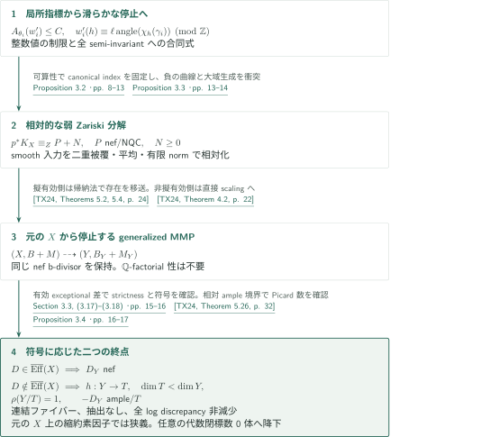
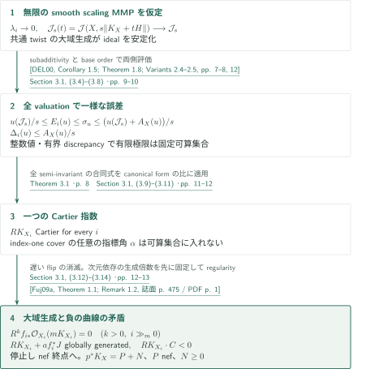
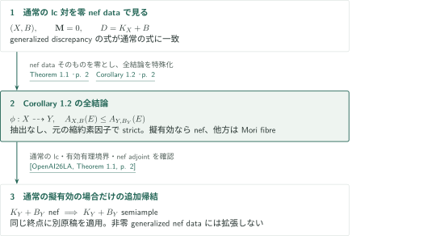

# Minimal models and Mori fibre spaces for generalized log canonical Q-pairs

**固定したnef b-divisor、局所的な指標の合同式、相対的弱Zariski分解**

主張は、generalized lc $\mathbb Q$-pairの随伴因子の符号に応じた極小モデルまたはMori fibre spaceの存在である。証明は、局所valuationの指標を制御して滑らかな場合のMMPを停止させ、相対的な弱Zariski分解を経由して既存のgeneralized MMPへ渡す。以下は著者の論証の概説であり、全79頁の独立検証ではない。

## 1. 主要結果

### Theorem 1.1 — 固定したgeneralized nef dataを保つモデル

$k$を標数0の代数閉体、$(X,B+M)$を射影generalized lc $\mathbb Q$-pairとする。すなわち、$X$は正規整射影多様体、$B$は有効な有理境界、$M$は上方の射影双有理モデル上のnefな有理Cartier因子のtraceで、$D=K_X+B+M$は$\mathbb Q$-Cartierとする。このnef b-divisorを固定する。

正規整射影多様体$Y$と、逆写像が因子を縮約しない双有理写像$\phi:X\dashrightarrow Y$が存在する。$B_Y=\phi_*B$とし、$M_Y$を同じnef b-divisorのtraceとすると、$(Y,B_Y+M_Y)$はgeneralized lcであり、共通関数体上のすべての素因子$E$について

$$A_{X,B+M}(E)\le A_{Y,B_Y+M_Y}(E).$$

$X$上にあり$\phi$で縮約される素因子では不等式は狭義である。さらに、

1. $D$が擬有効なら$K_Y+B_Y+M_Y$はnefである。
2. $D$が擬有効でなければ、正規射影多様体$T$への連結ファイバーをもつ射影縮約$h:Y\to T$が存在し、$\dim T<\dim Y$、$\rho(Y/T)=1$、$-(K_Y+B_Y+M_Y)$は$T$上ampleである。

$X,Y$の$\mathbb Q$-factorial性は仮定しない。ここで$A$はlog discrepancyであり、境界係数$b$の成分に対する値は$1-b$である。nefという結論をsemiampleまたはgood minimal modelと読み替えない。任意に選んだMMPの停止を主張する定理でもない。

<!-- cite:main-result -->[Theorem 1.1 · p. 2](https://github.com/openai/math/blob/1581d4cbdd69a0faf34b2089614fe2a814316a6a/preprints/Minimal-models-and-Mori-fibre-spaces-for-generalized-log-canonical-Q-pairs-September-24-2026/paper.pdf)<!-- /cite -->

### Corollary 1.2 — 通常のlc対

標数0の代数閉体上の射影lc $\mathbb Q$-pair $(X,B)$には、因子を抽出しない双有理写像$\phi:X\dashrightarrow Y$があり、$B_Y=\phi_*B$に対して$(Y,B_Y)$はlc、すべての素因子で$A_{X,B}\le A_{Y,B_Y}$、$X$上の縮約される素因子では狭義不等式となる。$K_X+B$が擬有効なら$K_Y+B_Y$はnefであり、そうでなければ$Y$は相対Picard数1、相対反豊富な随伴因子をもつMori fibre contractionをもつ。

<!-- cite:ordinary-result -->[Corollary 1.2 · p. 2](https://github.com/openai/math/blob/1581d4cbdd69a0faf34b2089614fe2a814316a6a/preprints/Minimal-models-and-Mori-fibre-spaces-for-generalized-log-canonical-Q-pairs-September-24-2026/paper.pdf)<!-- /cite -->

## 図の矢印に付した引用

<!-- reference-guide -->
略号のない定理・補題・節・式番号は本原稿 [Minimal models and Mori fibre spaces for generalized log canonical Q-pairs](https://github.com/openai/math/blob/1581d4cbdd69a0faf34b2089614fe2a814316a6a/preprints/Minimal-models-and-Mori-fibre-spaces-for-generalized-log-canonical-Q-pairs-September-24-2026/paper.pdf) を指します。外部入力には次の略号を使います。

- [TX24](https://d-nb.info/1335765638/34) Nikolaos Tsakanikas; Lingyao Xie — *Remarks on the existence of minimal models of log canonical generalized pairs*：NQCの相対的弱Zariski分解から極小モデルへ移送し、元のXから停止するMMPを選ぶ。相対ample境界付きgood modelはPicard数の確認に使用。Mathematische Zeitschrift 307 (2024), Article 20; published 26 April 2024。
- [DEL00](https://www-fourier.univ-grenoble-alpes.fr/~demailly/manuscripts/subaddmult.pdf) Jean-Pierre Demailly; Lawrence Ein; Robert Lazarsfeld — *A subadditivity property of multiplier ideals*：asymptotic multiplier idealのtwistの大域生成とsubadditivity。Prépublication de l’Institut Fourier no. 494 (2000), author PDF, 19 pages; pagination differs from Michigan Math. J. publication。
- [Fuj09a](https://www.math.kyoto-u.ac.jp/~fujino/effective-final.pdf) Osamu Fujino — *Effective base point free theorem for log canonical pairs—Kollár type theorem*：klt対のnef Cartier因子について次元だけによる大域生成倍数を固定する。Tohoku Mathematical Journal 61 (2009), 475–481, published version。
- [BDPP13](https://arxiv.org/pdf/math/0405285v1) Sébastien Boucksom; Jean-Pierre Demailly; Mihai Păun; Thomas Peternell — *The pseudo-effective cone of a compact Kähler manifold and varieties of negative Kodaira dimension*：滑らかな射影被覆の非uniruled性からcanonical擬有効性を得る。arXiv:math/0405285v1, 14 May 2004; statement numbering checked in this version。
- [BCHM10](https://arxiv.org/pdf/math/0610203v2) Caucher Birkar; Paolo Cascini; Christopher D. Hacon; James McKernan — *Existence of minimal models for varieties of log general type*：klt境界polytopeのample model有限性。外部証明は対象外。arXiv:math/0610203v2, archive label 14 August 2008; downloaded PDF title-page date November 26, 2024 retained。
- [OpenAI26LA](https://github.com/openai/math/blob/1581d4cbdd69a0faf34b2089614fe2a814316a6a/preprints/Log-abundance-in-characteristic-zero-September-24-2026/paper.pdf) OpenAI — *Log abundance in characteristic zero*：通常の対に限る主定理後の半豊富性。逆向きの利用はCorollary 12.1(i)の有限生成証明に限定して区別。September 24, 2026; fixed catalog commit 1581d4cbdd69a0faf34b2089614fe2a814316a6a。
- [KM98](https://doi.org/10.1017/CBO9780511662560) János Kollár; Shigefumi Mori — *Birational geometry of algebraic varieties*：遅いflipの高次直像消滅に用いるrelative Kawamata–Viehweg vanishing。本稿内の適用は読んだが、書籍の該当記述は未照合。Cambridge Tracts in Mathematics 134 (1998); source passage not directly checked。

各引用に結果番号とページを付します。誌面番号とPDF内の位置が異なる場合は両方を示します。GitHubの閲覧リンクではページ位置への自動移動を前提としません。
<!-- /reference-guide -->

## 2. Theorem 1.1 — 主定理の証明概略

<!-- proof-target:1 -->証明対象：[Theorem 1.1 · p. 2](https://github.com/openai/math/blob/1581d4cbdd69a0faf34b2089614fe2a814316a6a/preprints/Minimal-models-and-Mori-fibre-spaces-for-generalized-log-canonical-Q-pairs-September-24-2026/paper.pdf)<!-- /proof-target -->

**証明の道筋。** 主結果の各結論を、局所指標から滑らかなMMPの停止、相対化、generalized pairへの移送、discrepancyと終点の確認、基礎体の降下の順に追う。まず全体を示し、局所指標と停止の接続を次の図で拡大する。

### 1. 局所指標を大域の停止へ渡す

局所入力Theorem 3.1は、固定次元$n\ge2$のGorenstein klt germ $(V_i,o_i)$、$o_i$を固定する巡回群$G_i$、semi-invariantなcanonical generator $\theta_i$と任意の$\gamma_i\in G_i$に対して、部分列上で中心$o_i$のdivisorial valuation $w'_i$、$C>0$、正整数$\ell$を与える。$C,\ell$は部分列上で一定で、$A_{\theta_i}(w'_i)\le C$、かつ**すべての**非零な有理semi-invariant $h$に対し

$$w'_i(h)\equiv\ell\,\mathrm{angle}(\chi_h(\gamma_i))\pmod{\mathbb Z}.$$

特に不変関数体への制限は整数値である。valuationはprimitiveである必要はない。この入力の構成では、coneの独立な次数$d_1,\dots,d_n$に対する$\operatorname{vol}(v)d_1\cdots d_n\le C$から有限windowの長さを制御する。valuationの最適化と正標数のlogarithmic Cartier選択によりtupleを完成させ、各指標を丸める。原稿はgermと有限個の検査データを固定してから標数を大きく取り、最終の共通整数を選ぶ前に有限回の数値予算を決定している。

<!-- cite:phase -->[Theorem 3.1 · p. 8](https://github.com/openai/math/blob/1581d4cbdd69a0faf34b2089614fe2a814316a6a/preprints/Minimal-models-and-Mori-fibre-spaces-for-generalized-log-canonical-Q-pairs-September-24-2026/paper.pdf)<!-- /cite -->
<!-- cite:local-chain -->[Proposition 5.1; Lemma 6.1; Section 8 · pp. 22, 29–30, 39–44](https://github.com/openai/math/blob/1581d4cbdd69a0faf34b2089614fe2a814316a6a/preprints/Minimal-models-and-Mori-fibre-spaces-for-generalized-log-canonical-Q-pairs-September-24-2026/paper.pdf)<!-- /cite -->

完成tupleに対する合同式だけでは不十分である。§8.3では、任意の正則固有関数$h$に対して$h^jf^\alpha$を有限windowへ入れる。関数の個数がwindowの長さを超えるので、同一指標かつ同一の最低valuation値をもつ項が相殺する。Gauss性から異なる$h$の冪$j\ne j'$が必要となり、$1\le|j-j'|\le D_{\rm fin}$で合同式の誤差を消せる。$\ell=\operatorname{lcm}(1,\dots,D_{\rm fin})$を一度選べば全$h$に通用する。有理関数は分母の群軌道の積で不変な正則分母を作って処理する。これが後でcanonical formの比に使える強さである。

<!-- cite:all-characters -->[Section 8.3, (8.16)–(8.20) · pp. 44–45](https://github.com/openai/math/blob/1581d4cbdd69a0faf34b2089614fe2a814316a6a/preprints/Minimal-models-and-Mori-fibre-spaces-for-generalized-log-canonical-Q-pairs-September-24-2026/paper.pdf)<!-- /cite -->

### 2. 相対化してgeneralized MMPへ渡す

Proposition 3.3は、滑らかな複素準射影$X$が正規準射影$Z$上射影で$K_X$が相対擬有効なら、$p^*K_X\equiv_Z P+N$という有理Cartier部分をもつNQC弱Zariski分解を作る。ここで得るのは**相対数値同値**である。

そのために射をコンパクト化し、底の十分正の二重被覆を用いて、滑らかな射影被覆$X^\sharp$の$K_{X^\sharp}$を擬有効にする。一般ファイバーの非uniruled性と、general typeにした底の非uniruled性を経由する箇所でBDPPを使う。Proposition 3.2で得た分解を被覆のinvolutionで平均し、finite normによって$\mathbb Q$-Cartier性を保って商へ降ろす。底からのtwistは$Z$上数値的に0なので消える。

<!-- cite:relative -->[Proposition 3.3 · pp. 13–14](https://github.com/openai/math/blob/1581d4cbdd69a0faf34b2089614fe2a814316a6a/preprints/Minimal-models-and-Mori-fibre-spaces-for-generalized-log-canonical-Q-pairs-September-24-2026/paper.pdf)<!-- /cite -->
<!-- cite:bdpp -->[&#91;BDPP13, Theorem 0.2; Corollary 0.3, p. 2&#93;](https://arxiv.org/pdf/math/0405285v1#page=2)<!-- /cite -->

相対smooth WZDと低次元からの帰納法にTX24 Theorem 5.2を適用してsmooth minimal modelsを得る。次にTheorem 5.4でNQC generalized lc pairsへ渡し、Theorem 2.7でBirkar–Shokurovの意味の存在へ翻訳する。本稿の有理nef Cartier b-dataはNQCなので仮定を満たす。擬有効でない場合には、この存在入力は不要である。どちらの場合も小さい一般係数をもつ十分正のample因子$A$を選び、$(X,B+A+M)$のgeneralized lc性と$D+A$のnef性を確保してTheorem 4.2へ入れると、元の$X$からの停止するMMPを得る。

<!-- cite:transfer -->[Section 3.3 · p. 14](https://github.com/openai/math/blob/1581d4cbdd69a0faf34b2089614fe2a814316a6a/preprints/Minimal-models-and-Mori-fibre-spaces-for-generalized-log-canonical-Q-pairs-September-24-2026/paper.pdf)<!-- /cite -->
<!-- cite:tx-wzd -->[&#91;TX24, Theorems 5.2, 5.4, p. 24&#93;](https://d-nb.info/1335765638/34)<!-- /cite -->
<!-- cite:tx-models -->[&#91;TX24, Theorem 2.7, p. 9&#93;](https://d-nb.info/1335765638/34)<!-- /cite -->
<!-- cite:tx-program -->[&#91;TX24, Theorem 4.2, p. 22&#93;](https://d-nb.info/1335765638/34)<!-- /cite -->

### 3. 抽出なし・discrepancy・Mori fibreの全条件

各双有理段階の共通解消で$F=p^*D-q^*D^+$と置く。$F$は$q$-exceptionalかつ$q$上anti-nefなのでnegativityにより$F\ge0$。その段階で縮約される素因子の係数が0なら、その一般点を通る縮約曲線で有効性による非負交点と$D$の負交点が衝突する。同じnef b-divisorを引き戻しているのでnef部分は比較式で相殺され、$F$の係数はlog discrepancyの増分そのものとなる。合成で全素因子に非減少、元の縮約素因子に狭義増加を得る。各positive modelのsmallnessは逆写像による抽出を排除し、generalized lc性も保たれる。

fibre型終点では、連結性・次元低下・相対反豊富性はextremal contractionから得る。非$\mathbb Q$-factorialの場合の$\rho(Y/T)=1$は別途確認する。縮約ray上で次数0のCartier因子$L$に対し、小さい一般係数の$A\sim_{\mathbb Q} L+h^*H-D_Y$を加える。新adjointはnefなのでTX24 Theorem 5.26のMMPには負のstepがなく、元の$Y$上で相対semiampleである。数値的に自明なsemiample因子の射は各連結ファイバーを点に送るため、$L$は数値的に底から来る。縮約rayのannihilatorがちょうど$h^*N^1(T)_{\mathbb R}$となり、codimension 1を得る。この補助的なsemiamplenessは、元の$D_Y$のsemiamplenessを意味しない。

<!-- cite:exact-output -->[Section 3.3, (3.17)–(3.18) · pp. 15–16](https://github.com/openai/math/blob/1581d4cbdd69a0faf34b2089614fe2a814316a6a/preprints/Minimal-models-and-Mori-fibre-spaces-for-generalized-log-canonical-Q-pairs-September-24-2026/paper.pdf)<!-- /cite -->
<!-- cite:tx-good -->[&#91;TX24, Theorem 5.26, p. 32&#93;](https://d-nb.info/1335765638/34)<!-- /cite -->

有効exceptional pullback差は擬有効性を双方向に保存する。nef終点なら元の$D$は擬有効であり、擬有効の$D$からは一般正次元ファイバー上anti-ampleな終点へ行けない。これでTheorem 1.1の二つの場合分けが一致する。

### 4. 基礎体を降下する

Proposition 3.4では、対・nef data・それを担うlog resolutionを可算代数閉部分体$F\subset k$へ降ろし、$F\hookrightarrow\mathbb C$の上で有限のMMPを取る。縮約を定めるline bundleと生成切断をspreadして$F$-点に特殊化し、縮約曲線が同じことからStein targetを同定する。positive modelは適切な$b$に対する$\operatorname{Proj}_T\bigoplus_{m\ge0}f_*\mathcal O_S(mbD)$から復元する。divisorial sheaf、有限生成、relative Projが降下することを確認し、$k$へ拡大する。nef性、相対Picard数、相対ample性と有効なpullback差が保持され、全主張を得る。

<!-- cite:descent -->[Proposition 3.4 · pp. 16–17](https://github.com/openai/math/blob/1581d4cbdd69a0faf34b2089614fe2a814316a6a/preprints/Minimal-models-and-Mori-fibre-spaces-for-generalized-log-canonical-Q-pairs-September-24-2026/paper.pdf)<!-- /cite -->

## 3. Proposition 3.2 — 滑らかなscaling MMPの停止

<!-- proof-target:2 -->証明対象：[Proposition 3.2 · pp. 8–13](https://github.com/openai/math/blob/1581d4cbdd69a0faf34b2089614fe2a814316a6a/preprints/Minimal-models-and-Mori-fibre-spaces-for-generalized-log-canonical-Q-pairs-September-24-2026/paper.pdf)<!-- /proof-target -->

<!-- statement:proposition-3-2 -->
### Proposition 3.2 — 局所phase定理を仮定した停止

Theorem 3.1を仮定する。滑らかな射影複素多様体$X$で$K_X$が擬有効とし、$(X,H)$がklt、$K_X+H$がampleとなる有効ample有理因子$H$を取る。Proposition 3.2はこのscaling MMPの停止と、滑らかな双有理モデル$p:U\to X$上の$ p^*K_X=P+N$（$P$はnef有理Cartier、$N\ge0$は有理Cartier）を主張する。

<!-- cite:smooth -->[Proposition 3.2 · pp. 8–13](https://github.com/openai/math/blob/1581d4cbdd69a0faf34b2089614fe2a814316a6a/preprints/Minimal-models-and-Mori-fibre-spaces-for-generalized-log-canonical-Q-pairs-September-24-2026/paper.pdf)<!-- /cite -->
<!-- /statement -->

### 1. 一様なideal評価

次元0,1では結論は直接従うので、次元2以上で無限のMMPを仮定する。divisorial contractionは有限回なので、最後はflipの列となる。正のscaling値が0へ近づかなければ、固定したklt境界の有理polytopeに対するample modelの有限性に反する。ここでBCHMの仮定である共通ample部分とklt性を、小さな有理摂動を一つのlog resolution上で選んで確保する。

<!-- cite:bchm -->[&#91;BCHM10, Corollary 1.1.5, p. 7&#93;](https://arxiv.org/pdf/math/0610203v2#page=7)<!-- /cite -->

$A_i(u)=A_{X_i}(u)$、$E_i(u)=A_i(u)-A_X(u)$、$\Delta_i(u)=A_{i+1}(u)-A_i(u)$と置く。$L_t=K_X+tH$のasymptotic multiplier ideal $\mathcal J_s(t)$を十分正にtwistすると、$t\downarrow0$で一様に大域生成となる。固定有限次元空間の部分空間が安定するのでidealも安定し、$\mathcal J_s$を得る。これはidealの降鎖条件による議論ではない。subadditivityとvaluation評価から、$i$が$s$に対して十分大きいとき、**すべての**divisorial $u$について

$$\frac{u(\mathcal J_s)}s\le E_i(u)\le\sigma_u\le\frac{u(\mathcal J_s)+A_X(u)}s,
\qquad0\le\Delta_i(u)\le\frac{A_X(u)}s.$$

<!-- cite:ideals -->[Section 3.1, (3.4)–(3.8) · pp. 9–10](https://github.com/openai/math/blob/1581d4cbdd69a0faf34b2089614fe2a814316a6a/preprints/Minimal-models-and-Mori-fibre-spaces-for-generalized-log-canonical-Q-pairs-September-24-2026/paper.pdf)<!-- /cite -->
<!-- cite:del -->[&#91;DEL00, Corollary 1.5; Theorem 1.8; Variants 2.4–2.5, pp. 7–8, 12&#93;](https://www-fourier.univ-grenoble-alpes.fr/~demailly/manuscripts/subaddmult.pdf#page=7)<!-- /cite -->

### 2. 可算性とcanonical index

整数値で$A_X(u)$が有界なvaluation列について、$E_i(u)$の有限極限は固定の可算集合に入る。原稿は$X$と可算個のidealが定義される可算代数閉体へ降ろし、対角部分列の極限valuationを取る。中心の余次元が2以上であるたびにblow-upするとJacobian値が少なくとも1増え、有界discrepancyと矛盾するため、極限は自明またはdivisorialとなる。

canonical indexが非有界なら、各点の巡回index-one cover上でcanonical generatorの指標を任意の$\alpha\in\mathbb R/\mathbb Z$へ近づけられる。Theorem 3.1の$w'_i$を下へ制限すると整数値かつ有界discrepancyであり、canonical formの比に対する合同式から$E_i(u_i)$の極限の剰余は$\ell\alpha$となる。しかし可算集合の正整数倍写像による逆像の可算和は可算であり、任意の$\alpha$を収容できない。従って一つの$R>0$で全$RK_{X_i}$がCartierとなる。

<!-- cite:index -->[Section 3.1, (3.9)–(3.11) · pp. 11–12](https://github.com/openai/math/blob/1581d4cbdd69a0faf34b2089614fe2a814316a6a/preprints/Minimal-models-and-Mori-fibre-spaces-for-generalized-log-canonical-Q-pairs-September-24-2026/paper.pdf)<!-- /cite -->

### 3. Cartier指数を固定して負の曲線と矛盾させる

遅いflip $f_i:X_i\to Z_i$に対し、上の$\Delta_i$評価とrelative Kawamata–Viehweg vanishingを組み合わせると、各固定$m>0$について$R^kf_{i*}\mathcal O_{X_i}(mK_{X_i})=0$（$k>0$）となる。共通解消上で丸める係数は$A_i-1-(m-1)\Delta_i>-1$となり、必要なpushforwardを$\mathcal O(mK_{X_i})$と同定できる。消滅の成立時点を$m$によらず一度に選ぶとは主張しない。

$J$を$Z_i$上で十分ampleに取り$D_i=-RK_{X_i}+f_i^*J$と$D_i-K_{X_i}$をampleにする。Fujinoのeffective base point free theoremを$a=1$で適用すると、次元だけによる$N$で$ND_i$が大域生成になる。この$N$を先に固定し、有限個の$m=R+jNR$（$1\le j\le n$）すべてで上の消滅が使える段階を選ぶ。regularityから$RK_{X_i}+a f_i^*J$が大域生成となる一方、$f_i$で縮約される曲線との交点は負である。矛盾により停止し、擬有効性がfibre型の終点を排除する。

<!-- cite:vanishing -->[Section 3.1, (3.12)–(3.14) · pp. 12–13](https://github.com/openai/math/blob/1581d4cbdd69a0faf34b2089614fe2a814316a6a/preprints/Minimal-models-and-Mori-fibre-spaces-for-generalized-log-canonical-Q-pairs-September-24-2026/paper.pdf)<!-- /cite -->
<!-- cite:fujino -->[&#91;Fuj09a, Theorem 1.1; Remark 1.2, 誌面 p. 475 / PDF p. 1&#93;](https://www.math.kyoto-u.ac.jp/~fujino/effective-final.pdf#page=1)<!-- /cite -->
## 4. Corollary 1.2 — 零のnef dataへの特殊化

<!-- proof-target:3 -->証明対象：[Corollary 1.2 · p. 2](https://github.com/openai/math/blob/1581d4cbdd69a0faf34b2089614fe2a814316a6a/preprints/Minimal-models-and-Mori-fibre-spaces-for-generalized-log-canonical-Q-pairs-September-24-2026/paper.pdf)<!-- /proof-target -->

### 1. 通常のdiscrepancyと終点へ戻す

通常のlc対に固定された零のnef b-divisorを付けると、generalized discrepancyのcrepant式は通常のものになる。従ってTheorem 1.1の抽出なし、非減少と狭義性、擬有効ならnef、非擬有効ならMori fibreという全結論がそのまま残る。ここでは数値同値な別因子を選んだのではなく、nef dataそのものを0にしている。

<!-- cite:ordinary-result -->[Corollary 1.2 · p. 2](https://github.com/openai/math/blob/1581d4cbdd69a0faf34b2089614fe2a814316a6a/preprints/Minimal-models-and-Mori-fibre-spaces-for-generalized-log-canonical-Q-pairs-September-24-2026/paper.pdf)<!-- /cite -->

### 2. Log abundanceとの接続を分ける

通常の擬有効の場合に限り、得られた$(Y,B_Y)$へ別原稿Log abundanceのTheorem 1.1を適用すると、同じ終点の$K_Y+B_Y$はsemiampleとなる。これは本稿主定理後の追加帰結である。非零のgeneralized nef dataに対するsemiamplenessは導かない。

逆向きには、Log abundanceのCorollary 12.1(i)の証明が本稿Corollary 1.2を使い、共通解消の有効exceptional差から全rounded degreeの切断を同定し、lc log canonical ringの有限生成へ進む。この接続はLog abundanceの主定理そのものの入力とは区別する。

<!-- cite:la-main -->[&#91;OpenAI26LA, Theorem 1.1, p. 2&#93;](https://github.com/openai/math/blob/1581d4cbdd69a0faf34b2089614fe2a814316a6a/preprints/Log-abundance-in-characteristic-zero-September-24-2026/paper.pdf)<!-- /cite -->
<!-- cite:la-ring -->[&#91;OpenAI26LA, Corollary 12.1(i), proof and (67), p. 76&#93;](https://github.com/openai/math/blob/1581d4cbdd69a0faf34b2089614fe2a814316a6a/preprints/Log-abundance-in-characteristic-zero-September-24-2026/paper.pdf)<!-- /cite -->

## 5. 直接入力と使用箇所

| 入力 | 使用箇所 | 内容と仮定 | 確認範囲 |
|---|---|---|---|
| <!-- cite:bchm -->[&#91;BCHM10, Corollary 1.1.5, p. 7&#93;](https://arxiv.org/pdf/math/0610203v2#page=7)<!-- /cite --> | [停止の入口](#proof-1-step-1) | 共通ample部分をもつklt境界polytopeのample model有限性からscaling値を0へ送る | 記述と本稿p.9の摂動を照合。外部証明は対象外 |
| <!-- cite:del -->[&#91;DEL00, Corollary 1.5; Theorem 1.8; Variants 2.4–2.5, pp. 7–8, 12&#93;](https://www-fourier.univ-grenoble-alpes.fr/~demailly/manuscripts/subaddmult.pdf#page=7)<!-- /cite --> | [一様評価](#proof-1-step-1) | smooth、bigな$K_X+tH$でtwistの一様大域生成とsubadditivity | 著者稿pp.7–8,12と本稿pp.9–10を照合 |
| <!-- cite:fujino -->[&#91;Fuj09a, Theorem 1.1; Remark 1.2, 誌面 p. 475 / PDF p. 1&#93;](https://www.math.kyoto-u.ac.jp/~fujino/effective-final.pdf#page=1)<!-- /cite --> | [停止の矛盾](#proof-1-step-3) | klt、nef Cartier $D_i$、$D_i-K_{X_i}$ ampleに対する次元依存の大域生成倍数 | 誌面p.475/PDF p.1と本稿p.12を照合 |
| <!-- cite:bdpp -->[&#91;BDPP13, Theorem 0.2; Corollary 0.3, p. 2&#93;](https://arxiv.org/pdf/math/0405285v1#page=2)<!-- /cite --> | [相対化](#proof-overview-step-2) | smooth projectiveで非uniruled性とcanonical擬有効性を比較 | arXiv v1 p.2と本稿pp.13–14を照合 |
| <!-- cite:tx-transfer-all -->[&#91;TX24, Theorem 2.7, p. 9; Theorem 4.2, p. 22; Theorems 5.2, 5.4, p. 24&#93;](https://d-nb.info/1335765638/34)<!-- /cite --> | [generalized pairへの移送](#proof-overview-step-2) | 相対smooth入力、NQC、generalized lc、適切なscaling ample因子 | publisher版pp.9,22,24と本稿p.14を照合 |
| <!-- cite:tx-good -->[&#91;TX24, Theorem 5.26, p. 32&#93;](https://d-nb.info/1335765638/34)<!-- /cite --> | [相対Picard数](#proof-overview-step-3) | 有効な相対ample境界を加えたnef adjointの相対semiampleness | publisher版p.32と本稿p.15を照合 |
| <!-- cite:la-main -->[&#91;OpenAI26LA, Theorem 1.1, p. 2&#93;](https://github.com/openai/math/blob/1581d4cbdd69a0faf34b2089614fe2a814316a6a/preprints/Log-abundance-in-characteristic-zero-September-24-2026/paper.pdf)<!-- /cite --> | [通常の対の追加帰結](#proof-2-step-2) | 通常のlc、有効有理境界、nefな$\mathbb Q$-Cartier adjoint | 主張p.2と本稿p.2を照合。証明は対象外 |

## 6. 原典を読む入口と確認範囲

<!-- reading-list -->
- [Theorem 1.1 · p. 2](https://github.com/openai/math/blob/1581d4cbdd69a0faf34b2089614fe2a814316a6a/preprints/Minimal-models-and-Mori-fibre-spaces-for-generalized-log-canonical-Q-pairs-September-24-2026/paper.pdf) — 仮定、全discrepancyと二つの終点。
- [Theorem 3.1 · p. 8](https://github.com/openai/math/blob/1581d4cbdd69a0faf34b2089614fe2a814316a6a/preprints/Minimal-models-and-Mori-fibre-spaces-for-generalized-log-canonical-Q-pairs-September-24-2026/paper.pdf) — 局所指標の全semi-invariantに対する合同式。
- [Proposition 3.2 · pp. 8–13](https://github.com/openai/math/blob/1581d4cbdd69a0faf34b2089614fe2a814316a6a/preprints/Minimal-models-and-Mori-fibre-spaces-for-generalized-log-canonical-Q-pairs-September-24-2026/paper.pdf) — ideal安定化、可算性、指数有界性と停止の矛盾。
- [Proposition 3.3 · pp. 13–14](https://github.com/openai/math/blob/1581d4cbdd69a0faf34b2089614fe2a814316a6a/preprints/Minimal-models-and-Mori-fibre-spaces-for-generalized-log-canonical-Q-pairs-September-24-2026/paper.pdf) — 二重被覆・平均・normによる相対数値分解。
- [Section 3.3, (3.17)–(3.18) · pp. 15–16](https://github.com/openai/math/blob/1581d4cbdd69a0faf34b2089614fe2a814316a6a/preprints/Minimal-models-and-Mori-fibre-spaces-for-generalized-log-canonical-Q-pairs-September-24-2026/paper.pdf) — 固定nef dataの差分、strictnessと非factorialな相対Picard数。
- [Proposition 3.4 · pp. 16–17](https://github.com/openai/math/blob/1581d4cbdd69a0faf34b2089614fe2a814316a6a/preprints/Minimal-models-and-Mori-fibre-spaces-for-generalized-log-canonical-Q-pairs-September-24-2026/paper.pdf) — 有限MMPとrelative Projの基礎体降下。
- [Section 8.3, (8.16)–(8.20) · pp. 44–45](https://github.com/openai/math/blob/1581d4cbdd69a0faf34b2089614fe2a814316a6a/preprints/Minimal-models-and-Mori-fibre-spaces-for-generalized-log-canonical-Q-pairs-September-24-2026/paper.pdf) — tupleの合同式を全有理固有関数へ拡張する箇所。
- [Theorems 9.1, 10.1; Section 13.4 · pp. 45, 50, 77](https://github.com/openai/math/blob/1581d4cbdd69a0faf34b2089614fe2a814316a6a/preprints/Minimal-models-and-Mori-fibre-spaces-for-generalized-log-canonical-Q-pairs-September-24-2026/paper.pdf) — 未検証の深い一様評価を追うための入口。
<!-- /reading-list -->

本稿のTheorem 1.1、Corollary 1.2と§3（pp.8–17）の主張・帰着・discrepancyとMori fibre終点・基礎体降下を読み、上表の直接入力の記述を原典と照合した。局所入力についてはTheorem 3.1、次数積とwindowの記述、§8.3の全semi-invariantへの延長を読んだ。§§4–8の全選択・連続化、および§§9–13のuniform lifting、mixing、trait比較、lc-incidenceの全証明は未検証である。特にTheorem 10.1→Theorem 9.1→Proposition 5.2→Proposition 5.1という後半の連鎖は、結果の役割と呼出しの確認までであり、その全接続を検証済みとは扱わない。

relative Kawamata–Viehweg vanishingの本稿内の適用条件は確認したが、Kollár–Moriの該当原典箇所は今回直接照合していない。局所部のnormalized volume、bounded complement、b-semiampleness等の外部入力も未照合として残す。外部定理の証明の再帰的検証、全原稿の正しさの認定、専門家査読・形式検証は行っていない。記事と図はAI生成の解説であり、重要な主張は原典で確認する。
