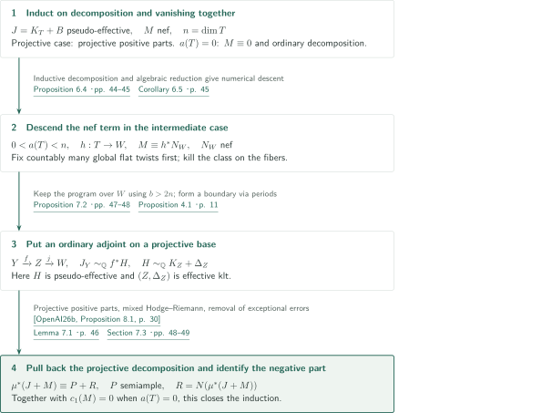
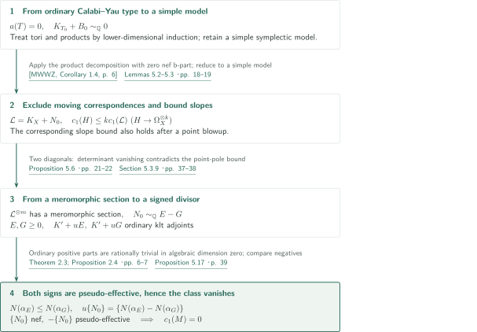
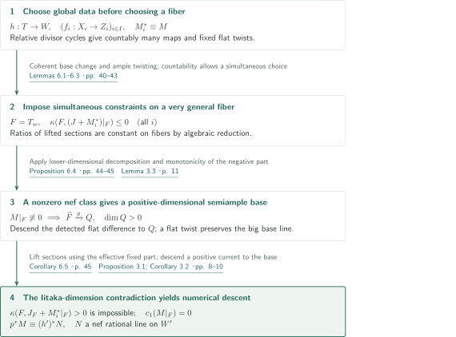
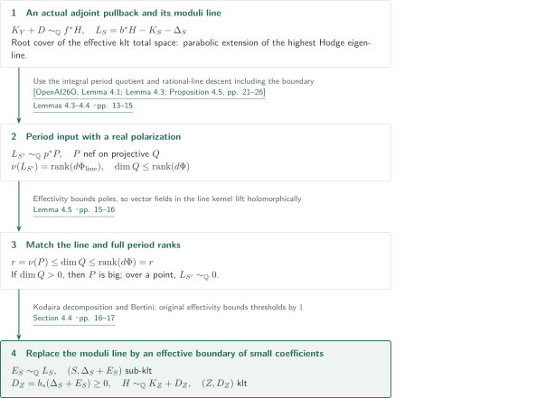
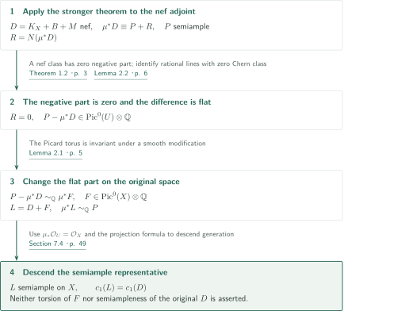

# Numerical semiampleness of nef adjoint classes on compact Kähler manifolds

**Kill the nef class on algebraic-reduction fibers, then pass to an ordinary adjoint on a projective base**

The manuscript studies an ordinary klt adjoint $K_X+B$ plus a nef rational line bundle $M$ on the original space. It constructs a numerical positive-part decomposition by induction on dimension and removes the negative part when the sum is nef. The output is a semiample representative of the same real Bott–Chern class; the flat part of the original line may change.

## 1. Main results

### Theorem 1.1 — A semiample representative on the original space

Let $X$ be a smooth connected compact Kähler manifold, $B\geq0$ a rational SNC divisor with every coefficient strictly less than $1$, and $M\in\operatorname{Pic}(X)\otimes_{\mathbb Z}\mathbb Q$. Suppose $K_X+B$ is pseudo-effective and both $M$ and $D=K_X+B+M$ are nef. There exists a semiample rational line bundle $L$ on $X$ such that

$$c_1(L)=c_1(D)\quad\text{in }H^{1,1}_{\mathrm{BC}}(X,\mathbb R).$$

Here $M$ is a line bundle on $X$ itself, rather than arbitrary nef b-divisor data living only on a higher model.

<!-- cite:main -->[Theorem 1.1 · p. 2](https://github.com/openai/math/blob/1581d4cbdd69a0faf34b2089614fe2a814316a6a/preprints/Numerical-semiampleness-of-nef-adjoint-classes-on-compact-Kahler-manifolds-October-6-2026/numerical-generalized-abundance.pdf)<!-- /cite -->

### Theorem 1.2 — A stronger decomposition including the negative part

Let $T$ be a smooth connected compact Kähler manifold, $B\geq0$ a rational SNC divisor with every coefficient strictly less than $1$, and $M$ a nef rational line bundle. If $J=K_T+B$ is pseudo-effective, there are a smooth compact Kähler modification $\mu:U\to T$, a semiample rational line bundle $P$, and an effective rational divisor $R$ such that

$$\mu^*(J+M)\equiv P+R,\qquad R=N\bigl(c_1(\mu^*(J+M))\bigr).$$

Moreover, $a(T)=0$ implies $c_1(M)=0$. Here $a(T)$ is the algebraic dimension and $N$ is the analytic divisorial negative part. The sum $J+M$ need not be nef. Throughout, $\equiv$ means equality of real Bott–Chern classes, whereas $\sim_{\mathbb Q}$ means equality in $\operatorname{Pic}\otimes\mathbb Q$.

<!-- cite:strong -->[Theorem 1.2 · p. 3](https://github.com/openai/math/blob/1581d4cbdd69a0faf34b2089614fe2a814316a6a/preprints/Numerical-semiampleness-of-nef-adjoint-classes-on-compact-Kahler-manifolds-October-6-2026/numerical-generalized-abundance.pdf)<!-- /cite -->

## References on the arrows

<!-- reference-guide -->
Unprefixed theorem, lemma, section and equation numbers refer to [Numerical semiampleness of nef adjoint classes on compact Kähler manifolds](https://github.com/openai/math/blob/1581d4cbdd69a0faf34b2089614fe2a814316a6a/preprints/Numerical-semiampleness-of-nef-adjoint-classes-on-compact-Kahler-manifolds-October-6-2026/numerical-generalized-abundance.pdf). External inputs use the following keys.

- [OpenAI26b](https://github.com/openai/math/blob/1581d4cbdd69a0faf34b2089614fe2a814316a6a/preprints/Numerical-Semiampleness-of-Nef-Adjoint-Divisors-October-3-2026/paper.pdf) OpenAI — *Numerical Semiampleness of Nef Adjoint Divisors*: Projective numerical semiampleness of positive parts and a generalized klt MMP with fixed nef data. October 3, 2026 version.
- [OpenAI26K](https://github.com/openai/math/blob/1581d4cbdd69a0faf34b2089614fe2a814316a6a/preprints/Log-abundance-for-compact-Kahler-spaces-under-logarithmic-Iitaka-subadditivity-October-6-2026/main.pdf) OpenAI — *Log abundance for compact Kähler spaces under logarithmic Iitaka subadditivity*: Actual rational-line decomposition of ordinary adjoints and contraction of a known negative part. October 6, 2026.
- [OpenAI26O](https://github.com/openai/math/blob/1581d4cbdd69a0faf34b2089614fe2a814316a6a/preprints/Orbifold-and-logarithmic-Iitaka-subadditivity-September-26-2026/paper.pdf) OpenAI — *Orbifold and logarithmic Iitaka subadditivity*: The logarithmic Iitaka hypothesis, highest-line positivity and actual line descent to a period quotient. September 26, 2026.
- [MWWZ](https://arxiv.org/pdf/2506.23218v2) Shin-ichi Matsumura; Juanyong Wang; Xiaojun Wu; Qimin Zhang — *Beauville–Bogomolov–Yau decomposition for Kähler generalized pairs*: Finite quasi-étale product decomposition for a klt pair of Calabi–Yau type with zero nef b-part. arXiv:2506.23218v2 (September 9, 2026); title-page date September 10, 2026.
- [HX](https://arxiv.org/pdf/2607.24986v1) Christopher Hacon; Lingyao Xie — *On the Kähler MMP and the transcendental base-point-free theorem*: Length bound for a negative ray of an ordinary klt pair. arXiv:2607.24986v1 (July 27, 2026); title-page date July 29, 2026.

Each citation gives the result and pages. When printed pagination differs from the PDF position, both are shown. GitHub previews do not automatically jump to the cited page.
<!-- /reference-guide -->

## 2. Proof of Theorem 1.2 — Simultaneous induction through three geometric cases

<!-- proof-target:1 -->Proof target：[Theorem 1.2 · p. 3](https://github.com/openai/math/blob/1581d4cbdd69a0faf34b2089614fe2a814316a6a/preprints/Numerical-semiampleness-of-nef-adjoint-classes-on-compact-Kahler-manifolds-October-6-2026/numerical-generalized-abundance.pdf)<!-- /proof-target --> See the [hypotheses and both conclusions](#theorem-1-2).

**Proof route.** The decomposition and the vanishing assertion for $a(T)=0$ are proved simultaneously. The projective case uses an external positive-part theorem. Algebraic dimension zero reduces to a [simple symplectic model](#proof-2). In the intermediate case, [fiberwise vanishing](#proof-3) descends $M$ to the algebraic base, and an [ordinary klt adjoint construction](#proof-4) permits a return to the projective input. Specializing to nef $D$ then gives [Theorem 1.1](#proof-5).

### 1. The projective and algebraic-dimension-zero cases

If $a(T)=\dim T$, the Kähler–Moishezon theorem makes $T$ projective. The projective input supplies a rational numerically semiample positive part from pseudo-effectivity of $K_T+B$ and nefness of $M$ on $T$. Separately, a generalized klt MMP with fixed nef data produces, on a common resolution,

$$u^*(K_T+B+M)\sim_{\mathbb Q}v^*H_m+E.$$

Here $H_m$ is nef and $E\geq0$ is $v$-exceptional. Negative-part calculus gives $E=N(u^*(K_T+B+M))$. The trace of $M$ on the generalized model is not assumed nef.

<!-- cite:projective -->[Proposition 2.5 · pp. 7–8](https://github.com/openai/math/blob/1581d4cbdd69a0faf34b2089614fe2a814316a6a/preprints/Numerical-semiampleness-of-nef-adjoint-classes-on-compact-Kahler-manifolds-October-6-2026/numerical-generalized-abundance.pdf)<!-- /cite -->

<!-- cite:external-positive -->[&#91;OpenAI26b, Proposition 8.1, p. 30&#93;](https://github.com/openai/math/blob/1581d4cbdd69a0faf34b2089614fe2a814316a6a/preprints/Numerical-Semiampleness-of-Nef-Adjoint-Divisors-October-3-2026/paper.pdf)<!-- /cite -->

<!-- cite:external-mmp -->[&#91;OpenAI26b, Theorem 2.3, p. 4&#93;](https://github.com/openai/math/blob/1581d4cbdd69a0faf34b2089614fe2a814316a6a/preprints/Numerical-Semiampleness-of-Nef-Adjoint-Divisors-October-3-2026/paper.pdf)<!-- /cite -->

If $a(T)=0$, Proposition 5.1 gives $M\equiv0$. The ordinary adjoint decomposition is an actual rational-line identity $\mu^*J\sim_{\mathbb Q}P+R$, and its semiample part $P$ is rationally trivial in this case. Adding $M$ therefore leaves the negative part unchanged. The logarithmic Iitaka hypothesis required by ordinary decomposition is supplied by subadditivity with reduced SNC boundaries and $\operatorname{Supp}(f^*D_Y)\subseteq\operatorname{Supp}(D_X)$.

<!-- cite:ordinary -->[Theorem 2.3; Proposition 2.4 · pp. 6–7](https://github.com/openai/math/blob/1581d4cbdd69a0faf34b2089614fe2a814316a6a/preprints/Numerical-semiampleness-of-nef-adjoint-classes-on-compact-Kahler-manifolds-October-6-2026/numerical-generalized-abundance.pdf)<!-- /cite -->

<!-- cite:external-ordinary -->[&#91;OpenAI26K, Definition 2.1; Theorem 2.13, pp. 6, 13&#93;](https://github.com/openai/math/blob/1581d4cbdd69a0faf34b2089614fe2a814316a6a/preprints/Log-abundance-for-compact-Kahler-spaces-under-logarithmic-Iitaka-subadditivity-October-6-2026/main.pdf)<!-- /cite -->

<!-- cite:external-iitaka -->[&#91;OpenAI26O, Corollary 6.2, pp. 40–41&#93;](https://github.com/openai/math/blob/1581d4cbdd69a0faf34b2089614fe2a814316a6a/preprints/Orbifold-and-logarithmic-Iitaka-subadditivity-September-26-2026/paper.pdf)<!-- /cite -->

### 2. Keep the ordinary program over the projective algebraic base

For $0<a(T)<n$, resolve the algebraic reduction as $h:T\to W$. Proposition 6.4 and Corollary 6.5 give $M\equiv h^*N_W$ with $N_W$ nef, after further modifications. Choose an ample Cartier divisor $A_W$ and an integer $b>2n$, and decompose $J+bh^*A_W$ as an ordinary klt adjoint. The ordinary program contracting its known negative part preserves the actual semiample positive line.

Preservation of the map to $W$ needs a separate argument. A $(J_i+bC_i)$-negative ray is $J_i$-negative and is generated by a rational curve with $0<-J_i\cdot\Gamma\leq2n$. Since $C_i=h_i^*A_W$ is Cartier, $C_i\cdot\Gamma>0$ would imply

$$(J_i+bC_i)\cdot\Gamma\geq-2n+b>0,$$

a contradiction. Thus $C_i\cdot\Gamma=0$, and connected-fiber descent preserves the actual morphism $h_i$. At the endpoint $(Y,\Delta)$, the line $J_Y+bh_Y^*A_W$ is semiample.

<!-- cite:program -->[Proposition 7.2 · pp. 47–48](https://github.com/openai/math/blob/1581d4cbdd69a0faf34b2089614fe2a814316a6a/preprints/Numerical-semiampleness-of-nef-adjoint-classes-on-compact-Kahler-manifolds-October-6-2026/numerical-generalized-abundance.pdf)<!-- /cite -->

<!-- cite:external-contract -->[&#91;OpenAI26K, Proposition 3.8, pp. 23–24&#93;](https://github.com/openai/math/blob/1581d4cbdd69a0faf34b2089614fe2a814316a6a/preprints/Log-abundance-for-compact-Kahler-spaces-under-logarithmic-Iitaka-subadditivity-October-6-2026/main.pdf)<!-- /cite -->

<!-- cite:external-cone -->[&#91;HX, Theorem 1.3, p. 2&#93;](https://arxiv.org/pdf/2607.24986v1#page=2)<!-- /cite -->

### 3. Solve on the projective base and pull back the entire negative part

Combine the semiample map with $h_Y$ and take the Stein factorization $f:Y\to Z$, $j:Z\to W$. The space $Z$ is normal projective, and $a(T)=\dim W\leq\dim Z\leq a(Y)=a(T)$ gives positive relative dimension for $f$. Subtracting the ample base term yields $J_Y\sim_{\mathbb Q}f^*H$. Ordinary nonvanishing and exceptional comparisons make $H$ pseudo-effective. Proposition 4.1 gives $H\sim_{\mathbb Q}K_Z+\Delta_Z$, with $(Z,\Delta_Z)$ klt and $\Delta_Z\geq0$. The projective input thus applies to $H+j^*N_W$.

Pull its decomposition to a common Kähler resolution $V$, obtaining a semiample class represented by $g^*P_{Z'}$ and an effective divisor $g^*E$. Every component of $g^*E$ maps into codimension at least two on the final projective model $Z_m$, but $V\to Z_m$ need not be birational. Lemma 7.1 uses mixed Hodge–Riemann relations to establish $N(r^*H_m+g^*E)=g^*E$. Adding the effective exceptional comparison $F$ of the ordinary program gives

$$q^*(J_1+M_1)\equiv g^*P_{Z'}+g^*E+F,\qquad N(q^*(J_1+M_1))=g^*E+F.$$

Lemma 2.2 removes the effective exceptional errors introduced by resolution. This yields the semiample rational positive class, rationality of the remainder, and its identification with the entire negative part.

<!-- cite:induction -->[Section 7.3 · pp. 48–49](https://github.com/openai/math/blob/1581d4cbdd69a0faf34b2089614fe2a814316a6a/preprints/Numerical-semiampleness-of-nef-adjoint-classes-on-compact-Kahler-manifolds-October-6-2026/numerical-generalized-abundance.pdf)<!-- /cite -->

<!-- cite:lift-negative -->[Lemma 7.1 · p. 46](https://github.com/openai/math/blob/1581d4cbdd69a0faf34b2089614fe2a814316a6a/preprints/Numerical-semiampleness-of-nef-adjoint-classes-on-compact-Kahler-manifolds-October-6-2026/numerical-generalized-abundance.pdf)<!-- /cite -->

## 3. Proof of Proposition 5.1 — Why the nef class vanishes in algebraic dimension zero

<!-- proof-target:2 -->Proof target：[Proposition 5.1 · p. 18](https://github.com/openai/math/blob/1581d4cbdd69a0faf34b2089614fe2a814316a6a/preprints/Numerical-semiampleness-of-nef-adjoint-classes-on-compact-Kahler-manifolds-October-6-2026/numerical-generalized-abundance.pdf)<!-- /proof-target -->

<!-- statement:proposition-5-1 -->
### Proposition 5.1 — The algebraic-dimension-zero induction step

Let $n\geq1$ and assume the algebraic-dimension-zero assertion of Theorem 1.2 in every dimension below $n$. Let $T$ be a smooth connected compact Kähler $n$-fold with $a(T)=0$, and $B\geq0$ a rational SNC divisor with coefficients strictly less than $1$. If $K_T+B$ is pseudo-effective, every nef rational line bundle $M$ satisfies $c_1(M)=0$.

<!-- cite:zero -->[Proposition 5.1 · p. 18](https://github.com/openai/math/blob/1581d4cbdd69a0faf34b2089614fe2a814316a6a/preprints/Numerical-semiampleness-of-nef-adjoint-classes-on-compact-Kahler-manifolds-October-6-2026/numerical-generalized-abundance.pdf)<!-- /cite -->
<!-- /statement -->

### 1. From an ordinary Calabi–Yau-type pair to a simple model

Ordinary decomposition and contraction of its negative part produce $K_{T_0}+B_0\sim_{\mathbb Q}0$. Apply the MWWZ product decomposition to this ordinary klt pair with zero nef b-part. Rationally connected factors and higher-dimensional strict Calabi–Yau factors on the finite quasi-étale cover are incompatible with $a=0$, leaving tori and symplectic factors. For multiple factors, lower-dimensional induction on the fibers and mixed intersection numbers kill the nef class. For one symplectic factor, Campana's minimal-fibration result reduces to a simple model with a generically nondegenerate holomorphic two-form. Complete proofs of these ancillary inputs are outside this article's checking scope.

<!-- cite:reduction -->[Lemmas 5.2–5.3 · pp. 18–19](https://github.com/openai/math/blob/1581d4cbdd69a0faf34b2089614fe2a814316a6a/preprints/Numerical-semiampleness-of-nef-adjoint-classes-on-compact-Kahler-manifolds-October-6-2026/numerical-generalized-abundance.pdf)<!-- /cite -->

<!-- cite:external-bby -->[&#91;MWWZ, Corollary 1.4, p. 6&#93;](https://arxiv.org/pdf/2506.23218v2#page=6)<!-- /cite -->

### 2. Extract a meromorphic section from cotangent slopes

If a finite cover has positive irregularity, the Albanese map and the torus intersection argument suffice. In the remaining case every smooth generically finite cover has irregularity zero. A family of finite correspondences sweeping $X\times X$ would produce a nonzero one-form on a fixed finite cover by contracting the two-form in a varying direction. Thus the only positive-dimensional proper subvarieties through a very general point are factor slices.

Let $N_0$ be an integral multiple of $M$ and put $\mathcal L=K_X+N_0$. The top wedge of the symplectic form makes $K_X$ effective. Lemma 5.5 bounds line subsheaves of $\Omega_X^{\otimes k}$ by $c_1(H)\leq k c_1(\mathcal L)$ and supplies the corresponding bounds after a point blowup. Proposition 5.6 uses two diagonals, projective-bundle volume, and determinants of cotangent tensors to produce a nonzero **meromorphic** section of a positive power of $\mathcal L$. In the final step, diagonal vanishing becomes a point pole, and bounded point-pole estimates contradict growing determinant orders. This is distinct from holomorphic nonvanishing.

<!-- cite:nonvanishing -->[Proposition 5.6 · pp. 21–22](https://github.com/openai/math/blob/1581d4cbdd69a0faf34b2089614fe2a814316a6a/preprints/Numerical-semiampleness-of-nef-adjoint-classes-on-compact-Kahler-manifolds-October-6-2026/numerical-generalized-abundance.pdf)<!-- /cite -->

<!-- cite:cancellation -->[Section 5.3.9 · pp. 37–38](https://github.com/openai/math/blob/1581d4cbdd69a0faf34b2089614fe2a814316a6a/preprints/Numerical-semiampleness-of-nef-adjoint-classes-on-compact-Kahler-manifolds-October-6-2026/numerical-generalized-abundance.pdf)<!-- /cite -->

### 3. Split a signed divisor into two ordinary adjoints

Divide the meromorphic section by a canonical section and resolve to obtain $N_0\sim_{\mathbb Q}E-G$ with $E,G\geq0$. Choose a small rational $u>0$ so that both $K'+uE$ and $K'+uG$ are ordinary klt adjoints. They are pseudo-effective, and algebraic dimension zero makes the semiample parts of their ordinary decompositions trivial. On a common model write their classes as $\alpha_E,\alpha_G$. Since $\alpha_E-\alpha_G=u\{N_0\}$ is nef,

$$N(\alpha_E)\leq N(\alpha_G),\qquad u\{N_0\}=\{N(\alpha_E)-N(\alpha_G)\}.$$

Hence $-\{N_0\}$ is also pseudo-effective. Pairing the nef class $\{N_0\}$ and its negative with a Kähler power gives zero mass, so $\{N_0\}=0$. Injectivity of pullback under generically finite maps and modifications returns the conclusion to $T$.

<!-- cite:zero-simple -->[Proposition 5.17 · p. 39](https://github.com/openai/math/blob/1581d4cbdd69a0faf34b2089614fe2a814316a6a/preprints/Numerical-semiampleness-of-nef-adjoint-classes-on-compact-Kahler-manifolds-October-6-2026/numerical-generalized-abundance.pdf)<!-- /cite -->

## 4. Proof of Proposition 6.4 — The order in which flat twists are chosen

<!-- proof-target:3 -->Proof target：[Proposition 6.4 · pp. 44–45](https://github.com/openai/math/blob/1581d4cbdd69a0faf34b2089614fe2a814316a6a/preprints/Numerical-semiampleness-of-nef-adjoint-classes-on-compact-Kahler-manifolds-October-6-2026/numerical-generalized-abundance.pdf)<!-- /proof-target -->

<!-- statement:proposition-6-4 -->
### Proposition 6.4 — Vanishing on algebraic-reduction fibers

Assume Theorem 1.2 in every dimension below $n$. Let $T$ be a smooth connected compact Kähler $n$-fold with $0<a(T)<n$, and let $h:T\to W$ be a holomorphic algebraic reduction with smooth projective base and connected fibers. Let $B\geq0$ be a rational SNC divisor with coefficients strictly less than $1$, let $J=K_T+B$ be pseudo-effective, and let $M$ be a nef rational line bundle. Then $c_1(M|_F)=0$ on a general smooth fiber $F$.

<!-- cite:fiber -->[Proposition 6.4 · pp. 44–45](https://github.com/openai/math/blob/1581d4cbdd69a0faf34b2089614fe2a814316a6a/preprints/Numerical-semiampleness-of-nef-adjoint-classes-on-compact-Kahler-manifolds-October-6-2026/numerical-generalized-abundance.pdf)<!-- /cite -->
<!-- /statement -->

### 1. Fix countably many twists on the total space first

Ordinary nonvanishing fixes $J\sim_{\mathbb Q}E\geq0$. Countably many components of relative divisor-cycle spaces produce global maps $f_i:X_i\to Z_i$ detecting the semiample maps on fibers. For indices where $p_i^*M$ is numerically trivial on a general $f_i$-fiber, numerical descent and birational invariance of $\operatorname{Pic}^0$ fix one global representative $M_i^*\equiv M$ on $T$. Its pullback is an actual rational pullback from the intermediate base.

Only then choose $w$. Lemma 6.1 applied simultaneously to the countably many $J+M_i^*$ gives $\kappa(F,(J+M_i^*)|_F)\leq0$ for every $i$, where $F=T_w$. Coherent base change and an ample twist on the projective base lift fiber sections globally; a nonconstant ratio on the fiber would contradict the algebraic reduction.

<!-- cite:countable -->[Lemmas 6.1–6.3 · pp. 40–43](https://github.com/openai/math/blob/1581d4cbdd69a0faf34b2089614fe2a814316a6a/preprints/Numerical-semiampleness-of-nef-adjoint-classes-on-compact-Kahler-manifolds-October-6-2026/numerical-generalized-abundance.pdf)<!-- /cite -->

<!-- cite:descent -->[Proposition 3.1; Corollary 3.2 · pp. 8–10](https://github.com/openai/math/blob/1581d4cbdd69a0faf34b2089614fe2a814316a6a/preprints/Numerical-semiampleness-of-nef-adjoint-classes-on-compact-Kahler-manifolds-October-6-2026/numerical-generalized-abundance.pdf)<!-- /cite -->

### 2. A positive-dimensional semiample base gives a contradiction

Suppose $M|_F\not\equiv0$. Inductive decomposition and monotonicity of the negative part give

$$\rho^*(J_F+M|_F)\equiv P_F+R_F,\qquad
P_F\equiv(\rho^*E_F-R_F)+\rho^*(M|_F).$$

Pairing the effective and nef classes on the right with a Kähler power shows that the map $g:\widehat F\to Q$ defined by $P_F$ has $\dim Q>0$. The class of $M$ vanishes on its general fiber, and cycle detection identifies a previously chosen index $i$. Using the rational triviality of $M_i^*$ on that fiber, Lemma 3.3 descends the remaining flat difference to a resolution of $Q$. A flat twist preserves bigness of the base line, giving

$$\kappa(F,J_F+M_i^*|_F)>0,$$

contrary to the preceding step. Local constancy in $R^2h_*\mathbb R$ then gives vanishing on a general smooth fiber.

<!-- cite:fiber -->[Proposition 6.4 · pp. 44–45](https://github.com/openai/math/blob/1581d4cbdd69a0faf34b2089614fe2a814316a6a/preprints/Numerical-semiampleness-of-nef-adjoint-classes-on-compact-Kahler-manifolds-October-6-2026/numerical-generalized-abundance.pdf)<!-- /cite -->

<!-- cite:flat-fiber -->[Lemma 3.3 · p. 11](https://github.com/openai/math/blob/1581d4cbdd69a0faf34b2089614fe2a814316a6a/preprints/Numerical-semiampleness-of-nef-adjoint-classes-on-compact-Kahler-manifolds-October-6-2026/numerical-generalized-abundance.pdf)<!-- /cite -->

### 3. Descend a positive current and recover a rational nef line

Corollary 6.5 feeds this vanishing into Proposition 3.1. After flattening, the vertical and mixed blocks of a positive current vanish, so it descends over the smooth locus. The intersection matrix of fiber components and exceptional negativity remove the remaining vertical divisors. Injectivity of $H^2(W',\mathbb Q)\to H^2(T',\mathbb Q)$ makes the descended class rational; Lefschetz $(1,1)$ and the curve criterion on the projective base produce a nef rational line $N$. The conclusion at this stage is $p^*M\equiv(h')^*N$, not linear descent of the original $M$.

<!-- cite:descent -->[Proposition 3.1; Corollary 3.2 · pp. 8–10](https://github.com/openai/math/blob/1581d4cbdd69a0faf34b2089614fe2a814316a6a/preprints/Numerical-semiampleness-of-nef-adjoint-classes-on-compact-Kahler-manifolds-October-6-2026/numerical-generalized-abundance.pdf)<!-- /cite -->

<!-- cite:fiber-descent -->[Corollary 6.5 · p. 45](https://github.com/openai/math/blob/1581d4cbdd69a0faf34b2089614fe2a814316a6a/preprints/Numerical-semiampleness-of-nef-adjoint-classes-on-compact-Kahler-manifolds-October-6-2026/numerical-generalized-abundance.pdf)<!-- /cite -->

## 5. Proof of Proposition 4.1 — From period rank to an ordinary klt adjoint

<!-- proof-target:4 -->Proof target：[Proposition 4.1 · p. 11](https://github.com/openai/math/blob/1581d4cbdd69a0faf34b2089614fe2a814316a6a/preprints/Numerical-semiampleness-of-nef-adjoint-classes-on-compact-Kahler-manifolds-October-6-2026/numerical-generalized-abundance.pdf)<!-- /proof-target -->

<!-- statement:proposition-4-1 -->
### Proposition 4.1 — An adjoint presentation on the projective base

Let $(Y,D)$ be an effective rational klt pair on a normal compact Kähler space, and let $f:Y\to Z$ be a surjective morphism with connected fibers onto a normal projective variety, with $\dim Y>\dim Z$. If a rational Cartier line bundle $H$ on $Z$ satisfies $K_Y+D\sim_{\mathbb Q}f^*H$, there is an effective rational divisor $D_Z$ such that $(Z,D_Z)$ is klt and $H\sim_{\mathbb Q}K_Z+D_Z$.

<!-- cite:base -->[Proposition 4.1 · p. 11](https://github.com/openai/math/blob/1581d4cbdd69a0faf34b2089614fe2a814316a6a/preprints/Numerical-semiampleness-of-nef-adjoint-classes-on-compact-Kahler-manifolds-October-6-2026/numerical-generalized-abundance.pdf)<!-- /cite -->
<!-- /statement -->

### 1. The discriminant and the highest Hodge eigenline

On a base resolution $b:S\to Z$, log canonical thresholds define $\Delta_S$ and $L_S=b^*H-K_S-\Delta_S$. A root cover of a relative pluriform supplies the highest Hodge eigenline, whose parabolic extension is identified with $L_S$. The total space need not be projective. Its real polarization need not be rational, but the ambient cohomology retains an integral lattice for the period input. Negative coefficients may occur on the crepant resolution, while effectivity of the original $D$ is essential in the next step.

<!-- cite:root -->[Lemmas 4.3–4.4 · pp. 13–15](https://github.com/openai/math/blob/1581d4cbdd69a0faf34b2089614fe2a814316a6a/preprints/Numerical-semiampleness-of-nef-adjoint-classes-on-compact-Kahler-manifolds-October-6-2026/numerical-generalized-abundance.pdf)<!-- /cite -->

<!-- cite:external-period -->[&#91;OpenAI26O, Lemma 4.1; Lemma 4.3; Proposition 4.5, pp. 21–26&#93;](https://github.com/openai/math/blob/1581d4cbdd69a0faf34b2089614fe2a814316a6a/preprints/Orbifold-and-logarithmic-Iitaka-subadditivity-September-26-2026/paper.pdf)<!-- /cite -->

### 2. The eigenline detects the entire period rank

A base vector field in the kernel of the eigenline period differential lifts meromorphically to the root cover by contraction with the highest form. Averaging under the root group and using the strict pole bound from the original effective boundary shows that the descended field is holomorphic and tangent to the boundary. Lift its flow through the functorial resolution and root cover: the Kodaira–Spencer class of the entire family vanishes too. Thus the line and full period differentials have the same kernel and rank.

Combine this with actual line descent $L_{S'}\sim_{\mathbb Q}p^*P$ to a period quotient $p:S'\to Q$:

$$r=\nu(L_{S'})=\nu(P)\leq\dim Q\leq\operatorname{rank}(d\Phi)=r.$$

If $\dim Q>0$, the line $P$ is nef and big; if $Q$ is a point, $L_{S'}$ is rationally trivial.

<!-- cite:rank -->[Lemma 4.5 · pp. 15–16](https://github.com/openai/math/blob/1581d4cbdd69a0faf34b2089614fe2a814316a6a/preprints/Numerical-semiampleness-of-nef-adjoint-classes-on-compact-Kahler-manifolds-October-6-2026/numerical-generalized-abundance.pdf)<!-- /cite -->

<!-- cite:period-input -->[Lemma 4.2 · p. 12](https://github.com/openai/math/blob/1581d4cbdd69a0faf34b2089614fe2a814316a6a/preprints/Numerical-semiampleness-of-nef-adjoint-classes-on-compact-Kahler-manifolds-October-6-2026/numerical-generalized-abundance.pdf)<!-- /cite -->

### 3. Replace the big moduli line by an effective boundary

Write $P\sim_{\mathbb Q}A+E$ and, for small $\varepsilon>0$, $P\sim_{\mathbb Q}A_\varepsilon+\varepsilon E$ with $A_\varepsilon$ ample. A general member of a sufficiently high free system with small coefficient gives $E_S\geq0$, $E_S\sim_{\mathbb Q}L_S$, and a sub-klt pair $(S,\Delta_S+E_S)$. In the point case take $E_S=0$. Thresholds over prime divisors of the original base are at most $1$ because $D\geq0$, so $D_Z=b_*(\Delta_S+E_S)$ is effective.

Push down the principal-divisor equality to obtain $H\sim_{\mathbb Q}K_Z+D_Z$. Comparing its pullback with the identity upstairs gives a crepant equality, and sub-klt upstairs implies klt for $(Z,D_Z)$. A merely numerical canonical bundle formula would not supply the required rational-line identity.

<!-- cite:boundary -->[Section 4.4 · pp. 16–17](https://github.com/openai/math/blob/1581d4cbdd69a0faf34b2089614fe2a814316a6a/preprints/Numerical-semiampleness-of-nef-adjoint-classes-on-compact-Kahler-manifolds-October-6-2026/numerical-generalized-abundance.pdf)<!-- /cite -->

## 6. Proof of Theorem 1.1 — Change the flat part and return to the original space

<!-- proof-target:5 -->Proof target：[Theorem 1.1 · p. 2](https://github.com/openai/math/blob/1581d4cbdd69a0faf34b2089614fe2a814316a6a/preprints/Numerical-semiampleness-of-nef-adjoint-classes-on-compact-Kahler-manifolds-October-6-2026/numerical-generalized-abundance.pdf)<!-- /proof-target --> See the [main statement](#theorem-1-1).

### 1. Nefness removes the negative part

Apply Theorem 1.2 to $D$. Since $\mu^*D$ is nef, $R=N(\mu^*D)=0$, and the difference between the semiample line $P$ and $\mu^*D$ has zero real Chern class.

<!-- cite:strong -->[Theorem 1.2 · p. 3](https://github.com/openai/math/blob/1581d4cbdd69a0faf34b2089614fe2a814316a6a/preprints/Numerical-semiampleness-of-nef-adjoint-classes-on-compact-Kahler-manifolds-October-6-2026/numerical-generalized-abundance.pdf)<!-- /cite -->

<!-- cite:negative -->[Lemma 2.2 · p. 6](https://github.com/openai/math/blob/1581d4cbdd69a0faf34b2089614fe2a814316a6a/preprints/Numerical-semiampleness-of-nef-adjoint-classes-on-compact-Kahler-manifolds-October-6-2026/numerical-generalized-abundance.pdf)<!-- /cite -->

### 2. The flat part is allowed to change

Lemma 2.1 places this difference in $\operatorname{Pic}^0(U)\otimes\mathbb Q$ and identifies $\operatorname{Pic}^0(X)\simeq\operatorname{Pic}^0(U)$ under a smooth modification. Thus choose $F\in\operatorname{Pic}^0(X)\otimes\mathbb Q$ with

$$P-\mu^*D\sim_{\mathbb Q}\mu^*F,\qquad L=D+F,\qquad\mu^*L\sim_{\mathbb Q}P.$$

The equality $\mu_*\mathcal O_U=\mathcal O_X$ and the projection formula descend global generation to $L$. We have $c_1(L)=c_1(D)$, but $F$ is not proved torsion. A nontorsion degree-zero line on an elliptic curve already explains why semiampleness of the original $D$ cannot be the conclusion.

<!-- cite:flat -->[Lemma 2.1 · p. 5](https://github.com/openai/math/blob/1581d4cbdd69a0faf34b2089614fe2a814316a6a/preprints/Numerical-semiampleness-of-nef-adjoint-classes-on-compact-Kahler-manifolds-October-6-2026/numerical-generalized-abundance.pdf)<!-- /cite -->

<!-- cite:finish -->[Section 7.4 · p. 49](https://github.com/openai/math/blob/1581d4cbdd69a0faf34b2089614fe2a814316a6a/preprints/Numerical-semiampleness-of-nef-adjoint-classes-on-compact-Kahler-manifolds-October-6-2026/numerical-generalized-abundance.pdf)<!-- /cite -->

## 7. Which papers supply which steps

| Source and result | Used at | Role and required hypotheses | Checking scope |
|---|---|---|---|
| <!-- cite:external-positive -->[&#91;OpenAI26b, Proposition 8.1, p. 30&#93;](https://github.com/openai/math/blob/1581d4cbdd69a0faf34b2089614fe2a814316a6a/preprints/Numerical-Semiampleness-of-Nef-Adjoint-Divisors-October-3-2026/paper.pdf)<!-- /cite --> | Proposition 2.5; [completion of induction](#proof-1-step-3) | An ordinary projective klt pair, pseudo-effective ordinary adjoint, and nef term on the original model give a numerically semiample positive part | Source statement and application matched |
| <!-- cite:external-mmp -->[&#91;OpenAI26b, Theorem 2.3, p. 4&#93;](https://github.com/openai/math/blob/1581d4cbdd69a0faf34b2089614fe2a814316a6a/preprints/Numerical-Semiampleness-of-Nef-Adjoint-Divisors-October-3-2026/paper.pdf)<!-- /cite --> | Proposition 2.5 | Nef endpoint and exceptional comparison for a generalized klt program with fixed nef b-data | Statement matched; not termination of every flip sequence |
| <!-- cite:external-ordinary -->[&#91;OpenAI26K, Definition 2.1; Theorem 2.13, pp. 6, 13&#93;](https://github.com/openai/math/blob/1581d4cbdd69a0faf34b2089614fe2a814316a6a/preprints/Log-abundance-for-compact-Kahler-spaces-under-logarithmic-Iitaka-subadditivity-October-6-2026/main.pdf)<!-- /cite -->; <!-- cite:external-contract -->[&#91;OpenAI26K, Proposition 3.8, pp. 23–24&#93;](https://github.com/openai/math/blob/1581d4cbdd69a0faf34b2089614fe2a814316a6a/preprints/Log-abundance-for-compact-Kahler-spaces-under-logarithmic-Iitaka-subadditivity-October-6-2026/main.pdf)<!-- /cite --> | Theorem 2.3; Proposition 2.4; [ordinary program](#proof-1-step-2) | Actual rational-line decomposition and ordinary contraction of a known negative part | October 6 version and application matched; distinct from the October 4 version of the existing catalog034 article |
| <!-- cite:external-iitaka -->[&#91;OpenAI26O, Corollary 6.2, pp. 40–41&#93;](https://github.com/openai/math/blob/1581d4cbdd69a0faf34b2089614fe2a814316a6a/preprints/Orbifold-and-logarithmic-Iitaka-subadditivity-September-26-2026/paper.pdf)<!-- /cite --> | Theorem 2.3 | Logarithmic subadditivity supplying Kähler abundance Assumption 1.1 | Support, boundary and fiber hypotheses matched |
| <!-- cite:external-period -->[&#91;OpenAI26O, Lemma 4.1; Lemma 4.3; Proposition 4.5, pp. 21–26&#93;](https://github.com/openai/math/blob/1581d4cbdd69a0faf34b2089614fe2a814316a6a/preprints/Orbifold-and-logarithmic-Iitaka-subadditivity-September-26-2026/paper.pdf)<!-- /cite --> | Lemma 4.2; [projective base](#proof-4) | Real polarization, ambient integral lattice, parabolic highest line, actual rational-line descent | Statements and uses matched; full external constructions not verified |
| <!-- cite:external-bby -->[&#91;MWWZ, Corollary 1.4, p. 6&#93;](https://arxiv.org/pdf/2506.23218v2#page=6)<!-- /cite --> | Lemma 5.3; [algebraic dimension zero](#proof-2-step-1) | Product decomposition of an ordinary klt Calabi–Yau-type pair with zero nef b-part | Input setting and specialization matched |
| <!-- cite:external-cone -->[&#91;HX, Theorem 1.3, p. 2&#93;](https://arxiv.org/pdf/2607.24986v1#page=2)<!-- /cite --> | Proposition 7.2 | Zero nef b-part, length at most $2n$, and Cartier integrality | Statement and degree inequality matched |

## 8. Return to the sources

<!-- reading-list -->
- [Theorem 1.2 · p. 3](https://github.com/openai/math/blob/1581d4cbdd69a0faf34b2089614fe2a814316a6a/preprints/Numerical-semiampleness-of-nef-adjoint-classes-on-compact-Kahler-manifolds-October-6-2026/numerical-generalized-abundance.pdf) — The two conclusions in the simultaneous induction and the meaning of numerical equivalence.
- [Proposition 5.6 · pp. 21–22](https://github.com/openai/math/blob/1581d4cbdd69a0faf34b2089614fe2a814316a6a/preprints/Numerical-semiampleness-of-nef-adjoint-classes-on-compact-Kahler-manifolds-October-6-2026/numerical-generalized-abundance.pdf) — The core construction of a meromorphic section from cotangent-slope bounds.
- [Proposition 6.4 · pp. 44–45](https://github.com/openai/math/blob/1581d4cbdd69a0faf34b2089614fe2a814316a6a/preprints/Numerical-semiampleness-of-nef-adjoint-classes-on-compact-Kahler-manifolds-October-6-2026/numerical-generalized-abundance.pdf) — Why global flat twists are fixed before the fiber is chosen.
- [Proposition 4.1 · p. 11](https://github.com/openai/math/blob/1581d4cbdd69a0faf34b2089614fe2a814316a6a/preprints/Numerical-semiampleness-of-nef-adjoint-classes-on-compact-Kahler-manifolds-October-6-2026/numerical-generalized-abundance.pdf) — Hypotheses needed to obtain an ordinary klt adjoint on the projective base.
- [Section 7.3 · pp. 48–49](https://github.com/openai/math/blob/1581d4cbdd69a0faf34b2089614fe2a814316a6a/preprints/Numerical-semiampleness-of-nef-adjoint-classes-on-compact-Kahler-manifolds-October-6-2026/numerical-generalized-abundance.pdf) — Pullback of the projective input and identification of the whole negative part.
- [Section 7.4 · p. 49](https://github.com/openai/math/blob/1581d4cbdd69a0faf34b2089614fe2a814316a6a/preprints/Numerical-semiampleness-of-nef-adjoint-classes-on-compact-Kahler-manifolds-October-6-2026/numerical-generalized-abundance.pdf) — Descent of a semiample representative to the original space.
<!-- /reading-list -->

The reading covered all conclusions of the principal results, the ordinary and projective input hypotheses, numerical descent, the order of choosing countably many global flat twists, period-rank comparison, and the final negative-part and semiample-representative descent. The specified input statements in the table were compared with their applications. This records the author's proof route; it is not an independent verification of every proof.

The intermediate direct-image estimates and determinant calculations in Proposition 5.6, pp. 23–36, were not fully audited. Root-cover extension, rational period-factor constructions and their compatibility on all models, and every original statement behind the ancillary Campana, Ou, cycle-space, mixed Hodge–Riemann, current-support and negativity inputs remain incompletely checked. Unrecorded inter-catalog relations are uninvestigated, rather than absent.
