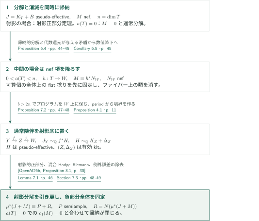
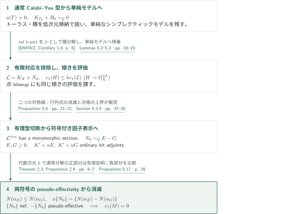
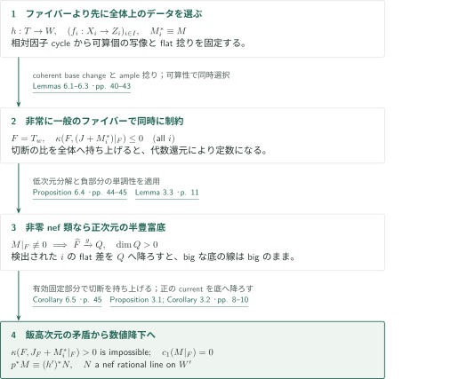
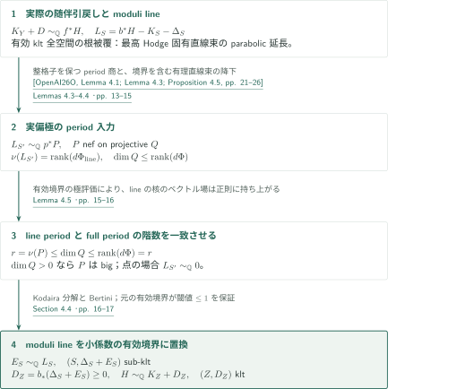
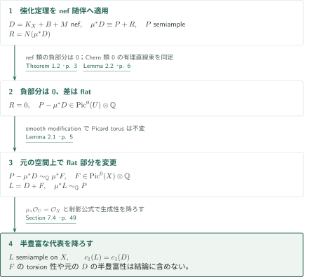

# Numerical semiampleness of nef adjoint classes on compact Kähler manifolds

**代数還元のファイバー上でnef類を消し、射影底の通常随伴へ帰着する**

原稿は、通常のklt随伴$K_X+B$に、元の空間上のnef有理直線束$M$を加えた類を扱う。証明は数値的正部分の分解を次元帰納で作り、nefの場合に負部分を消す。得られるのは実Bott–Chern類を共有する半豊富な代表であり、元の直線束のflat部分は変わり得る。

## 1. 主要結果

### Theorem 1.1 — 元の空間上の半豊富な代表

$X$を滑らかな連結コンパクトKähler多様体、$B\geq0$を係数がすべて$1$未満の有理SNC因子、$M\in\operatorname{Pic}(X)\otimes_{\mathbb Z}\mathbb Q$とする。$K_X+B$がpseudo-effective、$M$と$D=K_X+B+M$がnefなら、半豊富な有理直線束$L$が$X$上に存在して

$$c_1(L)=c_1(D)\quad\text{in }H^{1,1}_{\mathrm{BC}}(X,\mathbb R)$$

となる。ここで$M$は$X$自身の直線束であり、高いモデル上だけでnefな任意のb-divisorではない。

<!-- cite:main -->[Theorem 1.1 · p. 2](https://github.com/openai/math/blob/1581d4cbdd69a0faf34b2089614fe2a814316a6a/preprints/Numerical-semiampleness-of-nef-adjoint-classes-on-compact-Kahler-manifolds-October-6-2026/numerical-generalized-abundance.pdf)<!-- /cite -->

### Theorem 1.2 — 負部分を含む強化された分解

$T$を滑らかな連結コンパクトKähler多様体、$B\geq0$を係数がすべて$1$未満の有理SNC因子、$M$をnef有理直線束とする。$J=K_T+B$がpseudo-effectiveなら、滑らかなコンパクトKähler modification $\mu:U\to T$、半豊富な有理直線束$P$、有効有理因子$R$が存在して

$$\mu^*(J+M)\equiv P+R,\qquad R=N\bigl(c_1(\mu^*(J+M))\bigr).$$

さらに$a(T)=0$なら$c_1(M)=0$である。$a(T)$は代数次元、$N$は解析的因子的負部分である。$J+M$のnef性は仮定しない。以下、$\equiv$は実Bott–Chern類の一致、$\sim_{\mathbb Q}$は$\operatorname{Pic}\otimes\mathbb Q$における一致を表す。

<!-- cite:strong -->[Theorem 1.2 · p. 3](https://github.com/openai/math/blob/1581d4cbdd69a0faf34b2089614fe2a814316a6a/preprints/Numerical-semiampleness-of-nef-adjoint-classes-on-compact-Kahler-manifolds-October-6-2026/numerical-generalized-abundance.pdf)<!-- /cite -->

## 図の矢印に付した引用

<!-- reference-guide -->
略号のない定理・補題・節・式番号は本原稿 [Numerical semiampleness of nef adjoint classes on compact Kähler manifolds](https://github.com/openai/math/blob/1581d4cbdd69a0faf34b2089614fe2a814316a6a/preprints/Numerical-semiampleness-of-nef-adjoint-classes-on-compact-Kahler-manifolds-October-6-2026/numerical-generalized-abundance.pdf) を指します。外部入力には次の略号を使います。

- [OpenAI26b](https://github.com/openai/math/blob/1581d4cbdd69a0faf34b2089614fe2a814316a6a/preprints/Numerical-Semiampleness-of-Nef-Adjoint-Divisors-October-3-2026/paper.pdf) OpenAI — *Numerical Semiampleness of Nef Adjoint Divisors*：射影klt対の正部分の数値的半豊富性と、固定nefデータの一般化klt MMP。2026年10月3日版。
- [OpenAI26K](https://github.com/openai/math/blob/1581d4cbdd69a0faf34b2089614fe2a814316a6a/preprints/Log-abundance-for-compact-Kahler-spaces-under-logarithmic-Iitaka-subadditivity-October-6-2026/main.pdf) OpenAI — *Log abundance for compact Kähler spaces under logarithmic Iitaka subadditivity*：通常の随伴の線形同値による分解と、既知の負部分を収縮するプログラム。October 6, 2026。
- [OpenAI26O](https://github.com/openai/math/blob/1581d4cbdd69a0faf34b2089614fe2a814316a6a/preprints/Orbifold-and-logarithmic-Iitaka-subadditivity-September-26-2026/paper.pdf) OpenAI — *Orbifold and logarithmic Iitaka subadditivity*：通常分解の対数飯高仮定、最高Hodge lineの正値性とperiod商への降下。September 26, 2026。
- [MWWZ](https://arxiv.org/pdf/2506.23218v2) Shin-ichi Matsumura; Juanyong Wang; Xiaojun Wu; Qimin Zhang — *Beauville–Bogomolov–Yau decomposition for Kähler generalized pairs*：nef b-partが0のCalabi–Yau型klt対の有限準étale積分解。arXiv:2506.23218v2 (September 9, 2026); title-page date September 10, 2026。
- [HX](https://arxiv.org/pdf/2607.24986v1) Christopher Hacon; Lingyao Xie — *On the Kähler MMP and the transcendental base-point-free theorem*：通常klt対の負のrayの長さの上界。arXiv:2607.24986v1 (July 27, 2026); title-page date July 29, 2026。

各引用に結果番号とページを付します。誌面番号とPDF内の位置が異なる場合は両方を示します。GitHubの閲覧リンクではページ位置への自動移動を前提としません。
<!-- /reference-guide -->

## 2. Theorem 1.2 の証明 — 三つの幾何学的場合を同時帰納でつなぐ

<!-- proof-target:1 -->証明対象：[Theorem 1.2 · p. 3](https://github.com/openai/math/blob/1581d4cbdd69a0faf34b2089614fe2a814316a6a/preprints/Numerical-semiampleness-of-nef-adjoint-classes-on-compact-Kahler-manifolds-October-6-2026/numerical-generalized-abundance.pdf)<!-- /proof-target --> [仮定と二つの結論](#theorem-1-2)を参照する。

**証明の道筋。** 分解と$a(T)=0$での消滅を同時に帰納する。射影の場合は外部の正部分定理を使う。代数次元0の場合は[単純なシンプレクティックモデル](#proof-2)へ帰着する。中間の場合は[ファイバー上の消滅](#proof-3)から$M$を底へ降ろし、[通常klt随伴の構成](#proof-4)を経て射影の場合へ戻る。最後にnefな$D$へ特殊化して[Theorem 1.1](#proof-5)を得る。

### 1. 射影の場合と代数次元0の場合

$a(T)=\dim T$ならKähler–Moishezon定理で$T$は射影的となる。射影入力は$K_T+B$のpseudo-effectivityと、$T$上の$M$のnef性から、有理で数値的に半豊富な正部分を与える。これとは別に固定nefデータの一般化klt MMPを使い、共通解消上で

$$u^*(K_T+B+M)\sim_{\mathbb Q}v^*H_m+E$$

を得る。$H_m$はnef、$E\geq0$は$v$-例外的で、負部分の計算が$E=N(u^*(K_T+B+M))$を与える。一般化モデル上の$M$のtrace自体がnefとは仮定しない。

<!-- cite:projective -->[Proposition 2.5 · pp. 7–8](https://github.com/openai/math/blob/1581d4cbdd69a0faf34b2089614fe2a814316a6a/preprints/Numerical-semiampleness-of-nef-adjoint-classes-on-compact-Kahler-manifolds-October-6-2026/numerical-generalized-abundance.pdf)<!-- /cite -->

<!-- cite:external-positive -->[&#91;OpenAI26b, Proposition 8.1, p. 30&#93;](https://github.com/openai/math/blob/1581d4cbdd69a0faf34b2089614fe2a814316a6a/preprints/Numerical-Semiampleness-of-Nef-Adjoint-Divisors-October-3-2026/paper.pdf)<!-- /cite -->

<!-- cite:external-mmp -->[&#91;OpenAI26b, Theorem 2.3, p. 4&#93;](https://github.com/openai/math/blob/1581d4cbdd69a0faf34b2089614fe2a814316a6a/preprints/Numerical-Semiampleness-of-Nef-Adjoint-Divisors-October-3-2026/paper.pdf)<!-- /cite -->

$a(T)=0$ではProposition 5.1が$M\equiv0$を与える。通常随伴の分解は実際の線形同値$\mu^*J\sim_{\mathbb Q}P+R$であり、この場合$P$は有理直線束として自明となる。したがって$M$を加えても負部分は変わらない。通常分解の対数飯高仮定は、被約SNC境界と$\operatorname{Supp}(f^*D_Y)\subseteq\operatorname{Supp}(D_X)$を保った劣加法性によって供給される。

<!-- cite:ordinary -->[Theorem 2.3; Proposition 2.4 · pp. 6–7](https://github.com/openai/math/blob/1581d4cbdd69a0faf34b2089614fe2a814316a6a/preprints/Numerical-semiampleness-of-nef-adjoint-classes-on-compact-Kahler-manifolds-October-6-2026/numerical-generalized-abundance.pdf)<!-- /cite -->

<!-- cite:external-ordinary -->[&#91;OpenAI26K, Definition 2.1; Theorem 2.13, pp. 6, 13&#93;](https://github.com/openai/math/blob/1581d4cbdd69a0faf34b2089614fe2a814316a6a/preprints/Log-abundance-for-compact-Kahler-spaces-under-logarithmic-Iitaka-subadditivity-October-6-2026/main.pdf)<!-- /cite -->

<!-- cite:external-iitaka -->[&#91;OpenAI26O, Corollary 6.2, pp. 40–41&#93;](https://github.com/openai/math/blob/1581d4cbdd69a0faf34b2089614fe2a814316a6a/preprints/Orbifold-and-logarithmic-Iitaka-subadditivity-September-26-2026/paper.pdf)<!-- /cite -->

### 2. 中間代数次元でプログラムを射影底上に保つ

$0<a(T)<n$では代数還元を$h:T\to W$に解消する。Proposition 6.4とCorollary 6.5で、さらに高いモデル上で$M\equiv h^*N_W$、$N_W$ nefを得る。$A_W$をample Cartier、整数$b>2n$とし、$J+bh^*A_W$を通常klt境界の随伴として分解する。既知の負部分を収縮する通常プログラムは半豊富な正部分の実際の直線束を保持する。

このプログラムが$W$上で動くことは別に証明する。$J_i+bC_i$-負のrayは$J_i$-負であり、長さ$0<-J_i\cdot\Gamma\leq2n$の有理曲線で生成される。$C_i=h_i^*A_W$はCartierなので、$C_i\cdot\Gamma>0$なら

$$(J_i+bC_i)\cdot\Gamma\geq-2n+b>0$$

となって矛盾する。従って$C_i\cdot\Gamma=0$で、連結ファイバーによる降下が写像$h_i$自体を保持する。終点$(Y,\Delta)$で$J_Y+bh_Y^*A_W$は半豊富となる。

<!-- cite:program -->[Proposition 7.2 · pp. 47–48](https://github.com/openai/math/blob/1581d4cbdd69a0faf34b2089614fe2a814316a6a/preprints/Numerical-semiampleness-of-nef-adjoint-classes-on-compact-Kahler-manifolds-October-6-2026/numerical-generalized-abundance.pdf)<!-- /cite -->

<!-- cite:external-contract -->[&#91;OpenAI26K, Proposition 3.8, pp. 23–24&#93;](https://github.com/openai/math/blob/1581d4cbdd69a0faf34b2089614fe2a814316a6a/preprints/Log-abundance-for-compact-Kahler-spaces-under-logarithmic-Iitaka-subadditivity-October-6-2026/main.pdf)<!-- /cite -->

<!-- cite:external-cone -->[&#91;HX, Theorem 1.3, p. 2&#93;](https://arxiv.org/pdf/2607.24986v1#page=2)<!-- /cite -->

### 3. 射影底で解き、負部分全体を引き戻す

半豊富写像と$h_Y$を合わせたStein分解を$f:Y\to Z$、$j:Z\to W$とする。$Z$は正規射影的で、$a(T)=\dim W\leq\dim Z\leq a(Y)=a(T)$より$f$は正の相対次元を持つ。底のample項を引くことで$J_Y\sim_{\mathbb Q}f^*H$を得る。通常nonvanishingと例外比較で$H$はpseudo-effectiveであり、Proposition 4.1によって$H\sim_{\mathbb Q}K_Z+\Delta_Z$、$(Z,\Delta_Z)$ klt、$\Delta_Z\geq0$となる。従って射影入力を$H+j^*N_W$に適用できる。

その射影分解を共通Kähler解消$V$へ引くと、半豊富な類$g^*P_{Z'}$と有効因子$g^*E$を得る。$g^*E$の全成分は最終射影モデル$Z_m$の余次元2以上へ落ちるが、$V\to Z_m$は一般に双有理ではない。そこでLemma 7.1の混合Hodge–Riemann議論を用い、$N(r^*H_m+g^*E)=g^*E$を確定する。さらに通常プログラムの有効例外因子$F$を加えると

$$q^*(J_1+M_1)\equiv g^*P_{Z'}+g^*E+F,\qquad N(q^*(J_1+M_1))=g^*E+F.$$

解消で加えた有効例外誤差をLemma 2.2で取り除く。これで半豊富な有理正部分、負部分の有理性、その全体の同定が揃う。

<!-- cite:induction -->[Section 7.3 · pp. 48–49](https://github.com/openai/math/blob/1581d4cbdd69a0faf34b2089614fe2a814316a6a/preprints/Numerical-semiampleness-of-nef-adjoint-classes-on-compact-Kahler-manifolds-October-6-2026/numerical-generalized-abundance.pdf)<!-- /cite -->

<!-- cite:lift-negative -->[Lemma 7.1 · p. 46](https://github.com/openai/math/blob/1581d4cbdd69a0faf34b2089614fe2a814316a6a/preprints/Numerical-semiampleness-of-nef-adjoint-classes-on-compact-Kahler-manifolds-October-6-2026/numerical-generalized-abundance.pdf)<!-- /cite -->

## 3. Proposition 5.1 の証明 — 代数次元0でnef類が消える理由

<!-- proof-target:2 -->証明対象：[Proposition 5.1 · p. 18](https://github.com/openai/math/blob/1581d4cbdd69a0faf34b2089614fe2a814316a6a/preprints/Numerical-semiampleness-of-nef-adjoint-classes-on-compact-Kahler-manifolds-October-6-2026/numerical-generalized-abundance.pdf)<!-- /proof-target -->

<!-- statement:proposition-5-1 -->
### Proposition 5.1 — 代数次元0の帰納段階

$n\geq1$とし、Theorem 1.2の代数次元0での結論が$n$未満の全次元で成立すると仮定する。$T$を$a(T)=0$の滑らかな連結コンパクトKähler $n$次元多様体、$B\geq0$を係数が$1$未満の有理SNC因子とする。$K_T+B$がpseudo-effectiveなら、任意のnef有理直線束$M$は$c_1(M)=0$を満たす。

<!-- cite:zero -->[Proposition 5.1 · p. 18](https://github.com/openai/math/blob/1581d4cbdd69a0faf34b2089614fe2a814316a6a/preprints/Numerical-semiampleness-of-nef-adjoint-classes-on-compact-Kahler-manifolds-October-6-2026/numerical-generalized-abundance.pdf)<!-- /cite -->
<!-- /statement -->

### 1. 通常Calabi–Yau型の対から単純モデルへ

通常分解とその負部分の収縮により$K_{T_0}+B_0\sim_{\mathbb Q}0$を得る。MWWZの積分解には、この通常klt対をnef b-partが0の一般化対として入力する。有限準étale被覆の有理連結因子・高次元strict Calabi–Yau因子は$a=0$と両立せず、トーラスとシンプレクティック因子が残る。複数因子なら低次元ファイバー上の帰納仮定と混合交点数でnef類を消す。単一のシンプレクティック因子にはCampanaの最小ファイバー化を用い、一般点で非退化な正則2形式を持つ単純モデルへ帰着する。これら補助入力の全証明は本記事の確認範囲に含めない。

<!-- cite:reduction -->[Lemmas 5.2–5.3 · pp. 18–19](https://github.com/openai/math/blob/1581d4cbdd69a0faf34b2089614fe2a814316a6a/preprints/Numerical-semiampleness-of-nef-adjoint-classes-on-compact-Kahler-manifolds-October-6-2026/numerical-generalized-abundance.pdf)<!-- /cite -->

<!-- cite:external-bby -->[&#91;MWWZ, Corollary 1.4, p. 6&#93;](https://arxiv.org/pdf/2506.23218v2#page=6)<!-- /cite -->

### 2. 余接束の傾きから有理型切断を取り出す

不正則数が正の有限被覆があればAlbaneseとトーラス上の交点数で済む。残る場合、すべての滑らかな生成有限被覆で不正則数が0となる。動く有限対応が$X\times X$を覆うなら、固定有限被覆上で2形式を動く方向と縮約して非零1形式を得て矛盾する。このため非常に一般の点を通る正次元真部分多様体は因子スライスに限られる。

$N_0$を$M$の整数倍とし、$\mathcal L=K_X+N_0$を取る。シンプレクティック形式の最高外積により$K_X$は有効で、Lemma 5.5が$\Omega_X^{\otimes k}$への直線束の写像に対する$c_1(H)\leq k c_1(\mathcal L)$と点blowup上の対応する評価を与える。Proposition 5.6は、二つの対角線、射影束の体積、余接テンソルの行列式を使い、$\mathcal L$のある正の冪の非零**有理型**切断を得る。最終段階では、対角線の消滅次数を点での極へ移し、有界な点極評価と発散する行列式次数を衝突させる。これは正則切断のnonvanishingと同一ではない。

<!-- cite:nonvanishing -->[Proposition 5.6 · pp. 21–22](https://github.com/openai/math/blob/1581d4cbdd69a0faf34b2089614fe2a814316a6a/preprints/Numerical-semiampleness-of-nef-adjoint-classes-on-compact-Kahler-manifolds-October-6-2026/numerical-generalized-abundance.pdf)<!-- /cite -->

<!-- cite:cancellation -->[Section 5.3.9 · pp. 37–38](https://github.com/openai/math/blob/1581d4cbdd69a0faf34b2089614fe2a814316a6a/preprints/Numerical-semiampleness-of-nef-adjoint-classes-on-compact-Kahler-manifolds-October-6-2026/numerical-generalized-abundance.pdf)<!-- /cite -->

### 3. 符号付き因子表示を二つの通常随伴へ分ける

有理型切断を標準切断で割り、解消後に$N_0\sim_{\mathbb Q}E-G$、$E,G\geq0$を得る。小さい有理数$u>0$を選び、$K'+uE$と$K'+uG$の両方を通常klt随伴とする。両者はpseudo-effectiveであり、代数次元0なので通常分解の半豊富部分は自明である。共通モデル上の類を$\alpha_E,\alpha_G$とすると、$\alpha_E-\alpha_G=u\{N_0\}$はnefだから

$$N(\alpha_E)\leq N(\alpha_G),\qquad u\{N_0\}=\{N(\alpha_E)-N(\alpha_G)\}.$$

従って$-\{N_0\}$もpseudo-effectiveとなる。nefな$\{N_0\}$とその反対の類をKähler冪と積分し、質量0から$\{N_0\}=0$を得る。生成有限写像・modificationの引戻しの単射性で$T$へ戻す。

<!-- cite:zero-simple -->[Proposition 5.17 · p. 39](https://github.com/openai/math/blob/1581d4cbdd69a0faf34b2089614fe2a814316a6a/preprints/Numerical-semiampleness-of-nef-adjoint-classes-on-compact-Kahler-manifolds-October-6-2026/numerical-generalized-abundance.pdf)<!-- /cite -->

## 4. Proposition 6.4 の証明 — flat捻りを選ぶ順序

<!-- proof-target:3 -->証明対象：[Proposition 6.4 · pp. 44–45](https://github.com/openai/math/blob/1581d4cbdd69a0faf34b2089614fe2a814316a6a/preprints/Numerical-semiampleness-of-nef-adjoint-classes-on-compact-Kahler-manifolds-October-6-2026/numerical-generalized-abundance.pdf)<!-- /proof-target -->

<!-- statement:proposition-6-4 -->
### Proposition 6.4 — 代数還元ファイバー上の消滅

Theorem 1.2が$n$未満の全次元で成立すると仮定する。$T$を$0<a(T)<n$の滑らかな連結コンパクトKähler $n$次元多様体、$h:T\to W$を滑らかな射影底への連結ファイバーを持つ正則代数還元とする。$B\geq0$は係数が$1$未満の有理SNC因子、$J=K_T+B$はpseudo-effective、$M$はnef有理直線束とする。このとき一般の滑らかなファイバー$F$上で$c_1(M|_F)=0$である。

<!-- cite:fiber -->[Proposition 6.4 · pp. 44–45](https://github.com/openai/math/blob/1581d4cbdd69a0faf34b2089614fe2a814316a6a/preprints/Numerical-semiampleness-of-nef-adjoint-classes-on-compact-Kahler-manifolds-October-6-2026/numerical-generalized-abundance.pdf)<!-- /cite -->
<!-- /statement -->

### 1. 全体上の可算個の捻りを先に固定する

通常nonvanishingで$J\sim_{\mathbb Q}E\geq0$を固定する。相対因子cycleの可算個の成分から、ファイバーの半豊富写像を検出する全体上の可算個の写像$f_i:X_i\to Z_i$を作る。$p_i^*M$が一般$f_i$ファイバーで数値自明な添字に対し、数値降下と$\operatorname{Pic}^0$の双有理不変性で、全体$T$上の$M_i^*\equiv M$を一つずつ固定する。その引戻しは底からの実際の有理直線束の引戻しとなる。

その後に$w$を選ぶ。Lemma 6.1を可算個の$J+M_i^*$に同時適用すると、$F=T_w$上で$\kappa(F,(J+M_i^*)|_F)\leq0$が全$i$について成り立つ。これはcoherent base changeと射影底でのample捻りによりファイバー切断を全体へ持ち上げ、その比が代数還元に反することから従う。

<!-- cite:countable -->[Lemmas 6.1–6.3 · pp. 40–43](https://github.com/openai/math/blob/1581d4cbdd69a0faf34b2089614fe2a814316a6a/preprints/Numerical-semiampleness-of-nef-adjoint-classes-on-compact-Kahler-manifolds-October-6-2026/numerical-generalized-abundance.pdf)<!-- /cite -->

<!-- cite:descent -->[Proposition 3.1; Corollary 3.2 · pp. 8–10](https://github.com/openai/math/blob/1581d4cbdd69a0faf34b2089614fe2a814316a6a/preprints/Numerical-semiampleness-of-nef-adjoint-classes-on-compact-Kahler-manifolds-October-6-2026/numerical-generalized-abundance.pdf)<!-- /cite -->

### 2. 正次元の半豊富底が与える矛盾

$M|_F\not\equiv0$と仮定する。帰納的分解と負部分の単調性により

$$\rho^*(J_F+M|_F)\equiv P_F+R_F,\qquad
P_F\equiv(\rho^*E_F-R_F)+\rho^*(M|_F).$$

右辺の有効類とnef類をKähler冪と積分すると、$P_F$の写像$g:\widehat F\to Q$は$\dim Q>0$を持つ。その一般ファイバーで$M$は数値自明となり、cycleによる検出で既に選んだ$i$に対応する。$M_i^*$の有理自明性を用いると、残るflat差はLemma 3.3により$Q$の解消上へ降りる。底のbigな直線束はflat捻り後もbigなので

$$\kappa(F,J_F+M_i^*|_F)>0$$

となり前段に矛盾する。局所系$R^2h_*\mathbb R$の局所定数性で一般の滑らかなファイバー上の消滅を得る。

<!-- cite:fiber -->[Proposition 6.4 · pp. 44–45](https://github.com/openai/math/blob/1581d4cbdd69a0faf34b2089614fe2a814316a6a/preprints/Numerical-semiampleness-of-nef-adjoint-classes-on-compact-Kahler-manifolds-October-6-2026/numerical-generalized-abundance.pdf)<!-- /cite -->

<!-- cite:flat-fiber -->[Lemma 3.3 · p. 11](https://github.com/openai/math/blob/1581d4cbdd69a0faf34b2089614fe2a814316a6a/preprints/Numerical-semiampleness-of-nef-adjoint-classes-on-compact-Kahler-manifolds-October-6-2026/numerical-generalized-abundance.pdf)<!-- /cite -->

### 3. 正のcurrentを降ろし、有理nef直線束を回復する

Corollary 6.5はこの消滅をProposition 3.1へ入力する。平坦化後、正のcurrentの垂直成分と混合成分が消え、滑らかな部分で底のcurrentになる。残る垂直因子はファイバー成分の交点行列と例外的負性で除く。引戻し$H^2(W',\mathbb Q)\to H^2(T',\mathbb Q)$の単射性が降下類の有理性を与え、Lefschetz $(1,1)$と射影底の曲線判定でnef有理直線束$N$を得る。この段階の結論は$p^*M\equiv(h')^*N$であり、元の$M$の線形降下ではない。

<!-- cite:descent -->[Proposition 3.1; Corollary 3.2 · pp. 8–10](https://github.com/openai/math/blob/1581d4cbdd69a0faf34b2089614fe2a814316a6a/preprints/Numerical-semiampleness-of-nef-adjoint-classes-on-compact-Kahler-manifolds-October-6-2026/numerical-generalized-abundance.pdf)<!-- /cite -->

<!-- cite:fiber-descent -->[Corollary 6.5 · p. 45](https://github.com/openai/math/blob/1581d4cbdd69a0faf34b2089614fe2a814316a6a/preprints/Numerical-semiampleness-of-nef-adjoint-classes-on-compact-Kahler-manifolds-October-6-2026/numerical-generalized-abundance.pdf)<!-- /cite -->

## 5. Proposition 4.1 の証明 — periodの階数から通常klt随伴を作る

<!-- proof-target:4 -->証明対象：[Proposition 4.1 · p. 11](https://github.com/openai/math/blob/1581d4cbdd69a0faf34b2089614fe2a814316a6a/preprints/Numerical-semiampleness-of-nef-adjoint-classes-on-compact-Kahler-manifolds-October-6-2026/numerical-generalized-abundance.pdf)<!-- /proof-target -->

<!-- statement:proposition-4-1 -->
### Proposition 4.1 — 射影底の随伴表示

$(Y,D)$を正規コンパクトKähler空間上の有効有理klt対、$f:Y\to Z$を正規射影多様体への連結ファイバーを持つ全射射とし、$\dim Y>\dim Z$と仮定する。$Z$上の有理Cartier直線束$H$が$K_Y+D\sim_{\mathbb Q}f^*H$を満たすなら、有効有理因子$D_Z$が存在し、$(Z,D_Z)$はkltで$H\sim_{\mathbb Q}K_Z+D_Z$となる。

<!-- cite:base -->[Proposition 4.1 · p. 11](https://github.com/openai/math/blob/1581d4cbdd69a0faf34b2089614fe2a814316a6a/preprints/Numerical-semiampleness-of-nef-adjoint-classes-on-compact-Kahler-manifolds-October-6-2026/numerical-generalized-abundance.pdf)<!-- /cite -->
<!-- /statement -->

### 1. Discriminantと最高Hodge固有直線束

底の解消$b:S\to Z$上でlog canonical thresholdから$\Delta_S$を作り、$L_S=b^*H-K_S-\Delta_S$と置く。相対pluriformの根被覆が最高Hodge固有直線束を与え、そのparabolic延長を$L_S$と同定する。$Y$は射影的でなくてもよい。実偏極は有理とは限らないが、ambient cohomologyの整格子を保持してperiod入力を適用する。crepant解消上の境界には負係数があり得る一方、元の$D\geq0$は次段で必要になる。

<!-- cite:root -->[Lemmas 4.3–4.4 · pp. 13–15](https://github.com/openai/math/blob/1581d4cbdd69a0faf34b2089614fe2a814316a6a/preprints/Numerical-semiampleness-of-nef-adjoint-classes-on-compact-Kahler-manifolds-October-6-2026/numerical-generalized-abundance.pdf)<!-- /cite -->

<!-- cite:external-period -->[&#91;OpenAI26O, Lemma 4.1; Lemma 4.3; Proposition 4.5, pp. 21–26&#93;](https://github.com/openai/math/blob/1581d4cbdd69a0faf34b2089614fe2a814316a6a/preprints/Orbifold-and-logarithmic-Iitaka-subadditivity-September-26-2026/paper.pdf)<!-- /cite -->

### 2. 固有直線束のperiodが全periodを検出する

固有直線束のperiod微分の核にある底のベクトル場を、最高形式との縮約で根被覆上の有理型ベクトル場へ持ち上げる。根群で平均し、元の有効境界に由来する厳密な極次数上界を使うと、降下した場は正則で境界に接する。そのflowをfunctorial解消・根被覆へ持ち上げ、族全体のKodaira–Spencer classも消えることを示す。従ってline periodとfull periodの核・階数が一致する。

period商$p:S'\to Q$への実際の直線束降下$L_{S'}\sim_{\mathbb Q}p^*P$と合わせると

$$r=\nu(L_{S'})=\nu(P)\leq\dim Q\leq\operatorname{rank}(d\Phi)=r.$$

$\dim Q>0$なら$P$はnef and big、$Q$が点なら$L_{S'}$は有理自明となる。

<!-- cite:rank -->[Lemma 4.5 · pp. 15–16](https://github.com/openai/math/blob/1581d4cbdd69a0faf34b2089614fe2a814316a6a/preprints/Numerical-semiampleness-of-nef-adjoint-classes-on-compact-Kahler-manifolds-October-6-2026/numerical-generalized-abundance.pdf)<!-- /cite -->

<!-- cite:period-input -->[Lemma 4.2 · p. 12](https://github.com/openai/math/blob/1581d4cbdd69a0faf34b2089614fe2a814316a6a/preprints/Numerical-semiampleness-of-nef-adjoint-classes-on-compact-Kahler-manifolds-October-6-2026/numerical-generalized-abundance.pdf)<!-- /cite -->

### 3. Bigなmoduli lineを有効境界へ置き換える

$P\sim_{\mathbb Q}A+E$とし、小さい$\varepsilon>0$に対して$P\sim_{\mathbb Q}A_\varepsilon+\varepsilon E$、$A_\varepsilon$ ampleとする。十分高い自由系の一般元を小係数で取れば、$E_S\geq0$、$E_S\sim_{\mathbb Q}L_S$、$(S,\Delta_S+E_S)$ sub-kltとなる。点の場合は$E_S=0$とする。元の底の素因子に対する閾値は$D\geq0$により$\leq1$なので、押し下げた$D_Z=b_*(\Delta_S+E_S)$は有効である。

有理関数による主因子等式を押し下げ、$H\sim_{\mathbb Q}K_Z+D_Z$を得る。その引戻しを上の等式と比べるとcrepant同一式となり、sub-klt性から$(Z,D_Z)$のklt性が従う。単なる数値的canonical bundle formulaでは、ここで必要な線形同値は得られない。

<!-- cite:boundary -->[Section 4.4 · pp. 16–17](https://github.com/openai/math/blob/1581d4cbdd69a0faf34b2089614fe2a814316a6a/preprints/Numerical-semiampleness-of-nef-adjoint-classes-on-compact-Kahler-manifolds-October-6-2026/numerical-generalized-abundance.pdf)<!-- /cite -->

## 6. Theorem 1.1 の証明 — flat部分を変えて元の空間へ戻す

<!-- proof-target:5 -->証明対象：[Theorem 1.1 · p. 2](https://github.com/openai/math/blob/1581d4cbdd69a0faf34b2089614fe2a814316a6a/preprints/Numerical-semiampleness-of-nef-adjoint-classes-on-compact-Kahler-manifolds-October-6-2026/numerical-generalized-abundance.pdf)<!-- /proof-target --> [主要結果](#theorem-1-1)を参照する。

### 1. Nef性が負部分を消す

Theorem 1.2を$D$へ適用する。$\mu^*D$もnefなので$R=N(\mu^*D)=0$となり、半豊富な$P$と$\mu^*D$の差は実Chern類0の有理直線束である。

<!-- cite:strong -->[Theorem 1.2 · p. 3](https://github.com/openai/math/blob/1581d4cbdd69a0faf34b2089614fe2a814316a6a/preprints/Numerical-semiampleness-of-nef-adjoint-classes-on-compact-Kahler-manifolds-October-6-2026/numerical-generalized-abundance.pdf)<!-- /cite -->

<!-- cite:negative -->[Lemma 2.2 · p. 6](https://github.com/openai/math/blob/1581d4cbdd69a0faf34b2089614fe2a814316a6a/preprints/Numerical-semiampleness-of-nef-adjoint-classes-on-compact-Kahler-manifolds-October-6-2026/numerical-generalized-abundance.pdf)<!-- /cite -->

### 2. 変更するのはflat部分である

Lemma 2.1は、この差が$\operatorname{Pic}^0(U)\otimes\mathbb Q$に属し、smooth modificationで$\operatorname{Pic}^0(X)\simeq\operatorname{Pic}^0(U)$となることを使う。従って$F\in\operatorname{Pic}^0(X)\otimes\mathbb Q$を選んで

$$P-\mu^*D\sim_{\mathbb Q}\mu^*F,\qquad L=D+F,\qquad\mu^*L\sim_{\mathbb Q}P$$

とできる。$\mu_*\mathcal O_U=\mathcal O_X$と射影公式により生成性が$L$へ降りる。$c_1(L)=c_1(D)$だが、$F$がtorsionであるとは示していない。楕円曲線上の非torsion degree-zero直線束は、元の$D$の半豊富性を結論にできない理由を既に示している。

<!-- cite:flat -->[Lemma 2.1 · p. 5](https://github.com/openai/math/blob/1581d4cbdd69a0faf34b2089614fe2a814316a6a/preprints/Numerical-semiampleness-of-nef-adjoint-classes-on-compact-Kahler-manifolds-October-6-2026/numerical-generalized-abundance.pdf)<!-- /cite -->

<!-- cite:finish -->[Section 7.4 · p. 49](https://github.com/openai/math/blob/1581d4cbdd69a0faf34b2089614fe2a814316a6a/preprints/Numerical-semiampleness-of-nef-adjoint-classes-on-compact-Kahler-manifolds-October-6-2026/numerical-generalized-abundance.pdf)<!-- /cite -->

## 7. どの論文が、どの段階を担うか

| 供給元と結果 | 利用箇所 | 使用内容・必要な仮定 | 確認範囲 |
|---|---|---|---|
| <!-- cite:external-positive -->[&#91;OpenAI26b, Proposition 8.1, p. 30&#93;](https://github.com/openai/math/blob/1581d4cbdd69a0faf34b2089614fe2a814316a6a/preprints/Numerical-Semiampleness-of-Nef-Adjoint-Divisors-October-3-2026/paper.pdf)<!-- /cite --> | Proposition 2.5、[帰納の完結](#proof-1-step-3) | 射影的な通常klt対、pseudo-effectiveな通常随伴、元のモデル上のnef項から数値的半豊富正部分 | 原典の記述と適用を照合 |
| <!-- cite:external-mmp -->[&#91;OpenAI26b, Theorem 2.3, p. 4&#93;](https://github.com/openai/math/blob/1581d4cbdd69a0faf34b2089614fe2a814316a6a/preprints/Numerical-Semiampleness-of-Nef-Adjoint-Divisors-October-3-2026/paper.pdf)<!-- /cite --> | Proposition 2.5 | 固定nef b-dataを持つ一般化kltプログラムのnef終点と例外比較 | 記述照合。任意のflip列の停止ではない |
| <!-- cite:external-ordinary -->[&#91;OpenAI26K, Definition 2.1; Theorem 2.13, pp. 6, 13&#93;](https://github.com/openai/math/blob/1581d4cbdd69a0faf34b2089614fe2a814316a6a/preprints/Log-abundance-for-compact-Kahler-spaces-under-logarithmic-Iitaka-subadditivity-October-6-2026/main.pdf)<!-- /cite -->、<!-- cite:external-contract -->[&#91;OpenAI26K, Proposition 3.8, pp. 23–24&#93;](https://github.com/openai/math/blob/1581d4cbdd69a0faf34b2089614fe2a814316a6a/preprints/Log-abundance-for-compact-Kahler-spaces-under-logarithmic-Iitaka-subadditivity-October-6-2026/main.pdf)<!-- /cite --> | Theorem 2.3、Proposition 2.4、[通常プログラム](#proof-1-step-2) | 線形同値による分解、既知の負部分を消す通常プログラム | 10月6日版の仮定・記述と使用箇所を照合。既存034記事の10月4日版とは区別 |
| <!-- cite:external-iitaka -->[&#91;OpenAI26O, Corollary 6.2, pp. 40–41&#93;](https://github.com/openai/math/blob/1581d4cbdd69a0faf34b2089614fe2a814316a6a/preprints/Orbifold-and-logarithmic-Iitaka-subadditivity-September-26-2026/paper.pdf)<!-- /cite --> | Theorem 2.3 | Kähler abundanceのAssumption 1.1を満たす対数劣加法性 | 支持条件・境界・ファイバーの仮定を照合 |
| <!-- cite:external-period -->[&#91;OpenAI26O, Lemma 4.1; Lemma 4.3; Proposition 4.5, pp. 21–26&#93;](https://github.com/openai/math/blob/1581d4cbdd69a0faf34b2089614fe2a814316a6a/preprints/Orbifold-and-logarithmic-Iitaka-subadditivity-September-26-2026/paper.pdf)<!-- /cite --> | Lemma 4.2、[射影底](#proof-4) | 実偏極とambient整格子、parabolic最高直線束、実際の有理直線束降下 | 記述・使用箇所を照合。外部の全構成は未検証 |
| <!-- cite:external-bby -->[&#91;MWWZ, Corollary 1.4, p. 6&#93;](https://arxiv.org/pdf/2506.23218v2#page=6)<!-- /cite --> | Lemma 5.3、[代数次元0](#proof-2-step-1) | 通常klt Calabi–Yau型、nef b-part 0で積分解 | 入力の設定と特殊化を照合 |
| <!-- cite:external-cone -->[&#91;HX, Theorem 1.3, p. 2&#93;](https://arxiv.org/pdf/2607.24986v1#page=2)<!-- /cite --> | Proposition 7.2 | nef b-part 0、長さ$\leq2n$とCartier整数性 | 記述と次数不等式を照合 |

## 8. 原典を読む入口と確認範囲

<!-- reading-list -->
- [Theorem 1.2 · p. 3](https://github.com/openai/math/blob/1581d4cbdd69a0faf34b2089614fe2a814316a6a/preprints/Numerical-semiampleness-of-nef-adjoint-classes-on-compact-Kahler-manifolds-October-6-2026/numerical-generalized-abundance.pdf) — 同時帰納の二つの結論と、数値同値の意味。
- [Proposition 5.6 · pp. 21–22](https://github.com/openai/math/blob/1581d4cbdd69a0faf34b2089614fe2a814316a6a/preprints/Numerical-semiampleness-of-nef-adjoint-classes-on-compact-Kahler-manifolds-October-6-2026/numerical-generalized-abundance.pdf) — 余接束の傾き仮定から有理型切断を作る核心。
- [Proposition 6.4 · pp. 44–45](https://github.com/openai/math/blob/1581d4cbdd69a0faf34b2089614fe2a814316a6a/preprints/Numerical-semiampleness-of-nef-adjoint-classes-on-compact-Kahler-manifolds-October-6-2026/numerical-generalized-abundance.pdf) — 全体上のflat捻りを先に固定する順序。
- [Proposition 4.1 · p. 11](https://github.com/openai/math/blob/1581d4cbdd69a0faf34b2089614fe2a814316a6a/preprints/Numerical-semiampleness-of-nef-adjoint-classes-on-compact-Kahler-manifolds-October-6-2026/numerical-generalized-abundance.pdf) — 射影底の通常klt随伴を得るための仮定。
- [Section 7.3 · pp. 48–49](https://github.com/openai/math/blob/1581d4cbdd69a0faf34b2089614fe2a814316a6a/preprints/Numerical-semiampleness-of-nef-adjoint-classes-on-compact-Kahler-manifolds-October-6-2026/numerical-generalized-abundance.pdf) — 射影入力の引戻しと負部分の同定。
- [Section 7.4 · p. 49](https://github.com/openai/math/blob/1581d4cbdd69a0faf34b2089614fe2a814316a6a/preprints/Numerical-semiampleness-of-nef-adjoint-classes-on-compact-Kahler-manifolds-October-6-2026/numerical-generalized-abundance.pdf) — 元の空間への半豊富な代表の降下。
<!-- /reading-list -->

主要結果の全結論、通常分解・射影入力の仮定、数値降下、可算個のflat捻りを先に固定する手順、periodの階数比較、最終の負部分と半豊富代表の降下を読んだ。直接入力として上表の指定版の記述と適用箇所を照合した。これは著者の証明経路の読解であり、全証明の独立検証ではない。

Proposition 5.6の中間の直像評価・行列式計算（pp. 23–36）は全体を点検していない。根被覆の延長、periodの有理因子構成と全モデル上の整合性、Campana・Ou・cycle space・混合Hodge–Riemann・currentの支持／負性に関する補助外部結果のすべての原記述も未照合である。未記録のカタログ間関係は未調査であり、依存なしとはしない。
