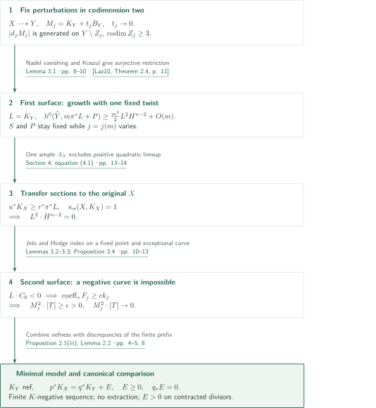
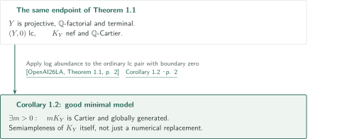

# Minimal models in numerical dimension one

**Stabilization of perturbed MMPs in codimension two and two surface tests for nefness**

The manuscript constructs a minimal model by finitely many canonical-negative operations when the numerical dimension, measured by section growth with a fixed ample twist, is one. Finite MMPs for each positive perturbation do not by themselves terminate their concatenation at coefficient zero. The argument fixes one model and detects nefness of its canonical divisor using surface intersections and orders of vanishing.

## 1. Main results

### Theorem 1.1 — A minimal model in numerical dimension one

Let $X$ be a smooth connected complex projective variety of dimension $n\geq3$. Assume that $K_X$ is pseudo-effective and $\kappa_\sigma(X,K_X)=1$. The convention in (1.1), for a Cartier divisor $D$, is

$$
\kappa_\sigma(X,D)=\max\left\{k\in\{0,\ldots,n\}:\exists A\text{ ample Cartier},\ \limsup_{m\to\infty}\frac{h^0(X,mD+A)}{m^k}>0\right\}.
$$

The value is $-\infty$ if the set is empty; $A$ is fixed before taking the limit. This convention is not replaced by an intersection definition for $K_X$, whose nefness is not yet known.

There exist a normal projective $\mathbb Q$-factorial terminal variety $Y$ and a finite sequence $\varphi:X\dashrightarrow Y$ of $K$-negative divisorial contractions and flips such that $K_Y$ is nef. The inverse map contracts no prime divisor. On a common smooth projective resolution $p:W\to X$, $q:W\to Y$, compatible canonical divisors satisfy

$$
p^*K_X=q^*K_Y+E,
\qquad E\geq0,\qquad E\text{ is a }q\text{-exceptional rational divisor},
$$

and $\operatorname{Supp}E$ contains the strict transform of every prime divisor of $X$ contracted by $\varphi$.

<!-- cite:main -->[Theorem 1.1; equation (1.1) · pp. 1–2](https://github.com/openai/math/blob/1581d4cbdd69a0faf34b2089614fe2a814316a6a/preprints/Minimal-models-in-numerical-dimension-one-September-24-2026/paper.pdf)<!-- /cite -->

### Corollary 1.2 — The same endpoint is a good minimal model

Under the hypotheses of Theorem 1.1, the same $\mathbb Q$-factorial terminal endpoint $Y$ has semiample $K_Y$, and hence is a good minimal model of $X$. This is a separate consequence using log abundance. The fixed-twist growth argument of Theorem 1.1 alone does not assert semiampleness of $K_Y$ or nonvanishing of $K_X$.

<!-- cite:cor -->[Corollary 1.2 · p. 2](https://github.com/openai/math/blob/1581d4cbdd69a0faf34b2089614fe2a814316a6a/preprints/Minimal-models-in-numerical-dimension-one-September-24-2026/paper.pdf)<!-- /cite -->

## References on the arrows

<!-- reference-guide -->
Unprefixed theorem, lemma, section and equation numbers refer to [Minimal models in numerical dimension one](https://github.com/openai/math/blob/1581d4cbdd69a0faf34b2089614fe2a814316a6a/preprints/Minimal-models-in-numerical-dimension-one-September-24-2026/paper.pdf). External inputs use the following keys.

- [BCHM10](https://arxiv.org/pdf/math/0610203v2) Caucher Birkar; Paolo Cascini; Christopher D. Hacon; James McKernan — *Existence of minimal models for varieties of log general type*: Finite scaling MMP for klt pairs with big boundary. arXiv:math/0610203v2 (2008-08-14); downloaded 81-page PDF bears 2024-11-26 compilation date.
- [Laz10](https://www.math.stonybrook.edu/~roblaz/Reprints/Lazarsfeld.PCMI.Short.Course.MI.pdf) Robert Lazarsfeld — *A short course on multiplier ideals*: Nadel vanishing for restriction with a fixed twist. Author-hosted 37-page PDF, arXiv:0901.0651v1 (2009-01-06); cited publication 2010.
- [OpenAI26LA](https://github.com/openai/math/blob/1581d4cbdd69a0faf34b2089614fe2a814316a6a/preprints/Log-abundance-in-characteristic-zero-September-24-2026/paper.pdf) OpenAI — *Log abundance in characteristic zero*: Ordinary lc log abundance added only for the corollary. September 24, 2026; commit 1581d4cbdd69a0faf34b2089614fe2a814316a6a.
- [KM98](https://doi.org/10.1017/CBO9780511662560) János Kollár; Shigefumi Mori — *Birational Geometry of Algebraic Varieties*: MMP, base point free and negativity; original book result/page checks remain open. Cambridge Tracts in Mathematics 134, 1998; book passages not independently located.
- [Har77](https://doi.org/10.1007/978-1-4757-3849-0) Robin Hartshorne — *Algebraic Geometry*: Surface Riemann–Roch and Hodge index; manuscript uses read, book checks remain open. Graduate Texts in Mathematics 52, 1977; book passages not independently located.
- [Ful98](https://doi.org/10.1007/978-1-4612-1700-8) William Fulton — *Intersection Theory*: Cycle intersections and Borel–Moore localization; manuscript uses read, book checks remain open. Second edition, 1998; book passages not independently located.

Each citation gives the result and pages. When printed pagination differs from the PDF position, both are shown. GitHub previews do not automatically jump to the cited page.
<!-- /reference-guide -->

## 2. Proof of Theorem 1.1 — One fixed model and two surfaces

<!-- proof-target:1 -->Proof target：[Theorem 1.1; equation (1.1) · pp. 1–2](https://github.com/openai/math/blob/1581d4cbdd69a0faf34b2089614fe2a814316a6a/preprints/Minimal-models-in-numerical-dimension-one-September-24-2026/paper.pdf)<!-- /proof-target -->

**Proof route.** See [Theorem 1.1](#theorem-1-1) for the statement. Proposition 2.1 fixes $X\dashrightarrow Y$ so that sufficiently divisible multiples of $M_j=K_Y+t_jB_Y$, $t_j\to0$, are generated outside sets of codimension at least three. A first, very general surface converts positive square into quadratic growth with one fixed twist. The hypothesis $\kappa_\sigma=1$ forces that square to vanish. A second surface detects any negative curve, contradicting the zero-square limit and proving nefness.

### 1. Stabilize positive perturbations in codimension two

Choose an effective ample rational divisor $B$ such that $(X,B)$ is klt and $K_X+B$ is ample. Put $t_j=2^{-j}$. Starting from the preceding nef endpoint, run the $(K+t_{j+1}B)$-MMP with scaling of $(t_j-t_{j+1})B$. The transformed boundary remains big and effective; ampleness need not persist. BCHM supplies a finite scaling MMP. Bigness of the adjoint excludes a Mori fibre space, and the base point free theorem applies to the nef and big klt adjoint at each endpoint.

<!-- cite:bchm -->[&#91;BCHM10, Corollary 1.4.2, p. 10&#93;](https://arxiv.org/pdf/math/0610203v2#page=10)<!-- /cite -->

On a scaling ray, $(K+t_{j+1}B)\cdot R<0$ and $(K+t_{j+1}B+\lambda C)\cdot R=0$ imply $B\cdot R>0$ and $K\cdot R<0$. For a small contraction, the relative base point free theorem descends $K-b(K+t_{j+1}B)\sim_{\mathbb Q}h^*A$. With $b>0$, relative ampleness of the flipped adjoint gives relative ampleness of the flipped canonical divisor. Every step is therefore a canonical MMP step.

Lemma 2.3 does not assert termination of the concatenation. Finiteness of divisorial contractions and strict increase of discrepancies first remove codimension-two components of the flipped loci. A decrease in the dimension of the finite-dimensional space spanned by algebraic $(n-2)$-cycle classes then handles the flipping loci. Choose one endpoint $Y$ after this finite prefix. Each later finite composition is an isomorphism outside sets of codimension at least three on both sides. Normality transfers sections, giving generation of $|d_jM_j|$ on $Y\setminus Z_j$. Both $d_j$ and $Z_j$ may depend on $j$.

<!-- cite:perturbations -->[Proposition 2.1; Lemmas 2.2–2.3 · pp. 4–8](https://github.com/openai/math/blob/1581d4cbdd69a0faf34b2089614fe2a814316a6a/preprints/Minimal-models-in-numerical-dimension-one-September-24-2026/paper.pdf)<!-- /cite -->

### 2. Force zero square while keeping the ample twist fixed

Put $L=K_Y$. Terminality makes $Y$ smooth in codimension two. Choose a very general complete intersection surface $S\subset Y$ avoiding every $Z_j$ and $\operatorname{Sing}Y$ simultaneously. Each $M_j|_S$ is semiample, so the limit $L|_S$ is nef and $L^2\cdot H^{n-2}\geq0$.

On a resolution $\pi:\widehat Y\to Y$, put $r=n-2$, $A=\pi^*H$, and fix $P=K_{\widehat Y}+rA+A_0$ with $A_0$ ample Cartier. For each $m$, first choose $j=j(m)$ with $mt_j$ sufficiently small, and then choose **a multiple $k$ of $d_j$ with $k>m$**. A general $D_m\in|k\pi^*M_j|$ gives $R_m=(m/k)D_m$ whose multiplier ideal is trivial near $S$. The difference $m\pi^*L+P-iA-K_{\widehat Y}-R_m$ is ample for $0\leq i\leq r$. Nadel vanishing and the Koszul complex give surjectivity of restriction to $S$.

<!-- cite:laz -->[&#91;Laz10, Theorem 2.4, p. 11&#93;](https://www.math.stonybrook.edu/~roblaz/Reprints/Lazarsfeld.PCMI.Short.Course.MI.pdf#page=11)<!-- /cite -->

Surface Riemann–Roch then gives, along multiples of one integer $d$ with $dL$ Cartier,

$$
h^0(\widehat Y,m\pi^*L+P)\geq\frac{m^2}{2}L^2\cdot H^{n-2}+O(m).
$$

The twist $P$ and the coefficients of the error term are independent of $m,j,k$. On a common resolution, the effective difference $u^*K_X-r^*\pi^*L\geq0$ transfers sections to $X$. The fixed Cartier divisor $P_X=u_*r^*P$ is bounded above by one ample divisor $A_X$. A positive square would yield $h^0(X,mK_X+A_X)\geq cm^2$, contrary to (1.1). Hence $L^2\cdot H^{n-2}=0$. No uniform $O(m)$ upper bound is inferred from $\kappa_\sigma=1$.

<!-- cite:growth -->[Lemma 3.1 · pp. 8–10](https://github.com/openai/math/blob/1581d4cbdd69a0faf34b2089614fe2a814316a6a/preprints/Minimal-models-in-numerical-dimension-one-September-24-2026/paper.pdf)<!-- /cite -->
<!-- cite:completion -->[Section 4; equation (4.1) · pp. 13–14](https://github.com/openai/math/blob/1581d4cbdd69a0faf34b2089614fe2a814316a6a/preprints/Minimal-models-in-numerical-dimension-one-September-24-2026/paper.pdf)<!-- /cite -->

### 3. Use a surface through a negative curve to establish nefness

Suppose $L\cdot C_0<0$. Fix a surface component $T$ of a different complete intersection through a suitable point $x\in C_0$. The original very general $S$ can miss $C_0$, which necessitates this second surface. The squares of $M_j$ on all components are nonnegative, and their multiplicity-weighted sum is $M_j^2\cdot H^{n-2}\to0$. Thus $M_j^2\cdot[T]\to0$.

On a resolution, fix a curve through a point $z$ above $x$ that dominates $C_0$. The ambient jet estimate in Lemma 3.2 forces every pulled-back section of $k_jM_j$ to vanish to order at least $ck_j$ at $z$, with $c>0$ fixed. Blow up once on a fixed resolution of $T$. Its exceptional curve $e$ occurs in the fixed divisor $F_j$ with $\operatorname{coeff}_eF_j\geq ck_j$. The Hodge index theorem gives a uniform bound $F_j^2\leq-\epsilon k_j^2$. Nonnegative square of the residual moving system yields

$$
0\leq(k_jf^*(M_j|_T)-F_j)^2
=k_j^2(M_j^2\cdot[T])+F_j^2
\quad\Longrightarrow\quad M_j^2\cdot[T]\geq\epsilon,
$$

contradicting the zero limit. The construction also covers curves contained in the singular locus. This is the application of Proposition 3.4 to $L=K_Y$.

<!-- cite:nefness -->[Lemmas 3.2–3.3; Proposition 3.4 · pp. 10–13](https://github.com/openai/math/blob/1581d4cbdd69a0faf34b2089614fe2a814316a6a/preprints/Minimal-models-in-numerical-dimension-one-September-24-2026/paper.pdf)<!-- /cite -->

### 4. Recover all birational conclusions from the finite prefix

Projectivity, $\mathbb Q$-factoriality, terminality, and non-extraction of divisors come from the finite canonical prefix in Proposition 2.1. Sum the effective canonical differences of Lemma 2.2 on a common resolution to obtain $p^*K_X=q^*K_Y+E$. Components dominating prime divisors of $Y$ have coefficient zero, so $E$ is $q$-exceptional. Every prime divisor on $X$ contracted by the map changes from log discrepancy one to a value greater than one on terminal $Y$. Its strict transform therefore has positive coefficient in $E$. This accounts for the remaining conclusions of Theorem 1.1.

<!-- cite:comparison -->[Proposition 2.1(iii); Lemma 2.2 · pp. 4–5, 8](https://github.com/openai/math/blob/1581d4cbdd69a0faf34b2089614fe2a814316a6a/preprints/Minimal-models-in-numerical-dimension-one-September-24-2026/paper.pdf)<!-- /cite -->

## 3. Proof of Corollary 1.2 — Add ordinary log abundance

<!-- proof-target:2 -->Proof target：[Corollary 1.2 · p. 2](https://github.com/openai/math/blob/1581d4cbdd69a0faf34b2089614fe2a814316a6a/preprints/Minimal-models-in-numerical-dimension-one-September-24-2026/paper.pdf)<!-- /proof-target -->

[Corollary 1.2](#corollary-1-2) applies an additional input to the same constructed endpoint.

### 1. From a nef to a semiample canonical divisor

The variety $Y$ is normal projective terminal, and $K_Y$ is nef and $\mathbb Q$-Cartier. Thus the ordinary pair $(Y,0)$ is lc with effective rational boundary zero. Log abundance in characteristic zero makes **a positive Cartier multiple of $K_Y$ itself** globally generated; it does not merely supply a numerically equivalent divisor. The map and canonical comparison constructed in Theorem 1.1 are retained, and the same endpoint is a good minimal model.

<!-- cite:la -->[&#91;OpenAI26LA, Theorem 1.1, p. 2&#93;](https://github.com/openai/math/blob/1581d4cbdd69a0faf34b2089614fe2a814316a6a/preprints/Log-abundance-in-characteristic-zero-September-24-2026/paper.pdf)<!-- /cite -->
<!-- cite:cor -->[Corollary 1.2 · p. 2](https://github.com/openai/math/blob/1581d4cbdd69a0faf34b2089614fe2a814316a6a/preprints/Minimal-models-in-numerical-dimension-one-September-24-2026/paper.pdf)<!-- /cite -->

## 4. Which papers supply which steps

| Input | Used at | Role and hypotheses | Checking scope |
|---|---|---|---|
| BCHM scaling MMP with big boundary | Proposition 2.1, p. 7 | klt, big effective boundary, and a nef adjoint before scaling; each positive stage is finite | Corollary 1.4.2, its preceding termination statement, and the application checked |
| Lazarsfeld's Nadel vanishing | Lemma 3.1, p. 9 | Smooth resolution, effective $R_m$, ample difference; surjective restriction with a fixed twist | Theorem 2.4 and its use in (3.7) checked |
| Kollár–Mori MMP, base point free and negativity results | §§2.1–2.2, pp. 5–8 | Canonical negativity, relative descent, singularities and effective differences | Uses in the manuscript read; individual statements and page locations in the book remain unchecked |
| Surface Riemann–Roch, Hodge index and cycle intersections | Lemmas 3.1, 3.3; Proposition 3.4 | Quadratic growth and uniformly negative exceptional fixed parts on fixed surfaces | Calculations and hypotheses in the manuscript read; page-level checks against Hartshorne/Fulton remain open |
| Log abundance in characteristic zero (034) | Corollary 1.2, p. 2 | Makes the nef adjoint of the ordinary lc pair $(Y,0)$ semiample | Statement of Theorem 1.1 and application checked; its proof is outside scope |

AHK's four-dimensional flip argument is a methodological precedent for Lemma 2.3, not an imported termination theorem in arbitrary dimension. Theorem 1.1 here also does not take the generalized lc manuscript in 036 as an input. Containment in a related existence theorem does not create an unchecked direct-dependency arrow.

## 5. Return to the sources

<!-- reading-list -->
- [Theorem 1.1; equation (1.1) · pp. 1–2](https://github.com/openai/math/blob/1581d4cbdd69a0faf34b2089614fe2a814316a6a/preprints/Minimal-models-in-numerical-dimension-one-September-24-2026/paper.pdf) — The section-growth convention and all conclusions
- [Proposition 2.1; Lemmas 2.2–2.3 · pp. 4–8](https://github.com/openai/math/blob/1581d4cbdd69a0faf34b2089614fe2a814316a6a/preprints/Minimal-models-in-numerical-dimension-one-September-24-2026/paper.pdf) — From positive perturbations to a model fixed in codimension two
- [Lemma 3.1 · pp. 8–10](https://github.com/openai/math/blob/1581d4cbdd69a0faf34b2089614fe2a814316a6a/preprints/Minimal-models-in-numerical-dimension-one-September-24-2026/paper.pdf) — The fixed twist and the choice of j(m)
- [Lemmas 3.2–3.3; Proposition 3.4 · pp. 10–13](https://github.com/openai/math/blob/1581d4cbdd69a0faf34b2089614fe2a814316a6a/preprints/Minimal-models-in-numerical-dimension-one-September-24-2026/paper.pdf) — Excluding negative curves on a fixed surface
- [Section 4; equation (4.1) · pp. 13–14](https://github.com/openai/math/blob/1581d4cbdd69a0faf34b2089614fe2a814316a6a/preprints/Minimal-models-in-numerical-dimension-one-September-24-2026/paper.pdf) — Section transfer to X and use of numerical dimension
- [Corollary 1.2 · p. 2](https://github.com/openai/math/blob/1581d4cbdd69a0faf34b2089614fe2a814316a6a/preprints/Minimal-models-in-numerical-dimension-one-September-24-2026/paper.pdf) — Where log abundance is added
<!-- /reading-list -->

Theorem 1.1, Corollary 1.2 and the proof text of §§2–4 were read, including where the model, twist and exceptional curve are fixed. Statements and applications of BCHM, Nadel vanishing and log abundance were checked. The classical textbook passages listed above, proofs of external inputs, and independent verification of the entire argument remain outside this checking scope. These are the manuscript's claims, not a certification by specialist review or formal verification.
