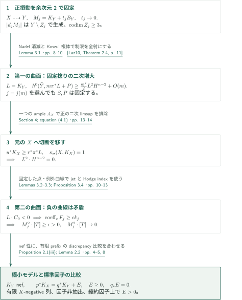
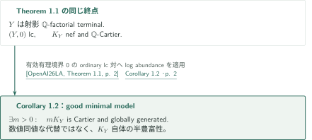

# Minimal models in numerical dimension one

**摂動MMPの余次元2での安定化と、二つの曲面によるnef性判定**

原稿は、固定ample捻り付きの切断増大で測った数値次元が1であるとき、有限の$K$-negativeな操作で極小モデルを構成する。摂動ごとの有限MMPを並べただけでは係数0での停止にならないため、まず一つのモデルを固定し、曲面上の交点数と切断の消滅次数から標準因子のnef性を得る。

## 1. 主要結果

### Theorem 1.1 — 数値次元1の極小モデル

$X$を次元$n\geq3$の滑らかな連結射影複素多様体とし、$K_X$がpseudo-effectiveで$\kappa_\sigma(X,K_X)=1$と仮定する。ここで原典(1.1)の規約は、Cartier因子$D$に対し

$$
\kappa_\sigma(X,D)=\max\left\{k\in\{0,\ldots,n\}:\exists A\text{ ample Cartier},\ \limsup_{m\to\infty}\frac{h^0(X,mD+A)}{m^k}>0\right\}.
$$

集合が空なら$-\infty$とし、$A$は極限の前に固定する。この仮定を、nef性未確立の$K_X$に対する交点数の定義へ置き換えない。

このとき、正規射影$\mathbb Q$-factorial terminal多様体$Y$と、有限列$\varphi:X\dashrightarrow Y$（$K$-negativeな因子的縮約とflipからなる）が存在し、$K_Y$はnefである。逆写像は素因子を縮約しない。共通の滑らかな射影解消$p:W\to X$, $q:W\to Y$上で、整合的に選んだ標準因子について

$$
p^*K_X=q^*K_Y+E,
\qquad E\geq0,\qquad E\text{ は }q\text{-exceptionalな有理因子},
$$

かつ$\operatorname{Supp}E$は$\varphi$が縮約する$X$上のすべての素因子の狭義変換を含む。

<!-- cite:main -->[Theorem 1.1; equation (1.1) · pp. 1–2](https://github.com/openai/math/blob/1581d4cbdd69a0faf34b2089614fe2a814316a6a/preprints/Minimal-models-in-numerical-dimension-one-September-24-2026/paper.pdf)<!-- /cite -->

### Corollary 1.2 — 同じ終点のgood minimal model性

Theorem 1.1の仮定の下で、同じ$\mathbb Q$-factorial terminal終点$Y$の$K_Y$はsemiampleであり、$Y$は$X$のgood minimal modelである。これはlog abundanceを追加して得る系である。Theorem 1.1の固定捻り付き増大の議論だけでは、$K_Y$のsemiamplenessや$K_X$の非消滅を主張していない。

<!-- cite:cor -->[Corollary 1.2 · p. 2](https://github.com/openai/math/blob/1581d4cbdd69a0faf34b2089614fe2a814316a6a/preprints/Minimal-models-in-numerical-dimension-one-September-24-2026/paper.pdf)<!-- /cite -->

## 図の矢印に付した引用

<!-- reference-guide -->
略号のない定理・補題・節・式番号は本原稿 [Minimal models in numerical dimension one](https://github.com/openai/math/blob/1581d4cbdd69a0faf34b2089614fe2a814316a6a/preprints/Minimal-models-in-numerical-dimension-one-September-24-2026/paper.pdf) を指します。外部入力には次の略号を使います。

- [BCHM10](https://arxiv.org/pdf/math/0610203v2) Caucher Birkar; Paolo Cascini; Christopher D. Hacon; James McKernan — *Existence of minimal models for varieties of log general type*：big境界付きklt対の有限scaling MMP。arXiv:math/0610203v2 (2008-08-14); downloaded 81-page PDF bears 2024-11-26 compilation date。
- [Laz10](https://www.math.stonybrook.edu/~roblaz/Reprints/Lazarsfeld.PCMI.Short.Course.MI.pdf) Robert Lazarsfeld — *A short course on multiplier ideals*：固定捻り付き制限全射のためのNadel消滅。Author-hosted 37-page PDF, arXiv:0901.0651v1 (2009-01-06); cited publication 2010。
- [OpenAI26LA](https://github.com/openai/math/blob/1581d4cbdd69a0faf34b2089614fe2a814316a6a/preprints/Log-abundance-in-characteristic-zero-September-24-2026/paper.pdf) OpenAI — *Log abundance in characteristic zero*：系にのみ追加するordinary lc log abundance。September 24, 2026; commit 1581d4cbdd69a0faf34b2089614fe2a814316a6a。
- [KM98](https://doi.org/10.1017/CBO9780511662560) János Kollár; Shigefumi Mori — *Birational Geometry of Algebraic Varieties*：MMP、base point free、negativity。引用書原本の番号・頁照合は保留。Cambridge Tracts in Mathematics 134, 1998; book passages not independently located。
- [Har77](https://doi.org/10.1007/978-1-4757-3849-0) Robin Hartshorne — *Algebraic Geometry*：曲面Riemann–RochとHodge index。本稿の使用を読解、原書照合は保留。Graduate Texts in Mathematics 52, 1977; book passages not independently located。
- [Ful98](https://doi.org/10.1007/978-1-4612-1700-8) William Fulton — *Intersection Theory*：cycle交叉とBorel–Moore局所化。本稿の使用を読解、原書照合は保留。Second edition, 1998; book passages not independently located。

各引用に結果番号とページを付します。誌面番号とPDF内の位置が異なる場合は両方を示します。GitHubの閲覧リンクではページ位置への自動移動を前提としません。
<!-- /reference-guide -->

## 2. Theorem 1.1 の証明 — 固定モデルと二つの曲面

<!-- proof-target:1 -->証明対象：[Theorem 1.1; equation (1.1) · pp. 1–2](https://github.com/openai/math/blob/1581d4cbdd69a0faf34b2089614fe2a814316a6a/preprints/Minimal-models-in-numerical-dimension-one-September-24-2026/paper.pdf)<!-- /proof-target -->

**証明の道筋。** 主張は[Theorem 1.1](#theorem-1-1)を参照する。Proposition 2.1で$X\dashrightarrow Y$を固定し、$M_j=K_Y+t_jB_Y$, $t_j\to0$の十分な倍数が余次元3以上の集合の外で生成される状況を作る。第一の非常に一般の曲面は正の平方を固定捻り付き二次増大へ変換する。$\kappa_\sigma=1$がその平方を0にする。第二の曲面は任意の負の曲線を検出し、平方0との矛盾からnef性を得る。

### 1. 有限の正摂動を、余次元2で固定する

$(X,B)$がklt、$B\geq0$がampleな有理因子、$K_X+B$がampleとなるよう選ぶ。$t_j=2^{-j}$とし、前のnef終点から$(K+t_{j+1}B)$-MMPを$(t_j-t_{j+1})B$でscalingする。境界の変換はbigかつeffectiveで十分であり、ample性を保つ必要はない。BCHMの有限scaling MMPを使い、adjointもbigなのでMori fibre spaceへの分岐を除く。各終点のnefかつbigなklt adjointにbase point free theoremを適用する。

<!-- cite:bchm -->[&#91;BCHM10, Corollary 1.4.2, p. 10&#93;](https://arxiv.org/pdf/math/0610203v2#page=10)<!-- /cite -->

scaling ray上の$(K+t_{j+1}B)\cdot R<0$と$(K+t_{j+1}B+\lambda C)\cdot R=0$から$B\cdot R>0$, $K\cdot R<0$を得る。小縮約では$K-b(K+t_{j+1}B)\sim_{\mathbb Q}h^*A$を相対base point free theoremで降下し、$b>0$とadjointの相対ample性からflip後の$K$も相対ampleとする。したがって、各段階は実際にcanonical MMPである。

Lemma 2.3はこの連結列の停止そのものを主張しない。因子的縮約の有限性、discrepancyの厳密増加によりflip先の余次元2成分を有限回で除き、次に代数的$(n-2)$-cycle類の張る有限次元空間の次元減少でflip元も扱う。この後の一つの終点$Y$を選ぶと、各後続の有限列は両側で余次元3以上の外では同型である。正規性により切断を移し、$|d_jM_j|$が$Y\setminus Z_j$で生成される。$d_j$と$Z_j$は$j$に依存してよい。

<!-- cite:perturbations -->[Proposition 2.1; Lemmas 2.2–2.3 · pp. 4–8](https://github.com/openai/math/blob/1581d4cbdd69a0faf34b2089614fe2a814316a6a/preprints/Minimal-models-in-numerical-dimension-one-September-24-2026/paper.pdf)<!-- /cite -->

### 2. 一つのample捻りを保って平方を0にする

$L=K_Y$と置く。$Y$はterminalなので余次元2で滑らかである。非常に一般の完全交叉曲面$S\subset Y$を、可算個の$Z_j$と$\operatorname{Sing}Y$をすべて避けて選ぶ。各$M_j|_S$はsemiample、従って極限$L|_S$はnefで、$L^2\cdot H^{n-2}\geq0$である。

解消$\pi:\widehat Y\to Y$上で、$r=n-2$, $A=\pi^*H$とし、ample Cartier因子$A_0$を用いて$P=K_{\widehat Y}+rA+A_0$を固定する。各$m$に対し先に$j=j(m)$を$mt_j$が十分小さくなるように選び、その後**$d_j$の倍数で$k>m$**を選ぶ。一般の$D_m\in|k\pi^*M_j|$から$R_m=(m/k)D_m$を取ると、$\mathcal J(R_m)$は$S$付近で自明である。$m\pi^*L+P-iA-K_{\widehat Y}-R_m$は$0\leq i\leq r$でampleとなり、Nadel消滅とKoszul複体が制限写像の全射性を与える。

<!-- cite:laz -->[&#91;Laz10, Theorem 2.4, p. 11&#93;](https://www.math.stonybrook.edu/~roblaz/Reprints/Lazarsfeld.PCMI.Short.Course.MI.pdf#page=11)<!-- /cite -->

曲面Riemann–Rochから、$dL$がCartierとなる一つの$d$の倍数に沿って

$$
h^0(\widehat Y,m\pi^*L+P)\geq\frac{m^2}{2}L^2\cdot H^{n-2}+O(m).
$$

ここで$P$と誤差の係数は$m,j,k$に依存しない。共通解消上の有効差$u^*K_X-r^*\pi^*L\geq0$で切断を$X$へ移し、固定Cartier因子$P_X=u_*r^*P$を一つのample因子$A_X$で上から抑える。正の平方なら$h^0(X,mK_X+A_X)\geq cm^2$が得られ、原典(1.1)に矛盾する。従って$L^2\cdot H^{n-2}=0$である。$\kappa_\sigma=1$から一様な$O(m)$上界を仮定する必要はない。

<!-- cite:growth -->[Lemma 3.1 · pp. 8–10](https://github.com/openai/math/blob/1581d4cbdd69a0faf34b2089614fe2a814316a6a/preprints/Minimal-models-in-numerical-dimension-one-September-24-2026/paper.pdf)<!-- /cite -->
<!-- cite:completion -->[Section 4; equation (4.1) · pp. 13–14](https://github.com/openai/math/blob/1581d4cbdd69a0faf34b2089614fe2a814316a6a/preprints/Minimal-models-in-numerical-dimension-one-September-24-2026/paper.pdf)<!-- /cite -->

### 3. 負の曲線を通る曲面でnef性を確定する

仮に$L\cdot C_0<0$なら、$C_0$上の適切な点$x$を通る別の完全交叉の曲面成分$T$を固定する。最初の非常に一般の$S$は$C_0$を見逃し得るため、この変更が必要である。各成分の$M_j$の平方は非負で、重複度付きの和が$M_j^2\cdot H^{n-2}\to0$なので、$M_j^2\cdot[T]\to0$。

一方、解消上で$x$の上の点$z$を通り$C_0$を支配する曲線を固定する。Lemma 3.2のambient jet評価から、引き戻した$k_jM_j$の全切断は$z$で少なくとも$ck_j$次消滅する（$c>0$は固定）。$T$の固定解消上で一度blow-upした例外曲線$e$に、固定成分$F_j$が$\operatorname{coeff}_eF_j\geq ck_j$を持つ。Hodge index theoremによる一様な$F_j^2\leq-\epsilon k_j^2$と可動部分の平方の非負性が

$$
0\leq(k_jf^*(M_j|_T)-F_j)^2
=k_j^2(M_j^2\cdot[T])+F_j^2
\quad\Longrightarrow\quad M_j^2\cdot[T]\geq\epsilon
$$

を与え、極限0に矛盾する。特異集合内の曲線もこの構成に含まれる。これがProposition 3.4を$L=K_Y$へ適用する箇所である。

<!-- cite:nefness -->[Lemmas 3.2–3.3; Proposition 3.4 · pp. 10–13](https://github.com/openai/math/blob/1581d4cbdd69a0faf34b2089614fe2a814316a6a/preprints/Minimal-models-in-numerical-dimension-one-September-24-2026/paper.pdf)<!-- /cite -->

### 4. 双有理的な全結論を有限列から回収する

$Y$の射影性、$\mathbb Q$-factorial性、terminal性、因子の非抽出はProposition 2.1の有限canonical prefixから得る。Lemma 2.2の有効な標準因子差を共通解消上で足せば$p^*K_X=q^*K_Y+E$となる。$Y$の素因子に写る成分の係数は0なので$E$は$q$-exceptionalである。$X$上で縮約される素因子はlog discrepancy 1からterminalな$Y$上の1より大きい値へ移るため、その狭義変換は$E$に正の係数で現れる。以上で主定理のnef性以外の結論も対応する。

<!-- cite:comparison -->[Proposition 2.1(iii); Lemma 2.2 · pp. 4–5, 8](https://github.com/openai/math/blob/1581d4cbdd69a0faf34b2089614fe2a814316a6a/preprints/Minimal-models-in-numerical-dimension-one-September-24-2026/paper.pdf)<!-- /cite -->

## 3. Corollary 1.2 の証明 — ordinary log abundanceを追加する

<!-- proof-target:2 -->証明対象：[Corollary 1.2 · p. 2](https://github.com/openai/math/blob/1581d4cbdd69a0faf34b2089614fe2a814316a6a/preprints/Minimal-models-in-numerical-dimension-one-September-24-2026/paper.pdf)<!-- /proof-target -->

[Corollary 1.2](#corollary-1-2)は、構成済みの同じ終点へ追加の入力を適用する。

### 1. nefな標準因子からsemiampleな標準因子へ

$Y$は正規射影terminalで$K_Y$は$\mathbb Q$-Cartierかつnefである。従ってordinary pair $(Y,0)$はlcで、境界0は有効有理境界である。標数0のlog abundanceを適用すると、**元の$K_Y$の正のCartier倍数**が大域生成される。数値同値な別の因子を得る結論ではない。Theorem 1.1で構成した写像と比較式を保持したまま、good minimal modelとなる。

<!-- cite:la -->[&#91;OpenAI26LA, Theorem 1.1, p. 2&#93;](https://github.com/openai/math/blob/1581d4cbdd69a0faf34b2089614fe2a814316a6a/preprints/Log-abundance-in-characteristic-zero-September-24-2026/paper.pdf)<!-- /cite -->
<!-- cite:cor -->[Corollary 1.2 · p. 2](https://github.com/openai/math/blob/1581d4cbdd69a0faf34b2089614fe2a814316a6a/preprints/Minimal-models-in-numerical-dimension-one-September-24-2026/paper.pdf)<!-- /cite -->

## 4. どの論文が、どの段階を担うか

| 入力 | 使用箇所 | 役割・適用条件 | 確認範囲 |
|---|---|---|---|
| BCHMのbig境界付きscaling MMP | Proposition 2.1, p. 7 | klt、big effective境界、scaling前のnef adjointを保ち各正摂動を有限で終える | Corollary 1.4.2と停止を述べる直前の段落、適用箇所を照合 |
| LazarsfeldのNadel消滅 | Lemma 3.1, p. 9 | smooth解消上、effective $R_m$、差がample。固定捻りの制限全射へ | Theorem 2.4の記述と式(3.7)を照合 |
| Kollár–MoriのMMP・base point free・negativity | §§2.1–2.2, pp. 5–8 | canonical negativity、相対降下、特異点と有効差 | 本稿での使用内容を読解。引用書の各番号・頁の原本照合は保留 |
| 曲面Riemann–Roch・Hodge index、cycleの交叉 | Lemmas 3.1, 3.3; Proposition 3.4 | 固定曲面の二次増大・例外固定部分の一様負値 | 本稿の計算と使用条件を読解。Hartshorne/Fulton原本の頁別照合は保留 |
| Log abundance in characteristic zero（034） | Corollary 1.2, p. 2 | ordinary lc対$(Y,0)$のnef adjointをsemiampleにする | Theorem 1.1の記述と適用を照合。入力定理の証明は対象外 |

AHKの4次元flipの議論はLemma 2.3の方法上の先行例であり、任意次元の停止定理として輸入されない。036のgeneralized lc原稿をTheorem 1.1の入力にする構成でもない。関連する一般存在定理との包含関係から、未確認の直接依存を追加しない。

## 5. 原典を読む入口と確認範囲

<!-- reading-list -->
- [Theorem 1.1; equation (1.1) · pp. 1–2](https://github.com/openai/math/blob/1581d4cbdd69a0faf34b2089614fe2a814316a6a/preprints/Minimal-models-in-numerical-dimension-one-September-24-2026/paper.pdf) — 切断増大の規約と主定理の全結論
- [Proposition 2.1; Lemmas 2.2–2.3 · pp. 4–8](https://github.com/openai/math/blob/1581d4cbdd69a0faf34b2089614fe2a814316a6a/preprints/Minimal-models-in-numerical-dimension-one-September-24-2026/paper.pdf) — 正摂動から余次元2で固定したモデルへ
- [Lemma 3.1 · pp. 8–10](https://github.com/openai/math/blob/1581d4cbdd69a0faf34b2089614fe2a814316a6a/preprints/Minimal-models-in-numerical-dimension-one-September-24-2026/paper.pdf) — 固定捻りとj(m)の選び方
- [Lemmas 3.2–3.3; Proposition 3.4 · pp. 10–13](https://github.com/openai/math/blob/1581d4cbdd69a0faf34b2089614fe2a814316a6a/preprints/Minimal-models-in-numerical-dimension-one-September-24-2026/paper.pdf) — 固定曲面上での負の曲線の排除
- [Section 4; equation (4.1) · pp. 13–14](https://github.com/openai/math/blob/1581d4cbdd69a0faf34b2089614fe2a814316a6a/preprints/Minimal-models-in-numerical-dimension-one-September-24-2026/paper.pdf) — Xへの切断移送と数値次元の使用
- [Corollary 1.2 · p. 2](https://github.com/openai/math/blob/1581d4cbdd69a0faf34b2089614fe2a814316a6a/preprints/Minimal-models-in-numerical-dimension-one-September-24-2026/paper.pdf) — log abundanceを追加する位置
<!-- /reading-list -->

Theorem 1.1、Corollary 1.2、および§§2–4の証明本文を読解し、固定モデル・固定捻り・固定例外曲線がどこで選ばれるかを照合した。BCHM、Nadel消滅、log abundanceは入力結果の記述と適用を確認した。古典的教科書の上記箇所の原本照合、外部結果そのものの証明、全論証の独立検証は行っていない。ここで紹介した結論は原稿の主張であり、専門家査読や形式検証による認定ではない。
