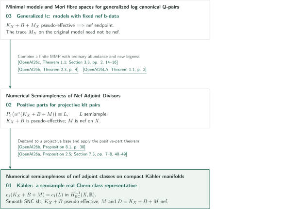

# Numerical semiampleness and generalized minimal models

**036 · Numerical semiampleness and generalized minimal models**

Four manuscripts address numerical semiampleness of nef adjoints and model existence for generalized lc pairs with fixed nef b-data. A semiample numerical representative, equality of real Bott–Chern classes, and semiampleness of the original adjoint are distinct conclusions. The numerical-dimension-one paper supplies a separate construction of minimal models using surface intersections.

<!-- Stage 2: place the generated English catalogue PDF link here. No PDF is generated or linked in Stage 1. -->

## 1. Papers in official catalogue order

CATALOGINVENTORYTOKEN

## 2. From model existence to numerical semiampleness

The diagram shows a chain of reductions linking three manuscripts. Downward edges are direct uses of specific results, not containment of every conclusion or verification of complete proofs. Box numbers follow the official inventory; their placement follows the dependency order.

### References in the diagram

<!-- reference-guide -->
- [OpenAI26a](https://github.com/openai/math/blob/1581d4cbdd69a0faf34b2089614fe2a814316a6a/preprints/Numerical-semiampleness-of-nef-adjoint-classes-on-compact-Kahler-manifolds-October-6-2026/numerical-generalized-abundance.pdf) OpenAI — *Numerical semiampleness of nef adjoint classes on compact Kähler manifolds*. October 6, 2026.
- [OpenAI26b](https://github.com/openai/math/blob/1581d4cbdd69a0faf34b2089614fe2a814316a6a/preprints/Numerical-Semiampleness-of-Nef-Adjoint-Divisors-October-3-2026/paper.pdf) OpenAI — *Numerical Semiampleness of Nef Adjoint Divisors*. October 3, 2026.
- [OpenAI26c](https://github.com/openai/math/blob/1581d4cbdd69a0faf34b2089614fe2a814316a6a/preprints/Minimal-models-and-Mori-fibre-spaces-for-generalized-log-canonical-Q-pairs-September-24-2026/paper.pdf) OpenAI — *Minimal models and Mori fibre spaces for generalized log canonical Q-pairs*. September 24, 2026.
- [OpenAI26d](https://github.com/openai/math/blob/1581d4cbdd69a0faf34b2089614fe2a814316a6a/preprints/Minimal-models-in-numerical-dimension-one-September-24-2026/paper.pdf) OpenAI — *Minimal models in numerical dimension one*. September 24, 2026.
- [OpenAI26LA](https://github.com/openai/math/blob/1581d4cbdd69a0faf34b2089614fe2a814316a6a/preprints/Log-abundance-in-characteristic-zero-September-24-2026/paper.pdf) OpenAI — *Log abundance in characteristic zero*. September 24, 2026.
<!-- /reference-guide -->

OpenAI26c supplies model existence, OpenAI26b the projective positive part, and OpenAI26a the Kähler real-Chern-class conclusion. OpenAI26LA is an additional input for ordinary adjoints. OpenAI26d denotes the separate surface argument discussed below.

The projective paper uses the finite MMP in the Q-factorial generalized klt setting to control two adjoints. It combines ordinary log abundance with its new bigness argument to construct the positive part. The Kähler paper applies this positive-part theorem to an ordinary klt pair on a **projective base** obtained after algebraic reduction. This is not an arrow running an arbitrary generalized MMP on a Kähler space.

<!-- cite:glm -->[&#91;OpenAI26c, Theorem 1.1; Section 3.3, pp. 2, 14–16&#93;](https://github.com/openai/math/blob/1581d4cbdd69a0faf34b2089614fe2a814316a6a/preprints/Minimal-models-and-Mori-fibre-spaces-for-generalized-log-canonical-Q-pairs-September-24-2026/paper.pdf)<!-- /cite -->
<!-- cite:p-input -->[&#91;OpenAI26b, Theorem 2.3, p. 4&#93;](https://github.com/openai/math/blob/1581d4cbdd69a0faf34b2089614fe2a814316a6a/preprints/Numerical-Semiampleness-of-Nef-Adjoint-Divisors-October-3-2026/paper.pdf)<!-- /cite -->
<!-- cite:p-positive -->[&#91;OpenAI26b, Proposition 8.1, p. 30&#93;](https://github.com/openai/math/blob/1581d4cbdd69a0faf34b2089614fe2a814316a6a/preprints/Numerical-Semiampleness-of-Nef-Adjoint-Divisors-October-3-2026/paper.pdf)<!-- /cite -->
<!-- cite:k-input -->[&#91;OpenAI26a, Proposition 2.5; Section 7.3, pp. 7–8, 48–49&#93;](https://github.com/openai/math/blob/1581d4cbdd69a0faf34b2089614fe2a814316a6a/preprints/Numerical-semiampleness-of-nef-adjoint-classes-on-compact-Kahler-manifolds-October-6-2026/numerical-generalized-abundance.pdf)<!-- /cite -->

Follow the [projective article](../projective-numerical-semiampleness/article.en.md) and the [Kähler article](../kahler-numerical-semiampleness/article.en.md) for hypotheses and proof steps. The Kähler paper also uses ordinary Kähler log abundance (the October 6, 2026 version in 034) and Orbifold Iitaka (033); their versions and distinct roles are recorded in its reference guide.

The [numerical-dimension-one article](../minimal-models-numerical-dimension-one/article.en.md) fixes positive perturbations in codimension two and proves nefness using growth with a fixed twist and a surface through a negative curve. Its Theorem 1.1 does not use the generalized existence theorem above. Corollary 1.2 separately adds ordinary log abundance to make the same terminal endpoint a good minimal model.

<!-- cite:nd -->[&#91;OpenAI26d, Theorem 1.1; Corollary 1.2, p. 2&#93;](https://github.com/openai/math/blob/1581d4cbdd69a0faf34b2089614fe2a814316a6a/preprints/Minimal-models-in-numerical-dimension-one-September-24-2026/paper.pdf)<!-- /cite -->
<!-- cite:la -->[&#91;OpenAI26LA, Theorem 1.1, p. 2&#93;](https://github.com/openai/math/blob/1581d4cbdd69a0faf34b2089614fe2a814316a6a/preprints/Log-abundance-in-characteristic-zero-September-24-2026/paper.pdf)<!-- /cite -->

Corollary 1.2 of the [generalized lc article](../generalized-lc-minimal-models/article.en.md) likewise treats ordinary pairs with M=0, to which ordinary abundance can subsequently be added. No semiampleness conclusion is extrapolated to nonzero nef b-data. Unlisted citation relations remain uninvestigated rather than being classified as absent.

## 3. Sources and checking scope

The official overview and CONTENTS are fixed at commit 1581d4cbdd69a0faf34b2089614fe2a814316a6a. The subject is the second in official display order, “Algebraic and complex geometry”; entry 036 appears on PDF p. 5. The four titles, order, versions and page counts were checked, followed by the article statements, principal reductions, and statements and applications of direct inputs. Remaining textbook checks and unverified external proofs are described in each article. These accounts explain the manuscripts' claims and do not constitute specialist review or formal verification of the entire arguments.

<!-- cite:official -->[OpenAI Research Catalog · Catalog 036 · p. 5](https://github.com/openai/math/blob/1581d4cbdd69a0faf34b2089614fe2a814316a6a/overview.pdf)<!-- /cite -->
