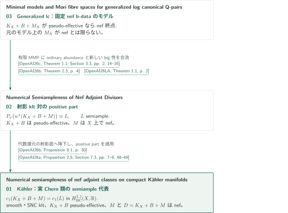

# 数値的半豊富性と一般化極小モデル

**036 · Numerical semiampleness and generalized minimal models**

nef adjointの数値的半豊富性と、固定nef b-dataを持つgeneralized lc対のモデル存在を扱う4篇である。数値同値なsemiample因子の存在、実Bott–Chern類の一致、元のadjointのsemiamplenessは区別する。数値次元1の論文は、曲面の交点論による別の極小モデル構成を与える。

<!-- Stage 2: place the generated Japanese catalogue PDF link here. No PDF is generated or linked in Stage 1. -->

## 1. 公式順の記事一覧

CATALOGINVENTORYTOKEN

## 2. モデル存在から数値的半豊富性へ

図は主要3篇の連続した帰着を示す。下向きの辺は実際に使われる結果への直接依存であり、元論文の全結論の包含や全証明の検証を表すものではない。箱の番号は公式順、配置は証明の依存順に従う。

### 図の引用案内

<!-- reference-guide -->
- [OpenAI26a](https://github.com/openai/math/blob/1581d4cbdd69a0faf34b2089614fe2a814316a6a/preprints/Numerical-semiampleness-of-nef-adjoint-classes-on-compact-Kahler-manifolds-October-6-2026/numerical-generalized-abundance.pdf) OpenAI — *Numerical semiampleness of nef adjoint classes on compact Kähler manifolds*. October 6, 2026.
- [OpenAI26b](https://github.com/openai/math/blob/1581d4cbdd69a0faf34b2089614fe2a814316a6a/preprints/Numerical-Semiampleness-of-Nef-Adjoint-Divisors-October-3-2026/paper.pdf) OpenAI — *Numerical Semiampleness of Nef Adjoint Divisors*. October 3, 2026.
- [OpenAI26c](https://github.com/openai/math/blob/1581d4cbdd69a0faf34b2089614fe2a814316a6a/preprints/Minimal-models-and-Mori-fibre-spaces-for-generalized-log-canonical-Q-pairs-September-24-2026/paper.pdf) OpenAI — *Minimal models and Mori fibre spaces for generalized log canonical Q-pairs*. September 24, 2026.
- [OpenAI26d](https://github.com/openai/math/blob/1581d4cbdd69a0faf34b2089614fe2a814316a6a/preprints/Minimal-models-in-numerical-dimension-one-September-24-2026/paper.pdf) OpenAI — *Minimal models in numerical dimension one*. September 24, 2026.
- [OpenAI26LA](https://github.com/openai/math/blob/1581d4cbdd69a0faf34b2089614fe2a814316a6a/preprints/Log-abundance-in-characteristic-zero-September-24-2026/paper.pdf) OpenAI — *Log abundance in characteristic zero*. September 24, 2026.
<!-- /reference-guide -->

OpenAI26cはモデル存在、OpenAI26bは射影的positive part、OpenAI26aはKählerでの実Chern類の結論を担う。OpenAI26LAはordinary adjointに対する追加の入力である。OpenAI26dは下記の独立した曲面論法の原稿を指す。

射影版は、generalized kltのQ-factorialな場合の有限MMPを使って二つのadjointを制御し、ordinary log abundanceと新たなbig性の議論を合わせてpositive partを構成する。Kähler版はそのpositive-part定理を、代数還元後の**射影底**上のordinary klt対へ適用する。Kähler空間で任意のgeneralized MMPをそのまま動かす矢印ではない。

<!-- cite:glm -->[&#91;OpenAI26c, Theorem 1.1; Section 3.3, pp. 2, 14–16&#93;](https://github.com/openai/math/blob/1581d4cbdd69a0faf34b2089614fe2a814316a6a/preprints/Minimal-models-and-Mori-fibre-spaces-for-generalized-log-canonical-Q-pairs-September-24-2026/paper.pdf)<!-- /cite -->
<!-- cite:p-input -->[&#91;OpenAI26b, Theorem 2.3, p. 4&#93;](https://github.com/openai/math/blob/1581d4cbdd69a0faf34b2089614fe2a814316a6a/preprints/Numerical-Semiampleness-of-Nef-Adjoint-Divisors-October-3-2026/paper.pdf)<!-- /cite -->
<!-- cite:p-positive -->[&#91;OpenAI26b, Proposition 8.1, p. 30&#93;](https://github.com/openai/math/blob/1581d4cbdd69a0faf34b2089614fe2a814316a6a/preprints/Numerical-Semiampleness-of-Nef-Adjoint-Divisors-October-3-2026/paper.pdf)<!-- /cite -->
<!-- cite:k-input -->[&#91;OpenAI26a, Proposition 2.5; Section 7.3, pp. 7–8, 48–49&#93;](https://github.com/openai/math/blob/1581d4cbdd69a0faf34b2089614fe2a814316a6a/preprints/Numerical-semiampleness-of-nef-adjoint-classes-on-compact-Kahler-manifolds-October-6-2026/numerical-generalized-abundance.pdf)<!-- /cite -->

適用仮定と証明の説明は[射影版の記事](../projective-numerical-semiampleness/article.ja.md)と[Kähler版の記事](../kahler-numerical-semiampleness/article.ja.md)へ進む。Kähler版にはさらにordinary Kähler log abundance（034の2026-10-06版）とOrbifold Iitaka（033）の入力があり、版と用途を同記事の文献案内に分けて記す。

[数値次元1の記事](../minimal-models-numerical-dimension-one/article.ja.md)は、有限正摂動を余次元2で固定し、固定捻りの増大と負の曲線を通る曲面を使ってnef性を示す。そのTheorem 1.1は上のgeneralizedモデル存在定理を使う構成ではない。Corollary 1.2ではordinary log abundanceを別途加え、同じterminal終点をgood minimal modelにする。

<!-- cite:nd -->[&#91;OpenAI26d, Theorem 1.1; Corollary 1.2, p. 2&#93;](https://github.com/openai/math/blob/1581d4cbdd69a0faf34b2089614fe2a814316a6a/preprints/Minimal-models-in-numerical-dimension-one-September-24-2026/paper.pdf)<!-- /cite -->
<!-- cite:la -->[&#91;OpenAI26LA, Theorem 1.1, p. 2&#93;](https://github.com/openai/math/blob/1581d4cbdd69a0faf34b2089614fe2a814316a6a/preprints/Log-abundance-in-characteristic-zero-September-24-2026/paper.pdf)<!-- /cite -->

[Generalized lcの記事](../generalized-lc-minimal-models/article.ja.md)のCorollary 1.2もM=0のordinary対を扱い、その後にだけordinary abundanceを追加できる。非零nef b-dataを持つ場合へsemiamplenessを外挿しない。未掲載の引用関係は未調査であり、依存なしとは扱わない。

## 3. 原典と確認範囲

公式overviewとCONTENTSの固定commit 1581d4cbdd69a0faf34b2089614fe2a814316a6aを参照し、分野は公式順の第2分野「Algebraic and complex geometry」、036の概要はPDF p. 5で確認した。4篇の順序・正式名・版・頁数を照合し、記事の主張・主要な帰着・直接入力の記述と使用箇所を点検した。個別に残る教科書照合や外部証明の未確認は各記事末尾に示す。原稿群の主張を紹介する概説であり、全論証の専門家査読・形式検証を意味しない。

<!-- cite:official -->[OpenAI Research Catalog · Catalog 036 · p. 5](https://github.com/openai/math/blob/1581d4cbdd69a0faf34b2089614fe2a814316a6a/overview.pdf)<!-- /cite -->
