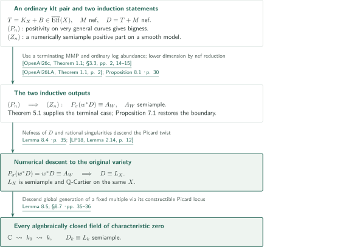
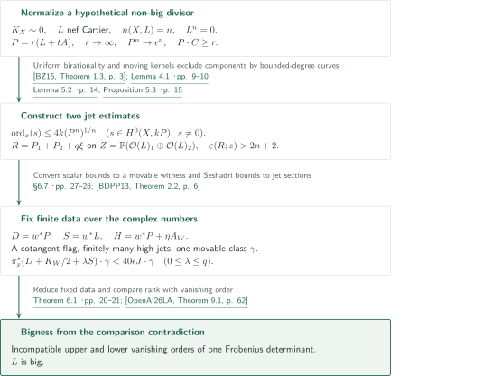
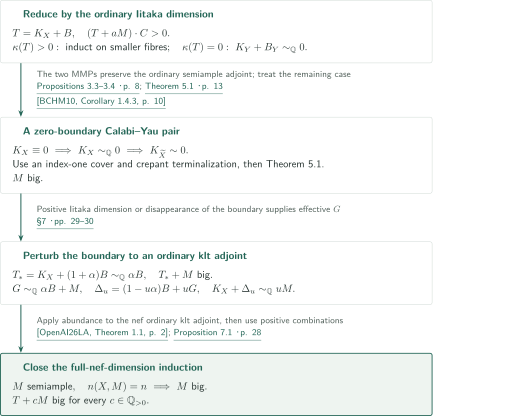
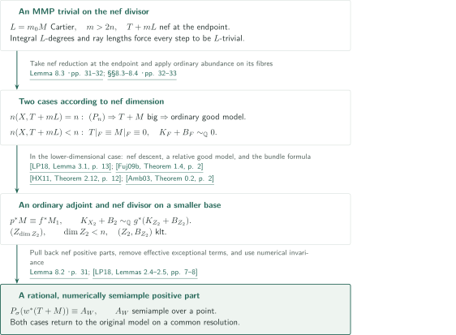
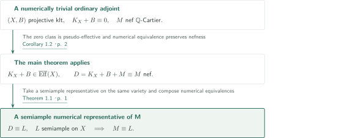

# Numerical Semiampleness of Nef Adjoint Divisors

**From full nef dimension to bigness, positive parts, and numerical descent**

The manuscript claims a semiample numerical representative on the original variety for an ordinary klt adjoint with a nef summand. The central positivity input concerns nef divisors of full nef dimension on Calabi–Yau pairs. Moving jets and a Frobenius comparison supply that input; nef reduction and induction on positive parts then produce the conclusion.

## 1. Main results

### Theorem 1.1 — Numerical semiampleness of a nef adjoint

Let $k$ be an algebraically closed field of characteristic zero and $(X,B)$ a projective klt $\mathbb Q$-pair. Assume that $T=K_X+B$ is pseudo-effective and that $M$ is a nef $\mathbb Q$-Cartier divisor **on $X$ itself**. If $D=T+M$ is nef, there is a semiample $\mathbb Q$-Cartier divisor $L$ on the same $X$ such that

$$D\equiv L.$$

Here $B$ is an effective rational boundary and $K_X+B$ is $\mathbb Q$-Cartier.

<!-- cite:main-result -->[Theorem 1.1 · p. 1](https://github.com/openai/math/blob/1581d4cbdd69a0faf34b2089614fe2a814316a6a/preprints/Numerical-Semiampleness-of-Nef-Adjoint-Divisors-October-3-2026/paper.pdf)<!-- /cite -->

### Corollary 1.2 — Nef divisors on klt Calabi–Yau pairs

Let $(X,B)$ be a projective klt $\mathbb Q$-pair over an algebraically closed field of characteristic zero. If $K_X+B\equiv0$, every nef $\mathbb Q$-Cartier divisor on $X$ is numerically semiample.

<!-- cite:main-corollary -->[Corollary 1.2 · p. 2](https://github.com/openai/math/blob/1581d4cbdd69a0faf34b2089614fe2a814316a6a/preprints/Numerical-Semiampleness-of-Nef-Adjoint-Divisors-October-3-2026/paper.pdf)<!-- /cite -->

The conclusion is neither $D\sim_{\mathbb Q}L$ nor semiampleness of $D$ itself. A nontorsion degree-zero line bundle on an elliptic curve is numerically trivial and has no sections in any positive power. The ordinary-pair hypotheses also differ from the generalized-pair data used during the MMP: the original $M$ determines a fixed nef b-divisor, whose trace on a subsequent model need not be nef.

## References on the arrows

<!-- reference-guide -->
Unprefixed theorem, lemma, section and equation numbers refer to [Numerical Semiampleness of Nef Adjoint Divisors](https://github.com/openai/math/blob/1581d4cbdd69a0faf34b2089614fe2a814316a6a/preprints/Numerical-Semiampleness-of-Nef-Adjoint-Divisors-October-3-2026/paper.pdf). External inputs use the following keys.

- [OpenAI26LA](https://github.com/openai/math/blob/1581d4cbdd69a0faf34b2089614fe2a814316a6a/preprints/Log-abundance-in-characteristic-zero-September-24-2026/paper.pdf) OpenAI — *Log abundance in characteristic zero*: Ordinary lc abundance, moving kernels and finite-data Frobenius comparison. September 24, 2026; fixed commit 1581d4cbdd69a0faf34b2089614fe2a814316a6a.
- [OpenAI26c](https://github.com/openai/math/blob/1581d4cbdd69a0faf34b2089614fe2a814316a6a/preprints/Minimal-models-and-Mori-fibre-spaces-for-generalized-log-canonical-Q-pairs-September-24-2026/paper.pdf) OpenAI — *Minimal models and Mori fibre spaces for generalized log canonical Q-pairs*: A terminating choice of MMP retaining fixed nef b-divisor data. September 24, 2026.
- [LP18](https://arxiv.org/pdf/1808.00438v2) Vladimir Lazić; Thomas Peternell — *On Generalised Abundance, I*: Positive-part comparisons and numerical descent to the base and original variety. arXiv:1808.00438v2, 6 September 2018.
- [BZ15](https://arxiv.org/pdf/1410.0938v2) Caucher Birkar; De-Qi Zhang — *Effectivity of Iitaka fibrations and pluricanonical systems of polarized pairs*: Uniform birationality for index-one nef data and reduced boundary bounds curve degrees. arXiv:1410.0938v2, 24 December 2015.
- [Amb03](https://arxiv.org/pdf/math/0308143v1) Florin Ambro — *The moduli b-divisor of an lc-trivial fibration*: Replace a Q-linear pullback ordinary klt adjoint by an effective klt boundary on the base. arXiv:math/0308143v1, 14 August 2003.
- [HX11](https://arxiv.org/pdf/1105.1169v3) Christopher D. Hacon; Chenyang Xu — *Existence of log canonical closures*: Obtain a relative good model from relative finite generation and good models on very general fibres. arXiv:1105.1169v3, stamp 28 June 2012; manuscript date July 24, 2020.
- [Fuj09b](https://www.math.kyoto-u.ac.jp/~fujino/BCHM01.pdf) Osamu Fujino — *Birkar–Cascini–Hacon–McKernan*: Finite generation of relative log canonical rings for rational klt pairs. Author notes, version 1.02, 28 November 2009.
- [CP15](https://aif.centre-mersenne.org/item/10.5802/aif.2945.pdf) Frédéric Campana; Mihai Păun — *Orbifold generic semi-positivity: an application to families of canonically polarized manifolds*: Generic semipositivity of the cotangent bundle on a smooth resolution with pseudo-effective K. Ann. Inst. Fourier 65 (2015), 835–861; published PDF.
- [BDPP13](https://arxiv.org/pdf/math/0405285v1) Sébastien Boucksom; Jean-Pierre Demailly; Mihai Păun; Thomas Peternell — *The pseudo-effective cone of a compact Kähler manifold and varieties of negative Kodaira dimension*: Separate a non-pseudo-effective divisor by a strongly movable curve. arXiv:math/0405285v1.
- [BCHM10](https://arxiv.org/pdf/math/0610203v2) Caucher Birkar; Paolo Cascini; Christopher D. Hacon; James McKernan — *Existence of minimal models for varieties of log general type*: Crepant Q-factorial terminalization of the canonical index-one cover. arXiv:math/0610203v2, 14 August 2008; PDF compilation date 26 November 2024.

Each citation gives the result and pages. When printed pagination differs from the PDF position, both are shown. GitHub previews do not automatically jump to the cited page.
<!-- /reference-guide -->

## 2. Proof of Theorem 1.1 — Two induction statements and descent to X

<!-- proof-target:1 -->Proof target：[Theorem 1.1 · p. 1](https://github.com/openai/math/blob/1581d4cbdd69a0faf34b2089614fe2a814316a6a/preprints/Numerical-Semiampleness-of-Nef-Adjoint-Divisors-October-3-2026/paper.pdf)<!-- /proof-target --> See the [statement](#theorem-1-1).

**Proof route.** Work first over $\mathbb C$ with simultaneous induction. Statement $(P_n)$ says that if, for some $a\in\mathbb Q_{>0}$, $T+aM$ has positive degree on every integral curve through a very general point, then $T+cM$ is big for every $c\in\mathbb Q_{>0}$. Statement $(Z_n)$ drops this positivity condition and asserts that $P_\sigma(w^*(T+M))$ is rational and numerically semiample on a smooth birational model. The [terminal case](#proof-2), [boundary reduction](#proof-3), and [positive-part argument](#proof-4) are detailed below. Nefness of the original $D$ is used at the end to identify its pullback with its positive part.

### 1. Preserve an ordinary semiample adjoint while making a generalized adjoint nef

Choose a terminating ordinary $T$-MMP and apply log abundance to its nef endpoint $U_0$. Next choose an MMP for $U_0+s_0N_0$ with sufficiently small $s_0>0$. If $dU_0$ is free Cartier, the extremal-ray length bound and the discrete inequality $U_i\cdot C\ge1/d$ force every step of this second program to be $U_i$-trivial. Thus the ordinary adjoint remains semiample while the generalized adjoint becomes nef.

The two effective exceptional pullback comparisons transport the positivity on very general curves to the endpoint. When $\kappa(T)>0$, the fibres of the ordinary semiample fibration admit the lower-dimensional $(P_j)$. When $\kappa(T)=0$, one has $U\sim_{\mathbb Q}0$ and reduces to full nef dimension on a Calabi–Yau pair. The input is the **existence of a terminating choice**, not termination of every sequence of flips.

<!-- cite:programs -->[Lemma 3.2 · pp. 6–7](https://github.com/openai/math/blob/1581d4cbdd69a0faf34b2089614fe2a814316a6a/preprints/Numerical-Semiampleness-of-Nef-Adjoint-Divisors-October-3-2026/paper.pdf)<!-- /cite -->

<!-- cite:positive-iitaka -->[Propositions 3.3–3.4 · p. 8](https://github.com/openai/math/blob/1581d4cbdd69a0faf34b2089614fe2a814316a6a/preprints/Numerical-Semiampleness-of-Nef-Adjoint-Divisors-October-3-2026/paper.pdf)<!-- /cite -->

<!-- cite:gm -->[&#91;OpenAI26c, Theorem 1.1; §3.3, pp. 2, 14–15&#93;](https://github.com/openai/math/blob/1581d4cbdd69a0faf34b2089614fe2a814316a6a/preprints/Minimal-models-and-Mori-fibre-spaces-for-generalized-log-canonical-Q-pairs-September-24-2026/paper.pdf)<!-- /cite -->

<!-- cite:la -->[&#91;OpenAI26LA, Theorem 1.1, p. 2&#93;](https://github.com/openai/math/blob/1581d4cbdd69a0faf34b2089614fe2a814316a6a/preprints/Log-abundance-in-characteristic-zero-September-24-2026/paper.pdf)<!-- /cite -->

### 2. Obtain a numerically semiample positive part and descend to X

Statement $(P_n)$ and the lower-dimensional $(Z_j)$ yield Proposition 8.1. Since the main theorem assumes $D$ nef, $P_\sigma(w^*D)=w^*D$ on every smooth birational model. Choose a semiample $A_W\equiv w^*D$. Clear denominators and the torsion in numerically trivial line bundles modulo $\operatorname{Pic}^0$ to obtain

$$\mathcal O_W(rA_W)\simeq w^*\mathcal O_X(rD)\otimes P_W,\qquad P_W\in\operatorname{Pic}^0(W).$$

Klt singularities are rational, so pullback identifies $\operatorname{Pic}^0(X)$ with $\operatorname{Pic}^0(W)$ and $P_W=w^*P_X$. The right side is now the pullback of a line bundle on $X$. Using $w_*\mathcal O_W=\mathcal O_X$ and the projection formula descends global generation. The resulting divisor twists $rD$ by $P_X$, so the conclusion remains numerical equivalence.

<!-- cite:positive -->[Proposition 8.1 · p. 30](https://github.com/openai/math/blob/1581d4cbdd69a0faf34b2089614fe2a814316a6a/preprints/Numerical-Semiampleness-of-Nef-Adjoint-Divisors-October-3-2026/paper.pdf)<!-- /cite -->

<!-- cite:descent -->[Lemma 8.4 · p. 35](https://github.com/openai/math/blob/1581d4cbdd69a0faf34b2089614fe2a814316a6a/preprints/Numerical-Semiampleness-of-Nef-Adjoint-Divisors-October-3-2026/paper.pdf)<!-- /cite -->

<!-- cite:lp-descent -->[&#91;LP18, Lemma 2.14, p. 12&#93;](https://arxiv.org/pdf/1808.00438v2#page=12)<!-- /cite -->

### 3. Pass to every algebraically closed field of characteristic zero

Descend the variety, boundary and Cartier data to a finitely generated field, and embed its algebraic closure $k_0$ into $\mathbb C$. The complex conclusion gives a fixed $r>0$ and $P\in\operatorname{Pic}^0(X_{\mathbb C})$ for which $\mathcal O(rD)\otimes P$ is globally generated. In a Poincaré family over the Picard variety, global generation for this fixed $r$ defines a constructible set of parameters. Its nonemptiness is reflected by algebraically closed field extensions. A $k_0$-point therefore gives the desired representative, which can be extended to the original $k$. The argument with very general points itself need not be transferred to every ground field.

<!-- cite:field -->[Lemma 8.5; §8.7 · pp. 35–36](https://github.com/openai/math/blob/1581d4cbdd69a0faf34b2089614fe2a814316a6a/preprints/Numerical-Semiampleness-of-Nef-Adjoint-Divisors-October-3-2026/paper.pdf)<!-- /cite -->

## 3. Proof of Theorem 5.1 — Small scalar jets and large two-slot jets

<!-- proof-target:2 -->Proof target：[Theorem 5.1 · p. 13](https://github.com/openai/math/blob/1581d4cbdd69a0faf34b2089614fe2a814316a6a/preprints/Numerical-Semiampleness-of-Nef-Adjoint-Divisors-October-3-2026/paper.pdf)<!-- /proof-target -->

<!-- statement:theorem-5-1 -->
### Theorem 5.1 — The terminal case with trivial canonical bundle

Let $n\ge2$ and assume $(P_j)$ for $j<n$. Let $X$ be a projective $\mathbb Q$-factorial terminal complex variety of dimension $n$ with $K_X\sim0$. If $L$ is nef Cartier and $n(X,L)=n$, then $L$ is big.

<!-- cite:terminal -->[Theorem 5.1 · p. 13](https://github.com/openai/math/blob/1581d4cbdd69a0faf34b2089614fe2a814316a6a/preprints/Numerical-Semiampleness-of-Nef-Adjoint-Divisors-October-3-2026/paper.pdf)<!-- /cite -->
<!-- /statement -->

### 1. Compare positive integral degrees with uniformly bounded curve degrees

Suppose $L$ is not big and fix an ample Cartier divisor $A$. As $t\downarrow0$, normalize

$$P=r(L+tA),\qquad r\longrightarrow\infty,\qquad P^n\longrightarrow\epsilon^n.$$

Every curve through a very general point has $L\cdot C\ge1$, hence $P\cdot C\ge r$. In the opposite direction, Lemma 4.1 constructs curves of uniformly bounded degree when the testing volume and adjoint intersection ratio are bounded. Its Birkar–Zhang input uses a reduced SNC boundary, Cartier index one for the nef summand, and a big adjoint. The lower-dimensional $(P_j)$ supply this bigness when needed.

<!-- cite:curve -->[Lemma 4.1 · pp. 9–10](https://github.com/openai/math/blob/1581d4cbdd69a0faf34b2089614fe2a814316a6a/preprints/Numerical-Semiampleness-of-Nef-Adjoint-Divisors-October-3-2026/paper.pdf)<!-- /cite -->

<!-- cite:bz -->[&#91;BZ15, Theorem 1.3, p. 3&#93;](https://arxiv.org/pdf/1410.0938v2#page=3)<!-- /cite -->

### 2. Exclude moving base components to obtain the two estimates

On the scalar side, an excessively vanishing section produces a moving base component. Its volume and canonical-intersection estimates feed into Lemma 4.1, giving $\operatorname{ord}_x(s)\le4k(P^n)^{1/n}$ for every nonzero $s\in H^0(X,kP)$ at a very general $x$.

The two-slot construction uses

$$Z=\mathbb P(\mathcal O_X(L)_1\oplus\mathcal O_X(L)_2)\longrightarrow X\times X,\qquad R=P_1+P_2+q\xi.$$

Fix $q$ before making $t$ small. The proof excludes positive-dimensional slice fibres, lower-dimensional components and sweeping branch divisors, then treats finite correspondences dominant over both factors. Non-sweeping branch images reduce the possibilities to finitely many Stein covers **for each fixed $t$**. A product-dominant family of birational graphs between fixed covers leads to a model birational to an abelian variety; the bounded-degree obstruction then excludes the last case. Consequently there is a point outside both axes with $\varepsilon(R;z)>2n+2$. The finite lists of covers themselves are not asserted to be uniform in $t$.

<!-- cite:scalar -->[Lemma 5.2 · p. 14](https://github.com/openai/math/blob/1581d4cbdd69a0faf34b2089614fe2a814316a6a/preprints/Numerical-Semiampleness-of-Nef-Adjoint-Divisors-October-3-2026/paper.pdf)<!-- /cite -->

<!-- cite:bundle -->[Proposition 5.3 · p. 15](https://github.com/openai/math/blob/1581d4cbdd69a0faf34b2089614fe2a814316a6a/preprints/Numerical-Semiampleness-of-Nef-Adjoint-Divisors-October-3-2026/paper.pdf)<!-- /cite -->

<!-- cite:exclusions -->[§§5.4–5.6 · pp. 16–20](https://github.com/openai/math/blob/1581d4cbdd69a0faf34b2089614fe2a814316a6a/preprints/Numerical-Semiampleness-of-Nef-Adjoint-Divisors-October-3-2026/paper.pdf)<!-- /cite -->

<!-- cite:la-moving -->[&#91;OpenAI26LA, Lemmas 7.1–7.5, pp. 45–52&#93;](https://github.com/openai/math/blob/1581d4cbdd69a0faf34b2089614fe2a814316a6a/preprints/Log-abundance-in-characteristic-zero-September-24-2026/paper.pdf)<!-- /cite -->

### 3. Fix all complex data before applying the Frobenius comparison

On a resolution $w:W\to X$, set $D=w^*P$ and $S=w^*L$, and perturb $w^*P$ slightly to an ample $H$. Pseudo-effectivity of $K_W$ supplies generic semipositivity of the cotangent bundle and the flag required by the comparison. The two-slot Seshadri bound produces finitely many sections generating jets through order $(2n+2)k_0$. The scalar bound implies that $\pi_x^*(2D+E)-40\epsilon J$ on the blowup of a point is not pseudo-effective. Duality with movable curves supplies one fixed strongly movable class witnessing all the weight inequalities.

Theorem 6.1 rules out coexistence of these fixed data by opposite bounds on the vanishing order of a Frobenius-evaluation determinant. Thus the assumption that $L$ is not big is contradictory. The manuscript reproves the comparison theorem; this overview checks its statement and the application in §6.7. The full slope and determinant calculation in §§6.2–6.6, the external Hanamura/Blanc sources used in §5.6, and the restriction theorem producing the flag were not independently checked.

<!-- cite:application -->[§6.7 · pp. 27–28](https://github.com/openai/math/blob/1581d4cbdd69a0faf34b2089614fe2a814316a6a/preprints/Numerical-Semiampleness-of-Nef-Adjoint-Divisors-October-3-2026/paper.pdf)<!-- /cite -->

<!-- cite:cp -->[&#91;CP15, Theorem 2.1, print p. 844 / PDF p. 11&#93;](https://aif.centre-mersenne.org/item/10.5802/aif.2945.pdf#page=11)<!-- /cite -->

<!-- cite:bdpp -->[&#91;BDPP13, Theorem 2.2, p. 6&#93;](https://arxiv.org/pdf/math/0405285v1#page=6)<!-- /cite -->

<!-- cite:la-frobenius -->[&#91;OpenAI26LA, Theorem 9.1, p. 62&#93;](https://github.com/openai/math/blob/1581d4cbdd69a0faf34b2089614fe2a814316a6a/preprints/Log-abundance-in-characteristic-zero-September-24-2026/paper.pdf)<!-- /cite -->

## 4. Proof of Proposition 7.1 — Restore the boundary on a Calabi–Yau pair

<!-- proof-target:3 -->Proof target：[Proposition 7.1 · p. 28](https://github.com/openai/math/blob/1581d4cbdd69a0faf34b2089614fe2a814316a6a/preprints/Numerical-Semiampleness-of-Nef-Adjoint-Divisors-October-3-2026/paper.pdf)<!-- /proof-target -->

<!-- statement:proposition-7-1 -->
### Proposition 7.1 — The full-nef-dimension induction statement

Let $n\ge2$ and assume $(P_j)$ for $j<n$, together with the log-abundance and terminating-MMP inputs of Theorems 2.2–2.3. Let $(X,B)$ be a projective klt $\mathbb Q$-pair of dimension $n$ over $\mathbb C$, and $M$ a nef $\mathbb Q$-Cartier divisor on $X$. Suppose $T=K_X+B$ is pseudo-effective and, for some $a\in\mathbb Q_{>0}$, every integral curve $C$ through a very general point satisfies $(T+aM)\cdot C>0$. Then $T+cM$ is big for every $c\in\mathbb Q_{>0}$.

<!-- cite:full -->[Proposition 7.1 · p. 28](https://github.com/openai/math/blob/1581d4cbdd69a0faf34b2089614fe2a814316a6a/preprints/Numerical-Semiampleness-of-Nef-Adjoint-Divisors-October-3-2026/paper.pdf)<!-- /cite -->
<!-- /statement -->

### 1. Transfer the zero-boundary case to Theorem 5.1

The preceding reductions allow us to focus on $K_X+B\equiv0$ and $M$ of full nef dimension. If $B=0$, log abundance gives $K_X\sim_{\mathbb Q}0$. The index-one cover is klt and canonical; after crepant terminalization it is terminal and $\mathbb Q$-factorial with $K\sim0$. Apply Theorem 5.1 to a Cartier multiple of the pulled-back $M$, then descend bigness, which is detected by a dominant generically finite pullback.

<!-- cite:bchm -->[&#91;BCHM10, Corollary 1.4.3, p. 10&#93;](https://arxiv.org/pdf/math/0610203v2#page=10)<!-- /cite -->

### 2. Enlarge the boundary slightly and realize M as an ordinary adjoint

For $B\ne0$, set $T_*:=K_X+(1+\alpha)B\sim_{\mathbb Q}\alpha B$. If $\kappa(T_*)>0$, Proposition 3.3 gives bigness of $T_*+M$. If it is zero, the two-stage MMP has $B_Y=0$ at its endpoint, so the zero-boundary case just established gives the same conclusion. This avoids using Proposition 7.1 before completing its proof.

Choose an effective $G\sim_{\mathbb Q}\alpha B+M$. For a sufficiently small positive rational $u$,

$$\Delta_u=(1-u\alpha)B+uG\ge0,\qquad K_X+\Delta_u\sim_{\mathbb Q}uM,$$

and $(X,\Delta_u)$ is an ordinary klt pair. Its adjoint is nef, so log abundance now makes $M$ itself semiample. Full nef dimension forces the associated morphism to be generically finite, and hence $M$ is big. Finally, the positive-combination argument of Proposition 3.4 gives bigness of $T+cM$ for every $c>0$. The stronger intermediate semiampleness conclusion belongs to this specially constructed ordinary-adjoint situation.

<!-- cite:boundary -->[§7 · pp. 29–30](https://github.com/openai/math/blob/1581d4cbdd69a0faf34b2089614fe2a814316a6a/preprints/Numerical-Semiampleness-of-Nef-Adjoint-Divisors-October-3-2026/paper.pdf)<!-- /cite -->

<!-- cite:la -->[&#91;OpenAI26LA, Theorem 1.1, p. 2&#93;](https://github.com/openai/math/blob/1581d4cbdd69a0faf34b2089614fe2a814316a6a/preprints/Log-abundance-in-characteristic-zero-September-24-2026/paper.pdf)<!-- /cite -->

## 5. Proof of Proposition 8.1 — Nef reduction and descent of positive parts

<!-- proof-target:4 -->Proof target：[Proposition 8.1 · p. 30](https://github.com/openai/math/blob/1581d4cbdd69a0faf34b2089614fe2a814316a6a/preprints/Numerical-Semiampleness-of-Nef-Adjoint-Divisors-October-3-2026/paper.pdf)<!-- /proof-target -->

<!-- statement:proposition-8-1 -->
### Proposition 8.1 — Rationality and numerical semiampleness of the positive part

Let $(X,B)$ be a projective klt $\mathbb Q$-pair over $\mathbb C$, with $K_X+B$ pseudo-effective, and let $M$ be a nef $\mathbb Q$-Cartier divisor on $X$. There is a projective birational morphism $w:W\to X$ from a smooth projective variety such that

$$P_\sigma\bigl(w^*(K_X+B+M)\bigr)$$

is rational and numerically equivalent to a semiample $\mathbb Q$-divisor on $W$. Nefness of $K_X+B+M$ itself is not assumed here.

<!-- cite:positive -->[Proposition 8.1 · p. 30](https://github.com/openai/math/blob/1581d4cbdd69a0faf34b2089614fe2a814316a6a/preprints/Numerical-Semiampleness-of-Nef-Adjoint-Divisors-October-3-2026/paper.pdf)<!-- /cite -->
<!-- /statement -->

### 1. Prepare the alternatives by an MMP trivial on the nef divisor

Make $L=m_0M$ Cartier and choose $m>2n$. On a $(T+mL)$-negative ray, the inequality $L\cdot C>0$ would imply $(T+mL)\cdot C\ge m-2n>0$, using integrality and the ordinary ray-length bound. Thus the chosen terminating MMP is $L$-trivial and also $T$-negative. Its endpoint has $T+mL$ nef and retains a nef transform of $M$.

If $T+mL$ has full nef dimension, $(P_n)$ makes $T+M$ big. A decomposition $T+M\sim_{\mathbb Q}A+G$ realizes a positive rational multiple $(1+v)(T+M)$ as an ordinary big klt adjoint. The pullback of the semiample adjoint on its good minimal model gives its positive part.

<!-- cite:nef-mmp -->[Lemma 8.3 · pp. 31–32](https://github.com/openai/math/blob/1581d4cbdd69a0faf34b2089614fe2a814316a6a/preprints/Numerical-Semiampleness-of-Nef-Adjoint-Divisors-October-3-2026/paper.pdf)<!-- /cite -->

<!-- cite:nef-reduction -->[§§8.3–8.4 · pp. 32–33](https://github.com/openai/math/blob/1581d4cbdd69a0faf34b2089614fe2a814316a6a/preprints/Numerical-Semiampleness-of-Nef-Adjoint-Divisors-October-3-2026/paper.pdf)<!-- /cite -->

### 2. Reduce to an ordinary adjoint and a nef divisor on a smaller base

If the nef dimension is smaller, a very general compact nef-reduction fibre $F$ has $T|_F$ pseudo-effective, $M|_F$ nef, and $(T+mL)|_F\equiv0$. These signs make both restrictions numerically trivial. Ordinary log abundance then gives $K_F+B|_F\sim_{\mathbb Q}0$.

Birational descent of nef divisors produces $f:X_1\to Z_1$ after resolution, with $p^*M\equiv f^*M_1$ and $M_1$ nef. This is **numerical equivalence**. Write $K_{X_1}+B_1=p^*T+E$, where $E\ge0$ is $p$-exceptional. The ordinary adjoint has Iitaka dimension zero on the general fibre. Relative finite generation of its log canonical ring and good minimal models of very general fibres give a relative good model. Its semiample fibration $g:X_2\to Z_2$ satisfies

$$K_{X_2}+B_2\sim_{\mathbb Q}g^*A_2,\qquad \dim Z_2=\dim Z_1<n.$$

Apply Ambro's result to this **Q-linear identity for an ordinary klt adjoint**, replacing $A_2$ by $K_{Z_2}+B_{Z_2}$ with effective klt boundary. Pseudo-effectivity of the ordinary adjoint upstairs and sections supplied by its good model descend to show that the base adjoint is pseudo-effective. Statement $(Z_{\dim Z_2})$ therefore applies.

<!-- cite:lp-base -->[&#91;LP18, Lemma 3.1, p. 13&#93;](https://arxiv.org/pdf/1808.00438v2#page=13)<!-- /cite -->

<!-- cite:fujino -->[&#91;Fuj09b, Theorem 1.4, p. 2&#93;](https://www.math.kyoto-u.ac.jp/~fujino/BCHM01.pdf#page=2)<!-- /cite -->

<!-- cite:hx -->[&#91;HX11, Theorem 2.12, p. 12&#93;](https://arxiv.org/pdf/1105.1169v3#page=12)<!-- /cite -->

<!-- cite:hx-termination -->[&#91;HX11, Corollary 2.9, p. 9&#93;](https://arxiv.org/pdf/1105.1169v3#page=9)<!-- /cite -->

<!-- cite:ambro -->[&#91;Amb03, Theorem 0.2, p. 2&#93;](https://arxiv.org/pdf/math/0308143v1#page=2)<!-- /cite -->

<!-- cite:relative -->[§8.5 · pp. 33–34](https://github.com/openai/math/blob/1581d4cbdd69a0faf34b2089614fe2a814316a6a/preprints/Numerical-Semiampleness-of-Nef-Adjoint-Divisors-October-3-2026/paper.pdf)<!-- /cite -->

### 3. Use positive-part comparisons to return to the original model

The lower-dimensional positive part is numerically semiample, hence nef. Use the pullback formula for a nef positive part, its invariance under adding effective exceptional divisors, and the numerical invariance of its rationality and numerical semiampleness. These rules allow the numerical descent of $M$ and the Q-linear ordinary-adjoint formula to enter the same comparison. Reverse the relative MMP from $X_2$ and then remove the $p$-exceptional $E$, obtaining the asserted positive part of $w^*(T+M)$. This proves $(Z_n)$ from $(P_n)$ and the lower-dimensional $(Z_j)$.

<!-- cite:positive-rules -->[Lemma 8.2 · p. 31](https://github.com/openai/math/blob/1581d4cbdd69a0faf34b2089614fe2a814316a6a/preprints/Numerical-Semiampleness-of-Nef-Adjoint-Divisors-October-3-2026/paper.pdf)<!-- /cite -->

<!-- cite:lp-positive -->[&#91;LP18, Lemmas 2.4–2.5, pp. 7–8&#93;](https://arxiv.org/pdf/1808.00438v2#page=7)<!-- /cite -->

## 6. Proof of Corollary 1.2 — A numerically trivial ordinary adjoint

<!-- proof-target:5 -->Proof target：[Corollary 1.2 · p. 2](https://github.com/openai/math/blob/1581d4cbdd69a0faf34b2089614fe2a814316a6a/preprints/Numerical-Semiampleness-of-Nef-Adjoint-Divisors-October-3-2026/paper.pdf)<!-- /proof-target --> See the [statement](#corollary-1-2).

### 1. Check the hypotheses of the main theorem

If $K_X+B\equiv0$, the ordinary adjoint is pseudo-effective. For every nef $M$, the divisor $D=K_X+B+M\equiv M$ is nef. The semiample divisor $L\equiv D$ supplied by Theorem 1.1 is therefore numerically equivalent to $M$. This replaces a numerical representative; it does not produce sections of a nontorsion numerically trivial line bundle.

<!-- cite:main-corollary -->[Corollary 1.2 · p. 2](https://github.com/openai/math/blob/1581d4cbdd69a0faf34b2089614fe2a814316a6a/preprints/Numerical-Semiampleness-of-Nef-Adjoint-Divisors-October-3-2026/paper.pdf)<!-- /cite -->

## 7. Which papers supply which steps

| Source | Used at | Role and hypotheses | Checking scope |
|---|---|---|---|
| Log abundance in characteristic zero | Lemma 3.2, §7, §8 | Actual semiampleness of nef ordinary lc/klt adjoints; no direct application to a generalized nef trace | Theorem 1.1 and its uses checked; full source proof excluded |
| Minimal models and Mori fibre spaces for generalized log canonical Q-pairs | Theorem 2.3, Lemmas 3.2 and 8.3 | A terminating choice retaining rational nef b-divisor data; preservation for Q-factorial generalized klt input compared with §3.3 | Direct input within catalogue 036 |
| Birkar–Zhang and the moving-kernel results of Log abundance | Lemma 4.1, §5 | Uniform birationality for index-one data and reduced boundary; intersection bounds for moving components | Input statements and use checked |
| Campana–Păun and BDPP | §6.7 | Generic semipositivity; separation of a non-pseudo-effective divisor by a movable curve | Statements and use checked; external flag-restriction source not checked |
| Lazić–Peternell, Fujino, Hacon–Xu and Ambro | §8 | Numerical descent of nef divisors, relative good models, the ordinary klt canonical bundle formula, and positive-part comparisons | Statements, hypotheses and use checked; external proofs excluded |

Log abundance in catalogue 034 and the generalized-minimal-model manuscript in catalogue 036 are direct inputs. Further dependency relations with the Kähler and numerical-dimension-one manuscripts of catalogue 036 are not inferred merely from the present reference check.

## 8. Return to the sources

<!-- reading-list -->
- [Lemma 3.2 · pp. 6–7](https://github.com/openai/math/blob/1581d4cbdd69a0faf34b2089614fe2a814316a6a/preprints/Numerical-Semiampleness-of-Nef-Adjoint-Divisors-October-3-2026/paper.pdf) — The two-stage MMP keeps an ordinary semiample adjoint while making a generalized adjoint nef.
- [Theorem 5.1 · p. 13](https://github.com/openai/math/blob/1581d4cbdd69a0faf34b2089614fe2a814316a6a/preprints/Numerical-Semiampleness-of-Nef-Adjoint-Divisors-October-3-2026/paper.pdf) — Entry to the full-nef-dimension bigness argument.
- [Theorem 6.1 · pp. 20–21](https://github.com/openai/math/blob/1581d4cbdd69a0faf34b2089614fe2a814316a6a/preprints/Numerical-Semiampleness-of-Nef-Adjoint-Divisors-October-3-2026/paper.pdf) — The fixed complex data and what is transferred to positive characteristic.
- [§7 · pp. 29–30](https://github.com/openai/math/blob/1581d4cbdd69a0faf34b2089614fe2a814316a6a/preprints/Numerical-Semiampleness-of-Nef-Adjoint-Divisors-October-3-2026/paper.pdf) — Close Pn using an index-one cover and boundary perturbation.
- [Proposition 8.1 · p. 30](https://github.com/openai/math/blob/1581d4cbdd69a0faf34b2089614fe2a814316a6a/preprints/Numerical-Semiampleness-of-Nef-Adjoint-Divisors-October-3-2026/paper.pdf) — The positive-part induction and its two cases.
- [§8.5 · pp. 33–34](https://github.com/openai/math/blob/1581d4cbdd69a0faf34b2089614fe2a814316a6a/preprints/Numerical-Semiampleness-of-Nef-Adjoint-Divisors-October-3-2026/paper.pdf) — Relative good models, canonical bundle formula and lower-dimensional positive parts.
- [Lemma 8.4 · p. 35](https://github.com/openai/math/blob/1581d4cbdd69a0faf34b2089614fe2a814316a6a/preprints/Numerical-Semiampleness-of-Nef-Adjoint-Divisors-October-3-2026/paper.pdf) — The Pic0 argument descending a numerical representative to X.
- [Lemma 8.5; §8.7 · pp. 35–36](https://github.com/openai/math/blob/1581d4cbdd69a0faf34b2089614fe2a814316a6a/preprints/Numerical-Semiampleness-of-Nef-Adjoint-Divisors-October-3-2026/paper.pdf) — The finite-type parameter argument for changing algebraically closed fields.
<!-- /reading-list -->

The two principal statements and their conclusions were compared with the source. Reading covered the reductions and geometric exclusions in §§3–5, the statement of Theorem 6.1 and its application in §6.7, and the proofs in §§7–8. The comparison distinguishes ordinary from generalized pairs, numerical from Q-linear equivalence, and a representative on the original variety from a positive part on a birational model.

The full Frobenius calculation in §§6.2–6.6 and comparison with the external Hanamura/Blanc and Mehta–Ramanathan statements remain unchecked. Input proofs have not been recursively verified. This is neither an independent certification of the complete manuscript nor expert peer review.
