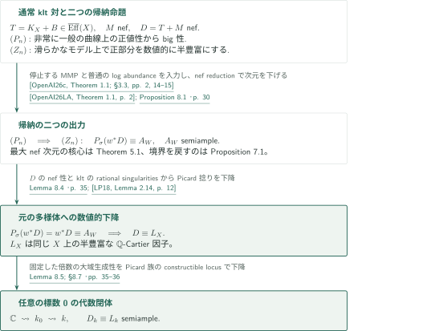
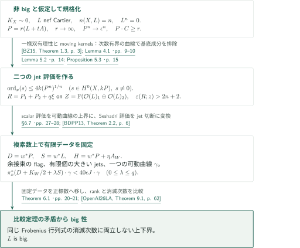
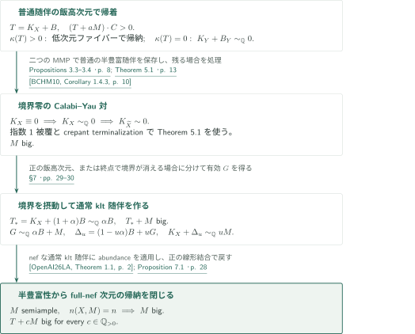
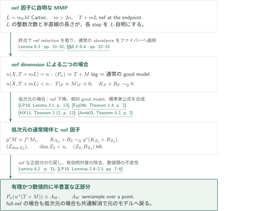
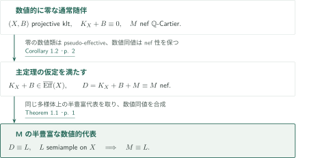

# Numerical Semiampleness of Nef Adjoint Divisors

**最大nef次元のbig性を、正部分の帰納法と数値的下降へつなぐ**

原稿は、通常のklt対にnef因子を加えた随伴について、同じ多様体上の半豊富な数値的代表の存在を主張する。核心は、最大nef次元を持つCalabi–Yau対上のnef因子のbig性である。moving jetsとFrobenius比較でこの入力を作り、nef reductionと正部分の帰納法を経由して結論を得る。

## 1. 主要結果

### Theorem 1.1 — nef随伴の数値的半豊富性

$k$を標数0の代数閉体、$(X,B)$を射影klt $\mathbb Q$対とする。$T=K_X+B$がpseudo-effectiveで、$M$が**$X$自身の上の**nef $\mathbb Q$-Cartier因子であると仮定する。$D=T+M$がnefなら、同じ$X$上に半豊富な$\mathbb Q$-Cartier因子$L$が存在し、

$$D\equiv L$$

となる。ここで$B$は有効有理境界であり、$K_X+B$は$\mathbb Q$-Cartierである。

<!-- cite:main-result -->[Theorem 1.1 · p. 1](https://github.com/openai/math/blob/1581d4cbdd69a0faf34b2089614fe2a814316a6a/preprints/Numerical-Semiampleness-of-Nef-Adjoint-Divisors-October-3-2026/paper.pdf)<!-- /cite -->

### Corollary 1.2 — klt Calabi–Yau対上のnef因子

標数0の代数閉体上の射影klt $\mathbb Q$対$(X,B)$について$K_X+B\equiv0$なら、$X$上の任意のnef $\mathbb Q$-Cartier因子は数値的に半豊富である。

<!-- cite:main-corollary -->[Corollary 1.2 · p. 2](https://github.com/openai/math/blob/1581d4cbdd69a0faf34b2089614fe2a814316a6a/preprints/Numerical-Semiampleness-of-Nef-Adjoint-Divisors-October-3-2026/paper.pdf)<!-- /cite -->

結論は$D\sim_{\mathbb Q}L$でも、$D$自身の半豊富性でもない。例えば楕円曲線上の非torsionな次数0の線束は数値的には零であり、正冪に切断を持たない。通常の対への仮定と、後のMMPで使うgeneralized pairの仮定も分ける。MMP中のnef成分は最初の$M$が定める固定b-divisorであり、その各モデル上のtraceまでnefとは限らない。

## 図の矢印に付した引用

<!-- reference-guide -->
略号のない定理・補題・節・式番号は本原稿 [Numerical Semiampleness of Nef Adjoint Divisors](https://github.com/openai/math/blob/1581d4cbdd69a0faf34b2089614fe2a814316a6a/preprints/Numerical-Semiampleness-of-Nef-Adjoint-Divisors-October-3-2026/paper.pdf) を指します。外部入力には次の略号を使います。

- [OpenAI26LA](https://github.com/openai/math/blob/1581d4cbdd69a0faf34b2089614fe2a814316a6a/preprints/Log-abundance-in-characteristic-zero-September-24-2026/paper.pdf) OpenAI — *Log abundance in characteristic zero*：通常lc対のlog abundance、moving kernel、有限データFrobenius比較。September 24, 2026; fixed commit 1581d4cbdd69a0faf34b2089614fe2a814316a6a。
- [OpenAI26c](https://github.com/openai/math/blob/1581d4cbdd69a0faf34b2089614fe2a814316a6a/preprints/Minimal-models-and-Mori-fibre-spaces-for-generalized-log-canonical-Q-pairs-September-24-2026/paper.pdf) OpenAI — *Minimal models and Mori fibre spaces for generalized log canonical Q-pairs*：固定したnef b-divisorを保つ停止するMMPの選択。September 24, 2026。
- [LP18](https://arxiv.org/pdf/1808.00438v2) Vladimir Lazić; Thomas Peternell — *On Generalised Abundance, I*：正部分の比較、nef因子の底への数値的下降、元の多様体への下降。arXiv:1808.00438v2, 6 September 2018。
- [BZ15](https://arxiv.org/pdf/1410.0938v2) Caucher Birkar; De-Qi Zhang — *Effectivity of Iitaka fibrations and pluricanonical systems of polarized pairs*：Cartier指数1・被約境界の一様双有理性から曲線次数を抑える。arXiv:1410.0938v2, 24 December 2015。
- [Amb03](https://arxiv.org/pdf/math/0308143v1) Florin Ambro — *The moduli b-divisor of an lc-trivial fibration*：通常klt随伴のQ線形引戻しを、底の有効klt境界へ置き換える。arXiv:math/0308143v1, 14 August 2003。
- [HX11](https://arxiv.org/pdf/1105.1169v3) Christopher D. Hacon; Chenyang Xu — *Existence of log canonical closures*：相対有限生成と非常に一般のファイバーのgood modelから相対good modelを得る。arXiv:1105.1169v3, stamp 28 June 2012; manuscript date July 24, 2020。
- [Fuj09b](https://www.math.kyoto-u.ac.jp/~fujino/BCHM01.pdf) Osamu Fujino — *Birkar–Cascini–Hacon–McKernan*：有理klt対の相対log canonical ringの有限生成。Author notes, version 1.02, 28 November 2009。
- [CP15](https://aif.centre-mersenne.org/item/10.5802/aif.2945.pdf) Frédéric Campana; Mihai Păun — *Orbifold generic semi-positivity: an application to families of canonically polarized manifolds*：滑らかな解消のpseudo-effective Kから余接束のgeneric semipositivity。Ann. Inst. Fourier 65 (2015), 835–861; published PDF。
- [BDPP13](https://arxiv.org/pdf/math/0405285v1) Sébastien Boucksom; Jean-Pierre Demailly; Mihai Păun; Thomas Peternell — *The pseudo-effective cone of a compact Kähler manifold and varieties of negative Kodaira dimension*：非pseudo-effective因子を一つのstrongly movable curveで分離する。arXiv:math/0405285v1。
- [BCHM10](https://arxiv.org/pdf/math/0610203v2) Caucher Birkar; Paolo Cascini; Christopher D. Hacon; James McKernan — *Existence of minimal models for varieties of log general type*：canonicalな指数1被覆のcrepant Q-factorial terminalization。arXiv:math/0610203v2, 14 August 2008; PDF compilation date 26 November 2024。

各引用に結果番号とページを付します。誌面番号とPDF内の位置が異なる場合は両方を示します。GitHubの閲覧リンクではページ位置への自動移動を前提としません。
<!-- /reference-guide -->

## 2. Theorem 1.1 の証明 — 二つの帰納命題と元の多様体への下降

<!-- proof-target:1 -->証明対象：[Theorem 1.1 · p. 1](https://github.com/openai/math/blob/1581d4cbdd69a0faf34b2089614fe2a814316a6a/preprints/Numerical-Semiampleness-of-Nef-Adjoint-Divisors-October-3-2026/paper.pdf)<!-- /proof-target --> [主張](#theorem-1-1)を参照する。

**証明の道筋。** 複素数体上で二つの命題を同時に帰納する。$(P_n)$は、ある$a\in\mathbb Q_{>0}$について$T+aM$が非常に一般の点を通るすべての整曲線と正に交わるとき、すべての$c\in\mathbb Q_{>0}$について$T+cM$がbigという命題である。$(Z_n)$はこの正値条件を課さず、滑らかな双有理モデル上の$P_\sigma(w^*(T+M))$が有理かつ数値的に半豊富となるという命題である。詳細は[terminalの場合](#proof-2)、[境界を含む場合](#proof-3)、[正部分](#proof-4)で説明する。元の$D$のnef性を最後に使って正部分と全体を一致させる。

### 1. 普通の半豊富随伴を保ったまま一般化随伴をnefにする

まず通常の$T$-MMPの停止する選択を取り、その終点の通常随伴$U_0$をlog abundanceで半豊富にする。次に十分小さい$s_0>0$に対する$U_0+s_0N_0$-MMPを選ぶ。$dU_0$をfree Cartierとすると、負の極端半直線の長さの評価と$U_i\cdot C\ge1/d$の離散性により、この第二のMMPは$U_i$に関して自明になる。従って普通の半豊富性を壊さず、一般化随伴をnefにできる。

共通解消上の二つの有効例外差は、非常に一般の曲線上の正値性を終点へ運ぶ。$\kappa(T)>0$なら普通の半豊富随伴のファイバーで低次元の$(P_j)$を使う。$\kappa(T)=0$なら$U\sim_{\mathbb Q}0$となり、Calabi–Yau対上の最大nef次元の場合へ帰着する。使うMMP入力は**停止する選択の存在**であり、任意のflip列の停止を要求していない。

<!-- cite:programs -->[Lemma 3.2 · pp. 6–7](https://github.com/openai/math/blob/1581d4cbdd69a0faf34b2089614fe2a814316a6a/preprints/Numerical-Semiampleness-of-Nef-Adjoint-Divisors-October-3-2026/paper.pdf)<!-- /cite -->

<!-- cite:positive-iitaka -->[Propositions 3.3–3.4 · p. 8](https://github.com/openai/math/blob/1581d4cbdd69a0faf34b2089614fe2a814316a6a/preprints/Numerical-Semiampleness-of-Nef-Adjoint-Divisors-October-3-2026/paper.pdf)<!-- /cite -->

<!-- cite:gm -->[&#91;OpenAI26c, Theorem 1.1; §3.3, pp. 2, 14–15&#93;](https://github.com/openai/math/blob/1581d4cbdd69a0faf34b2089614fe2a814316a6a/preprints/Minimal-models-and-Mori-fibre-spaces-for-generalized-log-canonical-Q-pairs-September-24-2026/paper.pdf)<!-- /cite -->

<!-- cite:la -->[&#91;OpenAI26LA, Theorem 1.1, p. 2&#93;](https://github.com/openai/math/blob/1581d4cbdd69a0faf34b2089614fe2a814316a6a/preprints/Log-abundance-in-characteristic-zero-September-24-2026/paper.pdf)<!-- /cite -->

### 2. 正部分を数値的に半豊富にし、元のXへ戻す

$(P_n)$と低次元の$(Z_j)$からProposition 8.1を得る。主定理の$D$はnefなので、任意の滑らかな双有理モデルについて$P_\sigma(w^*D)=w^*D$である。そこで半豊富な$A_W\equiv w^*D$を取る。分母とnumerically trivialな線束の離散部分のtorsionを消すと、

$$\mathcal O_W(rA_W)\simeq w^*\mathcal O_X(rD)\otimes P_W,\qquad P_W\in\operatorname{Pic}^0(W).$$

klt特異点はrational singularitiesなので、$\operatorname{Pic}^0(X)\simeq\operatorname{Pic}^0(W)$により$P_W=w^*P_X$となる。右辺は$X$上の線束の引戻しであり、$w_*\mathcal O_W=\mathcal O_X$と射影公式で大域生成性を下降させる。得られる因子は$rD$を$P_X$で捻ったものなので、ここでも保証されるのは数値同値である。

<!-- cite:positive -->[Proposition 8.1 · p. 30](https://github.com/openai/math/blob/1581d4cbdd69a0faf34b2089614fe2a814316a6a/preprints/Numerical-Semiampleness-of-Nef-Adjoint-Divisors-October-3-2026/paper.pdf)<!-- /cite -->

<!-- cite:descent -->[Lemma 8.4 · p. 35](https://github.com/openai/math/blob/1581d4cbdd69a0faf34b2089614fe2a814316a6a/preprints/Numerical-Semiampleness-of-Nef-Adjoint-Divisors-October-3-2026/paper.pdf)<!-- /cite -->

<!-- cite:lp-descent -->[&#91;LP18, Lemma 2.14, p. 12&#93;](https://arxiv.org/pdf/1808.00438v2#page=12)<!-- /cite -->

### 3. 任意の標数0の代数閉体へ移す

多様体・境界・Cartierデータを有限生成体へ下降し、その代数閉包$k_0$を$\mathbb C$へ埋め込む。複素数上の結論から、ある整数$r>0$と$P\in\operatorname{Pic}^0(X_{\mathbb C})$について$\mathcal O(rD)\otimes P$が大域生成となる。Picard多様体上のPoincaré族を用いると、固定した$r$に対する大域生成性のパラメータ集合はconstructibleである。その非空性は代数閉体拡大で反映されるため、$k_0$上の点を取り、元の$k$へ拡大できる。非常に一般の点を使う議論自体を任意の基礎体へ移す必要はない。

<!-- cite:field -->[Lemma 8.5; §8.7 · pp. 35–36](https://github.com/openai/math/blob/1581d4cbdd69a0faf34b2089614fe2a814316a6a/preprints/Numerical-Semiampleness-of-Nef-Adjoint-Divisors-October-3-2026/paper.pdf)<!-- /cite -->

## 3. Theorem 5.1 の証明 — 小さいscalar jetsと大きい二変数jets

<!-- proof-target:2 -->証明対象：[Theorem 5.1 · p. 13](https://github.com/openai/math/blob/1581d4cbdd69a0faf34b2089614fe2a814316a6a/preprints/Numerical-Semiampleness-of-Nef-Adjoint-Divisors-October-3-2026/paper.pdf)<!-- /proof-target -->

<!-- statement:theorem-5-1 -->
### Theorem 5.1 — terminalで標準束が自明な場合

$n\ge2$とし、$j<n$の$(P_j)$を仮定する。$X$を次元$n$の射影$\mathbb Q$-factorial terminal複素多様体とし、$K_X\sim0$とする。$L$がnef Cartier因子で$n(X,L)=n$なら、$L$はbigである。

<!-- cite:terminal -->[Theorem 5.1 · p. 13](https://github.com/openai/math/blob/1581d4cbdd69a0faf34b2089614fe2a814316a6a/preprints/Numerical-Semiampleness-of-Nef-Adjoint-Divisors-October-3-2026/paper.pdf)<!-- /cite -->
<!-- /statement -->

### 1. 正の整数次数を、一様に有界な曲線次数と衝突させる

$L$がbigでないと仮定し、ample Cartier因子$A$を固定する。$t\downarrow0$に対し

$$P=r(L+tA),\qquad r\longrightarrow\infty,\qquad P^n\longrightarrow\epsilon^n$$

と規格化する。非常に一般の点を通る曲線は$L\cdot C\ge1$を満たすので$P\cdot C\ge r$となる。他方、Lemma 4.1は、nef testing classの体積と随伴交点比が有界な状況で、一様に有界な次数の曲線を作る。ここでBirkar–Zhangの入力に渡す境界は被約SNC、nef因子はCartier指数1、随伴はbigである。低次元で必要なbig性は$(P_j)$が供給する。

<!-- cite:curve -->[Lemma 4.1 · pp. 9–10](https://github.com/openai/math/blob/1581d4cbdd69a0faf34b2089614fe2a814316a6a/preprints/Numerical-Semiampleness-of-Nef-Adjoint-Divisors-October-3-2026/paper.pdf)<!-- /cite -->

<!-- cite:bz -->[&#91;BZ15, Theorem 1.3, p. 3&#93;](https://arxiv.org/pdf/1410.0938v2#page=3)<!-- /cite -->

### 2. moving kernelの基底成分を排除して二つの評価を得る

scalar側では、消滅次数が大きすぎる切断からmoving base componentを作り、その体積・標準交点評価をLemma 4.1へ渡す。これにより非常に一般の$x$で$0\ne s\in H^0(X,kP)$に対し$\operatorname{ord}_x(s)\le4k(P^n)^{1/n}$を得る。

二変数側では

$$Z=\mathbb P(\mathcal O_X(L)_1\oplus\mathcal O_X(L)_2)\longrightarrow X\times X,\qquad R=P_1+P_2+q\xi$$

を使う。$q$を先に固定し、$t$を小さくする。sliceの正次元ファイバー、低次元成分、動く分岐因子を順に排除し、最後に両因子へ支配的な有限対応を扱う。分岐因子が動かないことから、**固定した$t$ごと**に有限個のStein被覆へ帰着する。固定被覆間の支配的な双有理グラフ族をアーベル多様体の双有理モデルへ移して、最後もbounded-degree曲線と矛盾させる。こうして二つのaxisの外に$\varepsilon(R;z)>2n+2$を満たす点ができる。有限被覆のリスト自体が$t$に一様とは主張していない。

<!-- cite:scalar -->[Lemma 5.2 · p. 14](https://github.com/openai/math/blob/1581d4cbdd69a0faf34b2089614fe2a814316a6a/preprints/Numerical-Semiampleness-of-Nef-Adjoint-Divisors-October-3-2026/paper.pdf)<!-- /cite -->

<!-- cite:bundle -->[Proposition 5.3 · p. 15](https://github.com/openai/math/blob/1581d4cbdd69a0faf34b2089614fe2a814316a6a/preprints/Numerical-Semiampleness-of-Nef-Adjoint-Divisors-October-3-2026/paper.pdf)<!-- /cite -->

<!-- cite:exclusions -->[§§5.4–5.6 · pp. 16–20](https://github.com/openai/math/blob/1581d4cbdd69a0faf34b2089614fe2a814316a6a/preprints/Numerical-Semiampleness-of-Nef-Adjoint-Divisors-October-3-2026/paper.pdf)<!-- /cite -->

<!-- cite:la-moving -->[&#91;OpenAI26LA, Lemmas 7.1–7.5, pp. 45–52&#93;](https://github.com/openai/math/blob/1581d4cbdd69a0faf34b2089614fe2a814316a6a/preprints/Log-abundance-in-characteristic-zero-September-24-2026/paper.pdf)<!-- /cite -->

### 3. 全データを複素数上で固定してからFrobenius比較を使う

解消$w:W\to X$上で$D=w^*P$、$S=w^*L$と置き、$w^*P$を小さくample摂動して$H$を作る。$K_W$のpseudo-effectivityから余接束のgeneric semipositivityを得て、比較に必要なflagを取る。二変数側のSeshadri評価は有限個の切断による$(2n+2)k_0$次jetsへ変換する。一方scalar評価は点のblowup上で$\pi_x^*(2D+E)-40\epsilon J$がpseudo-effectiveでないことを意味する。可動曲線との双対性により、固定した一つのstrongly movable curveが比較定理の全weight不等式を与える。

Theorem 6.1は、これらの固定データが共存できないことを、Frobenius evaluationの行列式の消滅次数の上下評価で示す。従って非bigの仮定が矛盾する。原稿は比較定理を再証明しているが、この概説の照合対象は定理の記述と§6.7での適用である。§§6.2–6.6の全slope・行列式計算、§5.6で使うHanamura/Blancの外部原典、flagへの制限定理は独立に検証していない。

<!-- cite:application -->[§6.7 · pp. 27–28](https://github.com/openai/math/blob/1581d4cbdd69a0faf34b2089614fe2a814316a6a/preprints/Numerical-Semiampleness-of-Nef-Adjoint-Divisors-October-3-2026/paper.pdf)<!-- /cite -->

<!-- cite:cp -->[&#91;CP15, Theorem 2.1, 誌面 p. 844 / PDF p. 11&#93;](https://aif.centre-mersenne.org/item/10.5802/aif.2945.pdf#page=11)<!-- /cite -->

<!-- cite:bdpp -->[&#91;BDPP13, Theorem 2.2, p. 6&#93;](https://arxiv.org/pdf/math/0405285v1#page=6)<!-- /cite -->

<!-- cite:la-frobenius -->[&#91;OpenAI26LA, Theorem 9.1, p. 62&#93;](https://github.com/openai/math/blob/1581d4cbdd69a0faf34b2089614fe2a814316a6a/preprints/Log-abundance-in-characteristic-zero-September-24-2026/paper.pdf)<!-- /cite -->

## 4. Proposition 7.1 の証明 — Calabi–Yau対に境界を戻す

<!-- proof-target:3 -->証明対象：[Proposition 7.1 · p. 28](https://github.com/openai/math/blob/1581d4cbdd69a0faf34b2089614fe2a814316a6a/preprints/Numerical-Semiampleness-of-Nef-Adjoint-Divisors-October-3-2026/paper.pdf)<!-- /proof-target -->

<!-- statement:proposition-7-1 -->
### Proposition 7.1 — 全nef次元の帰納命題

$n\ge2$とし、$j<n$の$(P_j)$およびTheorems 2.2–2.3のlog abundanceと停止するMMPの入力を仮定する。$(X,B)$を次元$n$の射影klt $\mathbb Q$対（基礎体$\mathbb C$）、$M$を$X$上のnef $\mathbb Q$-Cartier因子とする。$T=K_X+B$がpseudo-effectiveで、ある$a\in\mathbb Q_{>0}$について、非常に一般の点を通るすべての整曲線$C$が$(T+aM)\cdot C>0$を満たすなら、すべての$c\in\mathbb Q_{>0}$について$T+cM$はbigである。

<!-- cite:full -->[Proposition 7.1 · p. 28](https://github.com/openai/math/blob/1581d4cbdd69a0faf34b2089614fe2a814316a6a/preprints/Numerical-Semiampleness-of-Nef-Adjoint-Divisors-October-3-2026/paper.pdf)<!-- /cite -->
<!-- /statement -->

### 1. 境界零の場合をTheorem 5.1へ移す

主定理の全体の帰着により、$K_X+B\equiv0$かつ$M$が最大nef次元を持つ場合に集中できる。$B=0$ならlog abundanceによって$K_X\sim_{\mathbb Q}0$となる。指数1被覆はkltかつcanonicalであり、crepant terminalization後には$K\sim0$でterminalかつ$\mathbb Q$-factorialとなる。引戻した$M$のCartier倍にTheorem 5.1を適用し、generically finiteな引戻しで検出できるbig性を下降させる。

<!-- cite:bchm -->[&#91;BCHM10, Corollary 1.4.3, p. 10&#93;](https://arxiv.org/pdf/math/0610203v2#page=10)<!-- /cite -->

### 2. 境界を少し増やし、M自身を通常の随伴にする

$B\ne0$では$T_*:=K_X+(1+\alpha)B\sim_{\mathbb Q}\alpha B$を考える。$\kappa(T_*)>0$ならProposition 3.3、零なら二段階MMPの終点で$B_Y=0$となることと直前の境界零の場合から、$T_*+M$がbigになる。ここでまだProposition 7.1自身を使っていない点が帰納の要所である。

有効な$G\sim_{\mathbb Q}\alpha B+M$を取り、十分小さい有理数$u>0$について

$$\Delta_u=(1-u\alpha)B+uG\ge0,\qquad K_X+\Delta_u\sim_{\mathbb Q}uM$$

とする。$(X,\Delta_u)$は通常のklt対である。この随伴はnefなのでlog abundanceが適用でき、今度は$M$自身が半豊富になる。最大nef次元からその射はgenerically finiteとなり、$M$はbigである。最後にProposition 3.4の正の線形結合の議論が、任意の$c>0$に対する$T+cM$のbig性を返す。この途中の強い結論は、この帰着で構成した通常随伴の状況に限られる。

<!-- cite:boundary -->[§7 · pp. 29–30](https://github.com/openai/math/blob/1581d4cbdd69a0faf34b2089614fe2a814316a6a/preprints/Numerical-Semiampleness-of-Nef-Adjoint-Divisors-October-3-2026/paper.pdf)<!-- /cite -->

<!-- cite:la -->[&#91;OpenAI26LA, Theorem 1.1, p. 2&#93;](https://github.com/openai/math/blob/1581d4cbdd69a0faf34b2089614fe2a814316a6a/preprints/Log-abundance-in-characteristic-zero-September-24-2026/paper.pdf)<!-- /cite -->

## 5. Proposition 8.1 の証明 — nef reductionと正部分の下降

<!-- proof-target:4 -->証明対象：[Proposition 8.1 · p. 30](https://github.com/openai/math/blob/1581d4cbdd69a0faf34b2089614fe2a814316a6a/preprints/Numerical-Semiampleness-of-Nef-Adjoint-Divisors-October-3-2026/paper.pdf)<!-- /proof-target -->

<!-- statement:proposition-8-1 -->
### Proposition 8.1 — 正部分の有理性と数値的半豊富性

$(X,B)$を$\mathbb C$上の射影klt $\mathbb Q$対、$K_X+B$をpseudo-effective、$M$を$X$上のnef $\mathbb Q$-Cartier因子とする。このとき滑らかな射影多様体からの双有理射$w:W\to X$が存在し、

$$P_\sigma\bigl(w^*(K_X+B+M)\bigr)$$

は有理因子であり、$W$上の半豊富な$\mathbb Q$因子に数値同値である。ここでは$K_X+B+M$自身のnef性を仮定していない。

<!-- cite:positive -->[Proposition 8.1 · p. 30](https://github.com/openai/math/blob/1581d4cbdd69a0faf34b2089614fe2a814316a6a/preprints/Numerical-Semiampleness-of-Nef-Adjoint-Divisors-October-3-2026/paper.pdf)<!-- /cite -->
<!-- /statement -->

### 1. nef因子に自明なMMPで場合分けを準備する

$L=m_0M$をCartierにし、$m>2n$を取る。$(T+mL)$-負の半直線で$L\cdot C>0$なら、整数性と通常の半直線長の評価により$(T+mL)\cdot C\ge m-2n>0$となって矛盾する。従って選んだ停止するMMPは$L$-自明で、$T$-負でもある。終点で$T+mL$はnef、$M$の変換もnefである。

これが最大nef次元なら$(P_n)$から$T+M$がbigとなる。$T+M\sim_{\mathbb Q}A+G$を用いて、正の有理倍$(1+v)(T+M)$を通常のbig klt随伴として表す。そのgood minimal model上の半豊富随伴の引戻しが正部分となる。

<!-- cite:nef-mmp -->[Lemma 8.3 · pp. 31–32](https://github.com/openai/math/blob/1581d4cbdd69a0faf34b2089614fe2a814316a6a/preprints/Numerical-Semiampleness-of-Nef-Adjoint-Divisors-October-3-2026/paper.pdf)<!-- /cite -->

<!-- cite:nef-reduction -->[§§8.3–8.4 · pp. 32–33](https://github.com/openai/math/blob/1581d4cbdd69a0faf34b2089614fe2a814316a6a/preprints/Numerical-Semiampleness-of-Nef-Adjoint-Divisors-October-3-2026/paper.pdf)<!-- /cite -->

### 2. 低次元の底上の通常随伴とnef因子へ帰着する

nef dimensionが小さい場合、nef reductionの非常に一般のコンパクトファイバー$F$では$T|_F$がpseudo-effective、$M|_F$がnefで、$(T+mL)|_F\equiv0$である。この符号により両者は数値的に零となり、通常のlog abundanceから$K_F+B|_F\sim_{\mathbb Q}0$を得る。

nef因子の双有理下降により、解消後の$f:X_1\to Z_1$に対し$p^*M\equiv f^*M_1$、$M_1$ nefとなる。ここは**数値同値**である。$K_{X_1}+B_1=p^*T+E$（$E\ge0$は$p$-例外的）とすると一般ファイバーのIitaka次元は零。相対log canonical ringの有限生成と、非常に一般のファイバーのgood minimal modelを入力して相対good modelを作る。そのsemiample fibration $g:X_2\to Z_2$では

$$K_{X_2}+B_2\sim_{\mathbb Q}g^*A_2,\qquad \dim Z_2=\dim Z_1<n.$$

Ambroの結果をこの**通常klt随伴のQ線形同値**に適用し、有効klt境界$B_{Z_2}$を持つ$K_{Z_2}+B_{Z_2}$へ置き換える。元の普通随伴のpseudo-effectivityとgood modelによる切断を下降すると、底の随伴もpseudo-effectiveになる。従って底の$(Z_{\dim Z_2})$が使える。

<!-- cite:lp-base -->[&#91;LP18, Lemma 3.1, p. 13&#93;](https://arxiv.org/pdf/1808.00438v2#page=13)<!-- /cite -->

<!-- cite:fujino -->[&#91;Fuj09b, Theorem 1.4, p. 2&#93;](https://www.math.kyoto-u.ac.jp/~fujino/BCHM01.pdf#page=2)<!-- /cite -->

<!-- cite:hx -->[&#91;HX11, Theorem 2.12, p. 12&#93;](https://arxiv.org/pdf/1105.1169v3#page=12)<!-- /cite -->

<!-- cite:hx-termination -->[&#91;HX11, Corollary 2.9, p. 9&#93;](https://arxiv.org/pdf/1105.1169v3#page=9)<!-- /cite -->

<!-- cite:ambro -->[&#91;Amb03, Theorem 0.2, p. 2&#93;](https://arxiv.org/pdf/math/0308143v1#page=2)<!-- /cite -->

<!-- cite:relative -->[§8.5 · pp. 33–34](https://github.com/openai/math/blob/1581d4cbdd69a0faf34b2089614fe2a814316a6a/preprints/Numerical-Semiampleness-of-Nef-Adjoint-Divisors-October-3-2026/paper.pdf)<!-- /cite -->

### 3. 正部分の比較で元のモデルに戻る

低次元で得た正部分は数値的に半豊富なのでnefである。nefな正部分の引戻し公式、有効例外因子を足しても正部分が変わらないこと、正部分の有理性・数値的半豊富性が元の因子の数値類だけで決まることを順に使う。これにより数値的な$M$の下降と、Q線形な通常随伴の公式を同じ比較に入れられる。$X_2$上から相対MMPを戻し、最後に$p$-例外的な$E$を除いて$w^*(T+M)$の正部分を得る。これが$(P_n)$と低次元の$(Z_j)$から$(Z_n)$への帰納段階である。

<!-- cite:positive-rules -->[Lemma 8.2 · p. 31](https://github.com/openai/math/blob/1581d4cbdd69a0faf34b2089614fe2a814316a6a/preprints/Numerical-Semiampleness-of-Nef-Adjoint-Divisors-October-3-2026/paper.pdf)<!-- /cite -->

<!-- cite:lp-positive -->[&#91;LP18, Lemmas 2.4–2.5, pp. 7–8&#93;](https://arxiv.org/pdf/1808.00438v2#page=7)<!-- /cite -->

## 6. Corollary 1.2 の証明 — 数値的に零な普通随伴

<!-- proof-target:5 -->証明対象：[Corollary 1.2 · p. 2](https://github.com/openai/math/blob/1581d4cbdd69a0faf34b2089614fe2a814316a6a/preprints/Numerical-Semiampleness-of-Nef-Adjoint-Divisors-October-3-2026/paper.pdf)<!-- /proof-target --> [主張](#corollary-1-2)を参照する。

### 1. 主定理の入力を確認する

$K_X+B\equiv0$なら普通随伴はpseudo-effectiveであり、任意のnef $M$に対して$D=K_X+B+M\equiv M$もnefである。Theorem 1.1が与える半豊富因子$L\equiv D$は$M$にも数値同値となる。数値類を置き換えた結論であり、非torsionなnumerically trivial線束の切断を新たに作る主張ではない。

<!-- cite:main-corollary -->[Corollary 1.2 · p. 2](https://github.com/openai/math/blob/1581d4cbdd69a0faf34b2089614fe2a814316a6a/preprints/Numerical-Semiampleness-of-Nef-Adjoint-Divisors-October-3-2026/paper.pdf)<!-- /cite -->

## 7. どの論文が、どの段階を担うか

| 供給元 | 利用箇所 | 使用内容・適用条件 | 確認範囲 |
|---|---|---|---|
| Log abundance in characteristic zero | Lemma 3.2、§7、§8 | 通常lc/klt随伴のnef性から実際の半豊富性。generalized nef traceには直接適用しない | Thm 1.1と本稿の適用を照合。供給原稿全証明は対象外 |
| Minimal models and Mori fibre spaces for generalized log canonical Q-pairs | Theorem 2.3、Lemmas 3.2・8.3 | 固定した有理nef b-divisorを保つ停止する選択。入力がQ-factorial generalized kltの場合の維持も§3.3と照合 | カタログ036内の直接入力 |
| Birkar–Zhang、Log abundanceのmoving-kernel群 | Lemma 4.1、§5 | 指数1・被約境界の双有理性と動く基底成分の交点評価 | 供給結果の記述と使用箇所を照合 |
| Campana–Păun、BDPP | §6.7 | 余接束のgeneric semipositivity、非pseudo-effective因子の可動曲線による分離 | 記述・用途を照合。flag制限定理は外部原典未照合 |
| Lazić–Peternell、Fujino、Hacon–Xu、Ambro | §8 | nef因子の数値的下降、相対good model、通常kltの標準束公式、正部分の比較 | 記述・仮定・適用箇所を照合。外部証明の再検証は対象外 |

カタログ034のLog abundanceと036の一般化極小モデル論文は直接入力である。カタログ036のKähler論文・数値次元1論文との追加の依存関係は、この原稿の引用確認だけからは認定していない。

## 8. 原典を読む入口と確認範囲

<!-- reading-list -->
- [Lemma 3.2 · pp. 6–7](https://github.com/openai/math/blob/1581d4cbdd69a0faf34b2089614fe2a814316a6a/preprints/Numerical-Semiampleness-of-Nef-Adjoint-Divisors-October-3-2026/paper.pdf) — 普通の半豊富随伴を保ちながら一般化随伴をnefにする二段階MMP。
- [Theorem 5.1 · p. 13](https://github.com/openai/math/blob/1581d4cbdd69a0faf34b2089614fe2a814316a6a/preprints/Numerical-Semiampleness-of-Nef-Adjoint-Divisors-October-3-2026/paper.pdf) — 最大nef次元からbig性を得る核心の開始点。
- [Theorem 6.1 · pp. 20–21](https://github.com/openai/math/blob/1581d4cbdd69a0faf34b2089614fe2a814316a6a/preprints/Numerical-Semiampleness-of-Nef-Adjoint-Divisors-October-3-2026/paper.pdf) — 固定した複素データの条件と、何を正標数へ移すか。
- [§7 · pp. 29–30](https://github.com/openai/math/blob/1581d4cbdd69a0faf34b2089614fe2a814316a6a/preprints/Numerical-Semiampleness-of-Nef-Adjoint-Divisors-October-3-2026/paper.pdf) — 指数1被覆と境界摂動を経てPnを閉じる。
- [Proposition 8.1 · p. 30](https://github.com/openai/math/blob/1581d4cbdd69a0faf34b2089614fe2a814316a6a/preprints/Numerical-Semiampleness-of-Nef-Adjoint-Divisors-October-3-2026/paper.pdf) — 正部分の帰納法の主張と二つの場合。
- [§8.5 · pp. 33–34](https://github.com/openai/math/blob/1581d4cbdd69a0faf34b2089614fe2a814316a6a/preprints/Numerical-Semiampleness-of-Nef-Adjoint-Divisors-October-3-2026/paper.pdf) — 相対good model、標準束公式、低次元の正部分。
- [Lemma 8.4 · p. 35](https://github.com/openai/math/blob/1581d4cbdd69a0faf34b2089614fe2a814316a6a/preprints/Numerical-Semiampleness-of-Nef-Adjoint-Divisors-October-3-2026/paper.pdf) — 数値的代表を元のXへ戻すPic0の操作。
- [Lemma 8.5; §8.7 · pp. 35–36](https://github.com/openai/math/blob/1581d4cbdd69a0faf34b2089614fe2a814316a6a/preprints/Numerical-Semiampleness-of-Nef-Adjoint-Divisors-October-3-2026/paper.pdf) — 代数閉体の変更に必要な有限型パラメータ論法。
<!-- /reading-list -->

主要二結果と各結論への接続、§§3–5の帰着・幾何学的排除、Theorem 6.1の記述と§6.7の適用、§§7–8の証明を読んだ。普通の対とgeneralized pair、数値同値とQ線形同値、元の多様体上の代表と双有理モデル上の正部分を区別して照合した。

未確認なのは、§§6.2–6.6のFrobenius比較の全計算、Hanamura/Blancの双有理群定理およびMehta–Ramanathan制限定理の外部原典との照合である。引用元各論文の証明を再帰的に検証しておらず、原稿全体の独立した正しさの認定や専門家査読を意味しない。
