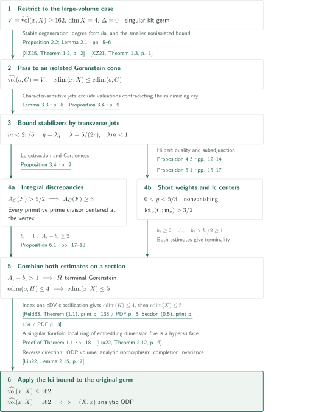
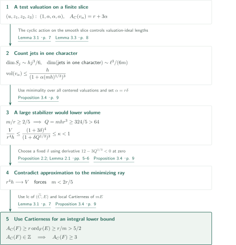
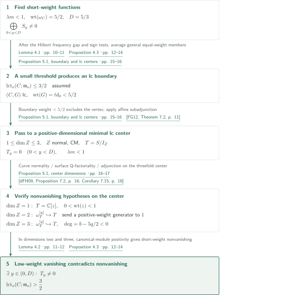

# The normalized-volume gap in dimension four

**From a lower volume bound to a hypersurface local ring, then to the established lci bound**

The manuscript asserts the upper bound 162 for singular complex algebraic klt fourfold germs with zero boundary, together with the analytic classification of equality. Its structural contribution is that volume at least 162 forces embedding dimension at most five. Transverse jets control stabilizers on a stable-degeneration cone; separate discrepancy and maximal-ideal threshold estimates then produce a terminal Gorenstein threefold section.

## 1. Main results

### Theorem 1.1 — The sharp fourfold bound and equality

Let $X$ be a normal complex algebraic variety and $x\in X$ a singular closed point. Assume $\dim X=4$, $K_X$ is $\mathbb Q$-Cartier, and $X$ is **klt with zero boundary** near $x$. Then

$$
\widehat{\operatorname{vol}}(x,X)\le 162=2\cdot3^4.
$$

Equality holds if and only if the analytic germ is isomorphic to

$$
(X,x)\simeq\bigl(\{z_0^2+z_1^2+z_2^2+z_3^2+z_4^2=0\}\subset\mathbb C^5,0\bigr).
$$

No isolatedness, lci, quotient, or smoothability hypothesis is imposed. What follows describes the manuscript's argument; it is not an independent verification of every proof.

<!-- cite:main -->[Theorem 1.1 · p. 1](https://github.com/openai/math/blob/fd4aeeb2ee4fc729c18d98444fed42fd0529eeeb/preprints/The-normalized-volume-gap-in-dimension-four-September-24-2026/paper.pdf)<!-- /cite -->

For $\mathfrak a_t(v)=\{f\in\mathcal O_{X,x}:v(f)\ge t\}$, the normalization is

$$
\operatorname{vol}(v)=\lim_{t\to\infty}\frac{4!}{t^4}\ell(\mathcal O_{X,x}/\mathfrak a_t(v)),\qquad
\widehat{\operatorname{vol}}(x,X)=\inf_{c_X(v)=x} A_X(v)^4\operatorname{vol}(v).
$$

Here $A_X(F)=1+\operatorname{coeff}_F(K_Y-\mu^*K_X)$ is the **log discrepancy**; valuations of infinite discrepancy contribute $+\infty$. The infimum over all centered real valuations equals that over prime-divisor valuations centered at $x$. With this convention the smooth fourfold value is 256 and the ordinary-double-point value is 162.

<!-- cite:conventions -->[Section 2 · pp. 3–5](https://github.com/openai/math/blob/fd4aeeb2ee4fc729c18d98444fed42fd0529eeeb/preprints/The-normalized-volume-gap-in-dimension-four-September-24-2026/paper.pdf)<!-- /cite -->

## References on the arrows

<!-- reference-guide -->
Unprefixed theorem, lemma, section and equation numbers refer to [Fourfold volume gap](https://github.com/openai/math/blob/fd4aeeb2ee4fc729c18d98444fed42fd0529eeeb/preprints/The-normalized-volume-gap-in-dimension-four-September-24-2026/paper.pdf). External inputs use the following keys.

- [XZ25](https://arxiv.org/pdf/2205.10915v2) Chenyang Xu; Ziquan Zhuang — *Stable degenerations of singularities*: Finite generation of klt minimizers and stable degeneration to a K-semistable cone. arXiv:2205.10915v2; published JAMS 38 (2025).
- [LX18](https://arxiv.org/pdf/1707.05561v2) Chi Li; Chenyang Xu — *Stability of valuations: higher rational rank*: Preservation of volume and discrepancy and minimization over all valuations on the cone. arXiv:1707.05561v2; published Peking Mathematical Journal 1 (2018).
- [Li18](https://arxiv.org/pdf/1511.08164v4) Chi Li — *Minimizing normalized volumes of valuations*: Izumi estimate for the embedding-dimension comparison. arXiv:1511.08164v4, 2017-07-18; manuscript date 2017-07-19.
- [XZ21](https://arxiv.org/pdf/2005.08303v1) Chenyang Xu; Ziquan Zhuang — *Uniqueness of the minimizer of the normalized volume function*: Finite-degree formula for normalized volume under crepant finite Galois covers. arXiv:2005.08303v1, 2020-05-17; published CJM 9 (2021).
- [Liu22](https://arxiv.org/pdf/2007.14320v2) Yuchen Liu — *K-stability of cubic fourfolds*: Nonisolated bound, sharp lci bound and equality, and invariance under completion isomorphism. arXiv:2007.14320v2, 2022-01-10; manuscript date 2022-01-11.
- [FG12](https://arxiv.org/pdf/1009.3996v1) Osamu Fujino; Yoshinori Gongyo — *On canonical bundle formulae and subadjunctions*: Supplies a klt boundary on a minimal lc center in the affine setting. arXiv:1009.3996v1, 2010-09-21; internal version 1.17, 2010-09-12.
- [dFH09](https://arxiv.org/pdf/0805.1767v2) Tommaso de Fernex; Christopher D. Hacon — *Singularities on normal varieties*: Q-factoriality of surfaces admitting a klt boundary. arXiv:0805.1767v2, 2008-10-25; published Compositio 145 (2009).
- [Reid83](https://webhomes.maths.ed.ac.uk/cheltsov/quotient/pdf/reid2.pdf) Miles Reid — *Minimal models of canonical 3-folds*: cDV classification and hypersurface presentation of index-one terminal threefold points. Advanced Studies in Pure Mathematics 1 (1983), 131–180; original spread scan.

Each citation gives the result and pages. When printed pagination differs from the PDF position, both are shown. GitHub previews do not automatically jump to the cited page.
<!-- /reference-guide -->

## 2. Theorem 1.1 — Proof overview of the main theorem

<!-- proof-target:1 -->Proof target：[Theorem 1.1 · p. 1](https://github.com/openai/math/blob/fd4aeeb2ee4fc729c18d98444fed42fd0529eeeb/preprints/The-normalized-volume-gap-in-dimension-four-September-24-2026/paper.pdf)<!-- /proof-target -->

**Proof route.** The bound in the [statement](#theorem-1-1) already holds when $V:=\widehat{\operatorname{vol}}(x,X)<162$. Under $V\ge162$, the argument constrains the local ring. After reduction to a cone, the [stabilizer estimate](#proof-1) branches into $A_C(F)\ge3$ and the [threshold bound $>3/2$](#proof-2); these meet at the threefold section. One then returns to the original germ and invokes the lci theorem. The final input supplies the upper bound, necessity in the equality case, and sharpness, whose roles are distinguished below.

### 1. Reduction to a cone with the same volume

Stable degeneration produces $C=\operatorname{Spec}\operatorname{gr}_v\mathcal O_{X,x}$ and a minimizing Reeb vector $\xi_*$. Finite generation, preservation of volume and log discrepancy, and minimization over all centered valuations are essential: minimization only within a fixed Reeb cone would not suffice. Lemma 2.1 lifts homogeneous generators and uses the Izumi estimate to obtain $\operatorname{edim}(x,X)\le\operatorname{edim}(o,C)$.

<!-- cite:stable -->[&#91;XZ25, Theorem 1.2, p. 2&#93;](https://arxiv.org/pdf/2205.10915v2#page=2)<!-- /cite --> <!-- cite:cone-minimum -->[&#91;LX18, Theorem 1.3, p. 3; Lemma 4.10, p. 35&#93;](https://arxiv.org/pdf/1707.05561v2#page=3)<!-- /cite --> <!-- cite:izumi -->[&#91;Li18, Theorem 3.1, p. 6&#93;](https://arxiv.org/pdf/1511.08164v4#page=6)<!-- /cite -->

A singular point on the punctured cone would have an orbit closure making the singular locus positive-dimensional at the vertex, contradicting $V\le4096/27<162$. The finite-degree formula applies to the index-one cover of degree $d$ and gives $dV\le256$, hence $d=1$. Cohen–Macaulayness of klt singularities and graded Nakayama make $C$ Gorenstein. For primitive integral gradings approaching the minimizing ray, write $r>0$ and $h$ for the discrepancy and volume of the degree valuation: $r^4h\ge V$ and $r^4h\to V$.

<!-- cite:cone -->[Proposition 2.2; Lemma 2.1 · pp. 5–6](https://github.com/openai/math/blob/fd4aeeb2ee4fc729c18d98444fed42fd0529eeeb/preprints/The-normalized-volume-gap-in-dimension-four-September-24-2026/paper.pdf)<!-- /cite --> <!-- cite:finite-degree -->[&#91;XZ21, Theorem 1.3, p. 1&#93;](https://arxiv.org/pdf/2005.08303v1#page=1)<!-- /cite --> <!-- cite:nonisolated -->[&#91;Liu22, Corollary 2.18, p. 9&#93;](https://arxiv.org/pdf/2007.14320v2#page=9)<!-- /cite -->

### 2. The two estimates meet at a terminal section

Proposition 3.4 gives $A_C(F)\ge3$ for every primitive prime divisor centered at the vertex. Proposition 5.1 gives $\operatorname{lct}_o(C;\mathfrak m_o)>3/2$. On a log resolution of the maximal ideal, write $\mathfrak m_o\mathcal O_Y=\mathcal O_Y(-\sum b_iE_i)$ and $A_i=A_C(E_i)$. The ordinary discrepancy along a general section $H$ is $A_i-1-b_i$. As a Cartier section of a Gorenstein Cohen–Macaulay fourfold, $H$ is Gorenstein and $S_2$; Bertini gives smoothness away from the vertex, hence $R_1$ and normality.

If $b_i=1$, then $A_i-b_i\ge2$; if $b_i\ge2$, then $A_i-b_i>b_i/2\ge1$. Every coefficient is positive, so $H$ is a terminal Gorenstein threefold germ. The threshold estimate alone is not being used to infer terminality. Reid's index-one classification makes a singular $H$ an isolated cDV point, hence an analytic hypersurface. Including the smooth case, $\operatorname{edim}(o,H)\le4$, and therefore

$$
\operatorname{edim}(x,X)\le\operatorname{edim}(o,C)\le\operatorname{edim}(o,H)+1\le5.
$$

<!-- cite:section -->[Proposition 6.1 · pp. 17–18](https://github.com/openai/math/blob/fd4aeeb2ee4fc729c18d98444fed42fd0529eeeb/preprints/The-normalized-volume-gap-in-dimension-four-September-24-2026/paper.pdf)<!-- /cite --> <!-- cite:reid -->[&#91;Reid83, Theorem (1.1), print p. 138 / PDF p. 5; Section (0.5), print p. 134 / PDF p. 3&#93;](https://webhomes.maths.ed.ac.uk/cheltsov/quotient/pdf/reid2.pdf#page=5)<!-- /cite -->

### 3. Upper bound, necessity for equality, and sharpness

A singular normal fourfold germ with embedding dimension at most five has local ring equal to a five-dimensional regular local ring modulo a height-one prime. A regular local ring is a UFD, so this ideal is principal. Thus the original $X$ is an algebraic local hypersurface, hence lci; showing only that the degeneration cone is a hypersurface would not suffice.

Liu's lci theorem now yields $V\le2(4-1)^4=162$. Its equality classification says that $V=162$ forces the original germ to be an ODP. Conversely, one needs the actual ODP volume to be 162: merely exhibiting one valuation of normalized volume 162 would not establish the infimum. For the exceptional divisor $E$ of the ordinary blow-up of the ODP vertex, $A_X(E)=3$ and $\operatorname{vol}(E)=2$, giving the candidate value $3^4\cdot2=162$. The manuscript invokes the established lci equality theorem and this ODP calculation at this point, and uses invariance under isomorphism of completed local rings to pass to the analytic characterization. This also establishes sharpness of the constant.

<!-- cite:finish -->[Proof of Theorem 1.1 · p. 18](https://github.com/openai/math/blob/fd4aeeb2ee4fc729c18d98444fed42fd0529eeeb/preprints/The-normalized-volume-gap-in-dimension-four-September-24-2026/paper.pdf)<!-- /cite --> <!-- cite:lci -->[&#91;Liu22, Theorem 2.12, p. 6&#93;](https://arxiv.org/pdf/2007.14320v2#page=6)<!-- /cite --> <!-- cite:completion -->[&#91;Liu22, Lemma 2.15, p. 7&#93;](https://arxiv.org/pdf/2007.14320v2#page=7)<!-- /cite -->

## 3. Proposition 3.4 — Transverse jets control stabilizers and discrepancies

<!-- proof-target:2 -->Proof target：[Proposition 3.4 · p. 9](https://github.com/openai/math/blob/fd4aeeb2ee4fc729c18d98444fed42fd0529eeeb/preprints/The-normalized-volume-gap-in-dimension-four-September-24-2026/paper.pdf)<!-- /proof-target -->

<!-- statement:proposition-3-4 -->
### Proposition 3.4 — Stabilizers on a large-volume cone

Take the cone $C$ of Proposition 2.2 with $V\ge162$ and primitive positive integral gradings approaching its minimizing ray; let $r$ be the degree valuation's discrepancy. For all sufficiently close gradings, every point of $C\setminus\{o\}$ has stabilizer order $m<2r/5$. Consequently every primitive prime divisor $F$ centered at $o$ has $A_C(F)\ge3$.

<!-- cite:stabilizer -->[Proposition 3.4 · p. 9](https://github.com/openai/math/blob/fd4aeeb2ee4fc729c18d98444fed42fd0529eeeb/preprints/The-normalized-volume-gap-in-dimension-four-September-24-2026/paper.pdf)<!-- /cite -->
<!-- /statement -->

### 1. Test valuations against the minimum over all valuations

The grading extraction in Lemma 3.1 has $K_{\widetilde C}=\pi^*K_C+(r-1)E$ and an lc pair $(\widetilde C,E)$. On the smooth slice cover with stabilizer $\mu_m$, assign weights $(1,\alpha,\alpha,\alpha)$ to $(u,z_1,z_2,z_3)$ and restrict the resulting valuation to the function field. For rational $\alpha>0$, this $v_\alpha$ is proportional to a divisorial valuation and $A_C(v_\alpha)=r+3\alpha$.

The image of functions of degree $j$ is bounded by the minimum of $\dim S_j$ and the dimension of slice jets in the matching character. The latter has leading term $\ell^3/(6m)$: forgetting the character and hence $m$ would lose the required estimate. Integrating over degrees gives

$$
V\le(r+3\alpha)^4\frac{h}{\bigl(1+\alpha(mh)^{1/3}\bigr)^3}.
$$

<!-- cite:extraction -->[Lemma 3.1 · p. 7](https://github.com/openai/math/blob/fd4aeeb2ee4fc729c18d98444fed42fd0529eeeb/preprints/The-normalized-volume-gap-in-dimension-four-September-24-2026/paper.pdf)<!-- /cite --> <!-- cite:jets -->[Lemma 3.3 · p. 8](https://github.com/openai/math/blob/fd4aeeb2ee4fc729c18d98444fed42fd0529eeeb/preprints/The-normalized-volume-gap-in-dimension-four-September-24-2026/paper.pdf)<!-- /cite -->

### 2. Contradiction to approximate minimality, then integrality

If $m/r\ge2/5$, then $Q=mhr^3\ge324/5>64$. Set $\alpha=r\delta$ and divide the bound by $r^4h$. The derivative at zero of $(1+3\delta)^4/(1+\delta Q^{1/3})^3$ is $12-3Q^{1/3}<0$. A fixed small positive rational $\delta$ gives a ratio uniformly below one, contradicting $V/(r^4h)\to1$. The cutoff limit is taken separately for each valuation, so uniformity of the jet-error constants in the grading is unnecessary.

Local Cartierness of $mE$ gives $\operatorname{ord}_F(E)\ge1/m$. The lc pair then yields $A_C(F)\ge r\operatorname{ord}_F(E)>5/2$. Since $K_C$ is Cartier, this is an integer, hence at least three. Rescaling to $y=\lambda j$, $\lambda=5/(2r)$, fixes the canonical weight at $5/2$ and gives $\lambda m<1$ at every nonvertex point.

<!-- cite:stabilizer -->[Proposition 3.4 · p. 9](https://github.com/openai/math/blob/fd4aeeb2ee4fc729c18d98444fed42fd0529eeeb/preprints/The-normalized-volume-gap-in-dimension-four-September-24-2026/paper.pdf)<!-- /cite -->

## 4. Proposition 5.1 — Low-weight functions and minimal lc centers raise the threshold

<!-- proof-target:3 -->Proof target：[Proposition 5.1 · pp. 15–17](https://github.com/openai/math/blob/fd4aeeb2ee4fc729c18d98444fed42fd0529eeeb/preprints/The-normalized-volume-gap-in-dimension-four-September-24-2026/paper.pdf)<!-- /proof-target -->

<!-- statement:proposition-5-1 -->
### Proposition 5.1 — The maximal-ideal threshold

Let $C$ be the fourfold cone of Proposition 2.2, with vertex $o$. Fix a grading satisfying Proposition 3.4 and rescale its weights so that the canonical weight is $5/2$. Then

$$
\operatorname{lct}_o(C;\mathfrak m_o)>\frac32.
$$

The threshold refers to log canonicity in a neighborhood of $o$. For the maximal ideal it is the infimum of $A_C(F)/\operatorname{ord}_F(\mathfrak m_o)$ over prime divisors centered at $o$.

<!-- cite:threshold -->[Proposition 5.1 · pp. 15–17](https://github.com/openai/math/blob/fd4aeeb2ee4fc729c18d98444fed42fd0529eeeb/preprints/The-normalized-volume-gap-in-dimension-four-September-24-2026/paper.pdf)<!-- /cite -->
<!-- /statement -->

### 1. A Hilbert-series frequency gap forces short weights

For a normal Cohen–Macaulay graded domain $T$, use the natural weights on its canonical module to form

$$
\mu_T=\sum_y\dim T_y\,\delta_y+(-1)^{\dim T-1}\sum_y\dim(\omega_T)_y\,\delta_{-y}.
$$

Lemma 4.1 uses $\lambda m<1$ to place all nonzero Hilbert-series pole frequencies outside $[-1,1]$. A Schwartz test $F$ with Fourier transform supported in $(-1,1)$ then satisfies $\int F\,d\mu_T=\int F(y)P_T(y)\,dy$, where $P_T$ encodes the polar part of $H_T(s)=\sum_y\dim T_y e^{-sy}$ at $s=0$. The manuscript derives $H_{\omega_T}(z)=(-1)^{\dim T}H_T(z^{-1})$ by dualizing a graded free resolution; we follow that internal calculation. In this identity $H_T(z)$ is the integer-graded Hilbert series, with $z=e^{-\lambda s}$.

For the four-dimensional ring $S$, canonical weight $5/2$ makes the density $a(x^3+cx)$ after shifting to $x=y+5/4$. The manuscript multiplies squares of band-limited functions by sign-changing polynomials. After deriving $c\ge-1$ and $a\ge432/625$, it shows that the absence of function weights in $(0,D)$, $D=5/3$, gives contradictory integral bounds. This is Proposition 4.3(a). Its two- and three-dimensional version (b) has an **additional hypothesis**: an injection $\omega_T^{[q]}\hookrightarrow T$ must lower weights by a positive amount. Lemma 4.2 then gives positive canonical-section weights and positivity of the next-to-leading coefficient of $P_T$.

<!-- cite:hilbert -->[Lemma 4.1 · pp. 10–11](https://github.com/openai/math/blob/fd4aeeb2ee4fc729c18d98444fed42fd0529eeeb/preprints/The-normalized-volume-gap-in-dimension-four-September-24-2026/paper.pdf)<!-- /cite --> <!-- cite:positivity -->[Lemma 4.2 · pp. 11–12](https://github.com/openai/math/blob/fd4aeeb2ee4fc729c18d98444fed42fd0529eeeb/preprints/The-normalized-volume-gap-in-dimension-four-September-24-2026/paper.pdf)<!-- /cite --> <!-- cite:short -->[Proposition 4.3 · pp. 12–14](https://github.com/openai/math/blob/fd4aeeb2ee4fc729c18d98444fed42fd0529eeeb/preprints/The-normalized-volume-gap-in-dimension-four-September-24-2026/paper.pdf)<!-- /cite -->

### 2. A small threshold creates an lc center where all low weights vanish

Assume $\operatorname{lct}_o(C;\mathfrak m_o)\le3/2$. Choose a basis $f_i$ of the homogeneous functions with $0<y<D$ and put $d_0=\max\operatorname{wt}(f_i)<D$. Power them to a common weight $B$, obtaining an ideal $\mathfrak b$. Its threshold $t=\operatorname{lct}_o(C;\mathfrak b^{d_0/B})$ satisfies $0<t\le3/2$ and $td_0<5/2$. Averaging sufficiently many general members constructs an effective homogeneous boundary $G$ of total weight $td_0$. The pair $(C,G)$ is lc, and every $f_i$ vanishes on every lc center. The argument does not assume that $\mathfrak b$ is maximal-ideal primary.

On the grading extraction, $A_{C,G}(F)>0$ for every divisor centered exactly at $o$: the strict inequality $td_0<5/2$ makes the exceptional coefficient difference positive. Thus $o$ itself is not an lc center. A minimal center $Z$ has $1\le\dim Z\le3$. Affine subadjunction applies because $C$ is normal affine, $G$ is an effective rational boundary, $K_C+G$ is $\mathbb Q$-Cartier, and the pair is lc. The resulting klt pair $(Z,\Delta_Z)$ makes $Z$ normal with rational singularities, hence Cohen–Macaulay.

<!-- cite:threshold-construction -->[Proposition 5.1, boundary and lc centers · pp. 15–16](https://github.com/openai/math/blob/fd4aeeb2ee4fc729c18d98444fed42fd0529eeeb/preprints/The-normalized-volume-gap-in-dimension-four-September-24-2026/paper.pdf)<!-- /cite --> <!-- cite:subadjunction -->[&#91;FG12, Theorem 7.2, p. 11&#93;](https://arxiv.org/pdf/1009.3996v1#page=11)<!-- /cite -->

### 3. Check the nonvanishing hypothesis in each center dimension

Give $T=S/I_Z$ the induced grading. Its stabilizers equal those of the same points in $C$, so $\lambda m<1$ remains valid even if the action is ineffective. However, $T_y$ is an image of $S_y$, and all $f_i$ vanish on $Z$, so $T_y=0$ for $0<y<D$.

If $\dim Z=1$, the normal graded curve has ring $\mathbb C[z]$, and the stabilizer bound forces the weight of $z$ below one, a contradiction. If $\dim Z=2$, a surface admitting a klt boundary is $\mathbb Q$-factorial; removing the effective boundary makes $Z$ itself $\mathbb Q$-Gorenstein klt. A homogeneous generator of a reflexive canonical power has positive weight. Sending it to $1$ gives the required weight-lowering injection.

If $\dim Z=3$, then $U=Z\setminus\{o\}$ is a Cartier divisor in smooth $C\setminus\{o\}$. Choose a nonzero low-weight function $f$, put $b=\operatorname{wt}(f)<D$ and $q=\operatorname{ord}_Z(f)\ge1$. Equivariant adjunction and multiplication by $f$ give $\omega_U^{\otimes q}\to\mathcal O_U$ of degree $b-q(5/2)<0$. Reflexive extension across the vertex yields $\omega_T^{[q]}\hookrightarrow T$. No global $\mathbb Q$-Gorenstein hypothesis on $Z$ is required. In dimensions two and three, Proposition 4.3(b) now contradicts low-weight vanishing, proving the strict threshold bound.

<!-- cite:threshold-centers -->[Proposition 5.1, center dimensions · pp. 16–17](https://github.com/openai/math/blob/fd4aeeb2ee4fc729c18d98444fed42fd0529eeeb/preprints/The-normalized-volume-gap-in-dimension-four-September-24-2026/paper.pdf)<!-- /cite --> <!-- cite:surface -->[&#91;dFH09, Proposition 7.2, p. 16; Corollary 7.15, p. 18&#93;](https://arxiv.org/pdf/0805.1767v2#page=16)<!-- /cite -->

## 5. Which papers supply which steps

| Input | Used at | Role and hypotheses | Checking scope |
|---|---|---|---|
| <!-- cite:stable -->[&#91;XZ25, Theorem 1.2, p. 2&#93;](https://arxiv.org/pdf/2205.10915v2#page=2)<!-- /cite --> <!-- cite:cone-minimum -->[&#91;LX18, Theorem 1.3, p. 3; Lemma 4.10, p. 35&#93;](https://arxiv.org/pdf/1707.05561v2#page=3)<!-- /cite --> <!-- cite:izumi -->[&#91;Li18, Theorem 3.1, p. 6&#93;](https://arxiv.org/pdf/1511.08164v4#page=6)<!-- /cite --> | Proposition 2.2, Lemma 2.1 | Finite generation for a klt minimizer, preservation and minimization of volume on the cone, embedding-dimension comparison with the original local ring | Stated results in the specified versions and their uses on pp.4–6 checked |
| <!-- cite:finite-degree -->[&#91;XZ21, Theorem 1.3, p. 1&#93;](https://arxiv.org/pdf/2005.08303v1#page=1)<!-- /cite --> <!-- cite:nonisolated -->[&#91;Liu22, Corollary 2.18, p. 9&#93;](https://arxiv.org/pdf/2007.14320v2#page=9)<!-- /cite --> | Proposition 2.2 | Degree formula for crepant finite Galois covers, smaller bound at nonisolated points, $dV\le256$ | Hypotheses of the theorem and corollary compared with p.6 |
| <!-- cite:subadjunction -->[&#91;FG12, Theorem 7.2, p. 11&#93;](https://arxiv.org/pdf/1009.3996v1#page=11)<!-- /cite --> <!-- cite:surface -->[&#91;dFH09, Proposition 7.2, p. 16; Corollary 7.15, p. 18&#93;](https://arxiv.org/pdf/0805.1767v2#page=16)<!-- /cite --> | Proposition 5.1 | A klt boundary on a minimal affine lc center, $\mathbb Q$-factoriality in dimension two | Statements compared with their uses on pp.16–17 |
| <!-- cite:reid -->[&#91;Reid83, Theorem (1.1), print p. 138 / PDF p. 5; Section (0.5), print p. 134 / PDF p. 3&#93;](https://webhomes.maths.ed.ac.uk/cheltsov/quotient/pdf/reid2.pdf#page=5)<!-- /cite --> | Proposition 6.1 | The terminal Gorenstein threefold section is a cDV hypersurface | Theorem (1.1) and §(0.5) read in the original spread scan and compared with p.18 |
| <!-- cite:lci -->[&#91;Liu22, Theorem 2.12, p. 6&#93;](https://arxiv.org/pdf/2007.14320v2#page=6)<!-- /cite --> <!-- cite:completion -->[&#91;Liu22, Lemma 2.15, p. 7&#93;](https://arxiv.org/pdf/2007.14320v2#page=7)<!-- /cite --> | End of Theorem 1.1 | Upper bound, equality classification, and analytic invariance once the original germ is lci | Theorem 2.12 and Lemma 2.15 compared with p.18 |

The relationship with the every-dimensional manuscript is recorded in the catalogue guide. No arrow asserting that this paper depends on that manuscript is introduced. Methodological comparisons with sphere packing and orbifold Riemann–Roch are distinct from the direct inputs above.

## 6. Return to the sources

<!-- reading-list -->
- [Theorem 1.1 · p. 1](https://github.com/openai/math/blob/fd4aeeb2ee4fc729c18d98444fed42fd0529eeeb/preprints/The-normalized-volume-gap-in-dimension-four-September-24-2026/paper.pdf) — Hypotheses, zero boundary, dimension, and equality
- [Proposition 2.2; Lemma 2.1 · pp. 5–6](https://github.com/openai/math/blob/fd4aeeb2ee4fc729c18d98444fed42fd0529eeeb/preprints/The-normalized-volume-gap-in-dimension-four-September-24-2026/paper.pdf) — Volume preservation and embedding-dimension comparison with the original ring
- [Lemma 3.3 · p. 8](https://github.com/openai/math/blob/fd4aeeb2ee4fc729c18d98444fed42fd0529eeeb/preprints/The-normalized-volume-gap-in-dimension-four-September-24-2026/paper.pdf) — Where character-sensitive jets detect stabilizer order
- [Proposition 4.3 · pp. 12–14](https://github.com/openai/math/blob/fd4aeeb2ee4fc729c18d98444fed42fd0529eeeb/preprints/The-normalized-volume-gap-in-dimension-four-September-24-2026/paper.pdf) — Hilbert duality and sign tests for short-weight nonvanishing
- [Proposition 5.1 · pp. 15–17](https://github.com/openai/math/blob/fd4aeeb2ee4fc729c18d98444fed42fd0529eeeb/preprints/The-normalized-volume-gap-in-dimension-four-September-24-2026/paper.pdf) — The lc boundary and canonical modules in each center dimension
- [Proposition 6.1 · pp. 17–18](https://github.com/openai/math/blob/fd4aeeb2ee4fc729c18d98444fed42fd0529eeeb/preprints/The-normalized-volume-gap-in-dimension-four-September-24-2026/paper.pdf) — Combining the two estimates to obtain a terminal section
- [Proof of Theorem 1.1 · p. 18](https://github.com/openai/math/blob/fd4aeeb2ee4fc729c18d98444fed42fd0529eeeb/preprints/The-normalized-volume-gap-in-dimension-four-September-24-2026/paper.pdf) — The final lci input for the bound and equality
<!-- /reading-list -->

We checked the statement and volume convention, Proposition 2.2, the estimate from Lemma 3.3 to Proposition 3.4, the sign and weight reductions in §4, all three center dimensions in Proposition 5.1, and the section argument and application of the lci theorem in §6 against the proof text. For external inputs, the scope is the statements and applications in the table, without recursive verification of their proofs.

Remaining unchecked are the full local algebra of the slice/extraction construction in Lemma 3.1, an independent recomputation of all Fourier, approximation, and moment calculations in §4, and independent verification of every sheaf identification involving natural gradings and reflexive extension on three-dimensional centers. The manuscript's explanations of these connections were read; completion of this overview does not certify the whole manuscript.
