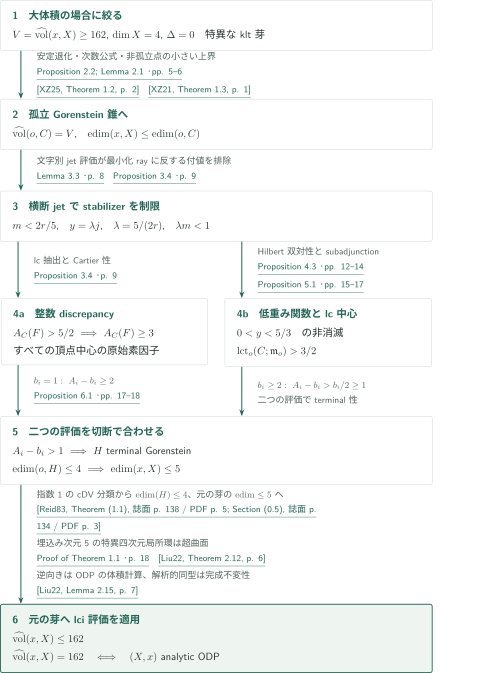
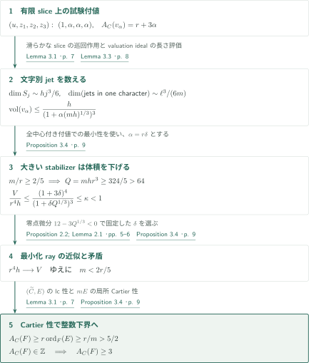
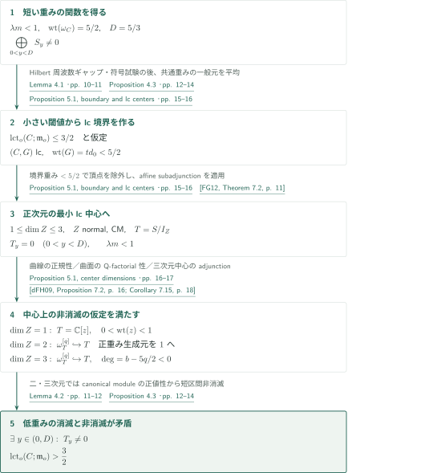

# The normalized-volume gap in dimension four

**体積の下限から局所環を超曲面へ帰着し、既知のlci評価を適用する**

原稿は、零境界の特異な複素代数的klt四次元芽について、正規化体積の上界162と等号の場合の解析的分類を主張する。新しい構造的帰着は、体積が162以上なら埋込み次元が5以下になることである。安定退化した錐のstabilizerを横断jetで制御し、discrepancyと極大イデアルの閾値を別々に評価して、terminal Gorenstein三次元切断を作る。

## 1. 主要結果

### Theorem 1.1 — 四次元の鋭い上界と等号分類

$X$を複素数体上の正規代数多様体、$x\in X$を特異な閉点とする。$\dim X=4$、$K_X$は$\mathbb Q$-Cartierで、$X$は$x$の近傍で**境界零のklt**であると仮定する。このとき

$$
\widehat{\operatorname{vol}}(x,X)\le 162=2\cdot3^4.
$$

等号が成立することと、解析的芽が

$$
(X,x)\simeq\bigl(\{z_0^2+z_1^2+z_2^2+z_3^2+z_4^2=0\}\subset\mathbb C^5,0\bigr)
$$

であることは同値である。孤立特異点、lci、商特異点、smoothabilityは仮定しない。以下は原稿が提示する論証の概説であり、全証明の独立検証ではない。

<!-- cite:main -->[Theorem 1.1 · p. 1](https://github.com/openai/math/blob/fd4aeeb2ee4fc729c18d98444fed42fd0529eeeb/preprints/The-normalized-volume-gap-in-dimension-four-September-24-2026/paper.pdf)<!-- /cite -->

体積は$\mathfrak a_t(v)=\{f\in\mathcal O_{X,x}:v(f)\ge t\}$に対し

$$
\operatorname{vol}(v)=\lim_{t\to\infty}\frac{4!}{t^4}\ell(\mathcal O_{X,x}/\mathfrak a_t(v)),\qquad
\widehat{\operatorname{vol}}(x,X)=\inf_{c_X(v)=x} A_X(v)^4\operatorname{vol}(v)
$$

と正規化する。$A_X(F)=1+\operatorname{coeff}_F(K_Y-\mu^*K_X)$は**log discrepancy**で、discrepancy無限大の評価は$+\infty$とする。全実付値での下限と中心が$x$である素因子付値での下限は一致する。この規約で滑らかな四次元点は256、通常二重点は162となる。

<!-- cite:conventions -->[Section 2 · pp. 3–5](https://github.com/openai/math/blob/fd4aeeb2ee4fc729c18d98444fed42fd0529eeeb/preprints/The-normalized-volume-gap-in-dimension-four-September-24-2026/paper.pdf)<!-- /cite -->

## 図の矢印に付した引用

<!-- reference-guide -->
略号のない定理・補題・節・式番号は本原稿 [Fourfold volume gap](https://github.com/openai/math/blob/fd4aeeb2ee4fc729c18d98444fed42fd0529eeeb/preprints/The-normalized-volume-gap-in-dimension-four-September-24-2026/paper.pdf) を指します。外部入力には次の略号を使います。

- [XZ25](https://arxiv.org/pdf/2205.10915v2) Chenyang Xu; Ziquan Zhuang — *Stable degenerations of singularities*：klt最小化付値の有限生成とK-semistable錐への安定退化。arXiv:2205.10915v2; published JAMS 38 (2025)。
- [LX18](https://arxiv.org/pdf/1707.05561v2) Chi Li; Chenyang Xu — *Stability of valuations: higher rational rank*：退化錐への体積・discrepancy保存と全付値での最小性。arXiv:1707.05561v2; published Peking Mathematical Journal 1 (2018)。
- [Li18](https://arxiv.org/pdf/1511.08164v4) Chi Li — *Minimizing normalized volumes of valuations*：埋込み次元比較に用いるIzumi型評価。arXiv:1511.08164v4, 2017-07-18; manuscript date 2017-07-19。
- [XZ21](https://arxiv.org/pdf/2005.08303v1) Chenyang Xu; Ziquan Zhuang — *Uniqueness of the minimizer of the normalized volume function*：crepant有限Galois被覆に対する正規化体積の次数公式。arXiv:2005.08303v1, 2020-05-17; published CJM 9 (2021)。
- [Liu22](https://arxiv.org/pdf/2007.14320v2) Yuchen Liu — *K-stability of cubic fourfolds*：非孤立点の上界、lciの鋭い上界と等号分類、完成局所環による不変性。arXiv:2007.14320v2, 2022-01-10; manuscript date 2022-01-11。
- [FG12](https://arxiv.org/pdf/1009.3996v1) Osamu Fujino; Yoshinori Gongyo — *On canonical bundle formulae and subadjunctions*：affine最小lc中心にklt境界を供給する。arXiv:1009.3996v1, 2010-09-21; internal version 1.17, 2010-09-12。
- [dFH09](https://arxiv.org/pdf/0805.1767v2) Tommaso de Fernex; Christopher D. Hacon — *Singularities on normal varieties*：klt境界を持つ曲面のQ-factorial性。arXiv:0805.1767v2, 2008-10-25; published Compositio 145 (2009)。
- [Reid83](https://webhomes.maths.ed.ac.uk/cheltsov/quotient/pdf/reid2.pdf) Miles Reid — *Minimal models of canonical 3-folds*：指数1 terminal三次元特異点のcDV分類と超曲面表示。Advanced Studies in Pure Mathematics 1 (1983), 131–180; original spread scan。

各引用に結果番号とページを付します。誌面番号とPDF内の位置が異なる場合は両方を示します。GitHubの閲覧リンクではページ位置への自動移動を前提としません。
<!-- /reference-guide -->

## 2. Theorem 1.1 — 主定理の証明概略

<!-- proof-target:1 -->証明対象：[Theorem 1.1 · p. 1](https://github.com/openai/math/blob/fd4aeeb2ee4fc729c18d98444fed42fd0529eeeb/preprints/The-normalized-volume-gap-in-dimension-four-September-24-2026/paper.pdf)<!-- /proof-target -->

**証明の道筋。** [主張](#theorem-1-1)の上界は、$V:=\widehat{\operatorname{vol}}(x,X)<162$なら既に成立する。$V\ge162$の場合に局所環の構造を絞る。錐への帰着の後、[stabilizer評価](#proof-1)が二つに分岐し、$A_C(F)\ge3$と[閾値$>3/2$](#proof-2)が三次元切断で合流する。最後に元の芽へ戻ってlci定理を使う。図の最後の入力が上界・等号の必要条件・最適性を同時に供給するが、各結論の役割は分けて説明する。

### 1. 体積を保つ錐への帰着

安定退化で$C=\operatorname{Spec}\operatorname{gr}_v\mathcal O_{X,x}$と最小化Reebベクトル$\xi_*$を得る。有限生成、錐上での体積・log discrepancyの保存、全中心付き付値の中での最小性が必要であり、固定Reeb錐だけでの最小化では足りない。Lemma 2.1は斉次生成元の持ち上げとIzumi評価を用い、$\operatorname{edim}(x,X)\le\operatorname{edim}(o,C)$を得る。

<!-- cite:stable -->[&#91;XZ25, Theorem 1.2, p. 2&#93;](https://arxiv.org/pdf/2205.10915v2#page=2)<!-- /cite --> <!-- cite:cone-minimum -->[&#91;LX18, Theorem 1.3, p. 3; Lemma 4.10, p. 35&#93;](https://arxiv.org/pdf/1707.05561v2#page=3)<!-- /cite --> <!-- cite:izumi -->[&#91;Li18, Theorem 3.1, p. 6&#93;](https://arxiv.org/pdf/1511.08164v4#page=6)<!-- /cite -->

錐のpunctureに特異点があれば、その軌道の閉包により頂点の特異 locusは正次元となり、$V\le4096/27<162$に反する。指数$d$のindex-one coverには有限次数公式を適用でき、$dV\le256$から$d=1$。kltのCohen–Macaulay性と斉次Nakayamaで$C$はGorensteinとなる。十分近い原始整次数付けのdegree valuationについて、discrepancyを$r>0$、体積を$h$とすれば$r^4h\ge V$かつ$r^4h\to V$である。

<!-- cite:cone -->[Proposition 2.2; Lemma 2.1 · pp. 5–6](https://github.com/openai/math/blob/fd4aeeb2ee4fc729c18d98444fed42fd0529eeeb/preprints/The-normalized-volume-gap-in-dimension-four-September-24-2026/paper.pdf)<!-- /cite --> <!-- cite:finite-degree -->[&#91;XZ21, Theorem 1.3, p. 1&#93;](https://arxiv.org/pdf/2005.08303v1#page=1)<!-- /cite --> <!-- cite:nonisolated -->[&#91;Liu22, Corollary 2.18, p. 9&#93;](https://arxiv.org/pdf/2007.14320v2#page=9)<!-- /cite -->

### 2. 二つの評価がterminal切断で合流する

Proposition 3.4は頂点中心の原始素因子すべてに$A_C(F)\ge3$を与える。Proposition 5.1は$\operatorname{lct}_o(C;\mathfrak m_o)>3/2$を与える。極大イデアルのlog resolution上で$\mathfrak m_o\mathcal O_Y=\mathcal O_Y(-\sum b_iE_i)$、$A_i=A_C(E_i)$とすると、一般切断$H$の通常discrepancyは$A_i-1-b_i$である。$H$はGorenstein Cohen–Macaulay四次元多様体のCartier切断なのでGorensteinかつ$S_2$であり、Bertiniによる頂点外の滑らかさが$R_1$を与えて正規となる。

$b_i=1$では$A_i-b_i\ge2$、$b_i\ge2$では$A_i-b_i>b_i/2\ge1$。したがって全係数は正で、$H$はterminal Gorenstein三次元芽となる。ここでは閾値だけからterminal性を結論していない。Reidの指数1分類により特異な$H$は孤立cDV、したがって解析的超曲面であり、滑らかな場合も含め$\operatorname{edim}(o,H)\le4$。よって

$$
\operatorname{edim}(x,X)\le\operatorname{edim}(o,C)\le\operatorname{edim}(o,H)+1\le5.
$$

<!-- cite:section -->[Proposition 6.1 · pp. 17–18](https://github.com/openai/math/blob/fd4aeeb2ee4fc729c18d98444fed42fd0529eeeb/preprints/The-normalized-volume-gap-in-dimension-four-September-24-2026/paper.pdf)<!-- /cite --> <!-- cite:reid -->[&#91;Reid83, Theorem (1.1), 誌面 p. 138 / PDF p. 5; Section (0.5), 誌面 p. 134 / PDF p. 3&#93;](https://webhomes.maths.ed.ac.uk/cheltsov/quotient/pdf/reid2.pdf#page=5)<!-- /cite -->

### 3. 上界、等号の必要条件、最適性

特異な正規四次元芽で埋込み次元が5以下なら、元の局所環は五次元正則局所環の高さ1素イデアルによる商となる。正則局所環のUFD性でそのイデアルは主イデアルだから、$X$自身が代数的局所超曲面、従ってlciである。ここで錐だけが超曲面であることと混同しない。

この段階でLiuのlci定理を適用し$V\le2(4-1)^4=162$を得る。同じ定理の等号分類により、$V=162$なら元の芽はODPである。逆向きにはODPの体積が実際に162であることが必要であり、単に一つの付値が162を与えるだけでは下限の一致を示さない。ODPの頂点の通常blow-upの例外因子$E$では$A_X(E)=3$、$\operatorname{vol}(E)=2$なので候補値は$3^4\cdot2=162$となる。本稿は既知のlci定理の等号主張とこのODP計算をここで入力し、完成局所環の同型で体積が不変という結果を通じて解析的分類に結び付ける。これで上界の最適性も得られる。

<!-- cite:finish -->[Proof of Theorem 1.1 · p. 18](https://github.com/openai/math/blob/fd4aeeb2ee4fc729c18d98444fed42fd0529eeeb/preprints/The-normalized-volume-gap-in-dimension-four-September-24-2026/paper.pdf)<!-- /cite --> <!-- cite:lci -->[&#91;Liu22, Theorem 2.12, p. 6&#93;](https://arxiv.org/pdf/2007.14320v2#page=6)<!-- /cite --> <!-- cite:completion -->[&#91;Liu22, Lemma 2.15, p. 7&#93;](https://arxiv.org/pdf/2007.14320v2#page=7)<!-- /cite -->

## 3. Proposition 3.4 — 横断jetからstabilizerとdiscrepancyを制御する

<!-- proof-target:2 -->証明対象：[Proposition 3.4 · p. 9](https://github.com/openai/math/blob/fd4aeeb2ee4fc729c18d98444fed42fd0529eeeb/preprints/The-normalized-volume-gap-in-dimension-four-September-24-2026/paper.pdf)<!-- /proof-target -->

<!-- statement:proposition-3-4 -->
### Proposition 3.4 — 大体積錐のstabilizer上界

Proposition 2.2の錐$C$、$V\ge162$、最小化rayに近づく原始正整次数付けを考え、degree valuationのdiscrepancyを$r$とする。最小化rayに十分近いすべての次数付けに対し、$C\setminus\{o\}$のすべての点のstabilizer位数$m$は$m<2r/5$を満たす。従って、頂点$o$に中心を持つすべての原始素因子$F$について$A_C(F)\ge3$である。

<!-- cite:stabilizer -->[Proposition 3.4 · p. 9](https://github.com/openai/math/blob/fd4aeeb2ee4fc729c18d98444fed42fd0529eeeb/preprints/The-normalized-volume-gap-in-dimension-four-September-24-2026/paper.pdf)<!-- /cite -->
<!-- /statement -->

### 1. 全付値最小性に対する試験付値

Lemma 3.1のgrading extractionは$K_{\widetilde C}=\pi^*K_C+(r-1)E$とlc対$(\widetilde C,E)$を持つ。stabilizer $\mu_m$の滑らかなslice上で座標$(u,z_1,z_2,z_3)$に重み$(1,\alpha,\alpha,\alpha)$を与え、関数体へ制限した付値$v_\alpha$を用いる。$\alpha>0$を有理数とすればこれは因子的付値に比例し、$A_C(v_\alpha)=r+3\alpha$となる。

次数$j$の関数の像は、$S_j$の次元と、対応する文字のslice jet空間の次元の小さい方で抑えられる。後者の主要項は$\ell^3/(6m)$であり、$m$を忘れる通常のjet計数では必要な評価にならない。次数について積分すると

$$
V\le(r+3\alpha)^4\frac{h}{\bigl(1+\alpha(mh)^{1/3}\bigr)^3}.
$$

<!-- cite:extraction -->[Lemma 3.1 · p. 7](https://github.com/openai/math/blob/fd4aeeb2ee4fc729c18d98444fed42fd0529eeeb/preprints/The-normalized-volume-gap-in-dimension-four-September-24-2026/paper.pdf)<!-- /cite --> <!-- cite:jets -->[Lemma 3.3 · p. 8](https://github.com/openai/math/blob/fd4aeeb2ee4fc729c18d98444fed42fd0529eeeb/preprints/The-normalized-volume-gap-in-dimension-four-September-24-2026/paper.pdf)<!-- /cite -->

### 2. 近似最小性との矛盾と整数性

$m/r\ge2/5$なら$Q=mhr^3\ge324/5>64$。$\alpha=r\delta$として右辺を$r^4h$で割った比$(1+3\delta)^4/(1+\delta Q^{1/3})^3$の零点微分は$12-3Q^{1/3}<0$となる。小さな固定有理数$\delta>0$が一様に$1$未満の比を与え、$V/(r^4h)\to1$と矛盾する。各付値のcutoff極限を先に取るので、jet誤差項の次数付けに関する一様性は要求しない。

$mE$の局所Cartier性から$\operatorname{ord}_F(E)\ge1/m$であり、lc性を使うと$A_C(F)\ge r\operatorname{ord}_F(E)>5/2$。$K_C$がCartierなのでこれは整数で、$A_C(F)\ge3$となる。以後$y=\lambda j$、$\lambda=5/(2r)$に再正規化するとcanonical weightは$5/2$、すべての非頂点stabilizerは$\lambda m<1$となる。

<!-- cite:stabilizer -->[Proposition 3.4 · p. 9](https://github.com/openai/math/blob/fd4aeeb2ee4fc729c18d98444fed42fd0529eeeb/preprints/The-normalized-volume-gap-in-dimension-four-September-24-2026/paper.pdf)<!-- /cite -->

## 4. Proposition 5.1 — 低重み関数と最小lc中心から閾値を上げる

<!-- proof-target:3 -->証明対象：[Proposition 5.1 · pp. 15–17](https://github.com/openai/math/blob/fd4aeeb2ee4fc729c18d98444fed42fd0529eeeb/preprints/The-normalized-volume-gap-in-dimension-four-September-24-2026/paper.pdf)<!-- /proof-target -->

<!-- statement:proposition-5-1 -->
### Proposition 5.1 — 極大イデアルの閾値

Proposition 2.2の四次元錐$C$と頂点$o$を取る。Proposition 3.4を満たす次数付けを固定し、canonical weightが$5/2$となるよう重みを再正規化する。このとき

$$
\operatorname{lct}_o(C;\mathfrak m_o)>\frac32.
$$

閾値は$o$の近傍でのlog canonicityに対するもので、極大イデアルの場合は$o$を中心とする素因子の$A_C(F)/\operatorname{ord}_F(\mathfrak m_o)$の下限である。

<!-- cite:threshold -->[Proposition 5.1 · pp. 15–17](https://github.com/openai/math/blob/fd4aeeb2ee4fc729c18d98444fed42fd0529eeeb/preprints/The-normalized-volume-gap-in-dimension-four-September-24-2026/paper.pdf)<!-- /cite -->
<!-- /statement -->

### 1. Hilbert級数の周波数ギャップが短い重みを強制する

正規Cohen–Macaulay次数付き環$T$に対し、canonical moduleの自然な重みを使って

$$
\mu_T=\sum_y\dim T_y\,\delta_y+(-1)^{\dim T-1}\sum_y\dim(\omega_T)_y\,\delta_{-y}
$$

を作る。Lemma 4.1は$\lambda m<1$からHilbert級数の非零pole frequencyが$[-1,1]$外にあることを示し、Fourier変換の台が$(-1,1)$にあるSchwartz関数$F$に対して$\int F\,d\mu_T=\int F(y)P_T(y)\,dy$を得る。$P_T$は$H_T(s)=\sum_y\dim T_y e^{-sy}$の$s=0$でのpolar partを記録する多項式である。本稿は次数付き自由分解を双対化して$H_{\omega_T}(z)=(-1)^{\dim T}H_T(z^{-1})$を導き、この内部の計算を用いる。ここで後者の$H_T(z)$は整次数のHilbert級数であり、$z=e^{-\lambda s}$である。

四次元環$S$ではcanonical weight $5/2$の対称性で、$x=y+5/4$に移した密度は$a(x^3+cx)$となる。原稿はband-limited関数の二乗に符号を変える多項式を掛け、$c\ge-1$と$a\ge432/625$を得た後、区間$(0,D)$、$D=5/3$に関数重みがないと積分値の上下界が矛盾することを示す。Proposition 4.3(a)が従う。二・三次元の場合の同命題(b)には、$\omega_T^{[q]}\hookrightarrow T$が重みを正に下げるという**追加条件**がある。Lemma 4.2がcanonical sectionの正重みと$P_T$の次高次係数の正値性を供給する。

<!-- cite:hilbert -->[Lemma 4.1 · pp. 10–11](https://github.com/openai/math/blob/fd4aeeb2ee4fc729c18d98444fed42fd0529eeeb/preprints/The-normalized-volume-gap-in-dimension-four-September-24-2026/paper.pdf)<!-- /cite --> <!-- cite:positivity -->[Lemma 4.2 · pp. 11–12](https://github.com/openai/math/blob/fd4aeeb2ee4fc729c18d98444fed42fd0529eeeb/preprints/The-normalized-volume-gap-in-dimension-four-September-24-2026/paper.pdf)<!-- /cite --> <!-- cite:short -->[Proposition 4.3 · pp. 12–14](https://github.com/openai/math/blob/fd4aeeb2ee4fc729c18d98444fed42fd0529eeeb/preprints/The-normalized-volume-gap-in-dimension-four-September-24-2026/paper.pdf)<!-- /cite -->

### 2. 閾値が小さいと低重み関数の共通零点にlc中心ができる

$\operatorname{lct}_o(C;\mathfrak m_o)\le3/2$と仮定する。$0<y<D$の斉次関数の基底$f_i$を取り、$d_0=\max\operatorname{wt}(f_i)<D$とする。冪を取って共通重み$B$に揃えたイデアル$\mathfrak b$の閾値$t=\operatorname{lct}_o(C;\mathfrak b^{d_0/B})$は$0<t\le3/2$であり、$td_0<5/2$。十分多くの一般元の平均で作る有効斉次境界$G$は総重み$td_0$を持ち、$(C,G)$はlcで、その全lc中心で$f_i$が消える。$\mathfrak b$が極大イデアルprimaryであるとは仮定しない。

grading extraction上では$A_{C,G}(F)>0$が中心ちょうど$o$のすべての$F$に成り立つ。これは$td_0<5/2$により例外因子の係数差が正になるためで、$o$自体はlc中心でない。従って最小lc中心$Z$は$1\le\dim Z\le3$を満たす。affine subadjunctionを適用できるのは$C$が正規affine、$G$が有効有理境界、$K_C+G$が$\mathbb Q$-Cartier、対がlcであるためである。得られるklt対$(Z,\Delta_Z)$により$Z$は正規・有理特異点・Cohen–Macaulayとなる。

<!-- cite:threshold-construction -->[Proposition 5.1, boundary and lc centers · pp. 15–16](https://github.com/openai/math/blob/fd4aeeb2ee4fc729c18d98444fed42fd0529eeeb/preprints/The-normalized-volume-gap-in-dimension-four-September-24-2026/paper.pdf)<!-- /cite --> <!-- cite:subadjunction -->[&#91;FG12, Theorem 7.2, p. 11&#93;](https://arxiv.org/pdf/1009.3996v1#page=11)<!-- /cite -->

### 3. 中心の次元ごとに非消滅の仮定を確保する

$T=S/I_Z$には元のgradingを誘導する。stabilizerは同じ点を$C$で見たものと同一なので$\lambda m<1$を保つが、作用は有効とは限らない。一方、$T_y$は$S_y$の商であり、すべての$f_i$が$Z$上で零なので$T_y=0$ for $0<y<D$。

$\dim Z=1$なら正規な次数付き曲線は$\mathbb C[z]$であり、$z$の重みはstabilizer条件から$1$未満となり直ちに矛盾する。$\dim Z=2$ならklt境界を持つ曲面の$\mathbb Q$-factorial性で$Z$自体が$\mathbb Q$-Gorenstein kltとなる。canonical reflexive powerの斉次生成元は正重みを持ち、それを$1$へ送って必要な重みを下げる単射を得る。

$\dim Z=3$では$U=Z\setminus\{o\}$は滑らかな$C\setminus\{o\}$内のCartier因子である。非零低重み関数$f$について$b=\operatorname{wt}(f)<D$、$q=\operatorname{ord}_Z(f)\ge1$とすると、equivariant adjunctionと$f$による乗法から$\omega_U^{\otimes q}\to\mathcal O_U$が得られ、その次数は$b-q(5/2)<0$である。頂点を跨いで反射的に延長すれば$\omega_T^{[q]}\hookrightarrow T$となる。$Z$全体の$\mathbb Q$-Gorenstein性を仮定する必要はない。二・三次元ともProposition 4.3(b)の低重み非消滅と矛盾し、閾値の厳密な不等式を得る。

<!-- cite:threshold-centers -->[Proposition 5.1, center dimensions · pp. 16–17](https://github.com/openai/math/blob/fd4aeeb2ee4fc729c18d98444fed42fd0529eeeb/preprints/The-normalized-volume-gap-in-dimension-four-September-24-2026/paper.pdf)<!-- /cite --> <!-- cite:surface -->[&#91;dFH09, Proposition 7.2, p. 16; Corollary 7.15, p. 18&#93;](https://arxiv.org/pdf/0805.1767v2#page=16)<!-- /cite -->

## 5. どの論文が、どの段階を担うか

| 入力 | 利用箇所 | 役割と適用条件 | 確認範囲 |
|---|---|---|---|
| <!-- cite:stable -->[&#91;XZ25, Theorem 1.2, p. 2&#93;](https://arxiv.org/pdf/2205.10915v2#page=2)<!-- /cite --> <!-- cite:cone-minimum -->[&#91;LX18, Theorem 1.3, p. 3; Lemma 4.10, p. 35&#93;](https://arxiv.org/pdf/1707.05561v2#page=3)<!-- /cite --> <!-- cite:izumi -->[&#91;Li18, Theorem 3.1, p. 6&#93;](https://arxiv.org/pdf/1511.08164v4#page=6)<!-- /cite --> | Proposition 2.2、Lemma 2.1 | klt最小化付値の有限生成、退化錐の全付値最小性と体積保存、元の局所環への埋込み次元比較 | 指定版の結果記述と本稿pp.4–6の使用を照合 |
| <!-- cite:finite-degree -->[&#91;XZ21, Theorem 1.3, p. 1&#93;](https://arxiv.org/pdf/2005.08303v1#page=1)<!-- /cite --> <!-- cite:nonisolated -->[&#91;Liu22, Corollary 2.18, p. 9&#93;](https://arxiv.org/pdf/2007.14320v2#page=9)<!-- /cite --> | Proposition 2.2 | crepant有限Galois被覆の次数公式、非孤立点の小さい上界、$dV\le256$ | 定理・系の仮定と本稿p.6を照合 |
| <!-- cite:subadjunction -->[&#91;FG12, Theorem 7.2, p. 11&#93;](https://arxiv.org/pdf/1009.3996v1#page=11)<!-- /cite --> <!-- cite:surface -->[&#91;dFH09, Proposition 7.2, p. 16; Corollary 7.15, p. 18&#93;](https://arxiv.org/pdf/0805.1767v2#page=16)<!-- /cite --> | Proposition 5.1 | affine最小lc中心のklt境界、二次元中心の$\mathbb Q$-factorial性 | 指定版の記述と本稿pp.16–17を照合 |
| <!-- cite:reid -->[&#91;Reid83, Theorem (1.1), 誌面 p. 138 / PDF p. 5; Section (0.5), 誌面 p. 134 / PDF p. 3&#93;](https://webhomes.maths.ed.ac.uk/cheltsov/quotient/pdf/reid2.pdf#page=5)<!-- /cite --> | Proposition 6.1 | terminal Gorenstein三次元切断をcDV超曲面にする | 見開き原典のTheorem (1.1)、§(0.5)と本稿p.18を照合 |
| <!-- cite:lci -->[&#91;Liu22, Theorem 2.12, p. 6&#93;](https://arxiv.org/pdf/2007.14320v2#page=6)<!-- /cite --> <!-- cite:completion -->[&#91;Liu22, Lemma 2.15, p. 7&#93;](https://arxiv.org/pdf/2007.14320v2#page=7)<!-- /cite --> | Theorem 1.1の結末 | 元の芽がlciになった後の上界・等号分類・解析的同型での不変性 | Theorem 2.12、Lemma 2.15と本稿p.18を照合 |

同カタログの全次元原稿との関係はカタログ案内にまとめる。本稿が全次元原稿に依存するとする矢印は設けない。球充填やorbifold Riemann–Rochへの方法上の比較は、上記の直接入力とは区別する。

## 6. 原典を読む入口と確認範囲

<!-- reading-list -->
- [Theorem 1.1 · p. 1](https://github.com/openai/math/blob/fd4aeeb2ee4fc729c18d98444fed42fd0529eeeb/preprints/The-normalized-volume-gap-in-dimension-four-September-24-2026/paper.pdf) — 仮定・零境界・次元・等号分類
- [Proposition 2.2; Lemma 2.1 · pp. 5–6](https://github.com/openai/math/blob/fd4aeeb2ee4fc729c18d98444fed42fd0529eeeb/preprints/The-normalized-volume-gap-in-dimension-four-September-24-2026/paper.pdf) — 体積保存と元の局所環への埋込み次元比較
- [Lemma 3.3 · p. 8](https://github.com/openai/math/blob/fd4aeeb2ee4fc729c18d98444fed42fd0529eeeb/preprints/The-normalized-volume-gap-in-dimension-four-September-24-2026/paper.pdf) — 文字ごとのjet計数がstabilizer位数を捉える箇所
- [Proposition 4.3 · pp. 12–14](https://github.com/openai/math/blob/fd4aeeb2ee4fc729c18d98444fed42fd0529eeeb/preprints/The-normalized-volume-gap-in-dimension-four-September-24-2026/paper.pdf) — Hilbert双対性と短区間非消滅の符号試験
- [Proposition 5.1 · pp. 15–17](https://github.com/openai/math/blob/fd4aeeb2ee4fc729c18d98444fed42fd0529eeeb/preprints/The-normalized-volume-gap-in-dimension-four-September-24-2026/paper.pdf) — lc境界の構成と中心次元ごとのcanonical module
- [Proposition 6.1 · pp. 17–18](https://github.com/openai/math/blob/fd4aeeb2ee4fc729c18d98444fed42fd0529eeeb/preprints/The-normalized-volume-gap-in-dimension-four-September-24-2026/paper.pdf) — 二つの評価からterminal切断を得る箇所
- [Proof of Theorem 1.1 · p. 18](https://github.com/openai/math/blob/fd4aeeb2ee4fc729c18d98444fed42fd0529eeeb/preprints/The-normalized-volume-gap-in-dimension-four-September-24-2026/paper.pdf) — lciへの帰着後に上界と等号を得る最終段階
<!-- /reading-list -->

主張、体積の正規化、Proposition 2.2、Lemma 3.3からProposition 3.4への評価、§4の符号と重みの帰着、Proposition 5.1のlc中心の三つの場合、§6の切断とlci定理への適用を原典本文で照合した。外部入力は上表の結果の記述と適用箇所を対象とし、その証明は再帰的に検証していない。

未確認として残すのは、Lemma 3.1のslice/extraction構成の全局所代数、§4の全Fourier・近似・moment計算の独立再計算、および三次元中心上の自然なgradingと反射的延長に関する全sheaf同型の独立検証である。これらの接続について原稿の説明は読んだが、概説の完成を原稿全体の正しさの認定とはしない。
