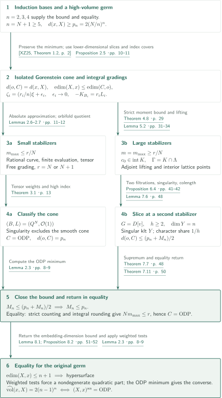
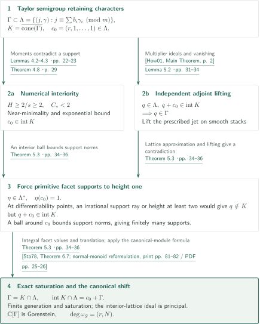
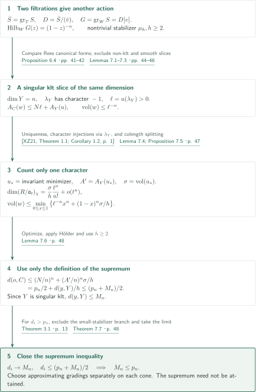
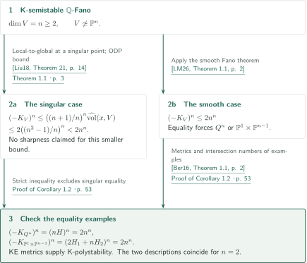

# The ordinary-double-point gap in every dimension

**Stable degeneration, saturation of jet semigroups, and a supremum argument in the same dimension**

The manuscript propagates the ordinary-double-point (ODP) volume gap for boundary-zero complex algebraic klt singularities from dimensions at most four to every dimension. It degenerates a high-volume germ to an isolated Gorenstein K-polystable cone, then splits according to stabilizers of integral gradings. When the construction produces another singularity of the same dimension, it closes an inequality for the supremum of all singular densities instead of invoking an unavailable induction hypothesis.

## 1. Main results

### Theorem 1.1 — The ODP volume gap and equality classification

Let $n\ge2$ and let $x$ be a singular closed point of a normal complex algebraic $n$-fold $X$. Assume $K_X$ is $\mathbb Q$-Cartier and $X$ is **klt with zero boundary** near $x$. Then

$$\widehat{\operatorname{vol}}(x,X)\le2(n-1)^n,$$

with equality if and only if there is a complex analytic isomorphism

$$
(X,x)^{\mathrm{an}}\simeq\bigl(\{z_0^2+\cdots+z_n^2=0\}\subset\mathbb C^{n+1},0\bigr).
$$

No isolatedness, complete-intersection or smoothability assumption is made.

For $R=\mathcal O_{X,x}$ and $\mathfrak a_t(v)=\{f:v(f)\ge t\}$, the normalization is

$$
\operatorname{vol}(v)=\lim_{t\to\infty}\frac{n!\,\ell(R/\mathfrak a_t(v))}{t^n},\qquad
\widehat{\operatorname{vol}}(x,X)=\inf_{v\text{ centered exactly at }x}A_X(v)^n\operatorname{vol}(v).
$$

Here $A_X$ is log discrepancy: the exceptional divisor of the ordinary blowup of a smooth $n$-fold point has discrepancy $n$. A valuation of infinite discrepancy contributes $+\infty$. Write $d(x,X)=\widehat{\operatorname{vol}}(x,X)/n^n$ and $p_n=2((n-1)/n)^n$.

<!-- cite:main -->[Theorem 1.1 · p. 3](https://github.com/openai/math/blob/fd4aeeb2ee4fc729c18d98444fed42fd0529eeeb/preprints/The-ordinary-double-point-gap-in-every-dimension-September-24-2026/paper.pdf)<!-- /cite --> <!-- cite:normalization -->[§2.1; (2.1) · pp. 6–7](https://github.com/openai/math/blob/fd4aeeb2ee4fc729c18d98444fed42fd0529eeeb/preprints/The-ordinary-double-point-gap-in-every-dimension-September-24-2026/paper.pdf)<!-- /cite -->

### Corollary 1.2 — Global volumes of K-semistable Fano varieties

Let $V$ be an $n$-dimensional K-semistable $\mathbb Q$-Fano variety, $n\ge2$. If $V$ is singular, then

$$(-K_V)^n\le2\left(\frac{n^2-1}{n}\right)^n<2n^n.$$

If $V\not\simeq\mathbb P^n$, then $(-K_V)^n\le2n^n$, with equality precisely for a smooth quadric $Q^n\subset\mathbb P^{n+1}$ or $\mathbb P^1\times\mathbb P^{n-1}$. These descriptions coincide when $n=2$. **The smaller singular bound is not asserted to be sharp and is not accompanied by a classification of its equality cases.**

<!-- cite:global -->[Corollary 1.2 · p. 3](https://github.com/openai/math/blob/fd4aeeb2ee4fc729c18d98444fed42fd0529eeeb/preprints/The-ordinary-double-point-gap-in-every-dimension-September-24-2026/paper.pdf)<!-- /cite -->

## References on the arrows

<!-- reference-guide -->
Unprefixed theorem, lemma, section and equation numbers refer to [ODP gap in every dimension](https://github.com/openai/math/blob/fd4aeeb2ee4fc729c18d98444fed42fd0529eeeb/preprints/The-ordinary-double-point-gap-in-every-dimension-September-24-2026/paper.pdf). External inputs use the following keys.

- [Gra15](https://www.jpswanson.org/notes/liegroups.pdf) Robin Graham (lecturer); Josh Swanson (initial draft); Debbie Matthews (editor) — *(Compact) Lie Groups and Representation Theory Lecture Notes*: Irreducibility of the graded harmonic-polynomial representations in the ODP minimum. University of Washington lecture notes, 2015-05-29.
- [XZ25](https://arxiv.org/pdf/2205.10915v2) Chenyang Xu; Ziquan Zhuang — *Stable degenerations of singularities*: Minimizers, finite generation and degeneration of klt germs to K-semistable and K-polystable cones. arXiv:2205.10915v2, 2025-01-17.
- [XZ21](https://arxiv.org/pdf/2005.08303v1) Chenyang Xu; Ziquan Zhuang — *Uniqueness of the minimizer of the normalized volume function*: Uniqueness, automorphism invariance and the finite degree formula. arXiv:2005.08303v1, 2020-05-17.
- [LWX21](https://arxiv.org/pdf/1805.03393v2) Chi Li; Xiaowei Wang; Chenyang Xu — *Algebraicity of the metric tangent cones and equivariant K-stability*: Special degeneration from a K-semistable to a K-polystable cone. arXiv:1805.03393v2, 2021-01-08.
- [BL21](https://arxiv.org/pdf/1802.09658v2) Harold Blum; Yuchen Liu — *The normalized volume of a singularity is lower semicontinuous*: Lower semicontinuity used to exclude singular puncture points by induction. arXiv:1802.09658v2, 2019-08-15; manuscript date 2019-08-16.
- [LX19](https://arxiv.org/pdf/1706.01933v3) Yuchen Liu; Chenyang Xu — *K-stability of cubic threefolds*: The threefold bound 16 and equality, and the smooth upper bound in all dimensions. arXiv:1706.01933v3, 2019-01-26.
- [LZ25](https://arxiv.org/pdf/2502.11847v1) Chi Li; Zhengyi Zhou — *Minimal log discrepancy and orbifold curves*: Orbifold rational curves with at most one stack point in the small-stabilizer branch. arXiv:2502.11847v1, 2025-02-17.
- [AOV11](https://www.math.brown.edu/dabramov/PAPERS/TAME/twisted-tame-10-01-2009.pdf) Dan Abramovich; Martin Olsson; Angelo Vistoli — *Twisted stable maps to tame Artin stacks*: Properness of twisted stable maps in the finite evaluation argument. Author-hosted manuscript, twisted-tame-10-01-2009.pdf; published J. Algebraic Geometry 20 (2011).
- [CS19](https://msp.org/gt/2019/23-3/gt-v23-n3-p05-s.pdf) Tristan C. Collins; Gábor Székelyhidi — *Sasaki–Einstein metrics and K-stability*: Ricci-flat metrics on isolated K-polystable Fano cones and the stability convention. Geometry & Topology 23 (2019), 1339–1413; publisher PDF with final back cover.
- [ADK08](https://arxiv.org/pdf/0707.4310v2) Carolina Araujo; Stéphane Druel; Sándor J. Kovács — *Cohomological characterizations of projective spaces and hyperquadrics*: High-index classification after the grading is free and L is an actual ample line bundle. arXiv:0707.4310v2, 2007-10-09; manuscript date 2007-07-29.
- [How01](https://arxiv.org/pdf/math/0003232v1) Jason A. Howald — *Multiplier ideals of monomial ideals*: Newton-polyhedron interior criterion for monomials on smooth atlases. arXiv:math/0003232v1, 2000-03-31.
- [Fuj23](https://www.math.kyoto-u.ac.jp/~fujino/cone-and-contraction.pdf) Osamu Fujino — *Cone and contraction theorem for projective morphisms between complex analytic spaces*: Nef and big vanishing for a coarse klt pair and an integral Q-Cartier Weil divisor. Version 0.00, 2023-10-09; author PDF.
- [Sta78](https://math.mit.edu/~rstan/pubs/pubfiles/30.pdf) Richard P. Stanley — *Hilbert functions of graded algebras*: Canonical modules of normal monoids through interior lattice points and the Gorenstein criterion. Advances in Mathematics 28 (1978), 57–83; author-hosted scan.
- [EM04](https://arxiv.org/pdf/math/0301164v2) Lawrence Ein; Mircea Mustaţă — *Inversion of adjunction for local complete intersection varieties*: Inversion of adjunction in the weighted hypersurface estimate. arXiv:math/0301164v2, 2003-07-30.
- [Liu18](https://arxiv.org/pdf/1605.01034v5) Yuchen Liu — *The volume of singular Kähler–Einstein Fano varieties*: Equivalence of K/Ding semistability and the local-to-global volume comparison. arXiv:1605.01034v5, 2018-05-23.
- [LM26](https://arxiv.org/pdf/2506.17420v3) Chi Li; Minghao Miao — *On the volume of K-semistable Fano manifolds*: The smooth K-semistable Fano bound and equality candidates away from projective space. arXiv:2506.17420v3, 2026-05-20; manuscript title-page date 2026-05-22.
- [Ber16](https://arxiv.org/pdf/1205.6214v3) Robert J. Berman — *K-polystability of Q-Fano varieties admitting Kähler–Einstein metrics*: K-polystability from the KE metrics on the global equality examples. arXiv:1205.6214v3, 2015-06-09.
- [Liu22](https://arxiv.org/pdf/2007.14320v2) Yuchen Liu — *K-stability of cubic fourfolds*: Transfer of normalized volume under isomorphic completed local rings. arXiv:2007.14320v2, 2022-01-10.
- [OpenAI26b](https://github.com/openai/math/blob/fd4aeeb2ee4fc729c18d98444fed42fd0529eeeb/preprints/The-normalized-volume-gap-in-dimension-four-September-24-2026/paper.pdf) OpenAI — *The normalized-volume gap in dimension four*: The unrestricted boundary-zero klt fourfold bound 162 and analytic equality as the induction base. September 24, 2026.

Each citation gives the result and pages. When printed pagination differs from the PDF position, both are shown. GitHub previews do not automatically jump to the cited page.
<!-- /reference-guide -->

## 2. Theorem 1.1 — Proof overview of the main theorem

<!-- proof-target:1 -->Proof target：[Theorem 1.1 · p. 3](https://github.com/openai/math/blob/fd4aeeb2ee4fc729c18d98444fed42fd0529eeeb/preprints/The-ordinary-double-point-gap-in-every-dimension-September-24-2026/paper.pdf)<!-- /proof-target --> See the [statement and normalization](#theorem-1-1).

**Proof route.** Dimension two uses quotient singularities, dimension three an established gap theorem, and dimension four the companion in this catalogue. The remaining step is $n=N+1\ge5$ and starts with a cone of density at least $p_n$. Small stabilizers classify the cone; large stabilizers lead through the [saturated semigroup](#proof-1) to a [slice estimate in the same dimension](#proof-2). Equality needs a further return from the cone to the original germ.

### 1. Preserve volume and obtain an isolated Gorenstein cone

Stable degeneration and its K-polystable refinement preserve the minimizing valuation's value. Lifting generators and upper semicontinuity in the flat degeneration also give $\operatorname{edim}(X,x)\le\operatorname{edim}(C,o)$, so the final cone is singular. If a puncture point $P$ were singular, an étale product of an $(n-1)$-dimensional transverse slice with a smooth curve would give $d(P,C)\le p_{n-1}$ by induction and Lemma 2.1. Lower semicontinuity gives $d(o,C)\le d(P,C)$, contradicting $p_{n-1}<p_n$. Applying the finite degree formula to the canonical index-$q$ cover gives $d(o,C)\le1/q$; since $p_n>1/2$, the index is one.

<!-- cite:cone -->[Proposition 2.5 · pp. 10–11](https://github.com/openai/math/blob/fd4aeeb2ee4fc729c18d98444fed42fd0529eeeb/preprints/The-ordinary-double-point-gap-in-every-dimension-September-24-2026/paper.pdf)<!-- /cite --> <!-- cite:stable -->[&#91;XZ25, Theorem 1.2, p. 2&#93;](https://arxiv.org/pdf/2205.10915v2#page=2)<!-- /cite --> <!-- cite:polystable -->[&#91;LWX21, Theorem 1.2, p. 2&#93;](https://arxiv.org/pdf/1805.03393v2#page=2)<!-- /cite --> <!-- cite:lsc -->[&#91;BL21, Theorem 33(1), p. 23&#93;](https://arxiv.org/pdf/1802.09658v2#page=23)<!-- /cite --> <!-- cite:degree -->[&#91;XZ21, Theorem 1.3, p. 1&#93;](https://arxiv.org/pdf/2005.08303v1#page=1)<!-- /cite --> <!-- cite:base-three -->[&#91;LX19, Theorem 1.3(1), p. 3&#93;](https://arxiv.org/pdf/1706.01933v3#page=3)<!-- /cite --> <!-- cite:base-four -->[&#91;OpenAI26b, Theorem 1.1, p. 1&#93;](https://github.com/openai/math/blob/fd4aeeb2ee4fc729c18d98444fed42fd0529eeeb/preprints/The-normalized-volume-gap-in-dimension-four-September-24-2026/paper.pdf)<!-- /cite -->

### 2. Small stabilizers force a free grading and high-index classification

Normalize $A_C(\xi)=n$ and approximate by primitive positive integral gradings $\zeta_i=(r_i/n)\xi+\epsilon_i$ with **absolute error** $\epsilon_i\to0$. The smooth orbifold $B_i=[C^\circ/\mathbb G_m]$ has a faithful weight-one ample line bundle $L_i$ and $-K_{B_i}=r_iL_i$. If $m_{\max}\le r/N$, the Li–Zhou curve theorem supplies a minimal-degree map $\mathbb P(1,m)\to B$. Unless the deformation character count directly forces freeness, its evaluation map is finite and surjective.

The symmetric product of infinitesimal translations over all sheets gives a nonzero rank-$b$ tensor of integral weight $-bm$. A Bochner argument for the Ricci-flat cone metric bounds its Reeb weight by $\tau\ge-b$; estimates in fixed ring generators control the character error independently of $b$. Thus the integer $nm-r$ is at most $o(1)$. Rounding and faithfulness of the tangent action force all stabilizers to be trivial and $r=N$ or $N+1$. High-index classification of the resulting smooth polarized Fano variety identifies its section ring with the quadric ring or a polynomial ring. Singularity of $C$ excludes the latter.

<!-- cite:approximation -->[Lemmas 2.6–2.7 · pp. 11–12](https://github.com/openai/math/blob/fd4aeeb2ee4fc729c18d98444fed42fd0529eeeb/preprints/The-ordinary-double-point-gap-in-every-dimension-September-24-2026/paper.pdf)<!-- /cite --> <!-- cite:small -->[Theorem 3.1; proof · pp. 13–19](https://github.com/openai/math/blob/fd4aeeb2ee4fc729c18d98444fed42fd0529eeeb/preprints/The-ordinary-double-point-gap-in-every-dimension-September-24-2026/paper.pdf)<!-- /cite --> <!-- cite:curve -->[&#91;LZ25, Proposition 2.6, p. 6&#93;](https://arxiv.org/pdf/2502.11847v1#page=6)<!-- /cite --> <!-- cite:properness -->[&#91;AOV11, Theorem 4.3, p. 17&#93;](https://www.math.brown.edu/dabramov/PAPERS/TAME/twisted-tame-10-01-2009.pdf#page=17)<!-- /cite --> <!-- cite:metric -->[&#91;CS19, Theorem 1.1, print p. 1340 / PDF p. 2&#93;](https://msp.org/gt/2019/23-3/gt-v23-n3-p05-s.pdf#page=2)<!-- /cite --> <!-- cite:high-index -->[&#91;ADK08, Theorems 1.1 and 1.3, pp. 1–2&#93;](https://arxiv.org/pdf/0707.4310v2#page=1)<!-- /cite -->

### 3. Large stabilizers lead to an inequality for the supremum

For $m=m_{\max}\ge r/N$, record original degree and transverse Taylor initial in a semigroup $\Gamma$. Moment estimates from near-minimality and an exponential expectation inequality put $c_0=(r,1,\ldots,1)$ inside its real cone $K$. Adjoint lifting then yields $\Gamma=K\cap\Lambda$ and $\operatorname{int}K\cap\Lambda=c_0+\Gamma$. The [Theorem 5.3 section](#proof-1) explains this exact integral strengthening.

Two filtrations produce a central ring $G=D[v]$ with Hilbert series $(1-z)^{-n}$. A point with a different stabilizer $\mu_h$, $h\ge2$, gives a singular klt slice $Y$ of **the same dimension $n$**. The share $1/h$ of each character in leading colength yields $d(o,C)\le(p_n+M_n)/2$, where $M_n$ is the supremum of all singular $n$-dimensional klt densities. Applying this to germs approaching $M_n$ proves $M_n\le p_n$. The original $m$ and the new $h$ belong to different actions.

<!-- cite:interior -->[Theorem 4.8 · p. 29](https://github.com/openai/math/blob/fd4aeeb2ee4fc729c18d98444fed42fd0529eeeb/preprints/The-ordinary-double-point-gap-in-every-dimension-September-24-2026/paper.pdf)<!-- /cite --> <!-- cite:saturation -->[Theorem 5.3 · pp. 34–36](https://github.com/openai/math/blob/fd4aeeb2ee4fc729c18d98444fed42fd0529eeeb/preprints/The-ordinary-double-point-gap-in-every-dimension-September-24-2026/paper.pdf)<!-- /cite --> <!-- cite:two-filtrations -->[Proposition 6.4; Corollary 6.6 · pp. 41–43](https://github.com/openai/math/blob/fd4aeeb2ee4fc729c18d98444fed42fd0529eeeb/preprints/The-ordinary-double-point-gap-in-every-dimension-September-24-2026/paper.pdf)<!-- /cite --> <!-- cite:bootstrap -->[Theorem 7.7 · p. 48](https://github.com/openai/math/blob/fd4aeeb2ee4fc729c18d98444fed42fd0529eeeb/preprints/The-ordinary-double-point-gap-in-every-dimension-September-24-2026/paper.pdf)<!-- /cite -->

### 4. Classify equality on the cone and return to the germ

When $d(o,C)=p_n$, every inequality in the slice estimate is an equality. Thus $h=2$ and, after normalizing $u(\lambda_Y)=1$, one has $A_Y(u)=N$ and $\operatorname{vol}(u)=2$. The restricted valuation $w$ satisfies $A_C(w)=2N$ and $\operatorname{vol}(w)=2^{-N}$ and computes the minimum; uniqueness gives $w=(2N/n)\operatorname{wt}_\xi$. If the distinguished section $v\in S_m$ had $w(v)>2$, a positive leading-order loss in the low-filtration quotient would make the volume estimate strict. Hence $w(v)\le2$. Absolute approximation gives $Nm-r\le o(1)$, so integrality returns the grading to $Nm\le r$, the small-stabilizer branch. Theorem 7.11 therefore identifies $C$ as the ODP cone.

The original singular germ has embedding dimension at most $n+1$, hence exactly $n+1$, and is a hypersurface. Lemma 8.1 supplies the weighted bound

$$
\widehat{\operatorname{vol}}(x,X)\le
\frac{d_F(\sum_{i=0}^n w_i-d_F)^n}{\prod_{i=0}^n w_i},
$$

where $F=0$ is a local equation, $w_i>0$ are rational weights, and $d_F$ is its least weight. Weights all equal to one exclude multiplicity $q>2$. If $q=2$ but the quadratic part omits a direction, giving that direction weight $1-\varepsilon$ yields the strict bound $2(n-1-\varepsilon)^n/(1-\varepsilon)<2(n-1)^n$. Equality forces a nondegenerate quadratic part, and the holomorphic Morse lemma gives an analytic ODP. An ODP degeneration alone would not establish this last assertion.

<!-- cite:equality -->[Lemmas 7.8–7.10; Theorem 7.11 · pp. 49–50](https://github.com/openai/math/blob/fd4aeeb2ee4fc729c18d98444fed42fd0529eeeb/preprints/The-ordinary-double-point-gap-in-every-dimension-September-24-2026/paper.pdf)<!-- /cite --> <!-- cite:unique -->[&#91;XZ21, Theorem 1.1; Corollary 1.2, p. 1&#93;](https://arxiv.org/pdf/2005.08303v1#page=1)<!-- /cite --> <!-- cite:hypersurface -->[Lemma 8.1; Proposition 8.2 · pp. 51–52](https://github.com/openai/math/blob/fd4aeeb2ee4fc729c18d98444fed42fd0529eeeb/preprints/The-ordinary-double-point-gap-in-every-dimension-September-24-2026/paper.pdf)<!-- /cite --> <!-- cite:inversion -->[&#91;EM04, Theorem 1.1, p. 1&#93;](https://arxiv.org/pdf/math/0301164v2#page=1)<!-- /cite --> <!-- cite:finish -->[Proof of Theorem 1.1 · p. 52](https://github.com/openai/math/blob/fd4aeeb2ee4fc729c18d98444fed42fd0529eeeb/preprints/The-ordinary-double-point-gap-in-every-dimension-September-24-2026/paper.pdf)<!-- /cite -->

### 5. Sharpness requires the infimum at an ODP

For the converse, Lemma 2.3 uses uniqueness to make a quadric cone's minimizer invariant under cone scaling and $\mathrm{SO}(n+1,\mathbb C)$. Irreducibility of each graded harmonic-polynomial representation forces it to be a positive multiple of the ordinary degree valuation. That valuation has discrepancy $n-1$ and volume two, so the **infimum over all valuations** is $2(n-1)^n$. This is stronger than testing only the ordinary blowup to obtain an upper bound. Completion invariance transfers the value to an analytic ODP, establishing sharpness and the reverse equality implication.

<!-- cite:odp -->[Lemma 2.3 · pp. 8–9](https://github.com/openai/math/blob/fd4aeeb2ee4fc729c18d98444fed42fd0529eeeb/preprints/The-ordinary-double-point-gap-in-every-dimension-September-24-2026/paper.pdf)<!-- /cite --> <!-- cite:harmonic -->[&#91;Gra15, Example 251; Theorem 257, pp. 56–57&#93;](https://www.jpswanson.org/notes/liegroups.pdf#page=56)<!-- /cite --> <!-- cite:completion -->[&#91;Liu22, Lemma 2.15, p. 7&#93;](https://arxiv.org/pdf/2007.14320v2#page=7)<!-- /cite -->

## 3. Theorem 5.3 — From the canonical shift to exact saturation

<!-- proof-target:2 -->Proof target：[Theorem 5.3 · pp. 34–36](https://github.com/openai/math/blob/fd4aeeb2ee4fc729c18d98444fed42fd0529eeeb/preprints/The-ordinary-double-point-gap-in-every-dimension-September-24-2026/paper.pdf)<!-- /proof-target -->

<!-- statement:theorem-5-3 -->
### Theorem 5.3 — The saturated jet semigroup

Fix the orbifold jet data of §§4–5: a smooth effective proper complex $N$-orbifold $B$ with projective coarse space, an ample line bundle $L$ with $-K_B=rL$, and a point with stabilizer $\mu_m$. The fibre character of $L$ is one and transverse coordinate characters are $b_i$. Let $\Gamma$ record the total-degree–lexicographic Taylor initials $(j,\gamma)$ of sections of $H^0(B,jL)$, and put

$$
\Lambda=\{(j,\gamma)\in\mathbb Z\times\mathbb Z^N:j\equiv\textstyle\sum b_i\gamma_i\pmod m\},\qquad
K=\overline{\operatorname{cone}(\Gamma)},\qquad c_0=(r,1,\ldots,1).
$$

The cone is full-dimensional, has bounded slices of bounded degree, contains the positive constant ray, projects onto the exponent orthant, and satisfies the jet realization properties of §4. If $c_0\in\operatorname{int}K$, then $K$ is rational polyhedral, every facet's primitive nonnegative support form $\eta\in\Lambda^*$ has $\eta(c_0)=1$, and

$$\Gamma=K\cap\Lambda,\qquad\operatorname{int}K\cap\Lambda=c_0+\Gamma.$$

In particular, $\Gamma$ is finitely generated and saturated and generates the group $\Lambda$. In the large-stabilizer branch, Theorem 4.8 supplies the interiority hypothesis for every sufficiently far grading.

<!-- cite:saturation -->[Theorem 5.3 · pp. 34–36](https://github.com/openai/math/blob/fd4aeeb2ee4fc729c18d98444fed42fd0529eeeb/preprints/The-ordinary-double-point-gap-in-every-dimension-September-24-2026/paper.pdf)<!-- /cite -->
<!-- /statement -->

### 1. Establish interiority numerically

Rescale original degree $j$ to $D_0=Nj/r$, so the cone is the epigraph $D_0\ge f(x)$ with lattice density $s=r/(Nm)\le1$. Put $H=\int_{\mathbb R_{\ge0}^N}e^{-f(x)}dx$. The volume lower bound gives $H\ge2/s$; near-minimality of valuations mixing degree with Taylor order gives a second moment inequality. Failure of interiority would give $f(\mathbf1)\ge N$. A supporting linear form then allows the uniform exponential estimate of Theorem 4.4, whose constant $C_*=(3/4)e^{4/3}-e/3<2$ contradicts $H\ge2$. The asymptotic semigroup count used here does not assume saturation.

<!-- cite:moments -->[Lemmas 4.2–4.3 · pp. 22–23](https://github.com/openai/math/blob/fd4aeeb2ee4fc729c18d98444fed42fd0529eeeb/preprints/The-ordinary-double-point-gap-in-every-dimension-September-24-2026/paper.pdf)<!-- /cite --> <!-- cite:exponential -->[Theorem 4.4; proof · pp. 24–28](https://github.com/openai/math/blob/fd4aeeb2ee4fc729c18d98444fed42fd0529eeeb/preprints/The-ordinary-double-point-gap-in-every-dimension-September-24-2026/paper.pdf)<!-- /cite --> <!-- cite:interior -->[Theorem 4.8 · p. 29](https://github.com/openai/math/blob/fd4aeeb2ee4fc729c18d98444fed42fd0529eeeb/preprints/The-ordinary-double-point-gap-in-every-dimension-September-24-2026/paper.pdf)<!-- /cite -->

### 2. Prove adjoint lifting independently of interiority

Lemma 5.2 says that $(j,\alpha)\in\Lambda$ and $(j,\alpha)+c_0\in\operatorname{int}K$ imply $(j,\alpha)\in\Gamma$. Choose positive integral weights agreeing with finitely many known Taylor initials and construct the weighted blowup as a smooth stack. The canonical shift cancels the exceptional cost, leaving the nef and big class $(j+r-j_0)\pi^*L$ in (5.6). Howald's monomial multiplier-ideal formula places the prescribed exceptional monomial in the required ideal; orbifold vanishing in Lemma 5.1 lifts the section. Its coarse-space reduction uses Fujino's theorem for a klt pair and an integral $\mathbb Q$-Cartier Weil divisor. Retaining characters on the smooth atlases is essential for descent.

<!-- cite:adjoint -->[Lemmas 5.1–5.2 · pp. 30–34](https://github.com/openai/math/blob/fd4aeeb2ee4fc729c18d98444fed42fd0529eeeb/preprints/The-ordinary-double-point-gap-in-every-dimension-September-24-2026/paper.pdf)<!-- /cite --> <!-- cite:howald -->[&#91;How01, Main Theorem, p. 2&#93;](https://arxiv.org/pdf/math/0003232v1#page=2)<!-- /cite --> <!-- cite:vanishing -->[&#91;Fuj23, Theorem 3.2.4, print p. 31 / PDF p. 41&#93;](https://www.math.kyoto-u.ac.jp/~fujino/cone-and-contraction.pdf#page=41)<!-- /cite -->

### 3. Height-one supports give finite generation and the canonical module

If a supporting ray at a differentiability point were irrational, or its primitive integral form had height at least two on $c_0$, lattice approximation would produce $q\notin K$ with $q+c_0\in\operatorname{int}K$. Adjoint lifting forbids this. A small ball around $c_0$ bounds the norms of height-one supports, so only finitely many integral supports occur. This proves rational polyhedrality.

For $q\in K\cap\Lambda$, translation by $c_0$ reaches the interior, hence lifting gives $q\in\Gamma$. Conversely, each primitive facet takes an integer value at least one on an interior lattice point, so subtracting $c_0$ remains in $K$. These are the two set equalities; finite generation follows. The interior-translation formula makes the normal semigroup ring's canonical module principal, supplying the Gorenstein property and degree $(r,N)$ needed in Lemma 6.1. Saturation alone would not imply Gorensteinness.

<!-- cite:saturation -->[Theorem 5.3 · pp. 34–36](https://github.com/openai/math/blob/fd4aeeb2ee4fc729c18d98444fed42fd0529eeeb/preprints/The-ordinary-double-point-gap-in-every-dimension-September-24-2026/paper.pdf)<!-- /cite --> <!-- cite:canonical-module -->[&#91;Sta78, Theorem 6.7; normal-monoid reformulation, print pp. 81–82 / PDF pp. 25–26&#93;](https://math.mit.edu/~rstan/pubs/pubfiles/30.pdf#page=25)<!-- /cite --> <!-- cite:taylor-ring -->[Lemma 6.1 · pp. 37–39](https://github.com/openai/math/blob/fd4aeeb2ee4fc729c18d98444fed42fd0529eeeb/preprints/The-ordinary-double-point-gap-in-every-dimension-September-24-2026/paper.pdf)<!-- /cite -->

## 4. Theorem 7.7 — Control the same-dimensional slice by a supremum

<!-- proof-target:3 -->Proof target：[Theorem 7.7 · p. 48](https://github.com/openai/math/blob/fd4aeeb2ee4fc729c18d98444fed42fd0529eeeb/preprints/The-ordinary-double-point-gap-in-every-dimension-September-24-2026/paper.pdf)<!-- /proof-target -->

<!-- statement:theorem-7-7 -->
### Theorem 7.7 — The inductive upper bound

In the setting of §7, let $n=N+1\ge5$ and assume the local ODP volume theorem for boundary-zero klt germs in every dimension below $n$. Let $M_n$ be the supremum of $d$ over singular normal complex algebraic $\mathbb Q$-Gorenstein boundary-zero klt $n$-fold germs. Then

$$M_n\le p_n=2\left(\frac{n-1}{n}\right)^n.$$

<!-- cite:bootstrap -->[Theorem 7.7 · p. 48](https://github.com/openai/math/blob/fd4aeeb2ee4fc729c18d98444fed42fd0529eeeb/preprints/The-ordinary-double-point-gap-in-every-dimension-September-24-2026/paper.pdf)<!-- /cite -->
<!-- /statement -->

### 1. Construct a singular klt slice of the same dimension

The first filtration $T$ is transverse Taylor order: $\bar S=\operatorname{gr}_T S$ and $D=\bar S/(\bar v)$. The second assigns $W=a+T(e_i)$ to a basis $v^ae_i$, giving $\operatorname{gr}_W S=D[v]$. Reducedness of $D$ uses the volume hypothesis and $N\ge4$. If every puncture stabilizer were trivial, Hilbert series $(1-z)^{-N}$ would force $D$ to be a polynomial ring generated in degree one, and ultimately $C$ to be smooth. Thus a stabilizer $\mu_h$, $h\ge2$, exists.

A transverse slice $Y$ in the $W$-Rees total space through that point has a function $\lambda_Y$ of character $-1$. Comparison of canonical forms gives, for a quasi-monomial valuation $u$ of $Y$, $\ell=u(\lambda_Y)$ and its restriction $w$ to $C$,

$$A_C(w)\le N\ell+A_Y(u),\qquad\operatorname{vol}(w)\le\ell^{-n}.$$

If $Y$ were not klt, tests with $A_Y(u)/\ell$ tending to a nonpositive value would give $\widehat{\operatorname{vol}}(o,C)\le N^n$, contradicting the lower bound $2N^n$. Smoothness of $Y$ would produce a nonzero $\mu_h$-fixed point in the other deformation's general fibre $\mathbb A^N$, also a contradiction. Establishing singularity is necessary before using $M_n$.

<!-- cite:two-filtrations -->[Proposition 6.4; Corollary 6.6 · pp. 41–43](https://github.com/openai/math/blob/fd4aeeb2ee4fc729c18d98444fed42fd0529eeeb/preprints/The-ordinary-double-point-gap-in-every-dimension-September-24-2026/paper.pdf)<!-- /cite --> <!-- cite:slice -->[Lemmas 7.1–7.3 · pp. 44–46](https://github.com/openai/math/blob/fd4aeeb2ee4fc729c18d98444fed42fd0529eeeb/preprints/The-ordinary-double-point-gap-in-every-dimension-September-24-2026/paper.pdf)<!-- /cite -->

### 2. Restriction to one character improves the coefficient

Uniqueness makes the minimizer $u_*$ on $Y$ invariant under $\mu_h$. With $\sigma=\operatorname{vol}(u_*)$, injections between character spaces induced by powers of $\lambda_Y$ show that each character carries $1/h$ of the leading colength. Splitting the valuation quotient by the filtration, the second part injects into one character quotient, rather than the full quotient. Thus

$$\operatorname{vol}(w)\le\min_{0\le x\le1}
\left\{\frac{x^n}{\ell^n}+\frac{(1-x)^n\sigma}{h}\right\}.$$

Combining this with the discrepancy estimate and Hölder's inequality, and putting $A'=A_Y(u_*)$, yields

$$
d(o,C)\le\left(\frac Nn\right)^n+\frac{(A'/n)^n\sigma}{h}
=\frac{p_n}{2}+\frac{d(y,Y)}h\le\frac{p_n+M_n}{2}.
$$

No same-dimensional ODP bound has been applied to $Y$.

<!-- cite:character -->[Lemma 7.4; Proposition 7.5 · p. 47](https://github.com/openai/math/blob/fd4aeeb2ee4fc729c18d98444fed42fd0529eeeb/preprints/The-ordinary-double-point-gap-in-every-dimension-September-24-2026/paper.pdf)<!-- /cite --> <!-- cite:optimization -->[Lemma 7.6 · p. 48](https://github.com/openai/math/blob/fd4aeeb2ee4fc729c18d98444fed42fd0529eeeb/preprints/The-ordinary-double-point-gap-in-every-dimension-September-24-2026/paper.pdf)<!-- /cite -->

### 3. The supremum need not be attained

If $M_n>p_n$, choose germs with $d_i>p_n$ and $d_i\to M_n$. On each corresponding cone an infinite small-stabilizer subsequence contradicts Theorem 3.1 and the ODP minimum. A sufficiently far large-stabilizer grading therefore exists on each fixed cone. Passing to the limit in $d_i\le(p_n+M_n)/2$ contradicts $M_n>p_n$. Approximation constants may depend on the cone; no uniform rate over all germs and no attained supremum is required.

<!-- cite:bootstrap -->[Theorem 7.7 · p. 48](https://github.com/openai/math/blob/fd4aeeb2ee4fc729c18d98444fed42fd0529eeeb/preprints/The-ordinary-double-point-gap-in-every-dimension-September-24-2026/paper.pdf)<!-- /cite -->

## 5. Corollary 1.2 — From local volumes to global bounds and examples

<!-- proof-target:4 -->Proof target：[Corollary 1.2 · p. 3](https://github.com/openai/math/blob/fd4aeeb2ee4fc729c18d98444fed42fd0529eeeb/preprints/The-ordinary-double-point-gap-in-every-dimension-September-24-2026/paper.pdf)<!-- /proof-target --> See the [three conclusions](#corollary-1-2).

### 1. Obtain the stricter bound for singular Fano varieties

Equivalence of K-semistability and Ding semistability and the local-to-global inequality for every centered valuation give

$$(-K_V)^n\le\left(\frac{n+1}{n}\right)^n\widehat{\operatorname{vol}}(x,V).$$

Apply Theorem 1.1 at a singular closed point to obtain $2((n^2-1)/n)^n$. This is strictly below $2n^n$; it does not establish sharpness or classify equality at the smaller value.

<!-- cite:local-global -->[&#91;Liu18, Theorem 21, p. 14&#93;](https://arxiv.org/pdf/1605.01034v5#page=14)<!-- /cite --> <!-- cite:ding -->[&#91;Liu18, Theorem 13(2), p. 9&#93;](https://arxiv.org/pdf/1605.01034v5#page=9)<!-- /cite --> <!-- cite:global-proof -->[Proof of Corollary 1.2 · p. 53](https://github.com/openai/math/blob/fd4aeeb2ee4fc729c18d98444fed42fd0529eeeb/preprints/The-ordinary-double-point-gap-in-every-dimension-September-24-2026/paper.pdf)<!-- /cite -->

### 2. Reduce equality at $2n^n$ to the smooth classification

For smooth $V\not\simeq\mathbb P^n$, apply Li–Miao. The strict singular bound excludes singular equality cases, so equality at $2n^n$ forces a smooth quadric or $\mathbb P^1\times\mathbb P^{n-1}$. The Li–Miao input concerns smooth Fano manifolds and is not applied directly to singular $V$.

<!-- cite:smooth-global -->[&#91;LM26, Theorem 1.1, p. 2&#93;](https://arxiv.org/pdf/2506.17420v3#page=2)<!-- /cite -->

### 3. Compute equality on the two examples

The manuscript uses the homogeneous and product Kähler–Einstein metrics to ensure K-polystability of these examples. For hyperplane classes $H,H_1,H_2$,

$$(-K_{Q^n})^n=(nH)^n=2n^n,\qquad
(-K_{\mathbb P^1\times\mathbb P^{n-1}})^n=(2H_1+nH_2)^n=2n^n.$$

When $n=2$, $Q^2\simeq\mathbb P^1\times\mathbb P^1$, so the descriptions are not distinct examples. The proof of the general metric-to-K-polystability theorem is outside this overview's checking scope.

<!-- cite:global-proof -->[Proof of Corollary 1.2 · p. 53](https://github.com/openai/math/blob/fd4aeeb2ee4fc729c18d98444fed42fd0529eeeb/preprints/The-ordinary-double-point-gap-in-every-dimension-September-24-2026/paper.pdf)<!-- /cite --> <!-- cite:ke-stability -->[&#91;Ber16, Theorem 1.1, p. 2&#93;](https://arxiv.org/pdf/1205.6214v3#page=2)<!-- /cite -->

## 6. Which papers supply which steps

| Input | Used at | Role and required hypotheses | Checking scope |
|---|---|---|---|
| <!-- cite:base-four -->[&#91;OpenAI26b, Theorem 1.1, p. 1&#93;](https://github.com/openai/math/blob/fd4aeeb2ee4fc729c18d98444fed42fd0529eeeb/preprints/The-normalized-volume-gap-in-dimension-four-September-24-2026/paper.pdf)<!-- /cite --> | Theorem 2.4 and induction base | Bound 162 and analytic equality for unrestricted boundary-zero klt fourfolds | Both statements and pp.9–10 checked; the companion proof belongs to its own article |
| <!-- cite:stable -->[&#91;XZ25, Theorem 1.2, p. 2&#93;](https://arxiv.org/pdf/2205.10915v2#page=2)<!-- /cite --> <!-- cite:unique -->[&#91;XZ21, Theorem 1.1; Corollary 1.2, p. 1&#93;](https://arxiv.org/pdf/2005.08303v1#page=1)<!-- /cite --> <!-- cite:degree -->[&#91;XZ21, Theorem 1.3, p. 1&#93;](https://arxiv.org/pdf/2005.08303v1#page=1)<!-- /cite --> <!-- cite:polystable -->[&#91;LWX21, Theorem 1.2, p. 2&#93;](https://arxiv.org/pdf/1805.03393v2#page=2)<!-- /cite --> | Proposition 2.5 and §7 | Volume-preserving cone degeneration, uniqueness, finite degree | Statements and uses compared |
| <!-- cite:curve -->[&#91;LZ25, Proposition 2.6, p. 6&#93;](https://arxiv.org/pdf/2502.11847v1#page=6)<!-- /cite --> <!-- cite:properness -->[&#91;AOV11, Theorem 4.3, p. 17&#93;](https://www.math.brown.edu/dabramov/PAPERS/TAME/twisted-tame-10-01-2009.pdf#page=17)<!-- /cite --> <!-- cite:metric -->[&#91;CS19, Theorem 1.1, print p. 1340 / PDF p. 2&#93;](https://msp.org/gt/2019/23-3/gt-v23-n3-p05-s.pdf#page=2)<!-- /cite --> <!-- cite:high-index -->[&#91;ADK08, Theorems 1.1 and 1.3, pp. 1–2&#93;](https://arxiv.org/pdf/0707.4310v2#page=1)<!-- /cite --> | Theorem 3.1 | Orbifold curves, properness, Ricci-flat metric, high index after freeness | Hypotheses, statements and use sites compared; input proofs not reverified |
| <!-- cite:howald -->[&#91;How01, Main Theorem, p. 2&#93;](https://arxiv.org/pdf/math/0003232v1#page=2)<!-- /cite --> <!-- cite:vanishing -->[&#91;Fuj23, Theorem 3.2.4, print p. 31 / PDF p. 41&#93;](https://www.math.kyoto-u.ac.jp/~fujino/cone-and-contraction.pdf#page=41)<!-- /cite --> <!-- cite:canonical-module -->[&#91;Sta78, Theorem 6.7; normal-monoid reformulation, print pp. 81–82 / PDF pp. 25–26&#93;](https://math.mit.edu/~rstan/pubs/pubfiles/30.pdf#page=25)<!-- /cite --> | Lemma 5.2; Lemma 6.1 | Monomial ideals, nef and big vanishing, interior lattice points in the canonical module | Statements and their smooth-atlas, coarse klt and normal-monoid interfaces checked |
| <!-- cite:inversion -->[&#91;EM04, Theorem 1.1, p. 1&#93;](https://arxiv.org/pdf/math/0301164v2#page=1)<!-- /cite --> | Lemma 8.1 | Inversion of adjunction for a normal Cartier hypersurface in a smooth ambient variety | Theorem 1.1 and use of the weighted ideal compared |
| <!-- cite:local-global -->[&#91;Liu18, Theorem 21, p. 14&#93;](https://arxiv.org/pdf/1605.01034v5#page=14)<!-- /cite --> <!-- cite:smooth-global -->[&#91;LM26, Theorem 1.1, p. 2&#93;](https://arxiv.org/pdf/2506.17420v3#page=2)<!-- /cite --> | Corollary 1.2 | Local-to-global comparison and the smooth Fano bound with equality candidates | Statements and p.53 compared; inputs to a consequence of the main theorem |

## 7. Return to the sources

<!-- reading-list -->
- [§2.1; (2.1) · pp. 6–7](https://github.com/openai/math/blob/fd4aeeb2ee4fc729c18d98444fed42fd0529eeeb/preprints/The-ordinary-double-point-gap-in-every-dimension-September-24-2026/paper.pdf) — Normalization and the valuation domain.
- [Proposition 2.5 · pp. 10–11](https://github.com/openai/math/blob/fd4aeeb2ee4fc729c18d98444fed42fd0529eeeb/preprints/The-ordinary-double-point-gap-in-every-dimension-September-24-2026/paper.pdf) — The reduction derives isolatedness and Gorensteinness.
- [Theorem 3.1; proof · pp. 13–19](https://github.com/openai/math/blob/fd4aeeb2ee4fc729c18d98444fed42fd0529eeeb/preprints/The-ordinary-double-point-gap-in-every-dimension-September-24-2026/paper.pdf) — From orbifold curves through tensors to free gradings.
- [Theorem 4.8 · p. 29](https://github.com/openai/math/blob/fd4aeeb2ee4fc729c18d98444fed42fd0529eeeb/preprints/The-ordinary-double-point-gap-in-every-dimension-September-24-2026/paper.pdf) — Where the exponential estimate forces canonical interiority.
- [Lemmas 5.1–5.2 · pp. 30–34](https://github.com/openai/math/blob/fd4aeeb2ee4fc729c18d98444fed42fd0529eeeb/preprints/The-ordinary-double-point-gap-in-every-dimension-September-24-2026/paper.pdf) — Vanishing, multiplier ideals and the prescribed jet lift.
- [Theorem 5.3 · pp. 34–36](https://github.com/openai/math/blob/fd4aeeb2ee4fc729c18d98444fed42fd0529eeeb/preprints/The-ordinary-double-point-gap-in-every-dimension-September-24-2026/paper.pdf) — Rational polyhedrality, height one and the two lattice identities.
- [Proposition 6.4; Corollary 6.6 · pp. 41–43](https://github.com/openai/math/blob/fd4aeeb2ee4fc729c18d98444fed42fd0529eeeb/preprints/The-ordinary-double-point-gap-in-every-dimension-September-24-2026/paper.pdf) — Two filtrations producing the second stabilizer.
- [Lemma 7.4; Proposition 7.5 · p. 47](https://github.com/openai/math/blob/fd4aeeb2ee4fc729c18d98444fed42fd0529eeeb/preprints/The-ordinary-double-point-gap-in-every-dimension-September-24-2026/paper.pdf) — The comparison counts a single character rather than total length.
- [Theorem 7.7 · p. 48](https://github.com/openai/math/blob/fd4aeeb2ee4fc729c18d98444fed42fd0529eeeb/preprints/The-ordinary-double-point-gap-in-every-dimension-September-24-2026/paper.pdf) — The supremum argument avoiding same-dimensional induction.
- [Lemmas 7.8–7.10; Theorem 7.11 · pp. 49–50](https://github.com/openai/math/blob/fd4aeeb2ee4fc729c18d98444fed42fd0529eeeb/preprints/The-ordinary-double-point-gap-in-every-dimension-September-24-2026/paper.pdf) — Strict counting and integral rounding return equality to small stabilizers.
- [Lemma 8.1; Proposition 8.2 · pp. 51–52](https://github.com/openai/math/blob/fd4aeeb2ee4fc729c18d98444fed42fd0529eeeb/preprints/The-ordinary-double-point-gap-in-every-dimension-September-24-2026/paper.pdf) — The weighted test making the original quadratic part nondegenerate.
- [Proof of Corollary 1.2 · p. 53](https://github.com/openai/math/blob/fd4aeeb2ee4fc729c18d98444fed42fd0529eeeb/preprints/The-ordinary-double-point-gap-in-every-dimension-September-24-2026/paper.pdf) — Separate roles of the local-to-global bound and smooth equality examples.
<!-- /reading-list -->

This overview reports the authors' claims and proof architecture. Editorial reading compared the hypotheses and every conclusion of the theorem and corollary, the cone reduction in §2, the classification interfaces in §3, the interiority, adjoint lifting and two-filtration statements in §§4–6, and the inequalities, equality analysis and hypersurface recovery in §§7–8. The external inputs above were checked at the level of statements and applicability, without recursively checking their proofs.

**Unverified scope.** We have not independently verified every calculation in the exponential optimization of §4.3, all flatness, normality and canonical-module lifting details in §6, every boundary and obstruction-theoretic step for twisted stable maps in §3, the external proofs of harmonic-polynomial irreducibility and completion invariance in the ODP calculation, or the proof of the general metric-to-K-polystability theorem. Tracing the main interfaces does not certify all 57 pages of the proof.
