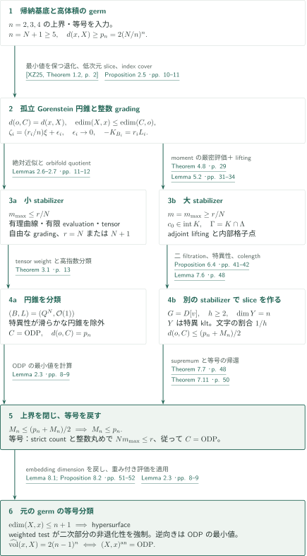
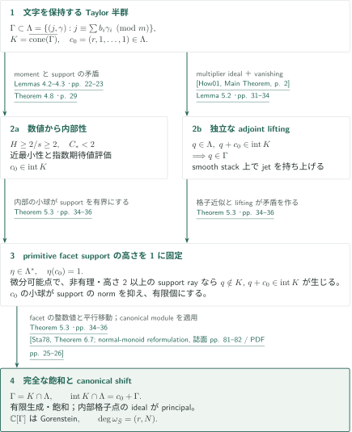
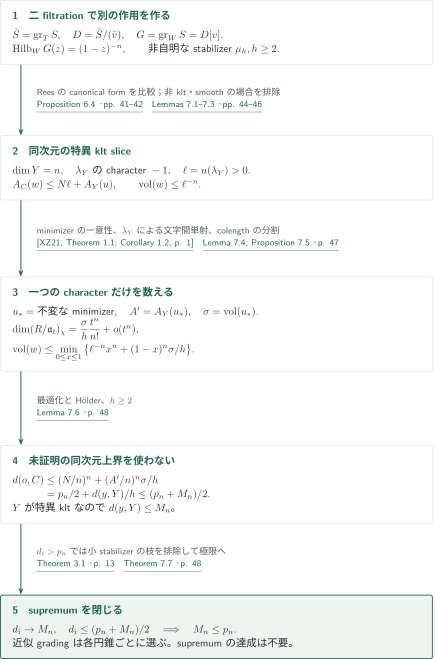
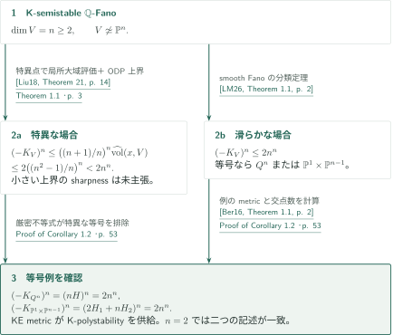

# The ordinary-double-point gap in every dimension

**安定退化、jet半群の飽和、同次元の上限値による帰納法**

本原稿は、零境界の複素代数的klt特異点に対する通常二重点（ODP）の体積ギャップを、四次元までの結果から全次元へ進める。高体積の特異点を孤立Gorenstein K-polystable円錐へ退化し、整数gradingのstabilizerを用いて分類と体積評価を分岐させる。同次元の別の特異点へ移る場面では、未証明の帰納仮定を使わず、特異点全体の体積のsupremumを閉じる。

## 1. 主要結果

### Theorem 1.1 — ODPの体積ギャップと等号分類

$n\ge2$とし、$x$を正規複素代数的$n$次元多様体$X$の特異閉点とする。$K_X$は$\mathbb Q$-Cartier、$X$は$x$の近傍で**零境界でklt**と仮定する。このとき

$$
\widehat{\operatorname{vol}}(x,X)\le 2(n-1)^n,
$$

等号は複素解析的同型

$$
(X,x)^{\mathrm{an}}\simeq\bigl(\{z_0^2+\cdots+z_n^2=0\}\subset\mathbb C^{n+1},0\bigr)
$$

が存在するとき、かつそのときに限る。孤立性・complete intersection・smoothabilityは仮定しない。

ここで$R=\mathcal O_{X,x}$、$\mathfrak a_t(v)=\{f:v(f)\ge t\}$として

$$
\operatorname{vol}(v)=\lim_{t\to\infty}\frac{n!\,\ell(R/\mathfrak a_t(v))}{t^n},\qquad
\widehat{\operatorname{vol}}(x,X)=\inf_{v\text{ centered exactly at }x}A_X(v)^n\operatorname{vol}(v).
$$

$A_X$はlog discrepancyで、滑らかな$n$次元点の通常blowupの例外因子では$n$。無限discrepancyのvaluationの寄与は$+\infty$と定める。密度$d(x,X)=\widehat{\operatorname{vol}}(x,X)/n^n$と$ p_n=2((n-1)/n)^n$を使う。

<!-- cite:main -->[Theorem 1.1 · p. 3](https://github.com/openai/math/blob/fd4aeeb2ee4fc729c18d98444fed42fd0529eeeb/preprints/The-ordinary-double-point-gap-in-every-dimension-September-24-2026/paper.pdf)<!-- /cite --> <!-- cite:normalization -->[§2.1; (2.1) · pp. 6–7](https://github.com/openai/math/blob/fd4aeeb2ee4fc729c18d98444fed42fd0529eeeb/preprints/The-ordinary-double-point-gap-in-every-dimension-September-24-2026/paper.pdf)<!-- /cite -->

### Corollary 1.2 — K-semistable Fanoの大域体積

$V$を$n\ge2$次元のK-semistable $\mathbb Q$-Fano多様体とする。$V$が特異なら

$$
(-K_V)^n\le 2\left(\frac{n^2-1}{n}\right)^n<2n^n.
$$

また$V\not\simeq\mathbb P^n$なら$(-K_V)^n\le2n^n$であり、等号は$V$が滑らかな二次超曲面$Q^n\subset\mathbb P^{n+1}$または$\mathbb P^1\times\mathbb P^{n-1}$である場合に限り、これらでは等号が成立する。$n=2$では両者は同じ多様体を表す。**特異な場合の小さい上界について、最適性や等号の場合の分類は主張されていない。**

<!-- cite:global -->[Corollary 1.2 · p. 3](https://github.com/openai/math/blob/fd4aeeb2ee4fc729c18d98444fed42fd0529eeeb/preprints/The-ordinary-double-point-gap-in-every-dimension-September-24-2026/paper.pdf)<!-- /cite -->

## 図の矢印に付した引用

<!-- reference-guide -->
略号のない定理・補題・節・式番号は本原稿 [ODP gap in every dimension](https://github.com/openai/math/blob/fd4aeeb2ee4fc729c18d98444fed42fd0529eeeb/preprints/The-ordinary-double-point-gap-in-every-dimension-September-24-2026/paper.pdf) を指します。外部入力には次の略号を使います。

- [Gra15](https://www.jpswanson.org/notes/liegroups.pdf) Robin Graham (lecturer); Josh Swanson (initial draft); Debbie Matthews (editor) — *(Compact) Lie Groups and Representation Theory Lecture Notes*：ODPの次数別harmonic polynomial表現の既約性。University of Washington lecture notes, 2015-05-29。
- [XZ25](https://arxiv.org/pdf/2205.10915v2) Chenyang Xu; Ziquan Zhuang — *Stable degenerations of singularities*：klt germのminimizerと有限生成、K-semistable／K-polystable coneへの退化。arXiv:2205.10915v2, 2025-01-17。
- [XZ21](https://arxiv.org/pdf/2005.08303v1) Chenyang Xu; Ziquan Zhuang — *Uniqueness of the minimizer of the normalized volume function*：minimizerの一意性・自己同型不変性と有限次数公式。arXiv:2005.08303v1, 2020-05-17。
- [LWX21](https://arxiv.org/pdf/1805.03393v2) Chi Li; Xiaowei Wang; Chenyang Xu — *Algebraicity of the metric tangent cones and equivariant K-stability*：K-semistable coneからK-polystable coneへのspecial degeneration。arXiv:1805.03393v2, 2021-01-08。
- [BL21](https://arxiv.org/pdf/1802.09658v2) Harold Blum; Yuchen Liu — *The normalized volume of a singularity is lower semicontinuous*：punctureの特異点を低次元帰納法で排除する下半連続性。arXiv:1802.09658v2, 2019-08-15; manuscript date 2019-08-16。
- [LX19](https://arxiv.org/pdf/1706.01933v3) Yuchen Liu; Chenyang Xu — *K-stability of cubic threefolds*：三次元の上界16・等号分類、および全次元のsmooth上界。arXiv:1706.01933v3, 2019-01-26。
- [LZ25](https://arxiv.org/pdf/2502.11847v1) Chi Li; Zhengyi Zhou — *Minimal log discrepancy and orbifold curves*：小stabilizerの枝で用いる一つ以下のstack pointを持つorbifold有理曲線。arXiv:2502.11847v1, 2025-02-17。
- [AOV11](https://www.math.brown.edu/dabramov/PAPERS/TAME/twisted-tame-10-01-2009.pdf) Dan Abramovich; Martin Olsson; Angelo Vistoli — *Twisted stable maps to tame Artin stacks*：有限evaluationの証明に使うtwisted stable mapsのproperness。Author-hosted manuscript, twisted-tame-10-01-2009.pdf; published J. Algebraic Geometry 20 (2011)。
- [CS19](https://msp.org/gt/2019/23-3/gt-v23-n3-p05-s.pdf) Tristan C. Collins; Gábor Székelyhidi — *Sasaki–Einstein metrics and K-stability*：K-polystable isolated Fano coneのRicci-flat metricと安定性の用語対応。Geometry & Topology 23 (2019), 1339–1413; publisher PDF with final back cover。
- [ADK08](https://arxiv.org/pdf/0707.4310v2) Carolina Araujo; Stéphane Druel; Sándor J. Kovács — *Cohomological characterizations of projective spaces and hyperquadrics*：自由なgradingを得た後の実際のample line bundleによる高指数分類。arXiv:0707.4310v2, 2007-10-09; manuscript date 2007-07-29。
- [How01](https://arxiv.org/pdf/math/0003232v1) Jason A. Howald — *Multiplier ideals of monomial ideals*：smooth atlas上のmonomialに対するNewton polyhedron内部判定。arXiv:math/0003232v1, 2000-03-31。
- [Fuj23](https://www.math.kyoto-u.ac.jp/~fujino/cone-and-contraction.pdf) Osamu Fujino — *Cone and contraction theorem for projective morphisms between complex analytic spaces*：coarse klt pairとintegral Q-Cartier Weil divisorに対するnef and big vanishing。Version 0.00, 2023-10-09; author PDF。
- [Sta78](https://math.mit.edu/~rstan/pubs/pubfiles/30.pdf) Richard P. Stanley — *Hilbert functions of graded algebras*：normal monoidの内部格子点によるcanonical moduleとGorenstein判定。Advances in Mathematics 28 (1978), 57–83; author-hosted scan。
- [EM04](https://arxiv.org/pdf/math/0301164v2) Lawrence Ein; Mircea Mustaţă — *Inversion of adjunction for local complete intersection varieties*：weighted hypersurface boundでのinversion of adjunction。arXiv:math/0301164v2, 2003-07-30。
- [Liu18](https://arxiv.org/pdf/1605.01034v5) Yuchen Liu — *The volume of singular Kähler–Einstein Fano varieties*：K/Ding semistabilityの同値と局所大域体積比較。arXiv:1605.01034v5, 2018-05-23。
- [LM26](https://arxiv.org/pdf/2506.17420v3) Chi Li; Minghao Miao — *On the volume of K-semistable Fano manifolds*：非射影空間のsmooth K-semistable Fanoの上界と等号候補。arXiv:2506.17420v3, 2026-05-20; manuscript title-page date 2026-05-22。
- [Ber16](https://arxiv.org/pdf/1205.6214v3) Robert J. Berman — *K-polystability of Q-Fano varieties admitting Kähler–Einstein metrics*：系の等号例でKE metricからK-polystabilityを得る。arXiv:1205.6214v3, 2015-06-09。
- [Liu22](https://arxiv.org/pdf/2007.14320v2) Yuchen Liu — *K-stability of cubic fourfolds*：ODPの解析的同型・完備化から正規化体積を移す。arXiv:2007.14320v2, 2022-01-10。
- [OpenAI26b](https://github.com/openai/math/blob/fd4aeeb2ee4fc729c18d98444fed42fd0529eeeb/preprints/The-normalized-volume-gap-in-dimension-four-September-24-2026/paper.pdf) OpenAI — *The normalized-volume gap in dimension four*：零境界klt四次元での上界162と解析的等号分類を帰納基底へ供給。September 24, 2026。

各引用に結果番号とページを付します。誌面番号とPDF内の位置が異なる場合は両方を示します。GitHubの閲覧リンクではページ位置への自動移動を前提としません。
<!-- /reference-guide -->

## 2. Theorem 1.1 — 主定理の証明概略

<!-- proof-target:1 -->証明対象：[Theorem 1.1 · p. 3](https://github.com/openai/math/blob/fd4aeeb2ee4fc729c18d98444fed42fd0529eeeb/preprints/The-ordinary-double-point-gap-in-every-dimension-September-24-2026/paper.pdf)<!-- /proof-target --> [主張と正規化](#theorem-1-1)を参照。

**証明の道筋。** $n=2$は商特異点の計算、$n=3$は既存のギャップ定理、$n=4$は同カタログの四次元稿を使う。以下は$n=N+1\ge5$、$d\ge p_n$の円錐への帰着である。小さいstabilizerの枝は円錐を分類し、大きい枝は[飽和半群](#proof-1)と[同次元sliceの評価](#proof-2)を経由する。等号の解析は円錐の分類から元のgermへ戻る追加の議論を必要とする。

### 1. 体積を保ち、孤立Gorenstein円錐へ帰着する

安定退化とK-polystable退化は最小化valuationの値を保つ。生成元の持上げと平坦退化での上半連続性により$\operatorname{edim}(X,x)\le\operatorname{edim}(C,o)$も保たれる。従って最終円錐は特異である。punctureの点$P$が特異なら、grading軌道に横断する$(n-1)$次元sliceと滑らかな曲線のétale積表示から、低次元の帰納仮定とLemma 2.1により$d(P,C)\le p_{n-1}$。一方、下半連続性は$d(o,C)\le d(P,C)$を与えるため$p_{n-1}<p_n$と矛盾する。canonical index $q$の被覆に有限次数公式を適用すると$d(o,C)\le1/q$であり、$p_n>1/2$から$q=1$となる。

<!-- cite:cone -->[Proposition 2.5 · pp. 10–11](https://github.com/openai/math/blob/fd4aeeb2ee4fc729c18d98444fed42fd0529eeeb/preprints/The-ordinary-double-point-gap-in-every-dimension-September-24-2026/paper.pdf)<!-- /cite --> <!-- cite:stable -->[&#91;XZ25, Theorem 1.2, p. 2&#93;](https://arxiv.org/pdf/2205.10915v2#page=2)<!-- /cite --> <!-- cite:polystable -->[&#91;LWX21, Theorem 1.2, p. 2&#93;](https://arxiv.org/pdf/1805.03393v2#page=2)<!-- /cite --> <!-- cite:lsc -->[&#91;BL21, Theorem 33(1), p. 23&#93;](https://arxiv.org/pdf/1802.09658v2#page=23)<!-- /cite --> <!-- cite:degree -->[&#91;XZ21, Theorem 1.3, p. 1&#93;](https://arxiv.org/pdf/2005.08303v1#page=1)<!-- /cite --> <!-- cite:base-three -->[&#91;LX19, Theorem 1.3(1), p. 3&#93;](https://arxiv.org/pdf/1706.01933v3#page=3)<!-- /cite --> <!-- cite:base-four -->[&#91;OpenAI26b, Theorem 1.1, p. 1&#93;](https://github.com/openai/math/blob/fd4aeeb2ee4fc729c18d98444fed42fd0529eeeb/preprints/The-normalized-volume-gap-in-dimension-four-September-24-2026/paper.pdf)<!-- /cite -->

### 2. 小さいstabilizerは自由なgradingと高指数分類を強制する

$A_C(\xi)=n$と正規化し、primitive正整数gradingを$\zeta_i=(r_i/n)\xi+\epsilon_i$、$\epsilon_i\to0$という**絶対誤差**で近似する。$B_i=[C^\circ/\mathbb G_m]$は滑らかなorbifoldで、忠実なweight-one line bundle $L_i$について$-K_{B_i}=r_iL_i$。$m_{\max}\le r/N$なら、Li–Zhouのorbifold有理曲線から最小$L$次数の$\mathbb P(1,m)\to B$を取る。変形の文字数え上げが直接自由性を与える場合を除き、そのevaluationは有限全射となる。

全sheetの無限小移動を対称積にすると、rank $b$、整数weight $-bm$の非零対称tensorを得る。Ricci-flat cone metricによるBochner議論はReeb weight $\tau\ge-b$を与え、固定した環生成元でのcharacter評価がrank依存の誤差を除く。従って整数$nm-r$は$o(1)$以下となる。丸めと接空間作用の忠実性から全stabilizerが自明、$r=N$または$N+1$。高指数の滑らかなpolarized Fanoの分類により、section ringは二次円錐または多項式環である。$C$の特異性が後者を除く。

<!-- cite:approximation -->[Lemmas 2.6–2.7 · pp. 11–12](https://github.com/openai/math/blob/fd4aeeb2ee4fc729c18d98444fed42fd0529eeeb/preprints/The-ordinary-double-point-gap-in-every-dimension-September-24-2026/paper.pdf)<!-- /cite --> <!-- cite:small -->[Theorem 3.1; proof · pp. 13–19](https://github.com/openai/math/blob/fd4aeeb2ee4fc729c18d98444fed42fd0529eeeb/preprints/The-ordinary-double-point-gap-in-every-dimension-September-24-2026/paper.pdf)<!-- /cite --> <!-- cite:curve -->[&#91;LZ25, Proposition 2.6, p. 6&#93;](https://arxiv.org/pdf/2502.11847v1#page=6)<!-- /cite --> <!-- cite:properness -->[&#91;AOV11, Theorem 4.3, p. 17&#93;](https://www.math.brown.edu/dabramov/PAPERS/TAME/twisted-tame-10-01-2009.pdf#page=17)<!-- /cite --> <!-- cite:metric -->[&#91;CS19, Theorem 1.1, 誌面 p. 1340 / PDF p. 2&#93;](https://msp.org/gt/2019/23-3/gt-v23-n3-p05-s.pdf#page=2)<!-- /cite --> <!-- cite:high-index -->[&#91;ADK08, Theorems 1.1 and 1.3, pp. 1–2&#93;](https://arxiv.org/pdf/0707.4310v2#page=1)<!-- /cite -->

### 3. 大きいstabilizerでは体積のsupremumを閉じる

$m=m_{\max}\ge r/N$で、横断座標のTaylor初項と元の次数を記録した半群$\Gamma$を作る。近最小性によるmoment評価と指数分布の不等式からcanonical点$c_0=(r,1,\ldots,1)$が実cone $K$の内部に入る。adjoint liftingと合わせて$\Gamma=K\cap\Lambda$、$\operatorname{int}K\cap\Lambda=c_0+\Gamma$を得る。[Theorem 5.3の節](#proof-1)がこの非自明な整数的強化を説明する。

二つのfiltrationで構成する中央環は$G=D[v]$、Hilbert seriesは$(1-z)^{-n}$。別のstabilizer $\mu_h$、$h\ge2$を持つ点を通るslice $Y$は**元と同じ次元$n$**の特異klt germとなる。characterごとのcolengthの割合$1/h$により$d(o,C)\le(p_n+M_n)/2$、ここで$M_n$は特異$n$次元klt germ全体の密度のsupremumである。$M_n$に近づくgermを取るだけで$M_n\le p_n$を導く。元の$m$と新しい$h$を同一視してはならない。

<!-- cite:interior -->[Theorem 4.8 · p. 29](https://github.com/openai/math/blob/fd4aeeb2ee4fc729c18d98444fed42fd0529eeeb/preprints/The-ordinary-double-point-gap-in-every-dimension-September-24-2026/paper.pdf)<!-- /cite --> <!-- cite:saturation -->[Theorem 5.3 · pp. 34–36](https://github.com/openai/math/blob/fd4aeeb2ee4fc729c18d98444fed42fd0529eeeb/preprints/The-ordinary-double-point-gap-in-every-dimension-September-24-2026/paper.pdf)<!-- /cite --> <!-- cite:two-filtrations -->[Proposition 6.4; Corollary 6.6 · pp. 41–43](https://github.com/openai/math/blob/fd4aeeb2ee4fc729c18d98444fed42fd0529eeeb/preprints/The-ordinary-double-point-gap-in-every-dimension-September-24-2026/paper.pdf)<!-- /cite --> <!-- cite:bootstrap -->[Theorem 7.7 · p. 48](https://github.com/openai/math/blob/fd4aeeb2ee4fc729c18d98444fed42fd0529eeeb/preprints/The-ordinary-double-point-gap-in-every-dimension-September-24-2026/paper.pdf)<!-- /cite -->

### 4. 等号の円錐を分類し、元のgermへ戻す

$d(o,C)=p_n$ではslice評価の各不等式が等号となり、$h=2$、$u(\lambda_Y)=1$への正規化の下で$A_Y(u)=N$、$\operatorname{vol}(u)=2$を得る。制限valuation $w$は$A_C(w)=2N$、$\operatorname{vol}(w)=2^{-N}$で最小値を達成するため、一意性から$w=(2N/n)\operatorname{wt}_\xi$。特別な切断$v\in S_m$に$w(v)>2$を仮定すると、filtrationの低次部分に正の主要項の数え落としが生じ、体積評価は厳密不等式になる。従って$w(v)\le2$。絶対近似誤差から$Nm-r\le o(1)$を得て、整数性で$Nm\le r$となり小stabilizerの枝へ戻る。これがTheorem 7.11のODP円錐である。

元のgermはembedding dimensionが$n+1$以下で、特異性からちょうど$n+1$なのでhypersurfaceとなる。Lemma 8.1の重み付き評価

$$
\widehat{\operatorname{vol}}(x,X)\le
\frac{d_F(\sum_{i=0}^n w_i-d_F)^n}{\prod_{i=0}^n w_i}
$$

を使う。ここで$F=0$は局所方程式、$w_i>0$は有理重み、$d_F$は最小重みである。全重み1なら$q=\operatorname{mult}F>2$を排除する。$q=2$でも二次部分の欠けた方向の重みを$1-\varepsilon$にすると上界は$2(n-1-\varepsilon)^n/(1-\varepsilon)<2(n-1)^n$となる。等号は二次部分の非退化性を強制し、holomorphic Morse lemmaで解析的ODPを得る。退化先がODPであるだけでは、この復元は完了しない。

<!-- cite:equality -->[Lemmas 7.8–7.10; Theorem 7.11 · pp. 49–50](https://github.com/openai/math/blob/fd4aeeb2ee4fc729c18d98444fed42fd0529eeeb/preprints/The-ordinary-double-point-gap-in-every-dimension-September-24-2026/paper.pdf)<!-- /cite --> <!-- cite:unique -->[&#91;XZ21, Theorem 1.1; Corollary 1.2, p. 1&#93;](https://arxiv.org/pdf/2005.08303v1#page=1)<!-- /cite --> <!-- cite:hypersurface -->[Lemma 8.1; Proposition 8.2 · pp. 51–52](https://github.com/openai/math/blob/fd4aeeb2ee4fc729c18d98444fed42fd0529eeeb/preprints/The-ordinary-double-point-gap-in-every-dimension-September-24-2026/paper.pdf)<!-- /cite --> <!-- cite:inversion -->[&#91;EM04, Theorem 1.1, p. 1&#93;](https://arxiv.org/pdf/math/0301164v2#page=1)<!-- /cite --> <!-- cite:finish -->[Proof of Theorem 1.1 · p. 52](https://github.com/openai/math/blob/fd4aeeb2ee4fc729c18d98444fed42fd0529eeeb/preprints/The-ordinary-double-point-gap-in-every-dimension-September-24-2026/paper.pdf)<!-- /cite -->

### 5. 最適性はODPにおけるinfimumの計算で確認する

逆向きにはLemma 2.3を使う。二次円錐のminimizerは一意性によりcone scalingと$\mathrm{SO}(n+1,\mathbb C)$に不変である。各次数のharmonic polynomial表現の既約性により、minimizerは通常のdegree valuationの正倍となる。このvaluationのdiscrepancyは$n-1$、volumeは2なので、**全valuationにわたるinfimum**は$2(n-1)^n$。通常blowupを一つ試して上界を得るだけの計算と区別する。解析的ODPへの移行は完備化不変性を使う。これで定数の最適性と等号の逆向きが揃う。

<!-- cite:odp -->[Lemma 2.3 · pp. 8–9](https://github.com/openai/math/blob/fd4aeeb2ee4fc729c18d98444fed42fd0529eeeb/preprints/The-ordinary-double-point-gap-in-every-dimension-September-24-2026/paper.pdf)<!-- /cite --> <!-- cite:harmonic -->[&#91;Gra15, Example 251; Theorem 257, pp. 56–57&#93;](https://www.jpswanson.org/notes/liegroups.pdf#page=56)<!-- /cite --> <!-- cite:completion -->[&#91;Liu22, Lemma 2.15, p. 7&#93;](https://arxiv.org/pdf/2007.14320v2#page=7)<!-- /cite -->

## 3. Theorem 5.3 — canonical shiftからjet半群の完全な飽和へ

<!-- proof-target:2 -->証明対象：[Theorem 5.3 · pp. 34–36](https://github.com/openai/math/blob/fd4aeeb2ee4fc729c18d98444fed42fd0529eeeb/preprints/The-ordinary-double-point-gap-in-every-dimension-September-24-2026/paper.pdf)<!-- /proof-target -->

<!-- statement:theorem-5-3 -->
### Theorem 5.3 — 飽和jet半群

§§4–5のorbifold jet dataを固定する。すなわち、$B$は滑らかでeffectiveかつproperな$N$次元複素orbifoldでprojective coarse spaceを持ち、$L$はample、$-K_B=rL$。選んだ点のstabilizerは$\mu_m$、$L$のfiber characterは1、横断座標のcharacterは$b_i$。$\Gamma$は$H^0(B,jL)$のtotal degree–lex順Taylor初項$(j,\gamma)$の半群、

$$
\Lambda=\{(j,\gamma)\in\mathbb Z\times\mathbb Z^N:j\equiv\textstyle\sum b_i\gamma_i\pmod m\},\qquad
K=\overline{\operatorname{cone}(\Gamma)},\qquad c_0=(r,1,\ldots,1).
$$

$K$はfull-dimensional、次数の有界sliceは有界、正の定数rayを含み、指数orthant全体へ射影し、§4のjet実現性を満たす。$c_0\in\operatorname{int}K$と仮定すると、$K$は有理多面coneで、各facetのprimitive非負support form $\eta\in\Lambda^*$は$\eta(c_0)=1$を満たし、

$$
\Gamma=K\cap\Lambda,\qquad\operatorname{int}K\cap\Lambda=c_0+\Gamma.
$$

特に$\Gamma$は有限生成で飽和し、その生成する群は$\Lambda$である。主定理の大stabilizerの枝ではTheorem 4.8が、十分先のgradingごとにこのinteriority仮定を供給する。

<!-- cite:saturation -->[Theorem 5.3 · pp. 34–36](https://github.com/openai/math/blob/fd4aeeb2ee4fc729c18d98444fed42fd0529eeeb/preprints/The-ordinary-double-point-gap-in-every-dimension-September-24-2026/paper.pdf)<!-- /cite -->
<!-- /statement -->

### 1. Interiorityを数値的に確保する

元の次数$j$を$D_0=Nj/r$へ変換すると$K$は$D_0\ge f(x)$のepigraphとなり、格子密度は$s=r/(Nm)\le1$。$H=\int_{\mathbb R_{\ge0}^N}e^{-f(x)}dx$とおく。体積の下限は$H\ge2/s$を与え、degreeとTaylor orderを混ぜたvaluationの近最小性は二つ目のmoment不等式を与える。もし$c_0$が内部になければ$f(\mathbf1)\ge N$であり、supporting linear formを用いてTheorem 4.4の一様指数評価を適用できる。その定数$C_*=(3/4)e^{4/3}-e/3<2$が$H\ge2$と矛盾する。asymptotic格子点数え上げはこの段階では飽和を仮定していない。

<!-- cite:moments -->[Lemmas 4.2–4.3 · pp. 22–23](https://github.com/openai/math/blob/fd4aeeb2ee4fc729c18d98444fed42fd0529eeeb/preprints/The-ordinary-double-point-gap-in-every-dimension-September-24-2026/paper.pdf)<!-- /cite --> <!-- cite:exponential -->[Theorem 4.4; proof · pp. 24–28](https://github.com/openai/math/blob/fd4aeeb2ee4fc729c18d98444fed42fd0529eeeb/preprints/The-ordinary-double-point-gap-in-every-dimension-September-24-2026/paper.pdf)<!-- /cite --> <!-- cite:interior -->[Theorem 4.8 · p. 29](https://github.com/openai/math/blob/fd4aeeb2ee4fc729c18d98444fed42fd0529eeeb/preprints/The-ordinary-double-point-gap-in-every-dimension-September-24-2026/paper.pdf)<!-- /cite -->

### 2. Adjoint liftingをinteriorityとは独立に証明する

Lemma 5.2は$(j,\alpha)\in\Lambda$と$(j,\alpha)+c_0\in\operatorname{int}K$から$(j,\alpha)\in\Gamma$を導く。有限個の既知の初項に合う正整数重みを選び、smooth stackとしてweighted blowupを作る。canonical shiftが例外因子の次数を消すため、式(5.6)の残りは$(j+r-j_0)\pi^*L$というnef and big classになる。Howaldのmonomial multiplier ideal公式は例外因子上の指定monomialが必要なidealに入ることを保証し、Lemma 5.1のorbifold vanishingがその切断を持ち上げる。coarse spaceへ移したvanishingでは、klt境界とintegral $\mathbb Q$-Cartier Weil divisorへのFujinoの定理が使われる。smooth atlasのcharacterを保持することが降下に必要である。

<!-- cite:adjoint -->[Lemmas 5.1–5.2 · pp. 30–34](https://github.com/openai/math/blob/fd4aeeb2ee4fc729c18d98444fed42fd0529eeeb/preprints/The-ordinary-double-point-gap-in-every-dimension-September-24-2026/paper.pdf)<!-- /cite --> <!-- cite:howald -->[&#91;How01, Main Theorem, p. 2&#93;](https://arxiv.org/pdf/math/0003232v1#page=2)<!-- /cite --> <!-- cite:vanishing -->[&#91;Fuj23, Theorem 3.2.4, 誌面 p. 31 / PDF p. 41&#93;](https://www.math.kyoto-u.ac.jp/~fujino/cone-and-contraction.pdf#page=41)<!-- /cite -->

### 3. Supportの高さ1が有限生成とcanonical moduleを結ぶ

微分可能な境界点でsupport rayが非有理、またはprimitive supportの$c_0$での高さが2以上なら、格子点の近似を使い、$q\notin K$かつ$q+c_0\in\operatorname{int}K$となる$q\in\Lambda$を構成できる。これはadjoint liftingと矛盾する。$c_0$の周りの小球がsupport formのnormを抑えるため、高さ1の整数supportは有限個しかない。これが有理多面性を与える。

$q\in K\cap\Lambda$なら$q+c_0$は内部なのでliftingから$q\in\Gamma$。逆に内部格子点は全primitive facetで値が1以上なので、$c_0$を引いても$K$に残る。ここから二つの集合等式と有限生成を得る。内点の平行移動公式はnormal semigroup ringのcanonical moduleをprincipalにし、Lemma 6.1で必要なGorenstein性とcanonical degree $(r,N)$を供給する。飽和だけからGorenstein性を推論するのではない。

<!-- cite:saturation -->[Theorem 5.3 · pp. 34–36](https://github.com/openai/math/blob/fd4aeeb2ee4fc729c18d98444fed42fd0529eeeb/preprints/The-ordinary-double-point-gap-in-every-dimension-September-24-2026/paper.pdf)<!-- /cite --> <!-- cite:canonical-module -->[&#91;Sta78, Theorem 6.7; normal-monoid reformulation, 誌面 pp. 81–82 / PDF pp. 25–26&#93;](https://math.mit.edu/~rstan/pubs/pubfiles/30.pdf#page=25)<!-- /cite --> <!-- cite:taylor-ring -->[Lemma 6.1 · pp. 37–39](https://github.com/openai/math/blob/fd4aeeb2ee4fc729c18d98444fed42fd0529eeeb/preprints/The-ordinary-double-point-gap-in-every-dimension-September-24-2026/paper.pdf)<!-- /cite -->

## 4. Theorem 7.7 — 同次元sliceをsupremumで制御する

<!-- proof-target:3 -->証明対象：[Theorem 7.7 · p. 48](https://github.com/openai/math/blob/fd4aeeb2ee4fc729c18d98444fed42fd0529eeeb/preprints/The-ordinary-double-point-gap-in-every-dimension-September-24-2026/paper.pdf)<!-- /proof-target -->

<!-- statement:theorem-7-7 -->
### Theorem 7.7 — 上界の帰納段階

§7の設定、すなわち$n=N+1\ge5$で、零境界klt germについてのODP体積定理が$n$未満の全次元で成立すると仮定する。$M_n$を正規複素代数的・$\mathbb Q$-Gorenstein・零境界の特異klt $n$次元germの密度$d$のsupremumとする。このとき

$$M_n\le p_n=2\left(\frac{n-1}{n}\right)^n.$$

<!-- cite:bootstrap -->[Theorem 7.7 · p. 48](https://github.com/openai/math/blob/fd4aeeb2ee4fc729c18d98444fed42fd0529eeeb/preprints/The-ordinary-double-point-gap-in-every-dimension-September-24-2026/paper.pdf)<!-- /cite -->
<!-- /statement -->

### 1. 同次元の特異klt sliceを作る

最初のfiltration $T$は横断Taylor order、$\bar S=\operatorname{gr}_T S$、$D=\bar S/(\bar v)$。二番目はbasis $v^ae_i$に$W=a+T(e_i)$を与え、$\operatorname{gr}_W S=D[v]$となる。$D$のreducednessには体積仮定と$N\ge4$を用いる。全てのpuncture stabilizerが自明なら、Hilbert series $(1-z)^{-N}$から$D$は次数1生成の多項式環となり、元の$C$まで滑らかになる。従ってstabilizer $\mu_h$、$h\ge2$が存在する。

$W$-Rees total spaceのその点を通る横断slice $Y$には、character $-1$の関数$\lambda_Y$がある。canonical formの比較から、$u$を$Y$のquasi-monomial valuation、$\ell=u(\lambda_Y)$、$w$を$C$への制限として

$$A_C(w)\le N\ell+A_Y(u),\qquad \operatorname{vol}(w)\le\ell^{-n}.$$

非kltなら$A_Y(u)/\ell$が非正へ近づくtestで$\widehat{\operatorname{vol}}(o,C)\le N^n$となり、$2N^n$という下限に矛盾する。$Y$が滑らかとの仮定は、もう一方のdeformationの一般fiber $\mathbb A^N$に非原点の$\mu_h$固定点を生じさせるため排除される。この特異性の確認が$M_n$を使う条件である。

<!-- cite:two-filtrations -->[Proposition 6.4; Corollary 6.6 · pp. 41–43](https://github.com/openai/math/blob/fd4aeeb2ee4fc729c18d98444fed42fd0529eeeb/preprints/The-ordinary-double-point-gap-in-every-dimension-September-24-2026/paper.pdf)<!-- /cite --> <!-- cite:slice -->[Lemmas 7.1–7.3 · pp. 44–46](https://github.com/openai/math/blob/fd4aeeb2ee4fc729c18d98444fed42fd0529eeeb/preprints/The-ordinary-double-point-gap-in-every-dimension-September-24-2026/paper.pdf)<!-- /cite -->

### 2. 一つのcharacterへの制限が係数を改善する

$Y$のminimizer $u_*$は一意性により$\mu_h$不変。$\sigma=\operatorname{vol}(u_*)$とすると、$\lambda_Y^j$によるcharacter間の単射から各characterのcolength主要項は全体の$1/h$となる。filtrationで商を二つに分けると、後半は全長ではなく一つのcharacter商に単射する。従って

$$
\operatorname{vol}(w)\le\min_{0\le x\le1}
\left\{\frac{x^n}{\ell^n}+\frac{(1-x)^n\sigma}{h}\right\}.
$$

これをdiscrepancy評価とHölder不等式に合わせ、$A'=A_Y(u_*)$として

$$
d(o,C)\le\left(\frac Nn\right)^n+\frac{(A'/n)^n\sigma}{h}
=\frac{p_n}{2}+\frac{d(y,Y)}h\le\frac{p_n+M_n}{2}
$$

を得る。ここでは同次元のODP上界を$Y$に適用していない。

<!-- cite:character -->[Lemma 7.4; Proposition 7.5 · p. 47](https://github.com/openai/math/blob/fd4aeeb2ee4fc729c18d98444fed42fd0529eeeb/preprints/The-ordinary-double-point-gap-in-every-dimension-September-24-2026/paper.pdf)<!-- /cite --> <!-- cite:optimization -->[Lemma 7.6 · p. 48](https://github.com/openai/math/blob/fd4aeeb2ee4fc729c18d98444fed42fd0529eeeb/preprints/The-ordinary-double-point-gap-in-every-dimension-September-24-2026/paper.pdf)<!-- /cite -->

### 3. Supremumは達成されなくてもよい

$M_n>p_n$なら$d_i>p_n$で$d_i\to M_n$となるgermを選ぶ。対応する円錐で小stabilizerの無限部分列があればTheorem 3.1とODPの体積計算に矛盾するため、各固定円錐で十分先の大stabilizer gradingを使える。$d_i\le(p_n+M_n)/2$の極限を取れば$M_n\le p_n$となり矛盾する。grading近似の定数は各円錐ごとでよく、全germに一様な近似速度もsupremumの達成も不要である。

<!-- cite:bootstrap -->[Theorem 7.7 · p. 48](https://github.com/openai/math/blob/fd4aeeb2ee4fc729c18d98444fed42fd0529eeeb/preprints/The-ordinary-double-point-gap-in-every-dimension-September-24-2026/paper.pdf)<!-- /cite -->

## 5. Corollary 1.2 — 局所評価から大域体積と等号例へ

<!-- proof-target:4 -->証明対象：[Corollary 1.2 · p. 3](https://github.com/openai/math/blob/fd4aeeb2ee4fc729c18d98444fed42fd0529eeeb/preprints/The-ordinary-double-point-gap-in-every-dimension-September-24-2026/paper.pdf)<!-- /proof-target --> [三つの結論](#corollary-1-2)を参照。

### 1. 特異なFanoには厳しい上界を得る

K-semistabilityとDing semistabilityの同値、および任意のcentered valuationへの局所大域比較から

$$(-K_V)^n\le\left(\frac{n+1}{n}\right)^n\widehat{\operatorname{vol}}(x,V).$$

特異閉点でTheorem 1.1を代入すると、系の$2((n^2-1)/n)^n$となる。これは$2n^n$未満だが、この小さい値の最適性や等号例を得たことにはならない。

<!-- cite:local-global -->[&#91;Liu18, Theorem 21, p. 14&#93;](https://arxiv.org/pdf/1605.01034v5#page=14)<!-- /cite --> <!-- cite:ding -->[&#91;Liu18, Theorem 13(2), p. 9&#93;](https://arxiv.org/pdf/1605.01034v5#page=9)<!-- /cite --> <!-- cite:global-proof -->[Proof of Corollary 1.2 · p. 53](https://github.com/openai/math/blob/fd4aeeb2ee4fc729c18d98444fed42fd0529eeeb/preprints/The-ordinary-double-point-gap-in-every-dimension-September-24-2026/paper.pdf)<!-- /cite -->

### 2. $2n^n$での等号はsmooth分類へ帰着する

$V\not\simeq\mathbb P^n$が滑らかな場合にLi–Miaoの定理を適用する。特異な場合には既に厳密不等式を得たため、$2n^n$での等号はsmooth quadricまたは$\mathbb P^1\times\mathbb P^{n-1}$に限る。Li–Miaoの入力はsmooth Fano manifoldに対するもので、特異な$V$へ直接適用しない。

<!-- cite:smooth-global -->[&#91;LM26, Theorem 1.1, p. 2&#93;](https://arxiv.org/pdf/2506.17420v3#page=2)<!-- /cite -->

### 3. 二つの例で等号を計算する

原稿はhomogeneous metricと積のKähler–Einstein metricにより両例のK-polystabilityを確認する。$H,H_1,H_2$をhyperplane classとして

$$(-K_{Q^n})^n=(nH)^n=2n^n,\qquad
(-K_{\mathbb P^1\times\mathbb P^{n-1}})^n=(2H_1+nH_2)^n=2n^n.$$

$n=2$では$Q^2\simeq\mathbb P^1\times\mathbb P^1$であり、別の等号例を二重に数えてはいない。metricからK-polystabilityへの一般定理自体の証明は本概説の確認範囲外とする。

<!-- cite:global-proof -->[Proof of Corollary 1.2 · p. 53](https://github.com/openai/math/blob/fd4aeeb2ee4fc729c18d98444fed42fd0529eeeb/preprints/The-ordinary-double-point-gap-in-every-dimension-September-24-2026/paper.pdf)<!-- /cite --> <!-- cite:ke-stability -->[&#91;Ber16, Theorem 1.1, p. 2&#93;](https://arxiv.org/pdf/1205.6214v3#page=2)<!-- /cite -->

## 6. どの論文が、どの段階を担うか

| 供給結果 | 利用箇所 | 使用内容・必要な仮定 | 確認範囲 |
|---|---|---|---|
| <!-- cite:base-four -->[&#91;OpenAI26b, Theorem 1.1, p. 1&#93;](https://github.com/openai/math/blob/fd4aeeb2ee4fc729c18d98444fed42fd0529eeeb/preprints/The-normalized-volume-gap-in-dimension-four-September-24-2026/paper.pdf)<!-- /cite --> | 本稿Theorem 2.4、帰納基底 | unrestrictedな零境界klt四次元での上界162と解析的等号分類 | 両記述と本稿pp.9–10の利用を照合。四次元稿の証明は別記事 |
| <!-- cite:stable -->[&#91;XZ25, Theorem 1.2, p. 2&#93;](https://arxiv.org/pdf/2205.10915v2#page=2)<!-- /cite --> <!-- cite:unique -->[&#91;XZ21, Theorem 1.1; Corollary 1.2, p. 1&#93;](https://arxiv.org/pdf/2005.08303v1#page=1)<!-- /cite --> <!-- cite:degree -->[&#91;XZ21, Theorem 1.3, p. 1&#93;](https://arxiv.org/pdf/2005.08303v1#page=1)<!-- /cite --> <!-- cite:polystable -->[&#91;LWX21, Theorem 1.2, p. 2&#93;](https://arxiv.org/pdf/1805.03393v2#page=2)<!-- /cite --> | Proposition 2.5、§7 | 最小値を保つ円錐退化、一意性、finite degree | 定理記述と本稿の使用箇所を照合 |
| <!-- cite:curve -->[&#91;LZ25, Proposition 2.6, p. 6&#93;](https://arxiv.org/pdf/2502.11847v1#page=6)<!-- /cite --> <!-- cite:properness -->[&#91;AOV11, Theorem 4.3, p. 17&#93;](https://www.math.brown.edu/dabramov/PAPERS/TAME/twisted-tame-10-01-2009.pdf#page=17)<!-- /cite --> <!-- cite:metric -->[&#91;CS19, Theorem 1.1, 誌面 p. 1340 / PDF p. 2&#93;](https://msp.org/gt/2019/23-3/gt-v23-n3-p05-s.pdf#page=2)<!-- /cite --> <!-- cite:high-index -->[&#91;ADK08, Theorems 1.1 and 1.3, pp. 1–2&#93;](https://arxiv.org/pdf/0707.4310v2#page=1)<!-- /cite --> | Theorem 3.1 | orbifold curve、properness、Ricci-flat metric、自由性を得た後の高指数分類 | 入力の仮定・記述・適用先を照合。入力証明は未再検証 |
| <!-- cite:howald -->[&#91;How01, Main Theorem, p. 2&#93;](https://arxiv.org/pdf/math/0003232v1#page=2)<!-- /cite --> <!-- cite:vanishing -->[&#91;Fuj23, Theorem 3.2.4, 誌面 p. 31 / PDF p. 41&#93;](https://www.math.kyoto-u.ac.jp/~fujino/cone-and-contraction.pdf#page=41)<!-- /cite --> <!-- cite:canonical-module -->[&#91;Sta78, Theorem 6.7; normal-monoid reformulation, 誌面 pp. 81–82 / PDF pp. 25–26&#93;](https://math.mit.edu/~rstan/pubs/pubfiles/30.pdf#page=25)<!-- /cite --> | Lemma 5.2、Lemma 6.1 | monomial ideal、nef and big vanishing、内部格子点でcanonical moduleを記述 | 原典記述とsmooth atlas／coarse klt pair／normal monoidへの適用を照合 |
| <!-- cite:inversion -->[&#91;EM04, Theorem 1.1, p. 1&#93;](https://arxiv.org/pdf/math/0301164v2#page=1)<!-- /cite --> | Lemma 8.1 | smooth ambient内のnormal Cartier hypersurfaceへのinversion of adjunction | Theorem 1.1の記述とweighted idealの利用を照合 |
| <!-- cite:local-global -->[&#91;Liu18, Theorem 21, p. 14&#93;](https://arxiv.org/pdf/1605.01034v5#page=14)<!-- /cite --> <!-- cite:smooth-global -->[&#91;LM26, Theorem 1.1, p. 2&#93;](https://arxiv.org/pdf/2506.17420v3#page=2)<!-- /cite --> | Corollary 1.2 | local-to-global、smooth Fanoの上界と等号候補 | 原典記述・本稿p.53を照合。主定理の帰結への入力 |

## 7. 原典を読む入口と確認範囲

<!-- reading-list -->
- [§2.1; (2.1) · pp. 6–7](https://github.com/openai/math/blob/fd4aeeb2ee4fc729c18d98444fed42fd0529eeeb/preprints/The-ordinary-double-point-gap-in-every-dimension-September-24-2026/paper.pdf) — 正規化とvaluationの範囲。
- [Proposition 2.5 · pp. 10–11](https://github.com/openai/math/blob/fd4aeeb2ee4fc729c18d98444fed42fd0529eeeb/preprints/The-ordinary-double-point-gap-in-every-dimension-September-24-2026/paper.pdf) — 特異性とGorenstein性が仮定ではなく結論となる帰着。
- [Theorem 3.1; proof · pp. 13–19](https://github.com/openai/math/blob/fd4aeeb2ee4fc729c18d98444fed42fd0529eeeb/preprints/The-ordinary-double-point-gap-in-every-dimension-September-24-2026/paper.pdf) — orbifold curveからtensorと自由なgradingへの接続。
- [Theorem 4.8 · p. 29](https://github.com/openai/math/blob/fd4aeeb2ee4fc729c18d98444fed42fd0529eeeb/preprints/The-ordinary-double-point-gap-in-every-dimension-September-24-2026/paper.pdf) — 指数期待値の評価がcanonical点の内部性に使われる位置。
- [Lemmas 5.1–5.2 · pp. 30–34](https://github.com/openai/math/blob/fd4aeeb2ee4fc729c18d98444fed42fd0529eeeb/preprints/The-ordinary-double-point-gap-in-every-dimension-September-24-2026/paper.pdf) — vanishing、multiplier ideal、指定jetの持上げ。
- [Theorem 5.3 · pp. 34–36](https://github.com/openai/math/blob/fd4aeeb2ee4fc729c18d98444fed42fd0529eeeb/preprints/The-ordinary-double-point-gap-in-every-dimension-September-24-2026/paper.pdf) — 有理多面性・高さ1・二つの格子点等式。
- [Proposition 6.4; Corollary 6.6 · pp. 41–43](https://github.com/openai/math/blob/fd4aeeb2ee4fc729c18d98444fed42fd0529eeeb/preprints/The-ordinary-double-point-gap-in-every-dimension-September-24-2026/paper.pdf) — 別のstabilizerを作る二つのfiltration。
- [Lemma 7.4; Proposition 7.5 · p. 47](https://github.com/openai/math/blob/fd4aeeb2ee4fc729c18d98444fed42fd0529eeeb/preprints/The-ordinary-double-point-gap-in-every-dimension-September-24-2026/paper.pdf) — 全長ではなく一つのcharacterを数える箇所。
- [Theorem 7.7 · p. 48](https://github.com/openai/math/blob/fd4aeeb2ee4fc729c18d98444fed42fd0529eeeb/preprints/The-ordinary-double-point-gap-in-every-dimension-September-24-2026/paper.pdf) — 同次元の帰納仮定を避けるsupremumの議論。
- [Lemmas 7.8–7.10; Theorem 7.11 · pp. 49–50](https://github.com/openai/math/blob/fd4aeeb2ee4fc729c18d98444fed42fd0529eeeb/preprints/The-ordinary-double-point-gap-in-every-dimension-September-24-2026/paper.pdf) — 等号から小stabilizerへ戻すstrict countと整数丸め。
- [Lemma 8.1; Proposition 8.2 · pp. 51–52](https://github.com/openai/math/blob/fd4aeeb2ee4fc729c18d98444fed42fd0529eeeb/preprints/The-ordinary-double-point-gap-in-every-dimension-September-24-2026/paper.pdf) — 元のgermの二次部分を非退化にするweighted test。
- [Proof of Corollary 1.2 · p. 53](https://github.com/openai/math/blob/fd4aeeb2ee4fc729c18d98444fed42fd0529eeeb/preprints/The-ordinary-double-point-gap-in-every-dimension-September-24-2026/paper.pdf) — 局所大域評価とsmooth等号例の別々の役割。
<!-- /reading-list -->

本概説は著者の主張と証明の構成を紹介する。編集側では主定理・系の仮定と全結論、§2のcone reduction、§3のclassificationへの接続、§§4–6のinteriority／adjoint lifting／二filtrationの記述、§§7–8の体積不等式・等号・hypersurfaceへの復元を本文で照合した。上記外部入力は定理の記述と適用条件を確認したが、その証明へ再帰的に進んではいない。

**未確認の範囲。** §4.3の指数期待値最適化の全計算、§6の全flatness・normality・canonical moduleの持上げ、§3のtwisted stable map境界と変形障害理論の全細部、ODP計算に用いるharmonic polynomialの既約性・完備化不変性の外部証明、metricからK-polystabilityへの一般定理の証明は独立検証していない。核心の接続を追ったことを全57頁の証明の正しさの認定とはしない。
