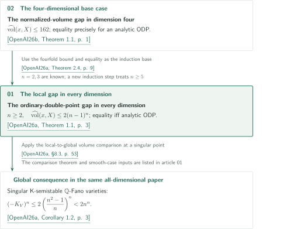

# The sharp ordinary-double-point volume gap

**From the fourfold structure theorem to the local gap in every dimension**

The two papers in Catalogue 037 study normalized volumes of boundary-zero complex algebraic klt singularities. The all-dimensional paper uses the fourfold paper as an induction base and claims the upper bound $2(n-1)^n$ for singular $n$-dimensional germs, with equality precisely for an analytic ordinary double point (ODP).

<!-- PDF links: stage 2; do not publish links before bilingual booklets exist. -->

## 1. The two papers in official order

CATALOGINVENTORYTOKEN

## 2. From the fourfold input to all dimensions

The official order lists the all-dimensional paper first, but the direct proof input runs in the opposite direction. The keys in the diagram refer to the following fixed manuscripts. The reference guides before the figures in each article specify the statements, roles, and versions of external inputs.

<!-- reference-guide -->
- [OpenAI26a] OpenAI — *The ordinary-double-point gap in every dimension*. September 24, 2026. The local gap in all dimensions, equality, and the global corollary. [原典 / Original](https://github.com/openai/math/blob/fd4aeeb2ee4fc729c18d98444fed42fd0529eeeb/preprints/The-ordinary-double-point-gap-in-every-dimension-September-24-2026/paper.pdf).
- [OpenAI26b] OpenAI — *The normalized-volume gap in dimension four*. September 24, 2026. The fourfold induction base. [原典 / Original](https://github.com/openai/math/blob/fd4aeeb2ee4fc729c18d98444fed42fd0529eeeb/preprints/The-normalized-volume-gap-in-dimension-four-September-24-2026/paper.pdf).
<!-- /reference-guide -->

The fourfold paper forces embedding dimension at most $5$ from a large normalized volume, reduces to a hypersurface, and invokes the established lci volume theorem. The all-dimensional paper imports this fourfold bound and equality characterization as Theorem 2.4. Together with the known cases $n=2,3$, it starts the induction for $n\ge5$. An intermediate comparison involving singularities of the same dimension uses the supremum $M_n$ of their volume densities, without assuming the gap still to be proved.

<!-- cite:four-main -->[&#91;OpenAI26b, Theorem 1.1, p. 1&#93;](https://github.com/openai/math/blob/fd4aeeb2ee4fc729c18d98444fed42fd0529eeeb/preprints/The-normalized-volume-gap-in-dimension-four-September-24-2026/paper.pdf)<!-- /cite --> <!-- cite:four-use -->[&#91;OpenAI26a, Theorem 2.4, p. 9&#93;](https://github.com/openai/math/blob/fd4aeeb2ee4fc729c18d98444fed42fd0529eeeb/preprints/The-ordinary-double-point-gap-in-every-dimension-September-24-2026/paper.pdf)<!-- /cite --> <!-- cite:all-induction -->[&#91;OpenAI26a, Theorem 7.7; §8.2, pp. 48, 52&#93;](https://github.com/openai/math/blob/fd4aeeb2ee4fc729c18d98444fed42fd0529eeeb/preprints/The-ordinary-double-point-gap-in-every-dimension-September-24-2026/paper.pdf)<!-- /cite -->

The global volume bound for singular K-semistable $\mathbb Q$-Fano varieties also requires a local-to-global comparison. The paper does not claim sharpness or classify equality for this smaller singular bound. Its separate bound $2n^n$ for $V\not\simeq\mathbb P^n$, including equality, combines the strict singular estimate with an external theorem for smooth varieties.

<!-- cite:global -->[&#91;OpenAI26a, Corollary 1.2, p. 3&#93;](https://github.com/openai/math/blob/fd4aeeb2ee4fc729c18d98444fed42fd0529eeeb/preprints/The-ordinary-double-point-gap-in-every-dimension-September-24-2026/paper.pdf)<!-- /cite --> <!-- cite:global-proof -->[&#91;OpenAI26a, §8.3, p. 53&#93;](https://github.com/openai/math/blob/fd4aeeb2ee4fc729c18d98444fed42fd0529eeeb/preprints/The-ordinary-double-point-gap-in-every-dimension-September-24-2026/paper.pdf)<!-- /cite -->

| Source → application | Relation | Input and place of use |
|---|---|---|
| Fourfold paper, Theorem 1.1 → all-dimensional paper, Theorem 2.4 and §8.2 | Direct proof input | The bound and analytic equality characterization for boundary-zero complex algebraic klt fourfold germs supply the $n=4$ induction base. |
| All-dimensional paper, Theorem 1.1 → its Corollary 1.2 and §8.3 | Use in a consequence | Apply the local bound at a singular closed point and then the local-to-global comparison to bound the anticanonical volume. |

The all-dimensional statement includes the fourfold statement, but this does not mean that the fourfold proof depends on the all-dimensional paper. The [fourfold article](../normalized-volume-gap-four/article.en.md) explains the hypersurface reduction; the [all-dimensional article](../ordinary-double-point-gap/article.en.md) explains induction, recovery of equality, and the global corollary.

## 3. Sources and checking scope

The official overview calls this catalogue *The sharp ordinary-double-point volume gap*; CONTENTS uses *The ordinary-double-point volume gap*. Its field is *Algebraic and complex geometry*. The order and manuscripts are fixed at commit `fd4aeeb2ee4fc729c18d98444fed42fd0529eeeb`. Both manuscripts are dated September 24, 2026, and have 57 and 20 pages, including references.

<!-- cite:catalog -->[OpenAI Research Catalog · Catalog 037 · p. 5](https://github.com/openai/math/blob/fd4aeeb2ee4fc729c18d98444fed42fd0529eeeb/overview.pdf)<!-- /cite -->

The articles describe the authors' claims and proof strategies. Editorial checks compared the main hypotheses and conclusions, selected proof passages, and the inter-paper input and application against the sources. They include checking by someone other than each article's writer, but do not constitute expert peer review or independent verification of every proof. Full details of the semigroup and filtration constructions, analytic estimates, and proofs of external theorems remain outside this checking scope; each article and its source record give finer limitations.
