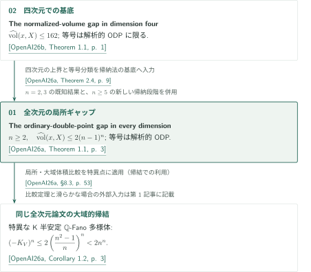

# 通常二重点の鋭い体積ギャップ

**四次元の構造定理から全次元の局所ギャップへ**

カタログ037の2論文は、境界が零の複素代数的klt特異点の正規化体積を扱う。全次元論文は四次元論文を帰納法の基底として用い、特異な$n$次元germの上界$2(n-1)^n$と、等号成立が解析的通常二重点（ODP）に限られることを主張する。

<!-- PDF links: stage 2; do not publish links before bilingual booklets exist. -->

## 1. 全2篇の要点（公式順）

CATALOGINVENTORYTOKEN

## 2. 四次元の入力から全次元へ

公式掲載順は全次元論文、四次元論文の順だが、証明への直接入力は逆向きである。図中のキーは次の固定原稿を指す。外部文献の記述・用途・版は個別記事の図前文献案内を参照。

<!-- reference-guide -->
- [OpenAI26a] OpenAI — *The ordinary-double-point gap in every dimension*. September 24, 2026. 全次元の局所ギャップ、等号分類、大域的系. [原典 / Original](https://github.com/openai/math/blob/fd4aeeb2ee4fc729c18d98444fed42fd0529eeeb/preprints/The-ordinary-double-point-gap-in-every-dimension-September-24-2026/paper.pdf).
- [OpenAI26b] OpenAI — *The normalized-volume gap in dimension four*. September 24, 2026. 四次元の帰納基底. [原典 / Original](https://github.com/openai/math/blob/fd4aeeb2ee4fc729c18d98444fed42fd0529eeeb/preprints/The-normalized-volume-gap-in-dimension-four-September-24-2026/paper.pdf).
<!-- /reference-guide -->

四次元論文は、大きい正規化体積から埋込み次元を$5$以下へ抑え、超曲面に帰着して既知のlci体積定理を使う。全次元論文はこの四次元の上界と等号分類をTheorem 2.4として取り込み、$n=2,3$の既知結果と合わせて$n\ge5$の帰納法へ進む。同じ次元の特異点を含む途中の比較には、まだ証明していないギャップを仮定せず、体積密度の上限$M_n$を用いる。

<!-- cite:four-main -->[&#91;OpenAI26b, Theorem 1.1, p. 1&#93;](https://github.com/openai/math/blob/fd4aeeb2ee4fc729c18d98444fed42fd0529eeeb/preprints/The-normalized-volume-gap-in-dimension-four-September-24-2026/paper.pdf)<!-- /cite --> <!-- cite:four-use -->[&#91;OpenAI26a, Theorem 2.4, p. 9&#93;](https://github.com/openai/math/blob/fd4aeeb2ee4fc729c18d98444fed42fd0529eeeb/preprints/The-ordinary-double-point-gap-in-every-dimension-September-24-2026/paper.pdf)<!-- /cite --> <!-- cite:all-induction -->[&#91;OpenAI26a, Theorem 7.7; §8.2, pp. 48, 52&#93;](https://github.com/openai/math/blob/fd4aeeb2ee4fc729c18d98444fed42fd0529eeeb/preprints/The-ordinary-double-point-gap-in-every-dimension-September-24-2026/paper.pdf)<!-- /cite -->

全次元の局所定理から特異なK半安定$\mathbb Q$-Fano多様体の大域体積上界を得るには、局所・大域比較を別途用いる。この特異な場合の小さい上界には、最適性や等号分類は主張されていない。$V\not\simeq\mathbb P^n$に対する別の上界$2n^n$と等号分類は、特異な場合の厳しい評価と、滑らかな場合の外部定理を組み合わせる。

<!-- cite:global -->[&#91;OpenAI26a, Corollary 1.2, p. 3&#93;](https://github.com/openai/math/blob/fd4aeeb2ee4fc729c18d98444fed42fd0529eeeb/preprints/The-ordinary-double-point-gap-in-every-dimension-September-24-2026/paper.pdf)<!-- /cite --> <!-- cite:global-proof -->[&#91;OpenAI26a, §8.3, p. 53&#93;](https://github.com/openai/math/blob/fd4aeeb2ee4fc729c18d98444fed42fd0529eeeb/preprints/The-ordinary-double-point-gap-in-every-dimension-September-24-2026/paper.pdf)<!-- /cite -->

| 供給元 → 利用先 | 種別 | 使用内容・適用箇所 |
|---|---|---|
| 四次元論文 Theorem 1.1 → 全次元論文 Theorem 2.4、§8.2 | 証明への直接入力 | 零境界の複素代数的klt四次元germに対する上界と解析的等号分類を、帰納法の$n=4$基底に使う。 |
| 全次元論文 Theorem 1.1 → 同論文 Corollary 1.2、§8.3 | 帰結での利用 | 特異閉点で局所上界を適用し、局所・大域比較を介して反標準体積を抑える。 |

全次元の主張は四次元の主張を含むが、四次元論文の証明が全次元論文へ依存するという意味ではない。[四次元記事](../normalized-volume-gap-four/article.ja.md)では超曲面への帰着、[全次元記事](../ordinary-double-point-gap/article.ja.md)では帰納法・等号の復元と大域的系を詳説する。

## 3. 原典と確認範囲

公式概要の名称は *The sharp ordinary-double-point volume gap*、CONTENTSの見出しは *The ordinary-double-point volume gap*。分野は *Algebraic and complex geometry*。公式順と原稿は固定commit `fd4aeeb2ee4fc729c18d98444fed42fd0529eeeb`に揃え、両原稿は2026年9月24日版、参考文献込みで57頁・20頁である。

<!-- cite:catalog -->[OpenAI Research Catalog · Catalog 037 · p. 5](https://github.com/openai/math/blob/fd4aeeb2ee4fc729c18d98444fed42fd0529eeeb/overview.pdf)<!-- /cite -->

記事は著者の主張と証明戦略を紹介する。編集側では、主要主張の仮定・結論、選択した証明本文、論文間の直接入力と適用箇所を原典に照合した。各記事の執筆者以外による内容点検を含むが、専門家査読や全証明の独立検証ではない。半群・フィルトレーション構成や解析評価の全細部、外部定理の証明全体は確認対象外であり、より細かな範囲は各記事末尾と出典記録に示す。
