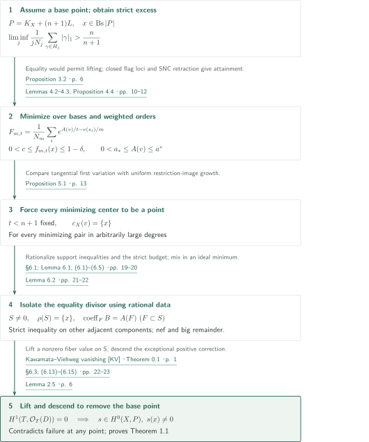
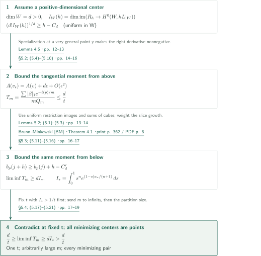
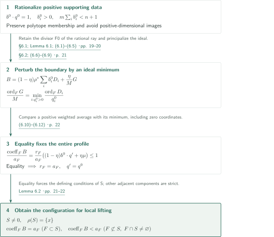
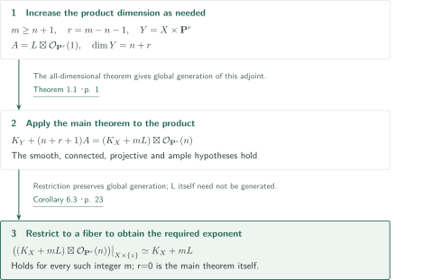

# Fujita’s freeness conjecture

**Exponential minimization isolates a point center; local discrepancies lift an adjoint section**

The manuscript claims Fujita’s freeness conjecture in every dimension for an arbitrary ample line bundle. The core argument combines exponential minimization arising from a hypothetical base point with a tangential first variation at a positive-dimensional center. A restriction-space estimate independent of the degree and singularities of the center isolates a point without losing the sharp exponent.

## 1. Main results

### Theorem 1.1 — Global generation at the sharp exponent

Let $X$ be a smooth connected projective complex variety of dimension $n\geq1$, and let $L$ be an ample line bundle on $X$. Then

$$P:=K_X+(n+1)L$$

is globally generated. Global generation of $L$ itself is not assumed. For $X=\mathbf P^n$, $L=\mathcal O_{\mathbf P^n}(1)$, the bundle $P$ is trivial whereas $K_X+nL$ has no nonzero section, so the exponent is sharp. The statement does not include separation of points or tangent directions, or very ampleness. For disconnected varieties it applies componentwise; dimension zero is immediate.

<!-- cite:main-result -->[Theorem 1.1 · p. 1](https://github.com/openai/math/blob/fd4aeeb2ee4fc729c18d98444fed42fd0529eeeb/preprints/Fujitas-freeness-conjecture-September-23-2026/Fujitas-freeness-conjecture-September-23-2026.pdf)<!-- /cite -->

### Corollary 6.3 — Every higher exponent

Under the hypotheses of Theorem 1.1, $K_X+mL$ is globally generated for **every integer** $m\geq n+1$.

<!-- cite:all-powers -->[Corollary 6.3 · p. 23](https://github.com/openai/math/blob/fd4aeeb2ee4fc729c18d98444fed42fd0529eeeb/preprints/Fujitas-freeness-conjecture-September-23-2026/Fujitas-freeness-conjecture-September-23-2026.pdf)<!-- /cite -->

## References on the arrows

<!-- reference-guide -->
Unprefixed theorem, lemma, section and equation numbers refer to [Fujita freeness](https://github.com/openai/math/blob/fd4aeeb2ee4fc729c18d98444fed42fd0529eeeb/preprints/Fujitas-freeness-conjecture-September-23-2026/Fujitas-freeness-conjecture-September-23-2026.pdf). External inputs use the following keys.

- [DK](https://arxiv.org/pdf/math/9910118v2) Jean-Pierre Demailly; János Kollár — *Singularity exponents*: Semicontinuity of singularity exponents, used in threshold and flag-incidence loci. arXiv:math/9910118v2, 2000-05-01.
- [KV](https://www.math.kyoto-u.ac.jp/~fujino/kawamata--viehweg2.pdf) Osamu Fujino — *Kawamata–Viehweg vanishing*: Vanishing for a nef and big remainder and lifting of sections. Lecture note v1.04, 2009-07-22.
- [BM](https://www.ceremade.dauphine.fr/~carlier/Brunn-Minkowski) Richard J. Gardner — *Brunn–Minkowski*: Growth of sums of initial-exponent sets forced by restricted sections. Bulletin AMS 39 (2002), 355–405; published version.
- [FL](https://arxiv.org/pdf/alg-geom/9311013v1) Takao Fujita — *Adjoint lifting*: Methodological source for local discrepancy and lifting; its threefold main theorem is not applied. arXiv:alg-geom/9311013v1, 1993-11-30.
- [RES](https://www.math.purdue.edu/~wlodarcz/singularities/Resolution.pdf) Jarosław Włodarczyk — *SNC resolution*: Resolution and principalization preserving an existing SNC boundary. JAMS 18 (2005), 779–822; published version.

Each citation gives the result and pages. When printed pagination differs from the PDF position, both are shown. GitHub previews do not automatically jump to the cited page.
<!-- /reference-guide -->

## 2. Theorem 1.1 — Proof overview of the main theorem

<!-- proof-target:1 -->Proof target：[Theorem 1.1 · p. 1](https://github.com/openai/math/blob/fd4aeeb2ee4fc729c18d98444fed42fd0529eeeb/preprints/Fujitas-freeness-conjecture-September-23-2026/Fujitas-freeness-conjecture-September-23-2026.pdf)<!-- /proof-target -->

**Proof route.** Suppose that $P$ is not generated at a closed point $x$. A strict ordinary-order estimate produces a minimization problem in which both the basis and the monomial order vary. After [excluding positive-dimensional centers](#proof-1) and [isolating the discrepancy-equality divisor](#proof-2), vanishing supplies a section nonzero at $x$. Finally, [application to a product](#proof-3) gives Corollary 6.3.

Put $R_j=H^0(X,jL)$ and $N_j=\dim R_j$. The test $v$ is a nonzero monomial order with nonnegative real weights on a smooth birational model, in SNC coordinates adapted to the relative canonical divisor. If $E_i$ are its positive-weight components with weights $u_i$, then $A(v)=\sum_i u_iA(E_i)$, where $A(E_i)=1+\operatorname{ord}_{E_i}K_{Y/X}$. The center $c_X(v)$ is the closed center, and the constraint is $x\in c_X(v)$. Positive rescaling changes orders and discrepancy by the same factor.

<!-- cite:normalization -->[§2.1; Lemmas 2.1–2.2 · pp. 3–4](https://github.com/openai/math/blob/fd4aeeb2ee4fc729c18d98444fed42fd0529eeeb/preprints/Fujitas-freeness-conjecture-September-23-2026/Fujitas-freeness-conjecture-September-23-2026.pdf)<!-- /cite -->

### 1. Lifting in the equality case makes the mean order strictly larger

Let $H_j$ be the initial-exponent set for the Taylor monomial order comparing ordinary degree first. From $\#H_j=N_j$ and the Hilbert asymptotic, filling lattice points in increasing total degree gives

$$\liminf_{j\to\infty}\frac{1}{jN_j}\sum_{\gamma\in H_j}|\gamma|_1\geq (L^n)^{1/n}\frac{n}{n+1}.$$

If the bound with right-hand side $n/(n+1)$ were an equality under failure of generation, then $L^n=1$, and the normalized initial exponents would eventually meet every fixed small ball in the interior of the simplex. Choosing $n<t'<n+1$, the manuscript forms products of sections whose leading forms define an ideal with threshold greater than $1/h$ on the exceptional divisor $E$ of the point blowup. Degeneration to monomials and semicontinuity from Singularity exponents [DK] transfer this strict inequality back to the original leading forms.

After resolving the ideal, the remaining positivity is $(n+1-t')L$. Theorem 2.4 kills $H^1$, a nonzero fiber value on $E$ lifts, and Lemma 2.5 descends it to a section nonzero at $x$. This contradicts failure of generation. Thus Proposition 3.2 gives the **strict** inequality $\liminf>n/(n+1)$.

<!-- cite:ordinary -->[Proposition 3.2 · pp. 6–9](https://github.com/openai/math/blob/fd4aeeb2ee4fc729c18d98444fed42fd0529eeeb/preprints/Fujitas-freeness-conjecture-September-23-2026/Fujitas-freeness-conjecture-September-23-2026.pdf)<!-- /cite -->

<!-- cite:dk-semicontinuity -->[Singularity exponents &#91;DK&#93; · Theorem 3.1; Lemma 3.2 · pp. 14–15](https://arxiv.org/pdf/math/9910118v2#page=14)<!-- /cite -->

### 2. Fix a basis through a flag before taking a minimum on an SNC model

For an ordered degree-$m$ basis $\mathbf s=(s_i)$ and $t>0$, set

$$F_{m,t}(v,\mathbf s)=\frac1{N_m}\sum_i\exp\left(\frac{A(v)}t-\frac{v(s_i)}m\right),\qquad f_{m,t}(x)=\inf_{x\in c_X(v),\,\mathbf s}F_{m,t}(v,\mathbf s).$$

Proposition 3.2 makes the derivative for $v=\lambda\operatorname{ord}_x$ negative at $\lambda=0$. Lemma 4.2 gives $0<c\leq f_{m,t}(x)\leq1-\delta$ for a common interval immediately below $n+1$ and all sufficiently large $m$. On the relevant sublevel set it also gives $0<a_*\leq A(v)\leq a^*<\infty$. The upper bound uses a supply of low-order jets forcing a fixed proportion of every basis to have low order.

<!-- cite:objective -->[(4.1) · p. 9](https://github.com/openai/math/blob/fd4aeeb2ee4fc729c18d98444fed42fd0529eeeb/preprints/Fujitas-freeness-conjecture-September-23-2026/Fujitas-freeness-conjecture-September-23-2026.pdf)<!-- /cite -->

The proof does not compactify all bases or all models at once. Rational lower bounds on normalized section orders become a threshold condition for a sum of powers of base ideals. Lemma 2.3 gives closed loci in the complete flag variety. Choose a flag in the nested intersection and a basis adapted to it; only then resolve this basis’s divisors on one model. SNC retraction preserves section orders and does not increase discrepancy, while normalized weights lie in a compact simplex. Weights may vanish in the limit, but the center then enlarges and still contains $x$. This yields the minimizing pair of Proposition 4.4.

<!-- cite:attainment -->[Lemmas 4.2–4.3; Proposition 4.4 · pp. 10–12](https://github.com/openai/math/blob/fd4aeeb2ee4fc729c18d98444fed42fd0529eeeb/preprints/Fujitas-freeness-conjecture-September-23-2026/Fujitas-freeness-conjecture-September-23-2026.pdf)<!-- /cite -->

<!-- cite:snc-resolution -->[SNC resolution &#91;RES&#93; · Theorem 1.0.1 · print p. 781 / PDF p. 3; Definition 2.1.3 · print p. 783 / PDF p. 5; Theorem 2.4.1 · print p. 786 / PDF p. 8](https://www.math.purdue.edu/~wlodarcz/singularities/Resolution.pdf#page=3)<!-- /cite -->

### 3. Force every minimizing center to be a point and rationalize support data

Proposition 5.1 fixes one $t<n+1$ for which, in arbitrarily large degrees, **every** minimizing pair has center $\{x\}$. This universal assertion is needed next: another stratum realizing the same normalized section-order profile and discrepancy would give the same minimum.

On an SNC model of $D_i=\operatorname{div}(s_i)$, normalized profiles from the strata form finitely many rational polytopes. The gradient of the objective gives positive supporting coefficients $b_i$, and differentiation in the scaling direction gives $m\sum_i b_i=t<n+1$. Lemma 6.1 rationalizes the profile and supporting coefficients without changing membership in the polytopes or losing this strict budget. The ideal perturbation of Lemma 6.2 then isolates a nonempty reduced discrepancy-equality divisor $S$ over $x$.

<!-- cite:point-center -->[Proposition 5.1 · p. 13](https://github.com/openai/math/blob/fd4aeeb2ee4fc729c18d98444fed42fd0529eeeb/preprints/Fujitas-freeness-conjecture-September-23-2026/Fujitas-freeness-conjecture-September-23-2026.pdf)<!-- /cite -->

<!-- cite:rational-support -->[§6.1; Lemma 6.1; (6.1)–(6.5) · pp. 19–20](https://github.com/openai/math/blob/fd4aeeb2ee4fc729c18d98444fed42fd0529eeeb/preprints/Fujitas-freeness-conjecture-September-23-2026/Fujitas-freeness-conjecture-September-23-2026.pdf)<!-- /cite -->

<!-- cite:isolation -->[Lemma 6.2 · pp. 21–22](https://github.com/openai/math/blob/fd4aeeb2ee4fc729c18d98444fed42fd0529eeeb/preprints/Fujitas-freeness-conjecture-September-23-2026/Fujitas-freeness-conjecture-September-23-2026.pdf)<!-- /cite -->

### 4. A local coefficient comparison gives a section nonzero at the original point

On a resolution $\rho:T\to X$, the effective rational SNC divisor $B$ leaves $(n+1)\rho^*L-B$ nef and big. Put $D=K_T+(n+1)\rho^*L-\lfloor B\rfloor$; then $D-(K_T+\{B\})$ is this remainder. Kawamata–Viehweg vanishing [KV] gives $H^1(T,\mathcal O_T(D))=0$, hence a surjection

$$H^0(T,\mathcal O_T(D+S))\longrightarrow H^0(S,\mathcal O_S(D+S)).$$

The comparison divisor is

$$C=D+S-\rho^*P=K_{T/X}-\lfloor B\rfloor+S.$$

By Lemma 6.2, its coefficients are zero on $S$ and nonnegative on other components meeting $S$. Thus $C$ is effective near $S$ and has no component of $S$ in its support. Since $S$ is reduced and all its components map to $x$, one has $\rho^*P|_S=P|_x\otimes\mathcal O_S$. Multiplying a nonzero fiber value by the canonical rational section of $C$ gives a section nonzero at the generic point of every component of $S$. It lifts by the displayed surjection.

On nonexceptional components the coefficients of $C$ are nonpositive, so its positive part is exceptional. Lemma 2.5 descends the lift to $X$ with $s(x)\neq0$. For $n=1$, a component of $S$ may be the point $x$ itself, and the same coefficient comparison applies. The assumed failure at any point has been contradicted, completing the global-generation conclusion of Theorem 1.1. Only the comparison near $S$ is needed: neither global log canonicity of $B$ nor global effectivity of $C$ is required.

<!-- cite:lifting -->[§6.3; (6.13)–(6.15) · pp. 22–23](https://github.com/openai/math/blob/fd4aeeb2ee4fc729c18d98444fed42fd0529eeeb/preprints/Fujitas-freeness-conjecture-September-23-2026/Fujitas-freeness-conjecture-September-23-2026.pdf)<!-- /cite -->

<!-- cite:vanishing -->[Theorem 2.4 · p. 5](https://github.com/openai/math/blob/fd4aeeb2ee4fc729c18d98444fed42fd0529eeeb/preprints/Fujitas-freeness-conjecture-September-23-2026/Fujitas-freeness-conjecture-September-23-2026.pdf)<!-- /cite --> · <!-- cite:descent -->[Lemma 2.5 · p. 6](https://github.com/openai/math/blob/fd4aeeb2ee4fc729c18d98444fed42fd0529eeeb/preprints/Fujitas-freeness-conjecture-September-23-2026/Fujitas-freeness-conjecture-September-23-2026.pdf)<!-- /cite -->

<!-- cite:kv-vanishing -->[Kawamata–Viehweg vanishing &#91;KV&#93; · Theorem 0.1 · p. 1](https://www.math.kyoto-u.ac.jp/~fujino/kawamata--viehweg2.pdf#page=1)<!-- /cite --> · <!-- cite:fujita-lifting -->[Adjoint lifting &#91;FL&#93; · §1(1.6) · p. 3](https://arxiv.org/pdf/alg-geom/9311013v1#page=3)<!-- /cite -->

## 3. Proof of Proposition 5.1 — Excluding positive-dimensional centers

<!-- proof-target:2 -->Proof target：[Proposition 5.1 · p. 13](https://github.com/openai/math/blob/fd4aeeb2ee4fc729c18d98444fed42fd0529eeeb/preprints/Fujitas-freeness-conjecture-September-23-2026/Fujitas-freeness-conjecture-September-23-2026.pdf)<!-- /proof-target -->

<!-- statement:proposition-5-1 -->
### Proposition 5.1 — Point centers for all minimizing pairs

For $X,L,n$ as in Theorem 1.1 and $P=K_X+(n+1)L$, suppose that $P$ is not generated at a closed point $x$. For the function $f_{m,t}(x)$ defined above, there is a real number $0<t<n+1$ such that, in arbitrarily large integer degrees $m$, the infimum is attained and **every** monomial test and basis attaining it has center exactly $\{x\}$.

<!-- cite:point-center -->[Proposition 5.1 · p. 13](https://github.com/openai/math/blob/fd4aeeb2ee4fc729c18d98444fed42fd0529eeeb/preprints/Fujitas-freeness-conjecture-September-23-2026/Fujitas-freeness-conjecture-September-23-2026.pdf)<!-- /cite -->
<!-- /statement -->

**Proof route.** If a positive-dimensional center $W$ exists, minimality bounds a weighted tangential moment from above. Uniform growth of restricted sections forces a strictly larger lower bound for the same moment. Constants independent of centers and models, and the order of limits, connect the two estimates.

### 1. Separate the restriction-image bound from the center’s degree and singularities

Fix a very ample multiple $kL$. For any integral $d$-dimensional subvariety $W$, put $I_W(h)=\dim\operatorname{im}(R_h\to H^0(W,hL|_W))$. Lemma 5.2 gives

$$\bigl(d!I_W(h)\bigr)^{1/d}\geq h-C_d\qquad(h\geq H_d)$$

with $C_d,H_d$ independent of $W$. Surjectivity of restriction is not used. A general linear projection $W\to\mathbf P^d$ has degree $D=k^d(L^d\cdot W)\geq D_0=k^d$. Bounded-degree ambient forms separate $D_0$ points of its geometric generic fiber and yield $D_0$ elements independent over $\mathbf C(\mathbf P^d)$. Multiplication by monomials from the base gives $I_W(qk)\geq D_0\binom{q-D_0+d}{d}$. Globally generated multiples handle the finitely many residue classes and cover all degrees. The argument uses the fixed number $D_0$ of points, not an upper bound on $D$.

<!-- cite:restriction -->[Lemma 5.2; (5.1)–(5.3) · pp. 13–14](https://github.com/openai/math/blob/fd4aeeb2ee4fc729c18d98444fed42fd0529eeeb/preprints/Fujitas-freeness-conjecture-September-23-2026/Fujitas-freeness-conjecture-September-23-2026.pdf)<!-- /cite -->

### 2. Use specialization to make the tangential derivative nonnegative

Suppose a minimizing pair has center $W$ of dimension $d>0$. Lemma 4.5 gives $f_{m,t}(y)\geq f_{m,t}(x)$ at a very general smooth point $y\in W$. On the stratum above it, split coordinates into the old positive-weight directions, fiber directions and tangential directions from $W$. Write initial exponents as $(p,\beta)$ and the old weight as $\ell(p)$. Replacing the basis by one adapted to this initial order preserves minimality.

Give weight $\epsilon$ to the $d$ tangential coordinates and $\epsilon^2$ to the remaining fiber coordinates. For each fixed basis, $A(v_\epsilon)=A(v)+d\epsilon+O(\epsilon^2)$ and $v_\epsilon(s)=\ell(p)+\epsilon|\beta|_1+O(\epsilon^2)$. The perturbed center is $y$, so specialization is what makes $F(v_\epsilon,\mathbf s)\geq f_{m,t}(y)\geq F(v,\mathbf s)$ available. Consequently

$$T_m:=\frac{\sum_{(p,\beta)\in\Gamma_m}|\beta|_1e^{-\ell(p)/m}}{mQ_m}\leq\frac dt,\qquad Q_j:=\sum_{(p,\beta)\in\Gamma_j}e^{-\ell(p)/m}.$$

The denominator in the exponential defining $Q_j$ is the reference degree $m$, not the auxiliary degree $j$. Perturbation and differentiation are performed at fixed $m$; no choice of $\epsilon$ uniform in all degrees is required.

<!-- cite:specialization -->[Lemma 4.5 · pp. 12–13](https://github.com/openai/math/blob/fd4aeeb2ee4fc729c18d98444fed42fd0529eeeb/preprints/Fujitas-freeness-conjecture-September-23-2026/Fujitas-freeness-conjecture-September-23-2026.pdf)<!-- /cite --> · <!-- cite:variation -->[§5.2; (5.4)–(5.10) · pp. 14–16](https://github.com/openai/math/blob/fd4aeeb2ee4fc729c18d98444fed42fd0529eeeb/preprints/Fujitas-freeness-conjecture-September-23-2026/Fujitas-freeness-conjecture-September-23-2026.pdf)<!-- /cite -->

### 3. Weight the growth of sumsets to contradict the upper bound

For a fixed transverse exponent $p$, consider the slice $G_p(j)$. Restricted sections supply enough points in $G_0(h)$, and in the fixed degree $h_0=kd$ one also has $\{0,1\}^d\subset G_0(h_0)$. Thicken finite sets by unit cubes and apply Brunn–Minkowski [BM]. For nonempty slices, $b_p(j)=(d!\#G_p(j))^{1/d}$ satisfies

$$b_p(j+h)\geq b_p(j)+h-C'_d,$$

where $C'_d$ is independent of the center, test and $j,p$. Weight this inequality by $e^{-\ell(p)/m}$. Convexity of the $(d+1)$st power and a simplex first-moment estimate turn it into a lower bound for $T_m$.

<!-- cite:slice-growth -->[§5.3; (5.11)–(5.16) · pp. 16–17](https://github.com/openai/math/blob/fd4aeeb2ee4fc729c18d98444fed42fd0529eeeb/preprints/Fujitas-freeness-conjecture-September-23-2026/Fujitas-freeness-conjecture-September-23-2026.pdf)<!-- /cite --> · <!-- cite:bm-inequality -->[Brunn–Minkowski &#91;BM&#93; · Theorem 4.1 · print p. 362 / PDF p. 8](https://www.ceremade.dauphine.fr/~carlier/Brunn-Minkowski)<!-- /cite -->

The uniform $a_*>0$ from Lemma 4.2 gives

$$I_*:=\int_0^1s^n\exp\!\left(\frac{(1-s)a_*}{n+1}\right)ds>\frac1{n+1}.$$

Fix $t<n+1$ once so that $I_*>1/t$. Choose a subsequence along which $f_{m,t}(x)$ approaches its positive liminf. If positive-dimensional centers occur infinitely often, pass further to a fixed dimension $d$. At auxiliary degrees $j_i=\lfloor mi/l\rfloor$, the rescaled test $(j_i/m)v$ is admissible at $x$, so specialization at $y$ is not needed in every auxiliary degree. First let $m\to\infty$ for fixed $l$, and only then let $l\to\infty$. The result is

$$\liminf T_m\geq dI_*>\frac dt,$$

contradicting the first-variation bound. Far enough along this subsequence, no minimizing pair has a positive-dimensional center. This proves the universal assertion in Proposition 5.1, stronger than existence of one point-centered minimizing pair.

<!-- cite:limits -->[§5.4; (5.17)–(5.21) · pp. 17–19](https://github.com/openai/math/blob/fd4aeeb2ee4fc729c18d98444fed42fd0529eeeb/preprints/Fujitas-freeness-conjecture-September-23-2026/Fujitas-freeness-conjecture-September-23-2026.pdf)<!-- /cite -->

## 4. Proof of Lemma 6.2 — Making equality fix the entire profile

<!-- proof-target:3 -->Proof target：[Lemma 6.2 · pp. 21–22](https://github.com/openai/math/blob/fd4aeeb2ee4fc729c18d98444fed42fd0529eeeb/preprints/Fujitas-freeness-conjecture-September-23-2026/Fujitas-freeness-conjecture-September-23-2026.pdf)<!-- /proof-target -->

<!-- statement:lemma-6-2 -->
### Lemma 6.2 — The equality divisor and adjacent components

Suppose $P$ is not generated at $x$, and fix $t,m$ and a minimizing basis as in Proposition 5.1. Resolve $D_i=\operatorname{div}(s_i)$ by $\pi:Y\to X$. Let $E_j$ be the SNC support components, $a_j=A(E_j)$, and $z_j=(\operatorname{ord}_{E_j}D_i/a_j)_i$. For a stratum $Z$ whose image contains $x$, put $C_Z=\operatorname{conv}\{z_j:j\in J(Z)\}$.

The vectors $q^0\in\mathbf Q_{\geq0}^{N_m}$ and $b^0\in\mathbf Q_{>0}^{N_m}$ supplied by Lemma 6.1 satisfy

$$b^0\cdot q^0=1,\quad m\sum_i b_i^0<n+1,\quad b^0\cdot z\leq1\quad(z\in C_Z,\ q^0\in C_Z),$$

and $q^0$ belongs to no polytope indexed by a stratum with positive-dimensional image. Set $I=\{i:q_i^0>0\}$. Choose a positive integer $M$ with all $M/q_i^0$ integral, and put $\mathfrak c=\sum_{i\in I}\mathcal O_X(-(M/q_i^0)D_i)$. Choose $u$ with $\mathfrak c(uL)$ globally generated. On a principalization $\rho:T\to X$, retain a prime $F_0$ realizing $q^0$ and write $\mathfrak c\mathcal O_T=\mathcal O_T(-G)$. Make the pullbacks and exceptional divisors SNC, and for a sufficiently small rational $0<\eta<1$ define

$$B=(1-\eta)\rho^*\sum_i b_i^0D_i+\frac\eta M G.$$

For a prime $F$ in the support, set $a_F=A(F)$ and $r_F=\sum_j\operatorname{ord}_F(E_j)a_j\leq a_F$. Let $S$ be the reduced sum of components satisfying $x\in\rho(F)$, $(\operatorname{ord}_F(D_i)/a_F)_i=q^0$ and $r_F=a_F$. It contains $F_0$, so $S\neq0$.

Then **every component of $S$ maps to $x$ and has coefficient $a_F$ in $B$. Every other prime in the support meeting $S$ has coefficient strictly smaller than its log discrepancy.**

<!-- cite:rational-support -->[§6.1; Lemma 6.1; (6.1)–(6.5) · pp. 19–20](https://github.com/openai/math/blob/fd4aeeb2ee4fc729c18d98444fed42fd0529eeeb/preprints/Fujitas-freeness-conjecture-September-23-2026/Fujitas-freeness-conjecture-September-23-2026.pdf)<!-- /cite --> · <!-- cite:boundary -->[§6.2; (6.6)–(6.9) · p. 21](https://github.com/openai/math/blob/fd4aeeb2ee4fc729c18d98444fed42fd0529eeeb/preprints/Fujitas-freeness-conjecture-September-23-2026/Fujitas-freeness-conjecture-September-23-2026.pdf)<!-- /cite --> · <!-- cite:isolation -->[Lemma 6.2 · pp. 21–22](https://github.com/openai/math/blob/fd4aeeb2ee4fc729c18d98444fed42fd0529eeeb/preprints/Fujitas-freeness-conjecture-September-23-2026/Fujitas-freeness-conjecture-September-23-2026.pdf)<!-- /cite -->
<!-- /statement -->

**Proof route.** A positive supporting functional alone does not fix the profile when equality holds. Perturb it using an ideal whose order is a minimum of coordinate ratios, and track the equality conditions in the resulting convex combination.

### 1. Rationalize support conditions and point-center constraints together

On each polytope containing the minimizing profile $q=(v(s_i)/A(v))_i$, the gradient gives $b\cdot z\leq b\cdot q=1$. If $q$ also belonged to a positive-dimensional-image polytope, it would realize a minimizing pair with a nonpoint center, contradicting Proposition 5.1. Lemma 6.1 chooses a rational point in the intersection of the smallest faces containing $q$, while avoiding the finitely many polytopes not containing it. After obtaining $q^0$, it chooses $b^0>0$ in a rational feasible polyhedron while preserving $m\sum b_i^0<n+1$.

Toroidal extraction of the rational monomial ray gives $F_0$. Its profile is $q^0$, its retraction discrepancy inequality is an equality, and its center is $x$. This divisor is retained in subsequent resolutions.

<!-- cite:rational-support -->[§6.1; Lemma 6.1; (6.1)–(6.5) · pp. 19–20](https://github.com/openai/math/blob/fd4aeeb2ee4fc729c18d98444fed42fd0529eeeb/preprints/Fujitas-freeness-conjecture-September-23-2026/Fujitas-freeness-conjecture-September-23-2026.pdf)<!-- /cite --> · <!-- cite:normalization -->[§2.1; Lemmas 2.1–2.2 · pp. 3–4](https://github.com/openai/math/blob/fd4aeeb2ee4fc729c18d98444fed42fd0529eeeb/preprints/Fujitas-freeness-conjecture-September-23-2026/Fujitas-freeness-conjecture-September-23-2026.pdf)<!-- /cite -->

### 2. Mixing in a minimum preserves the positivity needed for vanishing

The order of a sum of ideals is the minimum of their orders, hence

$$\frac{\operatorname{ord}_F(G)}M=\min_{i\in I}\frac{\operatorname{ord}_F(D_i)}{q_i^0}.$$

Meanwhile $u\rho^*L-G$ is globally generated. Since $D_i\sim mL$,

$$ (n+1)\rho^*L-B\equiv\left(n+1-(1-\eta)m\sum_i b_i^0-\frac{\eta u}M\right)\rho^*L+\frac\eta M(u\rho^*L-G).$$

For small $\eta$ the first coefficient is positive, the second summand is nef, and the total is nef and big. A component of $S$ has retraction profile $q^0$. Its retraction center has image containing $x$; exclusion of positive-dimensional-image polytopes forces every such component to map to $x$. Both the minimum above and the pairing with $b^0$ equal $a_F$, giving $\operatorname{coeff}_F B=a_F$.

<!-- cite:boundary -->[§6.2; (6.6)–(6.9) · p. 21](https://github.com/openai/math/blob/fd4aeeb2ee4fc729c18d98444fed42fd0529eeeb/preprints/Fujitas-freeness-conjecture-September-23-2026/Fujitas-freeness-conjecture-September-23-2026.pdf)<!-- /cite --> · <!-- cite:rigidity -->[(6.10)–(6.12) · p. 22](https://github.com/openai/math/blob/fd4aeeb2ee4fc729c18d98444fed42fd0529eeeb/preprints/Fujitas-freeness-conjecture-September-23-2026/Fujitas-freeness-conjecture-September-23-2026.pdf)<!-- /cite -->

### 3. Equality on an adjacent component forces membership in S

If $F$ meets a component $F_S$ of $S$, both retraction profiles lie in the same $C_Z$ determined at an intersection point. For $r_F=0$, all section orders and the order of $G$ vanish, so $\operatorname{coeff}_F B=0<a_F$. For $r_F>0$, put $q'=(\operatorname{ord}_F(D_i)/r_F)_i$ and $\mu=\min_{i\in I}q_i'/q_i^0$. Then

$$\mu\leq\sum_{i\in I}b_i^0q_i'\leq b^0\cdot q'\leq1,\qquad\frac{\operatorname{coeff}_F B}{a_F}=\frac{r_F}{a_F}\bigl((1-\eta)b^0\cdot q'+\eta\mu\bigr)\leq1.$$

Equality forces $r_F=a_F$ and $b^0\cdot q'=\mu=1$. The positively weighted average on $I$ equals its minimum, so $q_i'=q_i^0$ there. Strict positivity of $b_i^0$ outside $I$ also forces $q_i'=0$ there. Thus $q'=q^0$. Since the intersection point lies over $x$, the prime $F$ satisfies every defining condition for $S$. All adjacent components outside $S$ therefore have strict inequality. This local comparison feeds into [the main theorem’s lifting step](#proof-overview-step-4).

<!-- cite:rigidity -->[(6.10)–(6.12) · p. 22](https://github.com/openai/math/blob/fd4aeeb2ee4fc729c18d98444fed42fd0529eeeb/preprints/Fujitas-freeness-conjecture-September-23-2026/Fujitas-freeness-conjecture-September-23-2026.pdf)<!-- /cite -->

## 5. Proof of Corollary 6.3 — Increasing the exponent by taking a product

<!-- proof-target:4 -->Proof target：[Corollary 6.3 · p. 23](https://github.com/openai/math/blob/fd4aeeb2ee4fc729c18d98444fed42fd0529eeeb/preprints/Fujitas-freeness-conjecture-September-23-2026/Fujitas-freeness-conjecture-September-23-2026.pdf)<!-- /proof-target -->

**Proof route.** Since $L$ need not have sections, global generation cannot simply be propagated by multiplying by another copy of $L$. Instead apply the all-dimensional Theorem 1.1 to a product with projective space.

### 1. Adjust the dimension and adjoint bundle together

Set $r=m-n-1\geq0$, $Y=X\times\mathbf P^r$, and $A=L\boxtimes\mathcal O_{\mathbf P^r}(1)$. Then $Y$ is smooth, connected and projective over $\mathbf C$, with $\dim Y=n+r$, and $A$ is ample. Theorem 1.1 applied to $(Y,A)$ makes

$$K_Y+(n+r+1)A=(K_X+mL)\boxtimes\mathcal O_{\mathbf P^r}(n)$$

globally generated.

<!-- cite:all-powers -->[Corollary 6.3 · p. 23](https://github.com/openai/math/blob/fd4aeeb2ee4fc729c18d98444fed42fd0529eeeb/preprints/Fujitas-freeness-conjecture-September-23-2026/Fujitas-freeness-conjecture-September-23-2026.pdf)<!-- /cite -->

### 2. Restrict to a fiber to recover every m

The restriction of a globally generated line bundle is globally generated. Restricting to $X\times\{z\}$ therefore gives global generation of $K_X+mL$. The case $r=0$ is Theorem 1.1 itself. Since $m\geq n+1$ was arbitrary, this proves the entire conclusion of Corollary 6.3.

<!-- cite:all-powers -->[Corollary 6.3 · p. 23](https://github.com/openai/math/blob/fd4aeeb2ee4fc729c18d98444fed42fd0529eeeb/preprints/Fujitas-freeness-conjecture-September-23-2026/Fujitas-freeness-conjecture-September-23-2026.pdf)<!-- /cite -->

## 6. Which papers supply which steps

| Source and result | Used at | Role and required hypotheses | Checking scope |
|---|---|---|---|
| <!-- cite:dk-semicontinuity -->[Singularity exponents &#91;DK&#93; · Theorem 3.1; Lemma 3.2 · pp. 14–15](https://arxiv.org/pdf/math/9910118v2#page=14)<!-- /cite --> | Lemma 2.3, §3, Lemma 4.3 | Local semicontinuity; $e^\varphi=(\sum|g_i|^2)^{1/2}$ is locally Hölder. The manuscript adds constructibility through resolution and stratification | Compared the specified version and its use for closed threshold loci, degeneration and flags |
| <!-- cite:kv-vanishing -->[Kawamata–Viehweg vanishing &#91;KV&#93; · Theorem 0.1 · p. 1](https://www.math.kyoto-u.ac.jp/~fujino/kawamata--viehweg2.pdf#page=1)<!-- /cite --> | Theorem 2.4, §3, §6.3 | Smooth projective model, SNC fractional boundary and a nef and big remainder; $H^1$ vanishing gives surjective restriction | Compared the rounding formulation and the conditions at both lifting steps |
| <!-- cite:bm-inequality -->[Brunn–Minkowski &#91;BM&#93; · Theorem 4.1 · print p. 362 / PDF p. 8](https://www.ceremade.dauphine.fr/~carlier/Brunn-Minkowski)<!-- /cite --> | §5.3 (5.13) | Unit-cube thickenings of nonempty finite lattice sets; the sets and their Minkowski sum are bounded and measurable | Compared the inequality and its discrete application |
| <!-- cite:snc-resolution -->[SNC resolution &#91;RES&#93; · Theorem 1.0.1 · print p. 781 / PDF p. 3; Definition 2.1.3 · print p. 783 / PDF p. 5; Theorem 2.4.1 · print p. 786 / PDF p. 8](https://www.math.purdue.edu/~wlodarcz/singularities/Resolution.pdf#page=3)<!-- /cite --> | §2.1, Proposition 4.4, §6.2 | Characteristic zero, resolution and principalization preserving the SNC boundary; extracted primes retained by strict transform | Compared principalization and marked-ideal resolution statements with their use |

Adjoint lifting [FL] is an explicit **methodological reference** in §6.3. Its threefold freeness theorem is not applied in higher dimension. The manuscript gives its own restriction argument on reduced $S$ and descent with exceptional correction. For initial-exponent counting and the monomial threshold, the account follows the arguments provided in the manuscript; references to related theories are not counted as additional direct inputs.

<!-- cite:fujita-lifting -->[Adjoint lifting &#91;FL&#93; · §1(1.6) · p. 3](https://arxiv.org/pdf/alg-geom/9311013v1#page=3)<!-- /cite -->

## 7. Return to the sources

<!-- reading-list -->
- [Proposition 3.2 · pp. 6–9](https://github.com/openai/math/blob/fd4aeeb2ee4fc729c18d98444fed42fd0529eeeb/preprints/Fujitas-freeness-conjecture-September-23-2026/Fujitas-freeness-conjecture-September-23-2026.pdf) — The equality case behind strictness and lifting from the point blowup.
- [Lemmas 4.2–4.3; Proposition 4.4 · pp. 10–12](https://github.com/openai/math/blob/fd4aeeb2ee4fc729c18d98444fed42fd0529eeeb/preprints/Fujitas-freeness-conjecture-September-23-2026/Fujitas-freeness-conjecture-September-23-2026.pdf) — Attainment with both bases and models varying.
- [Lemma 5.2; (5.1)–(5.3) · pp. 13–14](https://github.com/openai/math/blob/fd4aeeb2ee4fc729c18d98444fed42fd0529eeeb/preprints/Fujitas-freeness-conjecture-September-23-2026/Fujitas-freeness-conjecture-September-23-2026.pdf) — A restriction-image lower bound independent of the degree and singularities of the center.
- [§5.4; (5.17)–(5.21) · pp. 17–19](https://github.com/openai/math/blob/fd4aeeb2ee4fc729c18d98444fed42fd0529eeeb/preprints/Fujitas-freeness-conjecture-September-23-2026/Fujitas-freeness-conjecture-September-23-2026.pdf) — The fixed parameter, subsequence and order of limits.
- [§6.1; Lemma 6.1; (6.1)–(6.5) · pp. 19–20](https://github.com/openai/math/blob/fd4aeeb2ee4fc729c18d98444fed42fd0529eeeb/preprints/Fujitas-freeness-conjecture-September-23-2026/Fujitas-freeness-conjecture-September-23-2026.pdf) — Rationalization preserving support inequalities and the positivity budget.
- [Lemma 6.2 · pp. 21–22](https://github.com/openai/math/blob/fd4aeeb2ee4fc729c18d98444fed42fd0529eeeb/preprints/Fujitas-freeness-conjecture-September-23-2026/Fujitas-freeness-conjecture-September-23-2026.pdf) — The equality conditions forcing the same profile.
- [§6.3; (6.13)–(6.15) · pp. 22–23](https://github.com/openai/math/blob/fd4aeeb2ee4fc729c18d98444fed42fd0529eeeb/preprints/Fujitas-freeness-conjecture-September-23-2026/Fujitas-freeness-conjecture-September-23-2026.pdf) — Lifting using local effectivity and descent with exceptional positive correction.
- [Corollary 6.3 · p. 23](https://github.com/openai/math/blob/fd4aeeb2ee4fc729c18d98444fed42fd0529eeeb/preprints/Fujitas-freeness-conjecture-September-23-2026/Fujitas-freeness-conjecture-September-23-2026.pdf) — The product argument giving every higher exponent.
<!-- /reading-list -->

The proof text in §§2–6 was read. The statements and application sites of the four external inputs above were compared, as was the methodological connection to Fujita’s local lifting argument. The explanation tracks the nonzero section required by Theorem 1.1, the universal quantifier in Proposition 5.1, the three conclusions of Lemma 6.2 and the extension to every exponent in Corollary 6.3.

This is not an independent verification of the entire proof. The lattice approximation and choice of initial forms in §3, and all the asymptotic estimates in §5, were read as parts of the manuscript’s argument; a complete independent reconstruction or formal verification was not performed. Complete proofs of the external theorems and their further dependencies are outside the checking scope. All cross-catalogue dependencies also remain uninvestigated.

<!-- cite:reading-scope -->[§§2–6 · pp. 3–23](https://github.com/openai/math/blob/fd4aeeb2ee4fc729c18d98444fed42fd0529eeeb/preprints/Fujitas-freeness-conjecture-September-23-2026/Fujitas-freeness-conjecture-September-23-2026.pdf)<!-- /cite -->
