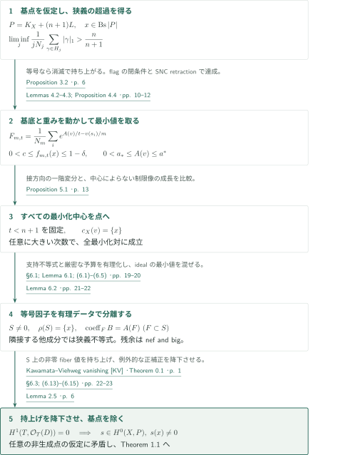
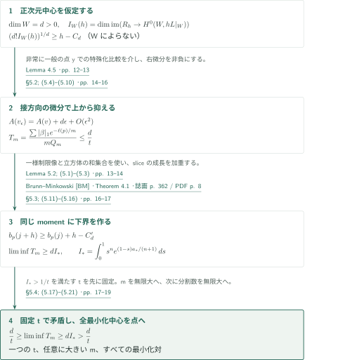
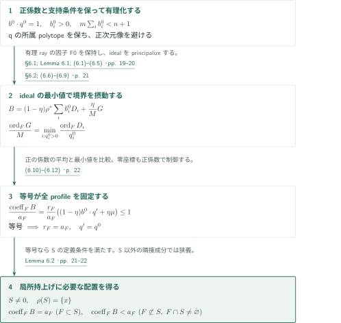
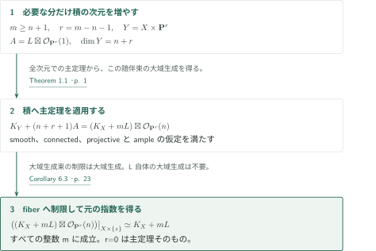

# Fujita’s freeness conjecture

**指数型最小化で中心を点に絞り、局所discrepancyから随伴切断を持ち上げる**

原稿は、任意のample line bundleに対する藤田の自由性予想を全次元で主張する。証明の核心は、基点の存在から作る指数型汎関数の最小化と、正次元中心における接方向の一階変分である。中心の次数・特異性に依存しない制限切断の評価が、鋭い指数を保ったまま中心を点へ絞る。

## 1. 主要結果

### Theorem 1.1 — 鋭い指数での大域生成

$X$を次元$n\geq1$の滑らかな連結射影複素多様体、$L$を$X$上のample line bundleとする。このとき

$$P:=K_X+(n+1)L$$

は大域生成される。$L$自体の大域生成は仮定しない。$X=\mathbf P^n$, $L=\mathcal O_{\mathbf P^n}(1)$では$P$は自明だが$K_X+nL$に非零切断はなく、指数は鋭い。点・接方向の分離やvery amplenessはこの主張に含まれない。非連結の場合は各成分に適用でき、次元0の場合は自明である。

<!-- cite:main-result -->[Theorem 1.1 · p. 1](https://github.com/openai/math/blob/fd4aeeb2ee4fc729c18d98444fed42fd0529eeeb/preprints/Fujitas-freeness-conjecture-September-23-2026/Fujitas-freeness-conjecture-September-23-2026.pdf)<!-- /cite -->

### Corollary 6.3 — すべての大きい指数

Theorem 1.1と同じ仮定の下で、**すべての整数**$m\geq n+1$について$K_X+mL$が大域生成される。

<!-- cite:all-powers -->[Corollary 6.3 · p. 23](https://github.com/openai/math/blob/fd4aeeb2ee4fc729c18d98444fed42fd0529eeeb/preprints/Fujitas-freeness-conjecture-September-23-2026/Fujitas-freeness-conjecture-September-23-2026.pdf)<!-- /cite -->

## 図の矢印に付した引用

<!-- reference-guide -->
略号のない定理・補題・節・式番号は本原稿 [Fujita freeness](https://github.com/openai/math/blob/fd4aeeb2ee4fc729c18d98444fed42fd0529eeeb/preprints/Fujitas-freeness-conjecture-September-23-2026/Fujitas-freeness-conjecture-September-23-2026.pdf) を指します。外部入力には次の略号を使います。

- [DK](https://arxiv.org/pdf/math/9910118v2) Jean-Pierre Demailly; János Kollár — *Singularity exponents*：特異性指数の半連続性。thresholdとflag上の閉条件への入力。arXiv:math/9910118v2, 2000-05-01。
- [KV](https://www.math.kyoto-u.ac.jp/~fujino/kawamata--viehweg2.pdf) Osamu Fujino — *Kawamata–Viehweg vanishing*：nef and bigな残余からの消滅と切断の持上げ。Lecture note v1.04, 2009-07-22。
- [BM](https://www.ceremade.dauphine.fr/~carlier/Brunn-Minkowski) Richard J. Gardner — *Brunn–Minkowski*：制限切断の初期指数が強制する和集合の成長。Bulletin AMS 39 (2002), 355–405; published version。
- [FL](https://arxiv.org/pdf/alg-geom/9311013v1) Takao Fujita — *Adjoint lifting*：局所discrepancyと持上げの方法上の参照。三次元の主定理は適用しない。arXiv:alg-geom/9311013v1, 1993-11-30。
- [RES](https://www.math.purdue.edu/~wlodarcz/singularities/Resolution.pdf) Jarosław Włodarczyk — *SNC resolution*：既存SNC境界を保つ解消・principalization。JAMS 18 (2005), 779–822; published version。

各引用に結果番号とページを付します。誌面番号とPDF内の位置が異なる場合は両方を示します。GitHubの閲覧リンクではページ位置への自動移動を前提としません。
<!-- /reference-guide -->

## 2. Theorem 1.1 — 主定理の証明概略

<!-- proof-target:1 -->証明対象：[Theorem 1.1 · p. 1](https://github.com/openai/math/blob/fd4aeeb2ee4fc729c18d98444fed42fd0529eeeb/preprints/Fujitas-freeness-conjecture-September-23-2026/Fujitas-freeness-conjecture-September-23-2026.pdf)<!-- /proof-target -->

**証明の道筋。** $P$が閉点$x$で生成されないと仮定する。普通消滅次数の狭義評価から、基底とmonomial orderを動かす最小化問題を作る。[正次元中心の排除](#proof-1)と[等号因子の分離](#proof-2)を経て、消滅定理により$x$で非零の切断を得る。最後に[積への適用](#proof-3)からCorollary 6.3を導く。

$R_j=H^0(X,jL)$、$N_j=\dim R_j$と置く。$v$は滑らかな双有理モデル上の非零の非負実重みmonomial orderで、相対標準因子に適合したSNC座標を使う。正重みの成分を$E_i$、重みを$u_i$とすると$A(v)=\sum_i u_iA(E_i)$、$A(E_i)=1+\operatorname{ord}_{E_i}K_{Y/X}$。中心$c_X(v)$は閉中心であり、$x\in c_X(v)$を課す。正のスカラー倍では次数とdiscrepancyを同じ比で変える。

<!-- cite:normalization -->[§2.1; Lemmas 2.1–2.2 · pp. 3–4](https://github.com/openai/math/blob/fd4aeeb2ee4fc729c18d98444fed42fd0529eeeb/preprints/Fujitas-freeness-conjecture-September-23-2026/Fujitas-freeness-conjecture-September-23-2026.pdf)<!-- /cite -->

### 1. 等号の場合の持上げが、平均次数を厳密に押し上げる

普通次数を先に比較するTaylor monomial順序の初期指数集合を$H_j$とする。$\#H_j=N_j$とHilbert漸近式から、最小の次数の格子点を順に詰めると

$$\liminf_{j\to\infty}\frac{1}{jN_j}\sum_{\gamma\in H_j}|\gamma|_1\geq (L^n)^{1/n}\frac{n}{n+1}.$$

非生成の下で右辺を$n/(n+1)$にした不等式が等号なら、$L^n=1$で、正規化した初期指数は単体内部の任意の固定小球をやがて捉える。原稿は$n<t'<n+1$を選び、積で作る切断のleading formsから、点blow-upの例外因子$E$上にthresholdが$1/h$より大きいidealを得る。単項式への退化とSingularity exponents [DK]の半連続性が、この狭義性を元のleading formsへ戻す。

そのidealを解消すると、残る正値性は$(n+1-t')L$である。Theorem 2.4で$H^1$を消し、$E$上の非零fiber値を持ち上げ、Lemma 2.5で$x$に非零の切断へ降下させる。これは非生成に反するので、Proposition 3.2の結論は**狭義**の$\liminf>n/(n+1)$となる。

<!-- cite:ordinary -->[Proposition 3.2 · pp. 6–9](https://github.com/openai/math/blob/fd4aeeb2ee4fc729c18d98444fed42fd0529eeeb/preprints/Fujitas-freeness-conjecture-September-23-2026/Fujitas-freeness-conjecture-September-23-2026.pdf)<!-- /cite -->

<!-- cite:dk-semicontinuity -->[Singularity exponents &#91;DK&#93; · Theorem 3.1; Lemma 3.2 · pp. 14–15](https://arxiv.org/pdf/math/9910118v2#page=14)<!-- /cite -->

### 2. 基底をflagで固定してから、SNCモデルで最小値を取る

次数$m$の順序付き基底$\mathbf s=(s_i)$と$t>0$に対し

$$F_{m,t}(v,\mathbf s)=\frac1{N_m}\sum_i\exp\left(\frac{A(v)}t-\frac{v(s_i)}m\right),\qquad f_{m,t}(x)=\inf_{x\in c_X(v),\,\mathbf s}F_{m,t}(v,\mathbf s).$$

Proposition 3.2は$v=\lambda\operatorname{ord}_x$の$\lambda=0$での微分を負にする。Lemma 4.2は、$n+1$の直下の共通区間と十分大きい$m$に対して$0<c\leq f_{m,t}(x)\leq1-\delta$、さらに小さいsublevel上で$0<a_*\leq A(v)\leq a^*<\infty$を与える。上界には、任意の基底が一定割合の低次数jetを含むことを使う。

<!-- cite:objective -->[(4.1) · p. 9](https://github.com/openai/math/blob/fd4aeeb2ee4fc729c18d98444fed42fd0529eeeb/preprints/Fujitas-freeness-conjecture-September-23-2026/Fujitas-freeness-conjecture-September-23-2026.pdf)<!-- /cite -->

基底全体や全モデルを一度にコンパクト化するのではない。正規化次数の有理下界リストをbase idealsの和のthreshold条件へ書き換え、Lemma 2.3から完全flag variety上の閉集合を作る。入れ子の閉集合に共通するflagとその適合基底を選んだ後、この基底の因子を一つのモデルで解消する。SNC retractionは切断次数を保ちdiscrepancyを増やさず、正規化した重みはコンパクトな単体に入る。極限で重みが0になっても中心は拡大して$x$を含み、Proposition 4.4の最小化対を得る。

<!-- cite:attainment -->[Lemmas 4.2–4.3; Proposition 4.4 · pp. 10–12](https://github.com/openai/math/blob/fd4aeeb2ee4fc729c18d98444fed42fd0529eeeb/preprints/Fujitas-freeness-conjecture-September-23-2026/Fujitas-freeness-conjecture-September-23-2026.pdf)<!-- /cite -->

<!-- cite:snc-resolution -->[SNC resolution &#91;RES&#93; · Theorem 1.0.1 · 誌面 p. 781 / PDF p. 3; Definition 2.1.3 · 誌面 p. 783 / PDF p. 5; Theorem 2.4.1 · 誌面 p. 786 / PDF p. 8](https://www.math.purdue.edu/~wlodarcz/singularities/Resolution.pdf#page=3)<!-- /cite -->

### 3. すべての最小化中心を点に絞り、有理支持データを取る

Proposition 5.1は、一つの$t<n+1$を固定したまま、任意に大きい次数で**すべての**最小化対の中心を$\{x\}$にする。この全称性は次の段階で必要になる。同じ正規化次数profileとdiscrepancyを別のstratumが実現すれば、その対も同じ最小値を持つからである。

切断因子$D_i=\operatorname{div}(s_i)$のSNCモデルでは、各stratumの正規化次数profileは有限個の有理polytopeをなす。目的関数のgradientから正の支持係数$b_i$が得られ、スカラー方向の微分は$m\sum_i b_i=t<n+1$を与える。Lemma 6.1は、所属するpolytopeを変えず、この厳密な予算を保ってprofileと支持係数を有理化する。Lemma 6.2のideal摂動が、等号を持つ非空の被約因子$S$を$x$の上に分離する。

<!-- cite:point-center -->[Proposition 5.1 · p. 13](https://github.com/openai/math/blob/fd4aeeb2ee4fc729c18d98444fed42fd0529eeeb/preprints/Fujitas-freeness-conjecture-September-23-2026/Fujitas-freeness-conjecture-September-23-2026.pdf)<!-- /cite -->

<!-- cite:rational-support -->[§6.1; Lemma 6.1; (6.1)–(6.5) · pp. 19–20](https://github.com/openai/math/blob/fd4aeeb2ee4fc729c18d98444fed42fd0529eeeb/preprints/Fujitas-freeness-conjecture-September-23-2026/Fujitas-freeness-conjecture-September-23-2026.pdf)<!-- /cite -->

<!-- cite:isolation -->[Lemma 6.2 · pp. 21–22](https://github.com/openai/math/blob/fd4aeeb2ee4fc729c18d98444fed42fd0529eeeb/preprints/Fujitas-freeness-conjecture-September-23-2026/Fujitas-freeness-conjecture-September-23-2026.pdf)<!-- /cite -->

### 4. 局所的な係数比較から、元の点で非零の切断を得る

解消$\rho:T\to X$上の有効有理SNC因子$B$は$(n+1)\rho^*L-B$をnef and bigに保つ。$D=K_T+(n+1)\rho^*L-\lfloor B\rfloor$と置けば、$D-(K_T+\{B\})$がこの残余に等しい。Kawamata–Viehweg vanishing [KV]により$H^1(T,\mathcal O_T(D))=0$、従って

$$H^0(T,\mathcal O_T(D+S))\longrightarrow H^0(S,\mathcal O_S(D+S))$$

が全射となる。比較因子は

$$C=D+S-\rho^*P=K_{T/X}-\lfloor B\rfloor+S.$$

Lemma 6.2により$C$の係数は$S$上で0、$S$と交わる他の成分で非負である。ゆえに$C$は$S$の近傍で有効で、$S$を成分に含まない。$S$は被約で全成分が$x$へ写るため$\rho^*P|_S=P|_x\otimes\mathcal O_S$。非零のfiber値に$C$の標準有理切断を掛けると、$S$の各成分の一般点で非零の切断ができ、上の全射で持ち上がる。

非例外的成分では$C$の係数が非正なので、その正部分は例外的である。Lemma 2.5で持上げを$X$へ降下させると$s(x)\neq0$。$n=1$では$S$の成分が点$x$自身でも同じ係数比較が成り立つ。任意の非生成点の仮定が矛盾したので、Theorem 1.1の大域生成へ至る。ここで必要なのは$S$の近傍の比較であり、$B$に大域的lc性、$C$に大域的有効性を要求しない。

<!-- cite:lifting -->[§6.3; (6.13)–(6.15) · pp. 22–23](https://github.com/openai/math/blob/fd4aeeb2ee4fc729c18d98444fed42fd0529eeeb/preprints/Fujitas-freeness-conjecture-September-23-2026/Fujitas-freeness-conjecture-September-23-2026.pdf)<!-- /cite -->

<!-- cite:vanishing -->[Theorem 2.4 · p. 5](https://github.com/openai/math/blob/fd4aeeb2ee4fc729c18d98444fed42fd0529eeeb/preprints/Fujitas-freeness-conjecture-September-23-2026/Fujitas-freeness-conjecture-September-23-2026.pdf)<!-- /cite --> · <!-- cite:descent -->[Lemma 2.5 · p. 6](https://github.com/openai/math/blob/fd4aeeb2ee4fc729c18d98444fed42fd0529eeeb/preprints/Fujitas-freeness-conjecture-September-23-2026/Fujitas-freeness-conjecture-September-23-2026.pdf)<!-- /cite -->

<!-- cite:kv-vanishing -->[Kawamata–Viehweg vanishing &#91;KV&#93; · Theorem 0.1 · p. 1](https://www.math.kyoto-u.ac.jp/~fujino/kawamata--viehweg2.pdf#page=1)<!-- /cite --> · <!-- cite:fujita-lifting -->[Adjoint lifting &#91;FL&#93; · §1(1.6) · p. 3](https://arxiv.org/pdf/alg-geom/9311013v1#page=3)<!-- /cite -->

## 3. Proposition 5.1の証明 — 正次元中心の排除

<!-- proof-target:2 -->証明対象：[Proposition 5.1 · p. 13](https://github.com/openai/math/blob/fd4aeeb2ee4fc729c18d98444fed42fd0529eeeb/preprints/Fujitas-freeness-conjecture-September-23-2026/Fujitas-freeness-conjecture-September-23-2026.pdf)<!-- /proof-target -->

<!-- statement:proposition-5-1 -->
### Proposition 5.1 — 全最小化対の点中心性

Theorem 1.1の$X,L,n$と$P=K_X+(n+1)L$について、$P$が閉点$x$で生成されないと仮定する。上で定義した$f_{m,t}(x)$に対し、ある実数$0<t<n+1$が存在し、任意に大きい整数$m$で最小値が達成され、これを達成する**すべての**monomial testと基底の対は中心がちょうど$\{x\}$である。

<!-- cite:point-center -->[Proposition 5.1 · p. 13](https://github.com/openai/math/blob/fd4aeeb2ee4fc729c18d98444fed42fd0529eeeb/preprints/Fujitas-freeness-conjecture-September-23-2026/Fujitas-freeness-conjecture-September-23-2026.pdf)<!-- /cite -->
<!-- /statement -->

**証明の道筋。** 正次元中心$W$を仮定し、最小性から接方向のweighted momentの上界を得る。他方、制限切断の一様な成長は同じmomentに厳密に大きい下界を強制する。中心・モデルが次数とともに変わっても使える定数と、極限の順序が接続の要点である。

### 1. 制限像の下界を、中心の次数と特異性から切り離す

$kL$を固定したvery ample multipleとし、任意のintegralな$d$次元部分多様体$W$に対して$I_W(h)=\dim\operatorname{im}(R_h\to H^0(W,hL|_W))$と置く。Lemma 5.2は

$$\bigl(d!I_W(h)\bigr)^{1/d}\geq h-C_d\qquad(h\geq H_d)$$

を、$W$によらない$C_d,H_d$で与える。制限写像の全射性は使わない。一般線形射影$W\to\mathbf P^d$の次数は$D=k^d(L^d\cdot W)\geq D_0=k^d$。幾何学的一般fiberの$D_0$点を分離する有界次数のambient formsを取り、$\mathbf C(\mathbf P^d)$上で独立な$D_0$個の元を得る。底のmonomialsとの積で$I_W(qk)\geq D_0\binom{q-D_0+d}{d}$、有限個の剰余類を大域生成multipleで補って全次数へ広げる。使うのは固定個数$D_0$の点であり、$D$自体の上界ではない。

<!-- cite:restriction -->[Lemma 5.2; (5.1)–(5.3) · pp. 13–14](https://github.com/openai/math/blob/fd4aeeb2ee4fc729c18d98444fed42fd0529eeeb/preprints/Fujitas-freeness-conjecture-September-23-2026/Fujitas-freeness-conjecture-September-23-2026.pdf)<!-- /cite -->

### 2. 特殊化比較を介して、接方向の微分を非負にする

最小化対の中心$W$が$d>0$次元とする。Lemma 4.5により、非常に一般の滑らかな$y\in W$で$f_{m,t}(y)\geq f_{m,t}(x)$。上のstratumで元の正重み方向、fiber方向、$W$の接方向に座標を分ける。初期指数を$(p,\beta)$、元の重みを$\ell(p)$とし、その順序に適合する基底へ替えても最小性は保たれる。

接方向の$d$座標に$\epsilon$、残るfiber座標に$\epsilon^2$の重みを加える。各固定基底について$A(v_\epsilon)=A(v)+d\epsilon+O(\epsilon^2)$、$v_\epsilon(s)=\ell(p)+\epsilon|\beta|_1+O(\epsilon^2)$。摂動の中心は$y$なので、特殊化比較を入れて初めて$F(v_\epsilon,\mathbf s)\geq f_{m,t}(y)\geq F(v,\mathbf s)$が得られる。従って

$$T_m:=\frac{\sum_{(p,\beta)\in\Gamma_m}|\beta|_1e^{-\ell(p)/m}}{mQ_m}\leq\frac dt,\qquad Q_j:=\sum_{(p,\beta)\in\Gamma_j}e^{-\ell(p)/m}.$$

$Q_j$の指数の分母は、補助次数$j$でなく基準次数$m$である。摂動と微分は$m$を固定して行い、$\epsilon$を全次数で一様に取る必要はない。

<!-- cite:specialization -->[Lemma 4.5 · pp. 12–13](https://github.com/openai/math/blob/fd4aeeb2ee4fc729c18d98444fed42fd0529eeeb/preprints/Fujitas-freeness-conjecture-September-23-2026/Fujitas-freeness-conjecture-September-23-2026.pdf)<!-- /cite --> · <!-- cite:variation -->[§5.2; (5.4)–(5.10) · pp. 14–16](https://github.com/openai/math/blob/fd4aeeb2ee4fc729c18d98444fed42fd0529eeeb/preprints/Fujitas-freeness-conjecture-September-23-2026/Fujitas-freeness-conjecture-September-23-2026.pdf)<!-- /cite -->

### 3. 和集合の成長を加重して、上界と矛盾させる

横方向の指数$p$を固定したslice $G_p(j)$について、制限切断は$G_0(h)$に十分多くの点を供給する。さらに固定次数$h_0=kd$で$\{0,1\}^d\subset G_0(h_0)$。有限集合を単位立方体で厚くし、Brunn–Minkowski [BM]を適用すると、非空sliceの$b_p(j)=(d!\#G_p(j))^{1/d}$に

$$b_p(j+h)\geq b_p(j)+h-C'_d$$

が成り立つ。$C'_d$は中心・test・$j,p$によらない。この下界を$e^{-\ell(p)/m}$で加重し、$(d+1)$乗の凸性と単体の一次momentの評価を使って$T_m$の下界へ移す。

<!-- cite:slice-growth -->[§5.3; (5.11)–(5.16) · pp. 16–17](https://github.com/openai/math/blob/fd4aeeb2ee4fc729c18d98444fed42fd0529eeeb/preprints/Fujitas-freeness-conjecture-September-23-2026/Fujitas-freeness-conjecture-September-23-2026.pdf)<!-- /cite --> · <!-- cite:bm-inequality -->[Brunn–Minkowski &#91;BM&#93; · Theorem 4.1 · 誌面 p. 362 / PDF p. 8](https://www.ceremade.dauphine.fr/~carlier/Brunn-Minkowski)<!-- /cite -->

Lemma 4.2の一様な$a_*>0$から

$$I_*:=\int_0^1s^n\exp\!\left(\frac{(1-s)a_*}{n+1}\right)ds>\frac1{n+1}$$

なので、$I_*>1/t$を満たす$t<n+1$を一度固定する。$f_{m,t}(x)$が正のliminfに近づく部分列を選ぶ。そこで正次元中心が無限回現れると仮定し、さらにその次元$d$を固定する。補助次数$j_i=\lfloor mi/l\rfloor$では同じtestの$(j_i/m)$倍を$x$で試すため、$y$で全補助次数の特殊化比較を要求しない。まず固定$l$で$m\to\infty$、次に$l\to\infty$とすると

$$\liminf T_m\geq dI_*>\frac dt,$$

となり一階変分の上界と矛盾する。この部分列の十分先で正次元中心を持つ最小化対は一つもない。これが「ある点中心の最小化対」より強い、Proposition 5.1の全称的結論である。

<!-- cite:limits -->[§5.4; (5.17)–(5.21) · pp. 17–19](https://github.com/openai/math/blob/fd4aeeb2ee4fc729c18d98444fed42fd0529eeeb/preprints/Fujitas-freeness-conjecture-September-23-2026/Fujitas-freeness-conjecture-September-23-2026.pdf)<!-- /cite -->

## 4. Lemma 6.2の証明 — 等号を同じprofileへ固定する

<!-- proof-target:3 -->証明対象：[Lemma 6.2 · pp. 21–22](https://github.com/openai/math/blob/fd4aeeb2ee4fc729c18d98444fed42fd0529eeeb/preprints/Fujitas-freeness-conjecture-September-23-2026/Fujitas-freeness-conjecture-September-23-2026.pdf)<!-- /proof-target -->

<!-- statement:lemma-6-2 -->
### Lemma 6.2 — 等号因子とその隣接成分

$P$が$x$で非生成とし、Proposition 5.1の$t,m$と最小化基底を固定する。$D_i=\operatorname{div}(s_i)$を$\pi:Y\to X$で解消し、SNC supportの成分を$E_j$、$a_j=A(E_j)$、$z_j=(\operatorname{ord}_{E_j}D_i/a_j)_i$とする。像が$x$を含むstratum $Z$に対して$C_Z=\operatorname{conv}\{z_j:j\in J(Z)\}$。

Lemma 6.1で得る$q^0\in\mathbf Q_{\geq0}^{N_m}$、$b^0\in\mathbf Q_{>0}^{N_m}$は

$$b^0\cdot q^0=1,\quad m\sum_i b_i^0<n+1,\quad b^0\cdot z\leq1\quad(z\in C_Z,\ q^0\in C_Z)$$

を満たし、$q^0$は正次元の像を持つstratumのpolytopeに属さない。$I=\{i:q_i^0>0\}$、$M/q_i^0$がすべて整数となる正整数$M$を選び、$\mathfrak c=\sum_{i\in I}\mathcal O_X(-(M/q_i^0)D_i)$と置く。$\mathfrak c(uL)$が大域生成となる$u$を選び、$q^0$を実現する素因子$F_0$を保持して$\rho:T\to X$でprincipalizeし、$\mathfrak c\mathcal O_T=\mathcal O_T(-G)$とする。pullbacksと例外因子をSNCにし、十分小さい有理数$0<\eta<1$で

$$B=(1-\eta)\rho^*\sum_i b_i^0D_i+\frac\eta M G$$

を定める。supportの素因子$F$について$a_F=A(F)$、$r_F=\sum_j\operatorname{ord}_F(E_j)a_j\leq a_F$と置く。$S$を、$x\in\rho(F)$、$(\operatorname{ord}_F(D_i)/a_F)_i=q^0$、$r_F=a_F$を満たす成分の被約和とする。$F_0$を含むので$S\neq0$。

このとき、**$S$の全成分は$x$へ写り、その$B$における係数は$a_F$に等しい。一方、$S$と交わるsupport内の他のすべての素因子の係数は、そのlog discrepancyより厳密に小さい。**

<!-- cite:rational-support -->[§6.1; Lemma 6.1; (6.1)–(6.5) · pp. 19–20](https://github.com/openai/math/blob/fd4aeeb2ee4fc729c18d98444fed42fd0529eeeb/preprints/Fujitas-freeness-conjecture-September-23-2026/Fujitas-freeness-conjecture-September-23-2026.pdf)<!-- /cite --> · <!-- cite:boundary -->[§6.2; (6.6)–(6.9) · p. 21](https://github.com/openai/math/blob/fd4aeeb2ee4fc729c18d98444fed42fd0529eeeb/preprints/Fujitas-freeness-conjecture-September-23-2026/Fujitas-freeness-conjecture-September-23-2026.pdf)<!-- /cite --> · <!-- cite:isolation -->[Lemma 6.2 · pp. 21–22](https://github.com/openai/math/blob/fd4aeeb2ee4fc729c18d98444fed42fd0529eeeb/preprints/Fujitas-freeness-conjecture-September-23-2026/Fujitas-freeness-conjecture-September-23-2026.pdf)<!-- /cite -->
<!-- /statement -->

**証明の道筋。** 正係数の支持汎関数だけでは等号のprofileは固定されない。idealの次数が座標比の最小値となることを利用して摂動し、凸結合で等号が成立する条件を追う。

### 1. 支持条件と点中心性を同時に有理化する

最小化profile $q=(v(s_i)/A(v))_i$を含むpolytope上で、gradientから$b\cdot z\leq b\cdot q=1$を得る。$q$が正次元像のpolytopeにも属せば、同じprofileを実現する点中心でない最小化対ができ、Proposition 5.1に反する。Lemma 6.1は$q$を含む最小faceの交わりの有理点を選び、含まない有限個のpolytopeを避けたまま$q^0$へ移す。次に有理線形不等式の解集合で$b^0>0$を選び、$m\sum b_i^0<n+1$も保つ。

有理monomial weightsのrayをtoroidalに抽出すると$F_0$を得る。そのprofileは$q^0$、retractionのdiscrepancy不等式は等号で、中心は$x$である。この因子を後の解消でも保持する。

<!-- cite:rational-support -->[§6.1; Lemma 6.1; (6.1)–(6.5) · pp. 19–20](https://github.com/openai/math/blob/fd4aeeb2ee4fc729c18d98444fed42fd0529eeeb/preprints/Fujitas-freeness-conjecture-September-23-2026/Fujitas-freeness-conjecture-September-23-2026.pdf)<!-- /cite --> · <!-- cite:normalization -->[§2.1; Lemmas 2.1–2.2 · pp. 3–4](https://github.com/openai/math/blob/fd4aeeb2ee4fc729c18d98444fed42fd0529eeeb/preprints/Fujitas-freeness-conjecture-September-23-2026/Fujitas-freeness-conjecture-September-23-2026.pdf)<!-- /cite -->

### 2. 最小値を混ぜても、消滅に必要な正値性が残る

idealの和の次数は最小値なので

$$\frac{\operatorname{ord}_F(G)}M=\min_{i\in I}\frac{\operatorname{ord}_F(D_i)}{q_i^0}.$$

一方、$u\rho^*L-G$は大域生成である。$D_i\sim mL$より

$$ (n+1)\rho^*L-B\equiv\left(n+1-(1-\eta)m\sum_i b_i^0-\frac{\eta u}M\right)\rho^*L+\frac\eta M(u\rho^*L-G).$$

小さい$\eta$に対し第一係数は正、第二項はnefで、全体はnef and bigとなる。$S$の成分のretraction profileは$q^0$である。その中心の像は$x$を含み、正次元像のpolytopeが除外されているため、$S$の各成分は$x$へ写る。また上の最小値も$b^0$とのpairingも$a_F$に等しく、$\operatorname{coeff}_F B=a_F$を得る。

<!-- cite:boundary -->[§6.2; (6.6)–(6.9) · p. 21](https://github.com/openai/math/blob/fd4aeeb2ee4fc729c18d98444fed42fd0529eeeb/preprints/Fujitas-freeness-conjecture-September-23-2026/Fujitas-freeness-conjecture-September-23-2026.pdf)<!-- /cite --> · <!-- cite:rigidity -->[(6.10)–(6.12) · p. 22](https://github.com/openai/math/blob/fd4aeeb2ee4fc729c18d98444fed42fd0529eeeb/preprints/Fujitas-freeness-conjecture-September-23-2026/Fujitas-freeness-conjecture-September-23-2026.pdf)<!-- /cite -->

### 3. 隣接成分での等号は、Sの成分であることを強制する

$F$が$S$の成分$F_S$と交わるとき、両者のretraction profileは交点から定まる同じ$C_Z$に属する。$r_F=0$ならすべての切断次数と$G$の次数が0で、$\operatorname{coeff}_F B=0<a_F$。$r_F>0$なら$q'=(\operatorname{ord}_F(D_i)/r_F)_i$、$\mu=\min_{i\in I}q_i'/q_i^0$として

$$\mu\leq\sum_{i\in I}b_i^0q_i'\leq b^0\cdot q'\leq1,\qquad\frac{\operatorname{coeff}_F B}{a_F}=\frac{r_F}{a_F}\bigl((1-\eta)b^0\cdot q'+\eta\mu\bigr)\leq1.$$

等号なら$r_F=a_F$かつ$b^0\cdot q'=\mu=1$。$I$上の正の重みの平均が最小値に等しいので$q_i'=q_i^0$、$I$の外でも$b_i^0>0$により$q_i'=0$が強制される。従って$q'=q^0$。交点は$x$の上にあるから$F$は$S$の定義条件をすべて満たす。ゆえに$S$以外の隣接成分では狭義不等式となる。この局所比較が[主定理の持上げ](#proof-overview-step-4)へ渡る。

<!-- cite:rigidity -->[(6.10)–(6.12) · p. 22](https://github.com/openai/math/blob/fd4aeeb2ee4fc729c18d98444fed42fd0529eeeb/preprints/Fujitas-freeness-conjecture-September-23-2026/Fujitas-freeness-conjecture-September-23-2026.pdf)<!-- /cite -->

## 5. Corollary 6.3の証明 — 積を使って指数を増やす

<!-- proof-target:4 -->証明対象：[Corollary 6.3 · p. 23](https://github.com/openai/math/blob/fd4aeeb2ee4fc729c18d98444fed42fd0529eeeb/preprints/Fujitas-freeness-conjecture-September-23-2026/Fujitas-freeness-conjecture-September-23-2026.pdf)<!-- /proof-target -->

**証明の道筋。** $L$に切断があるとは限らないため、追加の$L$を掛けて大域生成を保つとは論じない。全次元で成り立つTheorem 1.1を射影空間との積へ適用する。

### 1. 次元と随伴束を同時に調整する

$r=m-n-1\geq0$、$Y=X\times\mathbf P^r$、$A=L\boxtimes\mathcal O_{\mathbf P^r}(1)$とする。$Y$は滑らかな連結射影複素多様体で$\dim Y=n+r$、$A$はample。主定理を$(Y,A)$へ適用すると

$$K_Y+(n+r+1)A=(K_X+mL)\boxtimes\mathcal O_{\mathbf P^r}(n)$$

が大域生成される。

<!-- cite:all-powers -->[Corollary 6.3 · p. 23](https://github.com/openai/math/blob/fd4aeeb2ee4fc729c18d98444fed42fd0529eeeb/preprints/Fujitas-freeness-conjecture-September-23-2026/Fujitas-freeness-conjecture-September-23-2026.pdf)<!-- /cite -->

### 2. Fiberへの制限で、すべてのmを回収する

大域生成束の制限は大域生成なので、$X\times\{z\}$への制限から$K_X+mL$の大域生成を得る。$r=0$はTheorem 1.1そのもの。$m\geq n+1$は任意だったから、Corollary 6.3の全結論が従う。

<!-- cite:all-powers -->[Corollary 6.3 · p. 23](https://github.com/openai/math/blob/fd4aeeb2ee4fc729c18d98444fed42fd0529eeeb/preprints/Fujitas-freeness-conjecture-September-23-2026/Fujitas-freeness-conjecture-September-23-2026.pdf)<!-- /cite -->

## 6. どの論文が、どの段階を担うか

| 供給元と結果 | 利用箇所 | 使用内容・必要な仮定 | 確認範囲 |
|---|---|---|---|
| <!-- cite:dk-semicontinuity -->[Singularity exponents &#91;DK&#93; · Theorem 3.1; Lemma 3.2 · pp. 14–15](https://arxiv.org/pdf/math/9910118v2#page=14)<!-- /cite --> | Lemma 2.3、§3、Lemma 4.3 | 局所的な半連続性。$e^\varphi=(\sum|g_i|^2)^{1/2}$は局所Hölder。constructibilityは原稿が解消・層別化で補う | 指定版の記述と、threshold閉性・退化・flagへの使用を照合 |
| <!-- cite:kv-vanishing -->[Kawamata–Viehweg vanishing &#91;KV&#93; · Theorem 0.1 · p. 1](https://www.math.kyoto-u.ac.jp/~fujino/kawamata--viehweg2.pdf#page=1)<!-- /cite --> | Theorem 2.4、§3、§6.3 | smooth projective model、SNC fractional boundary、nef and bigな残余。$H^1$消滅から制限の全射へ | rounding形式と二つの持上げ箇所の条件を照合 |
| <!-- cite:bm-inequality -->[Brunn–Minkowski &#91;BM&#93; · Theorem 4.1 · 誌面 p. 362 / PDF p. 8](https://www.ceremade.dauphine.fr/~carlier/Brunn-Minkowski)<!-- /cite --> | §5.3 (5.13) | 非空有限格子集合の立方体による厚み付け。有界可測でMinkowski和も可測 | 不等式の記述と離散化の適用を照合 |
| <!-- cite:snc-resolution -->[SNC resolution &#91;RES&#93; · Theorem 1.0.1 · 誌面 p. 781 / PDF p. 3; Definition 2.1.3 · 誌面 p. 783 / PDF p. 5; Theorem 2.4.1 · 誌面 p. 786 / PDF p. 8](https://www.math.purdue.edu/~wlodarcz/singularities/Resolution.pdf#page=3)<!-- /cite --> | §2.1、Proposition 4.4、§6.2 | 標数0、固定SNC境界を保つ解消・principalization。抽出済み因子を狭義変換で保持 | principalization、marked idealの解消の記述と用途を照合 |

Adjoint lifting [FL]は、§6.3が明記する**方法上の参照**である。三次元の自由性定理を高次元へ直接適用してはいない。本稿は被約$S$への制限と例外補正の降下を自ら記述する。初期指数の計数・単項式thresholdは本稿内の議論を追い、関連する既存理論への言及を追加の直接依存として数えていない。

<!-- cite:fujita-lifting -->[Adjoint lifting &#91;FL&#93; · §1(1.6) · p. 3](https://arxiv.org/pdf/alg-geom/9311013v1#page=3)<!-- /cite -->

## 7. 原典を読む入口と確認範囲

<!-- reading-list -->
- [Proposition 3.2 · pp. 6–9](https://github.com/openai/math/blob/fd4aeeb2ee4fc729c18d98444fed42fd0529eeeb/preprints/Fujitas-freeness-conjecture-September-23-2026/Fujitas-freeness-conjecture-September-23-2026.pdf) — 狭義性を生む等号の場合と、例外因子からの持上げ。
- [Lemmas 4.2–4.3; Proposition 4.4 · pp. 10–12](https://github.com/openai/math/blob/fd4aeeb2ee4fc729c18d98444fed42fd0529eeeb/preprints/Fujitas-freeness-conjecture-September-23-2026/Fujitas-freeness-conjecture-September-23-2026.pdf) — 基底とモデルを同時に動かした最小化の達成。
- [Lemma 5.2; (5.1)–(5.3) · pp. 13–14](https://github.com/openai/math/blob/fd4aeeb2ee4fc729c18d98444fed42fd0529eeeb/preprints/Fujitas-freeness-conjecture-September-23-2026/Fujitas-freeness-conjecture-September-23-2026.pdf) — 中心の次数・特異性によらない制限像の下界。
- [§5.4; (5.17)–(5.21) · pp. 17–19](https://github.com/openai/math/blob/fd4aeeb2ee4fc729c18d98444fed42fd0529eeeb/preprints/Fujitas-freeness-conjecture-September-23-2026/Fujitas-freeness-conjecture-September-23-2026.pdf) — 固定パラメータ・部分列・極限の順序。
- [§6.1; Lemma 6.1; (6.1)–(6.5) · pp. 19–20](https://github.com/openai/math/blob/fd4aeeb2ee4fc729c18d98444fed42fd0529eeeb/preprints/Fujitas-freeness-conjecture-September-23-2026/Fujitas-freeness-conjecture-September-23-2026.pdf) — 支持不等式とpositivity budgetを保つ有理化。
- [Lemma 6.2 · pp. 21–22](https://github.com/openai/math/blob/fd4aeeb2ee4fc729c18d98444fed42fd0529eeeb/preprints/Fujitas-freeness-conjecture-September-23-2026/Fujitas-freeness-conjecture-September-23-2026.pdf) — 等号が同じprofileを強制する箇所。
- [§6.3; (6.13)–(6.15) · pp. 22–23](https://github.com/openai/math/blob/fd4aeeb2ee4fc729c18d98444fed42fd0529eeeb/preprints/Fujitas-freeness-conjecture-September-23-2026/Fujitas-freeness-conjecture-September-23-2026.pdf) — 局所有効性で足りる持上げと、例外補正の降下。
- [Corollary 6.3 · p. 23](https://github.com/openai/math/blob/fd4aeeb2ee4fc729c18d98444fed42fd0529eeeb/preprints/Fujitas-freeness-conjecture-September-23-2026/Fujitas-freeness-conjecture-September-23-2026.pdf) — 積への適用から全指数へ移る短い証明。
<!-- /reading-list -->

原稿§§2–6の証明本文を読み、外部4入力の記述・使用箇所と、Fujitaの局所持上げとの方法上の対応を照合した。各主張の全結論・量化と説明先の対応を確認した。

証明全体の独立検証ではない。§3の格子点近似・初期形式、§5の漸近評価は原稿の読解に限り、完全な再証明・形式検証は未実施。外部定理の証明と再帰的依存は確認対象外で、他カタログの全依存関係も未調査。

<!-- cite:reading-scope -->[§§2–6 · pp. 3–23](https://github.com/openai/math/blob/fd4aeeb2ee4fc729c18d98444fed42fd0529eeeb/preprints/Fujitas-freeness-conjecture-September-23-2026/Fujitas-freeness-conjecture-September-23-2026.pdf)<!-- /cite -->
