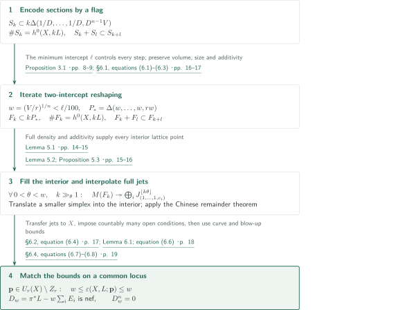
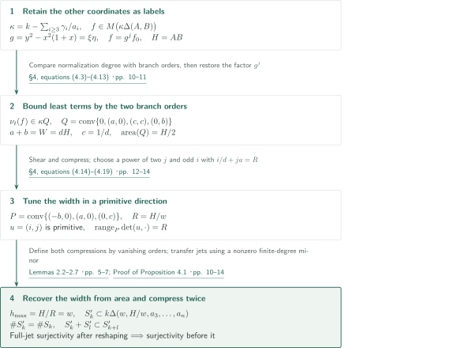
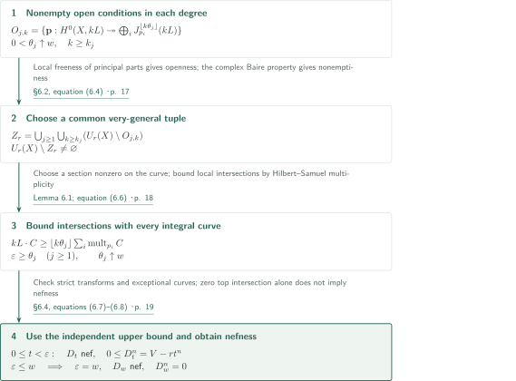

# Maximal Multipoint Seshadri Constants in Higher Dimensions

**Real-intercept reshaping and graded additivity yield jet separation at the volume bound**

The manuscript claims exact maximality of the ordinary multipoint Seshadri constant on a fixed smooth complex projective variety for every sufficiently large integer point count. Its mechanism reshapes initial exponents into an elongated simplex without losing volume, fills its interior using additivity, and obtains surjectivity onto full jets. This article presents the manuscript's argument and checks its connections; it does not certify the complete proof.

## 1. Main results

### Theorem 1.1 — Maximality at very general tuples

Let $X$ be a smooth integral complex projective variety of dimension $n\geq3$, let $L$ be an ample line bundle, and put $V=L^n$. Write

$$U_r(X)=\{(p_1,\ldots,p_r)\in X^r:p_i\ne p_j\ (i\ne j)\}.$$

The convention throughout is

$$\varepsilon(X,L;\mathbf p)=\inf_C\frac{L\cdot C}{\sum_{i=1}^r\operatorname{mult}_{p_i}C},$$

where $C\subset X$ ranges over integral curves meeting at least one marked point and the multiplicity is zero outside $C$. This is the ordinary, equally weighted multipoint constant defined by curves. The denominator is not divided by $r$, and no higher-cycle invariant is substituted.

The manuscript asserts the existence of an integer $r_0=r_0(X,L)\geq1$ such that **for every integer $r\geq r_0$** there is a countable union $Z_r$ of proper Zariski-closed subsets of $U_r(X)$, with nonempty complement, and

$$\varepsilon(X,L;\mathbf p)=\left(\frac Vr\right)^{1/n}\qquad(\mathbf p\in U_r(X)\setminus Z_r).$$

Equivalently, for the blow-up $\pi:Y\to X$ at such a tuple and its exceptional divisors $E_i$, the real divisor class

$$D_w=\pi^*L-w\sum_{i=1}^rE_i,\qquad w=(V/r)^{1/n}$$

is nef and has $D_w^n=0$. “Very general” here imposes countably many conditions; it is not replaced by a single nonempty Zariski-open set. The threshold depends on the fixed polarized variety, and equality holds at each point count beyond it, not merely asymptotically as $r\to\infty$.

<!-- cite:main -->[Theorem 1.1 · pp. 1–2](https://github.com/openai/math/blob/1581d4cbdd69a0faf34b2089614fe2a814316a6a/preprints/Maximal-Multipoint-Seshadri-Constants-in-Higher-Dimensions-October-5-2026/main.pdf)<!-- /cite -->

This is the qualitative Nagata–Biran–Szemberg assertion in dimension $n\geq3$. The theorem does not add a claim about every plane point count $r\geq10$, surfaces, arbitrary characteristic, or weighted constants.

## References on the arrows

<!-- reference-guide -->
Unprefixed theorem, lemma, section and equation numbers refer to [Maximal Multipoint Seshadri Constants in Higher Dimensions](https://github.com/openai/math/blob/1581d4cbdd69a0faf34b2089614fe2a814316a6a/preprints/Maximal-Multipoint-Seshadri-Constants-in-Higher-Dimensions-October-5-2026/main.pdf). External inputs use the following keys.

- [OpenAI26b](https://github.com/openai/math/blob/1581d4cbdd69a0faf34b2089614fe2a814316a6a/preprints/Maximal-Seshadri-Constants-on-Arbitrary-Polarized-Surfaces-September-23-2026/main.pdf) OpenAI — *Maximal Seshadri constants on arbitrary polarized surfaces*: Methodological antecedent for node bounds, diagonal compression and primitive directions; the adaptation is proved here, without using surface maximality. September 23, 2026.

Each citation gives the result and pages. When printed pagination differs from the PDF position, both are shown. GitHub previews do not automatically jump to the cited page.
<!-- /reference-guide -->

The external paper listed above is a methodological antecedent. The finite-degree jet transfers, compression and interior filling used in the main argument are proved in this manuscript; surface maximality is not a premise.

## 2. Proof of Theorem 1.1 — From exponent sets to full jets

<!-- proof-target:1 -->Proof target：[Theorem 1.1 · pp. 1–2](https://github.com/openai/math/blob/1581d4cbdd69a0faf34b2089614fe2a814316a6a/preprints/Maximal-Multipoint-Seshadri-Constants-in-Higher-Dimensions-October-5-2026/main.pdf)<!-- /proof-target --> See the [hypotheses and conclusions](#theorem-1-1).

**Proof route.** A complete-intersection flag supplies an additive exponent family. Repeating two-intercept reshaping $n-1$ times gives an elongated simplex. Additivity and asymptotically full density supply its interior lattice points, and one-variable Hermite interpolation separates full jets. The next section explains reshaping; Section 4 explains the common very-general locus and the matching bounds. Write $\Delta(a_1,\ldots,a_n)=\{x\in\mathbb R^n_{\geq0}:\sum x_i/a_i\leq1\}$ and let $M(F)$ denote the Laurent monomial space with exponents in $F$.

### 1. A flag supplies the initial simplex of the correct volume

Choose $D$ with $DL$ very ample and a smooth integral complete-intersection flag cut out by $n-1$ general sections. Divide sections successively along the flag and bound the final vanishing order by the degree on its last curve. A lexicographic initial exponent $\alpha$ then satisfies

$$D\sum_{i<n}\alpha_i+\frac{\alpha_n}{D^{n-1}V}\leq k.$$

Thus $S_k\subset k\Delta(1/D,\ldots,1/D,D^{n-1}V)$ and $\#S_k=h^0(X,kL)=Vk^n/n!+O(k^{n-1})$, while multiplicativity of least terms gives $S_k+S_l\subset S_{k+l}$. At each fixed degree, choose positive weights exposing the finitely many least terms and shrink local coordinates. Persistence of a nonzero maximal jet minor transfers surjectivity from $M(S_k)$ to $H^0(X,kL)$. The weights may depend on the degree, but the flag, order and additive support family remain fixed.

<!-- cite:flag -->[Proposition 3.1 · pp. 8–9](https://github.com/openai/math/blob/1581d4cbdd69a0faf34b2089614fe2a814316a6a/preprints/Maximal-Multipoint-Seshadri-Constants-in-Higher-Dimensions-October-5-2026/main.pdf)<!-- /cite -->

### 2. One threshold works for every subsequent point count

Let $\ell>0$ be the smallest intercept of the initial simplex. Before fixing $r$, choose $r_0$ so that $w=(V/r)^{1/n}<\ell/100$ for every $r\geq r_0$. Proposition 4.1 replaces $(A,B)$ by $(w,AB/w)$; carry the large new intercept into the next pair. Every input pair has $A,B\geq\ell$, so $w\max(3/A,2/B)\leq3w/\ell<1/16$ and the proposition remains applicable. After $n-1$ replacements, the product of intercepts is still $V$, and

$$P_* = \Delta(w,\ldots,w,rw),\quad F_k\subset kP_*\cap\mathbb Z^n,\quad F_k+F_l\subset F_{k+l},\quad\#F_k=h^0(X,kL).$$

No restriction to square point counts or another subsequence occurs.

<!-- cite:iteration -->[§6.1, equations (6.1)–(6.3) · pp. 16–17](https://github.com/openai/math/blob/1581d4cbdd69a0faf34b2089614fe2a814316a6a/preprints/Maximal-Multipoint-Seshadri-Constants-in-Higher-Dimensions-October-5-2026/main.pdf)<!-- /cite -->

### 3. Turn density into prescribed exponents and interpolate

Since $\operatorname{vol}(P_*)=V/n!$, only $o(k^n)$ lattice points are missing. Density alone does not guarantee a particular exponent. In Lemma 5.1, each $y\in kK\cap\mathbb Z^n$, for a fixed compact $K$ inside the simplex, has $\gg k^n$ decompositions $y=y_1+y_2$ into degrees $k_1=\lfloor k/2\rfloor$ and $k_2=k-k_1$. The holes exclude only $o(k^n)$ candidates. Some pair lies in $F_{k_1}\times F_{k_2}$, and additivity puts $y$ in $F_k$. No boundary saturation is asserted.

<!-- cite:saturation -->[Lemma 5.1 · pp. 14–15](https://github.com/openai/math/blob/1581d4cbdd69a0faf34b2089614fe2a814316a6a/preprints/Maximal-Multipoint-Seshadri-Constants-in-Higher-Dimensions-October-5-2026/main.pdf)<!-- /cite -->

Given $0<\theta<w$, choose $\theta/w<\lambda<1$ and translate $\lambda P_*$ into the interior. For large $k$, its lattice points lie in $F_k$. The corresponding monomial translation acts by a unit on jet algebras at torus points. With $m=\lfloor k\theta\rfloor$, the set

$$E_{r,m}=\{(\beta,b)\in\mathbb Z_{\geq0}^{n-1}\times\mathbb Z_{\geq0}:|\beta|+b/r<m+1\}$$

lies in $k\lambda P_*$. Choose distinct $c_i\in\mathbb C^*$. For each coefficient of $(x'-1)^\alpha$, apply the Chinese remainder theorem modulo $(Y-c_i)^{m+1-|\alpha|}$. This prescribes arbitrary full jets through degree $m$ at $(1,\ldots,1,c_i)$. Proposition 5.3 then gives surjectivity, which transfers backward through every reshaping step to some distinct tuple on $X$. That tuple may depend on $\theta$ and $k$.

<!-- cite:interpolation -->[Lemma 5.2; Proposition 5.3 · pp. 15–16](https://github.com/openai/math/blob/1581d4cbdd69a0faf34b2089614fe2a814316a6a/preprints/Maximal-Multipoint-Seshadri-Constants-in-Higher-Dimensions-October-5-2026/main.pdf)<!-- /cite -->

## 3. Proof of Proposition 4.1 — Reshape two real intercepts

<!-- proof-target:2 -->Proof target：[Proposition 4.1 · pp. 9–10](https://github.com/openai/math/blob/1581d4cbdd69a0faf34b2089614fe2a814316a6a/preprints/Maximal-Multipoint-Seshadri-Constants-in-Higher-Dimensions-October-5-2026/main.pdf)<!-- /proof-target -->

<!-- statement:proposition-4-1 -->
### Proposition 4.1 — Two-intercept reshaping

Let $n\geq2$ and let $A,B,a_3,\ldots,a_n>0$ be real. Suppose finite sets $S_k\subset k\Delta(A,B,a_3,\ldots,a_n)\cap\mathbb Z^n$ satisfy $S_k+S_l\subset S_{k+l}$ for all $k,l\geq1$. Put $H=AB$ and $d=\max(3/A,2/B)$. For every real $w>0$ with $dw<1/16$, there exist finite sets $S'_k$ such that

$$S'_k\subset k\Delta(w,H/w,a_3,\ldots,a_n)\cap\mathbb Z^n,\quad\#S'_k=\#S_k,\quad S'_k+S'_l\subset S'_{k+l}.$$

For every $k\geq1,m\geq0,r\geq1$, if $M(S'_k)$ surjects onto jets through degree $m$ at some distinct torus $r$-tuple, then $M(S_k)$ does so at some distinct torus $r$-tuple. The tuples need not coincide.

<!-- cite:reshape -->[Proposition 4.1 · pp. 9–10](https://github.com/openai/math/blob/1581d4cbdd69a0faf34b2089614fe2a814316a6a/preprints/Maximal-Multipoint-Seshadri-Constants-in-Higher-Dimensions-October-5-2026/main.pdf)<!-- /cite -->
<!-- /statement -->

Fixing the remaining exponents as a label $\gamma$, the two-coordinate bound is $\kappa\Delta(A,B)$, where $\kappa=k-\sum_{i\geq3}\gamma_i/a_i\geq0$. Every operation retains this label and commutes with real scaling by $\kappa$.

### 1. A node gives a quadrilateral of equal area

Use $g=y^2-x^2(1+x)$ and local coordinates with $g=\xi\eta$. Write $f=g^jf_0$. On the normalization $x=v^2-1,y=v(v^2-1)$, the residual polynomial has degree at most $(\kappa-jd)W$, where $W=\max(2A,3B)=dH$. Its orders at the two branches $v=\pm1$ show that its least $(1,t)$-weight $\mu$ satisfies $(1+1/t)\mu\leq(\kappa-jd)W$. Restoring the least exponent $(j,j)$ of $g^j$ puts the least exponent of $f$ in

$$\kappa Q,\quad Q=\operatorname{conv}\{(0,0),(a,0),(c,c),(0,b)\},\quad a=\frac{Wt}{1+t},\quad b=\frac W{1+t},\quad c=1/d.$$

For $t>T=d^2H$, this quadrilateral has area $H/2$. Least-term bases in each label and compatibility of products preserve both cardinality and additivity across degrees.

<!-- cite:node -->[§4, equations (4.3)–(4.13) · pp. 10–11](https://github.com/openai/math/blob/1581d4cbdd69a0faf34b2089614fe2a814316a6a/preprints/Maximal-Multipoint-Seshadri-Constants-in-Higher-Dimensions-October-5-2026/main.pdf)<!-- /cite -->

### 2. Tune a primitive direction to the exact required width

Apply the shear $(\alpha,\beta)\mapsto(\alpha-\beta,\beta)$ and compress by vanishing orders in the second coordinate. The result lies in $P=\operatorname{conv}\{(-b,0),(a,0),(0,c)\}$. Put $R=H/w$ and choose $j$ as the largest power of two at most $R/(2W)$. The inequality $dw<1/16$ makes the interval $(d(R-jW),d(R-ja_0))$, with $a_0=WT/(1+T)$, longer than $2$. Choose an odd integer $i$ in it and then $t>T$ with $i/d+ja=R$. The vector $u=(i,j)$ is primitive, and the range of $\det(u,\cdot)$ on $P$ is exactly $R$.

Extend $u$ to an integral basis. Horizontal slice lengths form a tent, whose area $H/2$ and height range $R$ force its maximum width to be $H/R=w$. Horizontal and then vertical compression yield $\Delta(w,R)$. No rationality of the intercepts is required. Compression does not merely translate lattice points: it replaces each row of Laurent polynomials by its possible vanishing orders at $z=1$.

<!-- cite:direction -->[§4, equations (4.14)–(4.19) · pp. 12–14](https://github.com/openai/math/blob/1581d4cbdd69a0faf34b2089614fe2a814316a6a/preprints/Maximal-Multipoint-Seshadri-Constants-in-Higher-Dimensions-October-5-2026/main.pdf)<!-- /cite -->

### 3. Separate fixed supports from degree-dependent jet transfers

The initial order, integral changes and exact vanishing orders defining compression are fixed in all degrees and preserve multiplication of labelled spaces. Small analytic scaling parameters and weights exposing tie-breaks may instead depend on the finite degree and test tuple. Convergence of derivatives and persistence of a nonzero finite minor transfer surjectivity backward for full jets, including the unchanged $n-2$ variables. This distinction preserves both the graded structure and the interpolation implications under iteration.

<!-- cite:transfer -->[Lemmas 2.2–2.7 · pp. 5–7](https://github.com/openai/math/blob/1581d4cbdd69a0faf34b2089614fe2a814316a6a/preprints/Maximal-Multipoint-Seshadri-Constants-in-Higher-Dimensions-October-5-2026/main.pdf)<!-- /cite -->

## 4. Proof of Theorem 1.1 — A very-general locus and matching bounds

<!-- proof-target:3 -->Proof target：[Theorem 1.1 · pp. 1–2](https://github.com/openai/math/blob/1581d4cbdd69a0faf34b2089614fe2a814316a6a/preprints/Maximal-Multipoint-Seshadri-Constants-in-Higher-Dimensions-October-5-2026/main.pdf)<!-- /proof-target --> This completes the equality, nefness and zero top intersection in the [main theorem](#theorem-1-1).

### 1. From special test tuples to a common very-general locus

For fixed integers $k,m$, surjectivity onto jets is Zariski open: smoothness makes principal parts locally free, and maximal minors define the surjectivity locus. Choose $\theta_j\uparrow w$. For each $j$, all $k\geq k_j$ yield nonempty open sets $O_{j,k}\subset U_r(X)$. Remove $Z_r=\bigcup_j\bigcup_{k\geq k_j}(U_r(X)\setminus O_{j,k})$. The complex space $U_r(X)(\mathbb C)$ is locally compact Hausdorff and hence Baire; each proper algebraic closed subset has empty complex interior. Thus the complement is nonempty. The constructed special torus tuples are not themselves called general: nonzero rank conditions and a countable intersection provide that passage.

<!-- cite:locus -->[§6.2, equation (6.4) · p. 17](https://github.com/openai/math/blob/1581d4cbdd69a0faf34b2089614fe2a814316a6a/preprints/Maximal-Multipoint-Seshadri-Constants-in-Higher-Dimensions-October-5-2026/main.pdf)<!-- /cite -->

### 2. Full jets give the lower bound with ordinary multiplicities

Lemma 6.1 deduces $A\cdot C\geq m\sum_i\operatorname{mult}_{p_i}C$ from separation of full jets through degree $m\geq1$ by $A$. Lift a nonzero element of $\mathfrak m_C^m/\mathfrak m_C^{m+1}$ at one marked point and prescribe zero jets at the others. The resulting section does not vanish identically on $C$. Even when $C$ is singular, for nonzero $f\in\mathfrak m_C^m$,

$$q\,\operatorname{length}(\mathcal O_C/(f))=\operatorname{length}(\mathcal O_C/(f^q))\geq mq\,e(\mathcal O_C)+O(1)$$

bounds the local intersection by $m$ times the ordinary Hilbert–Samuel multiplicity. Take $A=kL$ and $m=\lfloor k\theta_j\rfloor$. First letting $k\to\infty$ and then $j\to\infty$ gives $\varepsilon\geq w$.

<!-- cite:lower -->[Lemma 6.1; equation (6.6) · p. 18](https://github.com/openai/math/blob/1581d4cbdd69a0faf34b2089614fe2a814316a6a/preprints/Maximal-Multipoint-Seshadri-Constants-in-Higher-Dimensions-October-5-2026/main.pdf)<!-- /cite -->

### 3. The blow-up upper bound and the nef-class conclusion

For any distinct tuple, put $D_t=\pi^*L-t\sum E_i$. Curves inside $E_i$ have nonnegative intersection because $D_t|_{E_i}=t\mathcal O_{\mathbb P^{n-1}}(1)$. Every other curve $\Gamma$ is the strict transform of an integral curve $C\subset X$, and

$$D_t\cdot\Gamma=L\cdot C-t\sum_i\operatorname{mult}_{p_i}C.$$

The manuscript explains $E_i\cdot\Gamma=\operatorname{mult}_{p_i}C$, including for singular $C$, using the blow-up of its maximal ideal and the Hilbert–Samuel multiplicity of the exceptional fibre. Hence $D_t$ is nef for $0\leq t<\varepsilon$, and

$$0\leq D_t^n=V-rt^n$$

gives the universal upper bound $\varepsilon\leq w$. Combine it with Step 2 for equality. Substituting the lower bound into every curve intersection proves that $D_w$ is nef, and the intersection computation gives $D_w^n=0$. Conversely, nefness of $D_w$ gives $\varepsilon\geq w$ on strict transforms; the upper bound then gives equality. Zero top self-intersection alone is not used to infer nefness.

<!-- cite:upper -->[§6.4, equations (6.7)–(6.8) · p. 19](https://github.com/openai/math/blob/1581d4cbdd69a0faf34b2089614fe2a814316a6a/preprints/Maximal-Multipoint-Seshadri-Constants-in-Higher-Dimensions-October-5-2026/main.pdf)<!-- /cite -->

## 5. Which papers supply which steps

The surface paper is a methodological antecedent, not a direct input through its maximality theorem. Its final test uses jet **injectivity** on finite torus subgroups, whereas this manuscript reshapes polynomial spaces to obtain full-dimensional jet **surjectivity**. Section 1.1 explicitly states that all arguments needed for the adaptation are proved here.

<!-- cite:relation -->[§1.1; §4 · pp. 2, 9](https://github.com/openai/math/blob/1581d4cbdd69a0faf34b2089614fe2a814316a6a/preprints/Maximal-Multipoint-Seshadri-Constants-in-Higher-Dimensions-October-5-2026/main.pdf)<!-- /cite -->

| Source and result | Location in this manuscript | Relation and role | Checking scope |
|---|---|---|---|
| Surface paper, Proposition 3.2 | Proposition 4.1, pp. 10–11 | Generalization of method: two-branch node bounds for labelled polynomial spaces | Antecedent statement and adaptation proof compared |
| Surface paper, Proposition 3.4 | Proposition 4.1, p. 12 | Generalization of method: diagonal slice compression | Injectivity distinguished from surjectivity |
| Surface paper, Lemma 4.3 | Proposition 4.1, pp. 12–14 | Generalization of method: primitive directions tuned continuously to a real width | Threshold and choice of direction compared |

<!-- cite:surface-node -->[&#91;OpenAI26b, Proposition 3.2, p. 8&#93;](https://github.com/openai/math/blob/1581d4cbdd69a0faf34b2089614fe2a814316a6a/preprints/Maximal-Seshadri-Constants-on-Arbitrary-Polarized-Surfaces-September-23-2026/main.pdf)<!-- /cite --> · <!-- cite:surface-compression -->[&#91;OpenAI26b, Proposition 3.4, pp. 9–10&#93;](https://github.com/openai/math/blob/1581d4cbdd69a0faf34b2089614fe2a814316a6a/preprints/Maximal-Seshadri-Constants-on-Arbitrary-Polarized-Surfaces-September-23-2026/main.pdf)<!-- /cite --> · <!-- cite:surface-direction -->[&#91;OpenAI26b, Lemma 4.3, p. 14&#93;](https://github.com/openai/math/blob/1581d4cbdd69a0faf34b2089614fe2a814316a6a/preprints/Maximal-Seshadri-Constants-on-Arbitrary-Polarized-Surfaces-September-23-2026/main.pdf)<!-- /cite -->

Nagata, Biran, Küchle and Roé–Ross are cited for background and are not placed on proof-dependency arrows here. Demailly, Ito, Okounkov-body and semigroup theory, and Dumnicki provide context for the methods; the connections explained above are followed through the manuscript's own lemmas. Complete proofs of these external historical results and unlisted cross-catalogue connections remain uninvestigated.

## 6. Return to the sources

<!-- reading-list -->
- [Theorem 1.1 · pp. 1–2](https://github.com/openai/math/blob/1581d4cbdd69a0faf34b2089614fe2a814316a6a/preprints/Maximal-Multipoint-Seshadri-Constants-in-Higher-Dimensions-October-5-2026/main.pdf) — Quantifiers, ground field, ordinary multipoint constant and nef-class conclusion.
- [Proof of Proposition 4.1 · pp. 10–14](https://github.com/openai/math/blob/1581d4cbdd69a0faf34b2089614fe2a814316a6a/preprints/Maximal-Multipoint-Seshadri-Constants-in-Higher-Dimensions-October-5-2026/main.pdf) — The node, compression and primitive-direction mechanism with real intercepts.
- [Lemma 5.1 · pp. 14–15](https://github.com/openai/math/blob/1581d4cbdd69a0faf34b2089614fe2a814316a6a/preprints/Maximal-Multipoint-Seshadri-Constants-in-Higher-Dimensions-October-5-2026/main.pdf) — Why additivity across degrees upgrades density to interior saturation.
- [Lemma 5.2; Proposition 5.3 · pp. 15–16](https://github.com/openai/math/blob/1581d4cbdd69a0faf34b2089614fe2a814316a6a/preprints/Maximal-Multipoint-Seshadri-Constants-in-Higher-Dimensions-October-5-2026/main.pdf) — Full-jet interpolation in the elongated simplex and translation into the interior.
- [§6.2, equation (6.4) · p. 17](https://github.com/openai/math/blob/1581d4cbdd69a0faf34b2089614fe2a814316a6a/preprints/Maximal-Multipoint-Seshadri-Constants-in-Higher-Dimensions-October-5-2026/main.pdf) — From existence in each degree to a common very-general tuple.
- [Lemma 6.1; equation (6.6) · p. 18](https://github.com/openai/math/blob/1581d4cbdd69a0faf34b2089614fe2a814316a6a/preprints/Maximal-Multipoint-Seshadri-Constants-in-Higher-Dimensions-October-5-2026/main.pdf) — The lower bound using ordinary multiplicities, including singular curves.
- [§6.4, equations (6.7)–(6.8) · p. 19](https://github.com/openai/math/blob/1581d4cbdd69a0faf34b2089614fe2a814316a6a/preprints/Maximal-Multipoint-Seshadri-Constants-in-Higher-Dimensions-October-5-2026/main.pdf) — The blow-up upper bound and the nefness equivalence.
<!-- /reading-list -->

Editorial checking covered the full conclusions and quantifiers of Theorem 1.1, the principal proof passages in Sections 2–6, and the three surface-paper statements cited above together with their uses as methodological antecedents. It followed the complete-intersection flag, reshaping, interior filling, interpolation, countable common locus, ordinary curve multiplicities and blow-up bounds. Recursive verification of external historical proofs, specialist review and formal verification were not performed. The authors' theorem claim is distinct from this limited comparison.
