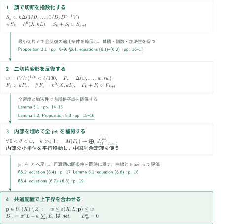
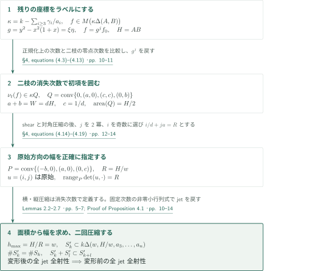
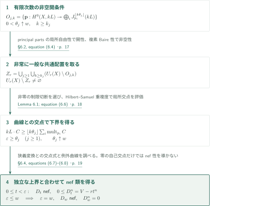

# Maximal Multipoint Seshadri Constants in Higher Dimensions

**実数切片の変形と次数間加法性から、体積上界を達成するjet分離へ**

本稿は、固定した滑らかな複素射影多様体の通常多点Seshadri定数について、点数が十分大きいすべての整数で体積上界に一致するという主張を扱う。核心は、切断の初項指数を体積を保って細長い単体へ変形し、加法性から内部の格子点を埋め、全jetの全射性を得ることである。以下は原稿の論証の紹介と接続の照合であり、証明全体の正しさを認定するものではない。

## 1. 主要結果

### Theorem 1.1 — 非常に一般な多点での最大性

$X$を次元$n\geq3$の滑らかな整複素射影多様体、$L$をample line bundle、$V=L^n$とする。相異なる順序付き点の配置空間を

$$U_r(X)=\{(p_1,\ldots,p_r)\in X^r:p_i\ne p_j\ (i\ne j)\}$$

とする。本稿の定数は、少なくとも一つの指定点を通る整曲線$C\subset X$について

$$\varepsilon(X,L;\mathbf p)=\inf_C\frac{L\cdot C}{\sum_{i=1}^r\operatorname{mult}_{p_i}C}.$$

点が$C$の外にあれば重複度は$0$である。これは通常の曲線で定義した等重み多点定数であり、分母を$r$で割る正規化も、高次元サイクルによる定数への置換も行わない。

ある整数$r_0=r_0(X,L)\geq1$が存在し、**各整数$r\geq r_0$**について、$U_r(X)$の真Zariski閉集合の可算和$Z_r$を、補集合が空でないように取れて、

$$\varepsilon(X,L;\mathbf p)=\left(\frac Vr\right)^{1/n}\qquad(\mathbf p\in U_r(X)\setminus Z_r)$$

が成り立つ、と原稿は主張する。同じ配置でのblow-up $\pi:Y\to X$と例外因子$E_i$について、これは実因子類

$$D_w=\pi^*L-w\sum_{i=1}^rE_i,\qquad w=(V/r)^{1/n}$$

がnefで$D_w^n=0$となることと同値である。単一の非空Zariski開集合上の「一般」ではなく、可算個の条件を同時に満たす「非常に一般」を用いる。$r_0$は固定した$(X,L)$に依存し、結論は$r\to\infty$での漸近等式ではなく、しきい値以降の各点数での厳密な等式である。

<!-- cite:main -->[Theorem 1.1 · pp. 1–2](https://github.com/openai/math/blob/1581d4cbdd69a0faf34b2089614fe2a814316a6a/preprints/Maximal-Multipoint-Seshadri-Constants-in-Higher-Dimensions-October-5-2026/main.pdf)<!-- /cite -->

これは$n\geq3$の定性的Nagata–Biran–Szemberg型主張である。平面の全点数$r\geq10$に対するNagata予想や、曲面・任意標数・重み付き定数についての主張をこの定理から追加しない。

## 図の矢印に付した引用

<!-- reference-guide -->
略号のない定理・補題・節・式番号は本原稿 [Maximal Multipoint Seshadri Constants in Higher Dimensions](https://github.com/openai/math/blob/1581d4cbdd69a0faf34b2089614fe2a814316a6a/preprints/Maximal-Multipoint-Seshadri-Constants-in-Higher-Dimensions-October-5-2026/main.pdf) を指します。外部入力には次の略号を使います。

- [OpenAI26b](https://github.com/openai/math/blob/1581d4cbdd69a0faf34b2089614fe2a814316a6a/preprints/Maximal-Seshadri-Constants-on-Arbitrary-Polarized-Surfaces-September-23-2026/main.pdf) OpenAI — *Maximal Seshadri constants on arbitrary polarized surfaces*：節点の指数評価・対角圧縮・原始格子方向の方法上の先行稿。本稿で再証明するため、曲面の最大性定理を直接入力にしない。September 23, 2026。

各引用に結果番号とページを付します。誌面番号とPDF内の位置が異なる場合は両方を示します。GitHubの閲覧リンクではページ位置への自動移動を前提としません。
<!-- /reference-guide -->

上記の外部文献は方法上の先行稿として区別する。主定理で必要な有限次数のjet移送、指数の圧縮、内部充填は本稿内で証明され、曲面最大性定理を前提としない。

## 2. Theorem 1.1の証明 — 指数集合から全jetへ

<!-- proof-target:1 -->証明対象：[Theorem 1.1 · pp. 1–2](https://github.com/openai/math/blob/1581d4cbdd69a0faf34b2089614fe2a814316a6a/preprints/Maximal-Multipoint-Seshadri-Constants-in-Higher-Dimensions-October-5-2026/main.pdf)<!-- /proof-target --> [仮定と全結論](#theorem-1-1)を参照する。

**証明の道筋。** 完全交叉旗から加法的指数集合を取り、二切片変形を$n-1$回反復して細長い単体を得る。加法性と漸近的な全密度から内部格子点を確保し、一変数のHermite補間で全jetを分離する。変形の機構を次節、非常に一般な配置への移行と上下界の合流を第4節で説明する。$\Delta(a_1,\ldots,a_n)=\{x\in\mathbb R^n_{\geq0}:\sum x_i/a_i\leq1\}$、$M(F)$は指数集合$F$のLaurent単項式空間とする。

### 1. 旗から体積の正しい初期単体へ

$DL$をvery ampleとし、一般の$n-1$個の切断による滑らかな整完全交叉旗を選ぶ。旗に沿って切断を順に割り、最後の曲線上で零点次数を評価すると、辞書式初項$\alpha$は

$$D\sum_{i<n}\alpha_i+\frac{\alpha_n}{D^{n-1}V}\leq k$$

を満たす。したがって$S_k\subset k\Delta(1/D,\ldots,1/D,D^{n-1}V)$、$\#S_k=h^0(X,kL)=Vk^n/n!+O(k^{n-1})$であり、初項の乗法性から$S_k+S_l\subset S_{k+l}$も保たれる。固定した次数で有限個の初項を露出する正の重みを選び、局所座標を縮小する。jet行列の非零最大小行列式の持続により、$M(S_k)$での全射性を$H^0(X,kL)$へ戻せる。重みが次数に依存しても、旗・初項順序・指数集合の加法性は固定されている。

<!-- cite:flag -->[Proposition 3.1 · pp. 8–9](https://github.com/openai/math/blob/1581d4cbdd69a0faf34b2089614fe2a814316a6a/preprints/Maximal-Multipoint-Seshadri-Constants-in-Higher-Dimensions-October-5-2026/main.pdf)<!-- /cite -->

### 2. 全点数に共通のしきい値と反復

初期単体の最小切片を$\ell>0$とする。$r\geq r_0$なら$w=(V/r)^{1/n}<\ell/100$となるように、$r$を固定する前に$r_0$を選ぶ。Proposition 4.1で二切片$(A,B)$を$(w,AB/w)$に変え、残った大きい切片を次の座標と組み合わせる。各入力は$A,B\geq\ell$であり、$w\max(3/A,2/B)\leq3w/\ell<1/16$だから毎回適用できる。積$V$を保ったまま$n-1$回で

$$P_* = \Delta(w,\ldots,w,rw),\quad F_k\subset kP_*\cap\mathbb Z^n,\quad F_k+F_l\subset F_{k+l},\quad\#F_k=h^0(X,kL)$$

を得る。点数を平方数等に限定する操作はない。

<!-- cite:iteration -->[§6.1, equations (6.1)–(6.3) · pp. 16–17](https://github.com/openai/math/blob/1581d4cbdd69a0faf34b2089614fe2a814316a6a/preprints/Maximal-Multipoint-Seshadri-Constants-in-Higher-Dimensions-October-5-2026/main.pdf)<!-- /cite -->

### 3. 密度を指定された指数に変え、補間する

$\operatorname{vol}(P_*)=V/n!$なので欠ける格子点は$o(k^n)$個である。密度だけでは特定の点の存在を保証しない。Lemma 5.1は、固定した内部コンパクト集合$K$の各$y\in kK\cap\mathbb Z^n$に対し、$k_1=\lfloor k/2\rfloor$、$k_2=k-k_1$への分解$y=y_1+y_2$を$\gg k^n$個用意する。穴に落ちる候補は$o(k^n)$個なので両方が$F_{k_i}$に入る分解が残り、加法性により$y\in F_k$となる。境界上の格子点については主張しない。

<!-- cite:saturation -->[Lemma 5.1 · pp. 14–15](https://github.com/openai/math/blob/1581d4cbdd69a0faf34b2089614fe2a814316a6a/preprints/Maximal-Multipoint-Seshadri-Constants-in-Higher-Dimensions-October-5-2026/main.pdf)<!-- /cite -->

$0<\theta<w$、$\theta/w<\lambda<1$を取り、$\lambda P_*$を内部へ平行移動する。十分大きい$k$では$F_k$がその格子点を含み、単項式による平行移動はtorus上のjet代数で単元の乗法となる。$m=\lfloor k\theta\rfloor$に対し

$$E_{r,m}=\{(\beta,b)\in\mathbb Z_{\geq0}^{n-1}\times\mathbb Z_{\geq0}:|\beta|+b/r<m+1\}$$

は$k\lambda P_*$に含まれる。相異なる$c_i\in\mathbb C^*$を取り、$(x'-1)^\alpha$の各係数に対して$(Y-c_i)^{m+1-|\alpha|}$を法とする中国剰余定理を使うと、$(1,\ldots,1,c_i)$で次数$m$までの任意の全jetを実現する。これがProposition 5.3の全射性であり、各変形を逆向きにたどって$X$上のある相異なる配置へ移せる。配置は$\theta,k$に依存してよい。

<!-- cite:interpolation -->[Lemma 5.2; Proposition 5.3 · pp. 15–16](https://github.com/openai/math/blob/1581d4cbdd69a0faf34b2089614fe2a814316a6a/preprints/Maximal-Multipoint-Seshadri-Constants-in-Higher-Dimensions-October-5-2026/main.pdf)<!-- /cite -->

## 3. Proposition 4.1の証明 — 実数の二切片を整形する

<!-- proof-target:2 -->証明対象：[Proposition 4.1 · pp. 9–10](https://github.com/openai/math/blob/1581d4cbdd69a0faf34b2089614fe2a814316a6a/preprints/Maximal-Multipoint-Seshadri-Constants-in-Higher-Dimensions-October-5-2026/main.pdf)<!-- /proof-target -->

<!-- statement:proposition-4-1 -->
### Proposition 4.1 — 二切片変形

$n\geq2$、$A,B,a_3,\ldots,a_n>0$は実数とし、すべての$k\geq1$で有限集合$S_k\subset k\Delta(A,B,a_3,\ldots,a_n)\cap\mathbb Z^n$が$S_k+S_l\subset S_{k+l}$を満たすとする。$H=AB$、$d=\max(3/A,2/B)$と置く。$dw<1/16$を満たす任意の実数$w>0$に対し、有限集合$S'_k$が存在して

$$S'_k\subset k\Delta(w,H/w,a_3,\ldots,a_n)\cap\mathbb Z^n,\quad\#S'_k=\#S_k,\quad S'_k+S'_l\subset S'_{k+l}$$

となる。さらに各$k\geq1,m\geq0,r\geq1$について、$M(S'_k)$がある相異なる$r$個のtorus点で次数$m$までのjetへ全射なら、$M(S_k)$もある相異なる$r$個のtorus点で同じ次数のjetへ全射である。配置の一致は要求しない。

<!-- cite:reshape -->[Proposition 4.1 · pp. 9–10](https://github.com/openai/math/blob/1581d4cbdd69a0faf34b2089614fe2a814316a6a/preprints/Maximal-Multipoint-Seshadri-Constants-in-Higher-Dimensions-October-5-2026/main.pdf)<!-- /cite -->
<!-- /statement -->

残りの指数$\gamma$をラベルとして固定すると、二座標の範囲は$\kappa\Delta(A,B)$、$\kappa=k-\sum_{i\geq3}\gamma_i/a_i\geq0$である。以下の操作はそのラベルを保ち、実数$\kappa$による拡大と両立する。

### 1. 節点から同面積の四角形へ

$g=y^2-x^2(1+x)$を使い、$g=\xi\eta$となる局所座標を取る。$f=g^jf_0$から節点成分を除くと、正規化$x=v^2-1,y=v(v^2-1)$上の次数は$(\kappa-jd)W$以下、$W=\max(2A,3B)=dH$である。二枝$v=\pm1$における零点次数の和により、重み$(1,t)$の最小値$\mu$は$(1+1/t)\mu\leq(\kappa-jd)W$を満たす。$g^j$の初項$(j,j)$を戻せば、初項は

$$\kappa Q,\quad Q=\operatorname{conv}\{(0,0),(a,0),(c,c),(0,b)\},\quad a=\frac{Wt}{1+t},\quad b=\frac W{1+t},\quad c=1/d$$

に入る。$t>T=d^2H$では$Q$は面積$H/2$の四角形となる。各ラベルの初項基底と積の適合性により、指数の個数と次数間加法性を保持する。

<!-- cite:node -->[§4, equations (4.3)–(4.13) · pp. 10–11](https://github.com/openai/math/blob/1581d4cbdd69a0faf34b2089614fe2a814316a6a/preprints/Maximal-Multipoint-Seshadri-Constants-in-Higher-Dimensions-October-5-2026/main.pdf)<!-- /cite -->

### 2. 原始方向を調整して幅を正確に指定する

shear $(\alpha,\beta)\mapsto(\alpha-\beta,\beta)$の後、第二座標に沿う消失次数で圧縮すると$P=\operatorname{conv}\{(-b,0),(a,0),(0,c)\}$を得る。$R=H/w$とし、$j$を$R/(2W)$以下の最大の$2$冪に選ぶ。$dw<1/16$から、区間$(d(R-jW),d(R-ja_0))$、$a_0=WT/(1+T)$の長さが$2$を超える。そこに奇数$i$を取り、$i/d+ja=R$となる$t>T$を選べば$u=(i,j)$は原始で、$\det(u,\cdot)$の$P$上の幅は正確に$R$となる。

$u$を整基底に延ばすと、その横切片長はtent型である。面積$H/2$と縦幅$R$から最大横幅は$H/R=w$。横方向、縦方向の順に圧縮すると$\Delta(w,R)$になる。切片の有理性は使わない。これは格子点を単に平行移動する操作ではなく、各行のLaurent多項式空間の$z=1$での消失次数へ置き換える操作である。

<!-- cite:direction -->[§4, equations (4.14)–(4.19) · pp. 12–14](https://github.com/openai/math/blob/1581d4cbdd69a0faf34b2089614fe2a814316a6a/preprints/Maximal-Multipoint-Seshadri-Constants-in-Higher-Dimensions-October-5-2026/main.pdf)<!-- /cite -->

### 3. 固定した支持集合と次数ごとのjet移送を分ける

初項順序・整格子変換・圧縮の消失次数は全次数で固定し、ラベル付き空間の積を保つ。一方、解析的縮小の小パラメータやtie-breakを露出する重みは、有限次数・有限配置ごとに選んでよい。導関数まで収束する有限行列の非零小行列式を使うため、残り$n-2$変数を含む全jetの全射性が逆向きに移る。この区別が、反復後の加法性と補間の両方を支える。

<!-- cite:transfer -->[Lemmas 2.2–2.7 · pp. 5–7](https://github.com/openai/math/blob/1581d4cbdd69a0faf34b2089614fe2a814316a6a/preprints/Maximal-Multipoint-Seshadri-Constants-in-Higher-Dimensions-October-5-2026/main.pdf)<!-- /cite -->

## 4. Theorem 1.1の証明 — 非常に一般な配置と上下界の合流

<!-- proof-target:3 -->証明対象：[Theorem 1.1 · pp. 1–2](https://github.com/openai/math/blob/1581d4cbdd69a0faf34b2089614fe2a814316a6a/preprints/Maximal-Multipoint-Seshadri-Constants-in-Higher-Dimensions-October-5-2026/main.pdf)<!-- /proof-target --> [主定理](#theorem-1-1)の等式・nef性・零の自己交点をここで結ぶ。

### 1. 特殊配置での存在から共通の非常に一般な配置へ

固定した整数$k,m$でのjet全射性は、$X$が滑らかなため局所自由なprincipal parts束への写像の最大小行列式で定義されるZariski開条件である。$\theta_j\uparrow w$を選び、各$j$で全$k\geq k_j$について非空開集合$O_{j,k}\subset U_r(X)$を得る。$Z_r=\bigcup_j\bigcup_{k\geq k_j}(U_r(X)\setminus O_{j,k})$を除く。$U_r(X)(\mathbb C)$は局所コンパクトHausdorffでBaire空間、各真代数的閉集合は複素位相で内部を持たないため、補集合は非空である。構成した特殊なtorus配置そのものを一般配置と呼ぶのではなく、非零rank条件と可算交叉によって移している。

<!-- cite:locus -->[§6.2, equation (6.4) · p. 17](https://github.com/openai/math/blob/1581d4cbdd69a0faf34b2089614fe2a814316a6a/preprints/Maximal-Multipoint-Seshadri-Constants-in-Higher-Dimensions-October-5-2026/main.pdf)<!-- /cite -->

### 2. 全jetから通常の重複度による下界へ

Lemma 6.1では、$A$の次数$m\geq1$までの全jet分離から、すべての整曲線$C$に対して$A\cdot C\geq m\sum_i\operatorname{mult}_{p_i}C$を得る。ある指定点上で$\mathfrak m_C^m/\mathfrak m_C^{m+1}$の非零元をjetに持ち上げ、他の指定点で零jetを処方することで、$C$に恒等的には消えない切断を選ぶ。特異曲線でも、非零$f\in\mathfrak m_C^m$について

$$q\,\operatorname{length}(\mathcal O_C/(f))=\operatorname{length}(\mathcal O_C/(f^q))\geq mq\,e(\mathcal O_C)+O(1)$$

から局所交点数が$m$倍の通常のHilbert–Samuel重複度以上となる。$A=kL$、$m=\lfloor k\theta_j\rfloor$として、まず$k\to\infty$、次に$j\to\infty$とすれば$\varepsilon\geq w$を得る。

<!-- cite:lower -->[Lemma 6.1; equation (6.6) · p. 18](https://github.com/openai/math/blob/1581d4cbdd69a0faf34b2089614fe2a814316a6a/preprints/Maximal-Multipoint-Seshadri-Constants-in-Higher-Dimensions-October-5-2026/main.pdf)<!-- /cite -->

### 3. blow-upの上界とnef類の結論

任意の相異なる配置で$D_t=\pi^*L-t\sum E_i$とする。例外因子内の曲線には$D_t|_{E_i}=t\mathcal O_{\mathbb P^{n-1}}(1)$が非負で、他の曲線$\Gamma$は$C\subset X$の狭義変換だから

$$D_t\cdot\Gamma=L\cdot C-t\sum_i\operatorname{mult}_{p_i}C.$$

原典は特異な$C$でも$E_i\cdot\Gamma=\operatorname{mult}_{p_i}C$となることを、最大イデアルのblow-upとその例外ファイバーのHilbert–Samuel重複度で説明する。したがって$0\leq t<\varepsilon$なら$D_t$はnefであり、

$$0\leq D_t^n=V-rt^n$$

から全配置で$\varepsilon\leq w$を得る。第2段階の下界と合わせて等号になる。その下界を各曲線の式に戻せば$D_w$がnef、交点計算から$D_w^n=0$である。逆に$D_w$のnef性は各狭義変換との交点から$\varepsilon\geq w$を与えるので、上界と合わせて同値性が従う。零の自己交点だけからnef性を推論してはいない。

<!-- cite:upper -->[§6.4, equations (6.7)–(6.8) · p. 19](https://github.com/openai/math/blob/1581d4cbdd69a0faf34b2089614fe2a814316a6a/preprints/Maximal-Multipoint-Seshadri-Constants-in-Higher-Dimensions-October-5-2026/main.pdf)<!-- /cite -->

## 5. どの論文が、どの段階を担うか

本稿は曲面稿の方法を拡張するが、その最大性定理への直接依存ではない。曲面稿の有限torus群でのjetの**単射性**に対し、本稿は多項式空間を変形して全次元のjetの**全射性**を作る。原典§1.1は、必要な適応版を本稿内で証明すると明記する。

<!-- cite:relation -->[§1.1; §4 · pp. 2, 9](https://github.com/openai/math/blob/1581d4cbdd69a0faf34b2089614fe2a814316a6a/preprints/Maximal-Multipoint-Seshadri-Constants-in-Higher-Dimensions-October-5-2026/main.pdf)<!-- /cite -->

| 供給元・結果 | 本稿の箇所 | 関係と使用内容 | 確認範囲 |
|---|---|---|---|
| 曲面稿 Proposition 3.2 | Proposition 4.1、pp. 10–11 | 方法上の一般化：節点二枝の評価をラベル付き二変数多項式へ | 先行主張と本稿の適応証明を照合 |
| 曲面稿 Proposition 3.4 | Proposition 4.1、p. 12 | 方法上の一般化：対角sliceを圧縮 | 単射性と全射性の違いを区別 |
| 曲面稿 Lemma 4.3 | Proposition 4.1、pp. 12–14 | 方法上の一般化：原始方向を連続調整し実数幅を得る | しきい値と方向選択の記述を照合 |

<!-- cite:surface-node -->[&#91;OpenAI26b, Proposition 3.2, p. 8&#93;](https://github.com/openai/math/blob/1581d4cbdd69a0faf34b2089614fe2a814316a6a/preprints/Maximal-Seshadri-Constants-on-Arbitrary-Polarized-Surfaces-September-23-2026/main.pdf)<!-- /cite --> · <!-- cite:surface-compression -->[&#91;OpenAI26b, Proposition 3.4, pp. 9–10&#93;](https://github.com/openai/math/blob/1581d4cbdd69a0faf34b2089614fe2a814316a6a/preprints/Maximal-Seshadri-Constants-on-Arbitrary-Polarized-Surfaces-September-23-2026/main.pdf)<!-- /cite --> · <!-- cite:surface-direction -->[&#91;OpenAI26b, Lemma 4.3, p. 14&#93;](https://github.com/openai/math/blob/1581d4cbdd69a0faf34b2089614fe2a814316a6a/preprints/Maximal-Seshadri-Constants-on-Arbitrary-Polarized-Surfaces-September-23-2026/main.pdf)<!-- /cite -->

Nagata、Biran、Küchle、Roé–Ross等は背景として引用されるが、この概説の証明矢印には置かない。Demailly、Ito、Okounkov体・半群理論、Dumnickiの先行結果も本稿の動機付け・方法の文脈であり、ここで説明した接続は本稿内の補題で追っている。これらの外部証明全体と未掲載のカタログ間接続は未調査である。

## 6. 原典を読む入口と確認範囲

<!-- reading-list -->
- [Theorem 1.1 · pp. 1–2](https://github.com/openai/math/blob/1581d4cbdd69a0faf34b2089614fe2a814316a6a/preprints/Maximal-Multipoint-Seshadri-Constants-in-Higher-Dimensions-October-5-2026/main.pdf) — 量化、基礎体、通常多点定数とnef因子の結論。
- [Proof of Proposition 4.1 · pp. 10–14](https://github.com/openai/math/blob/1581d4cbdd69a0faf34b2089614fe2a814316a6a/preprints/Maximal-Multipoint-Seshadri-Constants-in-Higher-Dimensions-October-5-2026/main.pdf) — 実数切片を許す節点・圧縮・原始方向の核心。
- [Lemma 5.1 · pp. 14–15](https://github.com/openai/math/blob/1581d4cbdd69a0faf34b2089614fe2a814316a6a/preprints/Maximal-Multipoint-Seshadri-Constants-in-Higher-Dimensions-October-5-2026/main.pdf) — 密度だけでなく次数間加法性が内部点を埋める理由。
- [Lemma 5.2; Proposition 5.3 · pp. 15–16](https://github.com/openai/math/blob/1581d4cbdd69a0faf34b2089614fe2a814316a6a/preprints/Maximal-Multipoint-Seshadri-Constants-in-Higher-Dimensions-October-5-2026/main.pdf) — 細長い単体での全jet補間と内側への平行移動。
- [§6.2, equation (6.4) · p. 17](https://github.com/openai/math/blob/1581d4cbdd69a0faf34b2089614fe2a814316a6a/preprints/Maximal-Multipoint-Seshadri-Constants-in-Higher-Dimensions-October-5-2026/main.pdf) — 有限次数の存在から共通の非常に一般な配置へ。
- [Lemma 6.1; equation (6.6) · p. 18](https://github.com/openai/math/blob/1581d4cbdd69a0faf34b2089614fe2a814316a6a/preprints/Maximal-Multipoint-Seshadri-Constants-in-Higher-Dimensions-October-5-2026/main.pdf) — 特異な曲線上でも通常の重複度を用いる下界。
- [§6.4, equations (6.7)–(6.8) · p. 19](https://github.com/openai/math/blob/1581d4cbdd69a0faf34b2089614fe2a814316a6a/preprints/Maximal-Multipoint-Seshadri-Constants-in-Higher-Dimensions-October-5-2026/main.pdf) — blow-upによる上界とnefnessの同値。
<!-- /reading-list -->

編集側では、Theorem 1.1の全結論と量化、§§2–6の主要証明本文、曲面稿の上記3結果の記述と本稿の参照箇所を照合した。完全交叉旗、二切片変形、内部充填、補間、可算共通配置、曲線の重複度、blow-upの上下界を追った。外部歴史的結果の証明の再帰的検証、専門家査読、形式検証は行っていない。原稿の定理紹介と、この限定された照合を区別する。
