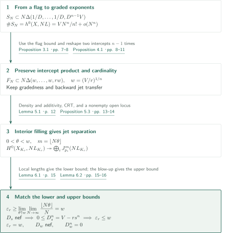
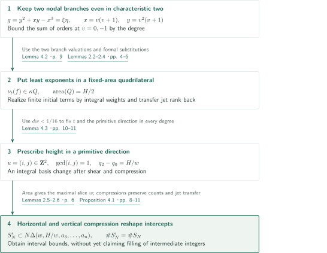
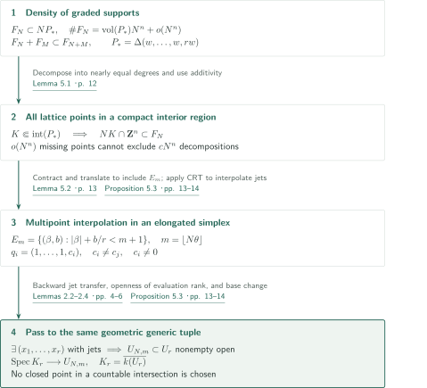

# Maximal multipoint Seshadri constants in positive characteristic

**Formal jet transfer and lattice filling attain the volume bound at a geometric generic tuple**

The manuscript claims that the ordinary, equally weighted multipoint Seshadri constant on a smooth polarized projective variety in positive characteristic is maximal for every sufficiently large point count. It turns the section ring into graded exponent sets, reshapes two intercepts using a node, and constructs the lower bound by interpolation. The tuple is geometric generic; no choice of very general closed points over a countable field is required.

## 1. Main results

### Theorem 1.1 — Maximality at the geometric generic tuple

Let $k$ be algebraically closed of characteristic $p>0$, let $X/k$ be smooth, integral and projective of dimension $n\geq3$, and let $L$ be ample. Let $U_r\subset X^r$ be the configuration space of ordered distinct points, put $K_r=\overline{k(U_r)}$, and let $p_1,\ldots,p_r\in X(K_r)$ be the points defined by its geometric generic point. The constant is

$$
\varepsilon_r(X,L)=\inf_C\frac{L_{K_r}\cdot C}{\sum_{i=1}^r\operatorname{mult}_{p_i}C},
$$

where $C$ ranges over integral curves meeting at least one marked point; multiplicity outside $C$ is zero. All weights are one. There is no division by $r$ in the denominator and no replacement of curves by higher-dimensional cycles.

The authors assert that an integer $r_0=r_0(X,L)$ exists such that **every integer $r\geq r_0$** satisfies

$$
\varepsilon_r(X,L)=\left(\frac{L^n}{r}\right)^{1/n}.
$$

Remark 6.3 gives the same conclusion for $n=2$. This does not assert maximality for every point count below $r_0$, or for arbitrary tuples of $k$-rational points.

<!-- cite:main -->[Theorem 1.1 · pp. 1–2](https://github.com/openai/math/blob/1581d4cbdd69a0faf34b2089614fe2a814316a6a/preprints/Maximal-multipoint-Seshadri-constants-in-positive-characteristic-October-5-2026/seshadri-positive-characteristic.pdf)<!-- /cite -->

<!-- cite:surfaces -->[Remark 6.3 · p. 16](https://github.com/openai/math/blob/1581d4cbdd69a0faf34b2089614fe2a814316a6a/preprints/Maximal-multipoint-Seshadri-constants-in-positive-characteristic-October-5-2026/seshadri-positive-characteristic.pdf)<!-- /cite -->

## References on the arrows

<!-- reference-guide -->
Unprefixed theorem, lemma, section and equation numbers refer to [Maximal multipoint Seshadri constants in positive characteristic](https://github.com/openai/math/blob/1581d4cbdd69a0faf34b2089614fe2a814316a6a/preprints/Maximal-multipoint-Seshadri-constants-in-positive-characteristic-October-5-2026/seshadri-positive-characteristic.pdf). External inputs use the following keys.

- [Stacks0H90](https://stacks.math.columbia.edu/tag/0H90) The Stacks Project Authors — *The Stacks Project — Lemma 10.133.9 (Tag 0H90)*: Principal parts via the diagonal ideal. Used at §2 p4, Lemma 2.4 pp5–6. HTML, accessed 2026-10-15; unpaginated.
- [Stacks0H8Z](https://stacks.math.columbia.edu/tag/0H8Z) The Stacks Project Authors — *The Stacks Project — Lemma 10.133.8 (Tag 0H8Z)*: Base change for principal parts. Used at §2 p4, Proposition 5.3 p14. HTML, accessed 2026-10-15; unpaginated.
- [Stacks0FD6](https://stacks.math.columbia.edu/tag/0FD6) The Stacks Project Authors — *The Stacks Project — Lemma 33.47.3 (Tag 0FD6)*: Smoothness of general hyperplane sections of an embedding. Used at Proposition 3.1 p7. HTML, accessed 2026-10-15; unpaginated.
- [Stacks0G4G](https://stacks.math.columbia.edu/tag/0G4G) The Stacks Project Authors — *The Stacks Project — Remark 37.32.4 (Tag 0G4G)*: Smooth irreducible hyperplane sections in dimension at least two. Used at Proposition 3.1 p7. HTML, accessed 2026-10-15; unpaginated.
- [Stacks0AZV](https://stacks.math.columbia.edu/tag/0AZV) The Stacks Project Authors — *The Stacks Project — Definition 43.15.1 (Tag 0AZV)*: Hilbert–Samuel multiplicity as the leading coefficient of length. Used at Lemma 6.1 p15; Lemma 6.2 p16. HTML, accessed 2026-10-15; unpaginated.
- [OpenAI26b](https://github.com/openai/math/blob/1581d4cbdd69a0faf34b2089614fe2a814316a6a/preprints/Maximal-Seshadri-Constants-on-Arbitrary-Polarized-Surfaces-September-23-2026/main.pdf) OpenAI — *Maximal Seshadri constants on arbitrary polarized surfaces*: Methodological background; required statements are reproved here rather than importing its main theorem. 2026-09-23.
- [OpenAI26c](https://github.com/openai/math/blob/1581d4cbdd69a0faf34b2089614fe2a814316a6a/preprints/Maximal-Multipoint-Seshadri-Constants-in-Higher-Dimensions-October-5-2026/main.pdf) OpenAI — *Maximal Multipoint Seshadri Constants in Higher Dimensions*: Methodological background; required statements are reproved here rather than importing its main theorem. 2026-10-05.

Each citation gives the result and pages. When printed pagination differs from the PDF position, both are shown. GitHub previews do not automatically jump to the cited page.
<!-- /reference-guide -->

The Stacks references are unpaginated HTML statements identified by their tags and result names. The diagrams cite statements reproved in this manuscript. The surface and higher-dimensional companions are methodological sources; their maximality theorems are not premises of this proof.

## 2. Theorem 1.1 — Proof overview of the main theorem

<!-- proof-target:1 -->Proof target：[Theorem 1.1 · pp. 1–2](https://github.com/openai/math/blob/1581d4cbdd69a0faf34b2089614fe2a814316a6a/preprints/Maximal-multipoint-Seshadri-constants-in-positive-characteristic-October-5-2026/seshadri-positive-characteristic.pdf)<!-- /proof-target -->

**Proof route.** The lower bound in [Theorem 1.1](#theorem-1-1) passes through a flag, [two-intercept reshaping](#proof-1), and [interior filling and interpolation](#proof-2). Put $V=L^n$ and $w=(V/r)^{1/n}$. Intersection theory on the blow-up supplies a separate upper bound.

### 1. Reshape intercepts while keeping one graded structure

Choose $D$ with $DL$ very ample and a smooth complete-intersection flag. At each Bertini step the variety being cut has dimension at least two, and the morphism induced by $DL$ is an embedding. Lexicographically least exponents in adapted coordinates give

$$
S_N\subset N\Delta(1/D,\ldots,1/D,D^{n-1}V),\qquad
S_N+S_M\subset S_{N+M},\qquad
\#S_N=h^0(X,NL)=\frac{V}{n!}N^n+o(N^n).
$$

Here $\Delta(a_1,\ldots,a_n)=\{x_i\geq0:\sum_i x_i/a_i\leq1\}$. The containment follows by successively dividing by flag equations and then bounding the final vanishing order by the degree of a zero divisor on the terminal curve. Apply Proposition 4.1 $n-1$ times, preserving the product of intercepts and the cardinality in each degree, to reach $\Delta(w,\ldots,w,rw)$. At every stage, jet separation after transformation transfers back to the preceding space.

<!-- cite:flag -->[Proposition 3.1 · pp. 7–8](https://github.com/openai/math/blob/1581d4cbdd69a0faf34b2089614fe2a814316a6a/preprints/Maximal-multipoint-Seshadri-constants-in-positive-characteristic-October-5-2026/seshadri-positive-characteristic.pdf)<!-- /cite -->

<!-- cite:reshape -->[Proposition 4.1 · pp. 8–11](https://github.com/openai/math/blob/1581d4cbdd69a0faf34b2089614fe2a814316a6a/preprints/Maximal-multipoint-Seshadri-constants-in-positive-characteristic-October-5-2026/seshadri-positive-characteristic.pdf)<!-- /cite -->

### 2. A lower bound from jets and a separate volume upper bound

For each fixed $0<\theta<w$, Proposition 5.3 supplies jets through order $\lfloor N\theta\rfloor$ at the geometric generic tuple for every sufficiently large $N$. In Lemma 6.1 one prescribes a nonzero class in $\mathfrak m^m/\mathfrak m^{m+1}$ of one curve local ring, and zero jets at the other points. The resulting section vanishes to order at least $m$ at every marked point while remaining nonzero on the curve. The local inequality $\operatorname{length}(R/(f))\geq m e(R)$ then gives, including for singular integral curves,

$$
NL_{K_r}\cdot C\geq\lfloor N\theta\rfloor\sum_i\operatorname{mult}_{p_i}C.
$$

Let $N\to\infty$ and then $\theta\uparrow w$ to obtain $\varepsilon_r\geq w$.

Separately, for rational $0\leq s<\varepsilon_r$, consider $D_s=\pi^*L_{K_r}-s\sum E_i$ on the blow-up. Curves inside $E_i$ are handled by $D_s|_{E_i}=s\mathcal O_{\mathbf P^{n-1}}(1)$; other curves by $E_i\cdot\widetilde C=\operatorname{mult}_{p_i}C$. Thus $D_s$ is nef and $0\leq D_s^n=V-rs^n$, giving $\varepsilon_r\leq w$. The upper bound alone does not establish maximality: it must meet the lower bound constructed from jets.

<!-- cite:jets -->[Proposition 5.3 · pp. 13–14](https://github.com/openai/math/blob/1581d4cbdd69a0faf34b2089614fe2a814316a6a/preprints/Maximal-multipoint-Seshadri-constants-in-positive-characteristic-October-5-2026/seshadri-positive-characteristic.pdf)<!-- /cite -->

<!-- cite:curve -->[Lemma 6.1 · p. 15](https://github.com/openai/math/blob/1581d4cbdd69a0faf34b2089614fe2a814316a6a/preprints/Maximal-multipoint-Seshadri-constants-in-positive-characteristic-October-5-2026/seshadri-positive-characteristic.pdf)<!-- /cite -->

<!-- cite:volume -->[Lemma 6.2 · pp. 15–16](https://github.com/openai/math/blob/1581d4cbdd69a0faf34b2089614fe2a814316a6a/preprints/Maximal-multipoint-Seshadri-constants-in-positive-characteristic-October-5-2026/seshadri-positive-characteristic.pdf)<!-- /cite -->

### 3. The boundary class and dimension two

Closedness of the nef cone and equality of the bounds imply that $D_w$ is nef with $D_w^n=0$. This connection uses the curve definition and the blow-up intersection calculation, rather than only a numerical correspondence. Remark 6.3 observes that the flag, reshaping, interpolation and intersection arguments all apply when $n=2$, with only one reshaping step. Strict positivity on every curve is not asserted here.

<!-- cite:finish -->[Proof of Theorem 1.1; Remark 6.3 · p. 16](https://github.com/openai/math/blob/1581d4cbdd69a0faf34b2089614fe2a814316a6a/preprints/Maximal-multipoint-Seshadri-constants-in-positive-characteristic-October-5-2026/seshadri-positive-characteristic.pdf)<!-- /cite -->

## 3. Proposition 4.1 — Two-intercept reshaping through a node

<!-- proof-target:2 -->Proof target：[Proposition 4.1 · pp. 8–11](https://github.com/openai/math/blob/1581d4cbdd69a0faf34b2089614fe2a814316a6a/preprints/Maximal-multipoint-Seshadri-constants-in-positive-characteristic-October-5-2026/seshadri-positive-characteristic.pdf)<!-- /proof-target -->

<!-- statement:proposition-4-1 -->
### Proposition 4.1 — Preserve cardinality, products and jet transfer

Let $n\geq2$, let $A,B,a_3,\ldots,a_n>0$, and let a graded family of finite sets $S_N\subset\mathbf Z^n$ satisfy $S_N\subset N\Delta(A,B,a_3,\ldots,a_n)$. Put $H=AB$ and $d=\max\{3/A,2/B\}$. For every $w>0$ with $dw<1/16$, there is a graded family $S'_N$ such that

$$
S'_N\subset N\Delta(w,H/w,a_3,\ldots,a_n),\qquad\#S'_N=\#S_N,
$$

and the transformation has backward jet transfer in every degree. This means that separation of order-$m$ jets by $M(S'_N)$ at some $r$ distinct torus points implies the same separation by $M(S_N)$ at some tuple. Here $M(S)$ is the span of Laurent monomials with exponents in $S$. For $n=2$ there are no remaining intercepts.

<!-- cite:reshape -->[Proposition 4.1 · pp. 8–11](https://github.com/openai/math/blob/1581d4cbdd69a0faf34b2089614fe2a814316a6a/preprints/Maximal-multipoint-Seshadri-constants-in-positive-characteristic-October-5-2026/seshadri-positive-characteristic.pdf)<!-- /cite -->
<!-- /statement -->

### 1. Bound exponents using the two branches

Use $g=y^2+xy-x^3$. Hensel lifting the simple roots $0,-1$ of $Z^2+Z-x$ gives formal coordinates with $g=\xi\eta$. The roots remain distinct when $p=2$, since $-1=1\ne0$. Under $x=v(v+1),\ y=v^2(v+1)$, the sum of the orders at $v=0,-1$ of a factor not divisible by $g$ is bounded by its degree. Consequently its least exponent for the order $(\alpha+t\beta,\beta)$ lies in a quadrilateral $Q$ of area $H/2$.

Formal coordinates alone do not transfer interpolation. Lemma 2.3 chooses common integral weights realizing the finitely many initial terms in each degree. Lemma 2.4 substitutes $z_a=s^{\lambda_a}(Q_a+\delta_a)$ into truncated jet rings. After column normalization, the evaluation matrix specializes at $s=0$ to the monomial matrix. A nonzero maximal minor remains nonzero over $k((s))$. Setting $\delta=0$ defines actual $k((s))$-points, and the substitution factors through their order-$m$ jet algebras. Surjectivity of the matrix and equality of dimensions make these algebra maps isomorphisms. Repeated centers would contradict surjectivity, so separation occurs at distinct points and the corresponding open locus is nonempty. The auxiliary weights may depend on the degree, but the formal coordinates and monomial order defining the graded family stay fixed.

<!-- cite:node -->[Lemma 4.2 · p. 9](https://github.com/openai/math/blob/1581d4cbdd69a0faf34b2089614fe2a814316a6a/preprints/Maximal-multipoint-Seshadri-constants-in-positive-characteristic-October-5-2026/seshadri-positive-characteristic.pdf)<!-- /cite -->

<!-- cite:formal -->[Lemmas 2.2–2.4 · pp. 4–6](https://github.com/openai/math/blob/1581d4cbdd69a0faf34b2089614fe2a814316a6a/preprints/Maximal-multipoint-Seshadri-constants-in-positive-characteristic-October-5-2026/seshadri-positive-characteristic.pdf)<!-- /cite -->

### 2. Fix the primitive direction and compressions in every degree

A shear and compression turn $Q$ into a triangle of the same area. Lemma 4.3 chooses $t$ and a primitive vector $u=(i,j)$ so that the height range under $z\mapsto\det(u,z)$ is exactly $H/w$. Choosing $j$ as a power of two and $i$ as an odd integer in a suitable open interval provides both primitivity and the required real intercept. After an integral basis change, horizontal and vertical compressions give the bounding triangle $\Delta(w,H/w)$. The other coordinates remain labels.

Compression does not fill every integer in a slice. In characteristic $p$, the orders of $\langle1,z^p\rangle$ at $z=1$ are $0,p$, leaving gaps. Lemma 2.6 preserves the interval bound, cardinality, gradedness and backward transfer. Filling every interior lattice point requires the separate argument in the next section.

<!-- cite:height -->[Lemma 4.3 · pp. 10–11](https://github.com/openai/math/blob/1581d4cbdd69a0faf34b2089614fe2a814316a6a/preprints/Maximal-multipoint-Seshadri-constants-in-positive-characteristic-October-5-2026/seshadri-positive-characteristic.pdf)<!-- /cite -->

<!-- cite:compression -->[Lemmas 2.5–2.6 · p. 6](https://github.com/openai/math/blob/1581d4cbdd69a0faf34b2089614fe2a814316a6a/preprints/Maximal-multipoint-Seshadri-constants-in-positive-characteristic-October-5-2026/seshadri-positive-characteristic.pdf)<!-- /cite -->

## 4. Proposition 5.3 — From interior filling to geometric generic jets

<!-- proof-target:3 -->Proof target：[Proposition 5.3 · pp. 13–14](https://github.com/openai/math/blob/1581d4cbdd69a0faf34b2089614fe2a814316a6a/preprints/Maximal-multipoint-Seshadri-constants-in-positive-characteristic-October-5-2026/seshadri-positive-characteristic.pdf)<!-- /proof-target -->

<!-- statement:proposition-5-3 -->
### Proposition 5.3 — Jets at the geometric generic tuple

Let $k$ be algebraically closed of positive characteristic, let $X/k$ be smooth, integral and projective of dimension $n\geq2$, let $L$ be ample, and put $V=L^n$. There is $r_0(X,L)$ such that for each integer $r\geq r_0$ and real $0<\theta<(V/r)^{1/n}$ there is $N_0(r,\theta)$ with the following property. For every $N\geq N_0$, $H^0(X,NL)$ separates jets through order $\lfloor N\theta\rfloor$ at some $r$ distinct $k$-points, possibly depending on $N$. After base change to $K_r$, the same separation holds at the fixed geometric generic tuple $p_1,\ldots,p_r$.

<!-- cite:jets -->[Proposition 5.3 · pp. 13–14](https://github.com/openai/math/blob/1581d4cbdd69a0faf34b2089614fe2a814316a6a/preprints/Maximal-multipoint-Seshadri-constants-in-positive-characteristic-October-5-2026/seshadri-positive-characteristic.pdf)<!-- /cite -->
<!-- /statement -->

### 1. Turn density into the presence of individual lattice points

Let $\ell$ be the smallest initial intercept and choose $r_0$ so that $w<\ell/100$. At each reshaping step the processed intercepts $A,B$ are at least $\ell$, hence $w\max(3/A,2/B)<1/16$. The final family $F_N$ lies in $P_* =\Delta(w,\ldots,w,rw)$ and has $\#F_N=\operatorname{vol}(P_*)N^n+o(N^n)$.

Lemma 5.1 combines this density with additivity. Each lattice point $y$ in a fixed compact interior region has at least $cN^n$ decompositions $y=y_1+y_2$ in nearly equal degrees. Missing lattice points exclude only $o(N^n)$ decompositions. One remains with both summands in the family, so $y\in F_N$. Density alone is not being identified with pointwise filling.

<!-- cite:filling -->[Lemma 5.1 · p. 12](https://github.com/openai/math/blob/1581d4cbdd69a0faf34b2089614fe2a814316a6a/preprints/Maximal-multipoint-Seshadri-constants-in-positive-characteristic-October-5-2026/seshadri-positive-characteristic.pdf)<!-- /cite -->

### 2. Interpolate in the elongated simplex and transfer to a nonempty open set

For $m=\lfloor N\theta\rfloor$, set

$$
E_m=\{(\beta,b)\in\mathbf Z_{\geq0}^{n-1}\times\mathbf Z_{\geq0}:|\beta|+b/r<m+1\}.
$$

Choose distinct nonzero $c_i\in k$ and express arbitrary jets at $q_i=(1,\ldots,1,c_i)$ as a sum of terms $(x'-1)^\alpha h_\alpha(Y)$. The Chinese remainder theorem supplies $h_\alpha$ with $\deg h_\alpha<r(m-|\alpha|+1)$, so all monomials lie in $E_m$. Neither factorials nor ordinary derivatives are required.

Choose $\theta/w<\lambda<1$ and a small positive vector $v$ such that $v+\lambda P_*\subset\operatorname{int}P_*$. An integral translate puts $E_m$ inside the filled region; multiplication by a Laurent monomial is a unit on the torus and preserves jet separation. Backward transfer returns to some tuple on $X$. For fixed $r,\theta,N$, surjectivity of evaluation into the principal-parts bundles is an open rank condition on $U_r$.

<!-- cite:crt -->[Lemma 5.2 · p. 13](https://github.com/openai/math/blob/1581d4cbdd69a0faf34b2089614fe2a814316a6a/preprints/Maximal-multipoint-Seshadri-constants-in-positive-characteristic-October-5-2026/seshadri-positive-characteristic.pdf)<!-- /cite -->

<!-- cite:jets -->[Proposition 5.3 · pp. 13–14](https://github.com/openai/math/blob/1581d4cbdd69a0faf34b2089614fe2a814316a6a/preprints/Maximal-multipoint-Seshadri-constants-in-positive-characteristic-October-5-2026/seshadri-positive-characteristic.pdf)<!-- /cite -->

### 3. Impose every condition at the same geometric generic tuple

The generic point of integral $U_r$ belongs to each nonempty open locus, and base change for principal parts respects jet evaluation. Thus the same $K_r$-tuple satisfies all required separations. No $k$-point needs to be chosen in a countable intersection of open sets, so countable algebraically closed fields are included. This conclusion must not be replaced by a statement for arbitrary general closed points over $k$.

<!-- cite:jets -->[Proposition 5.3 · pp. 13–14](https://github.com/openai/math/blob/1581d4cbdd69a0faf34b2089614fe2a814316a6a/preprints/Maximal-multipoint-Seshadri-constants-in-positive-characteristic-October-5-2026/seshadri-positive-characteristic.pdf)<!-- /cite -->

## 5. Which papers supply which steps

| Source | Used at | Role and hypotheses | Checking scope |
|---|---|---|---|
| Stacks 0FD6 / 0G4G (reference guide above) | Proposition 3.1, pp.7–8 | An embedding and dimension at least two give a smooth integral flag | Statements and application conditions checked |
| Stacks 0H90 / 0H8Z | §2 p.4; Proposition 5.3 p.14 | Principal parts, base change and the open evaluation condition | Statements and use checked; local freeness also uses smoothness and the symmetric-power filtration stated in the manuscript |
| Stacks 0AZV | Lemma 6.1 p.15 | Multiplicity as the leading coefficient of local length | Definition and the manuscript's local-length calculation checked |
| Surface and higher-dimensional companions | §1.1 p.2; §4 p.8 | Methodological sources for nodes, graded supports and reshaping | No direct dependence on their main theorems; the required results are reproved here |

## 6. Return to the sources

<!-- reading-list -->
- [Lemmas 2.2–2.4 · pp. 4–6](https://github.com/openai/math/blob/1581d4cbdd69a0faf34b2089614fe2a814316a6a/preprints/Maximal-multipoint-Seshadri-constants-in-positive-characteristic-October-5-2026/seshadri-positive-characteristic.pdf) — Transfer from formal substitutions to jet separation.
- [Proposition 4.1 · pp. 8–11](https://github.com/openai/math/blob/1581d4cbdd69a0faf34b2089614fe2a814316a6a/preprints/Maximal-multipoint-Seshadri-constants-in-positive-characteristic-October-5-2026/seshadri-positive-characteristic.pdf) — Node, primitive lattice direction, and compressions.
- [Proposition 5.3 · pp. 13–14](https://github.com/openai/math/blob/1581d4cbdd69a0faf34b2089614fe2a814316a6a/preprints/Maximal-multipoint-Seshadri-constants-in-positive-characteristic-October-5-2026/seshadri-positive-characteristic.pdf) — From density to all interior lattice points, then to geometric generic jets.
- [Proof of Theorem 1.1; Remark 6.3 · p. 16](https://github.com/openai/math/blob/1581d4cbdd69a0faf34b2089614fe2a814316a6a/preprints/Maximal-multipoint-Seshadri-constants-in-positive-characteristic-October-5-2026/seshadri-positive-characteristic.pdf) — Matching bounds and the dimension-two extension.
<!-- /reading-list -->

The editorial reading covered the proof passages in §§2–6: formal transfer, the two nodal branches, primitive lattice directions, interior filling, interpolation, passage to the generic tuple, and matching bounds. The Stacks statements and their application conditions were checked. This is not a recursive verification of their proofs, expert peer review, or formal verification. A complete independent verification of the construction in all degrees and an exhaustive investigation of connections with other catalogues were not performed. The authors' maximality claim remains distinct from this editorial checking scope.
