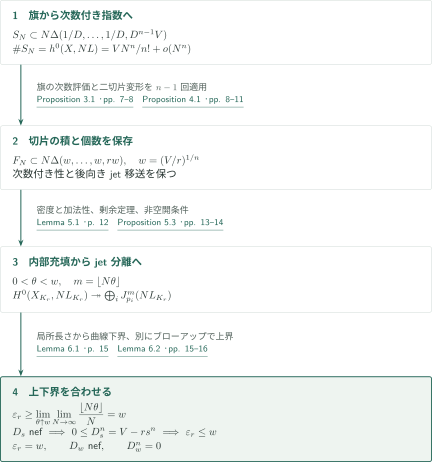
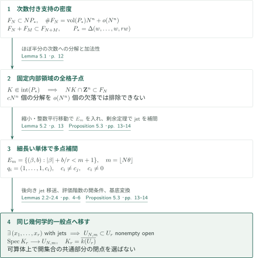

# Maximal multipoint Seshadri constants in positive characteristic

**形式的jet移送と格子点の充填から、幾何学的一般点で体積上界へ**

本原稿は、正標数の滑らかな射影多様体上で通常の等重み多点Seshadri定数が、十分大きいすべての点数で体積上界に等しいと主張する。切断環を次数付き指数集合に移し、節点による二切片変形と補間を経て下界を作る。点配置は幾何学的一般点で固定し、可算体上で「非常に一般な閉点」を選ぶ議論は用いない。

## 1. 主要結果

### Theorem 1.1 — 幾何学的一般点における最大性

$k$を標数$p>0$の代数閉体、$X/k$を次元$n\geq3$の滑らかな整射影多様体、$L$を豊富な直線束とする。順序付き相異点の配置空間を$U_r\subset X^r$、$K_r=\overline{k(U_r)}$とし、その幾何学的一般点が定める点を$p_1,\ldots,p_r\in X(K_r)$とする。本稿の定数は

$$
\varepsilon_r(X,L)=\inf_C\frac{L_{K_r}\cdot C}{\sum_{i=1}^r\operatorname{mult}_{p_i}C},
$$

である。$C$は少なくとも一つの$p_i$を通る整曲線を動き、通らない点での重複度は0とする。重みはすべて1で、$r$による平均化も高次元サイクルへの置換もしない。

ある整数$r_0=r_0(X,L)$が存在し、**すべての整数$r\geq r_0$**について

$$
\varepsilon_r(X,L)=\left(\frac{L^n}{r}\right)^{1/n}
$$

が成り立つ、というのが著者の主張である。$n=2$にも同じ結論が成り立つことをRemark 6.3が述べる。$r_0$未満の全点数や、任意の$k$-有理点配置を対象とした結論ではない。

<!-- cite:main -->[Theorem 1.1 · pp. 1–2](https://github.com/openai/math/blob/1581d4cbdd69a0faf34b2089614fe2a814316a6a/preprints/Maximal-multipoint-Seshadri-constants-in-positive-characteristic-October-5-2026/seshadri-positive-characteristic.pdf)<!-- /cite -->

<!-- cite:surfaces -->[Remark 6.3 · p. 16](https://github.com/openai/math/blob/1581d4cbdd69a0faf34b2089614fe2a814316a6a/preprints/Maximal-multipoint-Seshadri-constants-in-positive-characteristic-October-5-2026/seshadri-positive-characteristic.pdf)<!-- /cite -->

## 図の矢印に付した引用

<!-- reference-guide -->
略号のない定理・補題・節・式番号は本原稿 [Maximal multipoint Seshadri constants in positive characteristic](https://github.com/openai/math/blob/1581d4cbdd69a0faf34b2089614fe2a814316a6a/preprints/Maximal-multipoint-Seshadri-constants-in-positive-characteristic-October-5-2026/seshadri-positive-characteristic.pdf) を指します。外部入力には次の略号を使います。

- [Stacks0H90](https://stacks.math.columbia.edu/tag/0H90) The Stacks Project Authors — *The Stacks Project — Lemma 10.133.9 (Tag 0H90)*：主部加群の対角イデアルによる記述。使用箇所：§2 p4, Lemma 2.4 pp5–6。HTML, accessed 2026-10-15; unpaginated。
- [Stacks0H8Z](https://stacks.math.columbia.edu/tag/0H8Z) The Stacks Project Authors — *The Stacks Project — Lemma 10.133.8 (Tag 0H8Z)*：主部の基底変換。使用箇所：§2 p4, Proposition 5.3 p14。HTML, accessed 2026-10-15; unpaginated。
- [Stacks0FD6](https://stacks.math.columbia.edu/tag/0FD6) The Stacks Project Authors — *The Stacks Project — Lemma 33.47.3 (Tag 0FD6)*：射影埋込みの一般超平面切断の滑らかさ。使用箇所：Proposition 3.1 p7。HTML, accessed 2026-10-15; unpaginated。
- [Stacks0G4G](https://stacks.math.columbia.edu/tag/0G4G) The Stacks Project Authors — *The Stacks Project — Remark 37.32.4 (Tag 0G4G)*：次元2以上の滑らかな射影多様体の滑らかで既約な超平面切断。使用箇所：Proposition 3.1 p7。HTML, accessed 2026-10-15; unpaginated。
- [Stacks0AZV](https://stacks.math.columbia.edu/tag/0AZV) The Stacks Project Authors — *The Stacks Project — Definition 43.15.1 (Tag 0AZV)*：Hilbert–Samuel重複度と長さの先頭係数。使用箇所：Lemma 6.1 p15; Lemma 6.2 p16。HTML, accessed 2026-10-15; unpaginated。
- [OpenAI26b](https://github.com/openai/math/blob/1581d4cbdd69a0faf34b2089614fe2a814316a6a/preprints/Maximal-Seshadri-Constants-on-Arbitrary-Polarized-Surfaces-September-23-2026/main.pdf) OpenAI — *Maximal Seshadri constants on arbitrary polarized surfaces*：方法上の背景。主定理を直接入力せず、本稿で必要な命題を再証明する。2026-09-23。
- [OpenAI26c](https://github.com/openai/math/blob/1581d4cbdd69a0faf34b2089614fe2a814316a6a/preprints/Maximal-Multipoint-Seshadri-Constants-in-Higher-Dimensions-October-5-2026/main.pdf) OpenAI — *Maximal Multipoint Seshadri Constants in Higher Dimensions*：方法上の背景。主定理を直接入力せず、本稿で必要な命題を再証明する。2026-10-05。

各引用に結果番号とページを付します。誌面番号とPDF内の位置が異なる場合は両方を示します。GitHubの閲覧リンクではページ位置への自動移動を前提としません。
<!-- /reference-guide -->

Stacksの参照はページのないHTML版であり、タグと結果名で位置を特定する。図は本稿で再証明した命題・補題を指す。曲面篇・高次元篇は方法の出所として挙げられ、両篇の最大性の定理を本稿の証明の前提としない。

## 2. Theorem 1.1 — 主定理の証明概略

<!-- proof-target:1 -->証明対象：[Theorem 1.1 · pp. 1–2](https://github.com/openai/math/blob/1581d4cbdd69a0faf34b2089614fe2a814316a6a/preprints/Maximal-multipoint-Seshadri-constants-in-positive-characteristic-October-5-2026/seshadri-positive-characteristic.pdf)<!-- /proof-target -->

**証明の道筋。** [Theorem 1.1](#theorem-1-1)の下界は、旗による指数集合、[二切片変形](#proof-1)、[内部充填と補間](#proof-2)を経て作る。$V=L^n$、$w=(V/r)^{1/n}$とおく。上界は別にブローアップ上の交点数から示す。

### 1. 同じ次数付き構造を保って切片を変える

$DL$が非常に豊富となる$D$を取り、滑らかな完全交差旗を選ぶ。Bertiniの適用時には、切断する各多様体が次元2以上で、$DL$による射が埋込みであることを使う。旗に適合する局所座標で辞書式最小指数を取ると、

$$
S_N\subset N\Delta(1/D,\ldots,1/D,D^{n-1}V),\qquad
S_N+S_M\subset S_{N+M},\qquad
\#S_N=h^0(X,NL)=\frac{V}{n!}N^n+o(N^n)
$$

を得る。ここで$\Delta(a_1,\ldots,a_n)=\{x_i\geq0:\sum_i x_i/a_i\leq1\}$。最初の$n-1$座標の消滅を旗の方程式で順次割り、最後の曲線上の切断の零点次数で最後の指数を抑えるのが包含の根拠である。Proposition 4.1を$n-1$回適用し、切片の積と各次数の個数を保ちながら$\Delta(w,\ldots,w,rw)$へ移す。どの段階でも、変形後のjet分離から変形前のjet分離へ戻れる。

<!-- cite:flag -->[Proposition 3.1 · pp. 7–8](https://github.com/openai/math/blob/1581d4cbdd69a0faf34b2089614fe2a814316a6a/preprints/Maximal-multipoint-Seshadri-constants-in-positive-characteristic-October-5-2026/seshadri-positive-characteristic.pdf)<!-- /cite -->

<!-- cite:reshape -->[Proposition 4.1 · pp. 8–11](https://github.com/openai/math/blob/1581d4cbdd69a0faf34b2089614fe2a814316a6a/preprints/Maximal-multipoint-Seshadri-constants-in-positive-characteristic-October-5-2026/seshadri-positive-characteristic.pdf)<!-- /cite -->

### 2. jet分離による下界と、独立した体積上界

Proposition 5.3は、任意の固定した$0<\theta<w$について、十分大きいすべての$N$で$NL$が幾何学的一般点の組において$\lfloor N\theta\rfloor$次までのjetを分離することを与える。Lemma 6.1では、曲線の一つの局所環の非零な$\mathfrak m^m/\mathfrak m^{m+1}$の元を指定し、他点では零jetを指定する。このため、得られる切断は全指定点で$m$次以上消えながら、曲線上で恒等的には消えない。局所不等式$\operatorname{length}(R/(f))\geq m e(R)$により、特異な整曲線も含め

$$
NL_{K_r}\cdot C\geq\lfloor N\theta\rfloor\sum_i\operatorname{mult}_{p_i}C.
$$

$N\to\infty$、次に$\theta\uparrow w$として$\varepsilon_r\geq w$となる。

他方、$0\leq s<\varepsilon_r$を有理数とし、点のブローアップ上で$D_s=\pi^*L_{K_r}-s\sum E_i$を考える。例外因子内の曲線には$D_s|_{E_i}=s\mathcal O_{\mathbf P^{n-1}}(1)$、それ以外には$E_i\cdot\widetilde C=\operatorname{mult}_{p_i}C$を使い、$D_s$のnef性を得る。したがって$0\leq D_s^n=V-rs^n$であり、$\varepsilon_r\leq w$。上界を示すだけでは最大性は出ず、jetからの下界との合流が必要である。

<!-- cite:jets -->[Proposition 5.3 · pp. 13–14](https://github.com/openai/math/blob/1581d4cbdd69a0faf34b2089614fe2a814316a6a/preprints/Maximal-multipoint-Seshadri-constants-in-positive-characteristic-October-5-2026/seshadri-positive-characteristic.pdf)<!-- /cite -->

<!-- cite:curve -->[Lemma 6.1 · p. 15](https://github.com/openai/math/blob/1581d4cbdd69a0faf34b2089614fe2a814316a6a/preprints/Maximal-multipoint-Seshadri-constants-in-positive-characteristic-October-5-2026/seshadri-positive-characteristic.pdf)<!-- /cite -->

<!-- cite:volume -->[Lemma 6.2 · pp. 15–16](https://github.com/openai/math/blob/1581d4cbdd69a0faf34b2089614fe2a814316a6a/preprints/Maximal-multipoint-Seshadri-constants-in-positive-characteristic-October-5-2026/seshadri-positive-characteristic.pdf)<!-- /cite -->

### 3. 境界因子と曲面の場合

nef錐の閉性と上下界の一致から$D_w$はnefで、$D_w^n=0$となる。これは通常の曲線定義とブローアップ上の交点数を使った接続であり、数値だけから同値を宣言しているのではない。Remark 6.3では、旗・二切片変形・補間・交点数の各段階が$n=2$でも使え、変形が1回で済むことを確認している。任意の曲線との**厳密**な正の交わりまでは主張していない。

<!-- cite:finish -->[Proof of Theorem 1.1; Remark 6.3 · p. 16](https://github.com/openai/math/blob/1581d4cbdd69a0faf34b2089614fe2a814316a6a/preprints/Maximal-multipoint-Seshadri-constants-in-positive-characteristic-October-5-2026/seshadri-positive-characteristic.pdf)<!-- /cite -->

## 3. Proposition 4.1 — 節点による二切片変形

<!-- proof-target:2 -->証明対象：[Proposition 4.1 · pp. 8–11](https://github.com/openai/math/blob/1581d4cbdd69a0faf34b2089614fe2a814316a6a/preprints/Maximal-multipoint-Seshadri-constants-in-positive-characteristic-October-5-2026/seshadri-positive-characteristic.pdf)<!-- /proof-target -->

<!-- statement:proposition-4-1 -->
### Proposition 4.1 — 個数・積・jet移送を保つ変形

$n\geq2$、$A,B,a_3,\ldots,a_n>0$とし、有限集合の次数付き族$S_N\subset\mathbf Z^n$が$S_N\subset N\Delta(A,B,a_3,\ldots,a_n)$を満たすとする。$H=AB$、$d=\max\{3/A,2/B\}$とおく。$dw<1/16$を満たす任意の$w>0$に対して、次数付き族$S'_N$で

$$
S'_N\subset N\Delta(w,H/w,a_3,\ldots,a_n),\qquad\#S'_N=\#S_N
$$

を満たし、各次数で後向きのjet移送を持つものが存在する。後向きとは、$M(S'_N)$のある相異なる$r$個のトーラス点での$m$次jet分離が、$M(S_N)$のある点組での同じ分離を含意することをいう。$M(S)$は指数集合$S$のLaurent単項式の張る空間である。$n=2$では残りの切片はない。

<!-- cite:reshape -->[Proposition 4.1 · pp. 8–11](https://github.com/openai/math/blob/1581d4cbdd69a0faf34b2089614fe2a814316a6a/preprints/Maximal-multipoint-Seshadri-constants-in-positive-characteristic-October-5-2026/seshadri-positive-characteristic.pdf)<!-- /cite -->
<!-- /statement -->

### 1. 二つの枝の消滅次数で指数を抑える

$g=y^2+xy-x^3$を使う。$Z^2+Z-x$の二つの単根$0,-1$をHensel持ち上げすると、$g=\xi\eta$となる形式座標が得られる。標数2でも$0$と$-1=1$は異なる。パラメータ表示$x=v(v+1),\ y=v^2(v+1)$で、$g$の倍数でない因子の$v=0,-1$での消滅次数の和を次数で抑える。重み順序$(\alpha+t\beta,\beta)$の最小指数は、これにより面積$H/2$の四角形$Q$に入る。

形式座標を用いるだけでは補間は移らない。Lemma 2.3で各次数の有限個の初項を実現する共通整数重みを選び、Lemma 2.4で$z_a=s^{\lambda_a}(Q_a+\delta_a)$を切断jet環に代入する。列を正規化した評価行列は$s=0$で単項式の行列になる。非零最大小行列が$k((s))$上でも非零となる。$\delta=0$は実際の$k((s))$-点を定め、代入写像はその点の$m$次jet環を経由する。行列の全射性とjet環の同次元性から、この環写像は同型となる。中心の重複は全射性に反するため、相異点での分離が得られ、対応する開集合は非空である。次数ごとの重みは変えてよいが、次数付き性を支える形式座標と順序は固定する。

<!-- cite:node -->[Lemma 4.2 · p. 9](https://github.com/openai/math/blob/1581d4cbdd69a0faf34b2089614fe2a814316a6a/preprints/Maximal-multipoint-Seshadri-constants-in-positive-characteristic-October-5-2026/seshadri-positive-characteristic.pdf)<!-- /cite -->

<!-- cite:formal -->[Lemmas 2.2–2.4 · pp. 4–6](https://github.com/openai/math/blob/1581d4cbdd69a0faf34b2089614fe2a814316a6a/preprints/Maximal-multipoint-Seshadri-constants-in-positive-characteristic-October-5-2026/seshadri-positive-characteristic.pdf)<!-- /cite -->

### 2. 原始格子方向と圧縮を全次数で固定する

せん断と一度の圧縮で$Q$を同面積の三角形へ送る。Lemma 4.3は$t$と原始ベクトル$u=(i,j)$を選び、$z\mapsto\det(u,z)$の高さの幅を正確に$H/w$にする。$j$を2の冪、$i$を適切な開区間内の奇数に選ぶので、原始性と実数切片の調整が両立する。整数基底変換後、横圧縮・縦圧縮により最終的な境界が$\Delta(w,H/w)$となる。残りの指数はラベルとして保持する。

ここでの圧縮は「区間内の整数をすべて埋める」操作ではない。標数$p$では$\langle1,z^p\rangle$の$z=1$での消滅次数が$0,p$となり、中間が欠ける。Lemma 2.6が保証するのは区間による上界・個数・次数付き性・後向き移送である。全内部格子点の充填は次節の別の論証を必要とする。

<!-- cite:height -->[Lemma 4.3 · pp. 10–11](https://github.com/openai/math/blob/1581d4cbdd69a0faf34b2089614fe2a814316a6a/preprints/Maximal-multipoint-Seshadri-constants-in-positive-characteristic-October-5-2026/seshadri-positive-characteristic.pdf)<!-- /cite -->

<!-- cite:compression -->[Lemmas 2.5–2.6 · p. 6](https://github.com/openai/math/blob/1581d4cbdd69a0faf34b2089614fe2a814316a6a/preprints/Maximal-multipoint-Seshadri-constants-in-positive-characteristic-October-5-2026/seshadri-positive-characteristic.pdf)<!-- /cite -->

## 4. Proposition 5.3 — 内部充填から幾何学的一般点へ

<!-- proof-target:3 -->証明対象：[Proposition 5.3 · pp. 13–14](https://github.com/openai/math/blob/1581d4cbdd69a0faf34b2089614fe2a814316a6a/preprints/Maximal-multipoint-Seshadri-constants-in-positive-characteristic-October-5-2026/seshadri-positive-characteristic.pdf)<!-- /proof-target -->

<!-- statement:proposition-5-3 -->
### Proposition 5.3 — 幾何学的一般点でのjet分離

$k$は正標数の代数閉体、$X/k$は次元$n\geq2$の滑らかな整射影多様体、$L$は豊富、$V=L^n$とする。ある$r_0(X,L)$が存在し、各整数$r\geq r_0$と各実数$0<\theta<(V/r)^{1/n}$に対し、$N_0(r,\theta)$が存在する。すべての$N\geq N_0$で、$H^0(X,NL)$はある相異なる$r$個の$k$-点において$\lfloor N\theta\rfloor$次までのjetを分離する。その点組は$N$に依存してよい。同じ分離が$K_r$への基底変換後、固定した幾何学的一般点$p_1,\ldots,p_r$でも成り立つ。

<!-- cite:jets -->[Proposition 5.3 · pp. 13–14](https://github.com/openai/math/blob/1581d4cbdd69a0faf34b2089614fe2a814316a6a/preprints/Maximal-multipoint-Seshadri-constants-in-positive-characteristic-October-5-2026/seshadri-positive-characteristic.pdf)<!-- /cite -->
<!-- /statement -->

### 1. 密度を個々の格子点の存在へ変換する

初期切片の最小値を$\ell$とし、$w<\ell/100$となる$r_0$を選ぶ。各二切片変形で処理する$A,B$は$\ell$以上だから、$w\max(3/A,2/B)<1/16$を満たす。最終族$F_N$は$P_* =\Delta(w,\ldots,w,rw)$内で$\#F_N=\operatorname{vol}(P_*)N^n+o(N^n)$を持つ。

Lemma 5.1は、この密度と加法性を併用する。固定した内部コンパクト集合の格子点$y$には、ほぼ半分ずつの次数に属する和$y=y_1+y_2$という分解が少なくとも$cN^n$個ある。一方、欠落点が排除する分解は$o(N^n)$個なので、両項が族に属する分解が残り、$y\in F_N$となる。密度だけを個別格子点の存在と取り違えない。

<!-- cite:filling -->[Lemma 5.1 · p. 12](https://github.com/openai/math/blob/1581d4cbdd69a0faf34b2089614fe2a814316a6a/preprints/Maximal-multipoint-Seshadri-constants-in-positive-characteristic-October-5-2026/seshadri-positive-characteristic.pdf)<!-- /cite -->

### 2. 細長い単体で補間し、非空開集合へ移送する

$m=\lfloor N\theta\rfloor$とし、

$$
E_m=\{(\beta,b)\in\mathbf Z_{\geq0}^{n-1}\times\mathbf Z_{\geq0}:|\beta|+b/r<m+1\}
$$

を取る。相異なる非零$c_i\in k$について、$q_i=(1,\ldots,1,c_i)$での任意のjetを$(x'-1)^\alpha h_\alpha(Y)$の和で表す。中国剰余定理により$h_\alpha$を$\deg h_\alpha<r(m-|\alpha|+1)$で選べるため、その全単項式は$E_m$に入る。階乗や通常微分への依存はない。

$\theta/w<\lambda<1$と小さい正ベクトル$v$で$v+\lambda P_*\subset\operatorname{int}P_*$とする。整数平行移動を合わせて$E_m$を内部充填領域に入れ、トーラス上で単項式を掛けてもjet分離を保つことを使う。後向き移送で$X$上のある点組へ戻る。各固定した$r,\theta,N$について分離は主部束への評価写像の最大階数条件なので、$U_r$内の非空開条件となる。

<!-- cite:crt -->[Lemma 5.2 · p. 13](https://github.com/openai/math/blob/1581d4cbdd69a0faf34b2089614fe2a814316a6a/preprints/Maximal-multipoint-Seshadri-constants-in-positive-characteristic-October-5-2026/seshadri-positive-characteristic.pdf)<!-- /cite -->

<!-- cite:jets -->[Proposition 5.3 · pp. 13–14](https://github.com/openai/math/blob/1581d4cbdd69a0faf34b2089614fe2a814316a6a/preprints/Maximal-multipoint-Seshadri-constants-in-positive-characteristic-October-5-2026/seshadri-positive-characteristic.pdf)<!-- /cite -->

### 3. 同じ幾何学的一般点で全条件を満たす

整な$U_r$の一般点は各非空開集合に属し、主部の基底変換はjet評価と両立する。したがって同じ$K_r$-点組で必要な全分離条件が成立する。$k$-点の可算無限個の開集合の共通部分を選ぶ必要はなく、可算代数閉体も含まれる。この結論を「$k$上の任意の一般閉点で成立する」と置き換えない。

<!-- cite:jets -->[Proposition 5.3 · pp. 13–14](https://github.com/openai/math/blob/1581d4cbdd69a0faf34b2089614fe2a814316a6a/preprints/Maximal-multipoint-Seshadri-constants-in-positive-characteristic-October-5-2026/seshadri-positive-characteristic.pdf)<!-- /cite -->

## 5. どの論文が、どの段階を担うか

| 供給元 | 利用箇所 | 使用内容・条件 | 確認範囲 |
|---|---|---|---|
| Stacks 0FD6 / 0G4G（上記文献案内） | Proposition 3.1, pp.7–8 | 埋込みと次元2以上から滑らかで整な旗を選ぶ | 外部記述と適用条件を照合 |
| Stacks 0H90 / 0H8Z | §2 p.4; Proposition 5.3 p.14 | 主部の記述・基底変換と評価の開条件 | 記述と使用箇所を照合、局所自由性は本稿の滑らかさと対称冪のフィルトレーションも使用 |
| Stacks 0AZV | Lemma 6.1 p.15 | 重複度を長さの漸近係数とする | 定義と本稿の局所長さの計算を照合 |
| 曲面篇・高次元篇 | §1.1 p.2; §4 p.8 | 節点・次数付き支持・切片変形という方法の背景 | 主定理の直接依存ではない。本稿は必要な結果を再証明 |

## 6. 原典を読む入口と確認範囲

<!-- reading-list -->
- [Lemmas 2.2–2.4 · pp. 4–6](https://github.com/openai/math/blob/1581d4cbdd69a0faf34b2089614fe2a814316a6a/preprints/Maximal-multipoint-Seshadri-constants-in-positive-characteristic-October-5-2026/seshadri-positive-characteristic.pdf) — 形式的代入から実際のjet分離への移行。
- [Proposition 4.1 · pp. 8–11](https://github.com/openai/math/blob/1581d4cbdd69a0faf34b2089614fe2a814316a6a/preprints/Maximal-multipoint-Seshadri-constants-in-positive-characteristic-October-5-2026/seshadri-positive-characteristic.pdf) — 節点・原始格子方向・圧縮の三段階。
- [Proposition 5.3 · pp. 13–14](https://github.com/openai/math/blob/1581d4cbdd69a0faf34b2089614fe2a814316a6a/preprints/Maximal-multipoint-Seshadri-constants-in-positive-characteristic-October-5-2026/seshadri-positive-characteristic.pdf) — 密度から全格子点、補間から幾何学的一般点への移行。
- [Proof of Theorem 1.1; Remark 6.3 · p. 16](https://github.com/openai/math/blob/1581d4cbdd69a0faf34b2089614fe2a814316a6a/preprints/Maximal-multipoint-Seshadri-constants-in-positive-characteristic-October-5-2026/seshadri-positive-characteristic.pdf) — 上下界を合わせ、曲面にも適用する箇所。
<!-- /reading-list -->

編集側では§§2–6の証明本文、形式的移送、節点の二枝、原始格子方向、内部充填、補間、一般点への移行、上下界の接続を読んで照合した。外部Stacks入力は記述と使用条件を確認した。外部結果の全証明を再帰的に検証したものではなく、専門家査読・形式検証でもない。全次数の構成の完全な独立検証、他カタログとの接続の網羅調査は未実施である。著者の主張する最大性と、この編集上の照合範囲を区別する。
