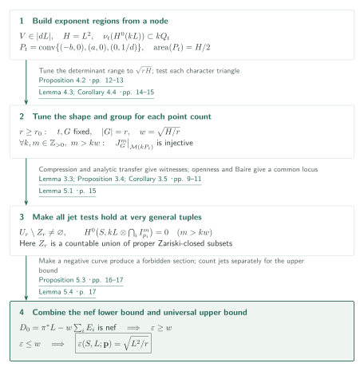
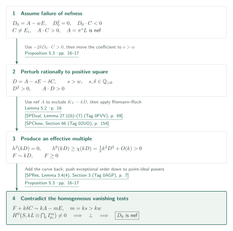
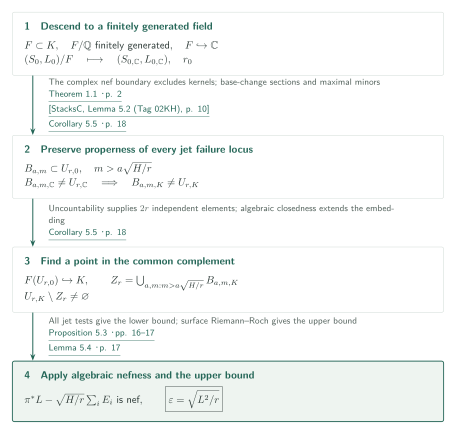

# Maximal Seshadri constants on arbitrary polarized surfaces

**From a nodal curve to finite interpolation, and from homogeneous vanishing to a nef boundary**

The manuscript claims that, on every smooth integral complex projective surface with an ample line bundle, the multipoint Seshadri constant at very general points reaches its volume bound once the number of points is sufficiently large. A fixed nodal curve constrains initial exponents; compression moves them into a triangle whose shape can be tuned to an interpolation test on a finite group. Riemann–Roch then converts the exclusion of equal vanishing orders into the exclusion of curves with arbitrary multiplicities.

## 1. Main results

### Theorem 1.1 — Eventual maximality on every polarized surface

Let $S$ be a smooth integral complex projective surface and $L$ an ample line bundle. Put $H=L^2$ and let

$$U_r=\{(p_1,\ldots,p_r)\in S^r:p_i\ne p_j\ (i\ne j)\}$$

be the space of ordered tuples of distinct points. The manuscript asserts that there is an integer $r_0=r_0(S,L)$ such that, **for every integer $r\ge r_0$**, there is a countable union $Z_r\subset U_r$ of proper Zariski-closed subsets, with nonempty complement, and for every $\mathbf p\in U_r\setminus Z_r$ the class

$$D_0=\pi^*L-\sqrt{\frac{L^2}{r}}\sum_{i=1}^r E_i$$

is nef. Here $\pi:Y\to S$ is the blow-up at the specified points and $E_i$ are its exceptional curves. Consequently,

$$\varepsilon(S,L;\mathbf p)=\sqrt{\frac{L^2}{r}}.$$

<!-- cite:main-result -->[Theorem 1.1 · p. 2](https://github.com/openai/math/blob/1581d4cbdd69a0faf34b2089614fe2a814316a6a/preprints/Maximal-Seshadri-Constants-on-Arbitrary-Polarized-Surfaces-September-23-2026/main.pdf)<!-- /cite -->

The normalization is the **multipoint constant with equal exceptional coefficients**:

$$\varepsilon(S,L;\mathbf p)=\inf_C\frac{L\cdot C}{\sum_i\operatorname{mult}_{p_i}C}
=\sup\{\lambda\ge0:\pi^*L-\lambda\sum_iE_i\text{ is nef}\}.$$

The infimum runs over integral curves meeting at least one point. The denominator is not divided by $r$, and no unequal exceptional weights are introduced. The multiplicities of a given curve need not be equal. “Very general” means the complement of the countable union above; the theorem does not assert that a single Zariski-open subset satisfies all jet conditions simultaneously.

<!-- cite:definition -->[§1; equation (1.1) · pp. 1–2](https://github.com/openai/math/blob/1581d4cbdd69a0faf34b2089614fe2a814316a6a/preprints/Maximal-Seshadri-Constants-on-Arbitrary-Polarized-Surfaces-September-23-2026/main.pdf)<!-- /cite -->

The result concerns the **qualitative Nagata–Biran conjecture**, with a threshold depending on the polarized surface. The strict nonhomogeneous plane inequality for every $r\ge10$ belongs to the separate manuscript cited as reference [14]. It does not follow merely from the unspecified threshold and non-strict inequality here. The proof of this surface theorem does not use that plane theorem.

<!-- cite:background -->[§§1–1.1 · pp. 2–3](https://github.com/openai/math/blob/1581d4cbdd69a0faf34b2089614fe2a814316a6a/preprints/Maximal-Seshadri-Constants-on-Arbitrary-Polarized-Surfaces-September-23-2026/main.pdf)<!-- /cite -->

### Corollary 5.5 — Uncountable algebraically closed fields of characteristic zero

Let $K$ be an uncountable algebraically closed field of characteristic zero, let $S/K$ be a smooth integral projective surface, and let $L$ be ample. There is an integer $r_0=r_0(S,L)$ such that, for every $r\ge r_0$, outside a countable union of proper Zariski-closed subsets of $U_r$, with nonempty complement,

$$\varepsilon(S,L;p_1,\ldots,p_r)=\sqrt{\frac{L^2}{r}}.$$

Both characteristic zero and uncountability are hypotheses. The corollary does not assert the same nonemptiness for rational points over a countable algebraically closed field.

<!-- cite:corollary -->[Corollary 5.5 · p. 18](https://github.com/openai/math/blob/1581d4cbdd69a0faf34b2089614fe2a814316a6a/preprints/Maximal-Seshadri-Constants-on-Arbitrary-Polarized-Surfaces-September-23-2026/main.pdf)<!-- /cite -->

## References on the arrows

<!-- reference-guide -->
Unprefixed theorem, lemma, section and equation numbers refer to [Maximal Seshadri constants on arbitrary polarized surfaces](https://github.com/openai/math/blob/1581d4cbdd69a0faf34b2089614fe2a814316a6a/preprints/Maximal-Seshadri-Constants-on-Arbitrary-Polarized-Surfaces-September-23-2026/main.pdf). External inputs use the following keys.

- [SPVar](https://stacks.math.columbia.edu/download/varieties.pdf) The Stacks Project Authors — *The Stacks Project — Varieties*: Smoothness of general members of a very ample system. version ed88ff78, compiled July 14, 2026; retrieved October 15, 2026.
- [SPMor](https://stacks.math.columbia.edu/download/more-morphisms.pdf) The Stacks Project Authors — *The Stacks Project — More on Morphisms*: Geometric irreducibility in Bertini. version ed88ff78, compiled July 14, 2026; retrieved October 15, 2026.
- [StacksN](https://stacks.math.columbia.edu/download/divisors.pdf) The Stacks Project Authors — *The Stacks Project — Divisors*: Regular immersions and the Rees algebra of a blow-up. version ed88ff78, compiled July 14, 2026; retrieved October 15, 2026.
- [SPMod](https://stacks.math.columbia.edu/download/modules.pdf) The Stacks Project Authors — *The Stacks Project — Sheaves of Modules*: Principal parts and finite-order differential operators. version ed88ff78, compiled July 14, 2026; retrieved October 15, 2026.
- [SPChow](https://stacks.math.columbia.edu/download/chow.pdf) The Stacks Project Authors — *The Stacks Project — Chow Homology and Chern Classes*: Riemann–Roch on a smooth projective surface. version ed88ff78, compiled July 14, 2026; retrieved October 15, 2026.
- [SPDual](https://stacks.math.columbia.edu/download/duality.pdf) The Stacks Project Authors — *The Stacks Project — Duality for Schemes*: Serre duality for top cohomology. version ed88ff78, compiled July 14, 2026; retrieved October 15, 2026.
- [SPRes](https://stacks.math.columbia.edu/download/resolve.pdf) The Stacks Project Authors — *The Stacks Project — Resolution of Surfaces*: Exceptional coefficients and powers of point ideals. version ed88ff78, compiled July 14, 2026; retrieved October 15, 2026.
- [SPLim](https://stacks.math.columbia.edu/download/limits.pdf) The Stacks Project Authors — *The Stacks Project — Limits of Schemes*: Descent of finite-presentation data. version ed88ff78, compiled July 14, 2026; retrieved October 15, 2026.
- [SPDes](https://stacks.math.columbia.edu/download/spaces-descent.pdf) The Stacks Project Authors — *The Stacks Project — Descent and Algebraic Spaces*: Descent of ampleness under field extension. version ed88ff78, compiled July 14, 2026; retrieved October 15, 2026.
- [StacksC](https://stacks.math.columbia.edu/download/coherent.pdf) The Stacks Project Authors — *The Stacks Project — Cohomology of Schemes*: Commutation of global sections with field extension. version ed88ff78, compiled July 14, 2026; retrieved October 15, 2026.

Each citation gives the result and pages. When printed pagination differs from the PDF position, both are shown. GitHub previews do not automatically jump to the cited page.
<!-- /reference-guide -->

Stacks result numbers follow the chapter PDFs used here, with stable Tags also recorded. Checking an external statement and its application is distinguished from recursively verifying its proof.

## 2. Proof of Theorem 1.1 — Tuned triangles and the maximal bound

<!-- proof-target:1 -->Proof target：[Theorem 1.1 · p. 2](https://github.com/openai/math/blob/1581d4cbdd69a0faf34b2089614fe2a814316a6a/preprints/Maximal-Seshadri-Constants-on-Arbitrary-Polarized-Surfaces-September-23-2026/main.pdf)<!-- /proof-target --> See the [hypotheses and all conclusions](#theorem-1-1).

**Proof route.** A nodal curve bounds initial exponents, and diagonal compression gives a triangle of area $H/2$. For each sufficiently large $r$, choose its shape and an index-$r$ lattice before choosing the jet orders. The resulting torus test works uniformly for all $k,m$. Two finite-matrix transfers and openness move the test to very general surface points. The lower bound supplied by [Proposition 5.3](#proof-2) is then combined with the universal upper bound of Lemma 5.4.

### 1. Intersection at the node bounds exponents; compression transfers jets

Choose $eL$ very ample. On the blow-up of a point, $2e\pi^*L-E$ is very ample. Choose a general member of its square meeting the exceptional curve transversely at two distinct points. Bertini supplies smoothness and irreducibility; pushing down gives an integral $V\in|dL|$, $d=4e$, smooth away from one ordinary node. Fix local coordinates in which the two branches are $xz=0$.

<!-- cite:nodal -->[Lemma 3.1; Proposition 3.2 · pp. 6–8](https://github.com/openai/math/blob/1581d4cbdd69a0faf34b2089614fe2a814316a6a/preprints/Maximal-Seshadri-Constants-on-Arbitrary-Polarized-Surfaces-September-23-2026/main.pdf)<!-- /cite -->

<!-- cite:ext-varieties -->[&#91;SPVar, Lemma 47.3 (Tag 0FD6), p. 108&#93;](https://stacks.math.columbia.edu/download/varieties.pdf#page=108)<!-- /cite -->

<!-- cite:ext-more-morphisms -->[&#91;SPMor, Lemma 32.3 (Tag 0G4F), p. 94&#93;](https://stacks.math.columbia.edu/download/more-morphisms.pdf#page=94)<!-- /cite -->

Choose $t>T>1$ so that $(1+t)^2>d^2Ht$, and set $a=dHt/(1+t)$, $b=dH/(1+t)$ and $c=1/d$. For a section of $kL$ whose divisor does not contain $V$, its least weight $v$ satisfies $v(1+1/t)\le kdH$ by intersection with the two branches. If $V$ occurs with coefficient $j$, remove it first and translate the initial exponent by $(j,j)$. Thus all initial exponents lie in

$$kQ_t,\qquad Q_t=\operatorname{conv}\{(0,0),(a,0),(c,c),(0,b)\}$$

Writing $q=\alpha-\beta$ makes diagonal slices vertical. Moving their lower endpoints to zero produces

$$P_t=\operatorname{conv}\{(-b,0),(a,0),(0,c)\},\qquad \operatorname{area}(P_t)=H/2$$

Area equality alone does not transfer jet evaluation. Proposition 3.4 uses the basis $u^qv^{\beta_q^-}(v-1)^h$ on each integer slice, substitutes $v=1+sy$, and divides by $s^h$ to obtain a limit $u^qy^h$. Persistence of a nonzero maximal minor transfers injectivity from $P_t$ to $Q_t$. The weighted analytic dilation in Proposition 2.2 then transfers it from initial monomials to the original sections. The constructed points remain distinct and may depend on $k,m$.

<!-- cite:compression -->[Lemma 3.3; Proposition 3.4; Corollary 3.5 · pp. 9–11](https://github.com/openai/math/blob/1581d4cbdd69a0faf34b2089614fe2a814316a6a/preprints/Maximal-Seshadri-Constants-on-Arbitrary-Polarized-Surfaces-September-23-2026/main.pdf)<!-- /cite -->

<!-- cite:transfer -->[Lemma 2.1; Proposition 2.2 · pp. 4–6](https://github.com/openai/math/blob/1581d4cbdd69a0faf34b2089614fe2a814316a6a/preprints/Maximal-Seshadri-Constants-on-Arbitrary-Polarized-Surfaces-September-23-2026/main.pdf)<!-- /cite -->

### 2. For every sufficiently large integer $r$, choose one group valid for all orders

Put $w=\sqrt{H/r}$. Lemma 4.3 chooses $t>T$ and a primitive lattice vector $u$ so that the range of $\det(u,-)$ on $P_t$ is **exactly** $\sqrt{rH}$. Explicitly, put $R=\sqrt{rH}$, $W=dH$ and $a_0=WT/(1+T)$, and choose a power of two $j$ with $R/(4W)<j\le R/(2W)$. For large $r$, the interval $(d(R-jW),d(R-ja_0))$ has length greater than two and contains an odd integer $i$. Then $u=(i,j)$ is primitive. The continuous parameter $t$ realizes the unique $a\in(a_0,W)$ satisfying $i/d+ja=R$. This is the step handling every sufficiently large integer rather than only square point counts.

<!-- cite:tuning -->[Lemma 4.3; Corollary 4.4 · pp. 14–15](https://github.com/openai/math/blob/1581d4cbdd69a0faf34b2089614fe2a814316a6a/preprints/Maximal-Seshadri-Constants-on-Arbitrary-Polarized-Surfaces-September-23-2026/main.pdf)<!-- /cite -->

Complete $u$ to an integer basis $(u,v_0)$ and set $M=\mathbb Zu+\mathbb Z(rv_0)$. Its annihilator in the torus is a group $G$ of exactly $r$ points. Character projections separate the exponent support into cosets of $M$; take a nonzero component and express it in lattice-$M$ coordinates. Its supporting triangle has area $(kw)^2/2$ and vertical range $kw$. Lemma 4.1 bounds its order at $(1,1)$ by $kw$: factor the common power $(U-1)^e$ from the horizontal rows and bound the remaining height range by $kw-e$. The coordinate map has Jacobian determinant $r\ne0$, so it preserves local orders. A nonzero polynomial cannot therefore vanish to order $m>kw$ at every point of $G$.

The quantifier order is essential: first fix $r_0$ from $(S,L)$, then fix $t,G$ for each $r$, and only then consider **all positive integers $k,m$ with $m>kw$**. An asymptotic interpolation theorem for a fixed multiplicity bound would not suffice.

<!-- cite:subgroup -->[Proposition 4.2 · pp. 12–13](https://github.com/openai/math/blob/1581d4cbdd69a0faf34b2089614fe2a814316a6a/preprints/Maximal-Seshadri-Constants-on-Arbitrary-Polarized-Surfaces-September-23-2026/main.pdf)<!-- /cite -->

<!-- cite:triangle -->[Lemma 4.1 · pp. 11–12](https://github.com/openai/math/blob/1581d4cbdd69a0faf34b2089614fe2a814316a6a/preprints/Maximal-Seshadri-Constants-on-Arbitrary-Polarized-Surfaces-September-23-2026/main.pdf)<!-- /cite -->

### 3. From special test points to very general configurations and a nef lower bound

Corollary 3.5 realizes each test at some tuple of $r$ surface points. Lemma 5.1 expresses evaluation as an algebraic vector-bundle map using principal parts. Its noninjectivity locus is cut out by maximal minors, so each injective locus is nonempty and Zariski open. There are countably many pairs $(k,m)$; their common locus is the complement of a countable union of proper closed subsets. The Baire property of $U_r(\mathbb C)$ makes it nonempty. Only at this step does one tuple satisfy all orders simultaneously.

<!-- cite:open -->[Lemma 5.1 · p. 15](https://github.com/openai/math/blob/1581d4cbdd69a0faf34b2089614fe2a814316a6a/preprints/Maximal-Seshadri-Constants-on-Arbitrary-Polarized-Surfaces-September-23-2026/main.pdf)<!-- /cite -->

<!-- cite:ext-modules -->[&#91;SPMod, Section 29 (Tag 0G3P), pp. 45–46&#93;](https://stacks.math.columbia.edu/download/modules.pdf#page=45)<!-- /cite -->

<!-- cite:ext-divisors -->[&#91;StacksN, Sections 22, 33 (Tags 0638, 01OF), pp. 47, 81–82&#93;](https://stacks.math.columbia.edu/download/divisors.pdf#page=47)<!-- /cite -->

Apply Proposition 5.3 at each such tuple to obtain nefness of $D_0$, hence $\varepsilon\ge w$. The passage from excluding equal vanishing orders to excluding curves with unequal multiplicities uses the proposition's Riemann–Roch argument; it is not left as a merely numerical equivalence.

<!-- cite:nef -->[Proposition 5.3 · pp. 16–17](https://github.com/openai/math/blob/1581d4cbdd69a0faf34b2089614fe2a814316a6a/preprints/Maximal-Seshadri-Constants-on-Arbitrary-Polarized-Surfaces-September-23-2026/main.pdf)<!-- /cite -->

### 4. A separate universal upper bound gives equality

The upper bound is independent of the interpolation construction and holds at every tuple of distinct points. Fix $0<\alpha<w$ and $m_k=\lceil k\alpha\rceil$. Riemann–Roch gives $h^0(kL)\ge Hk^2/2+O(k)$, exceeding the number of jet conditions $r\binom{m_k+1}{2}=r\alpha^2k^2/2+O(k)$. Thus there is an effective $F_k\sim k\pi^*L-m_k\sum E_i$. If $\pi^*L-\lambda\sum E_i$ is nef, then

$$0\le(\pi^*L-\lambda\sum E_i)\cdot F_k=kH-\lambda rm_k.$$

First let $k\to\infty$, then $\alpha\uparrow w$, to obtain $\lambda\le w$. Combining this with $\varepsilon\ge w$ gives $\varepsilon=w$. Computing $D_0^2=0$ alone would not establish the lower bound.

<!-- cite:upper -->[Lemma 5.4 · p. 17](https://github.com/openai/math/blob/1581d4cbdd69a0faf34b2089614fe2a814316a6a/preprints/Maximal-Seshadri-Constants-on-Arbitrary-Polarized-Surfaces-September-23-2026/main.pdf)<!-- /cite -->

<!-- cite:main-proof -->[Proof of Theorem 1.1 · p. 17](https://github.com/openai/math/blob/1581d4cbdd69a0faf34b2089614fe2a814316a6a/preprints/Maximal-Seshadri-Constants-on-Arbitrary-Polarized-Surfaces-September-23-2026/main.pdf)<!-- /cite -->

## 3. Proof of Proposition 5.3 — From equal multiplicities to all curves

<!-- proof-target:2 -->Proof target：[Proposition 5.3 · pp. 16–17](https://github.com/openai/math/blob/1581d4cbdd69a0faf34b2089614fe2a814316a6a/preprints/Maximal-Seshadri-Constants-on-Arbitrary-Polarized-Surfaces-September-23-2026/main.pdf)<!-- /proof-target -->

<!-- statement:proposition-5-3 -->
### Proposition 5.3 — Homogeneous tests imply nefness

Let $S$ be a smooth integral complex projective surface, $L$ ample, and $p_1,\ldots,p_r$ distinct points. Put $H=L^2$ and $w=\sqrt{H/r}$. Suppose that for every pair of positive integers $k,m$ with $m>kw$, no nonzero section of $L^{\otimes k}$ vanishes to order at least $m$ at every $p_i$. On the blow-up $Y$ of the points, the class $D_0=\pi^*L-w\sum_iE_i$ is nef.

<!-- cite:nef -->[Proposition 5.3 · pp. 16–17](https://github.com/openai/math/blob/1581d4cbdd69a0faf34b2089614fe2a814316a6a/preprints/Maximal-Seshadri-Constants-on-Arbitrary-Polarized-Surfaces-September-23-2026/main.pdf)<!-- /cite -->
<!-- /statement -->

Write $A=\pi^*L$ and $E=\sum_iE_i$. Then $A$ is nef, $A^2=H$, $A\cdot E_i=0$ and $E_i\cdot E_j=-\delta_{ij}$.

### 1. Subtract a negative curve and perturb rationally beyond the boundary

If $D_0$ were not nef, an integral curve $C\subset Y$ would satisfy $D_0\cdot C<0$. Since $D_0\cdot E_i=w>0$, this curve is not exceptional and $A\cdot C>0$. For a sufficiently small positive rational $\delta$,

$$(D_0-\delta C)^2=-2\delta D_0\cdot C+\delta^2C^2>0,\qquad A\cdot(D_0-\delta C)>0.$$

By continuity, choose a rational $s>w$ sufficiently close to $w$ so that $D=A-sE-\delta C$ still satisfies $D^2>0$ and $A\cdot D>0$. Nefness of $D$ itself is not required.

<!-- cite:nef -->[Proposition 5.3 · pp. 16–17](https://github.com/openai/math/blob/1581d4cbdd69a0faf34b2089614fe2a814316a6a/preprints/Maximal-Seshadri-Constants-on-Arbitrary-Polarized-Surfaces-September-23-2026/main.pdf)<!-- /cite -->

### 2. Serre duality and Riemann–Roch produce an effective multiple

For sufficiently large $k$ clearing the denominators, $A\cdot(K_Y-kD)<0$. Since $A$ is nef, $K_Y-kD$ cannot be linearly equivalent to an effective divisor. Serre duality gives $h^2(kD)=0$, and

$$h^0(kD)\ge\chi(\mathcal O_Y(kD))=\frac{k^2D^2-kD\cdot K_Y}{2}+\chi(\mathcal O_Y)>0.$$

This is Lemma 5.2. The cited Stacks statement is Grothendieck–Riemann–Roch, specialized here to a line bundle on a smooth projective surface.

<!-- cite:rr-internal -->[Lemma 5.2 · p. 16](https://github.com/openai/math/blob/1581d4cbdd69a0faf34b2089614fe2a814316a6a/preprints/Maximal-Seshadri-Constants-on-Arbitrary-Polarized-Surfaces-September-23-2026/main.pdf)<!-- /cite -->

<!-- cite:ext-duality -->[&#91;SPDual, Lemma 27.1(6)–(7) (Tag 0FVV), p. 69&#93;](https://stacks.math.columbia.edu/download/duality.pdf#page=69)<!-- /cite -->

<!-- cite:ext-chow -->[&#91;SPChow, Section 66 (Tag 02UO), p. 154&#93;](https://stacks.math.columbia.edu/download/chow.pdf#page=154)<!-- /cite -->

### 3. Add the curve back and contradict the homogeneous tests

Take an effective $F\sim kD$, with $k$ divisible by the denominators of $s,\delta$. Then

$$F+k\delta C\sim kA-mE,\qquad m=ks>kw.$$

The blow-up identity $\pi_*\mathcal O_Y(-mE)=\bigcap_i I_{p_i}^m$, together with the projection formula, gives a nonzero section of $kL$ vanishing to order at least $m$ at every point, contradicting the hypothesis. Hence $D_0$ is nef. The original multiplicities of $C$ may be unequal: effectivity and adding back the curve produce precisely the homogeneous test needed for the contradiction.

<!-- cite:ext-resolve -->[&#91;SPRes, Lemma 3.4(4), Section 3 (Tag 0AGP), p. 7&#93;](https://stacks.math.columbia.edu/download/resolve.pdf#page=7)<!-- /cite -->

<!-- cite:nef -->[Proposition 5.3 · pp. 16–17](https://github.com/openai/math/blob/1581d4cbdd69a0faf34b2089614fe2a814316a6a/preprints/Maximal-Seshadri-Constants-on-Arbitrary-Polarized-Surfaces-September-23-2026/main.pdf)<!-- /cite -->

## 4. Proof of Corollary 5.5 — Descend the failure loci

<!-- proof-target:3 -->Proof target：[Corollary 5.5 · p. 18](https://github.com/openai/math/blob/1581d4cbdd69a0faf34b2089614fe2a814316a6a/preprints/Maximal-Seshadri-Constants-on-Arbitrary-Polarized-Surfaces-September-23-2026/main.pdf)<!-- /proof-target --> See the [hypotheses and conclusion](#corollary-5-5).

**Proof route.** Descend $(S,L)$ to a subfield $F\subset K$ finitely generated over $\mathbb Q$, and use an embedding $F\hookrightarrow\mathbb C$ to obtain a threshold. Base-change the noninjectivity loci of jet evaluation rather than transferring the analytically constructed complex points.

### 1. Complex maximality makes every failure locus proper

Descend the projective equations and finite gluing data of $L$. Choose $(S_0,L_0)/F$ retaining ampleness, embed $F$ into $\mathbb C$, and fix $r_0$ from Theorem 1.1 there. Intersection number $H$ is unchanged by field extension. For each $r\ge r_0$ and $m>aw$, define the noninjectivity locus $B_{a,m}$ on $U_{r,0}$ by maximal minors of jet evaluation. Flat base change for global sections allows comparison of the same matrix condition over the different fields.

<!-- cite:ext-limits -->[&#91;SPLim, Lemma 10.1 (Tag 01ZM), p. 25&#93;](https://stacks.math.columbia.edu/download/limits.pdf#page=25)<!-- /cite -->

<!-- cite:ext-spaces-descent -->[&#91;SPDes, Lemma 13.1 (Tag 0D3C), pp. 21–22&#93;](https://stacks.math.columbia.edu/download/spaces-descent.pdf#page=21)<!-- /cite -->

<!-- cite:ext-coherent -->[&#91;StacksC, Lemma 5.2 (Tag 02KH), p. 10&#93;](https://stacks.math.columbia.edu/download/coherent.pdf#page=10)<!-- /cite -->

At a complex tuple where $A-wE$ is nef, a nonzero section in the evaluation kernel would give an effective class $aA-mE$ with negative intersection $aH-rmw<0$ against that nef class. Hence $B_{a,m}$ is proper over $\mathbb C$, and therefore over $F$ and over $K$. The same $r_0$ works for every $(a,m)$.

<!-- cite:corollary -->[Corollary 5.5 · p. 18](https://github.com/openai/math/blob/1581d4cbdd69a0faf34b2089614fe2a814316a6a/preprints/Maximal-Seshadri-Constants-on-Arbitrary-Polarized-Surfaces-September-23-2026/main.pdf)<!-- /cite -->

### 2. Uncountability supplies the common locus; the algebraic argument finishes

The field $F$ is countable, whereas $K$ is uncountable. Choose $2r$ elements of $K$ algebraically independent over $F$, then use algebraic closedness to extend to an embedding $F(U_{r,0})\hookrightarrow K$. The resulting $K$-point maps to the generic point of $U_{r,0}$ and avoids every $B_{a,m}$. Thus $Z_r=\bigcup_{a,m:m>aw}B_{a,m,K}$ has nonempty complement. Every tuple in that complement satisfies all homogeneous jet tests. The algebraic arguments of Lemma 5.2, Proposition 5.3 and Lemma 5.4 apply over $K$ and give the nef lower bound together with the matching upper bound.

<!-- cite:corollary -->[Corollary 5.5 · p. 18](https://github.com/openai/math/blob/1581d4cbdd69a0faf34b2089614fe2a814316a6a/preprints/Maximal-Seshadri-Constants-on-Arbitrary-Polarized-Surfaces-September-23-2026/main.pdf)<!-- /cite -->

## 5. Which references supply which steps

| Source and result | Used at | Role and required hypotheses | Checking scope |
|---|---|---|---|
| SPVar Lemma 47.3; SPMor Lemma 32.3 | Lemma 3.1, p. 7 | Smooth integral general member of a very ample system on a smooth integral surface. Transversality at two exceptional points is secured by the manuscript's surjective restriction map. | Statements and application conditions checked; external proofs excluded. |
| StacksN §§22, 33; SPMod §29 | Lemma 3.1, p. 7; Lemma 5.1, p. 15 | Rees-algebra blow-up, regular diagonal and principal parts. Openness itself follows from the manuscript's maximal-minor argument. | Source constructions and the manuscript's finite-jet explanation checked. |
| SPDual Lemma 27.1; SPChow §66 | Lemma 5.2, p. 16; Lemma 5.4, p. 17 | Top-cohomology vanishing and a quadratic Euler characteristic. Nefness is imposed on $A$, not $D$; use $D^2,A\cdot D>0$. | Statements, specialization and use checked. |
| SPRes Lemma 3.4(4) | Proposition 5.3, p. 17 | On a point blow-up of a two-dimensional regular local ring, exceptional order becomes an ideal power. | Statement and application checked. |
| SPLim Lemma 10.1; SPDes Lemma 13.1; StacksC Lemma 5.2 | Corollary 5.5, p. 18 | Finite-presentation descent, descent of ampleness, and flat base change. Uncountability supplies a point in the common complement. | Statements and application checked. |

The plane Nagata manuscript is a comparison for the threshold and strict inequality, not a direct input to Theorem 1.1 here. Dumnicki, Ciliberto–Farnik–Küronya–Lozovanu–Roé–Shramov, and Gundlach are discussed as methodological background; the required transfers, exponent bounds and triangle multiplicity estimate are proved within this manuscript. Their background proofs were not examined in this check. Unrecorded connections to other catalogues remain uninvestigated.

<!-- cite:background -->[§§1–1.1 · pp. 2–3](https://github.com/openai/math/blob/1581d4cbdd69a0faf34b2089614fe2a814316a6a/preprints/Maximal-Seshadri-Constants-on-Arbitrary-Polarized-Surfaces-September-23-2026/main.pdf)<!-- /cite -->

## 6. Return to the sources

<!-- reading-list -->
- [Lemma 3.1; Proposition 3.2 · pp. 6–8](https://github.com/openai/math/blob/1581d4cbdd69a0faf34b2089614fe2a814316a6a/preprints/Maximal-Seshadri-Constants-on-Arbitrary-Polarized-Surfaces-September-23-2026/main.pdf) — How intersection at the node bounds initial exponents.
- [Lemma 3.3; Proposition 3.4; Corollary 3.5 · pp. 9–11](https://github.com/openai/math/blob/1581d4cbdd69a0faf34b2089614fe2a814316a6a/preprints/Maximal-Seshadri-Constants-on-Arbitrary-Polarized-Surfaces-September-23-2026/main.pdf) — Transfer diagonal compression through finite jet matrices.
- [Proposition 4.2 · pp. 12–13](https://github.com/openai/math/blob/1581d4cbdd69a0faf34b2089614fe2a814316a6a/preprints/Maximal-Seshadri-Constants-on-Arbitrary-Polarized-Surfaces-September-23-2026/main.pdf) — Interpolation from an index-r lattice and character projection.
- [Lemma 4.3; Corollary 4.4 · pp. 14–15](https://github.com/openai/math/blob/1581d4cbdd69a0faf34b2089614fe2a814316a6a/preprints/Maximal-Seshadri-Constants-on-Arbitrary-Polarized-Surfaces-September-23-2026/main.pdf) — Choose the threshold before all jet orders.
- [Proposition 5.3 · pp. 16–17](https://github.com/openai/math/blob/1581d4cbdd69a0faf34b2089614fe2a814316a6a/preprints/Maximal-Seshadri-Constants-on-Arbitrary-Polarized-Surfaces-September-23-2026/main.pdf) — Pass from equal vanishing orders to all curve inequalities.
- [Lemma 5.4 · p. 17](https://github.com/openai/math/blob/1581d4cbdd69a0faf34b2089614fe2a814316a6a/preprints/Maximal-Seshadri-Constants-on-Arbitrary-Polarized-Surfaces-September-23-2026/main.pdf) — Check the universal upper bound separately from the lower bound.
- [Corollary 5.5 · p. 18](https://github.com/openai/math/blob/1581d4cbdd69a0faf34b2089614fe2a814316a6a/preprints/Maximal-Seshadri-Constants-on-Arbitrary-Polarized-Surfaces-September-23-2026/main.pdf) — Extension in characteristic zero and the role of uncountability.
<!-- /reading-list -->

The editorial check covered the hypotheses and all conclusions of the principal results, the indicated proof passages in §§2–5, and the statements and applications of the direct Stacks inputs. Particular attention was given to fixing $r_0$ before jet orders, openness in passing from special points to very general configurations, effectivity in reducing unequal curve multiplicities to homogeneous tests, and the separate lower and upper bounds. This is an account of the author's argument and a check of its connections, not independent certification of the entire proof or recursive verification of all external inputs. An optimal $r_0$, exact values for small point counts, arbitrary weighted constants, and positive-characteristic extensions are not asserted in this article.

<!-- cite:scope -->[§§2–5 · pp. 4–18](https://github.com/openai/math/blob/1581d4cbdd69a0faf34b2089614fe2a814316a6a/preprints/Maximal-Seshadri-Constants-on-Arbitrary-Polarized-Surfaces-September-23-2026/main.pdf)<!-- /cite -->
