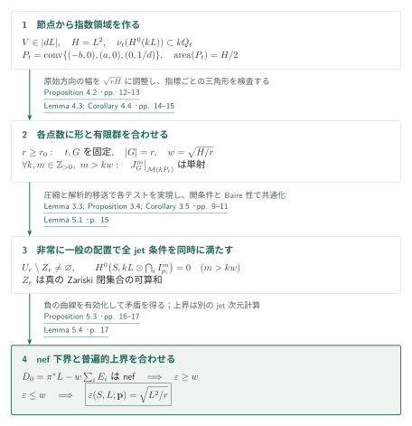
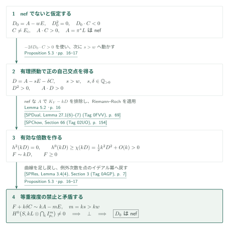
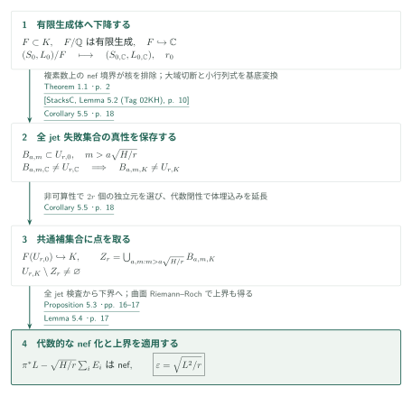

# Maximal Seshadri constants on arbitrary polarized surfaces

**節点曲線から有限補間へ、等重複度の消滅からnef境界へ**

原稿は、任意の滑らかな整射影複素曲面と豊富な直線束に対し、点数が十分大きければ非常に一般の点で多点Seshadri定数が体積上界に一致すると主張する。固定した節点曲線から切断の初項を三角形へ移し、その形を点数ごとに調整して有限群上のjet評価を単射にする。最後にRiemann–Rochを使い、等重複度の消滅から不均等な重複度を持つ曲線も排除する。

## 1. 主要結果

### Theorem 1.1 — 任意の偏極曲面での十分大きな点数に対する最大性

$S$を滑らかな整射影複素曲面、$L$を$S$上の豊富な直線束とする。$H=L^2$とし、相異なる順序付き$r$点の配置空間を

$$U_r=\{(p_1,\ldots,p_r)\in S^r:p_i\ne p_j\ (i\ne j)\}$$

と書く。原稿の定理は、整数$r_0=r_0(S,L)$が存在し、**各整数$r\ge r_0$に対し**、真のZariski閉部分集合の可算和$Z_r\subset U_r$で補集合が非空のものを取り、すべての$\mathbf p\in U_r\setminus Z_r$について

$$D_0=\pi^*L-\sqrt{\frac{L^2}{r}}\sum_{i=1}^r E_i$$

がnefになる、という主張である。ここで$\pi:Y\to S$は指定点のブローアップ、$E_i$は例外曲線である。その帰結として

$$\varepsilon(S,L;\mathbf p)=\sqrt{\frac{L^2}{r}}.$$

<!-- cite:main-result -->[Theorem 1.1 · p. 2](https://github.com/openai/math/blob/1581d4cbdd69a0faf34b2089614fe2a814316a6a/preprints/Maximal-Seshadri-Constants-on-Arbitrary-Polarized-Surfaces-September-23-2026/main.pdf)<!-- /cite -->

正規化は**等しい例外係数を使う多点定数**であり、

$$\varepsilon(S,L;\mathbf p)=\inf_C\frac{L\cdot C}{\sum_i\operatorname{mult}_{p_i}C}
=\sup\{\lambda\ge0:\pi^*L-\lambda\sum_iE_i\text{ is nef}\}.$$

$C$は少なくとも一点を通る整曲線を走る。分母を$r$で割る正規化や重み付き定数ではない。各曲線の重複度は等しいと仮定しない。「非常に一般」は上記の可算和の補集合を意味し、一つのZariski開集合で全jet条件を同時に満たすという主張ではない。

<!-- cite:definition -->[§1; equation (1.1) · pp. 1–2](https://github.com/openai/math/blob/1581d4cbdd69a0faf34b2089614fe2a814316a6a/preprints/Maximal-Seshadri-Constants-on-Arbitrary-Polarized-Surfaces-September-23-2026/main.pdf)<!-- /cite -->

この定理が扱うのは偏極に依存する閾値以降の**定性的Nagata–Biran予想**である。平面の全点数$r\ge10$における厳密な不均等重複度不等式は、本稿が参照文献[14]として挙げる別原稿の結果であり、ここでの閾値や非厳密不等式からそのまま導かれるものではない。本稿の主定理証明はその平面定理を入力しない。

<!-- cite:background -->[§§1–1.1 · pp. 2–3](https://github.com/openai/math/blob/1581d4cbdd69a0faf34b2089614fe2a814316a6a/preprints/Maximal-Seshadri-Constants-on-Arbitrary-Polarized-Surfaces-September-23-2026/main.pdf)<!-- /cite -->

### Corollary 5.5 — 非可算な代数閉体、標数0

$K$を非可算な標数0の代数閉体、$S/K$を滑らかな整射影曲面、$L$を豊富な直線束とする。整数$r_0=r_0(S,L)$が存在し、各$r\ge r_0$について、$U_r$内の真のZariski閉部分集合の可算和を除く非空の集合のすべての点で

$$\varepsilon(S,L;p_1,\ldots,p_r)=\sqrt{\frac{L^2}{r}}.$$

標数0と非可算性をともに仮定する。可算な代数閉体上の有理点に同じ非空性を主張する系ではない。

<!-- cite:corollary -->[Corollary 5.5 · p. 18](https://github.com/openai/math/blob/1581d4cbdd69a0faf34b2089614fe2a814316a6a/preprints/Maximal-Seshadri-Constants-on-Arbitrary-Polarized-Surfaces-September-23-2026/main.pdf)<!-- /cite -->

## 図の矢印に付した引用

<!-- reference-guide -->
略号のない定理・補題・節・式番号は本原稿 [Maximal Seshadri constants on arbitrary polarized surfaces](https://github.com/openai/math/blob/1581d4cbdd69a0faf34b2089614fe2a814316a6a/preprints/Maximal-Seshadri-Constants-on-Arbitrary-Polarized-Surfaces-September-23-2026/main.pdf) を指します。外部入力には次の略号を使います。

- [SPVar](https://stacks.math.columbia.edu/download/varieties.pdf) The Stacks Project Authors — *The Stacks Project — Varieties*：非常に豊富な系の一般切断の滑らかさ。version ed88ff78, compiled July 14, 2026; retrieved October 15, 2026。
- [SPMor](https://stacks.math.columbia.edu/download/more-morphisms.pdf) The Stacks Project Authors — *The Stacks Project — More on Morphisms*：Bertiniの幾何学的既約性。version ed88ff78, compiled July 14, 2026; retrieved October 15, 2026。
- [StacksN](https://stacks.math.columbia.edu/download/divisors.pdf) The Stacks Project Authors — *The Stacks Project — Divisors*：正則埋込みとブローアップのRees代数。version ed88ff78, compiled July 14, 2026; retrieved October 15, 2026。
- [SPMod](https://stacks.math.columbia.edu/download/modules.pdf) The Stacks Project Authors — *The Stacks Project — Sheaves of Modules*：principal partsと有限階微分作用素。version ed88ff78, compiled July 14, 2026; retrieved October 15, 2026。
- [SPChow](https://stacks.math.columbia.edu/download/chow.pdf) The Stacks Project Authors — *The Stacks Project — Chow Homology and Chern Classes*：曲面Riemann–Rochの入力。version ed88ff78, compiled July 14, 2026; retrieved October 15, 2026。
- [SPDual](https://stacks.math.columbia.edu/download/duality.pdf) The Stacks Project Authors — *The Stacks Project — Duality for Schemes*：Serre双対による最高次コホモロジーの消滅。version ed88ff78, compiled July 14, 2026; retrieved October 15, 2026。
- [SPRes](https://stacks.math.columbia.edu/download/resolve.pdf) The Stacks Project Authors — *The Stacks Project — Resolution of Surfaces*：例外因子の係数と点のイデアル冪の対応。version ed88ff78, compiled July 14, 2026; retrieved October 15, 2026。
- [SPLim](https://stacks.math.columbia.edu/download/limits.pdf) The Stacks Project Authors — *The Stacks Project — Limits of Schemes*：有限表示の射影データの下降。version ed88ff78, compiled July 14, 2026; retrieved October 15, 2026。
- [SPDes](https://stacks.math.columbia.edu/download/spaces-descent.pdf) The Stacks Project Authors — *The Stacks Project — Descent and Algebraic Spaces*：体拡大に対する豊富性の下降。version ed88ff78, compiled July 14, 2026; retrieved October 15, 2026。
- [StacksC](https://stacks.math.columbia.edu/download/coherent.pdf) The Stacks Project Authors — *The Stacks Project — Cohomology of Schemes*：体拡大と大域切断の可換性。version ed88ff78, compiled July 14, 2026; retrieved October 15, 2026。

各引用に結果番号とページを付します。誌面番号とPDF内の位置が異なる場合は両方を示します。GitHubの閲覧リンクではページ位置への自動移動を前提としません。
<!-- /reference-guide -->

Stacksの結果番号は参照した章PDFの番号を使い、安定したTagも併記する。外部入力の記述と本稿での適用を照合し、その証明自体の再帰的な検証とは区別する。

## 2. Theorem 1.1の証明 — 形を調整した三角形から最大性へ

<!-- proof-target:1 -->証明対象：[Theorem 1.1 · p. 2](https://github.com/openai/math/blob/1581d4cbdd69a0faf34b2089614fe2a814316a6a/preprints/Maximal-Seshadri-Constants-on-Arbitrary-Polarized-Surfaces-September-23-2026/main.pdf)<!-- /proof-target --> [仮定・全結論](#theorem-1-1)を参照する。

**証明の道筋。** 節点曲線で初項を囲み、対角スライスを圧縮して面積$H/2$の三角形を作る。各十分大きな$r$に対して三角形と指数$r$の格子を先に選び、すべての$k,m$に一様なtorus上のjet検査を得る。二つの有限行列の移送と開条件で非常に一般の曲面点へ移し、[Proposition 5.3](#proof-2)による下界とLemma 5.4の普遍的上界を合わせる。

### 1. 節点の交点数が初項を囲み、圧縮がjet条件を移す

$eL$を非常に豊富に取り、点のブローアップ上で$2e\pi^*L-E$を非常に豊富にする。その二乗の一般切断を、例外曲線と異なる二点で横断的に交わるよう選ぶ。Bertiniによる滑らかさと既約性を合わせ、押し下げて$V\in|dL|$、$d=4e$を得る。$V$は整で、一つの通常節点以外は滑らかである。節点の二枝を$xz=0$とする局所座標を固定する。

<!-- cite:nodal -->[Lemma 3.1; Proposition 3.2 · pp. 6–8](https://github.com/openai/math/blob/1581d4cbdd69a0faf34b2089614fe2a814316a6a/preprints/Maximal-Seshadri-Constants-on-Arbitrary-Polarized-Surfaces-September-23-2026/main.pdf)<!-- /cite -->

<!-- cite:ext-varieties -->[&#91;SPVar, Lemma 47.3 (Tag 0FD6), p. 108&#93;](https://stacks.math.columbia.edu/download/varieties.pdf#page=108)<!-- /cite -->

<!-- cite:ext-more-morphisms -->[&#91;SPMor, Lemma 32.3 (Tag 0G4F), p. 94&#93;](https://stacks.math.columbia.edu/download/more-morphisms.pdf#page=94)<!-- /cite -->

$t>T>1$を$(1+t)^2>d^2Ht$となるように取り、$a=dHt/(1+t)$、$b=dH/(1+t)$、$c=1/d$とする。$V$を成分に持たない$kL$の切断の最小重み$v$は、両枝との局所交点数から$v(1+1/t)\le kdH$を満たす。$V$を$j$回含む場合は先に除き、初項の指数を$(j,j)$だけ移す。従って全初項が

$$kQ_t,\qquad Q_t=\operatorname{conv}\{(0,0),(a,0),(c,c),(0,b)\}$$

に入る。$q=\alpha-\beta$で対角スライスを縦にし、その下端を0へ移すと

$$P_t=\operatorname{conv}\{(-b,0),(a,0),(0,c)\},\qquad \operatorname{area}(P_t)=H/2$$

になる。面積を揃えるだけではjet評価は移らない。Proposition 3.4は各整数スライスの基底$u^qv^{\beta_q^-}(v-1)^h$に$v=1+sy$を代入し、$s^{-h}$倍して$u^qy^h$へ収束させる。非零最大小行列式の持続で$P_t$の単射性が$Q_t$へ戻り、Proposition 2.2の重み付き解析的拡大縮小が初項から元の切断へ戻す。構成点は相異なり、$k,m$ごとに異なってよい。

<!-- cite:compression -->[Lemma 3.3; Proposition 3.4; Corollary 3.5 · pp. 9–11](https://github.com/openai/math/blob/1581d4cbdd69a0faf34b2089614fe2a814316a6a/preprints/Maximal-Seshadri-Constants-on-Arbitrary-Polarized-Surfaces-September-23-2026/main.pdf)<!-- /cite -->

<!-- cite:transfer -->[Lemma 2.1; Proposition 2.2 · pp. 4–6](https://github.com/openai/math/blob/1581d4cbdd69a0faf34b2089614fe2a814316a6a/preprints/Maximal-Seshadri-Constants-on-Arbitrary-Polarized-Surfaces-September-23-2026/main.pdf)<!-- /cite -->

### 2. 各十分大きな整数$r$に対して、全次数に使える有限群を選ぶ

$w=\sqrt{H/r}$と置く。Lemma 4.3は$t>T$と原始格子ベクトル$u$を選び、$P_t$上の$\det(u,-)$の幅を**ちょうど**$\sqrt{rH}$にする。具体的には$R=\sqrt{rH}$、$W=dH$、$a_0=WT/(1+T)$として、$R/(4W)<j\le R/(2W)$を満たす2の冪$j$を選ぶ。十分大きな$r$では区間$(d(R-jW),d(R-ja_0))$の長さが2を超えるので奇数$i$を選べる。$u=(i,j)$は原始であり、$i/d+ja=R$となる$a\in(a_0,W)$を連続パラメータ$t$で実現する。これが平方数に限らない全整数$r$を扱う箇所である。

<!-- cite:tuning -->[Lemma 4.3; Corollary 4.4 · pp. 14–15](https://github.com/openai/math/blob/1581d4cbdd69a0faf34b2089614fe2a814316a6a/preprints/Maximal-Seshadri-Constants-on-Arbitrary-Polarized-Surfaces-September-23-2026/main.pdf)<!-- /cite -->

$u$を整数基底$(u,v_0)$へ補い、$M=\mathbb Zu+\mathbb Z(rv_0)$とする。これを消すtorusの有限群$G$は$|G|=r$を満たす。$G$の指標射影で指数を$M$の剰余類ごとに分解し、非零成分を格子$M$の座標へ移す。得られるLaurent多項式の支持三角形は面積$(kw)^2/2$、縦幅$kw$である。Lemma 4.1はその$(1,1)$での消滅次数を$kw$以下と評価する。その証明は各水平行から$(U-1)^e$を共通に除き、残りの高さの幅を$kw-e$以下に抑えるものである。局所座標変換のJacobianは$r\ne0$なので消滅次数は保存され、$m>kw$で全$G$上に$m$重に消える非零多項式は存在しない。

重要な量化の順序は、$(S,L)$から$r_0$を固定し、次に各$r$について$t,G$を固定し、その後で**すべての正整数$k,m$、$m>kw$**を扱うことである。固定された重複度だけの漸近的補間では足りない。

<!-- cite:subgroup -->[Proposition 4.2 · pp. 12–13](https://github.com/openai/math/blob/1581d4cbdd69a0faf34b2089614fe2a814316a6a/preprints/Maximal-Seshadri-Constants-on-Arbitrary-Polarized-Surfaces-September-23-2026/main.pdf)<!-- /cite -->

<!-- cite:triangle -->[Lemma 4.1 · pp. 11–12](https://github.com/openai/math/blob/1581d4cbdd69a0faf34b2089614fe2a814316a6a/preprints/Maximal-Seshadri-Constants-on-Arbitrary-Polarized-Surfaces-September-23-2026/main.pdf)<!-- /cite -->

### 3. 特殊な検査点から非常に一般の配置へ、そしてnef下界へ

Corollary 3.5で各$(k,m)$の単射性を曲面のある$r$点で実現する。Lemma 5.1はprincipal-parts束を用いてjet評価を代数的なベクトル束の写像として表し、非単射集合を最大小行列式で定義する。従って各単射集合は非空Zariski開集合である。$(k,m)$は可算個なので、それらの共通部分は真の閉集合の可算和の補集合となる。複素多様体$U_r(\mathbb C)$のBaire性により非空である。ここで初めて、すべての次数について同じ配置を使える。

<!-- cite:open -->[Lemma 5.1 · p. 15](https://github.com/openai/math/blob/1581d4cbdd69a0faf34b2089614fe2a814316a6a/preprints/Maximal-Seshadri-Constants-on-Arbitrary-Polarized-Surfaces-September-23-2026/main.pdf)<!-- /cite -->

<!-- cite:ext-modules -->[&#91;SPMod, Section 29 (Tag 0G3P), pp. 45–46&#93;](https://stacks.math.columbia.edu/download/modules.pdf#page=45)<!-- /cite -->

<!-- cite:ext-divisors -->[&#91;StacksN, Sections 22, 33 (Tags 0638, 01OF), pp. 47, 81–82&#93;](https://stacks.math.columbia.edu/download/divisors.pdf#page=47)<!-- /cite -->

その配置でProposition 5.3を適用し、$D_0$のnef性、従って$\varepsilon\ge w$を得る。等しい重複度の切断を排除したことから、不均等な曲線の排除へ移る接続は同命題のRiemann–Roch論法であり、数値的な同値として省略しない。

<!-- cite:nef -->[Proposition 5.3 · pp. 16–17](https://github.com/openai/math/blob/1581d4cbdd69a0faf34b2089614fe2a814316a6a/preprints/Maximal-Seshadri-Constants-on-Arbitrary-Polarized-Surfaces-September-23-2026/main.pdf)<!-- /cite -->

### 4. 普遍的上界と合わせて等号を得る

上界は補間による下界とは別の議論で、任意の相異なる点配置について成立する。$0<\alpha<w$、$m_k=\lceil k\alpha\rceil$とすると、Riemann–Rochの$h^0(kL)\ge Hk^2/2+O(k)$はjet条件数$r\binom{m_k+1}{2}=r\alpha^2k^2/2+O(k)$を上回る。従って$F_k\sim k\pi^*L-m_k\sum E_i$を有効に取れる。$\pi^*L-\lambda\sum E_i$がnefなら

$$0\le(\pi^*L-\lambda\sum E_i)\cdot F_k=kH-\lambda rm_k.$$

$k\to\infty$、次いで$\alpha\uparrow w$とすると$\lambda\le w$となる。したがって前段の$\varepsilon\ge w$と合わせて$\varepsilon=w$。単に$D_0^2=0$と計算するだけでは下界は出ない。

<!-- cite:upper -->[Lemma 5.4 · p. 17](https://github.com/openai/math/blob/1581d4cbdd69a0faf34b2089614fe2a814316a6a/preprints/Maximal-Seshadri-Constants-on-Arbitrary-Polarized-Surfaces-September-23-2026/main.pdf)<!-- /cite -->

<!-- cite:main-proof -->[Proof of Theorem 1.1 · p. 17](https://github.com/openai/math/blob/1581d4cbdd69a0faf34b2089614fe2a814316a6a/preprints/Maximal-Seshadri-Constants-on-Arbitrary-Polarized-Surfaces-September-23-2026/main.pdf)<!-- /cite -->

## 3. Proposition 5.3の証明 — 等重複度からすべての曲線へ

<!-- proof-target:2 -->証明対象：[Proposition 5.3 · pp. 16–17](https://github.com/openai/math/blob/1581d4cbdd69a0faf34b2089614fe2a814316a6a/preprints/Maximal-Seshadri-Constants-on-Arbitrary-Polarized-Surfaces-September-23-2026/main.pdf)<!-- /proof-target -->

<!-- statement:proposition-5-3 -->
### Proposition 5.3 — Homogeneous tests imply nefness

$S$を滑らかな整射影複素曲面、$L$を豊富、$p_1,\ldots,p_r$を相異なる点とし、$H=L^2$、$w=\sqrt{H/r}$と置く。すべての正整数$k,m$で$m>kw$ならば、全$p_i$で少なくとも$m$重に消える$L^{\otimes k}$の非零切断が存在しないと仮定する。このとき、点をブローアップした$Y$上の$D_0=\pi^*L-w\sum_iE_i$はnefである。

<!-- cite:nef -->[Proposition 5.3 · pp. 16–17](https://github.com/openai/math/blob/1581d4cbdd69a0faf34b2089614fe2a814316a6a/preprints/Maximal-Seshadri-Constants-on-Arbitrary-Polarized-Surfaces-September-23-2026/main.pdf)<!-- /cite -->
<!-- /statement -->

$A=\pi^*L$、$E=\sum_iE_i$と書く。$A$はnef、$A^2=H$、$A\cdot E_i=0$、$E_i\cdot E_j=-\delta_{ij}$である。

### 1. 負の曲線を引き、境界の外へ有理摂動する

$D_0$がnefでないなら、$D_0\cdot C<0$となる整曲線$C\subset Y$がある。$D_0\cdot E_i=w>0$なので$C$は例外曲線ではなく、$A\cdot C>0$である。十分小さな正の有理数$\delta$について

$$(D_0-\delta C)^2=-2\delta D_0\cdot C+\delta^2C^2>0,\qquad A\cdot(D_0-\delta C)>0.$$

連続性から、$w$より大きい十分近い有理数$s$を取り、$D=A-sE-\delta C$でも$D^2>0$、$A\cdot D>0$を保てる。$D$自身のnef性は必要ない。

<!-- cite:nef -->[Proposition 5.3 · pp. 16–17](https://github.com/openai/math/blob/1581d4cbdd69a0faf34b2089614fe2a814316a6a/preprints/Maximal-Seshadri-Constants-on-Arbitrary-Polarized-Surfaces-September-23-2026/main.pdf)<!-- /cite -->

### 2. Serre双対とRiemann–Rochで有効倍数を得る

分母を払う十分大きな$k$について、$A\cdot(K_Y-kD)<0$となる。$A$はnefなので$K_Y-kD$は有効因子に線形同値でなく、Serre双対から$h^2(kD)=0$を得る。さらに

$$h^0(kD)\ge\chi(\mathcal O_Y(kD))=\frac{k^2D^2-kD\cdot K_Y}{2}+\chi(\mathcal O_Y)>0.$$

これはLemma 5.2の適用である。参照したStacksのRiemann–Rochは一般のGrothendieck–Riemann–Rochの記述であり、ここでは滑らかな射影曲面上の直線束に特殊化して用いる。

<!-- cite:rr-internal -->[Lemma 5.2 · p. 16](https://github.com/openai/math/blob/1581d4cbdd69a0faf34b2089614fe2a814316a6a/preprints/Maximal-Seshadri-Constants-on-Arbitrary-Polarized-Surfaces-September-23-2026/main.pdf)<!-- /cite -->

<!-- cite:ext-duality -->[&#91;SPDual, Lemma 27.1(6)–(7) (Tag 0FVV), p. 69&#93;](https://stacks.math.columbia.edu/download/duality.pdf#page=69)<!-- /cite -->

<!-- cite:ext-chow -->[&#91;SPChow, Section 66 (Tag 02UO), p. 154&#93;](https://stacks.math.columbia.edu/download/chow.pdf#page=154)<!-- /cite -->

### 3. 曲線を足し戻し、等しい重複度の禁止に戻る

有効$F\sim kD$を取り、$k$を$s,\delta$の分母で可除にすると

$$F+k\delta C\sim kA-mE,\qquad m=ks>kw.$$

ブローアップの恒等式$\pi_*\mathcal O_Y(-mE)=\bigcap_i I_{p_i}^m$と射影公式により、これは全点で$m$重に消える$kL$の非零切断を与え、仮定に反する。従って$D_0$はnefである。曲線$C$の元の各点での重複度が互いに異なっていても、この有効化と足し戻しにより等重複度の検査へ帰着できる。

<!-- cite:ext-resolve -->[&#91;SPRes, Lemma 3.4(4), Section 3 (Tag 0AGP), p. 7&#93;](https://stacks.math.columbia.edu/download/resolve.pdf#page=7)<!-- /cite -->

<!-- cite:nef -->[Proposition 5.3 · pp. 16–17](https://github.com/openai/math/blob/1581d4cbdd69a0faf34b2089614fe2a814316a6a/preprints/Maximal-Seshadri-Constants-on-Arbitrary-Polarized-Surfaces-September-23-2026/main.pdf)<!-- /cite -->

## 4. Corollary 5.5の証明 — 解析的な点を移さず、失敗集合を下降する

<!-- proof-target:3 -->証明対象：[Corollary 5.5 · p. 18](https://github.com/openai/math/blob/1581d4cbdd69a0faf34b2089614fe2a814316a6a/preprints/Maximal-Seshadri-Constants-on-Arbitrary-Polarized-Surfaces-September-23-2026/main.pdf)<!-- /proof-target --> [仮定・結論](#corollary-5-5)を参照する。

**証明の道筋。** $(S,L)$を$\mathbb Q$上有限生成な部分体$F\subset K$へ下降し、$F\hookrightarrow\mathbb C$を使って閾値を得る。複素数上の解析的構成点ではなく、jet評価の非単射集合を$K$へ基底変換する。

### 1. 複素数上の最大性で失敗集合が真であることを示す

射影方程式と$L$の有限な貼合せデータを$F$へ下降する。豊富性を保つ$(S_0,L_0)/F$を取り、$F\hookrightarrow\mathbb C$の後にTheorem 1.1の$r_0$を固定する。交点数$H$は体拡大で変わらない。各$r\ge r_0$と$m>aw$に対し、$U_{r,0}$上のjet評価の非単射集合$B_{a,m}$を小行列式で定義する。大域切断のflat base changeにより同じ行列条件を各体で比較できる。

<!-- cite:ext-limits -->[&#91;SPLim, Lemma 10.1 (Tag 01ZM), p. 25&#93;](https://stacks.math.columbia.edu/download/limits.pdf#page=25)<!-- /cite -->

<!-- cite:ext-spaces-descent -->[&#91;SPDes, Lemma 13.1 (Tag 0D3C), pp. 21–22&#93;](https://stacks.math.columbia.edu/download/spaces-descent.pdf#page=21)<!-- /cite -->

<!-- cite:ext-coherent -->[&#91;StacksC, Lemma 5.2 (Tag 02KH), p. 10&#93;](https://stacks.math.columbia.edu/download/coherent.pdf#page=10)<!-- /cite -->

複素数上で$A-wE$がnefとなる配置を選べば、評価の核にある非零切断は有効類$aA-mE$を与えるが、そのnef類との交点は$aH-rmw<0$になる。従って$B_{a,m}$は複素数上で真であり、$F$上でも$K$上でも真である。$r_0$は全$(a,m)$に共通である。

<!-- cite:corollary -->[Corollary 5.5 · p. 18](https://github.com/openai/math/blob/1581d4cbdd69a0faf34b2089614fe2a814316a6a/preprints/Maximal-Seshadri-Constants-on-Arbitrary-Polarized-Surfaces-September-23-2026/main.pdf)<!-- /cite -->

### 2. 非可算性で全条件を同時に満たし、代数的な結論を再適用する

$F$は可算であり、$K$は非可算なので、$F$上代数的に独立な$2r$個の元を$K$内で選べる。$K$が代数閉であることを使い、$F(U_{r,0})\hookrightarrow K$へ延長する。これが与える$K$点は$U_{r,0}$の生成点へ写るので、すべての$B_{a,m}$を避ける。ゆえに$Z_r=\bigcup_{a,m:m>aw}B_{a,m,K}$の補集合は非空である。その全点で均等jet条件が成立し、任意の標数0体上で使えるLemma 5.2、Proposition 5.3、Lemma 5.4の代数的議論から、nef下界と一致する上界を得る。

<!-- cite:corollary -->[Corollary 5.5 · p. 18](https://github.com/openai/math/blob/1581d4cbdd69a0faf34b2089614fe2a814316a6a/preprints/Maximal-Seshadri-Constants-on-Arbitrary-Polarized-Surfaces-September-23-2026/main.pdf)<!-- /cite -->

## 5. どの文献が、どの段階を担うか

| 供給元と結果 | 利用箇所 | 使用内容・必要な仮定 | 確認範囲 |
|---|---|---|---|
| SPVar Lemma 47.3、SPMor Lemma 32.3 | Lemma 3.1、p. 7 | 滑らかな整曲面上の非常に豊富な系の一般切断を滑らか・整にする。例外曲線との二点横断性は本稿内の制限写像の全射で確保。 | 記述と適用条件を照合。外部証明は対象外。 |
| StacksN §§22, 33、SPMod §29 | Lemma 3.1、p. 7；Lemma 5.1、p. 15 | Rees代数によるブローアップ、正則対角とprincipal parts。単射性の開性は本稿の小行列式の議論。 | 引用先の構成と本稿の有限jet説明を照合。 |
| SPDual Lemma 27.1、SPChow §66 | Lemma 5.2、p. 16；Lemma 5.4、p. 17 | 最高次コホモロジーの消滅と二次のEuler標数。$D$はnefと仮定せず、$A$のnef性と$D^2,A\cdot D>0$を使う。 | 記述・特殊化・使用箇所を照合。 |
| SPRes Lemma 3.4(4) | Proposition 5.3、p. 17 | 二次元正則局所環の点ブローアップで例外次数をイデアル冪へ戻す。 | 記述と適用を照合。 |
| SPLim Lemma 10.1、SPDes Lemma 13.1、StacksC Lemma 5.2 | Corollary 5.5、p. 18 | 有限表示の下降、豊富性の下降、flat base change。非可算性は共通補集合の点の存在に使う。 | 記述と適用を照合。 |

平面Nagata原稿は閾値と厳密不等式の比較対象であり、本稿のTheorem 1.1へ向かう直接依存ではない。Dumnicki、Ciliberto–Farnik–Küronya–Lozovanu–Roé–Shramov、Gundlachへの言及は方法の背景として区別され、本稿は必要な移送・指数評価・三角形の補間評価を内部で証明する。これら背景文献の証明は今回の点検対象としていない。他カタログとの未収録の接続は未調査である。

<!-- cite:background -->[§§1–1.1 · pp. 2–3](https://github.com/openai/math/blob/1581d4cbdd69a0faf34b2089614fe2a814316a6a/preprints/Maximal-Seshadri-Constants-on-Arbitrary-Polarized-Surfaces-September-23-2026/main.pdf)<!-- /cite -->

## 6. 原典を読む入口と確認範囲

<!-- reading-list -->
- [Lemma 3.1; Proposition 3.2 · pp. 6–8](https://github.com/openai/math/blob/1581d4cbdd69a0faf34b2089614fe2a814316a6a/preprints/Maximal-Seshadri-Constants-on-Arbitrary-Polarized-Surfaces-September-23-2026/main.pdf) — 節点との交点が初項の指数を制限する。
- [Lemma 3.3; Proposition 3.4; Corollary 3.5 · pp. 9–11](https://github.com/openai/math/blob/1581d4cbdd69a0faf34b2089614fe2a814316a6a/preprints/Maximal-Seshadri-Constants-on-Arbitrary-Polarized-Surfaces-September-23-2026/main.pdf) — 対角方向の圧縮を有限jet行列で移送する。
- [Proposition 4.2 · pp. 12–13](https://github.com/openai/math/blob/1581d4cbdd69a0faf34b2089614fe2a814316a6a/preprints/Maximal-Seshadri-Constants-on-Arbitrary-Polarized-Surfaces-September-23-2026/main.pdf) — 指数rの格子と指標分解による補間。
- [Lemma 4.3; Corollary 4.4 · pp. 14–15](https://github.com/openai/math/blob/1581d4cbdd69a0faf34b2089614fe2a814316a6a/preprints/Maximal-Seshadri-Constants-on-Arbitrary-Polarized-Surfaces-September-23-2026/main.pdf) — rに先に閾値を置き、全jet次数へ一様に適用する。
- [Proposition 5.3 · pp. 16–17](https://github.com/openai/math/blob/1581d4cbdd69a0faf34b2089614fe2a814316a6a/preprints/Maximal-Seshadri-Constants-on-Arbitrary-Polarized-Surfaces-September-23-2026/main.pdf) — 等重複度の消滅を任意の曲線への不等式へ変える。
- [Lemma 5.4 · p. 17](https://github.com/openai/math/blob/1581d4cbdd69a0faf34b2089614fe2a814316a6a/preprints/Maximal-Seshadri-Constants-on-Arbitrary-Polarized-Surfaces-September-23-2026/main.pdf) — 下界と独立に普遍的上界を確認する。
- [Corollary 5.5 · p. 18](https://github.com/openai/math/blob/1581d4cbdd69a0faf34b2089614fe2a814316a6a/preprints/Maximal-Seshadri-Constants-on-Arbitrary-Polarized-Surfaces-September-23-2026/main.pdf) — 標数0への移行と非可算性の役割。
<!-- /reading-list -->

編集側では、主結果の仮定・全結論、§§2–5の上記の証明箇所、直接入力のStacksの記述と使用箇所を照合した。特に、$r_0$をjet次数より先に固定する順序、特殊点から非常に一般の配置へ移る開条件、不均等な曲線を等重複度へ戻す有効化、上界と下界の合流を確認対象にした。これは著者の結論を説明するための読解・接続照合であり、全証明の独立な正しさ認定や外部入力の証明全体の検証ではない。最適な$r_0$、少数点での正確な値、一般の重み付き定数、正標数への拡張は本記事の主張に含めない。

<!-- cite:scope -->[§§2–5 · pp. 4–18](https://github.com/openai/math/blob/1581d4cbdd69a0faf34b2089614fe2a814316a6a/preprints/Maximal-Seshadri-Constants-on-Arbitrary-Polarized-Surfaces-September-23-2026/main.pdf)<!-- /cite -->
