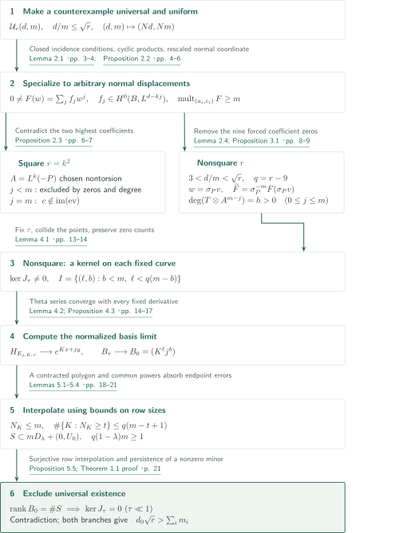
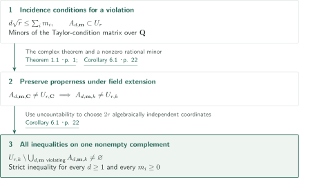
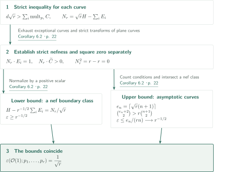

# Nagata’s conjecture for plane curves

**Specialization to a normal bundle and elliptic interpolation produce the equal-weight nef boundary**

The manuscript reduces unequal multiplicities at very general plane points to an equal-multiplicity system existing at every configuration, and excludes that system. This article describes the author's statements and proof connections; it does not independently certify the complete proof.

## 1. Main results

### Theorem 1.1 — A simultaneous strict inequality for all multiplicities

Let $r\ge10$ be an integer, and let $U_r\subset(\mathbf P^2_{\mathbf C})^r$ be the space of distinct ordered $r$-tuples. The author asserts the existence of a countable union $E_r\subset U_r$ of proper Zariski-closed subsets, with nonempty complement, such that the following holds for every $(p_1,\ldots,p_r)\notin E_r$. For every nonzero effective plane curve $C$ of degree $d\ge1$ and every $m_i\in\mathbf Z_{\ge0}$ satisfying $\operatorname{mult}_{p_i}C\ge m_i$,

$$d\sqrt r>\sum_{i=1}^r m_i.$$

Reducible and nonreduced curves are included. One exceptional set works for every degree and multiplicity vector: the points are **very general**. This must not be replaced by a statement on one Zariski-open set. The assertion does not include $r=9$.

<!-- cite:main-result -->[Theorem 1.1 · p. 1](https://github.com/openai/math/blob/1581d4cbdd69a0faf34b2089614fe2a814316a6a/preprints/Nagatas-Conjecture-for-Plane-Curves-September-23-2026/main.pdf)<!-- /cite -->

### Corollary 6.1 — Passage to uncountable characteristic-zero fields

Let $k$ be an uncountable algebraically closed field of characteristic zero, and let $r\ge10$. In the space of distinct ordered $r$-tuples in $\mathbf P^2_k$, the same strict inequality, with the degree, multiplicity and curve conventions of Theorem 1.1, holds simultaneously outside a countable union of proper closed subsets with nonempty complement.

<!-- cite:fields -->[Corollary 6.1 · p. 22](https://github.com/openai/math/blob/1581d4cbdd69a0faf34b2089614fe2a814316a6a/preprints/Nagatas-Conjecture-for-Plane-Curves-September-23-2026/main.pdf)<!-- /cite -->

### Corollary 6.2 — Strict nefness, square zero and maximal multipoint Seshadri constants

Blow up the plane at a tuple covered by Theorem 1.1 or Corollary 6.1. Write $H$ for the pullback of a line and $E_i$ for the exceptional curves. Then

$$N_r=\sqrt r\,H-\sum_iE_i\quad\text{is strictly nef},\qquad N_r^2=0.$$

The constant here is the equal-weight multipoint constant, normalized as

$$\varepsilon(\mathcal O(1);p_1,\ldots,p_r)
=\sup\{t\ge0:H-t\sum_iE_i\text{ is nef}\}
=\frac1{\sqrt r}.$$

It is neither a one-point constant nor a constant with separately prescribed weights. Its value is irrational for nonsquare $r$.

<!-- cite:positivity -->[Corollary 6.2 · p. 22](https://github.com/openai/math/blob/1581d4cbdd69a0faf34b2089614fe2a814316a6a/preprints/Nagatas-Conjecture-for-Plane-Curves-September-23-2026/main.pdf)<!-- /cite -->

## References on the arrows

<!-- reference-guide -->
Unprefixed theorem, lemma, section and equation numbers refer to [Nagata’s conjecture for plane curves](https://github.com/openai/math/blob/1581d4cbdd69a0faf34b2089614fe2a814316a6a/preprints/Nagatas-Conjecture-for-Plane-Curves-September-23-2026/main.pdf). External inputs use the following keys.

- [StacksN](https://stacks.math.columbia.edu/download/divisors.pdf) The Stacks Project Authors — *The Stacks project — Divisors*: Identify the normal bundle with O_B(k). Online chapter PDF and tag statement consulted 2026-10-15.
- [StacksC](https://stacks.math.columbia.edu/download/coherent.pdf) The Stacks Project Authors — *The Stacks project — Cohomology of Schemes*: Compute the section-space dimension in the square case. Online chapter PDF and tag statement consulted 2026-10-15.
- [StacksT](https://stacks.math.columbia.edu/download/curves.pdf) The Stacks Project Authors — *The Stacks project — Algebraic Curves*: Choose a nontorsion degree-zero line bundle. Online chapter PDF and tag statement consulted 2026-10-15.
- [Chow49](https://www.jstor.org/stable/2372375) W.-L. Chow — *On Compact Complex Analytic Varieties*: Algebraicity of the analytic image in Lemma 3.3; original theorem statement not checked. American Journal of Mathematics 71 (1949), 893–914; original theorem location unverified.

Each citation gives the result and pages. When printed pagination differs from the PDF position, both are shown. GitHub previews do not automatically jump to the cited page.
<!-- /reference-guide -->

## 2. Proof of Theorem 1.1 — Contradict universal existence using two limits

<!-- proof-target:1 -->Proof target：[Theorem 1.1 · p. 1](https://github.com/openai/math/blob/1581d4cbdd69a0faf34b2089614fe2a814316a6a/preprints/Nagatas-Conjecture-for-Plane-Curves-September-23-2026/main.pdf)<!-- /proof-target -->

**Proof route.** Express existence of a counterexample by closed incidence loci and take cyclic products to equalize multiplicities. For square $r$, at most two coefficients yield the contradiction. For nonsquare $r$, collide the remaining $r-9$ points on the normal bundle of a cubic to obtain a nonzero kernel, then prove column independence of a numerical matrix obtained by degenerating the elliptic curve. The diagram collects these branches and the final contradiction.

### 1. A countable exceptional set, cyclic products and normal polynomials

For a fixed degree $e$ and multiplicity vector $\mathbf n$, the locus $A_{e,\mathbf n}$ admitting a nonzero form is closed: it is defined over $\mathbf Q$ by the full-column-size minors of the Taylor-condition matrix. Remove all proper such loci to form $E_r$. A counterexample outside $E_r$ therefore has an incidence locus equal to all of $U_r$. Multiplying forms associated with the $r$ cyclic permutations gives $d=rd_0$, $m=\sum_i m_i>0$, and

$$\mathcal U_r(d,m):\quad\text{every distinct-point configuration admits a nonzero degree-}d
\text{ form of multiplicity }\ge m\text{ at every point},$$

with $d/m\le\sqrt r$. We write $\mathcal U_r$ for the manuscript's property $U_r(d,m)$ to distinguish it from the configuration space. The property persists under every common multiple $(Nd,Nm)$.

For a smooth degree-$k$ plane curve $B$, put $L=\mathcal O_B(1)$; its normal bundle is $M=L^k$. Move points towards $B$ and rescale the normal direction. For arbitrary distinct $a_i\in B$ and arbitrary normal vectors $c_i\in M_{a_i}$, this produces

$$0\ne F(w)=\sum_{j=0}^{\lfloor d/k\rfloor}f_jw^j,\qquad f_j\in H^0(B,L^{d-kj}),$$

of multiplicity at least $m$ at each $(a_i,c_i)$. Taking the lowest power of the motion parameter leaves distinct powers of $w$, ensuring nonvanishing. Multiplicity is preserved by extending the local derivative conditions, centered at the moving points, to parameter zero. The proof contradicts universal existence at a special configuration; it does not assume a reverse deformation from special to general points.

<!-- cite:universal -->[Lemma 2.1 · pp. 3–4](https://github.com/openai/math/blob/1581d4cbdd69a0faf34b2089614fe2a814316a6a/preprints/Nagatas-Conjecture-for-Plane-Curves-September-23-2026/main.pdf)<!-- /cite -->

<!-- cite:normal -->[Proposition 2.2 · pp. 4–6](https://github.com/openai/math/blob/1581d4cbdd69a0faf34b2089614fe2a814316a6a/preprints/Nagatas-Conjecture-for-Plane-Curves-September-23-2026/main.pdf)<!-- /cite -->

<!-- cite:normal-input -->[&#91;StacksN, Tag 0B3P, Lemma 15.2, p. 26&#93;](https://stacks.math.columbia.edu/download/divisors.pdf#page=26)<!-- /cite -->

### 2. Exclude equality as well in the square case

Let $r=k^2$ with $k\ge4$. Choose $P=\sum a_i$ so that $A=M(-P)$ is nontorsion, and choose the normal-vector tuple $c$ outside the image of $H^0(B,M)\to\bigoplus_iM_{a_i}$. These choices use countability of torsion and $h^0(B,M)=(k^2+3k)/2<r$.

If $j$ is the highest exponent of $F$, then $d\le km$ implies $j\le m$. When $j<m$, the required zeros of the leading coefficient either exceed its degree or, at the boundary $d=km$, produce a nonzero section of the nontrivial degree-zero bundle $A^{m-j}$. Both are impossible. The remaining case has $j=m$, $d=km$, and a nonzero constant leading coefficient $f_m$. Each fiber restriction equals $f_m(w-c_i)^m$, so the next coefficient satisfies $(f_{m-1}(a_i))=-mf_m(c_i)$. This puts the chosen $c$ in the evaluation image, again a contradiction. This second step excludes the endpoint equality.

<!-- cite:square -->[Proposition 2.3 · pp. 6–7](https://github.com/openai/math/blob/1581d4cbdd69a0faf34b2089614fe2a814316a6a/preprints/Nagatas-Conjecture-for-Plane-Curves-September-23-2026/main.pdf)<!-- /cite -->

<!-- cite:cohomology-input -->[&#91;StacksC, Tag 01XT, Lemma 8.1, p. 16&#93;](https://stacks.math.columbia.edu/download/coherent.pdf#page=16)<!-- /cite -->

<!-- cite:torsion-input -->[&#91;StacksT, Tag 0C1Z, Lemma 17.1, p. 36&#93;](https://stacks.math.columbia.edu/download/curves.pdf#page=36)<!-- /cite -->

### 3. Nonsquare case: collision on a fixed curve, then a numerical matrix limit

The rationality of $d/m$ gives $d/m<\sqrt r$. Setting nine normal displacements to zero on a cubic forces the coefficient of degree $j<m$ to vanish along $(m-j)P$. Lemma 2.4 excludes $d\le3m$. Put $A=L^3(-P)$ and $T=L^{d-3m}$. The substitution $w=\sigma_Pv$ and division $\widetilde F=\sigma_P^{-m}F(\sigma_Pv)$ place the first $m+1$ coefficient blocks in bundles $T\otimes A^{m-j}$ of the same positive degree $h=3(d-3m)$. For $j>m$, use $\sigma_P^{j-m}H^0(B,L^{d-3j})$; their direct sum defines $W_\tau$.

Take $B=X_\tau=\mathbf C^*/\tau^{\mathbf Z}$, $0<\tau<1$, with the manuscript's theta-bundle multipliers. Degree-three sections separate points and tangent directions, giving an analytic embedding; Lemma 3.3 invokes Chow's theorem to make its image an algebraic plane cubic. The location and statement in Chow's original paper remain unchecked here.

First fix $\tau$. Collide the remaining $q=r-9$ points along $y=0$ in local coordinates $(x,y)$. After $b$ derivatives in $y$, there are zeros of order at least $m-b$ at each point. A normalized finite-dimensional subsequence has a nonzero limit; Rouché's theorem preserves the total number of zeros and gives

$$J_\tau:W_\tau\longrightarrow\mathbf C^I,\quad
I=\{(\ell,b):0\le b<m,\ 0\le\ell<q(m-b)\},\qquad\ker J_\tau\ne0.$$

Next normalize the residue-class theta bases. Their local expressions converge to $e^{Kx+jy}$ together with every fixed derivative, so the matrices converge to $B_0=(K^\ell j^b)$. No continuous choice of kernel vectors across $\tau$ is used.

<!-- cite:cubic -->[Lemma 2.4; Proposition 3.1 · pp. 8–9](https://github.com/openai/math/blob/1581d4cbdd69a0faf34b2089614fe2a814316a6a/preprints/Nagatas-Conjecture-for-Plane-Curves-September-23-2026/main.pdf)<!-- /cite -->

<!-- cite:theta -->[Lemmas 3.2–3.3; §3.3 · pp. 10–12](https://github.com/openai/math/blob/1581d4cbdd69a0faf34b2089614fe2a814316a6a/preprints/Nagatas-Conjecture-for-Plane-Curves-September-23-2026/main.pdf)<!-- /cite -->

<!-- cite:collision -->[Lemma 4.1 · pp. 13–14](https://github.com/openai/math/blob/1581d4cbdd69a0faf34b2089614fe2a814316a6a/preprints/Nagatas-Conjecture-for-Plane-Curves-September-23-2026/main.pdf)<!-- /cite -->

<!-- cite:matrix -->[Lemma 4.2; Proposition 4.3 · pp. 14–17](https://github.com/openai/math/blob/1581d4cbdd69a0faf34b2089614fe2a814316a6a/preprints/Nagatas-Conjecture-for-Plane-Curves-September-23-2026/main.pdf)<!-- /cite -->

### 4. Row interpolation yields column independence and excludes every counterexample

The finite exponent set $S=\{(j,K)\}$ is defined in (4.4), including the degree-zero block $(d/3,0)$ when $3\mid d$. Put $a=3(\sqrt r-3)$, $\rho=3(d/m-3)$, and choose positive rational $\Delta$ with $\rho+\Delta\rho/9<a$. Taking $\lambda<1$ sufficiently close to one places $S$ in a contracted polygon $mD_\lambda+(0,U_0)$. Its maximum horizontal width is $m\lambda$, and the interval of heights with width at least $s$ has length $q(m\lambda-s)$. The identity $2a+a^2/9=q$ is decisive.

First take a common multiple of $(d,m)$ so that $q(1-\lambda)m\ge1$. This absorbs the lattice endpoint error and gives

$$N_K:=\#\{j:(j,K)\in S\}\le m,\qquad
\#\{K:N_K\ge t\}\le q(m-t+1)\quad(1\le t\le m).$$

Interpolate the largest rows first, multiplying each correction by $\prod_{a<i}(K-K_a)$ to preserve earlier rows. Every correction still satisfies $\ell<q(m-b)$. Hence the allowed span of $K^\ell J^b$ maps onto all functions on $S$, and $B_0$ has full column rank. A nonzero maximal minor persists for sufficiently small positive $\tau$, making $J_\tau$ injective and contradicting its nonzero kernel.

The common multiple leaves $d/m$, $\Delta$ and $\lambda$ unchanged and is taken once, before both limits. Exclusion of $\mathcal U_r(d,m)$ in both square and nonsquare cases returns the strict inequality for every degree and every unequal multiplicity vector outside the original single $E_r$.

<!-- cite:rows -->[Lemmas 5.1–5.4 · pp. 18–21](https://github.com/openai/math/blob/1581d4cbdd69a0faf34b2089614fe2a814316a6a/preprints/Nagatas-Conjecture-for-Plane-Curves-September-23-2026/main.pdf)<!-- /cite -->

<!-- cite:full-rank -->[Proposition 5.5; Theorem 1.1 proof · p. 21](https://github.com/openai/math/blob/1581d4cbdd69a0faf34b2089614fe2a814316a6a/preprints/Nagatas-Conjecture-for-Plane-Curves-September-23-2026/main.pdf)<!-- /cite -->

## 3. Proof of Corollary 6.1 — Transfer rational closed conditions

<!-- proof-target:2 -->Proof target：[Corollary 6.1 · p. 22](https://github.com/openai/math/blob/1581d4cbdd69a0faf34b2089614fe2a814316a6a/preprints/Nagatas-Conjecture-for-Plane-Curves-September-23-2026/main.pdf)<!-- /proof-target -->

Transfer all quantifiers of Theorem 1.1 to the fields in [Corollary 6.1 above](#corollary-6-1).

### 1. Proper incidence loci and a nonempty complement

For every violating $(d,\mathbf m)$, the incidence locus is defined by rational minors. Properness over $\mathbf C$ implies properness over $\mathbf Q$, and a nonzero rational minor stays nonzero under characteristic-zero field extension. Removing these countably many loci yields all inequalities simultaneously. Uncountability of $k$ permits $2r$ coordinates algebraically independent over $\mathbf Q$; they avoid every excluded locus and every diagonal. No embedding $k\hookrightarrow\mathbf C$ is required.

<!-- cite:fields -->[Corollary 6.1 · p. 22](https://github.com/openai/math/blob/1581d4cbdd69a0faf34b2089614fe2a814316a6a/preprints/Nagatas-Conjecture-for-Plane-Curves-September-23-2026/main.pdf)<!-- /cite -->

## 4. Proof of Corollary 6.2 — Combine curvewise positivity with an asymptotic upper bound

<!-- proof-target:3 -->Proof target：[Corollary 6.2 · p. 22](https://github.com/openai/math/blob/1581d4cbdd69a0faf34b2089614fe2a814316a6a/preprints/Nagatas-Conjecture-for-Plane-Curves-September-23-2026/main.pdf)<!-- /proof-target -->

For the three conclusions of [Corollary 6.2](#corollary-6-2), separate the lower bound obtained from the strict inequality from the upper bound obtained by counting conditions.

### 1. Intersections with every irreducible curve and the self-intersection

An irreducible curve on the blowup is exceptional or the strict transform of a plane curve. In the former case $N_r\cdot E_i=1$; in the latter, $N_r\cdot\widetilde C=d\sqrt r-\sum_i\operatorname{mult}_{p_i}C>0$. Thus $N_r$ is strictly nef. Separately, $H^2=1$, $H\cdot E_i=0$ and $E_i\cdot E_j=-\delta_{ij}$ give $N_r^2=r-r=0$. Nefness is not inferred from this numerical identity alone.

<!-- cite:positivity -->[Corollary 6.2 · p. 22](https://github.com/openai/math/blob/1581d4cbdd69a0faf34b2089614fe2a814316a6a/preprints/Nagatas-Conjecture-for-Plane-Curves-September-23-2026/main.pdf)<!-- /cite -->

### 2. The normalized lower bound and the interpolation-count upper bound

Nefness of $N_r/\sqrt r=H-r^{-1/2}\sum_iE_i$ gives $\varepsilon\ge r^{-1/2}$. For the reverse bound, set $e_n=\lceil\sqrt r(n+1)\rceil$. Since $\binom{e_n+2}{2}>r\binom{n+1}{2}$, there is a nonzero degree-$e_n$ form $D$ of multiplicity at least $n$ at every point. If $H-t\sum_iE_i$ is nef, then

$$0\le e_n-t\sum_i\operatorname{mult}_{p_i}D\le e_n-trn,$$

so $t\le e_n/(rn)\to1/\sqrt r$. This upper bound follows from the condition count for any configuration; the difficulty at very general points is the matching lower bound. Positive intersection with each curve is compatible with an asymptotic threshold equal to the boundary value.

<!-- cite:positivity -->[Corollary 6.2 · p. 22](https://github.com/openai/math/blob/1581d4cbdd69a0faf34b2089614fe2a814316a6a/preprints/Nagatas-Conjecture-for-Plane-Curves-September-23-2026/main.pdf)<!-- /cite -->

## 5. Which papers supply which steps

| Source and result | Used at | Role and required hypotheses | Checking scope |
|---|---|---|---|
| <!-- cite:normal-input -->[&#91;StacksN, Tag 0B3P, Lemma 15.2, p. 26&#93;](https://stacks.math.columbia.edu/download/divisors.pdf#page=26)<!-- /cite --> | Proposition 2.2, p. 4 | Identify the normal bundle of a smooth plane curve as an effective Cartier divisor | Statement and application compared |
| <!-- cite:cohomology-input -->[&#91;StacksC, Tag 01XT, Lemma 8.1, p. 16&#93;](https://stacks.math.columbia.edu/download/coherent.pdf#page=16)<!-- /cite --> | Proposition 2.3, p. 7 | $H^1(\mathbf P^2,\mathcal O)=0$ and the restriction sequence | Statement and application compared |
| <!-- cite:torsion-input -->[&#91;StacksT, Tag 0C1Z, Lemma 17.1, p. 36&#93;](https://stacks.math.columbia.edu/download/curves.pdf#page=36)<!-- /cite --> | Proposition 2.3, p. 6; Lemma 2.4, p. 8 | Finiteness of fixed-order torsion for a smooth projective curve in characteristic zero | Statement and application compared |
| Chow49 | Lemma 3.3, p. 11 | Algebraicity of the closed image of a compact analytic embedding | Use and hypotheses compared; original statement and location unchecked |

Dumnicki's evaluation matrices, Evain's collisions and Rosengren's theta conventions are methodological background explicitly identified by the manuscript. The particular row interpolation, collision conditions and normalized convergence used here are proved within the manuscript, so no unchecked direct-dependency arrows are assigned to those references. Exhaustive connections to other catalogues have not been investigated.

## 6. Return to the sources

<!-- reading-list -->
- [Lemma 2.1 · pp. 3–4](https://github.com/openai/math/blob/1581d4cbdd69a0faf34b2089614fe2a814316a6a/preprints/Nagatas-Conjecture-for-Plane-Curves-September-23-2026/main.pdf) — A common exceptional set for all degrees and multiplicities, and symmetrization.
- [Proposition 2.2 · pp. 4–6](https://github.com/openai/math/blob/1581d4cbdd69a0faf34b2089614fe2a814316a6a/preprints/Nagatas-Conjecture-for-Plane-Curves-September-23-2026/main.pdf) — Nonvanishing and multiplicity in the normal limit.
- [Proposition 2.3 · pp. 6–7](https://github.com/openai/math/blob/1581d4cbdd69a0faf34b2089614fe2a814316a6a/preprints/Nagatas-Conjecture-for-Plane-Curves-September-23-2026/main.pdf) — Two steps excluding equality in the square case.
- [Lemma 4.1 · pp. 13–14](https://github.com/openai/math/blob/1581d4cbdd69a0faf34b2089614fe2a814316a6a/preprints/Nagatas-Conjecture-for-Plane-Curves-September-23-2026/main.pdf) — Collide points only after fixing the elliptic curve.
- [Lemma 4.2; Proposition 4.3 · pp. 14–17](https://github.com/openai/math/blob/1581d4cbdd69a0faf34b2089614fe2a814316a6a/preprints/Nagatas-Conjecture-for-Plane-Curves-September-23-2026/main.pdf) — Basis normalization and the numerical matrix limit.
- [Lemmas 5.1–5.4 · pp. 18–21](https://github.com/openai/math/blob/1581d4cbdd69a0faf34b2089614fe2a814316a6a/preprints/Nagatas-Conjecture-for-Plane-Curves-September-23-2026/main.pdf) — Control the row distribution, not merely total dimension.
- [Corollary 6.2 · p. 22](https://github.com/openai/math/blob/1581d4cbdd69a0faf34b2089614fe2a814316a6a/preprints/Nagatas-Conjecture-for-Plane-Curves-September-23-2026/main.pdf) — Separate strict nefness, square zero, and the two bounds for the constant.
<!-- /reading-list -->

The editorial check compared the hypotheses and every principal conclusion with the statements and the listed proof passages in §§2–6. Particular attention was paid to arbitrary multiplicities, the square endpoint, the order of the fixed-curve collision and the subsequent matrix limit, lattice endpoint errors, and the separate Seshadri bounds. The three Stacks statements and their applications were compared. Chow's original theorem statement, external proofs, all background literature, and a complete independent verification of the analytic estimates remain outside this check.

<!-- cite:reading-scope -->[§§2–6 · pp. 3–22](https://github.com/openai/math/blob/1581d4cbdd69a0faf34b2089614fe2a814316a6a/preprints/Nagatas-Conjecture-for-Plane-Curves-September-23-2026/main.pdf)<!-- /cite -->
