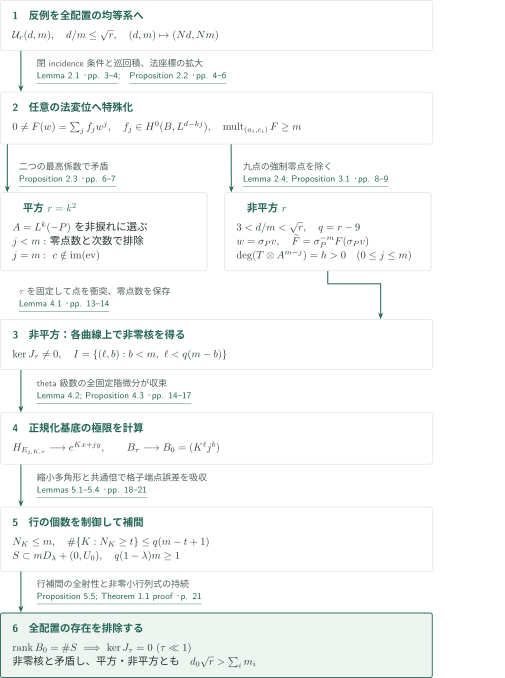
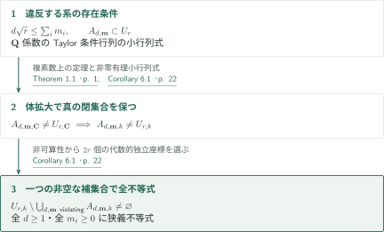
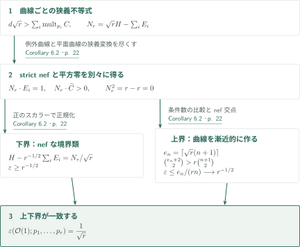

# Nagata’s conjecture for plane curves

**法束への特殊化と楕円曲線上の補間を経て、等重みの nef 境界を得る**

本原稿は、非常に一般な平面の点における不均等な重複度を、全配置で存在する均等重複度の系へ帰着し、その存在を排除する。以下は著者が掲げる定理と証明の接続の概説であり、原稿全体の独立した正しさの認定ではない。

## 1. 主要結果

### Theorem 1.1 — 全重複度について同時に成り立つ狭義不等式

$r\ge10$ を整数とし、$U_r\subset(\mathbf P^2_{\mathbf C})^r$ を相異なる順序付き $r$ 点の空間とする。著者は、真の Zariski 閉集合の可算和 $E_r\subset U_r$ で補集合が非空となるものが存在し、任意の $(p_1,\ldots,p_r)\notin E_r$ に対し、次が成り立つと主張する。任意の次数 $d\ge1$ の非零有効平面曲線 $C$ と、$\operatorname{mult}_{p_i}C\ge m_i$ を満たす任意の $m_i\in\mathbf Z_{\ge0}$ に対して

$$d\sqrt r>\sum_{i=1}^r m_i.$$

可約曲線・非被約曲線を含む。例外集合は次数・重複度ベクトルによらず一つであり、ここでの配置は「非常に一般」である。単一の Zariski 開集合上の主張に置き換えない。$r=9$ は主張の範囲外である。

<!-- cite:main-result -->[Theorem 1.1 · p. 1](https://github.com/openai/math/blob/1581d4cbdd69a0faf34b2089614fe2a814316a6a/preprints/Nagatas-Conjecture-for-Plane-Curves-September-23-2026/main.pdf)<!-- /cite -->

### Corollary 6.1 — 非可算な標数零体への移行

$k$ を非可算代数閉体、$\operatorname{char}k=0$、$r\ge10$ とする。$\mathbf P^2_k$ の相異なる順序付き $r$ 点の空間でも、真の閉集合の可算和の非空な補集合上で Theorem 1.1 と同じ次数・重複度・曲線の規約による狭義不等式が同時に成り立つ。

<!-- cite:fields -->[Corollary 6.1 · p. 22](https://github.com/openai/math/blob/1581d4cbdd69a0faf34b2089614fe2a814316a6a/preprints/Nagatas-Conjecture-for-Plane-Curves-September-23-2026/main.pdf)<!-- /cite -->

### Corollary 6.2 — strict nef、平方零、最大多点 Seshadri 定数

Theorem 1.1 または Corollary 6.1 の点配置で平面をブローアップした $X$ において、$H$ を直線の引戻し、$E_i$ を例外曲線とする。このとき

$$N_r=\sqrt r\,H-\sum_iE_i\quad\text{は strictly nef},\qquad N_r^2=0.$$

ここで用いるのは等重みの多点定数であり、正規化は

$$\varepsilon(\mathcal O(1);p_1,\ldots,p_r)
=\sup\{t\ge0:H-t\sum_iE_i\text{ is nef}\}
=\frac1{\sqrt r}.$$

一点定数でも、個別の重みを指定した定数でもない。非平方の $r$ では値は無理数となる。

<!-- cite:positivity -->[Corollary 6.2 · p. 22](https://github.com/openai/math/blob/1581d4cbdd69a0faf34b2089614fe2a814316a6a/preprints/Nagatas-Conjecture-for-Plane-Curves-September-23-2026/main.pdf)<!-- /cite -->

## 図の矢印に付した引用

<!-- reference-guide -->
略号のない定理・補題・節・式番号は本原稿 [Nagata’s conjecture for plane curves](https://github.com/openai/math/blob/1581d4cbdd69a0faf34b2089614fe2a814316a6a/preprints/Nagatas-Conjecture-for-Plane-Curves-September-23-2026/main.pdf) を指します。外部入力には次の略号を使います。

- [StacksN](https://stacks.math.columbia.edu/download/divisors.pdf) The Stacks Project Authors — *The Stacks project — Divisors*：法束を O_B(k) と同定する。Online chapter PDF and tag statement consulted 2026-10-15。
- [StacksC](https://stacks.math.columbia.edu/download/coherent.pdf) The Stacks Project Authors — *The Stacks project — Cohomology of Schemes*：平方の場合に切断空間の次元を計算する。Online chapter PDF and tag statement consulted 2026-10-15。
- [StacksT](https://stacks.math.columbia.edu/download/curves.pdf) The Stacks Project Authors — *The Stacks project — Algebraic Curves*：非捩れの次数0の線束を選ぶ。Online chapter PDF and tag statement consulted 2026-10-15。
- [Chow49](https://www.jstor.org/stable/2372375) W.-L. Chow — *On Compact Complex Analytic Varieties*：Lemma 3.3の解析的像の代数性に使用。原著の定理記述は未照合。American Journal of Mathematics 71 (1949), 893–914; original theorem location unverified。

各引用に結果番号とページを付します。誌面番号とPDF内の位置が異なる場合は両方を示します。GitHubの閲覧リンクではページ位置への自動移動を前提としません。
<!-- /reference-guide -->

## 2. Theorem 1.1 の証明 — 全配置の存在を二つの極限で矛盾させる

<!-- proof-target:1 -->証明対象：[Theorem 1.1 · p. 1](https://github.com/openai/math/blob/1581d4cbdd69a0faf34b2089614fe2a814316a6a/preprints/Nagatas-Conjecture-for-Plane-Curves-September-23-2026/main.pdf)<!-- /proof-target -->

**証明の道筋。** 反例の存在条件を閉集合として記述し、巡回積によって均等重複度へ移る。平方の場合は高々二つの係数が矛盾を与える。非平方の場合は、三次曲線の法束上で残る $r-9$ 点を衝突させて非零核を作る一方、楕円曲線を退化させた数値行列の列独立性を示す。図はこの分岐と最後の矛盾をまとめている。

### 1. 可算例外集合、巡回積、法束多項式

固定した次数 $e$ と重複度ベクトル $\mathbf n$ に対し、非零の曲線が存在する配置の集合 $A_{e,\mathbf n}$ は Taylor 条件行列の最大列小行列式で定義される閉集合で、$\mathbf Q$ 上定義される。真の $A_{e,\mathbf n}$ をすべて除いた $E_r$ の外で反例があれば、その一つの存在条件は $U_r$ 全体で成り立つ。点の巡回置換に対応する $r$ 個の式の積を取ると、$d=rd_0$、$m=\sum_i m_i>0$ に対して

$$\mathcal U_r(d,m):\quad\text{すべての相異なる点配置に、次数 }d\text{、各点重複度}\ge m\text{ の非零形式が存在}$$

が成り立ち、$d/m\le\sqrt r$ となる。ここで $\mathcal U_r$ は本原稿の性質 $U_r(d,m)$ を配置空間と区別して書いたもの。任意の共通倍数 $(Nd,Nm)$ にも同じ性質が成り立つ。

滑らかな次数 $k$ の平面曲線 $B$ と $L=\mathcal O_B(1)$ に対し、法束は $M=L^k$。点を $B$ に向けて動かし法方向を拡大すると、任意の相異なる $a_i\in B$ と任意の法ベクトル $c_i\in M_{a_i}$ において重複度 $m$ 以上を持つ

$$0\ne F(w)=\sum_{j=0}^{\lfloor d/k\rfloor}f_jw^j,\qquad f_j\in H^0(B,L^{d-kj})$$

を得る。最小の $s$ 次数を取り出す際、残る項の $w$ 指数が異なることが非零性を保証する。重複度は移動点に中心を移した局所式の微分条件を $s=0$ へ延長して保つ。特殊配置から一般配置への逆向きの変形を仮定するのではなく、全配置での存在を特殊配置で矛盾させている。

<!-- cite:universal -->[Lemma 2.1 · pp. 3–4](https://github.com/openai/math/blob/1581d4cbdd69a0faf34b2089614fe2a814316a6a/preprints/Nagatas-Conjecture-for-Plane-Curves-September-23-2026/main.pdf)<!-- /cite -->

<!-- cite:normal -->[Proposition 2.2 · pp. 4–6](https://github.com/openai/math/blob/1581d4cbdd69a0faf34b2089614fe2a814316a6a/preprints/Nagatas-Conjecture-for-Plane-Curves-September-23-2026/main.pdf)<!-- /cite -->

<!-- cite:normal-input -->[&#91;StacksN, Tag 0B3P, Lemma 15.2, p. 26&#93;](https://stacks.math.columbia.edu/download/divisors.pdf#page=26)<!-- /cite -->

### 2. 平方の場合は等号も排除する

$r=k^2$、$k\ge4$ とする。$P=\sum a_i$ を $A=M(-P)$ が非捩れとなるよう選び、法ベクトルの組 $c$ は評価写像 $H^0(B,M)\to\bigoplus_iM_{a_i}$ の像の外に取る。これは torsion が可算であることと、$h^0(B,M)=(k^2+3k)/2<r$ による。

$F$ の最高次数を $j$ とする。$d\le km$ なら $j\le m$。$j<m$ のとき最高係数の必要な零点数が次数を超えるか、境界 $d=km$ で非自明な次数零束 $A^{m-j}$ に非零切断を与えて矛盾する。残る $j=m$、$d=km$ では最高係数 $f_m$ が非零定数で、各ファイバー上 $F=f_m(w-c_i)^m$。次の係数が $(f_{m-1}(a_i))=-mf_m(c_i)$ を満たすため、選んだ $c$ が評価写像の像に入ってしまう。これが狭義の境界を含む排除である。

<!-- cite:square -->[Proposition 2.3 · pp. 6–7](https://github.com/openai/math/blob/1581d4cbdd69a0faf34b2089614fe2a814316a6a/preprints/Nagatas-Conjecture-for-Plane-Curves-September-23-2026/main.pdf)<!-- /cite -->

<!-- cite:cohomology-input -->[&#91;StacksC, Tag 01XT, Lemma 8.1, p. 16&#93;](https://stacks.math.columbia.edu/download/coherent.pdf#page=16)<!-- /cite -->

<!-- cite:torsion-input -->[&#91;StacksT, Tag 0C1Z, Lemma 17.1, p. 36&#93;](https://stacks.math.columbia.edu/download/curves.pdf#page=36)<!-- /cite -->

### 3. 非平方の場合：固定曲線上の衝突と数値行列の極限

$d/m$ は有理数なので $d/m<\sqrt r$。三次曲線の九点で法変位を零にすると、$j<m$ の係数に $(m-j)P$ の零点が強制される。Lemma 2.4 は $d\le3m$ を排除する。$A=L^3(-P)$、$T=L^{d-3m}$ とし、$w=\sigma_Pv$、$\widetilde F=\sigma_P^{-m}F(\sigma_Pv)$ により最初の $m+1$ 係数を同じ正次数 $h=3(d-3m)$ の束 $T\otimes A^{m-j}$ に置く。$j>m$ には $\sigma_P^{j-m}H^0(B,L^{d-3j})$ を用い、その直和を $W_\tau$ とする。

$B=X_\tau=\mathbf C^*/\tau^{\mathbf Z}$、$0<\tau<1$ とし、原典の multiplier を持つ theta 束を用いる。次数3の切断系は点・接ベクトルを分離するため解析的埋込みを与え、Lemma 3.3 は Chow の定理により像を代数的な平面三次曲線とする。Chow 原著の定理箇所は今回未照合である。

まず $\tau$ を固定する。残り $q=r-9$ 点を局所座標 $(x,y)$ の $y=0$ 上で衝突させる。$b$ 回の $y$ 微分後には各点で $m-b$ 次以上の零点があるので、正規化した有限次元切断の非零極限に対し Rouché の定理が零点の合計を保存し、

$$J_\tau:W_\tau\longrightarrow\mathbf C^{I},\quad
I=\{(\ell,b):0\le b<m,\ 0\le\ell<q(m-b)\},\qquad\ker J_\tau\ne0$$

を得る。次に theta 級数の剰余類ごとの基底を正規化すると、その局所式は $e^{Kx+jy}$ へ固定次数の全微分とともに収束する。したがって行列は $B_0=(K^\ell j^b)$ に収束する。$\tau$ をまたぐ核ベクトルの連続選択は使わない。

<!-- cite:cubic -->[Lemma 2.4; Proposition 3.1 · pp. 8–9](https://github.com/openai/math/blob/1581d4cbdd69a0faf34b2089614fe2a814316a6a/preprints/Nagatas-Conjecture-for-Plane-Curves-September-23-2026/main.pdf)<!-- /cite -->

<!-- cite:theta -->[Lemmas 3.2–3.3; §3.3 · pp. 10–12](https://github.com/openai/math/blob/1581d4cbdd69a0faf34b2089614fe2a814316a6a/preprints/Nagatas-Conjecture-for-Plane-Curves-September-23-2026/main.pdf)<!-- /cite -->

<!-- cite:collision -->[Lemma 4.1 · pp. 13–14](https://github.com/openai/math/blob/1581d4cbdd69a0faf34b2089614fe2a814316a6a/preprints/Nagatas-Conjecture-for-Plane-Curves-September-23-2026/main.pdf)<!-- /cite -->

<!-- cite:matrix -->[Lemma 4.2; Proposition 4.3 · pp. 14–17](https://github.com/openai/math/blob/1581d4cbdd69a0faf34b2089614fe2a814316a6a/preprints/Nagatas-Conjecture-for-Plane-Curves-September-23-2026/main.pdf)<!-- /cite -->

### 4. 行補間で列独立性を得て、すべての反例を排除する

指数集合 $S=\{(j,K)\}$ は原典 (4.4) の有限集合であり、$3\mid d$ の場合の次数零ブロック $(d/3,0)$ も含む。$a=3(\sqrt r-3)$、$\rho=3(d/m-3)$ とし、$0<\Delta\in\mathbf Q$ を $\rho+\Delta\rho/9<a$ となるよう選ぶ。さらに $\lambda<1$ を十分1に近く取ると、$S$ は縮小多角形 $mD_\lambda+(0,U_0)$ に入る。この多角形の最大水平幅は $m\lambda$、幅が $s$ 以上の高さの区間長は $q(m\lambda-s)$ である。ここで $2a+a^2/9=q$ が効く。

あらかじめ $(d,m)$ を共通倍して $q(1-\lambda)m\ge1$ とすれば、格子点端点の誤差を吸収して

$$N_K:=\#\{j:(j,K)\in S\}\le m,\qquad
\#\{K:N_K\ge t\}\le q(m-t+1)\quad(1\le t\le m)$$

を得る。大きい行から順に補間し、既処理の高さで消える $\prod_{a<i}(K-K_a)$ を掛けると、各補正項は $\ell<q(m-b)$ を保つ。したがって $K^\ell J^b$ の許された空間が $S$ 上の全関数へ全射となり、$B_0$ は列フルランクである。非零最大小行列式の連続性により小さい正の $\tau$ でも $J_\tau$ は単射となり、前段の非零核と矛盾する。

共通倍は比 $d/m$ と $\Delta,\lambda$ を変えず、点の衝突・行列極限の前に一度だけ取る。平方・非平方の両方で $\mathcal U_r(d,m)$ が排除されるため、最初の一つの $E_r$ の外で任意の次数・不均等重複度に狭義不等式が戻る。

<!-- cite:rows -->[Lemmas 5.1–5.4 · pp. 18–21](https://github.com/openai/math/blob/1581d4cbdd69a0faf34b2089614fe2a814316a6a/preprints/Nagatas-Conjecture-for-Plane-Curves-September-23-2026/main.pdf)<!-- /cite -->

<!-- cite:full-rank -->[Proposition 5.5; Theorem 1.1 proof · p. 21](https://github.com/openai/math/blob/1581d4cbdd69a0faf34b2089614fe2a814316a6a/preprints/Nagatas-Conjecture-for-Plane-Curves-September-23-2026/main.pdf)<!-- /cite -->

## 3. Corollary 6.1 の証明 — 有理係数の閉条件を移す

<!-- proof-target:2 -->証明対象：[Corollary 6.1 · p. 22](https://github.com/openai/math/blob/1581d4cbdd69a0faf34b2089614fe2a814316a6a/preprints/Nagatas-Conjecture-for-Plane-Curves-September-23-2026/main.pdf)<!-- /proof-target -->

Theorem 1.1 の全量化を、[上の Corollary 6.1](#corollary-6-1) の体へ移す。

### 1. 真の incidence locus と非空な補集合

違反する各 $(d,\mathbf m)$ の incidence locus は $\mathbf Q$ 係数の小行列式で定義される。複素数上で真なら、有理数上も真で、標数零の体拡大後も非零小行列式は非零である。これら可算個の閉集合を除けばすべての不等式が同時に成立する。非可算な $k$ では $\mathbf Q$ 上代数的独立な $2r$ 個の座標を選べ、全閉集合と対角線を避ける。$k\hookrightarrow\mathbf C$ という埋込みは不要である。

<!-- cite:fields -->[Corollary 6.1 · p. 22](https://github.com/openai/math/blob/1581d4cbdd69a0faf34b2089614fe2a814316a6a/preprints/Nagatas-Conjecture-for-Plane-Curves-September-23-2026/main.pdf)<!-- /cite -->

## 4. Corollary 6.2 の証明 — 曲線ごとの正性と漸近上界を合わせる

<!-- proof-target:3 -->証明対象：[Corollary 6.2 · p. 22](https://github.com/openai/math/blob/1581d4cbdd69a0faf34b2089614fe2a814316a6a/preprints/Nagatas-Conjecture-for-Plane-Curves-September-23-2026/main.pdf)<!-- /proof-target -->

[Corollary 6.2](#corollary-6-2) の三つの結論について、狭義不等式からの下界と、条件数からの上界を分ける。

### 1. すべての既約曲線との交点と自己交点

ブローアップの既約曲線は例外曲線か平面曲線の狭義変換である。前者に対し $N_r\cdot E_i=1$、後者に対し $N_r\cdot\widetilde C=d\sqrt r-\sum_i\operatorname{mult}_{p_i}C>0$。よって strictly nef である。一方、$H^2=1$、$H\cdot E_i=0$、$E_i\cdot E_j=-\delta_{ij}$ から $N_r^2=r-r=0$。この数値等式だけから nef 性を推論しているのではない。

<!-- cite:positivity -->[Corollary 6.2 · p. 22](https://github.com/openai/math/blob/1581d4cbdd69a0faf34b2089614fe2a814316a6a/preprints/Nagatas-Conjecture-for-Plane-Curves-September-23-2026/main.pdf)<!-- /cite -->

### 2. 正規化した下界と、補間条件数による上界

$N_r/\sqrt r=H-r^{-1/2}\sum_iE_i$ が nef なので $\varepsilon\ge r^{-1/2}$。逆向きには $e_n=\lceil\sqrt r(n+1)\rceil$ を取り、$\binom{e_n+2}{2}>r\binom{n+1}{2}$ から、各点で少なくとも $n$ 重の次数 $e_n$ の非零形式 $D$ を得る。$H-t\sum_iE_i$ が nef なら

$$0\le e_n-t\sum_i\operatorname{mult}_{p_i}D\le e_n-trn,$$

従って $t\le e_n/(rn)\to1/\sqrt r$。この上界は任意の配置の条件数から得られ、非常に一般な配置での困難は一致する下界にある。各曲線との交点が正であることと、漸近的な上限が境界値に等しいことは両立する。

<!-- cite:positivity -->[Corollary 6.2 · p. 22](https://github.com/openai/math/blob/1581d4cbdd69a0faf34b2089614fe2a814316a6a/preprints/Nagatas-Conjecture-for-Plane-Curves-September-23-2026/main.pdf)<!-- /cite -->

## 5. どの論文が、どの段階を担うか

| 供給元と結果 | 利用箇所 | 使用内容・必要な仮定 | 確認範囲 |
|---|---|---|---|
| <!-- cite:normal-input -->[&#91;StacksN, Tag 0B3P, Lemma 15.2, p. 26&#93;](https://stacks.math.columbia.edu/download/divisors.pdf#page=26)<!-- /cite --> | Proposition 2.2, p. 4 | 滑らかな平面曲線を有効 Cartier 因子として法束を同定 | 記述と適用を照合 |
| <!-- cite:cohomology-input -->[&#91;StacksC, Tag 01XT, Lemma 8.1, p. 16&#93;](https://stacks.math.columbia.edu/download/coherent.pdf#page=16)<!-- /cite --> | Proposition 2.3, p. 7 | $H^1(\mathbf P^2,\mathcal O)=0$ と制限完全列 | 記述と適用を照合 |
| <!-- cite:torsion-input -->[&#91;StacksT, Tag 0C1Z, Lemma 17.1, p. 36&#93;](https://stacks.math.columbia.edu/download/curves.pdf#page=36)<!-- /cite --> | Proposition 2.3, p. 6; Lemma 2.4, p. 8 | 標数零の滑らかな射影曲線の各有限位数 torsion の有限性 | 記述と適用を照合 |
| Chow49 | Lemma 3.3, p. 11 | コンパクトな解析的埋込みの閉像の代数性 | 利用箇所と仮定を照合。原著の記述・番号は未照合 |

Dumnicki の評価行列、Evain の衝突、Rosengren の theta 規約は原稿が明記する手法上の背景である。ここで用いる行補間・衝突条件・正規化収束は原稿内で証明されているため、それら背景文献からの未確認な直接依存の矢印は付けない。他カタログとの網羅的な接続調査は未実施である。

## 6. 原典を読む入口と確認範囲

<!-- reading-list -->
- [Lemma 2.1 · pp. 3–4](https://github.com/openai/math/blob/1581d4cbdd69a0faf34b2089614fe2a814316a6a/preprints/Nagatas-Conjecture-for-Plane-Curves-September-23-2026/main.pdf) — 全次数・全重複度に共通の例外集合と均等化。
- [Proposition 2.2 · pp. 4–6](https://github.com/openai/math/blob/1581d4cbdd69a0faf34b2089614fe2a814316a6a/preprints/Nagatas-Conjecture-for-Plane-Curves-September-23-2026/main.pdf) — 法方向の極限で非零性と重複度を保つ箇所。
- [Proposition 2.3 · pp. 6–7](https://github.com/openai/math/blob/1581d4cbdd69a0faf34b2089614fe2a814316a6a/preprints/Nagatas-Conjecture-for-Plane-Curves-September-23-2026/main.pdf) — 平方の場合の境界等号を排除する二段階。
- [Lemma 4.1 · pp. 13–14](https://github.com/openai/math/blob/1581d4cbdd69a0faf34b2089614fe2a814316a6a/preprints/Nagatas-Conjecture-for-Plane-Curves-September-23-2026/main.pdf) — 楕円曲線を固定してから点を衝突させる。
- [Lemma 4.2; Proposition 4.3 · pp. 14–17](https://github.com/openai/math/blob/1581d4cbdd69a0faf34b2089614fe2a814316a6a/preprints/Nagatas-Conjecture-for-Plane-Curves-September-23-2026/main.pdf) — 基底の正規化と数値行列の極限。
- [Lemmas 5.1–5.4 · pp. 18–21](https://github.com/openai/math/blob/1581d4cbdd69a0faf34b2089614fe2a814316a6a/preprints/Nagatas-Conjecture-for-Plane-Curves-September-23-2026/main.pdf) — 総次元ではなく行の分布を制御する。
- [Corollary 6.2 · p. 22](https://github.com/openai/math/blob/1581d4cbdd69a0faf34b2089614fe2a814316a6a/preprints/Nagatas-Conjecture-for-Plane-Curves-September-23-2026/main.pdf) — strict nef・平方0・定数の上下界を区別する。
<!-- /reading-list -->

編集側では主要結果の仮定・全結論と、§§2–6 の上記証明箇所を原典本文に照らした。特に、任意重複度への帰着、平方の等号、固定曲線上の衝突とその後の行列極限の順序、格子端点の誤差、Seshadri 定数の上下界の別々の根拠を確認した。Stacks の三入力は原文の記述と適用を照合した。Chow 原著の定理記述、外部結果の証明、背景文献全体、解析的評価の全面的な独立検証は未実施である。

<!-- cite:reading-scope -->[§§2–6 · pp. 3–22](https://github.com/openai/math/blob/1581d4cbdd69a0faf34b2089614fe2a814316a6a/preprints/Nagatas-Conjecture-for-Plane-Curves-September-23-2026/main.pdf)<!-- /cite -->
