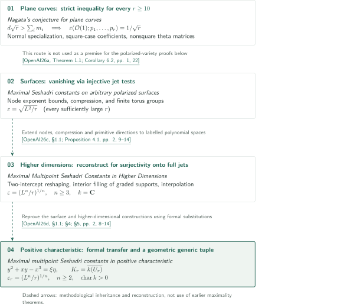

# Nagata’s conjecture and maximal Seshadri constants

**Catalogue 039 — Strict plane inequalities and maximal multipoint constants**

These four manuscripts concern Nagata's plane-curve inequality and ordinary, equally weighted multipoint Seshadri constants of ample line bundles. The plane paper claims a strict inequality for arbitrary multiplicities at every very general tuple with $r\geq10$. The other three claim attainment of the volume bound for **every sufficiently large integer $r$** on a fixed polarized variety. Each article distinguishes the authors' claims from the editorial checking scope.

<!-- Stage 2: insert real English booklet PDF link here; no placeholder URL. -->

## Papers in this catalogue

CATALOGINVENTORYTOKEN

## Methodological connections and reading routes

Dashed arrows show methodological inheritance and reconstruction explicitly described by the later manuscripts. They do not denote use of a predecessor's main theorem as a premise. The plane paper is shown separately because it gives a different argument covering every $r\geq10$. Diagram keys refer to these fixed manuscripts by OpenAI.

<!-- reference-guide -->
- [OpenAI26a](https://github.com/openai/math/blob/1581d4cbdd69a0faf34b2089614fe2a814316a6a/preprints/Nagatas-Conjecture-for-Plane-Curves-September-23-2026/main.pdf) OpenAI — *Nagata's conjecture for plane curves* — A separate route to the strict plane inequality and strict nefness; 2026-09-23.
- [OpenAI26b](https://github.com/openai/math/blob/1581d4cbdd69a0faf34b2089614fe2a814316a6a/preprints/Maximal-Seshadri-Constants-on-Arbitrary-Polarized-Surfaces-September-23-2026/main.pdf) OpenAI — *Maximal Seshadri constants on arbitrary polarized surfaces* — Surface jet injectivity from nodes, compression and finite groups; 2026-09-23.
- [OpenAI26c](https://github.com/openai/math/blob/1581d4cbdd69a0faf34b2089614fe2a814316a6a/preprints/Maximal-Multipoint-Seshadri-Constants-in-Higher-Dimensions-October-5-2026/main.pdf) OpenAI — *Maximal Multipoint Seshadri Constants in Higher Dimensions* — Generalization to graded exponent sets and full-jet surjectivity; 2026-10-05.
- [OpenAI26d](https://github.com/openai/math/blob/1581d4cbdd69a0faf34b2089614fe2a814316a6a/preprints/Maximal-multipoint-Seshadri-constants-in-positive-characteristic-October-5-2026/seshadri-positive-characteristic.pdf) OpenAI — *Maximal multipoint Seshadri constants in positive characteristic* — Positive-characteristic reconstruction using formal substitutions and a geometric generic tuple; 2026-10-05.
<!-- /reference-guide -->

<!-- cite:plane -->[&#91;OpenAI26a, Theorem 1.1; Corollary 6.2, pp. 1, 22&#93;](https://github.com/openai/math/blob/1581d4cbdd69a0faf34b2089614fe2a814316a6a/preprints/Nagatas-Conjecture-for-Plane-Curves-September-23-2026/main.pdf)<!-- /cite -->

<!-- cite:surface -->[&#91;OpenAI26b, Theorem 1.1; Corollary 5.5, pp. 2, 18&#93;](https://github.com/openai/math/blob/1581d4cbdd69a0faf34b2089614fe2a814316a6a/preprints/Maximal-Seshadri-Constants-on-Arbitrary-Polarized-Surfaces-September-23-2026/main.pdf)<!-- /cite -->

<!-- cite:higher -->[&#91;OpenAI26c, Theorem 1.1, pp. 1–2&#93;](https://github.com/openai/math/blob/1581d4cbdd69a0faf34b2089614fe2a814316a6a/preprints/Maximal-Multipoint-Seshadri-Constants-in-Higher-Dimensions-October-5-2026/main.pdf)<!-- /cite -->

<!-- cite:positive -->[&#91;OpenAI26d, Theorem 1.1; Remark 6.3, pp. 1–2, 16&#93;](https://github.com/openai/math/blob/1581d4cbdd69a0faf34b2089614fe2a814316a6a/preprints/Maximal-multipoint-Seshadri-constants-in-positive-characteristic-October-5-2026/seshadri-positive-characteristic.pdf)<!-- /cite -->

In the plane paper, [normal-bundle specialization and two ordered limits](../nagata-plane-curves/article.en.md#proof-1) establish strictness, while [Corollary 6.2](../nagata-plane-curves/article.en.md#corollary-6-2) deduces strict nefness and the Seshadri constant. Eventual maximality on arbitrary surfaces should not be identified with strictness for every plane point count $r\geq10$.

The higher-dimensional paper reconstructs the surface node, compression and primitive-direction method as [two-intercept reshaping](../maximal-seshadri-higher-dimensions/article.en.md#proof-2). The final test changes from injectivity of jets on surfaces to surjectivity onto full jets in higher dimensions. The positive-characteristic paper further uses [formal jet transfer and a two-branch node](../maximal-seshadri-positive-characteristic/article.en.md#proof-1), imposing all tests at the [geometric generic tuple](../maximal-seshadri-positive-characteristic/article.en.md#proof-2). These changes accommodate characteristic two and countable algebraically closed fields.

| Methodological source | Reconstruction | Role and checked distinction |
|---|---|---|
| Surface paper, Propositions 3.2, 3.4; Lemma 4.3 | Higher-dimensional paper, §1.1; Proposition 4.1 | Remaining coordinates become labels and real intercepts are reshaped; the required arguments are reproved |
| The same three surface results and higher-dimensional §§2–6 | Positive-characteristic paper, §1.1; §§2–5 | Formal substitutions replace analytic limits; the node becomes $y^2+xy-x^3$. Interior filling and interpolation are also reproved |

<!-- cite:surface-method -->[&#91;OpenAI26b, Propositions 3.2, 3.4; Lemma 4.3, pp. 8–10, 14&#93;](https://github.com/openai/math/blob/1581d4cbdd69a0faf34b2089614fe2a814316a6a/preprints/Maximal-Seshadri-Constants-on-Arbitrary-Polarized-Surfaces-September-23-2026/main.pdf)<!-- /cite -->

<!-- cite:higher-method -->[&#91;OpenAI26c, §1.1; Proposition 4.1, pp. 2, 9–14&#93;](https://github.com/openai/math/blob/1581d4cbdd69a0faf34b2089614fe2a814316a6a/preprints/Maximal-Multipoint-Seshadri-Constants-in-Higher-Dimensions-October-5-2026/main.pdf)<!-- /cite -->

<!-- cite:positive-method -->[&#91;OpenAI26d, §1.1; §4; §5, pp. 2, 8–14&#93;](https://github.com/openai/math/blob/1581d4cbdd69a0faf34b2089614fe2a814316a6a/preprints/Maximal-multipoint-Seshadri-constants-in-positive-characteristic-October-5-2026/seshadri-positive-characteristic.pdf)<!-- /cite -->

## Sources and checking scope

The official number and subject follow the OpenAI Research Catalog, “Algebraic and complex geometry” (032–068). Entry 039 is on overview PDF page 6. The table retains the official order in CONTENTS. The source snapshot is commit `1581d4cbdd69a0faf34b2089614fe2a814316a6a`.

<!-- cite:official -->[OpenAI Research Catalog · 039 · p. 6](https://github.com/openai/math/blob/1581d4cbdd69a0faf34b2089614fe2a814316a6a/overview.pdf)<!-- /cite -->

The articles check every principal conclusion against the relevant proof passages and compare direct inputs with their uses. The original statement and location in Chow's paper remain unchecked in the plane article. Complete external proofs, all analytic estimates and independent verification of constructions in every degree were not undertaken. Connections with other catalogues have not been exhaustively investigated; uninvestigated does not mean independent. The diagram selects confirmed methodological relations and is not a dependency graph of every cited work.
