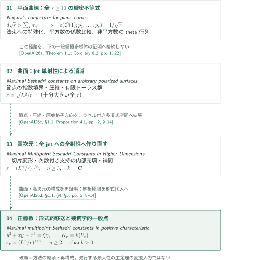

# Nagata’s conjecture and maximal Seshadri constants

**カタログ039 — 平面の厳密不等式と、多様体上の多点最大性**

平面曲線のNagata不等式と、豊富な直線束の通常の等重み多点Seshadri定数を扱う4本を収録する。平面篇は非常に一般な$r\geq10$点で任意の重複度に対する厳密不等式を主張する。残る3本は固定した偏極多様体に対して、十分大きい**すべての整数$r$**で体積上界を達成するという主張である。各主張と編集側の照合範囲は記事で区別する。

<!-- Stage 2: insert real Japanese booklet PDF link here; no placeholder URL. -->

## 収録論文

CATALOGINVENTORYTOKEN

## 方法の関係と読む入口

図の破線は、後続原稿が明示する方法の継承・作り直しを表す。先行論文の主定理を証明の前提として使う直接依存ではない。平面篇は、全$r\geq10$を扱う別の論証として分離して示す。図中のキーはOpenAI著の次の固定版を指す。

<!-- reference-guide -->
- [OpenAI26a](https://github.com/openai/math/blob/1581d4cbdd69a0faf34b2089614fe2a814316a6a/preprints/Nagatas-Conjecture-for-Plane-Curves-September-23-2026/main.pdf) OpenAI — *Nagata's conjecture for plane curves* — 平面の厳密不等式とstrict nef性の別経路; 2026-09-23.
- [OpenAI26b](https://github.com/openai/math/blob/1581d4cbdd69a0faf34b2089614fe2a814316a6a/preprints/Maximal-Seshadri-Constants-on-Arbitrary-Polarized-Surfaces-September-23-2026/main.pdf) OpenAI — *Maximal Seshadri constants on arbitrary polarized surfaces* — 節点・圧縮・有限群による曲面のjet単射性; 2026-09-23.
- [OpenAI26c](https://github.com/openai/math/blob/1581d4cbdd69a0faf34b2089614fe2a814316a6a/preprints/Maximal-Multipoint-Seshadri-Constants-in-Higher-Dimensions-October-5-2026/main.pdf) OpenAI — *Maximal Multipoint Seshadri Constants in Higher Dimensions* — 次数付き指数集合と全jet全射性への一般化; 2026-10-05.
- [OpenAI26d](https://github.com/openai/math/blob/1581d4cbdd69a0faf34b2089614fe2a814316a6a/preprints/Maximal-multipoint-Seshadri-constants-in-positive-characteristic-October-5-2026/seshadri-positive-characteristic.pdf) OpenAI — *Maximal multipoint Seshadri constants in positive characteristic* — 形式代入と幾何学的一般点による正標数への再構成; 2026-10-05.
<!-- /reference-guide -->

<!-- cite:plane -->[&#91;OpenAI26a, Theorem 1.1; Corollary 6.2, pp. 1, 22&#93;](https://github.com/openai/math/blob/1581d4cbdd69a0faf34b2089614fe2a814316a6a/preprints/Nagatas-Conjecture-for-Plane-Curves-September-23-2026/main.pdf)<!-- /cite -->

<!-- cite:surface -->[&#91;OpenAI26b, Theorem 1.1; Corollary 5.5, pp. 2, 18&#93;](https://github.com/openai/math/blob/1581d4cbdd69a0faf34b2089614fe2a814316a6a/preprints/Maximal-Seshadri-Constants-on-Arbitrary-Polarized-Surfaces-September-23-2026/main.pdf)<!-- /cite -->

<!-- cite:higher -->[&#91;OpenAI26c, Theorem 1.1, pp. 1–2&#93;](https://github.com/openai/math/blob/1581d4cbdd69a0faf34b2089614fe2a814316a6a/preprints/Maximal-Multipoint-Seshadri-Constants-in-Higher-Dimensions-October-5-2026/main.pdf)<!-- /cite -->

<!-- cite:positive -->[&#91;OpenAI26d, Theorem 1.1; Remark 6.3, pp. 1–2, 16&#93;](https://github.com/openai/math/blob/1581d4cbdd69a0faf34b2089614fe2a814316a6a/preprints/Maximal-multipoint-Seshadri-constants-in-positive-characteristic-October-5-2026/seshadri-positive-characteristic.pdf)<!-- /cite -->

平面篇では、[法束への特殊化と二つの極限](../nagata-plane-curves/article.ja.md#proof-1)が厳密不等式を与え、[Corollary 6.2](../nagata-plane-curves/article.ja.md#corollary-6-2)でstrict nef性とSeshadri定数を導く。一般曲面篇の十分大きい$r$での最大性と、平面の全$r\geq10$での厳密性を同一視しない。

曲面篇の節点・圧縮・原始格子方向を、高次元篇は[二切片変形](../maximal-seshadri-higher-dimensions/article.ja.md#proof-2)として作り直す。最終検査は曲面篇のjet単射性から、高次元篇の全jetへの全射性へ変わる。正標数篇はさらに[形式的jet移送と二枝の節点](../maximal-seshadri-positive-characteristic/article.ja.md#proof-1)を使い、[幾何学的一般点](../maximal-seshadri-positive-characteristic/article.ja.md#proof-2)で条件を同時に満たす。標数2や可算代数閉体を含むための変更である。

| 方法を供給する箇所 | 作り直す箇所 | 役割・確認した相違 |
|---|---|---|
| 曲面篇 Propositions 3.2, 3.4; Lemma 4.3 | 高次元篇 §1.1; Proposition 4.1 | 残りの座標をラベルとして保持し、実数切片を変形。必要な論証は高次元篇で再証明 |
| 曲面篇の同じ3結果、および高次元篇 §§2–6 | 正標数篇 §1.1; §§2–5 | 解析的極限を形式代入へ、節点を$y^2+xy-x^3$へ変更。内部充填と補間も再証明 |

<!-- cite:surface-method -->[&#91;OpenAI26b, Propositions 3.2, 3.4; Lemma 4.3, pp. 8–10, 14&#93;](https://github.com/openai/math/blob/1581d4cbdd69a0faf34b2089614fe2a814316a6a/preprints/Maximal-Seshadri-Constants-on-Arbitrary-Polarized-Surfaces-September-23-2026/main.pdf)<!-- /cite -->

<!-- cite:higher-method -->[&#91;OpenAI26c, §1.1; Proposition 4.1, pp. 2, 9–14&#93;](https://github.com/openai/math/blob/1581d4cbdd69a0faf34b2089614fe2a814316a6a/preprints/Maximal-Multipoint-Seshadri-Constants-in-Higher-Dimensions-October-5-2026/main.pdf)<!-- /cite -->

<!-- cite:positive-method -->[&#91;OpenAI26d, §1.1; §4; §5, pp. 2, 8–14&#93;](https://github.com/openai/math/blob/1581d4cbdd69a0faf34b2089614fe2a814316a6a/preprints/Maximal-multipoint-Seshadri-constants-in-positive-characteristic-October-5-2026/seshadri-positive-characteristic.pdf)<!-- /cite -->

## 原典・確認範囲

公式番号・分野名はOpenAI Research Catalogの「Algebraic and complex geometry」（032–068）に従う。039は概要PDFの6ページにあり、上表はCONTENTSの公式順を保つ。参照版はcommit `1581d4cbdd69a0faf34b2089614fe2a814316a6a`。

<!-- cite:official -->[OpenAI Research Catalog · 039 · p. 6](https://github.com/openai/math/blob/1581d4cbdd69a0faf34b2089614fe2a814316a6a/overview.pdf)<!-- /cite -->

各記事で主結果の全結論、原典の必要な証明本文、直接入力の記述と使用箇所を点検した。平面篇のChow原著の定理記述・位置の照合は保留であり、ほかの外部結果の全証明、全解析的評価、全次数構成の独立検証は行っていない。他カタログへの接続は網羅調査しておらず、未調査を「依存なし」と扱わない。図は確認した方法関係の選択であり、全引用文献の依存網ではない。
