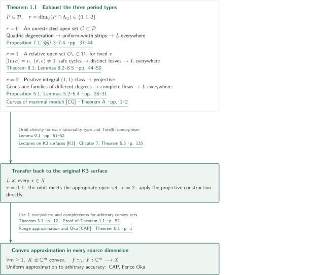
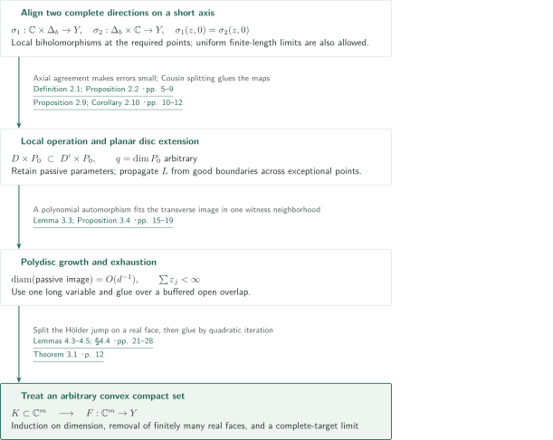
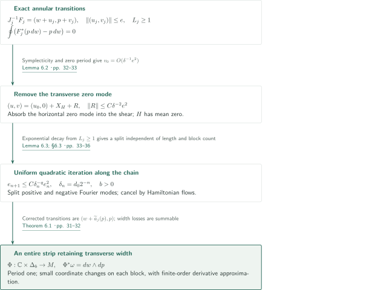
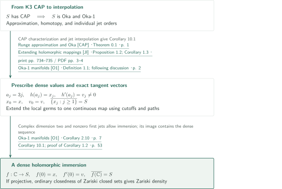
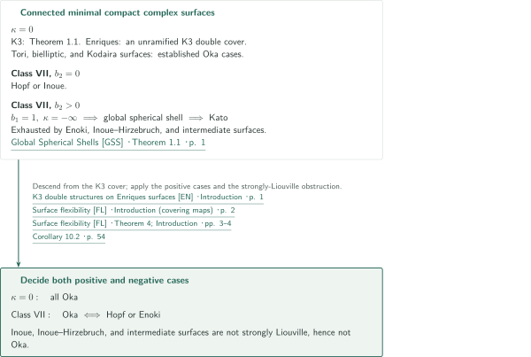
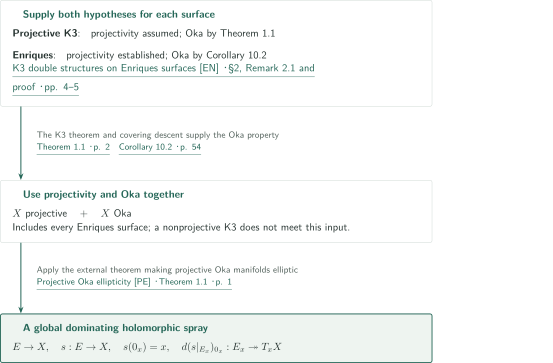

# Every complex K3 surface is Oka

**Two complete strip directions, convex approximation in every dimension, and the rationality trichotomy for periods**

The OpenAI manuscript claims that every complex K3 surface is Oka, without assuming projectivity. Its proof combines an analytic passage from two local complete holomorphic directions to convex approximation in every source dimension with geometric constructions and period dynamics that supply those directions on every K3 surface. This article explains that proof structure. The final section distinguishes the passages and input statements checked from the parts not independently verified.

## 1. Main results

### Theorem 1.1 — Convex approximation for every complex K3 surface

Let $X$ be any complex K3 surface and let $d_X$ be a distance induced by a smooth Hermitian metric. For every integer $m\ge1$, nonempty compact convex set $K\subset\mathbb C^m$, open neighborhood $U$ of $K$, holomorphic map $f:U\to X$, and $\varepsilon>0$, there is a holomorphic map $F:\mathbb C^m\to X$ such that

$$
\sup_{z\in K}d_X(F(z),f(z))<\varepsilon.
$$

Thus $X$ has CAP and is Oka. There is no assumption on projectivity, the Picard number, or the existence of an elliptic fibration.

<!-- cite:main-result -->[Theorem 1.1 · p. 2](https://github.com/openai/math/blob/fd4aeeb2ee4fc729c18d98444fed42fd0529eeeb/preprints/Every-complex-K3-surface-is-Oka-September-23-2026/paper.pdf)<!-- /cite --> · <!-- cite:cap-oka -->[Runge approximation and Oka &#91;CAP&#93; · Theorem 0.1 · p. 1](https://arxiv.org/pdf/math/0402278v5#page=1)<!-- /cite -->

### Corollary 1.2 — A dense entire immersion with a prescribed jet

For every complex K3 surface $S$, point $x\in S$, and nonzero vector $v\in T_xS$, there is a holomorphic immersion $f:\mathbb C\to S$ with

$$
f(0)=x,\qquad f'(0)=v,\qquad \overline{f(\mathbb C)}=S.
$$

The closure is taken in the ordinary complex topology. If $S$ is projective, the image is also Zariski dense. The prescribed datum is the exact vector $v$, not merely its tangent line.

<!-- cite:dense -->[Corollary 1.2 · p. 2](https://github.com/openai/math/blob/fd4aeeb2ee4fc729c18d98444fed42fd0529eeeb/preprints/Every-complex-K3-surface-is-Oka-September-23-2026/paper.pdf)<!-- /cite -->

### Corollary 10.2 — Kodaira dimension zero and minimal class VII

Every complex Enriques surface is Oka. More generally, every connected minimal compact complex surface with $\kappa=0$ is Oka. For a connected minimal compact complex surface of class VII,

$$
X\text{ is Oka}\quad\Longleftrightarrow\quad X\text{ is Hopf or Enoki}.
$$

Exhaustiveness in the second assertion uses Global Spherical Shells as an input separate from the K3 theorem.

<!-- cite:classification -->[Corollary 10.2 · p. 54](https://github.com/openai/math/blob/fd4aeeb2ee4fc729c18d98444fed42fd0529eeeb/preprints/Every-complex-K3-surface-is-Oka-September-23-2026/paper.pdf)<!-- /cite -->

### Corollary 10.3 — Global sprays on projective K3 and Enriques surfaces

Every projective complex K3 surface and every complex Enriques surface is elliptic in Gromov's sense: there are a holomorphic vector bundle $E\to X$ and a holomorphic map $s:E\to X$ with $s(0_x)=x$ and surjective fiber differential $d(s|_{E_x})_{0_x}:E_x\to T_xX$. This corollary makes no assertion about a global spray on a nonprojective K3 surface.

<!-- cite:sprays -->[Corollary 10.3 · p. 54](https://github.com/openai/math/blob/fd4aeeb2ee4fc729c18d98444fed42fd0529eeeb/preprints/Every-complex-K3-surface-is-Oka-September-23-2026/paper.pdf)<!-- /cite -->

## References on the arrows

<!-- reference-guide -->
Unprefixed theorem, lemma, section and equation numbers refer to [K3 Oka](https://github.com/openai/math/blob/fd4aeeb2ee4fc729c18d98444fed42fd0529eeeb/preprints/Every-complex-K3-surface-is-Oka-September-23-2026/paper.pdf). External inputs use the following keys.

- [CG](https://www.cambridge.org/core/services/aop-cambridge-core/content/view/4D944E80C9877293A6E64D2CE35B2D12/S205050942200024Xa.pdf/curves_of_maximal_moduli_on_k3_surfaces.pdf) Xi Chen and Frank Gounelas — *Curves of maximal moduli*: Nonisotrivial genus-one families of unbounded degree in §5. 2022 published version, Forum of Mathematics, Sigma 10, e36.
- [K3](https://www.math.uni-bonn.de/people/huybrech/K3Global.pdf) Daniel Huybrechts — *Lectures on K3 surfaces*: Local/global Torelli and the positive integral (1,1)-class criterion. Author-hosted prepublication draft, copyright 2015, retrieved October 10, 2026; distinct from the cited 2016 book.
- [VE](https://arxiv.org/pdf/1708.05802v1) Misha Verbitsky — *Ergodic structures: erratum*: Corrected orbit-closure framework; the fixed-v statement is proved in Lemma 9.1 of the manuscript. arXiv:1708.05802v1, 2017-08-19.
- [CAP](https://arxiv.org/pdf/math/0402278v5) Franc Forstnerič — *Runge approximation and Oka*: From convex approximation in every source dimension to the Oka property. arXiv:math/0402278v5, 2005-05-06 (PDF dated May 5).
- [JI](https://www.numdam.org/article/AIF_2005__55_3_733_0.pdf) Franc Forstnerič — *Extending holomorphic mappings*: From the Oka property to approximation with jet interpolation. 2005 published version, Annales de l’Institut Fourier 55(3), 733–751.
- [O1](https://arxiv.org/pdf/2303.15855v5) Antonio Alarcón and Franc Forstnerič — *Oka-1 manifolds*: Individual jet orders and immersed maps into a complex surface. arXiv:2303.15855v5, 2025-04-10.
- [FL](https://arxiv.org/pdf/1207.4838v3) Franc Forstnerič and Finnur Lárusson — *Surface flexibility*: Covering descent, established κ=0 cases, and positive/negative class-VII cases. arXiv:1207.4838v3, 2013-02-21.
- [GSS](https://github.com/openai/math/blob/fd4aeeb2ee4fc729c18d98444fed42fd0529eeeb/preprints/Global-Spherical-Shells-on-Minimal-Surfaces-of-Class-VII-September-24-2026/paper.pdf) OpenAI — *Global Spherical Shells*: Input only to Corollary 10.2: positive-b₂ minimal class VII surfaces are Kato. September 24, 2026; official 060 (fixed commit in the source record).
- [EN](https://arxiv.org/pdf/math/0604629v2) Francisco Javier Gallego, Miguel González and Bangere P. Purnaprajna — *K3 double structures on Enriques surfaces*: The étale K3 double cover and the statement of Enriques projectivity. arXiv:math/0604629v2, 2006-08-27.
- [PE](https://arxiv.org/pdf/2502.20028v6) Franc Forstnerič and Finnur Lárusson — *Projective Oka ellipticity*: A global dominating spray for a projective Oka manifold. arXiv:2502.20028v6, 2026-05-05 (PDF notes edits May 4).

Each citation gives the result and pages. When printed pagination differs from the PDF position, both are shown. GitHub previews do not automatically jump to the cited page.
<!-- /reference-guide -->

The external sources below are used within the stated scope of checking their input statements and their applications in the manuscript. Additional inputs from local Stein theory, $\bar\partial$ estimates, lattices, and dynamics have been read at their use in the manuscript but have not all been checked against their external originals. The outstanding scope is listed at the end.

## 2. Theorem 1.1 — Proof overview of the main theorem

<!-- proof-target:1 -->Proof target：[Theorem 1.1 · p. 2](https://github.com/openai/math/blob/fd4aeeb2ee4fc729c18d98444fed42fd0529eeeb/preprints/Every-complex-K3-surface-is-Oka-September-23-2026/paper.pdf)<!-- /proof-target -->

The K3 lattice $\Lambda=3U\oplus2E_8(-1)$ has signature $(3,19)$. Represent a marked period by an oriented positive real two-plane $P\subset\Lambda_{\mathbb R}$ and split according to $r=\dim_{\mathbb Q}(P\cap\Lambda_{\mathbb Q})\in\{0,1,2\}$. The common target is the local operation $L$ at every point; its precise content is stated in the next section.

### 1. No rational direction: meet an open set in the full period domain

Proposition 7.1 constructs a nonempty open set $\mathcal O$ in the full period domain $\mathcal D$ whose surfaces have $L$ everywhere. It starts with a degeneration of two quadrics, $Q_+Q_-=\alpha G$. Rational pencils on the components and coordinates on the necks provide finitely many raw charts. Theorem 6.1 sews these into strips with positive transverse width independent of their length. A compact usable region controls positions and transverse partners after recentering; propagation from good boundary points treats the remaining points.

The construction must be repeated in an unrestricted local deformation. Openness only inside a chosen projective family would not give an open subset of $\mathcal D$. Deforming the finite atlas with its margins and applying local Torelli supplies the required openness in the full period domain. When $r=0$, Lemma 9.1(1) makes the integral-isometry orbit meet $\mathcal O$.

<!-- cite:open-period -->[Proposition 7.1; §§7.3–7.4 · pp. 37–44](https://github.com/openai/math/blob/fd4aeeb2ee4fc729c18d98444fed42fd0529eeeb/preprints/Every-complex-K3-surface-is-Oka-September-23-2026/paper.pdf)<!-- /cite --> · <!-- cite:recenter -->[Lemma 6.4 · pp. 36–37](https://github.com/openai/math/blob/fd4aeeb2ee4fc729c18d98444fed42fd0529eeeb/preprints/Every-complex-K3-surface-is-Oka-September-23-2026/paper.pdf)<!-- /cite --> · <!-- cite:local-torelli -->[Lectures on K3 surfaces &#91;K3&#93; · Chapter 6, Proposition 2.8 · p. 107](https://www.math.uni-bonn.de/people/huybrech/K3Global.pdf#page=107)<!-- /cite --> · <!-- cite:orbits -->[Lemma 9.1 · pp. 51–52](https://github.com/openai/math/blob/fd4aeeb2ee4fc729c18d98444fed42fd0529eeeb/preprints/Every-complex-K3-surface-is-Oka-September-23-2026/paper.pdf)<!-- /cite -->

### 2. One rational direction: a relative open set for fixed v

Write $P\cap\Lambda_{\mathbb Q}=\mathbb Qv$, where $v\in\Lambda$ is primitive and positive. Theorem 8.1 constructs a nonempty relatively open set $\mathcal O_v$ in $\mathcal D_v=\{P:v\in P\}$. The center in Lemma 8.2 is an isotrivial genus-one fibration with $j=0$ and fiber class $e$ satisfying $(e,v)=0$. Normalize $[\operatorname{Im}\sigma]=v$ along the deformation. A circle-valued action selects safe cycles away from singular fibers and keeps the centers usable after repeated recentering.

If the leaf germs coming from two independent cycles agreed, a graph with both periods would produce a compact holomorphic torus in class $me$. This is impossible on a deformation with $(\sigma,e)\ne0$. Even if the two distinct leaves are tangent at a point, moving along a leaf gives a transverse partner and allows the displaced-point form of Proposition 2.2. Propagation removes the exceptional points. Lemma 9.1(2) then makes the orbit under integral isometries fixing $v$ meet $\mathcal O_v$.

<!-- cite:fixed-period -->[Theorem 8.1; Lemmas 8.2–8.5 · pp. 44–50](https://github.com/openai/math/blob/fd4aeeb2ee4fc729c18d98444fed42fd0529eeeb/preprints/Every-complex-K3-surface-is-Oka-September-23-2026/paper.pdf)<!-- /cite --> · <!-- cite:local -->[Definition 2.1; Proposition 2.2 · pp. 5–9](https://github.com/openai/math/blob/fd4aeeb2ee4fc729c18d98444fed42fd0529eeeb/preprints/Every-complex-K3-surface-is-Oka-September-23-2026/paper.pdf)<!-- /cite --> · <!-- cite:propagation -->[Proposition 2.9; Corollary 2.10 · pp. 10–12](https://github.com/openai/math/blob/fd4aeeb2ee4fc729c18d98444fed42fd0529eeeb/preprints/Every-complex-K3-surface-is-Oka-September-23-2026/paper.pdf)<!-- /cite --> · <!-- cite:orbits -->[Lemma 9.1 · pp. 51–52](https://github.com/openai/math/blob/fd4aeeb2ee4fc729c18d98444fed42fd0529eeeb/preprints/Every-complex-K3-surface-is-Oka-September-23-2026/paper.pdf)<!-- /cite -->

### 3. A rational plane: two curve families on a projective K3 surface

For $r=2$, the rational space $P^\perp$ has signature $(1,19)$ and contains a positive rational vector. An integral multiple is a positive integral $(1,1)$-class, so the projectivity criterion applies. Proposition 5.1 supplies $L$ everywhere in this case.

Its construction uses Theorem A of Chen–Gounelas with $g=1$. Unbounded self-intersection and the Hodge index theorem give unbounded degree for a fixed ample class, allowing two families of different degrees. Evaluation from their normalization families is finite étale over an open set. If their leaves agreed generically, the associated integral curves would coincide, contradicting the different degrees. Holomorphic vector fields on proper genus-one fibers have complete flows; flowing local sections produces the two strip directions. An inverse branch of the second evaluation map is used only for the initial lift. Subsequent flow values lie in the full proper fiber. Corollary 2.10 crosses the remaining algebraic exceptional set.

<!-- cite:projectivity -->[Lectures on K3 surfaces &#91;K3&#93; · §1.3.3, footnote 9 · p. 16](https://www.math.uni-bonn.de/people/huybrech/K3Global.pdf#page=16)<!-- /cite --> · <!-- cite:curves -->[Curves of maximal moduli &#91;CG&#93; · Theorem A · pp. 1–2](https://www.cambridge.org/core/services/aop-cambridge-core/content/view/4D944E80C9877293A6E64D2CE35B2D12/S205050942200024Xa.pdf/curves_of_maximal_moduli_on_k3_surfaces.pdf#page=1)<!-- /cite --> · <!-- cite:projective -->[Proposition 5.1; Lemmas 5.2–5.4 · pp. 28–31](https://github.com/openai/math/blob/fd4aeeb2ee4fc729c18d98444fed42fd0529eeeb/preprints/Every-complex-K3-surface-is-Oka-September-23-2026/paper.pdf)<!-- /cite -->

### 4. Torelli transfer and convergence to CAP in all dimensions

In the first two cases, change the marking to the period on the orbit and use global Torelli to obtain $L$ on a surface isomorphic to the original one. Signs and reflections in roots fixing the period account for different Kähler chambers. This is not a limit argument from the density of good periods: each orbit actually meets an open set appropriate to its rationality type.

Lemma 9.1 applies Ratner to the pointwise stabilizer $\mathrm{SO}_0(1,19)$ of a positive frame. It does not assume unipotent generation for a group with an extra compact rotation factor. Following Verbitsky's erratum, the argument distinguishes intermediate orbits with a rational direction. The editorial reading covers the manuscript's group-theoretic reduction, not independent proofs of the Ratner and Borel inputs.

Once all cases yield $L$ everywhere, Theorem 3.1 gives CAP for every $m$ and every compact convex source set. Compactness of the K3 surface supplies completeness and uniform equivalence of the target distances, returning the conclusion to the Hermitian distance specified in Theorem 1.1.

<!-- cite:torelli -->[Lectures on K3 surfaces &#91;K3&#93; · Chapter 7, Theorem 5.3 · p. 135](https://www.math.uni-bonn.de/people/huybrech/K3Global.pdf#page=135)<!-- /cite --> · <!-- cite:orbit-erratum -->[Ergodic structures: erratum &#91;VE&#93; · Theorem 2.5 · p. 5](https://arxiv.org/pdf/1708.05802v1#page=5)<!-- /cite --> · <!-- cite:orbits -->[Lemma 9.1 · pp. 51–52](https://github.com/openai/math/blob/fd4aeeb2ee4fc729c18d98444fed42fd0529eeeb/preprints/Every-complex-K3-surface-is-Oka-September-23-2026/paper.pdf)<!-- /cite --> · <!-- cite:final-proof -->[Proof of Theorem 1.1 · p. 52](https://github.com/openai/math/blob/fd4aeeb2ee4fc729c18d98444fed42fd0529eeeb/preprints/Every-complex-K3-surface-is-Oka-September-23-2026/paper.pdf)<!-- /cite -->

## 3. Theorem 3.1 — From the local operation L to convex approximation

<!-- proof-target:2 -->Proof target：[Theorem 3.1 · p. 12](https://github.com/openai/math/blob/fd4aeeb2ee4fc729c18d98444fed42fd0529eeeb/preprints/Every-complex-K3-surface-is-Oka-September-23-2026/paper.pdf)<!-- /proof-target -->

<!-- statement:theorem-3-1 -->
### Theorem 3.1 — Hypotheses and conclusion

Let $Y$ be a complex surface with a complete compatible distance. Assume the following operation $L$ at every $x\in Y$. There is an open neighborhood $V$ of $x$ such that, for every special pair $D\subset D'$, closed polydiscs $P_0\Subset\operatorname{int}P\subset\mathbb C^q$, and holomorphic map $f$ from a neighborhood of $D\times P$ into $V$, the restriction $f|_{D\times P_0}$ can be uniformly approximated by maps holomorphic near $D'\times P_0$ with values in $Y$. Here $D,D'$ are closed topological discs with piecewise smooth boundary, and $D'$ is obtained by attaching another such disc along a proper boundary arc of $D$. The case $q=0$ is included.

Then $Y$ has CAP in every source dimension: it satisfies the convex-approximation conclusion of Theorem 1.1 with $Y$ in place of $X$ and with the same quantifiers.

<!-- cite:local -->[Definition 2.1; Proposition 2.2 · pp. 5–9](https://github.com/openai/math/blob/fd4aeeb2ee4fc729c18d98444fed42fd0529eeeb/preprints/Every-complex-K3-surface-is-Oka-September-23-2026/paper.pdf)<!-- /cite --> · <!-- cite:cap-target -->[Theorem 3.1 · p. 12](https://github.com/openai/math/blob/fd4aeeb2ee4fc729c18d98444fed42fd0529eeeb/preprints/Every-complex-K3-surface-is-Oka-September-23-2026/paper.pdf)<!-- /cite -->
<!-- /statement -->

### 1. Convert two complete directions into a local operation with parameters

The strips in Proposition 2.2 are $\sigma_1:\mathbb C\times\Delta_b\to Y$ and $\sigma_2:\Delta_b\times\mathbb C\to Y$, locally biholomorphic at the required points and satisfying $\sigma_1(z,0)=\sigma_2(z,0)$ along a common short axis. Scalar approximation in the two directions creates errors that are small because of this axial agreement. Bounded Cousin splitting and nonlinear gluing remove the errors. One source variable can thus be enlarged while retaining arbitrarily many passive holomorphic parameters.

Proposition 2.9 enlarges a planar disc using finitely many witness neighborhoods along its boundary. Corollary 2.10 extends two tilted discs with good boundaries to produce two directions at their center. Consequently $L$ propagates across an exceptional set contained in a proper analytic subset. No multidimensional convex approximation is assumed at this stage.

<!-- cite:local -->[Definition 2.1; Proposition 2.2 · pp. 5–9](https://github.com/openai/math/blob/fd4aeeb2ee4fc729c18d98444fed42fd0529eeeb/preprints/Every-complex-K3-surface-is-Oka-September-23-2026/paper.pdf)<!-- /cite --> · <!-- cite:propagation -->[Proposition 2.9; Corollary 2.10 · pp. 10–12](https://github.com/openai/math/blob/fd4aeeb2ee4fc729c18d98444fed42fd0529eeeb/preprints/Every-complex-K3-surface-is-Oka-September-23-2026/paper.pdf)<!-- /cite -->

### 2. Turn polydisc growth into one long variable and thin transverse variables

A polynomial automorphism in Lemma 3.3 puts the added region into the form of one long variable and bounded passive variables. Near the joining region, the transverse image diameter is $O(1/d)$, small enough for a single witness neighborhood. Proposition 3.4 applies the planar extension and glues it to the old map over a buffered open overlap. Exhausting by polydiscs with summable errors and using completeness of the target yields an entire limit.

<!-- cite:polydisc -->[Lemma 3.3; Proposition 3.4 · pp. 15–19](https://github.com/openai/math/blob/fd4aeeb2ee4fc729c18d98444fed42fd0529eeeb/preprints/Every-complex-K3-surface-is-Oka-September-23-2026/paper.pdf)<!-- /cite -->

### 3. Use errors on real faces to reach an arbitrary convex set

Polydisc approximation alone does not treat an arbitrary convex $K$. Section 4 combines induction on dimension with removal of faces of a real polytope. Lemma 4.3 uses lower-dimensional CAP and complexification of real parameters to construct the deformation near a face. A complex collar of fixed width is not available throughout this process. Lemma 4.4 therefore constructs a jump splitting whose input is a Hölder trace on the real interface. Cauchy integrals provide the jump, Morera's theorem extends the partitioned differences, and a weighted $L^2\bar\partial$ solution provides the linear operator and estimates for the loss of width.

The nonlinear quadratic iteration of Lemma 4.5 performs the gluing. Removing finitely many faces reduces the problem to a polydisc, where Section 3 applies while keeping the error small on the original $K$. This closes the assertion for every dimension and every convex compact set. The roles of the linear and nonlinear estimates were read in the proof; an independent check of all constants and iterations remains outstanding.

<!-- cite:faces -->[Lemmas 4.3–4.5; §4.4 · pp. 21–28](https://github.com/openai/math/blob/fd4aeeb2ee4fc729c18d98444fed42fd0529eeeb/preprints/Every-complex-K3-surface-is-Oka-September-23-2026/paper.pdf)<!-- /cite -->

## 4. Theorem 6.1 — Sewing annular chains with uniform transverse width

<!-- proof-target:3 -->Proof target：[Theorem 6.1 · pp. 31–32](https://github.com/openai/math/blob/fd4aeeb2ee4fc729c18d98444fed42fd0529eeeb/preprints/Every-complex-K3-surface-is-Oka-September-23-2026/paper.pdf)<!-- /proof-target -->

<!-- statement:theorem-6-1 -->
### Theorem 6.1 — Annular-chain sewing

Let $M$ be a complex surface with a nowhere-zero holomorphic two-form $\omega$. Put $\mathcal C=\mathbb C/\mathbb Z$, $Y=\operatorname{Im}w$, and $\omega_0=dw\wedge dp$. Fix $0<h<1/8$, $r>0$, and $A<\infty$. For every $j\in\mathbb Z$, suppose $L_j\ge1$ and

$$
\phi_j:\{-2h<Y<L_j+2h\}\times\Delta_r\to M,
\qquad \phi_j^*\omega=\omega_0.
$$

Let $J_j(w,p)=(w+a_j(p),p)$ satisfy $|\operatorname{Im}a_j(p)+L_j|<h/8$ and $|a'_j(p)|\le A$. On the seam $S_j=\{|Y-L_j|<h\}\times\Delta_r$, suppose there are degree-one exact symplectic transitions $F_j$ with $\phi_j=\phi_{j+1}\circ F_j$ and

$$
J_j^{-1}F_j=(w+u_j,p+v_j),\qquad
\sup_j\|(u_j,v_j)\|_{S_j}\le e.
$$

Exactness means that the period of $F_j^*(p\,dw)-p\,dw$ vanishes.

There exist $b>0,e_*>0$ depending only on $h,r,A$ and the specified margins such that $e<e_*$ gives a holomorphic symplectic immersion $\Phi:\mathbb C\times\Delta_b\to M$, periodic of period one in its first variable. On smaller parts of each block with fixed positive end margins, $\Phi$ is obtained from $\phi_j$ by a small periodic symplectic change of variables. The corrected transitions are $(w,p)\mapsto(w+\widetilde a_j(p),p)$. The changes minus the identity, the differences $\widetilde a_j-a_j$, and any fixed finite number of their derivatives on further smaller domains tend uniformly to zero as $e\to0$. No upper bound on $L_j$ or on the number of blocks is required.

<!-- cite:sewing -->[Theorem 6.1 · pp. 31–32](https://github.com/openai/math/blob/fd4aeeb2ee4fc729c18d98444fed42fd0529eeeb/preprints/Every-complex-K3-surface-is-Oka-September-23-2026/paper.pdf)<!-- /cite -->
<!-- /statement -->

### 1. Exactness makes the transverse zero mode a quadratic error

A closed holomorphic one-form on a cylinder need not be exact: its period is an obstruction. For $E=(w+u,p+v)$, symplecticity together with exactness makes the zero Fourier coefficient of $v$ of order $O(\delta^{-1}e^2)$, instead of allowing a free first-order transverse drift. Lemma 6.2 gives

$$
(u,v)=(u_0,0)+X_H+R,\qquad
X_H=(H_p,-H_w),\qquad \|R\|\le C\delta^{-2}e^2.
$$

The remaining horizontal zero mode $u_0(p)$ can be absorbed into the shear.

<!-- cite:zero-mode -->[Lemma 6.2 · pp. 32–33](https://github.com/openai/math/blob/fd4aeeb2ee4fc729c18d98444fed42fd0529eeeb/preprints/Every-complex-K3-surface-is-Oka-September-23-2026/paper.pdf)<!-- /cite -->

### 2. Solve the Fourier splitting uniformly along the whole chain

Lemma 6.3 assigns the positive and negative Fourier modes of the mean-zero Hamiltonian to blocks in the appropriate directions. The bound $L_j\ge1$ gives exponential decay and a geometric-series estimate independent of chain length and block count. After a change of coordinates by Hamiltonian flows, the new error satisfies $e_{n+1}\le C\delta_n^{-q}e_n^2$. Choosing $\delta_n=d_0 2^{-n}$ makes the losses summable; for a sufficiently small initial error, quadratic convergence leaves a positive transverse width.

<!-- cite:split-chain -->[Lemma 6.3; §6.3 · pp. 33–36](https://github.com/openai/math/blob/fd4aeeb2ee4fc729c18d98444fed42fd0529eeeb/preprints/Every-complex-K3-surface-is-Oka-September-23-2026/paper.pdf)<!-- /cite -->

### 3. Obtain the entire direction and check the geometric application conditions

The corrected transitions leave the transverse coordinate $p$ fixed. Sewing the chain, whose heights extend in both directions, gives the whole $\mathbb C$ as the first variable on the universal cover and produces a period-one strip immersion. Small coordinate changes and interior Cauchy estimates give approximation to the original charts, including the stated finite-order derivatives.

For the applications in Sections 7–8, Lemma 6.4 removes the period defect of a raw transition by recentering both the actual coordinates and the model shear. This does not automatically bound accumulated drift. The finite atlas in Section 7 and the safe actions in Section 8 separately keep the moving centers inside buffered usable regions. Complete verification of these geometric uniformity estimates remains outside the checked scope of this draft.

<!-- cite:sewing -->[Theorem 6.1 · pp. 31–32](https://github.com/openai/math/blob/fd4aeeb2ee4fc729c18d98444fed42fd0529eeeb/preprints/Every-complex-K3-surface-is-Oka-September-23-2026/paper.pdf)<!-- /cite --> · <!-- cite:recenter -->[Lemma 6.4 · pp. 36–37](https://github.com/openai/math/blob/fd4aeeb2ee4fc729c18d98444fed42fd0529eeeb/preprints/Every-complex-K3-surface-is-Oka-September-23-2026/paper.pdf)<!-- /cite --> · <!-- cite:open-period -->[Proposition 7.1; §§7.3–7.4 · pp. 37–44](https://github.com/openai/math/blob/fd4aeeb2ee4fc729c18d98444fed42fd0529eeeb/preprints/Every-complex-K3-surface-is-Oka-September-23-2026/paper.pdf)<!-- /cite --> · <!-- cite:fixed-period -->[Theorem 8.1; Lemmas 8.2–8.5 · pp. 44–50](https://github.com/openai/math/blob/fd4aeeb2ee4fc729c18d98444fed42fd0529eeeb/preprints/Every-complex-K3-surface-is-Oka-September-23-2026/paper.pdf)<!-- /cite -->

## 5. Corollary 1.2 — Prescribed jets and a dense immersion

<!-- proof-target:4 -->Proof target：[Corollary 1.2 · p. 2](https://github.com/openai/math/blob/fd4aeeb2ee4fc729c18d98444fed42fd0529eeeb/preprints/Every-complex-K3-surface-is-Oka-September-23-2026/paper.pdf)<!-- /proof-target -->

The target is Corollary 1.2 as stated above. The intermediate Corollary 10.1 supplies approximation and jet interpolation from an open Riemann surface at once.

### 1. Put the nonzero first jets into one continuous map

Pass from CAP to the Oka property and then to Oka-1. The inputs to Corollary 10.1 are an open Riemann surface $R$, a compact Runge set $K$, a closed discrete set $A=\{a_j\}$, individual integers $k_j\ge1$, and a continuous map $h:R\to S$ holomorphic near $K\cup A$. Its output is a holomorphic map homotopic to $h$, approximating it on $K$ and retaining each $k_j$-jet. Finite and empty interpolation sets are allowed.

Take $R=\mathbb C$, $a_j=3j$, $x_0=x$, and $v_0=v$. For $j\ge1$, choose a dense sequence $x_j$ and nonzero vectors $v_j$ at these points. On disjoint locally finite discs, choose holomorphic germs with value $x_j$ and derivative $v_j$. A cutoff inside a coordinate ball and a path from each $x_j$ to a common basepoint extend the germs to one continuous map $h$. This supplies the topological input for interpolation. At $j=0$, it preserves the prescribed value and exact tangent vector.

<!-- cite:cap-oka -->[Runge approximation and Oka &#91;CAP&#93; · Theorem 0.1 · p. 1](https://arxiv.org/pdf/math/0402278v5#page=1)<!-- /cite --> · <!-- cite:jet-input -->[Extending holomorphic mappings &#91;JI&#93; · Proposition 1.2; Corollary 1.3 · print pp. 734–735 / PDF pp. 3–4](https://www.numdam.org/article/AIF_2005__55_3_733_0.pdf#page=3)<!-- /cite --> · <!-- cite:oka-one -->[Oka-1 manifolds &#91;O1&#93; · Definition 1.1; following discussion · p. 2](https://arxiv.org/pdf/2303.15855v5#page=2)<!-- /cite --> · <!-- cite:interpolation-use -->[Corollary 10.1; proof of Corollary 1.2 · p. 53](https://github.com/openai/math/blob/fd4aeeb2ee4fc729c18d98444fed42fd0529eeeb/preprints/Every-complex-K3-surface-is-Oka-September-23-2026/paper.pdf)<!-- /cite -->

### 2. Obtain immersion and ordinary density together

Since the target has complex dimension two and all prescribed first derivatives are nonzero, Corollary 2.10 of Oka-1 manifolds allows the interpolating map to be an immersion. Point interpolation alone would not establish nonvanishing differential. The resulting map satisfies $f(a_j)=x_j$ and $f'(a_j)=v_j$. Its image contains the dense sequence and is therefore dense in the ordinary topology.

<!-- cite:immersions -->[Oka-1 manifolds &#91;O1&#93; · Corollary 2.10 · p. 7](https://arxiv.org/pdf/2303.15855v5#page=7)<!-- /cite --> · <!-- cite:interpolation-use -->[Corollary 10.1; proof of Corollary 1.2 · p. 53](https://github.com/openai/math/blob/fd4aeeb2ee4fc729c18d98444fed42fd0529eeeb/preprints/Every-complex-K3-surface-is-Oka-September-23-2026/paper.pdf)<!-- /cite -->

### 3. Zariski density in the projective case

A Zariski closed subset of a projective $S$ is closed in the ordinary complex topology. No proper such subset can contain the ordinarily dense image $f(\mathbb C)$. This proves the final assertion.

<!-- cite:interpolation-use -->[Corollary 10.1; proof of Corollary 1.2 · p. 53](https://github.com/openai/math/blob/fd4aeeb2ee4fc729c18d98444fed42fd0529eeeb/preprints/Every-complex-K3-surface-is-Oka-September-23-2026/paper.pdf)<!-- /cite -->

## 6. Corollary 10.2 — Surface classification including the negative cases

<!-- proof-target:5 -->Proof target：[Corollary 10.2 · p. 54](https://github.com/openai/math/blob/fd4aeeb2ee4fc729c18d98444fed42fd0529eeeb/preprints/Every-complex-K3-surface-is-Oka-September-23-2026/paper.pdf)<!-- /proof-target -->

Retain connectedness, minimality, and compactness from the statement above. The list for $\kappa=0$ and the split by $b_2$ in class VII serve different parts of the proof.

### 1. From K3 surfaces to every Enriques surface

Theorem 1.1 and the CAP characterization make K3 surfaces Oka. An Enriques surface has an unramified holomorphic K3 double cover, so descent of the Oka property through a covering applies. This includes nodal Enriques surfaces and imposes no unnodal hypothesis.

<!-- cite:main-result -->[Theorem 1.1 · p. 2](https://github.com/openai/math/blob/fd4aeeb2ee4fc729c18d98444fed42fd0529eeeb/preprints/Every-complex-K3-surface-is-Oka-September-23-2026/paper.pdf)<!-- /cite --> · <!-- cite:enriques-cover -->[K3 double structures on Enriques surfaces &#91;EN&#93; · Introduction · p. 1](https://arxiv.org/pdf/math/0604629v2#page=1)<!-- /cite --> · <!-- cite:cover-descent -->[Surface flexibility &#91;FL&#93; · Introduction (covering maps) · p. 2](https://arxiv.org/pdf/1207.4838v3#page=2)<!-- /cite -->

### 2. The other surfaces of Kodaira dimension zero

The remaining minimal compact complex surfaces with $\kappa=0$ are complex tori, bielliptic surfaces, and Kodaira surfaces. Their Oka property is an established input recalled in the introduction to Surface flexibility; it is not a new construction in the K3 proof. Together with K3 and Enriques surfaces, this exhausts the $\kappa=0$ assertion.

<!-- cite:surface-cases -->[Surface flexibility &#91;FL&#93; · Theorem 4; Introduction · pp. 3–4](https://arxiv.org/pdf/1207.4838v3#page=3)<!-- /cite --> · <!-- cite:classification -->[Corollary 10.2 · p. 54](https://github.com/openai/math/blob/fd4aeeb2ee4fc729c18d98444fed42fd0529eeeb/preprints/Every-complex-K3-surface-is-Oka-September-23-2026/paper.pdf)<!-- /cite -->

### 3. Class VII with b₂=0: separate Hopf from Inoue

The list for $b_2=0$ consists of Hopf and Inoue surfaces. Theorem 4 of Surface flexibility makes Hopf surfaces Oka and Inoue surfaces not strongly Liouville. Since Oka implies strongly Liouville, the latter are not Oka. These negative conclusions are necessary for the claimed equivalence.

<!-- cite:surface-cases -->[Surface flexibility &#91;FL&#93; · Theorem 4; Introduction · pp. 3–4](https://arxiv.org/pdf/1207.4838v3#page=3)<!-- /cite -->

### 4. Class VII with b₂>0: exhaustiveness from Global Spherical Shells

For a minimal class-VII surface, $b_1=1$ and $\kappa=-\infty$. Together with $b_2>0$, these meet the hypotheses of Theorem 1.1 in official catalog 060. Its global spherical shell makes the surface a Kato surface. The Kato types are Enoki, Inoue–Hirzebruch, and intermediate. Theorem 4 of Surface flexibility makes Enoki Oka and the latter two not strongly Liouville, hence not Oka. Catalog 060 supplies exhaustiveness here as a separate paper; it is not an input to the K3 main theorem.

<!-- cite:shell -->[Global Spherical Shells &#91;GSS&#93; · Theorem 1.1 · p. 1](https://github.com/openai/math/blob/fd4aeeb2ee4fc729c18d98444fed42fd0529eeeb/preprints/Global-Spherical-Shells-on-Minimal-Surfaces-of-Class-VII-September-24-2026/paper.pdf)<!-- /cite --> · <!-- cite:surface-cases -->[Surface flexibility &#91;FL&#93; · Theorem 4; Introduction · pp. 3–4](https://arxiv.org/pdf/1207.4838v3#page=3)<!-- /cite --> · <!-- cite:classification -->[Corollary 10.2 · p. 54](https://github.com/openai/math/blob/fd4aeeb2ee4fc729c18d98444fed42fd0529eeeb/preprints/Every-complex-K3-surface-is-Oka-September-23-2026/paper.pdf)<!-- /cite -->

### 5. Close both directions of the equivalence

The positive Hopf and Enoki cases give sufficiency. The negative Inoue, Inoue–Hirzebruch, and intermediate cases, together with the exhaustive list, give necessity. Thus a minimal class-VII surface is Oka exactly when it is Hopf or Enoki. The manuscript does not claim a classification for arbitrary blowups or properly elliptic surfaces. The editorial check of catalog 060 covers its theorem statement and the hypotheses used here, not its proof.

<!-- cite:classification -->[Corollary 10.2 · p. 54](https://github.com/openai/math/blob/fd4aeeb2ee4fc729c18d98444fed42fd0529eeeb/preprints/Every-complex-K3-surface-is-Oka-September-23-2026/paper.pdf)<!-- /cite -->

## 7. Corollary 10.3 — From projective Oka to a global spray

<!-- proof-target:6 -->Proof target：[Corollary 10.3 · p. 54](https://github.com/openai/math/blob/fd4aeeb2ee4fc729c18d98444fed42fd0529eeeb/preprints/Every-complex-K3-surface-is-Oka-September-23-2026/paper.pdf)<!-- /proof-target -->

The meaning of a spray and the projectivity restriction are stated in Corollary 10.3 above.

### 1. The two hypotheses for a projective K3 surface

Projectivity is an assumption of the corollary; the Oka property follows from Theorem 1.1. Theorem 1.1 of Projective Oka ellipticity then gives one holomorphic spray dominating over the whole surface. This conclusion differs from strong dominability, which gives separate maps from $\mathbb C^2$ dominating at individual points.

<!-- cite:main-result -->[Theorem 1.1 · p. 2](https://github.com/openai/math/blob/fd4aeeb2ee4fc729c18d98444fed42fd0529eeeb/preprints/Every-complex-K3-surface-is-Oka-September-23-2026/paper.pdf)<!-- /cite --> · <!-- cite:elliptic-input -->[Projective Oka ellipticity &#91;PE&#93; · Theorem 1.1 · p. 1](https://arxiv.org/pdf/2502.20028v6#page=1)<!-- /cite -->

### 2. The two hypotheses for an Enriques surface

Corollary 10.2 gives the Oka property. Projectivity is the established fact cited in Section 2 of K3 double structures on Enriques surfaces. Both hypotheses of the same external theorem are therefore available, giving a global spray for every Enriques surface. For a nonprojective K3 surface the projectivity input is unavailable, so this argument does not supply that additional conclusion.

<!-- cite:classification -->[Corollary 10.2 · p. 54](https://github.com/openai/math/blob/fd4aeeb2ee4fc729c18d98444fed42fd0529eeeb/preprints/Every-complex-K3-surface-is-Oka-September-23-2026/paper.pdf)<!-- /cite --> · <!-- cite:enriques-projective -->[K3 double structures on Enriques surfaces &#91;EN&#93; · §2, Remark 2.1 and proof · pp. 4–5](https://arxiv.org/pdf/math/0604629v2#page=4)<!-- /cite --> · <!-- cite:elliptic-input -->[Projective Oka ellipticity &#91;PE&#93; · Theorem 1.1 · p. 1](https://arxiv.org/pdf/2502.20028v6#page=1)<!-- /cite -->

## 8. Which papers supply which steps

| Input | Application and role | Scope of checking |
|---|---|---|
| Curves of maximal moduli | Proposition 5.1: take moving genus-one families of different degrees to obtain two directions | Theorem A and its use |
| Lectures on K3 surfaces | Sections 7–9: local/global Torelli and the projectivity criterion | Specified passages in the author's draft; pagination is not silently identified with the 2016 book |
| Ergodic structures: erratum | Section 9: distinguish orbits by rational directions | Theorem 2.5; the fixed-$v$ group argument is in the manuscript's Lemma 9.1 |
| Runge approximation and Oka, Extending holomorphic mappings, Oka-1 manifolds | Section 10.1: CAP gives approximation, jet interpolation, and immersion | Specified statements and the dimension condition |
| Surface flexibility, K3 double structures on Enriques surfaces | Corollary 10.2: covering descent, established classification, positive and negative cases | Statements and use; no independent proof of Enriques projectivity |
| Global Spherical Shells (official 060) | Corollary 10.2: positive-$b_2$ minimal class VII is Kato | Hypotheses and conclusion of Theorem 1.1 only; not a dependency of the K3 theorem |
| Projective Oka ellipticity | Corollary 10.3: projective plus Oka gives a global spray | Theorem 1.1 and both application hypotheses |

The full proofs of these external results and recursive verification of their dependencies have not been undertaken. Background or comparisons, such as known dominability or density of Oka periods, are not counted as direct proof dependencies merely because they are cited.

## 9. Return to the sources and checking scope

<!-- reading-list -->
- [Theorem 1.1 · p. 2](https://github.com/openai/math/blob/fd4aeeb2ee4fc729c18d98444fed42fd0529eeeb/preprints/Every-complex-K3-surface-is-Oka-September-23-2026/paper.pdf) — Quantifiers and the absence of a projectivity hypothesis
- [Lemma 9.1 · pp. 51–52](https://github.com/openai/math/blob/fd4aeeb2ee4fc729c18d98444fed42fd0529eeeb/preprints/Every-complex-K3-surface-is-Oka-September-23-2026/paper.pdf) — The rationality trichotomy and orbit transfer
- [Definition 2.1; Proposition 2.2 · pp. 5–9](https://github.com/openai/math/blob/fd4aeeb2ee4fc729c18d98444fed42fd0529eeeb/preprints/Every-complex-K3-surface-is-Oka-September-23-2026/paper.pdf) — Two strip directions produce the local operation L
- [Theorem 3.1 · p. 12](https://github.com/openai/math/blob/fd4aeeb2ee4fc729c18d98444fed42fd0529eeeb/preprints/Every-complex-K3-surface-is-Oka-September-23-2026/paper.pdf) — Convex approximation in every source dimension
- [Lemmas 4.3–4.5; §4.4 · pp. 21–28](https://github.com/openai/math/blob/fd4aeeb2ee4fc729c18d98444fed42fd0529eeeb/preprints/Every-complex-K3-surface-is-Oka-September-23-2026/paper.pdf) — Real-face gluing and the final passage to convex sets
- [Proposition 5.1; Lemmas 5.2–5.4 · pp. 28–31](https://github.com/openai/math/blob/fd4aeeb2ee4fc729c18d98444fed42fd0529eeeb/preprints/Every-complex-K3-surface-is-Oka-September-23-2026/paper.pdf) — Different curve degrees and complete flows
- [Theorem 6.1 · pp. 31–32](https://github.com/openai/math/blob/fd4aeeb2ee4fc729c18d98444fed42fd0529eeeb/preprints/Every-complex-K3-surface-is-Oka-September-23-2026/paper.pdf) — The hypotheses retaining a uniform transverse width
- [Proposition 7.1; §§7.3–7.4 · pp. 37–44](https://github.com/openai/math/blob/fd4aeeb2ee4fc729c18d98444fed42fd0529eeeb/preprints/Every-complex-K3-surface-is-Oka-September-23-2026/paper.pdf) — Construct an open set in the full period domain
- [Theorem 8.1; Lemmas 8.2–8.5 · pp. 44–50](https://github.com/openai/math/blob/fd4aeeb2ee4fc729c18d98444fed42fd0529eeeb/preprints/Every-complex-K3-surface-is-Oka-September-23-2026/paper.pdf) — The relative open set for fixed v and safe actions
- [Corollary 10.1; proof of Corollary 1.2 · p. 53](https://github.com/openai/math/blob/fd4aeeb2ee4fc729c18d98444fed42fd0529eeeb/preprints/Every-complex-K3-surface-is-Oka-September-23-2026/paper.pdf) — From prescribed jets to a dense immersion
- [§10.2 · p. 54](https://github.com/openai/math/blob/fd4aeeb2ee4fc729c18d98444fed42fd0529eeeb/preprints/Every-complex-K3-surface-is-Oka-September-23-2026/paper.pdf) — Separate inputs for classification and global sprays
<!-- /reading-list -->

**Source version.** OpenAI, *Every complex K3 surface is Oka*, September 23, 2026, 56 pages. The fixed official-catalog commit, download URL, SHA-256, external source versions, and page mappings are recorded in the [source record](sources.json). Printed and PDF page numbers agree for the main manuscript.

**What was checked editorially.** The reading covers the hypotheses, quantifiers, and complete conclusions of the main results; the proof passages in Sections 2–9 needed for this account; and the connections to each consequence in Section 10. Particular checks concern the three period cases, the passage to general convex sets, the annular period obstruction, the immersion dimension condition, and both positive and negative class-VII cases. The specified input statements and uses in ten registered external sources were checked. Preparation reading and the additional checks during the first draft are separated in the [work record](status.md).

**Outstanding verification.** There is no independent verification of all $\bar\partial$, Hölder, and iteration estimates in Sections 3–4, all-point coverage and uniform recentering estimates for the finite atlases in Sections 7–8, or the full lattice and automorphism construction of Lemma 8.2. Additional inputs from Ratner, Borel, Borel–Harish-Chandra, Grauert, Siu, Hörmander, and Chen–Li for the Hodge primitive have been read where used in the manuscript; checking their statements against the external originals remains unfinished. This article does not certify the proofs of external papers, including catalog 060.

This AI-generated article is a guide to reading the source. It reports the author's claims and the stated editorial checks, not an independent proof of those claims. Mathematical use should return to the cited passages and the accompanying records.
