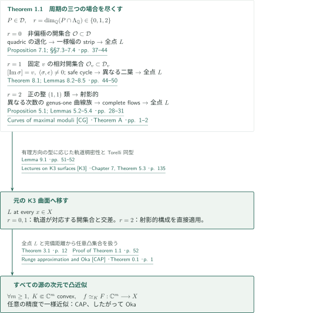
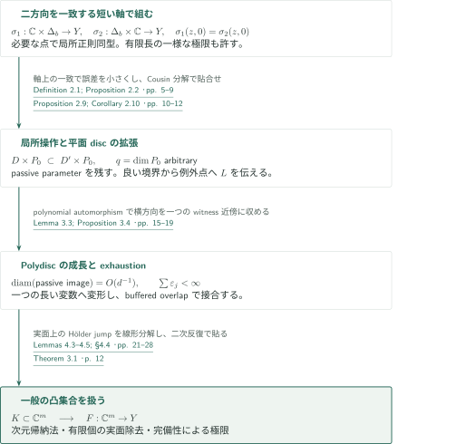
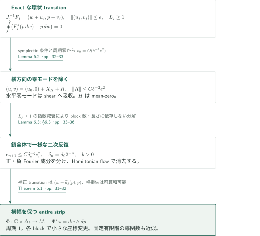
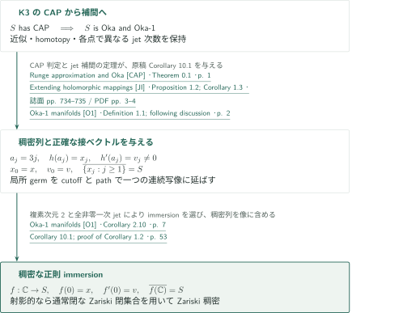
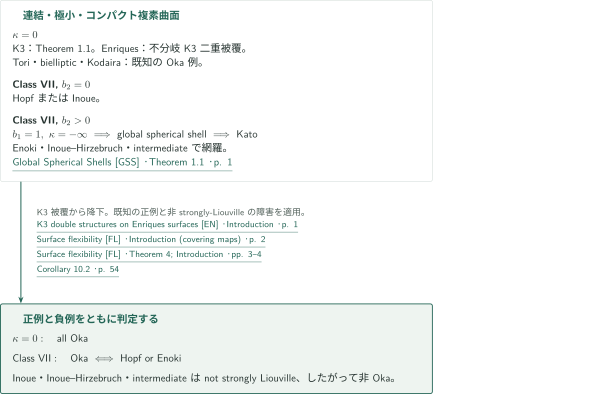
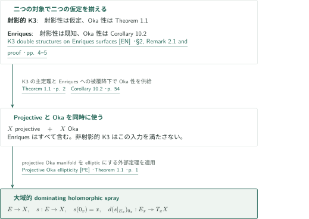

# すべての複素K3曲面のOka性

**二方向の正則strip、任意次元の凸近似、周期の有理方向による三分岐**

OpenAIの原稿は、射影性を仮定しないすべての複素K3曲面がOkaであると主張する。証明の中心は、局所的な二方向の完全な正則運動を、任意次元の源からの凸近似へ変換する解析と、その局所構造を全K3周期へ運ぶ幾何・力学の接続にある。本記事は原稿の証明構成を説明する。読解・入力結果の照合と、残る未検証部分は末尾で区別する。

## 1. 主要結果

### Theorem 1.1 — 任意の複素K3曲面の凸近似性

$X$を任意の複素K3曲面、$d_X$を滑らかなHermitian計量からの距離とする。任意の整数$m\ge1$、非空コンパクト凸集合$K\subset\mathbb C^m$、その開近傍$U$、正則写像$f:U\to X$、$\varepsilon>0$に対して、正則写像$F:\mathbb C^m\to X$が存在し、

$$
\sup_{z\in K}d_X(F(z),f(z))<\varepsilon
$$

を満たす。すなわち$X$はCAPを持ち、したがってOkaである。射影性、Picard数、楕円束の存在は仮定しない。

<!-- cite:main-result -->[Theorem 1.1 · p. 2](https://github.com/openai/math/blob/fd4aeeb2ee4fc729c18d98444fed42fd0529eeeb/preprints/Every-complex-K3-surface-is-Oka-September-23-2026/paper.pdf)<!-- /cite --> · <!-- cite:cap-oka -->[Runge approximation and Oka &#91;CAP&#93; · Theorem 0.1 · p. 1](https://arxiv.org/pdf/math/0402278v5#page=1)<!-- /cite -->

### Corollary 1.2 — 指定jetを持つ稠密なentire immersion

任意の複素K3曲面$S$、$x\in S$、$0\ne v\in T_xS$に対し、正則immersion $f:\mathbb C\to S$で

$$
f(0)=x,\qquad f'(0)=v,\qquad \overline{f(\mathbb C)}=S
$$

を満たすものが存在する。閉包は通常の複素位相で取る。$S$が射影的なら像はZariski稠密でもある。指定するのは接線の方向だけでなくベクトル$v$そのものである。

<!-- cite:dense -->[Corollary 1.2 · p. 2](https://github.com/openai/math/blob/fd4aeeb2ee4fc729c18d98444fed42fd0529eeeb/preprints/Every-complex-K3-surface-is-Oka-September-23-2026/paper.pdf)<!-- /cite -->

### Corollary 10.2 — Kodaira次元零と極小class VII

すべての複素Enriques曲面はOkaである。より一般に、連結・極小・コンパクト複素曲面で$\kappa=0$ならOkaである。連結・極小・コンパクトなclass VII曲面については

$$
X\text{ がOka}\quad\Longleftrightarrow\quad X\text{ がHopfまたはEnoki曲面}
$$

が成り立つ。後半の網羅性には、K3の主定理とは別にGlobal Spherical Shellsの結果を使う。

<!-- cite:classification -->[Corollary 10.2 · p. 54](https://github.com/openai/math/blob/fd4aeeb2ee4fc729c18d98444fed42fd0529eeeb/preprints/Every-complex-K3-surface-is-Oka-September-23-2026/paper.pdf)<!-- /cite -->

### Corollary 10.3 — 射影的K3とEnriquesの大域的spray

すべての射影的複素K3曲面、およびすべての複素Enriques曲面はGromovの意味でellipticである。すなわち正則ベクトル束$E\to X$と正則写像$s:E\to X$で、$s(0_x)=x$かつ$d(s|_{E_x})_{0_x}:E_x\to T_xX$が全射となるものが存在する。非射影的K3の大域的sprayはこの系の主張に含まれない。

<!-- cite:sprays -->[Corollary 10.3 · p. 54](https://github.com/openai/math/blob/fd4aeeb2ee4fc729c18d98444fed42fd0529eeeb/preprints/Every-complex-K3-surface-is-Oka-September-23-2026/paper.pdf)<!-- /cite -->

## 図の矢印に付した引用

<!-- reference-guide -->
略号のない定理・補題・節・式番号は本原稿 [K3 Oka](https://github.com/openai/math/blob/fd4aeeb2ee4fc729c18d98444fed42fd0529eeeb/preprints/Every-complex-K3-surface-is-Oka-September-23-2026/paper.pdf) を指します。外部入力には次の略号を使います。

- [CG](https://www.cambridge.org/core/services/aop-cambridge-core/content/view/4D944E80C9877293A6E64D2CE35B2D12/S205050942200024Xa.pdf/curves_of_maximal_moduli_on_k3_surfaces.pdf) Xi Chen and Frank Gounelas — *Curves of maximal moduli*：genus-one曲線族の非等自明変形と非有界次数を§5で使う。2022 published version, Forum of Mathematics, Sigma 10, e36。
- [K3](https://www.math.uni-bonn.de/people/huybrech/K3Global.pdf) Daniel Huybrechts — *Lectures on K3 surfaces*：local/global Torelliと正の整(1,1)類による射影性判定。著者公開の公刊前draft、copyright 2015、2026年10月10日取得。原稿引用の2016年公刊版とは区別。
- [VE](https://arxiv.org/pdf/1708.05802v1) Misha Verbitsky — *Ergodic structures: erratum*：軌道閉包の訂正された枠組み。固定vの主張は本稿Lemma 9.1で追う。arXiv:1708.05802v1, 2017-08-19。
- [CAP](https://arxiv.org/pdf/math/0402278v5) Franc Forstnerič — *Runge approximation and Oka*：任意次元の凸近似性からOka性へ。arXiv:math/0402278v5, 2005-05-06 (PDF dated May 5)。
- [JI](https://www.numdam.org/article/AIF_2005__55_3_733_0.pdf) Franc Forstnerič — *Extending holomorphic mappings*：Oka性からjet補間を伴う近似へ。2005 published version, Annales de l’Institut Fourier 55(3), 733–751。
- [O1](https://arxiv.org/pdf/2303.15855v5) Antonio Alarcón and Franc Forstnerič — *Oka-1 manifolds*：個別jet次数の補間と複素次元2でのimmersion。arXiv:2303.15855v5, 2025-04-10。
- [FL](https://arxiv.org/pdf/1207.4838v3) Franc Forstnerič and Finnur Lárusson — *Surface flexibility*：被覆によるOka降下、既知のκ=0例、class VIIの正例と負例。arXiv:1207.4838v3, 2013-02-21。
- [GSS](https://github.com/openai/math/blob/fd4aeeb2ee4fc729c18d98444fed42fd0529eeeb/preprints/Global-Spherical-Shells-on-Minimal-Surfaces-of-Class-VII-September-24-2026/paper.pdf) OpenAI — *Global Spherical Shells*：Corollary 10.2だけの入力：b₂>0の極小class VIIをKatoへ帰着。2026年9月24日版・公式060（固定commitは出典記録）。
- [EN](https://arxiv.org/pdf/math/0604629v2) Francisco Javier Gallego, Miguel González and Bangere P. Purnaprajna — *K3 double structures on Enriques surfaces*：Enriquesの不分岐K3二重被覆と射影性の記述。arXiv:math/0604629v2, 2006-08-27。
- [PE](https://arxiv.org/pdf/2502.20028v6) Franc Forstnerič and Finnur Lárusson — *Projective Oka ellipticity*：projectiveかつOkaから大域的dominating sprayへ。arXiv:2502.20028v6, 2026-05-05 (PDF notes edits May 4)。

各引用に結果番号とページを付します。誌面番号とPDF内の位置が異なる場合は両方を示します。GitHubの閲覧リンクではページ位置への自動移動を前提としません。
<!-- /reference-guide -->

以下の外部文献は、記載した入力の主張と原稿での使用箇所を照合した範囲で案内する。局所Stein理論、$\bar\partial$評価、格子・力学の追加入力には、原稿本文の読解にとどまり外部原典との照合が未了のものがある。未確認範囲を末尾に列挙する。

## 2. Theorem 1.1 — 主定理の証明概略

<!-- proof-target:1 -->証明対象：[Theorem 1.1 · p. 2](https://github.com/openai/math/blob/fd4aeeb2ee4fc729c18d98444fed42fd0529eeeb/preprints/Every-complex-K3-surface-is-Oka-September-23-2026/paper.pdf)<!-- /proof-target -->

K3格子$\Lambda=3U\oplus2E_8(-1)$の符号は$(3,19)$である。marked periodを向き付けられた正定値実2平面$P\subset\Lambda_{\mathbb R}$とし、$r=\dim_{\mathbb Q}(P\cap\Lambda_{\mathbb Q})\in\{0,1,2\}$で分ける。到達目標は全点での局所操作$L$であり、その正確な内容は次節に置く。

### 1. 有理方向なし：全周期領域の開集合へ運ぶ

Proposition 7.1は全period domain $\mathcal D$の非空開集合$\mathcal O$を構成し、そこに属する周期の曲面では全点に$L$が成り立つとする。出発点は二つのquadricの退化$Q_+Q_-=\alpha G$である。各成分の有理pencilとneckの座標から有限個のraw chartを選び、Theorem 6.1で長さに依存しない正の横幅を持つstripへ貼る。recentring後も使えるコンパクト領域で位置と横断相手を制御し、残る点は境界上の良い点から$L$を伝播する。

この構成を非偏極の局所変形でやり直す点が必要である。特定の射影族の中だけで開いていても$\mathcal D$の開集合にはならない。有限atlasの余裕を保つ変形とlocal Torelliが全周期領域での開性を与える。$r=0$ならLemma 9.1(1)によって整数等長変換の軌道が$\mathcal O$と交わる。

<!-- cite:open-period -->[Proposition 7.1; §§7.3–7.4 · pp. 37–44](https://github.com/openai/math/blob/fd4aeeb2ee4fc729c18d98444fed42fd0529eeeb/preprints/Every-complex-K3-surface-is-Oka-September-23-2026/paper.pdf)<!-- /cite --> · <!-- cite:recenter -->[Lemma 6.4 · pp. 36–37](https://github.com/openai/math/blob/fd4aeeb2ee4fc729c18d98444fed42fd0529eeeb/preprints/Every-complex-K3-surface-is-Oka-September-23-2026/paper.pdf)<!-- /cite --> · <!-- cite:local-torelli -->[Lectures on K3 surfaces &#91;K3&#93; · Chapter 6, Proposition 2.8 · p. 107](https://www.math.uni-bonn.de/people/huybrech/K3Global.pdf#page=107)<!-- /cite --> · <!-- cite:orbits -->[Lemma 9.1 · pp. 51–52](https://github.com/openai/math/blob/fd4aeeb2ee4fc729c18d98444fed42fd0529eeeb/preprints/Every-complex-K3-surface-is-Oka-September-23-2026/paper.pdf)<!-- /cite -->

### 2. 有理方向が一つ：固定vの相対開集合が必要

$P\cap\Lambda_{\mathbb Q}=\mathbb Qv$、$v\in\Lambda$をprimitiveかつ正とする。Theorem 8.1は$\mathcal D_v=\{P:v\in P\}$の非空相対開集合$\mathcal O_v$を作る。Lemma 8.2の中心は$j=0$のisotrivial genus-one fibrationで、fiber class $e$は$(e,v)=0$を満たす。変形上で$[\operatorname{Im}\sigma]=v$と正規化し、円周値のactionを使って特異fiberを避けるsafe cycleを選ぶ。このactionの制御が、反復的なrecentring後の中心を使用可能な領域に保つ。

二つの独立なcycleから得る葉のgermが一致すれば、二つの周期を持つgraphがcompact holomorphic torusを作り、その類が$me$になる。$(\sigma,e)\ne0$の変形ではこれは不可能である。二葉がある点で接していても、葉に沿って横断する位置へ移り、Proposition 2.2のdisplaced-pointの場合を使う。例外点の除去まで行って全点$L$を得る。Lemma 9.1(2)が、$v$を固定する整数等長変換の軌道と$\mathcal O_v$の交わりを保証する。

<!-- cite:fixed-period -->[Theorem 8.1; Lemmas 8.2–8.5 · pp. 44–50](https://github.com/openai/math/blob/fd4aeeb2ee4fc729c18d98444fed42fd0529eeeb/preprints/Every-complex-K3-surface-is-Oka-September-23-2026/paper.pdf)<!-- /cite --> · <!-- cite:local -->[Definition 2.1; Proposition 2.2 · pp. 5–9](https://github.com/openai/math/blob/fd4aeeb2ee4fc729c18d98444fed42fd0529eeeb/preprints/Every-complex-K3-surface-is-Oka-September-23-2026/paper.pdf)<!-- /cite --> · <!-- cite:propagation -->[Proposition 2.9; Corollary 2.10 · pp. 10–12](https://github.com/openai/math/blob/fd4aeeb2ee4fc729c18d98444fed42fd0529eeeb/preprints/Every-complex-K3-surface-is-Oka-September-23-2026/paper.pdf)<!-- /cite --> · <!-- cite:orbits -->[Lemma 9.1 · pp. 51–52](https://github.com/openai/math/blob/fd4aeeb2ee4fc729c18d98444fed42fd0529eeeb/preprints/Every-complex-K3-surface-is-Oka-September-23-2026/paper.pdf)<!-- /cite -->

### 3. 有理平面：射影的K3上の二つの曲線族を使う

$r=2$なら$P^\perp$は符号$(1,19)$の有理空間なので、正の有理ベクトルを含む。整数倍すれば正の整$(1,1)$類が得られ、射影性判定を適用できる。Proposition 5.1はこの場合の全点$L$を与える。

その構成で使うのはChen–GounelasのTheorem Aを$g=1$に適用した曲線族である。自己交点の非有界性とHodge indexから固定ample類に関する次数が非有界となり、異なる次数の二族を選べる。正規化族の評価写像はある開集合上で有限étaleになり、二族の葉が一般に同じなら対応するintegral curveも同じになって次数の違いに矛盾する。properなgenus-one fiber上の正則ベクトル場はcompleteなので、局所sectionをそのflowで動かして二方向のstripを作る。第二の評価写像の逆枝は初期値の持ち上げにだけ使い、その後のflowはproper fiber全体で定義する。残る代数的例外集合はCorollary 2.10で越える。

<!-- cite:projectivity -->[Lectures on K3 surfaces &#91;K3&#93; · §1.3.3, footnote 9 · p. 16](https://www.math.uni-bonn.de/people/huybrech/K3Global.pdf#page=16)<!-- /cite --> · <!-- cite:curves -->[Curves of maximal moduli &#91;CG&#93; · Theorem A · pp. 1–2](https://www.cambridge.org/core/services/aop-cambridge-core/content/view/4D944E80C9877293A6E64D2CE35B2D12/S205050942200024Xa.pdf/curves_of_maximal_moduli_on_k3_surfaces.pdf#page=1)<!-- /cite --> · <!-- cite:projective -->[Proposition 5.1; Lemmas 5.2–5.4 · pp. 28–31](https://github.com/openai/math/blob/fd4aeeb2ee4fc729c18d98444fed42fd0529eeeb/preprints/Every-complex-K3-surface-is-Oka-September-23-2026/paper.pdf)<!-- /cite -->

### 4. Torelli移送と任意次元のCAPへの合流

前二場合では軌道上の周期へmarkingを変え、global Torelliによって元の曲面と同型な曲面に$L$を得る。Kähler chamberの違いには周期を固定する符号変更・root reflectionを介在させる。これは良い周期の集合が単に稠密であることからの極限議論ではない。各軌道を、その型に適した開集合と実際に交差させる議論である。

Lemma 9.1のRatner適用は正の平面の点ごとの固定群$\mathrm{SO}_0(1,19)$から始める。コンパクト回転因子を含む群にそのままunipotent生成を仮定しない。Verbitskyのerratumを踏まえ、中間軌道の有理方向を区別する。編集側は本稿の群論的帰着を読んだが、Ratner・Borelの入力証明までは検証していない。

全場合で$L$を全点に得た後、Theorem 3.1が任意$m$の任意コンパクト凸集合に対するCAPを与える。K3のコンパクト性は標的距離の完備性と距離の一様同値性を供給し、Theorem 1.1の指定されたHermitian距離での結論に戻る。

<!-- cite:torelli -->[Lectures on K3 surfaces &#91;K3&#93; · Chapter 7, Theorem 5.3 · p. 135](https://www.math.uni-bonn.de/people/huybrech/K3Global.pdf#page=135)<!-- /cite --> · <!-- cite:orbit-erratum -->[Ergodic structures: erratum &#91;VE&#93; · Theorem 2.5 · p. 5](https://arxiv.org/pdf/1708.05802v1#page=5)<!-- /cite --> · <!-- cite:orbits -->[Lemma 9.1 · pp. 51–52](https://github.com/openai/math/blob/fd4aeeb2ee4fc729c18d98444fed42fd0529eeeb/preprints/Every-complex-K3-surface-is-Oka-September-23-2026/paper.pdf)<!-- /cite --> · <!-- cite:final-proof -->[Proof of Theorem 1.1 · p. 52](https://github.com/openai/math/blob/fd4aeeb2ee4fc729c18d98444fed42fd0529eeeb/preprints/Every-complex-K3-surface-is-Oka-September-23-2026/paper.pdf)<!-- /cite -->

## 3. Theorem 3.1 — 局所操作Lから任意次元の凸近似へ

<!-- proof-target:2 -->証明対象：[Theorem 3.1 · p. 12](https://github.com/openai/math/blob/fd4aeeb2ee4fc729c18d98444fed42fd0529eeeb/preprints/Every-complex-K3-surface-is-Oka-September-23-2026/paper.pdf)<!-- /proof-target -->

<!-- statement:theorem-3-1 -->
### Theorem 3.1 — 仮定と結論

$Y$を完備なcompatible distanceを持つ複素曲面とする。各点$x\in Y$で次の操作$L$が成立すると仮定する。$x$の開近傍$V$があり、任意のspecial pair $D\subset D'$、任意の閉polydisc $P_0\Subset\operatorname{int}P\subset\mathbb C^q$、$D\times P$の近傍から$V$への任意の正則写像$f$について、$f|_{D\times P_0}$を$D'\times P_0$の近傍から$Y$への正則写像で一様近似できる。ここで$D,D'$は区分的滑らかな境界を持つ閉位相的discであり、$D'$は$D$にもう一つのdiscを境界のproper arcに沿って付けたもの、$q=0$も許す。

このとき$Y$は、すべての源の次元でCAPを持つ。すなわちTheorem 1.1の凸近似の量化を$X$から$Y$へ置き換えた結論が成立する。

<!-- cite:local -->[Definition 2.1; Proposition 2.2 · pp. 5–9](https://github.com/openai/math/blob/fd4aeeb2ee4fc729c18d98444fed42fd0529eeeb/preprints/Every-complex-K3-surface-is-Oka-September-23-2026/paper.pdf)<!-- /cite --> · <!-- cite:cap-target -->[Theorem 3.1 · p. 12](https://github.com/openai/math/blob/fd4aeeb2ee4fc729c18d98444fed42fd0529eeeb/preprints/Every-complex-K3-surface-is-Oka-September-23-2026/paper.pdf)<!-- /cite -->
<!-- /statement -->

### 1. 完全な二方向をパラメータ付きの局所操作へ変える

Proposition 2.2のstripは$\sigma_1:\mathbb C\times\Delta_b\to Y$と$\sigma_2:\Delta_b\times\mathbb C\to Y$であり、必要な点で局所正則同型、共通の短い軸で$\sigma_1(z,0)=\sigma_2(z,0)$を満たす。二つの方向で別々にscalar approximationを行い、共通軸上の一致によって小さくなる誤差をbounded Cousin splittingと非線形貼合せで消す。これにより一つの源変数だけを長くしても、任意個のpassive holomorphic parameterを残せる。

Proposition 2.9は境界上の有限個のwitness近傍を使って平面discを拡張する。Corollary 2.10は、良い点に境界を持つ二つの傾いたdiscを延ばし、中心に二方向を作る。したがって悪い点がproper analytic subsetに含まれる場合にも$L$を全点へ伝えられる。ここまでに多変数の凸近似を仮定する循環はない。

<!-- cite:local -->[Definition 2.1; Proposition 2.2 · pp. 5–9](https://github.com/openai/math/blob/fd4aeeb2ee4fc729c18d98444fed42fd0529eeeb/preprints/Every-complex-K3-surface-is-Oka-September-23-2026/paper.pdf)<!-- /cite --> · <!-- cite:propagation -->[Proposition 2.9; Corollary 2.10 · pp. 10–12](https://github.com/openai/math/blob/fd4aeeb2ee4fc729c18d98444fed42fd0529eeeb/preprints/Every-complex-K3-surface-is-Oka-September-23-2026/paper.pdf)<!-- /cite -->

### 2. Polydiscを一つの長い変数と薄い横方向へ変える

Lemma 3.3のpolynomial automorphismで、拡張する部分を長い一変数とboundedなpassive変数の形に変える。接合部でpassive方向の像の直径を$O(1/d)$へ小さくし、単一witness近傍に収める。そこで平面拡張を行い、bufferedな開重なり上で元の写像と貼り合わせるのがProposition 3.4である。polydisc exhaustionで誤差を可算和可能に選び、標的距離の完備性からentireな極限を得る。

<!-- cite:polydisc -->[Lemma 3.3; Proposition 3.4 · pp. 15–19](https://github.com/openai/math/blob/fd4aeeb2ee4fc729c18d98444fed42fd0529eeeb/preprints/Every-complex-K3-surface-is-Oka-September-23-2026/paper.pdf)<!-- /cite -->

### 3. 実面上の誤差から一般の凸集合へ進む

Polydisc近似だけでは任意の凸集合$K$を扱えない。§4は次元に関する帰納法と実polytopeの面を外す操作を組み合わせる。Lemma 4.3は低次元CAPと実パラメータの複素化を用いて面近傍の変形を作る。途中では複素近傍の幅を固定できないため、Lemma 4.4は実interface上のHölder traceを入力とするjump splittingを構成する。Cauchy積分によるjump、分割後のMoreraによる延長、重み付き$L^2\bar\partial$解が、その線形作用素と幅損失に対する評価を供給する。

Lemma 4.5の非線形二次反復で貼り合わせ、有限個の面を順に除いてpolydiscの問題へ運ぶ。ここで§3の近似を使い、元の$K$上で誤差を保つ。これがTheorem 3.1の「すべての次元・すべての凸集合」を閉じる段階である。線形・非線形評価の役割は本文で追ったが、全定数と反復の独立検算は未了である。

<!-- cite:faces -->[Lemmas 4.3–4.5; §4.4 · pp. 21–28](https://github.com/openai/math/blob/fd4aeeb2ee4fc729c18d98444fed42fd0529eeeb/preprints/Every-complex-K3-surface-is-Oka-September-23-2026/paper.pdf)<!-- /cite -->

## 4. Theorem 6.1 — 環状鎖を一様な横幅で貼り合わせる

<!-- proof-target:3 -->証明対象：[Theorem 6.1 · pp. 31–32](https://github.com/openai/math/blob/fd4aeeb2ee4fc729c18d98444fed42fd0529eeeb/preprints/Every-complex-K3-surface-is-Oka-September-23-2026/paper.pdf)<!-- /proof-target -->

<!-- statement:theorem-6-1 -->
### Theorem 6.1 — Annular-chain sewing

$M$は零点のない正則2形式$\omega$を持つ複素曲面、$\mathcal C=\mathbb C/\mathbb Z$、$Y=\operatorname{Im}w$、$\omega_0=dw\wedge dp$とする。$0<h<1/8$、$r>0$、$A<\infty$を固定する。各$j\in\mathbb Z$について$L_j\ge1$と

$$
\phi_j:\{-2h<Y<L_j+2h\}\times\Delta_r\to M,
\qquad \phi_j^*\omega=\omega_0
$$

があるとする。$J_j(w,p)=(w+a_j(p),p)$は$|\operatorname{Im}a_j(p)+L_j|<h/8$、$|a'_j(p)|\le A$を満たす。seam $S_j=\{|Y-L_j|<h\}\times\Delta_r$上にdegree-oneのexact symplectic transition $F_j$があり、$\phi_j=\phi_{j+1}\circ F_j$かつ

$$
J_j^{-1}F_j=(w+u_j,p+v_j),\qquad
\sup_j\|(u_j,v_j)\|_{S_j}\le e
$$

とする。exactは$F_j^*(p\,dw)-p\,dw$の周期積分が零であることをいう。

$h,r,A$と指定された余裕だけに依存する$b>0,e_*>0$が存在し、$e<e_*$なら第1変数について周期1のholomorphic symplectic immersion $\Phi:\mathbb C\times\Delta_b\to M$が得られる。各blockの両端に一定の正の余裕を残した領域では$\Phi$は$\phi_j$に小さなperiodic symplectic座標変換を施したもので、補正後のtransitionは$(w,p)\mapsto(w+\widetilde a_j(p),p)$となる。座標変換の恒等写像からの差と$\widetilde a_j-a_j$、およびさらに内側での任意の固定有限階の導関数は、$e\to0$で一様に零へ向かう。$L_j$の上界やblock数の上界は不要である。

<!-- cite:sewing -->[Theorem 6.1 · pp. 31–32](https://github.com/openai/math/blob/fd4aeeb2ee4fc729c18d98444fed42fd0529eeeb/preprints/Every-complex-K3-surface-is-Oka-September-23-2026/paper.pdf)<!-- /cite -->
<!-- /statement -->

### 1. Exactnessが横方向の零モードを二次誤差にする

円筒上ではclosedな正則1形式がexactとは限らず、periodが障害となる。$E=(w+u,p+v)$に対してsymplectic条件とexactnessを併用すると、$v$の零Fourier係数は一次の自由なdriftでなく$O(\delta^{-1}e^2)$となる。Lemma 6.2は

$$
(u,v)=(u_0,0)+X_H+R,\qquad
X_H=(H_p,-H_w),\qquad \|R\|\le C\delta^{-2}e^2
$$

と分解する。残る横ではなく水平の零モード$u_0(p)$はshearへ吸収できる。

<!-- cite:zero-mode -->[Lemma 6.2 · pp. 32–33](https://github.com/openai/math/blob/fd4aeeb2ee4fc729c18d98444fed42fd0529eeeb/preprints/Every-complex-K3-surface-is-Oka-September-23-2026/paper.pdf)<!-- /cite -->

### 2. Fourier分解を鎖全体で一様に解く

Lemma 6.3はmean-zero Hamiltonianの正・負Fourier成分を、それぞれ適切な方向のblockへ分配する。$L_j\ge1$による指数減衰が幾何級数を作り、作用素ノルムを鎖の長さ・block数から独立にする。Hamiltonian flowによる座標変更後の誤差は$e_{n+1}\le C\delta_n^{-q}e_n^2$を満たす。$\delta_n=d_0 2^{-n}$を選ぶと、十分小さい初期誤差に対して二次収束が幅損失を上回り、正の横幅が残る。

<!-- cite:split-chain -->[Lemma 6.3; §6.3 · pp. 33–36](https://github.com/openai/math/blob/fd4aeeb2ee4fc729c18d98444fed42fd0529eeeb/preprints/Every-complex-K3-surface-is-Oka-September-23-2026/paper.pdf)<!-- /cite -->

### 3. 全entire方向と幾何構成への適用条件

補正後のtransitionは横座標$p$を動かさない。高さが両方向へ伸びる鎖を貼ると、universal coverの第1変数が$\mathbb C$全体を覆い、周期1のstrip immersionを得る。小さな座標変更と内側でのCauchy評価が、各元のchartへの近似と有限階導関数の結論を与える。

§§7–8への適用では、raw transitionのperiod defectをLemma 6.4のrecentringで消し、実際の座標とmodel shearを同時に移す。これだけで累積driftが自動的に小さくなるわけではない。§7の有限atlasと§8のsafe actionは、移動する中心が常にbufferedな使用可能領域に残ることを別に確保する。その一様性を含む幾何的評価の完全な検証は初稿の保留事項である。

<!-- cite:sewing -->[Theorem 6.1 · pp. 31–32](https://github.com/openai/math/blob/fd4aeeb2ee4fc729c18d98444fed42fd0529eeeb/preprints/Every-complex-K3-surface-is-Oka-September-23-2026/paper.pdf)<!-- /cite --> · <!-- cite:recenter -->[Lemma 6.4 · pp. 36–37](https://github.com/openai/math/blob/fd4aeeb2ee4fc729c18d98444fed42fd0529eeeb/preprints/Every-complex-K3-surface-is-Oka-September-23-2026/paper.pdf)<!-- /cite --> · <!-- cite:open-period -->[Proposition 7.1; §§7.3–7.4 · pp. 37–44](https://github.com/openai/math/blob/fd4aeeb2ee4fc729c18d98444fed42fd0529eeeb/preprints/Every-complex-K3-surface-is-Oka-September-23-2026/paper.pdf)<!-- /cite --> · <!-- cite:fixed-period -->[Theorem 8.1; Lemmas 8.2–8.5 · pp. 44–50](https://github.com/openai/math/blob/fd4aeeb2ee4fc729c18d98444fed42fd0529eeeb/preprints/Every-complex-K3-surface-is-Oka-September-23-2026/paper.pdf)<!-- /cite -->

## 5. Corollary 1.2 — 指定jetと稠密immersion

<!-- proof-target:4 -->証明対象：[Corollary 1.2 · p. 2](https://github.com/openai/math/blob/fd4aeeb2ee4fc729c18d98444fed42fd0529eeeb/preprints/Every-complex-K3-surface-is-Oka-September-23-2026/paper.pdf)<!-- /proof-target -->

証明対象は冒頭のCorollary 1.2である。中間のCorollary 10.1は、開Riemann面からの近似とjet補間を一度に与える。

### 1. 非零の一次jetを一つの連続写像へ組み込む

CAPからOka性、さらにOka-1性へ進む。Corollary 10.1の入力は、開Riemann面$R$、コンパクトRunge集合$K$、閉離散集合$A=\{a_j\}$、各点ごとの整数$k_j\ge1$、$K\cup A$近傍で正則な連続写像$h:R\to S$である。結論は$h$とhomotopicで、$K$上で近似し、各$k_j$-jetを保つ正則写像である。有限・空の補間集合も許す。

$R=\mathbb C$、$a_j=3j$、$x_0=x$、$v_0=v$とし、$j\ge1$では稠密列$x_j$と各点で非零の$v_j$を取る。互いに素な局所有限disc上で値$x_j$・導関数$v_j$を持つ正則germを作る。座標球内のcutoffと$x_j$から共通の基点へのpathによって、これらを一つの連続写像$h$へ延ばす。これが補間定理に必要な位相的入力を満たし、$j=0$で指定値と正確な接ベクトルを保つ。

<!-- cite:cap-oka -->[Runge approximation and Oka &#91;CAP&#93; · Theorem 0.1 · p. 1](https://arxiv.org/pdf/math/0402278v5#page=1)<!-- /cite --> · <!-- cite:jet-input -->[Extending holomorphic mappings &#91;JI&#93; · Proposition 1.2; Corollary 1.3 · 誌面 pp. 734–735 / PDF pp. 3–4](https://www.numdam.org/article/AIF_2005__55_3_733_0.pdf#page=3)<!-- /cite --> · <!-- cite:oka-one -->[Oka-1 manifolds &#91;O1&#93; · Definition 1.1; following discussion · p. 2](https://arxiv.org/pdf/2303.15855v5#page=2)<!-- /cite --> · <!-- cite:interpolation-use -->[Corollary 10.1; proof of Corollary 1.2 · p. 53](https://github.com/openai/math/blob/fd4aeeb2ee4fc729c18d98444fed42fd0529eeeb/preprints/Every-complex-K3-surface-is-Oka-September-23-2026/paper.pdf)<!-- /cite -->

### 2. Immersionと通常位相の稠密性を同時に得る

複素次元が2で、指定した一次導関数がすべて非零なので、Oka-1 manifoldsのCorollary 2.10を使って補間写像をimmersionに選べる。単に点を補間するだけで微分の非消滅が従うわけではない。得られた写像は$f(a_j)=x_j$、$f'(a_j)=v_j$を満たすので、像が稠密列を含み、通常位相で稠密となる。

<!-- cite:immersions -->[Oka-1 manifolds &#91;O1&#93; · Corollary 2.10 · p. 7](https://arxiv.org/pdf/2303.15855v5#page=7)<!-- /cite --> · <!-- cite:interpolation-use -->[Corollary 10.1; proof of Corollary 1.2 · p. 53](https://github.com/openai/math/blob/fd4aeeb2ee4fc729c18d98444fed42fd0529eeeb/preprints/Every-complex-K3-surface-is-Oka-September-23-2026/paper.pdf)<!-- /cite -->

### 3. 射影的な場合のZariski稠密性

射影的$S$のZariski閉集合は通常の複素位相でも閉である。通常稠密な$f(\mathbb C)$を含むproper Zariski閉集合は存在せず、最後の結論が従う。

<!-- cite:interpolation-use -->[Corollary 10.1; proof of Corollary 1.2 · p. 53](https://github.com/openai/math/blob/fd4aeeb2ee4fc729c18d98444fed42fd0529eeeb/preprints/Every-complex-K3-surface-is-Oka-September-23-2026/paper.pdf)<!-- /cite -->

## 6. Corollary 10.2 — 正例・負例を合わせた曲面分類

<!-- proof-target:5 -->証明対象：[Corollary 10.2 · p. 54](https://github.com/openai/math/blob/fd4aeeb2ee4fc729c18d98444fed42fd0529eeeb/preprints/Every-complex-K3-surface-is-Oka-September-23-2026/paper.pdf)<!-- /proof-target -->

分類対象の連結性・極小性・コンパクト性は冒頭の主張の通りとする。$\kappa=0$の列挙とclass VIIの$b_2$による場合分けを分けて追う。

### 1. K3からすべてのEnriquesへ

K3はTheorem 1.1とCAP判定でOkaとなる。Enriquesには不分岐正則K3二重被覆があるため、Oka性の被覆による降下を適用できる。この議論はnodalなEnriquesも含み、unnodalという制限を必要としない。

<!-- cite:main-result -->[Theorem 1.1 · p. 2](https://github.com/openai/math/blob/fd4aeeb2ee4fc729c18d98444fed42fd0529eeeb/preprints/Every-complex-K3-surface-is-Oka-September-23-2026/paper.pdf)<!-- /cite --> · <!-- cite:enriques-cover -->[K3 double structures on Enriques surfaces &#91;EN&#93; · Introduction · p. 1](https://arxiv.org/pdf/math/0604629v2#page=1)<!-- /cite --> · <!-- cite:cover-descent -->[Surface flexibility &#91;FL&#93; · Introduction (covering maps) · p. 2](https://arxiv.org/pdf/1207.4838v3#page=2)<!-- /cite -->

### 2. Kodaira次元零の残りの種類

極小コンパクト複素曲面で$\kappa=0$の残りはcomplex tori、bielliptic surfaces、Kodaira surfacesである。これらのOka性はSurface flexibilityのIntroductionが整理する既知の入力であり、今回のK3証明で新たに構成する部分ではない。前段のK3・Enriquesと合わせて$\kappa=0$の結論を閉じる。

<!-- cite:surface-cases -->[Surface flexibility &#91;FL&#93; · Theorem 4; Introduction · pp. 3–4](https://arxiv.org/pdf/1207.4838v3#page=3)<!-- /cite --> · <!-- cite:classification -->[Corollary 10.2 · p. 54](https://github.com/openai/math/blob/fd4aeeb2ee4fc729c18d98444fed42fd0529eeeb/preprints/Every-complex-K3-surface-is-Oka-September-23-2026/paper.pdf)<!-- /cite -->

### 3. Class VIIでb₂=0：HopfとInoueを分ける

$b_2=0$の場合の列挙はHopfとInoueである。Surface flexibilityのTheorem 4はHopfをOkaとし、Inoueをnot strongly Liouvilleとする。Okaならstrongly Liouvilleなので、後者はOkaでない。負の結論を落とすと「if and only if」は得られない。

<!-- cite:surface-cases -->[Surface flexibility &#91;FL&#93; · Theorem 4; Introduction · pp. 3–4](https://arxiv.org/pdf/1207.4838v3#page=3)<!-- /cite -->

### 4. Class VIIでb₂>0：Global Spherical Shellsによる網羅性

極小class VIIの$b_1=1$、$\kappa=-\infty$と$b_2>0$は、公式060のTheorem 1.1の仮定を満たす。そのglobal spherical shellによりKato surfaceへ帰着する。Katoの種類はEnoki、Inoue–Hirzebruch、intermediateであり、Surface flexibilityのTheorem 4はEnokiをOka、後二者をnot strongly Liouville、したがって非Okaとする。060はこの網羅性を補う別論文の入力で、K3主定理の証明には使われない。

<!-- cite:shell -->[Global Spherical Shells &#91;GSS&#93; · Theorem 1.1 · p. 1](https://github.com/openai/math/blob/fd4aeeb2ee4fc729c18d98444fed42fd0529eeeb/preprints/Global-Spherical-Shells-on-Minimal-Surfaces-of-Class-VII-September-24-2026/paper.pdf)<!-- /cite --> · <!-- cite:surface-cases -->[Surface flexibility &#91;FL&#93; · Theorem 4; Introduction · pp. 3–4](https://arxiv.org/pdf/1207.4838v3#page=3)<!-- /cite --> · <!-- cite:classification -->[Corollary 10.2 · p. 54](https://github.com/openai/math/blob/fd4aeeb2ee4fc729c18d98444fed42fd0529eeeb/preprints/Every-complex-K3-surface-is-Oka-September-23-2026/paper.pdf)<!-- /cite -->

### 5. 必要十分条件を閉じる

HopfとEnokiの正例が十分性を、Inoue・Inoue–Hirzebruch・intermediateの負例と列挙の網羅性が必要性を与える。よって極小class VIIではOkaであることとHopfまたはEnokiであることが同値になる。原稿は任意のblowupやproperly elliptic surfacesの分類を主張していない。編集側が060で確認したのは主定理の記述とここでの適用条件であり、060の証明自体ではない。

<!-- cite:classification -->[Corollary 10.2 · p. 54](https://github.com/openai/math/blob/fd4aeeb2ee4fc729c18d98444fed42fd0529eeeb/preprints/Every-complex-K3-surface-is-Oka-September-23-2026/paper.pdf)<!-- /cite -->

## 7. Corollary 10.3 — Projective Okaから大域的sprayへ

<!-- proof-target:6 -->証明対象：[Corollary 10.3 · p. 54](https://github.com/openai/math/blob/fd4aeeb2ee4fc729c18d98444fed42fd0529eeeb/preprints/Every-complex-K3-surface-is-Oka-September-23-2026/paper.pdf)<!-- /proof-target -->

証明対象のsprayの意味と射影性の範囲は冒頭のCorollary 10.3を参照する。

### 1. 射影的K3の二つの仮定

射影性は系の仮定であり、Oka性はTheorem 1.1から得る。Projective Oka ellipticityのTheorem 1.1を適用すると、曲面全体でdominatingな一つのholomorphic sprayが存在する。各点を支配する別々の$\mathbb C^2$写像を得るstrong dominabilityとは異なる結論である。

<!-- cite:main-result -->[Theorem 1.1 · p. 2](https://github.com/openai/math/blob/fd4aeeb2ee4fc729c18d98444fed42fd0529eeeb/preprints/Every-complex-K3-surface-is-Oka-September-23-2026/paper.pdf)<!-- /cite --> · <!-- cite:elliptic-input -->[Projective Oka ellipticity &#91;PE&#93; · Theorem 1.1 · p. 1](https://arxiv.org/pdf/2502.20028v6#page=1)<!-- /cite -->

### 2. Enriquesの二つの仮定

EnriquesのOka性はCorollary 10.2、射影性はK3 double structures on Enriques surfacesの§2で引用される既知の事実から得る。これで同じ外部定理の両仮定が揃い、すべてのEnriquesに大域的sprayを得る。非射影的K3ではこの射影性の入力がなく、本稿から同じ結論を付け加えない。

<!-- cite:classification -->[Corollary 10.2 · p. 54](https://github.com/openai/math/blob/fd4aeeb2ee4fc729c18d98444fed42fd0529eeeb/preprints/Every-complex-K3-surface-is-Oka-September-23-2026/paper.pdf)<!-- /cite --> · <!-- cite:enriques-projective -->[K3 double structures on Enriques surfaces &#91;EN&#93; · §2, Remark 2.1 and proof · pp. 4–5](https://arxiv.org/pdf/math/0604629v2#page=4)<!-- /cite --> · <!-- cite:elliptic-input -->[Projective Oka ellipticity &#91;PE&#93; · Theorem 1.1 · p. 1](https://arxiv.org/pdf/2502.20028v6#page=1)<!-- /cite -->

## 8. どの論文がどの段階を担うか

| 入力 | 使用先と具体的な役割 | 照合の範囲 |
|---|---|---|
| Curves of maximal moduli | Proposition 5.1：$g=1$の動く曲線族を異なる次数で取り、二方向を作る | Theorem Aの記述と使用を照合 |
| Lectures on K3 surfaces | §§7–9：local/global Torelliと射影性判定 | 著者公開draftの該当箇所。2016年公刊版と同じページとは扱わない |
| Ergodic structures: erratum | §9：有理方向による軌道の区別 | Theorem 2.5を照合。固定$v$の群論は本稿Lemma 9.1 |
| Runge approximation and Oka、Extending holomorphic mappings、Oka-1 manifolds | §10.1：CAPから近似・jet補間・immersion | 指定した定義・命題・系の記述と次元条件を照合 |
| Surface flexibility、K3 double structures on Enriques surfaces | Corollary 10.2：被覆降下、既知分類、正例・負例 | 記述と使用を照合。Enriques射影性の独立証明は未検証 |
| Global Spherical Shells（公式060） | Corollary 10.2：正の$b_2$の極小class VIIをKatoへ帰着 | Theorem 1.1の仮定と結論のみ。K3主定理への依存ではない |
| Projective Oka ellipticity | Corollary 10.3：projective＋Okaからglobal spray | Theorem 1.1の記述と両仮定を照合 |

これら外部結果の全証明と、その先の依存文献の再帰的検証は実施していない。既知のdominabilityやOka周期の稠密性などの背景・比較を、それだけで本稿の直接証明依存とは数えない。

## 9. 原典を読む入口と確認範囲

<!-- reading-list -->
- [Theorem 1.1 · p. 2](https://github.com/openai/math/blob/fd4aeeb2ee4fc729c18d98444fed42fd0529eeeb/preprints/Every-complex-K3-surface-is-Oka-September-23-2026/paper.pdf) — 主張の量化と射影性を仮定しない範囲
- [Lemma 9.1 · pp. 51–52](https://github.com/openai/math/blob/fd4aeeb2ee4fc729c18d98444fed42fd0529eeeb/preprints/Every-complex-K3-surface-is-Oka-September-23-2026/paper.pdf) — 三つの有理性の場合分けと軌道移送
- [Definition 2.1; Proposition 2.2 · pp. 5–9](https://github.com/openai/math/blob/fd4aeeb2ee4fc729c18d98444fed42fd0529eeeb/preprints/Every-complex-K3-surface-is-Oka-September-23-2026/paper.pdf) — 二方向のstripから局所操作Lを得る
- [Theorem 3.1 · p. 12](https://github.com/openai/math/blob/fd4aeeb2ee4fc729c18d98444fed42fd0529eeeb/preprints/Every-complex-K3-surface-is-Oka-September-23-2026/paper.pdf) — 任意次元の凸近似という目標
- [Lemmas 4.3–4.5; §4.4 · pp. 21–28](https://github.com/openai/math/blob/fd4aeeb2ee4fc729c18d98444fed42fd0529eeeb/preprints/Every-complex-K3-surface-is-Oka-September-23-2026/paper.pdf) — 実面を除く解析と凸集合への最終移行
- [Proposition 5.1; Lemmas 5.2–5.4 · pp. 28–31](https://github.com/openai/math/blob/fd4aeeb2ee4fc729c18d98444fed42fd0529eeeb/preprints/Every-complex-K3-surface-is-Oka-September-23-2026/paper.pdf) — 異なる次数の曲線族とcomplete flows
- [Theorem 6.1 · pp. 31–32](https://github.com/openai/math/blob/fd4aeeb2ee4fc729c18d98444fed42fd0529eeeb/preprints/Every-complex-K3-surface-is-Oka-September-23-2026/paper.pdf) — 一様な横幅を保つ貼合せの仮定
- [Proposition 7.1; §§7.3–7.4 · pp. 37–44](https://github.com/openai/math/blob/fd4aeeb2ee4fc729c18d98444fed42fd0529eeeb/preprints/Every-complex-K3-surface-is-Oka-September-23-2026/paper.pdf) — 全period domainの開集合を構成
- [Theorem 8.1; Lemmas 8.2–8.5 · pp. 44–50](https://github.com/openai/math/blob/fd4aeeb2ee4fc729c18d98444fed42fd0529eeeb/preprints/Every-complex-K3-surface-is-Oka-September-23-2026/paper.pdf) — 固定vの相対開集合とsafe action
- [Corollary 10.1; proof of Corollary 1.2 · p. 53](https://github.com/openai/math/blob/fd4aeeb2ee4fc729c18d98444fed42fd0529eeeb/preprints/Every-complex-K3-surface-is-Oka-September-23-2026/paper.pdf) — 指定jetから稠密immersionを作る
- [§10.2 · p. 54](https://github.com/openai/math/blob/fd4aeeb2ee4fc729c18d98444fed42fd0529eeeb/preprints/Every-complex-K3-surface-is-Oka-September-23-2026/paper.pdf) — 曲面分類と大域sprayの別々の入力
<!-- /reading-list -->

**参照版。** OpenAI, *Every complex K3 surface is Oka*, September 23, 2026、56ページ。公式カタログの固定commit、取得URL、SHA-256、外部原典の版とページ対応は[出典記録](sources.json)に記載する。本稿の誌面番号とPDF位置は一致する。

**編集側で確認したこと。** 主要結果の仮定・量化・全結論、§§2–9の上記概説に必要な証明本文、§10の各帰結への接続を読んだ。主定理の三分岐、CAPで一般の凸集合に進む段階、環状鎖のperiod障害、immersionの次元条件、class VIIの正例と負例を照合した。登録した外部10文献は指定箇所の記述と使用先を確認した。準備調査と初稿中の追加照合は[作業記録](status.md)で分ける。

**未確認部分。** §§3–4の全$\bar\partial$・Hölder・反復評価、§§7–8の有限atlasの全点被覆とrecentringの全一様評価、Lemma 8.2の格子・自己同型構成は独立検証未了である。Ratner・Borel・Borel–Harish-Chandra、Grauert、Siu、Hörmander、Hodge原始形式に使うChen–Liなどの追加入力は原稿中の使い方を読んだ範囲であり、外部原典との記述照合を完了していない。060を含め外部論文の証明を認証したものではない。

本記事はAIが作成した原典読解の案内であり、著者の主張を編集側が独立に証明したという報告ではない。数学的利用には、上の読書案内と記録から原典の該当箇所を確認されたい。
