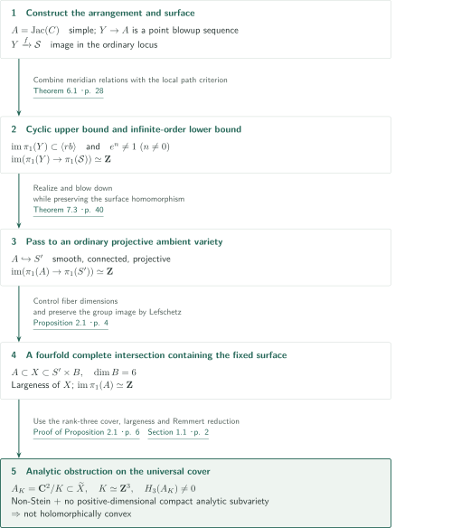
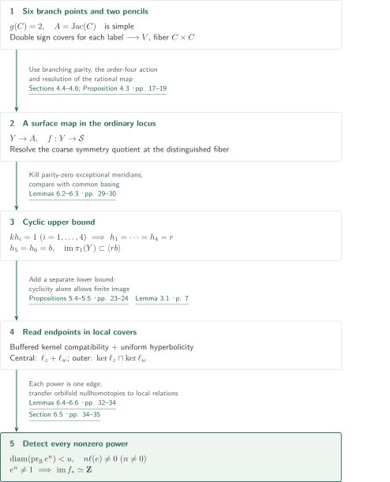
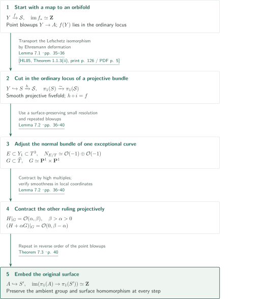
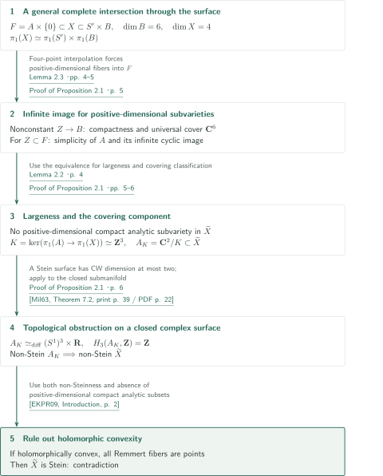

# A projective fourfold with large fundamental group and non-Stein universal cover

**Create an infinite cyclic image of a simple abelian surface, then use its rank-three lattice cover as an obstruction to Steinness.**

The manuscript claims a counterexample to the Shafarevich conjecture that the topological universal cover $\widetilde X$ of a smooth connected projective complex variety $X$ is holomorphically convex. Its construction reaches projective dimension four and also imposes a large fundamental group. The ambient variety is projective; the argument is not confined to general compact complex or nonprojective Kähler manifolds. This article explains the manuscript's construction and reasoning, without certifying the correctness of its complete proof.

## 1. Main results

### Theorem 1.1 — A projective fourfold with large fundamental group

There exist a smooth connected projective complex fourfold $X$ and a simple abelian surface $A\subset X$ such that:

1. $X$ has large fundamental group: for every positive-dimensional closed irreducible subvariety $Z\subset X$, the image $\operatorname{im}(\pi_1(Z^\nu)\to\pi_1(X))$ of the normalization is infinite.
2. $\operatorname{im}(\pi_1(A)\to\pi_1(X))\simeq\mathbf Z$.

The universal cover $\widetilde X$ contains no positive-dimensional compact complex-analytic subvariety and is not Stein.

<!-- cite:main -->[Theorem 1.1 · p. 1](https://github.com/openai/math/blob/1581d4cbdd69a0faf34b2089614fe2a814316a6a/preprints/A-projective-fourfold-with-large-fundamental-group-and-non-Stein-universal-cover-October-5-2026/large-fundamental-group-non-stein.pdf)<!-- /cite -->

Together, the last two conclusions also rule out holomorphic convexity. The Remmert reduction of a holomorphically convex complex manifold is a proper holomorphic map to a Stein space with connected compact analytic fibers. In the absence of positive-dimensional compact analytic subspaces, every fiber is a point; the reduction is an isomorphism, and the original manifold is Stein. The manuscript makes this additional argument in §1.1. Non-Steinness alone is not being used to infer failure of holomorphic convexity.

<!-- cite:remmert-self -->[Section 1.1 · p. 2](https://github.com/openai/math/blob/1581d4cbdd69a0faf34b2089614fe2a814316a6a/preprints/A-projective-fourfold-with-large-fundamental-group-and-non-Stein-universal-cover-October-5-2026/large-fundamental-group-non-stein.pdf)<!-- /cite -->

## References on the arrows

<!-- reference-guide -->
Unprefixed theorem, lemma, section and equation numbers refer to [A projective fourfold with large fundamental group and non-Stein universal cover](https://github.com/openai/math/blob/1581d4cbdd69a0faf34b2089614fe2a814316a6a/preprints/A-projective-fourfold-with-large-fundamental-group-and-non-Stein-universal-cover-October-5-2026/large-fundamental-group-non-stein.pdf). External inputs use the following keys.

- [Zar99](https://arxiv.org/pdf/math/9909052v2) Yuri G. Zarhin — *Hyperelliptic Jacobians without Complex Multiplication*: Simplicity of a genus-two Jacobian with characteristic-zero Galois group S6. arXiv:math/9909052v2, September 12, 1999 (preprint of the 2000 article).
- [LP25](https://www-fourier.univ-grenoble-alpes.fr/~py/Documents/Articles/J-Topology-2025-Llosa-Isenrich-Py.pdf) Claudio Llosa Isenrich and Pierre Py — *Groups with exotic finiteness properties from complex Morse theory*: Formulation of Stover–Toledo virtual cyclic ramified covers; a double cover for each label. Journal of Topology 18 (2025), e70013, author-hosted published PDF.
- [HL85](https://www.numdam.org/article/BSMF_1985__113__123_0.pdf) Helmut A. Hamm and Lê Dũng Tráng — *Lefschetz theorems on quasi-projective varieties*: Preserve the fundamental group under general hyperplane sections of the ordinary locus. Bulletin de la Société Mathématique de France 113 (1985), 123–142; NUMDAM scan.
- [Mil63](https://math.stanford.edu/~ralph/math215b/Milnor.pdf) John Milnor — *Morse Theory*: Andreotti–Frankel CW dimension bound for Stein manifolds. Annals of Mathematics Studies 51 (1963); Stanford-hosted facing-page scan.
- [EKPR09](https://arxiv.org/pdf/0904.0693v1) Philippe Eyssidieux, Ludmil Katzarkov, Tony Pantev and Mohan Ramachandran — *Linear Shafarevich Conjecture*: Formulation of Remmert reduction; holomorphic convexity implies Steinness under largeness. arXiv:0904.0693v1, April 4, 2009 (preprint of the 2012 article).

Each citation gives the result and pages. When printed pagination differs from the PDF position, both are shown. GitHub previews do not automatically jump to the cited page.
<!-- /reference-guide -->

## 2. Theorem 1.1 — Proof overview of the main theorem

<!-- proof-target:1 -->Proof target：[Theorem 1.1 · p. 1](https://github.com/openai/math/blob/1581d4cbdd69a0faf34b2089614fe2a814316a6a/preprints/A-projective-fourfold-with-large-fundamental-group-and-non-Stein-universal-cover-October-5-2026/large-fundamental-group-non-stein.pdf)<!-- /proof-target -->

**Proof route.** The statement is Theorem 1.1 above. First construct a map from a point blowup $Y$ of a simple abelian surface to an orbifold $\mathcal S$, and prove that its fundamental-group image is infinite cyclic. Preserve the actual surface homomorphism while passing to an ordinary smooth projective ambient variety and removing the surface blowups. A complete intersection containing the fixed surface then enforces largeness, while a surface cover inside the universal cover supplies the topological obstruction.

### 1. Separate geometric construction from the group calculation

An arrangement on an arithmetic complex-hyperbolic fourfold gives a smooth projective variety $V$ after two sign covers and branched fillings. An order-four action exchanges the factors of its distinguished fiber $C\times C$. Resolving the coarse quotient only near that fiber gives $\mathcal S$. Since $\operatorname{Sym}^2 C$ is a one-point blowup of $A=\operatorname{Jac}(C)$, resolving a rational map to the distinguished fiber produces $Y\to\mathcal S$. Meridian relations give the cyclic upper bound; path readings in local covers give the infinite-order lower bound.

<!-- cite:construction -->[Sections 4.4–4.6; Proposition 4.3 · pp. 17–19](https://github.com/openai/math/blob/1581d4cbdd69a0faf34b2089614fe2a814316a6a/preprints/A-projective-fourfold-with-large-fundamental-group-and-non-Stein-universal-cover-October-5-2026/large-fundamental-group-non-stein.pdf)<!-- /cite -->

### 2. Connect projective realization, largeness and the analytic obstruction

Feed the embedding $A\hookrightarrow S'$ from Theorem 7.3 into Proposition 2.1. Largeness follows by distinguishing subvarieties that move in an auxiliary abelian variety from those contained in the fixed surface. Meanwhile, the cover $A_K$ corresponding to the kernel $K\simeq\mathbf Z^3$ occurs as a closed complex submanifold of $\widetilde X$. Its nonzero $H_3$ obstructs Steinness. This $A_K$ is different from the universal cover $\mathbf C^2$ of $A$.

<!-- cite:completion -->[Theorem 7.3 · p. 40; Proof of Theorem 1.1 · p. 41; Proposition 2.1 · pp. 4–6](https://github.com/openai/math/blob/1581d4cbdd69a0faf34b2089614fe2a814316a6a/preprints/A-projective-fourfold-with-large-fundamental-group-and-non-Stein-universal-cover-October-5-2026/large-fundamental-group-non-stein.pdf)<!-- /cite -->

## 3. Proof of Theorem 6.1 — Local labels preserve the infinite cyclic image

<!-- proof-target:2 -->Proof target：[Theorem 6.1 · p. 28](https://github.com/openai/math/blob/1581d4cbdd69a0faf34b2089614fe2a814316a6a/preprints/A-projective-fourfold-with-large-fundamental-group-and-non-Stein-universal-cover-October-5-2026/large-fundamental-group-non-stein.pdf)<!-- /proof-target -->

<!-- statement:theorem-6-1 -->
### Theorem 6.1 — Infinite cyclic image of the distinguished surface

For a sufficiently deep arithmetic level in Proposition 4.3, $A=\operatorname{Jac}(C)$ is a simple abelian surface, $Y\to A$ is an iterated point blowup, and $\mathcal S$ is a smooth connected effective proper orbifold with projective coarse space. The map $f:Y\to\mathcal S$, whose image lies in the ordinary locus, satisfies
$$
\operatorname{im}(f_*:\pi_1(Y)\to\pi_1(\mathcal S))\simeq\mathbf Z.
$$
Here an orbifold fundamental group means the fundamental group of its classifying space.

<!-- cite:cyclic -->[Theorem 6.1 · p. 28](https://github.com/openai/math/blob/1581d4cbdd69a0faf34b2089614fe2a814316a6a/preprints/A-projective-fourfold-with-large-fundamental-group-and-non-Stein-universal-cover-October-5-2026/large-fundamental-group-non-stein.pdf)<!-- /cite -->
<!-- /statement -->

### 1. Realize six branch points and their local arrangement projectively

Choose four real algebraic branch points with $|\lambda_i|<0.01$, and two with $\lambda_5<-4$, $\lambda_6>4$. Weak approximation prescribes both these root locations and factorization types at three primes, yielding a degree-six polynomial with Galois group $S_6$. Zarhin's result gives $\operatorname{End}(A)=\mathbf Z$, hence simplicity. The application uses characteristic zero, irreducible degree six, and Galois group $S_6$.

<!-- cite:zarhin -->[&#91;Zar99, Theorem 2.1, p. 2&#93;](https://arxiv.org/pdf/math/9909052v2#page=2)<!-- /cite -->

In each of two coordinate pairs, take six slope hyperplanes and two coupling hyperplanes. Each coupling meets only the four red slopes. Proposition 4.1 realizes exactly this finite pattern in arbitrarily large bounded regions of a deep congruence ball quotient. Apply the Stover–Toledo virtual ramified-cover theorem with $d=2$ **separately to each label divisor**, whose components are smooth, embedded and pairwise disjoint. Then take a common finite cover and form two parity characters. The theorem is not applied directly to the intersecting union of all divisors.

<!-- cite:sign-covers -->[Proposition 4.1 · pp. 14–15; Theorem 4.2; Section 4.3 · p. 16](https://github.com/openai/math/blob/1581d4cbdd69a0faf34b2089614fe2a814316a6a/preprints/A-projective-fourfold-with-large-fundamental-group-and-non-Stein-universal-cover-October-5-2026/large-fundamental-group-non-stein.pdf)<!-- /cite --> <!-- cite:lp-input -->[&#91;LP25, Theorem 4.2, p. 8&#93;](https://www-fourier.univ-grenoble-alpes.fr/~py/Documents/Articles/J-Topology-2025-Llosa-Isenrich-Py.pdf#page=8)<!-- /cite --> <!-- cite:lp-input -->[&#91;LP25, Theorem 4.2, p. 8&#93;](https://www-fourier.univ-grenoble-alpes.fr/~py/Documents/Articles/J-Topology-2025-Llosa-Isenrich-Py.pdf#page=8)<!-- /cite -->

Blow up arrangement centers and assign an exceptional meridian the parity of the number of components through its center. After separating branch components, normalization gives a smooth $V$ with distinguished fiber $C\times C$. The order-four action is locally $(p,q;u,v)\mapsto(q,p;v,-u)$. Resolve the coarse quotient explicitly along this fiber, retaining quotient stacks at other fixed loci. This distinction ensures that the surface map lands in the ordinary locus.

<!-- cite:construction -->[Sections 4.4–4.6; Proposition 4.3 · pp. 17–19](https://github.com/openai/math/blob/1581d4cbdd69a0faf34b2089614fe2a814316a6a/preprints/A-projective-fourfold-with-large-fundamental-group-and-non-Stein-universal-cover-October-5-2026/large-fundamental-group-non-stein.pdf)<!-- /cite -->

### 2. Red and blue meridians give only a cyclic upper bound

The six-point orbifold pencil has group
$$
Q=\langle h_1,\ldots,h_6\mid h_i^2=1,\ h_1\cdots h_6=1\rangle.
$$
Its even-word subgroup is $\pi_1(C)$. Blowing up the intersection of a coupling meridian $k$ with a red meridian $h_i$ introduces an exceptional divisor of parity zero. Filling therefore imposes $kh_i=1$, identifying the four red meridians with one involution $r$. The sphere relation identifies the two blue meridians with an involution $b$, and the even-word image consists of powers of $rb$. The common-basepoint push in Lemma 6.2 transfers this calculation to the image of $\pi_1(Y)$. At this stage that cyclic image could still be finite.

<!-- cite:upper -->[Lemmas 6.2–6.3 · pp. 29–30](https://github.com/openai/math/blob/1581d4cbdd69a0faf34b2089614fe2a814316a6a/preprints/A-projective-fourfold-with-large-fundamental-group-and-non-Stein-universal-cover-October-5-2026/large-fundamental-group-non-stein.pdf)<!-- /cite -->

### 3. Detect each nonzero power as a single edge

Dihedral labels of local arrangement covers supply translations $\ell_z,\ell_w$. Central charts use the symmetry-invariant sum $\ell_z+\ell_w$; outer charts use the intersection of the two kernels. Proposition 5.4 gives equality of kernel tests on buffered overlaps, and Proposition 5.5 gives uniform hyperbolicity of the associated path graphs. Lemma 3.1 requires compatibility with prefixes, reversals and edge lifting, invariance of endpoint-equality tests after a short prefix, and uniform hyperbolicity. Lemma 6.4 verifies these hypotheses for the construction.

<!-- cite:local-inputs -->[Lemma 3.1 · p. 7; Proposition 5.4 · pp. 23–24; Proposition 5.5 · p. 24; Lemma 6.4 · pp. 32–33](https://github.com/openai/math/blob/1581d4cbdd69a0faf34b2089614fe2a814316a6a/preprints/A-projective-fourfold-with-large-fundamental-group-and-non-Stein-universal-cover-October-5-2026/large-fundamental-group-non-stein.pdf)<!-- /cite -->

An edge is a path whose projection to the ball has diameter $<u$, with no bound on length. Thus a loop $e$ with nonzero translation can be pushed near the distinguished fiber so that every nonzero power $e^n$ is still one edge, with read endpoints differing by $n\ell(e)\ne0$. The symmetry acts freely in the ordinary open set, so this difference survives the central quotient chart. Lemma 6.6 compares orbifold nullhomotopies with the local short-loop relations, using general position and transverse-disk meridian relations. The local criterion therefore proves $e^n\ne1$ for every $n\ne0$. Together with the cyclic upper bound, this gives image $\mathbf Z$. The local labels are not asserted to extend to a global dihedral representation of $\pi_1(\mathcal S)$.

<!-- cite:lower -->[Lemma 6.6; Sections 6.4–6.5 · pp. 33–35](https://github.com/openai/math/blob/1581d4cbdd69a0faf34b2089614fe2a814316a6a/preprints/A-projective-fourfold-with-large-fundamental-group-and-non-Stein-universal-cover-October-5-2026/large-fundamental-group-non-stein.pdf)<!-- /cite -->

## 4. Proof of Theorem 7.3 — Preserve the surface homomorphism in projective realization

<!-- proof-target:3 -->Proof target：[Theorem 7.3 · p. 40](https://github.com/openai/math/blob/1581d4cbdd69a0faf34b2089614fe2a814316a6a/preprints/A-projective-fourfold-with-large-fundamental-group-and-non-Stein-universal-cover-October-5-2026/large-fundamental-group-non-stein.pdf)<!-- /proof-target -->

<!-- statement:theorem-7-3 -->
### Theorem 7.3 — Embed the simple abelian surface itself

There exist a simple abelian surface $A$, a smooth connected projective complex variety $S'$, and a closed embedding $A\hookrightarrow S'$ such that
$$
\operatorname{im}(\pi_1(A)\to\pi_1(S'))\simeq\mathbf Z.
$$

<!-- cite:embedding -->[Theorem 7.3 · p. 40](https://github.com/openai/math/blob/1581d4cbdd69a0faf34b2089614fe2a814316a6a/preprints/A-projective-fourfold-with-large-fundamental-group-and-non-Stein-universal-cover-October-5-2026/large-fundamental-group-non-stein.pdf)<!-- /cite -->
<!-- /statement -->

### 1. Replace the orbifold ambient space by an ordinary projective one

Lemma 7.1 applies to a smooth connected effective proper Deligne–Mumford stack $T$ with projective coarse space, and a map from a smooth projective surface $Y$ into its ordinary locus. It constructs $Y\hookrightarrow S\xrightarrow h T$ with $h_*:\pi_1(S)\simeq\pi_1(T)$, where $S$ may be a smooth projective fivefold. A projective bundle built from many copies of the tangent and trivial bundles makes the nonordinary locus have large codimension, using faithful stabilizer representations. A complete intersection can then retain the graph of $Y$ while avoiding that locus.

For the fundamental group, the manuscript first applies Hamm–Lê's quasi-projective Lefschetz theorem to unconstrained general sections. A path in the parameter space of smooth complete intersections avoiding the boundary gives a smooth proper family; Ehresmann transports the isomorphism to the section constrained to contain $Y$. The constrained section is not simply assumed to be a general hyperplane.

<!-- cite:orbifold-realization -->[Lemma 7.1 · pp. 35–36](https://github.com/openai/math/blob/1581d4cbdd69a0faf34b2089614fe2a814316a6a/preprints/A-projective-fourfold-with-large-fundamental-group-and-non-Stein-universal-cover-October-5-2026/large-fundamental-group-non-stein.pdf)<!-- /cite --> <!-- cite:hl-input -->[&#91;HL85, Theorem 1.1.3(ii), print p. 126 / PDF p. 5&#93;](https://www.numdam.org/article/BSMF_1985__113__123_0.pdf#page=5)<!-- /cite --> <!-- cite:hl-input -->[&#91;HL85, Theorem 1.1.3(ii), print p. 126 / PDF p. 5&#93;](https://www.numdam.org/article/BSMF_1985__113__123_0.pdf#page=5)<!-- /cite -->

### 2. Change the ambient variety to remove the surface exceptional curves

Lemma 7.2 realizes the point blowdown of a $(-1)$-curve on an embedded smooth projective surface inside a new smooth projective ambient variety. It preserves both the ambient fundamental group and the **actual homomorphism from the surface**. The manuscript first constructs a threefold containing the surface, uses small resolutions of isolated nodes that leave the surface unchanged, and adjusts the exceptional curve's normal bundle to $\mathcal O(-1)\oplus\mathcal O(-1)$. Its blowup has exceptional divisor $G\simeq\mathbf P^1\times\mathbf P^1$, which is contracted along the other ruling.

The global projective step constructs an ample bundle with $H|_G=\mathcal O(\alpha,\beta)$ and $\beta>\alpha>0$. Then $D=H+\alpha G$ restricts to $\mathcal O(0,\beta-\alpha)$, and sections of a high multiple produce the desired contraction. Local coordinates verify smoothness of the target and the surface image. Repeating in reverse order of the point blowups embeds $A$ itself, preserving the homomorphism of Theorem 6.1 and proving Theorem 7.3.

<!-- cite:blowdown -->[Lemma 7.2 · pp. 36–40](https://github.com/openai/math/blob/1581d4cbdd69a0faf34b2089614fe2a814316a6a/preprints/A-projective-fourfold-with-large-fundamental-group-and-non-Stein-universal-cover-October-5-2026/large-fundamental-group-non-stein.pdf)<!-- /cite -->

## 5. Proof of Proposition 2.1 — Largeness and failure of holomorphic convexity

<!-- proof-target:4 -->Proof target：[Proposition 2.1 · p. 4](https://github.com/openai/math/blob/1581d4cbdd69a0faf34b2089614fe2a814316a6a/preprints/A-projective-fourfold-with-large-fundamental-group-and-non-Stein-universal-cover-October-5-2026/large-fundamental-group-non-stein.pdf)<!-- /proof-target -->

<!-- statement:proposition-2-1 -->
### Proposition 2.1 — From a cyclic-image embedding to the main theorem

Let $A$ be a simple abelian surface and $A\hookrightarrow S'$ a closed embedding in a smooth connected projective complex variety. Assume $\operatorname{im}(\pi_1(A)\to\pi_1(S'))\simeq\mathbf Z$. Then there exist a smooth connected projective fourfold $X$ with large fundamental group and a closed embedding $A\hookrightarrow X$ with infinite cyclic fundamental-group image, such that $\widetilde X$ is not Stein.

<!-- cite:reduction -->[Proposition 2.1 · p. 4](https://github.com/openai/math/blob/1581d4cbdd69a0faf34b2089614fe2a814316a6a/preprints/A-projective-fourfold-with-large-fundamental-group-and-non-Stein-universal-cover-October-5-2026/large-fundamental-group-non-stein.pdf)<!-- /cite -->
<!-- /statement -->

### 1. A fourfold complete intersection retaining the fixed surface

Put $d=\dim S'$, take an abelian variety $B$ of dimension six, and set $W=S'\times B$, $F=A\times\{0\}$. For a sufficiently high power of a very ample line bundle, let $X$ be the common zero locus of $c=d+2$ general sections of $\mathcal I_F\otimes L^m$. The rank-drop locus of their normal derivatives along $F$ has codimension three, greater than $\dim F=2$, so the successive intersections are smooth. Lefschetz gives
$$
\pi_1(X)\simeq\pi_1(S')\times\pi_1(B),
$$
with the image from $A$ preserved.

Uniform interpolation in Lemma 2.3 shows that requiring all $c$ equations to vanish at four distinct points of $W\setminus F$ in one $B$-fiber imposes $4c=4d+8$ conditions. The quadruple parameter space has dimension $4d+6$, so a general intersection has at most three points outside $F$ in each fiber. Every positive-dimensional fiber component is therefore contained in $F$.

<!-- cite:complete-intersection -->[Lemma 2.3 · pp. 4–5; Proof of Proposition 2.1 · p. 5](https://github.com/openai/math/blob/1581d4cbdd69a0faf34b2089614fe2a814316a6a/preprints/A-projective-fourfold-with-large-fundamental-group-and-non-Stein-universal-cover-October-5-2026/large-fundamental-group-non-stein.pdf)<!-- /cite -->

### 2. Largeness for every positive-dimensional subvariety

If $Z\subset X$ moves in $B$, the image of $\pi_1(Z^\nu)$ in $\pi_1(B)$ is infinite. A finite image would vanish because the target is torsion-free, so the map would lift to $\mathbf C^6$ and be constant by compactness. If the projection is constant, the fiber property gives $Z\subset F$. For $Z=F$, the given cyclic image is infinite. For a curve with normalization $D$, the nonzero map $\operatorname{Jac}(D)\to A$ is surjective by simplicity. Its integral lattice image has finite index in $\pi_1(A)=\mathbf Z^4$, hence remains infinite in the infinite cyclic quotient.

This proves largeness. Lemma 2.2 equates largeness with the absence of positive-dimensional compact analytic subvarieties in $\widetilde X$. In the converse direction, the compact analytic subvariety has algebraic image in $X$, and the resulting finite surjection of normalizations has finite-index image on fundamental groups.

<!-- cite:large -->[Lemma 2.2 · p. 4; Proof of Proposition 2.1 · pp. 5–6](https://github.com/openai/math/blob/1581d4cbdd69a0faf34b2089614fe2a814316a6a/preprints/A-projective-fourfold-with-large-fundamental-group-and-non-Stein-universal-cover-October-5-2026/large-fundamental-group-non-stein.pdf)<!-- /cite -->

### 3. Third homology of the surface cover obstructs Steinness

Here $\widetilde X\to X$ is the simply connected topological universal cover equipped with the lifted complex structure. For $K=\ker(\pi_1(A)\to\pi_1(X))\simeq\mathbf Z^3$, a connected component above $A$ is
$$
A_K=\mathbf C^2/K\simeq_{\mathrm{diff}}(S^1)^3\times\mathbf R,
\qquad H_3(A_K,\mathbf Z)\simeq\mathbf Z.
$$
Covering-space classification identifies this component through the kernel, and locally separated components in covering charts make $A_K$ a closed complex submanifold of $\widetilde X$. The Andreotti–Frankel bound says that a Stein surface has the homotopy type of a CW complex of real dimension at most two. Thus $A_K$ is not Stein. Since a closed complex submanifold of a Stein manifold is Stein, $\widetilde X$ cannot be Stein either.

<!-- cite:stein-obstruction -->[Proof of Proposition 2.1 · p. 6](https://github.com/openai/math/blob/1581d4cbdd69a0faf34b2089614fe2a814316a6a/preprints/A-projective-fourfold-with-large-fundamental-group-and-non-Stein-universal-cover-October-5-2026/large-fundamental-group-non-stein.pdf)<!-- /cite --> <!-- cite:milnor-input -->[&#91;Mil63, Theorem 7.2, print p. 39 / PDF p. 22&#93;](https://math.stanford.edu/~ralph/math215b/Milnor.pdf#page=22)<!-- /cite --> <!-- cite:milnor-input -->[&#91;Mil63, Theorem 7.2, print p. 39 / PDF p. 22&#93;](https://math.stanford.edu/~ralph/math215b/Milnor.pdf#page=22)<!-- /cite -->

Finally combine the Remmert reduction described in §1 with the absence of positive-dimensional compact analytic subvarieties. Then $\widetilde X$ is not holomorphically convex. Largeness is the extra input that turns the topological obstruction on $A_K$ into an obstruction to holomorphic convexity.

<!-- cite:remmert -->[&#91;EKPR09, Introduction, p. 2&#93;](https://arxiv.org/pdf/0904.0693v1#page=2)<!-- /cite -->

## 6. External inputs and their uses

| Input | Used at | Content and hypotheses | Checking scope |
|---|---|---|---|
| Zarhin, Theorem 2.1 | §4.1, p.13 | Characteristic zero, degree six and Galois group $S_6$ yield a simple Jacobian | Statement in arXiv v2 and application checked; complete input proof not verified |
| Stover–Toledo's ramified-cover theorem, as formulated in Llosa Isenrich–Py Theorem 4.2 | §4.3, p.16 | Virtual double branched covers of simplest-type congruence arithmetic ball quotients along disjoint embedded totally geodesic divisors | LP25 p.8 and application to each label checked; Stover–Toledo's proof not verified |
| Hamm–Lê, quasi-projective Lefschetz theorem | Lemma 7.1, pp.35–36 | Preserve the fundamental group by general sections of the ordinary locus, then deform to constrained sections | Application paragraph checked; external pagination recorded in the sources |
| Andreotti–Frankel dimension bound, as formulated in Milnor Theorem 7.2 | Proposition 2.1, p.6 | Vanishing of $H_3$ for a Stein surface | Statement and application to $A_K$ checked; Morse-theoretic proof outside scope |
| Remmert reduction, recalled in the introduction of Eyssidieux–Katzarkov–Pantev–Ramachandran | §1.1, p.2 | Holomorphic convexity and a Stein reduction with compact analytic fibers | Formulation and the deduction using largeness checked |

<!-- cite:zarhin -->[&#91;Zar99, Theorem 2.1, p. 2&#93;](https://arxiv.org/pdf/math/9909052v2#page=2)<!-- /cite --> <!-- cite:lp-input -->[&#91;LP25, Theorem 4.2, p. 8&#93;](https://www-fourier.univ-grenoble-alpes.fr/~py/Documents/Articles/J-Topology-2025-Llosa-Isenrich-Py.pdf#page=8)<!-- /cite --> <!-- cite:hl-input -->[&#91;HL85, Theorem 1.1.3(ii), print p. 126 / PDF p. 5&#93;](https://www.numdam.org/article/BSMF_1985__113__123_0.pdf#page=5)<!-- /cite --> <!-- cite:milnor-input -->[&#91;Mil63, Theorem 7.2, print p. 39 / PDF p. 22&#93;](https://math.stanford.edu/~ralph/math215b/Milnor.pdf#page=22)<!-- /cite --> <!-- cite:remmert -->[&#91;EKPR09, Introduction, p. 2&#93;](https://arxiv.org/pdf/0904.0693v1#page=2)<!-- /cite -->

The external proofs of the Borel–Harish-Chandra arithmetic lattice theorem, Baily–Borel projectivity, standard hyperbolic estimates, Serre vanishing, Bertini, numerical ampleness and general position for stacks were not recursively audited. The overview records their uses and roles within the manuscript; their theorem statements in the external originals were also not checked in this work. No proof-dependency arrow from the other surface counterexample in this catalog is recorded.

## 7. Return to the sources

<!-- reading-list -->
- [Proposition 2.1 and proof · pp. 4–6; Section 1.1 · p. 2](https://github.com/openai/math/blob/1581d4cbdd69a0faf34b2089614fe2a814316a6a/preprints/A-projective-fourfold-with-large-fundamental-group-and-non-Stein-universal-cover-October-5-2026/large-fundamental-group-non-stein.pdf) — Conjecture, covering component and the consequence for holomorphic convexity
- [Sections 4.4–4.6; Proposition 4.3 · pp. 17–19](https://github.com/openai/math/blob/1581d4cbdd69a0faf34b2089614fe2a814316a6a/preprints/A-projective-fourfold-with-large-fundamental-group-and-non-Stein-universal-cover-October-5-2026/large-fundamental-group-non-stein.pdf) — Construct the distinguished fiber and surface map into the ordinary locus
- [Theorem 6.1; Sections 6.1–6.5 · pp. 28–35](https://github.com/openai/math/blob/1581d4cbdd69a0faf34b2089614fe2a814316a6a/preprints/A-projective-fourfold-with-large-fundamental-group-and-non-Stein-universal-cover-October-5-2026/large-fundamental-group-non-stein.pdf) — Separate the cyclic upper bound from the infinite-order lower bound
- [Lemmas 7.1–7.2; Theorem 7.3 · pp. 35–40](https://github.com/openai/math/blob/1581d4cbdd69a0faf34b2089614fe2a814316a6a/preprints/A-projective-fourfold-with-large-fundamental-group-and-non-Stein-universal-cover-October-5-2026/large-fundamental-group-non-stein.pdf) — Projective realization and surface blowdown preserving the homomorphism
<!-- /reading-list -->

The reading covered all conclusions of the main result, the covering and topological obstruction in §2, the surface and orbifold construction in §4, the cyclic upper bound, detection of all nonzero powers and comparison with orbifold relations in §6, and projective realization and surface blowdown in §7. The reductions explained here were compared with those passages. The complete constant estimates for the local path criterion in §3, and all finite-model kernel-compatibility and uniform-hyperbolicity arguments in §5, were not fully checked. These are essential internal inputs to the infinite-order argument; this overview does not independently validate them. External checking centers on the statements and applications listed above. Recursive proof verification, formal verification and expert peer review have not been performed.
