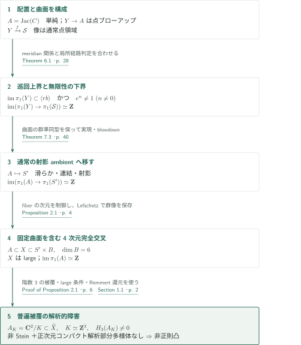
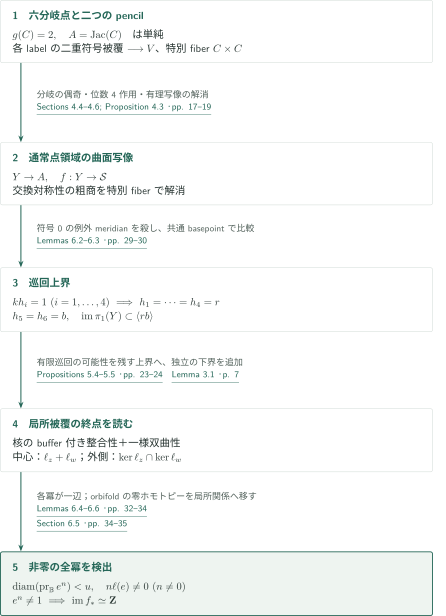
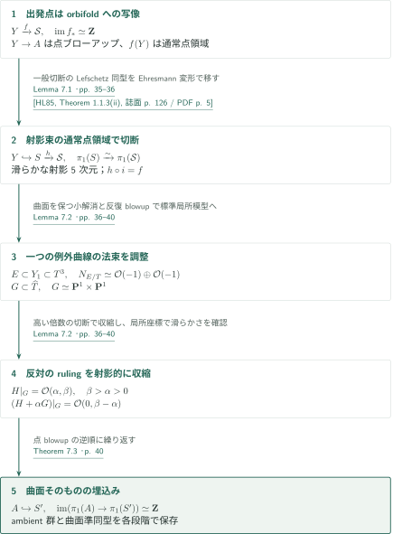
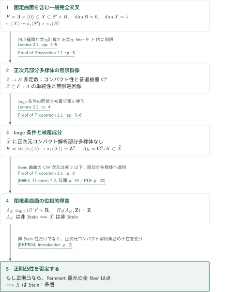

# A projective fourfold with large fundamental group and non-Stein universal cover

**単純アーベル曲面の無限巡回像を作り、その階数3の格子被覆をStein性への障害にする。**

本原稿が反例を主張するのは、滑らかな連結射影複素多様体 $X$ の位相的普遍被覆 $\widetilde X$ が正則凸である、というShafarevich予想である。構成は射影4次元に達し、さらにlarge fundamental groupを課す。単にコンパクト複素多様体や非射影Kähler多様体を作る議論ではない。以下は原稿の構成と論証の概説であり、編集側による全証明の正しさの認定ではない。

## 1. 主要結果

### Theorem 1.1 — large fundamental groupをもつ射影4次元の反例

滑らかな連結射影複素4次元多様体 $X$ と、その中の単純アーベル曲面 $A\subset X$ が存在し、次を満たす。

1. $X$ はlarge fundamental groupをもつ。すなわち、任意の正次元閉既約部分多様体 $Z\subset X$ に対し、正規化 $Z^\nu$ からの像 $\operatorname{im}(\pi_1(Z^\nu)\to\pi_1(X))$ は無限である。
2. $\operatorname{im}(\pi_1(A)\to\pi_1(X))\simeq\mathbf Z$。

$\widetilde X$ には正次元コンパクト複素解析的部分多様体が存在せず、$\widetilde X$ はSteinではない。

<!-- cite:main -->[Theorem 1.1 · p. 1](https://github.com/openai/math/blob/1581d4cbdd69a0faf34b2089614fe2a814316a6a/preprints/A-projective-fourfold-with-large-fundamental-group-and-non-Stein-universal-cover-October-5-2026/large-fundamental-group-non-stein.pdf)<!-- /cite -->

最後の二結論を合わせると正則凸性も否定される。正則凸な複素多様体のRemmert還元はStein空間への固有正則写像で、ファイバーは連結コンパクト解析空間である。正次元コンパクト解析部分空間がなければ全ファイバーは点となり、還元は同型、従って元の多様体はSteinになる。この追加論証は原稿§1.1にある。非Stein性だけから非正則凸性を結論しているわけではない。

<!-- cite:remmert-self -->[Section 1.1 · p. 2](https://github.com/openai/math/blob/1581d4cbdd69a0faf34b2089614fe2a814316a6a/preprints/A-projective-fourfold-with-large-fundamental-group-and-non-Stein-universal-cover-October-5-2026/large-fundamental-group-non-stein.pdf)<!-- /cite -->

## 図の矢印に付した引用

<!-- reference-guide -->
略号のない定理・補題・節・式番号は本原稿 [A projective fourfold with large fundamental group and non-Stein universal cover](https://github.com/openai/math/blob/1581d4cbdd69a0faf34b2089614fe2a814316a6a/preprints/A-projective-fourfold-with-large-fundamental-group-and-non-Stein-universal-cover-October-5-2026/large-fundamental-group-non-stein.pdf) を指します。外部入力には次の略号を使います。

- [Zar99](https://arxiv.org/pdf/math/9909052v2) Yuri G. Zarhin — *Hyperelliptic Jacobians without Complex Multiplication*：標数0でGalois群S6の種数2曲線のJacobianを単純にする。arXiv:math/9909052v2, September 12, 1999 (preprint of the 2000 article)。
- [LP25](https://www-fourier.univ-grenoble-alpes.fr/~py/Documents/Articles/J-Topology-2025-Llosa-Isenrich-Py.pdf) Claudio Llosa Isenrich and Pierre Py — *Groups with exotic finiteness properties from complex Morse theory*：Stover–Toledoの仮想巡回分岐被覆定理の定式化；各labelに二重被覆を供給。Journal of Topology 18 (2025), e70013, author-hosted published PDF。
- [HL85](https://www.numdam.org/article/BSMF_1985__113__123_0.pdf) Helmut A. Hamm and Lê Dũng Tráng — *Lefschetz theorems on quasi-projective varieties*：ordinary locusの一般超平面切断で基本群を保存。Bulletin de la Société Mathématique de France 113 (1985), 123–142; NUMDAM scan。
- [Mil63](https://math.stanford.edu/~ralph/math215b/Milnor.pdf) John Milnor — *Morse Theory*：Andreotti–FrankelのStein多様体のCW次元上界。Annals of Mathematics Studies 51 (1963); Stanford-hosted facing-page scan。
- [EKPR09](https://arxiv.org/pdf/0904.0693v1) Philippe Eyssidieux, Ludmil Katzarkov, Tony Pantev and Mohan Ramachandran — *Linear Shafarevich Conjecture*：Remmert還元の定式化；large条件のもとで正則凸性からStein性へ。arXiv:0904.0693v1, April 4, 2009 (preprint of the 2012 article)。

各引用に結果番号とページを付します。誌面番号とPDF内の位置が異なる場合は両方を示します。GitHubの閲覧リンクではページ位置への自動移動を前提としません。
<!-- /reference-guide -->

## 2. Theorem 1.1 — 主定理の証明概略

<!-- proof-target:1 -->証明対象：[Theorem 1.1 · p. 1](https://github.com/openai/math/blob/1581d4cbdd69a0faf34b2089614fe2a814316a6a/preprints/A-projective-fourfold-with-large-fundamental-group-and-non-Stein-universal-cover-October-5-2026/large-fundamental-group-non-stein.pdf)<!-- /proof-target -->

**証明の道筋。** 主張は上記Theorem 1.1を参照する。まず単純アーベル曲面の点ブローアップ $Y$ からorbifold $\mathcal S$ への写像を作り、$\pi_1$ の像を無限巡回群と計算する。次に曲面からの準同型を保って通常の滑らかな射影多様体へ移し、曲面上のブローアップを除く。最後に固定曲面を含む完全交叉でlarge条件を作り、普遍被覆中の曲面被覆から位相的障害を取り出す。

### 1. 構成と群像の計算を分ける

算術的複素双曲4次元球商上の超平面配置を、二つの符号被覆と分岐充填で滑らかな射影多様体 $V$ にする。特別ファイバー $C\times C$ を交換する位数4の作用を利用し、その近傍だけを通常の滑らかな空間へ解消して $\mathcal S$ を得る。$\operatorname{Sym}^2 C$ は $A=\operatorname{Jac}(C)$ の一点ブローアップなので、特別ファイバーへの有理写像を解消すると $Y\to\mathcal S$ ができる。群像の上界はmeridianの関係式、無限性の下界は局所被覆での経路読取りが担う。

<!-- cite:construction -->[Sections 4.4–4.6; Proposition 4.3 · pp. 17–19](https://github.com/openai/math/blob/1581d4cbdd69a0faf34b2089614fe2a814316a6a/preprints/A-projective-fourfold-with-large-fundamental-group-and-non-Stein-universal-cover-October-5-2026/large-fundamental-group-non-stein.pdf)<!-- /cite -->

### 2. 射影実現とlarge条件、解析的障害を接続する

Theorem 7.3の埋込み $A\hookrightarrow S'$ をProposition 2.1へ渡す。補助アーベル多様体への射影が非定数な部分多様体と、固定曲面内にある部分多様体を分けることでlarge条件を示す。一方、$A$ の基本群の核 $K\simeq\mathbf Z^3$ に対応する被覆 $A_K$ が $\widetilde X$ の閉複素部分多様体として現れる。その $H_3$ が消えないことがStein性を妨げる。ここで $A_K$ は $A$ の普遍被覆 $\mathbf C^2$ とは異なる。

<!-- cite:completion -->[Theorem 7.3 · p. 40; Proof of Theorem 1.1 · p. 41; Proposition 2.1 · pp. 4–6](https://github.com/openai/math/blob/1581d4cbdd69a0faf34b2089614fe2a814316a6a/preprints/A-projective-fourfold-with-large-fundamental-group-and-non-Stein-universal-cover-October-5-2026/large-fundamental-group-non-stein.pdf)<!-- /cite -->

## 3. Theorem 6.1 の証明 — 局所ラベルで巡回像の無限性を守る

<!-- proof-target:2 -->証明対象：[Theorem 6.1 · p. 28](https://github.com/openai/math/blob/1581d4cbdd69a0faf34b2089614fe2a814316a6a/preprints/A-projective-fourfold-with-large-fundamental-group-and-non-Stein-universal-cover-October-5-2026/large-fundamental-group-non-stein.pdf)<!-- /proof-target -->

<!-- statement:theorem-6-1 -->
### Theorem 6.1 — 特別曲面の無限巡回像

Proposition 4.3の構成で算術的levelを十分深く取ると、$A=\operatorname{Jac}(C)$ は単純アーベル曲面、$Y\to A$ は有限回の点ブローアップ、$\mathcal S$ は射影粗空間をもつ滑らかな連結effective proper orbifoldであり、通常点の領域に像をもつ写像 $f:Y\to\mathcal S$ は
$$
\operatorname{im}(f_*:\pi_1(Y)\to\pi_1(\mathcal S))\simeq\mathbf Z
$$
を満たす。orbifoldの基本群は分類空間の基本群を意味する。

<!-- cite:cyclic -->[Theorem 6.1 · p. 28](https://github.com/openai/math/blob/1581d4cbdd69a0faf34b2089614fe2a814316a6a/preprints/A-projective-fourfold-with-large-fundamental-group-and-non-Stein-universal-cover-October-5-2026/large-fundamental-group-non-stein.pdf)<!-- /cite -->
<!-- /statement -->

### 1. 六分岐点と局所配置を射影幾何へ実現する

四つの実代数的分岐点を $|\lambda_i|<0.01$ に、残り二つを $\lambda_5<-4$, $\lambda_6>4$ に置く。弱近似で根の位置と三つの素数での因数分解型を指定し、Galois群 $S_6$ の六次多項式を作る。Zarhinの結果より $\operatorname{End}(A)=\mathbf Z$、従って $A$ は単純となる。ここで使うのは標数0、既約次数6、Galois群 $S_6$ の場合である。

<!-- cite:zarhin -->[&#91;Zar99, Theorem 2.1, p. 2&#93;](https://arxiv.org/pdf/math/9909052v2#page=2)<!-- /cite -->

二つの座標対に六本のslopeと二本のcoupling hyperplaneを置く。coupling hyperplaneは赤い四本だけと交わる。Proposition 4.1により任意に大きな有界領域でこの有限配置と完全一致する深い合同球商を選ぶ。Stover–Toledoの仮想分岐被覆定理は、**各label divisorごとに** $d=2$ として適用する。その各divisorの成分は滑らか・埋込み・相互に非交差である。その後共通有限被覆を取り、二つの符号指標を作る。交差する全divisorの和へ定理を直接適用しない。

<!-- cite:sign-covers -->[Proposition 4.1 · pp. 14–15; Theorem 4.2; Section 4.3 · p. 16](https://github.com/openai/math/blob/1581d4cbdd69a0faf34b2089614fe2a814316a6a/preprints/A-projective-fourfold-with-large-fundamental-group-and-non-Stein-universal-cover-October-5-2026/large-fundamental-group-non-stein.pdf)<!-- /cite --> <!-- cite:lp-input -->[&#91;LP25, Theorem 4.2, p. 8&#93;](https://www-fourier.univ-grenoble-alpes.fr/~py/Documents/Articles/J-Topology-2025-Llosa-Isenrich-Py.pdf#page=8)<!-- /cite --> <!-- cite:lp-input -->[&#91;LP25, Theorem 4.2, p. 8&#93;](https://www-fourier.univ-grenoble-alpes.fr/~py/Documents/Articles/J-Topology-2025-Llosa-Isenrich-Py.pdf#page=8)<!-- /cite -->

配置の交差中心をブローアップし、例外meridianの符号をそこを通る成分数の偶奇で定める。分岐成分を分離して正規化すると滑らかな $V$ と特別ファイバー $C\times C$ を得る。位数4の作用は局所的に $(p,q;u,v)\mapsto(q,p;v,-u)$。特別ファイバーでの粗商を明示的に解消し、他の固定点ではquotient stackを保つ。この区別が、曲面写像の像を通常点領域に置く保証になる。

<!-- cite:construction -->[Sections 4.4–4.6; Proposition 4.3 · pp. 17–19](https://github.com/openai/math/blob/1581d4cbdd69a0faf34b2089614fe2a814316a6a/preprints/A-projective-fourfold-with-large-fundamental-group-and-non-Stein-universal-cover-October-5-2026/large-fundamental-group-non-stein.pdf)<!-- /cite -->

### 2. 赤・青meridianは巡回上界だけを与える

六点orbifold pencilの群は
$$
Q=\langle h_1,\ldots,h_6\mid h_i^2=1,\ h_1\cdots h_6=1\rangle.
$$
偶語部分群が $\pi_1(C)$ である。coupling meridian $k$ と赤meridian $h_i$ の交点のブローアップは、符号0の例外因子を作る。従って $kh_i=1$ が充填で課され、四つの赤meridianは共通のinvolution $r$ になる。球面関係は二つの青meridianを $b$ に同一視し、偶語の像は $rb$ の冪からなる。Lemma 6.2の共通basepointでの押し出しにより、この計算が $\pi_1(Y)$ の像に伝わる。しかし、この段階では有限巡回像も除外されていない。

<!-- cite:upper -->[Lemmas 6.2–6.3 · pp. 29–30](https://github.com/openai/math/blob/1581d4cbdd69a0faf34b2089614fe2a814316a6a/preprints/A-projective-fourfold-with-large-fundamental-group-and-non-Stein-universal-cover-October-5-2026/large-fundamental-group-non-stein.pdf)<!-- /cite -->

### 3. 全ての非零冪を一辺として検出する

局所配置被覆の二面体ラベルから二つのtranslation $\ell_z,\ell_w$ を読む。中心chartでは交換対称性に不変な和 $\ell_z+\ell_w$、外側では二つの核の共通部分を使う。Proposition 5.4はbufferをもつ重なりで核の一致を保証し、Proposition 5.5は対応する経路グラフの一様双曲性を与える。局所経路判定Lemma 3.1の仮定は、prefix・逆向き・辺の持上げの整合性、短いprefix後の終点一致判定の不変性、一様双曲性であり、Lemma 6.4が構成への適用を行う。

<!-- cite:local-inputs -->[Lemma 3.1 · p. 7; Proposition 5.4 · pp. 23–24; Proposition 5.5 · p. 24; Lemma 6.4 · pp. 32–33](https://github.com/openai/math/blob/1581d4cbdd69a0faf34b2089614fe2a814316a6a/preprints/A-projective-fourfold-with-large-fundamental-group-and-non-Stein-universal-cover-October-5-2026/large-fundamental-group-non-stein.pdf)<!-- /cite -->

辺を「長さ有界」ではなく「球への射影の直径 $<u$ の経路」と定める。従ってtranslationが非零のloop $e$ を特別ファイバー近くへ押すと、どの非零冪 $e^n$ も一辺のままで、読取り終点は $n\ell(e)\ne0$ だけ異なる。通常点領域では対称性が自由に作用するため、中心chartの商でもこの差は消えない。Lemma 6.6は、orbifoldで零ホモトピックなloopが局所の短い閉路関係でも自明になることを、一般位置と横断円板のmeridian関係を通じて示す。従って局所判定が $e^n\ne1$ を全ての $n\ne0$ について保証し、巡回上界と合わせて像は $\mathbf Z$ となる。局所ラベルを $\pi_1(\mathcal S)$ の大域的二面体表現とみなしてはいけない。

<!-- cite:lower -->[Lemma 6.6; Sections 6.4–6.5 · pp. 33–35](https://github.com/openai/math/blob/1581d4cbdd69a0faf34b2089614fe2a814316a6a/preprints/A-projective-fourfold-with-large-fundamental-group-and-non-Stein-universal-cover-October-5-2026/large-fundamental-group-non-stein.pdf)<!-- /cite -->

## 4. Theorem 7.3 の証明 — 曲面からの準同型を保って射影実現する

<!-- proof-target:3 -->証明対象：[Theorem 7.3 · p. 40](https://github.com/openai/math/blob/1581d4cbdd69a0faf34b2089614fe2a814316a6a/preprints/A-projective-fourfold-with-large-fundamental-group-and-non-Stein-universal-cover-October-5-2026/large-fundamental-group-non-stein.pdf)<!-- /proof-target -->

<!-- statement:theorem-7-3 -->
### Theorem 7.3 — 単純アーベル曲面そのものの埋込み

単純アーベル曲面 $A$、滑らかな連結射影複素多様体 $S'$、閉埋込み $A\hookrightarrow S'$ が存在し、
$$
\operatorname{im}(\pi_1(A)\to\pi_1(S'))\simeq\mathbf Z
$$
を満たす。

<!-- cite:embedding -->[Theorem 7.3 · p. 40](https://github.com/openai/math/blob/1581d4cbdd69a0faf34b2089614fe2a814316a6a/preprints/A-projective-fourfold-with-large-fundamental-group-and-non-Stein-universal-cover-October-5-2026/large-fundamental-group-non-stein.pdf)<!-- /cite -->
<!-- /statement -->

### 1. orbifoldを通常の射影ambientに置き換える

Lemma 7.1は、滑らかな連結effective proper Deligne–Mumford stack $T$ が射影粗空間をもち、滑らかな射影曲面の写像 $Y\to T$ が通常点領域に入るとき、$Y\hookrightarrow S\xrightarrow h T$、$h_*:\pi_1(S)\simeq\pi_1(T)$ を実現する。$S$ は滑らかな射影5次元に取れる。接束と自明束の多数の直和から射影束を作ると、忠実なstabilizer表現により非通常点領域の余次元が増える。曲面のgraphを含み、その領域を避ける完全交叉を取る。

群の同型は、まず拘束のない一般切断にHamm–Lêの準射影Lefschetz定理を適用し、次に滑らかで境界を避ける完全交叉のパラメータ空間を道で結び、smooth proper familyのEhresmann同型で曲面を含む切断へ移す。曲面を含む切断を、理由なしに「一般超平面」と扱っていない。

<!-- cite:orbifold-realization -->[Lemma 7.1 · pp. 35–36](https://github.com/openai/math/blob/1581d4cbdd69a0faf34b2089614fe2a814316a6a/preprints/A-projective-fourfold-with-large-fundamental-group-and-non-Stein-universal-cover-October-5-2026/large-fundamental-group-non-stein.pdf)<!-- /cite --> <!-- cite:hl-input -->[&#91;HL85, Theorem 1.1.3(ii), 誌面 p. 126 / PDF p. 5&#93;](https://www.numdam.org/article/BSMF_1985__113__123_0.pdf#page=5)<!-- /cite --> <!-- cite:hl-input -->[&#91;HL85, Theorem 1.1.3(ii), 誌面 p. 126 / PDF p. 5&#93;](https://www.numdam.org/article/BSMF_1985__113__123_0.pdf#page=5)<!-- /cite -->

### 2. ambientを変更して曲面上の例外曲線を除く

Lemma 7.2は、埋め込まれた滑らかな射影曲面の $(-1)$ 曲線を一点へ吹き下げる操作を、新しい滑らかな射影ambientの中で実現し、ambient基本群の同型と**曲面からの準同型**の可換性を保つ。原稿は曲面を含む3次元を作り、必要な孤立nodeでは曲面を変更しない小解消を選び、例外曲線の法束を $\mathcal O(-1)\oplus\mathcal O(-1)$ に調整する。そのブローアップの例外因子 $G\simeq\mathbf P^1\times\mathbf P^1$ を反対のrulingで収縮する。

大域的射影性を支えるのは、$H|_G=\mathcal O(\alpha,\beta)$、$\beta>\alpha>0$ を満たすample束の構成である。$D=H+\alpha G$ は $G$ 上で $\mathcal O(0,\beta-\alpha)$ となり、高い倍数の切断が所要の収縮を作る。局所座標で収縮先と曲面像の滑らかさを確認する。これを点ブローアップの逆順に繰り返して $A$ 自身を埋め込み、Theorem 6.1の実際の群準同型を保ったままTheorem 7.3へ至る。

<!-- cite:blowdown -->[Lemma 7.2 · pp. 36–40](https://github.com/openai/math/blob/1581d4cbdd69a0faf34b2089614fe2a814316a6a/preprints/A-projective-fourfold-with-large-fundamental-group-and-non-Stein-universal-cover-October-5-2026/large-fundamental-group-non-stein.pdf)<!-- /cite -->

## 5. Proposition 2.1 の証明 — large条件と非正則凸性

<!-- proof-target:4 -->証明対象：[Proposition 2.1 · p. 4](https://github.com/openai/math/blob/1581d4cbdd69a0faf34b2089614fe2a814316a6a/preprints/A-projective-fourfold-with-large-fundamental-group-and-non-Stein-universal-cover-October-5-2026/large-fundamental-group-non-stein.pdf)<!-- /proof-target -->

<!-- statement:proposition-2-1 -->
### Proposition 2.1 — 巡回像の埋込みから主定理へ

$A$ を単純アーベル曲面、$A\hookrightarrow S'$ を滑らかな連結射影複素多様体への閉埋込みとし、$\operatorname{im}(\pi_1(A)\to\pi_1(S'))\simeq\mathbf Z$ と仮定する。このときlarge fundamental groupをもつ滑らかな連結射影4次元多様体 $X$ と閉埋込み $A\hookrightarrow X$ が存在し、その基本群像は無限巡回、普遍被覆 $\widetilde X$ は非Steinである。

<!-- cite:reduction -->[Proposition 2.1 · p. 4](https://github.com/openai/math/blob/1581d4cbdd69a0faf34b2089614fe2a814316a6a/preprints/A-projective-fourfold-with-large-fundamental-group-and-non-Stein-universal-cover-October-5-2026/large-fundamental-group-non-stein.pdf)<!-- /cite -->
<!-- /statement -->

### 1. 固定曲面を保つ4次元完全交叉

$d=\dim S'$、$\dim B=6$ のアーベル多様体を取り、$W=S'\times B$、$F=A\times\{0\}$ とする。十分高いvery ample束の冪で $\mathcal I_F\otimes L^m$ の一般切断 $c=d+2$ 本を取り、その共通零点を $X$ とする。$F$ に沿う法微分のrank低下の余次元は3で $\dim F=2$ より大きく、各段階が滑らかになる。Lefschetzにより
$$
\pi_1(X)\simeq\pi_1(S')\times\pi_1(B)
$$
で、$A$ からの像は保たれる。

Lemma 2.3の一様補間により、一つの $B$-fiber内の $W\setminus F$ の相異なる四点で $c$ 本全てが消える条件は余次元 $4c=4d+8$。四点のパラメータ空間の次元 $4d+6$ を超えるので、一般切断では各fiberの $F$ 外の点は高々三つである。従って正次元fiber成分は $F$ 内に限られる。

<!-- cite:complete-intersection -->[Lemma 2.3 · pp. 4–5; Proof of Proposition 2.1 · p. 5](https://github.com/openai/math/blob/1581d4cbdd69a0faf34b2089614fe2a814316a6a/preprints/A-projective-fourfold-with-large-fundamental-group-and-non-Stein-universal-cover-October-5-2026/large-fundamental-group-non-stein.pdf)<!-- /cite -->

### 2. 全ての正次元部分多様体に対するlarge条件

$Z\subset X$ の $B$ への像が非定数なら、$\pi_1(Z^\nu)\to\pi_1(B)$ の像は無限である。有限ならtorsion-free性により零となり、$Z^\nu\to B$ は $\mathbf C^6$ に持ち上がるが、コンパクト性により定数になって矛盾する。像が定数なら $Z\subset F$。$Z=F$ では仮定の巡回像が使える。曲線の場合は正規化 $D$ のJacobianから $A$ への非零準同型が単純性により全射となり、$\pi_1(D)$ は $\pi_1(A)=\mathbf Z^4$ に有限指数の像をもつ。その無限巡回商への像も無限である。

これでlarge条件を得る。Lemma 2.2はlarge条件と $\widetilde X$ に正次元コンパクト解析部分多様体がないことの同値を与える。逆向きでは、コンパクト解析部分多様体の $X$ への像が代数的で、正規化間の有限全射が基本群に有限指数像を与えることを使う。

<!-- cite:large -->[Lemma 2.2 · p. 4; Proof of Proposition 2.1 · pp. 5–6](https://github.com/openai/math/blob/1581d4cbdd69a0faf34b2089614fe2a814316a6a/preprints/A-projective-fourfold-with-large-fundamental-group-and-non-Stein-universal-cover-October-5-2026/large-fundamental-group-non-stein.pdf)<!-- /cite -->

### 3. 曲面被覆の $H_3$ がStein性を妨げる

$\widetilde X\to X$ は単連結な位相的普遍被覆に持ち上げた複素構造を入れたものである。$K=\ker(\pi_1(A)\to\pi_1(X))\simeq\mathbf Z^3$ とすると、$A$ の逆像の一連結成分は
$$
A_K=\mathbf C^2/K\simeq_{\mathrm{diff}}(S^1)^3\times\mathbf R,
\qquad H_3(A_K,\mathbf Z)\simeq\mathbf Z.
$$
被覆分類によりこの核が成分の被覆を特定し、被覆chartでは成分が局所的に分離するため $A_K$ は $\widetilde X$ の閉複素部分多様体である。Andreotti–Frankelの次元上界は、複素2次元Stein多様体のCWホモトピー次元が実2以下であることを与える。従って $A_K$ は非Stein。Stein多様体の閉複素部分多様体はSteinなので、$\widetilde X$ も非Steinとなる。

<!-- cite:stein-obstruction -->[Proof of Proposition 2.1 · p. 6](https://github.com/openai/math/blob/1581d4cbdd69a0faf34b2089614fe2a814316a6a/preprints/A-projective-fourfold-with-large-fundamental-group-and-non-Stein-universal-cover-October-5-2026/large-fundamental-group-non-stein.pdf)<!-- /cite --> <!-- cite:milnor-input -->[&#91;Mil63, Theorem 7.2, 誌面 p. 39 / PDF p. 22&#93;](https://math.stanford.edu/~ralph/math215b/Milnor.pdf#page=22)<!-- /cite --> <!-- cite:milnor-input -->[&#91;Mil63, Theorem 7.2, 誌面 p. 39 / PDF p. 22&#93;](https://math.stanford.edu/~ralph/math215b/Milnor.pdf#page=22)<!-- /cite -->

最後に§1で述べたRemmert還元と正次元コンパクト解析部分多様体の不在を合わせると、$\widetilde X$ は正則凸でもない。これは $A_K$ の位相的障害を、large条件を介して正則凸性への障害に変える段階である。

<!-- cite:remmert -->[&#91;EKPR09, Introduction, p. 2&#93;](https://arxiv.org/pdf/0904.0693v1#page=2)<!-- /cite -->

## 6. 外部入力と使用箇所

| 入力 | 利用箇所 | 使用内容と仮定 | 確認範囲 |
|---|---|---|---|
| ZarhinのTheorem 2.1 | §4.1、p.13 | 標数0、次数6、Galois群 $S_6$ から単純Jacobian | arXiv v2の主張と本稿の適用を照合。入力の証明全体は未検証 |
| Stover–Toledoの分岐被覆定理、Llosa Isenrich–Py Theorem 4.2の定式化 | §4.3、p.16 | simplest typeの合同算術球商、相互非交差の埋込みtotally geodesic divisorに対する仮想二重分岐被覆 | LP25 p.8の主張と各labelへの適用を照合。Stover–Toledo原証明は未検証 |
| Hamm–Lêの準射影Lefschetz定理 | Lemma 7.1、pp.35–36 | ordinary locusの一般切断で基本群を保持し、変形で拘束付き切断へ移す | 原稿の適用段落を照合。外部版のページ対応は出典記録に記載 |
| Andreotti–Frankelの次元上界、Milnor Theorem 7.2の定式化 | Proposition 2.1、p.6 | Stein曲面の $H_3$ 消滅 | 主張と $A_K$ への適用を照合。Morse理論の証明は対象外 |
| Remmert還元（Eyssidieux–Katzarkov–Pantev–Ramachandranの導入） | §1.1、p.2 | 正則凸性とコンパクト解析ファイバーをもつStein還元 | 定式化と、本稿のlarge条件を併用する推論を照合 |

<!-- cite:zarhin -->[&#91;Zar99, Theorem 2.1, p. 2&#93;](https://arxiv.org/pdf/math/9909052v2#page=2)<!-- /cite --> <!-- cite:lp-input -->[&#91;LP25, Theorem 4.2, p. 8&#93;](https://www-fourier.univ-grenoble-alpes.fr/~py/Documents/Articles/J-Topology-2025-Llosa-Isenrich-Py.pdf#page=8)<!-- /cite --> <!-- cite:hl-input -->[&#91;HL85, Theorem 1.1.3(ii), 誌面 p. 126 / PDF p. 5&#93;](https://www.numdam.org/article/BSMF_1985__113__123_0.pdf#page=5)<!-- /cite --> <!-- cite:milnor-input -->[&#91;Mil63, Theorem 7.2, 誌面 p. 39 / PDF p. 22&#93;](https://math.stanford.edu/~ralph/math215b/Milnor.pdf#page=22)<!-- /cite --> <!-- cite:remmert -->[&#91;EKPR09, Introduction, p. 2&#93;](https://arxiv.org/pdf/0904.0693v1#page=2)<!-- /cite -->

算術格子・射影性に関するBorel–Harish-ChandraとBaily–Borel、双曲幾何の標準評価、Serre vanishing・Bertini・数値的ample判定、stackの一般位置に関する全外部証明は再帰的に追っていない。これらは本稿内での使用箇所と主定理までの役割を確認した範囲にとどまり、外部原典の定理記述自体も今回未照合である。同じカタログの曲面反例を本稿の入力とする矢印は記録していない。

## 7. 原典を読む入口と確認範囲

<!-- reading-list -->
- [Proposition 2.1 and proof · pp. 4–6; Section 1.1 · p. 2](https://github.com/openai/math/blob/1581d4cbdd69a0faf34b2089614fe2a814316a6a/preprints/A-projective-fourfold-with-large-fundamental-group-and-non-Stein-universal-cover-October-5-2026/large-fundamental-group-non-stein.pdf) — 反例が対象とする予想、被覆成分と正則凸性への帰結
- [Sections 4.4–4.6; Proposition 4.3 · pp. 17–19](https://github.com/openai/math/blob/1581d4cbdd69a0faf34b2089614fe2a814316a6a/preprints/A-projective-fourfold-with-large-fundamental-group-and-non-Stein-universal-cover-October-5-2026/large-fundamental-group-non-stein.pdf) — 特別ファイバーと通常点領域の曲面写像を構成する
- [Theorem 6.1; Sections 6.1–6.5 · pp. 28–35](https://github.com/openai/math/blob/1581d4cbdd69a0faf34b2089614fe2a814316a6a/preprints/A-projective-fourfold-with-large-fundamental-group-and-non-Stein-universal-cover-October-5-2026/large-fundamental-group-non-stein.pdf) — 巡回上界と無限性の下界を区別して読む
- [Lemmas 7.1–7.2; Theorem 7.3 · pp. 35–40](https://github.com/openai/math/blob/1581d4cbdd69a0faf34b2089614fe2a814316a6a/preprints/A-projective-fourfold-with-large-fundamental-group-and-non-Stein-universal-cover-October-5-2026/large-fundamental-group-non-stein.pdf) — 群準同型を保った射影実現と曲面blowdown
<!-- /reading-list -->

主結果の全結論、§2の被覆・位相的障害、§4の曲面とorbifold構成、§6の巡回上界・全非零冪の検出・orbifold関係との比較、§7の射影実現とブローアップ除去を読解し、ここで説明する帰着を照合した。§3の局所経路判定の全定数計算、§5の全有限モデルの核整合性・一様双曲性の証明は完全には追っていない。この二箇所は無限性の核心を支える原稿内入力であり、本記事の照合をもって独立に検証済みとはしない。外部入力は上表の定式化と適用を中心とし、その証明の再帰的検証・形式検証・専門家査読は未実施である。
