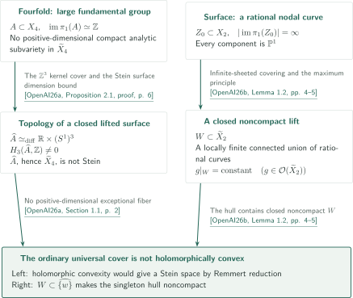

# Counterexamples to Shafarevich holomorphic convexity

**Two different obstructions to Shafarevich holomorphic convexity**

The question is whether the simply connected ordinary universal cover of every smooth connected projective complex variety is holomorphically convex. The first manuscript in official order constructs a fourfold with large fundamental group; the second constructs a surface with an infinite chain of rational curves upstairs. Both claim counterexamples in the projective setting, rather than examples only among general compact complex manifolds.

<!-- Booklet links are rendered above the inventory by CatalogMarkdownOverview from pdf-editions.json. -->

## Papers in official catalogue order

CATALOGINVENTORYTOKEN

## References on the arrows

- **[OpenAI26a]** OpenAI, *A projective fourfold with large fundamental group and non-Stein universal cover*, October 5, 2026, 41 pages. The topology of a closed lifted surface, and the use of largeness to deduce Steinness from hypothetical holomorphic convexity.

<!-- cite:fourfold -->[&#91;OpenAI26a, Theorem 1.1, p. 1&#93;](https://github.com/openai/math/blob/1581d4cbdd69a0faf34b2089614fe2a814316a6a/preprints/A-projective-fourfold-with-large-fundamental-group-and-non-Stein-universal-cover-October-5-2026/large-fundamental-group-non-stein.pdf)<!-- /cite -->

- **[OpenAI26b]** OpenAI, *A surface counterexample to Shafarevich holomorphic convexity*, September 23, 2026, 26 pages. The fundamental-group image of a whole rational nodal curve and the holomorphic-hull obstruction in its lift.

<!-- cite:surface -->[&#91;OpenAI26b, Theorem 1.1, p. 2&#93;](https://github.com/openai/math/blob/1581d4cbdd69a0faf34b2089614fe2a814316a6a/preprints/A-surface-counterexample-to-Shafarevich-holomorphic-convexity-September-23-2026/paper.pdf)<!-- /cite -->

## Two routes to the same negative conclusion

The two sides of the diagram concern separately constructed spaces; they do not represent proof dependence between the manuscripts.

On the fourfold side, a lifted simple abelian surface is a closed complex surface with nonzero third homology, and hence is not Stein. The universal cover additionally has no positive-dimensional compact analytic subvariety. If it were holomorphically convex, its Remmert reduction would be an isomorphism, making it Stein. This additional condition supplies the passage to failure of holomorphic convexity. See the [fourfold proof overview](../large-fundamental-group-non-stein/article.en.md).

<!-- cite:stein-obstruction -->[&#91;OpenAI26a, Proposition 2.1, proof, p. 6&#93;](https://github.com/openai/math/blob/1581d4cbdd69a0faf34b2089614fe2a814316a6a/preprints/A-projective-fourfold-with-large-fundamental-group-and-non-Stein-universal-cover-October-5-2026/large-fundamental-group-non-stein.pdf)<!-- /cite --> <!-- cite:remmert -->[&#91;OpenAI26a, Section 1.1, p. 2&#93;](https://github.com/openai/math/blob/1581d4cbdd69a0faf34b2089614fe2a814316a6a/preprints/A-projective-fourfold-with-large-fundamental-group-and-non-Stein-universal-cover-October-5-2026/large-fundamental-group-non-stein.pdf)<!-- /cite -->

On the surface side, the presence of compact rational curves alone is not the claimed obstruction. The entire connected lift is closed and noncompact, and every holomorphic function is constant on it, so it lies in the hull of any of its points. The [surface proof overview](../surface-shafarevich-counterexample/article.en.md) explains how infinitude is retained through compactification before applying this analytic obstruction.

<!-- cite:hull -->[&#91;OpenAI26b, Lemma 1.2, pp. 4–5&#93;](https://github.com/openai/math/blob/1581d4cbdd69a0faf34b2089614fe2a814316a6a/preprints/A-surface-counterexample-to-Shafarevich-holomorphic-convexity-September-23-2026/paper.pdf)<!-- /cite -->

## Sources and checking scope

The official inventory is *OpenAI Research Catalog*, October 6, 2026, entry 046 on PDF page 6, at fixed commit `1581d4cbdd69a0faf34b2089614fe2a814316a6a`. The official subject is **Algebraic and complex geometry**. CONTENTS uses the alternative heading *Shafarevich counterexamples in dimension two and with large fundamental group*; the two manuscripts and their order agree.

<!-- cite:catalog -->[OpenAI Research Catalog · Catalogue 046 · p. 6](https://github.com/openai/math/blob/1581d4cbdd69a0faf34b2089614fe2a814316a6a/overview.pdf)<!-- /cite -->

We checked the authors' main statements against the passages connecting construction, preservation of the group image, and the analytic obstruction. Each article specifies checked and unresolved direct inputs. This is not independent verification of every external proof or of the complete manuscripts. No mutual citation or direct use was found within the checked passages. Inputs from other catalogues into consequences are distinguished in the surface article; uninvestigated relations are not recorded as absent.
