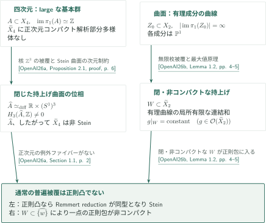

# Counterexamples to Shafarevich holomorphic convexity

**Shafarevich正則凸性予想の反例：二つの異なる障害**

対象は「滑らかな連結射影複素多様体の、単連結な通常の普遍被覆は正則凸か」という予想である。公式順の第1論文はlargeな基本群を持つ四次元多様体、第2論文は有理曲線の無限連鎖を持つ曲面を構成する。ともに射影的な設定の反例を主張しており、一般のコンパクト複素多様体の例にすり替えない。

<!-- Booklet links are rendered above the inventory by CatalogMarkdownOverview from pdf-editions.json. -->

## 公式順の記事一覧

CATALOGINVENTORYTOKEN

## 図の矢印に付した引用

- **[OpenAI26a]** OpenAI, *A projective fourfold with large fundamental group and non-Stein universal cover*, October 5, 2026、41ページ。閉じた持上げ曲面の位相と、large条件を用いた正則凸性からStein性への帰着。

<!-- cite:fourfold -->[&#91;OpenAI26a, Theorem 1.1, p. 1&#93;](https://github.com/openai/math/blob/1581d4cbdd69a0faf34b2089614fe2a814316a6a/preprints/A-projective-fourfold-with-large-fundamental-group-and-non-Stein-universal-cover-October-5-2026/large-fundamental-group-non-stein.pdf)<!-- /cite -->

- **[OpenAI26b]** OpenAI, *A surface counterexample to Shafarevich holomorphic convexity*, September 23, 2026、26ページ。有理成分からなる曲線全体の基本群像と、持上げの正則包による障害。

<!-- cite:surface -->[&#91;OpenAI26b, Theorem 1.1, p. 2&#93;](https://github.com/openai/math/blob/1581d4cbdd69a0faf34b2089614fe2a814316a6a/preprints/A-surface-counterexample-to-Shafarevich-holomorphic-convexity-September-23-2026/paper.pdf)<!-- /cite -->

## 同じ否定結論へ至る二つの経路

図の左右は別々に構成される空間であり、両論文の間の証明依存を表すものではない。

四次元側では、単純アーベル曲面の持上げは閉じた複素曲面であり、三次ホモロジーが非零なのでSteinにはなれない。さらに普遍被覆に正次元コンパクト解析部分多様体がないため、仮に正則凸ならRemmert reductionが同型となりSteinになってしまう。この追加条件が非正則凸性への接続を担う。[四次元論文の証明概説](../large-fundamental-group-non-stein/article.ja.md)へ。

<!-- cite:stein-obstruction -->[&#91;OpenAI26a, Proposition 2.1, proof, p. 6&#93;](https://github.com/openai/math/blob/1581d4cbdd69a0faf34b2089614fe2a814316a6a/preprints/A-projective-fourfold-with-large-fundamental-group-and-non-Stein-universal-cover-October-5-2026/large-fundamental-group-non-stein.pdf)<!-- /cite --> <!-- cite:remmert -->[&#91;OpenAI26a, Section 1.1, p. 2&#93;](https://github.com/openai/math/blob/1581d4cbdd69a0faf34b2089614fe2a814316a6a/preprints/A-projective-fourfold-with-large-fundamental-group-and-non-Stein-universal-cover-October-5-2026/large-fundamental-group-non-stein.pdf)<!-- /cite -->

曲面側では、コンパクト有理曲線を含むこと自体は障害の結論ではない。連結な持上げ全体が閉かつ非コンパクトで、すべての正則関数がその上で定数になることにより、一点の正則包にこの全体が入る。[曲面論文の証明概説](../surface-shafarevich-counterexample/article.ja.md)で、無限性をコンパクト化後に保つ段階から読むことができる。

<!-- cite:hull -->[&#91;OpenAI26b, Lemma 1.2, pp. 4–5&#93;](https://github.com/openai/math/blob/1581d4cbdd69a0faf34b2089614fe2a814316a6a/preprints/A-surface-counterexample-to-Shafarevich-holomorphic-convexity-September-23-2026/paper.pdf)<!-- /cite -->

## 原典・確認範囲

公式一覧は *OpenAI Research Catalog*, October 6, 2026、固定commit `1581d4cbdd69a0faf34b2089614fe2a814316a6a` の046、PDF 6ページ。公式分野は **Algebraic and complex geometry**。CONTENTSの別見出しは *Shafarevich counterexamples in dimension two and with large fundamental group* であり、収録順と2本のリンクは一致する。

<!-- cite:catalog -->[OpenAI Research Catalog · Catalogue 046 · p. 6](https://github.com/openai/math/blob/1581d4cbdd69a0faf34b2089614fe2a814316a6a/overview.pdf)<!-- /cite -->

著者の主定理と、その構成・群像の保持・解析的障害をつなぐ証明箇所を照合した。記事は各々の直接入力について確認範囲と未確認事項を記す。外部結果の全証明や原稿全体の独立検証を意味しない。両原稿の相互引用・直接利用は照合範囲では確認しなかった。他カタログへの帰結での利用は曲面記事で区別し、未調査の関係を依存なしと扱わない。
