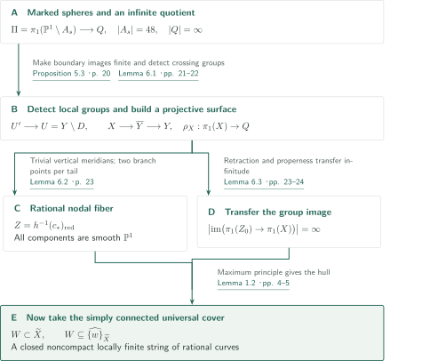
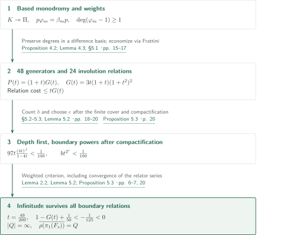
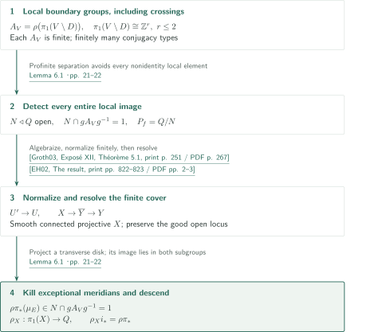
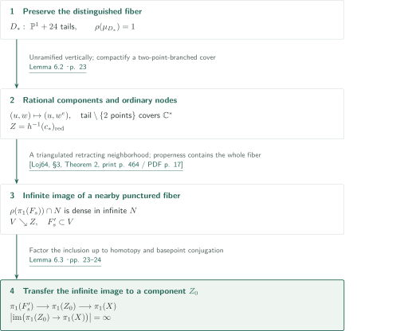
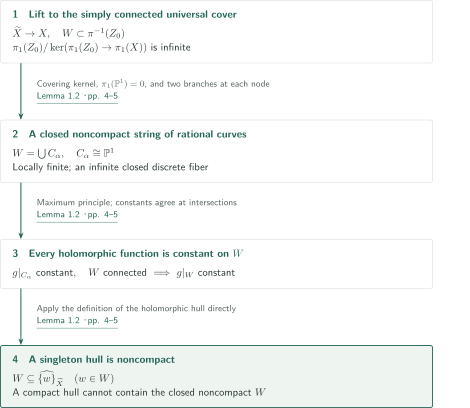

# A surface counterexample to Shafarevich holomorphic convexity

**Preserving a weighted pro-2 quotient on a projective surface, then lifting an infinite string of rational curves**

The manuscript addresses the usual smooth-projective formulation of the Shafarevich conjecture: the universal cover of every smooth connected projective complex variety is holomorphically convex. The author claims a counterexample in complex dimension two. Finite covers first produce a smooth projective surface; its ordinary simply connected universal cover is taken only afterwards. The argument does not identify an arbitrary non-Stein cover as a counterexample.

## 1. Main results

### Theorem 1.1 — A projective surface with a noncompact singleton holomorphic hull upstairs

There exist a smooth connected projective complex surface $X$ and a connected nodal curve $Z_0\subset X$ whose irreducible components are smooth rational curves, such that

$$
\left|\operatorname{im}\bigl(\pi_1(Z_0)\longrightarrow\pi_1(X)\bigr)\right|=\infty.
$$

In the simply connected universal cover $\widetilde X$, a connected component above $Z_0$ is a closed, connected, noncompact, locally finite union of compact rational curves. The holomorphic hull of any one of its points is noncompact. In particular, $\widetilde X$ is not holomorphically convex.

<!-- cite:main -->[Theorem 1.1 · p. 2](https://github.com/openai/math/blob/1581d4cbdd69a0faf34b2089614fe2a814316a6a/preprints/A-surface-counterexample-to-Shafarevich-holomorphic-convexity-September-23-2026/paper.pdf)<!-- /cite -->

For a nonempty compact subset $K$ of a complex manifold $V$, the hull is

$$
\widehat K_V=\{v\in V:|g(v)|\leq\sup_K|g|\text{ for every }g\in\mathcal O(V)\}.
$$

A projective surface is also a compact Kähler manifold, so a valid construction also contradicts the universal assertion for that larger class. The constructed objects are nevertheless smooth projective surfaces: the manuscript is not a classification of covers of arbitrary compact complex manifolds, nor a claim of nonconvexity for every Kähler manifold.

<!-- cite:formulation -->[§1 · p. 2](https://github.com/openai/math/blob/1581d4cbdd69a0faf34b2089614fe2a814316a6a/preprints/A-surface-counterexample-to-Shafarevich-holomorphic-convexity-September-23-2026/paper.pdf)<!-- /cite -->

## References on the arrows

<!-- reference-guide -->
Unprefixed theorem, lemma, section and equation numbers refer to [A surface counterexample to Shafarevich holomorphic convexity](https://github.com/openai/math/blob/1581d4cbdd69a0faf34b2089614fe2a814316a6a/preprints/A-surface-counterexample-to-Shafarevich-holomorphic-convexity-September-23-2026/paper.pdf). External inputs use the following keys.

- [Groth03](https://arxiv.org/pdf/math/0206203v2) Alexander Grothendieck et al. — *Revêtements étales et groupe fondamental (SGA 1)*: Algebraization of nonproper finite étale covers and uniqueness of finite normal extensions. 2003 revised edition; arXiv:math/0206203v2. Main printed pagination of this edition is used, not the old marginal pagination..
- [EH02](https://ems.press/content/serial-article-files/42948?nt=1) Santiago Encinas; Herwig Hauser — *Strong resolution of singularities in characteristic zero*: Strong resolution preserving the smooth open locus. Commentarii Mathematici Helvetici 77 (2002), 821–845; publisher PDF.
- [Loj64](https://numdam.org/item/ASNSP_1964_3_18_4_449_0.pdf) Stanisław Łojasiewicz — *Triangulation of semi-analytic sets*: Triangulation compatible with the special fiber. Annali della Scuola Normale Superiore di Pisa, Ser. 3, 18 (1964), 449–474; Numdam PDF with cover page.
- [Stacks26a](https://stacks.math.columbia.edu/tag/03GR) The Stacks Project Authors — *The Stacks Project — Relative normalization: Lemma 29.54.15*: Finiteness of relative normalization under the Nagata and finite-type hypotheses. HTML tag 03GR, accessed 2026-10-13; unpaginated.
- [Stacks26b](https://stacks.math.columbia.edu/tag/0B3I) The Stacks Project Authors — *The Stacks Project — Finite morphisms are projective: Lemma 29.45.16*: Projectivity of finite morphisms. HTML tag 0B3I, accessed 2026-10-13; unpaginated.
- [Stacks26c](https://stacks.math.columbia.edu/tag/0BIC) The Stacks Project Authors — *The Stacks Project — Embedded resolution: Lemma 54.15.6*: Boundary resolution by point blowups of a regular surface. HTML tag 0BIC, accessed 2026-10-13; unpaginated.

Each citation gives the result and pages. When printed pagination differs from the PDF position, both are shown. GitHub previews do not automatically jump to the cited page.
<!-- /reference-guide -->

## 2. Proof of Theorem 1.1 — From the construction to a holomorphic hull

<!-- proof-target:1 -->Proof target：[Theorem 1.1 · p. 2](https://github.com/openai/math/blob/1581d4cbdd69a0faf34b2089614fe2a814316a6a/preprints/A-surface-counterexample-to-Shafarevich-holomorphic-convexity-September-23-2026/paper.pdf)<!-- /proof-target --> See the [statement](#theorem-1-1).

**Proof route.** Starting with a family of spheres minus 48 points, construct a pro-2 group $Q$ that remains infinite after all required boundary relations. A finite quotient detecting the local boundary groups produces the projective surface $X$. Rationality of its special-fiber components and an infinite fundamental-group image then meet in a curve $Z_0$. Finally inspect a singleton hull in the universal cover. The details are organized as the [infinite quotient](#proof-2), [finite cover and descent](#proof-3), [special fiber](#proof-4), and [holomorphic hull](#proof-5).

### 1. Distinguish the three covers

First, $B'\to B$ is a finite étale parameter cover splitting the 48 markings into sections. Its projective completion $C'\to\mathbb P^1$ has ramification index exactly two at the distinguished point $c_*\in C'\setminus B'$. Next, $U'\to U$ is the finite étale cover defined by a finite group $P_f$; normalization and resolution produce $X$. The projective morphism $X\to Y$ includes resolution and is not assumed globally finite or unramified. Only the final map $\widetilde X\to X$ is the simply connected universal cover.

<!-- cite:covers -->[§5.2; Lemma 6.1 · pp. 18, 21–22](https://github.com/openai/math/blob/1581d4cbdd69a0faf34b2089614fe2a814316a6a/preprints/A-surface-counterexample-to-Shafarevich-holomorphic-convexity-September-23-2026/paper.pdf)<!-- /cite -->

### 2. Connect every conclusion

Lemma 6.1 supplies projectivity and smoothness, Lemma 6.2 supplies the rational nodal special fiber, and Lemma 6.3 supplies a connected component $Z_0$ with infinite fundamental-group image. This infinitude comes from loops in the incidence graph, not from an individual $\mathbb P^1$. Lemma 1.2 then supplies closedness, local finiteness, noncompactness and the singleton-hull conclusion in Theorem 1.1.

<!-- cite:final -->[Lemmas 6.2–6.3; proof of Theorem 1.1 · pp. 23–24](https://github.com/openai/math/blob/1581d4cbdd69a0faf34b2089614fe2a814316a6a/preprints/A-surface-counterexample-to-Shafarevich-holomorphic-convexity-September-23-2026/paper.pdf)<!-- /cite -->

## 3. Proof of Proposition 5.3 — Keep infinitude after the geometric relations

<!-- proof-target:2 -->Proof target：[Proposition 5.3 · p. 20](https://github.com/openai/math/blob/1581d4cbdd69a0faf34b2089614fe2a814316a6a/preprints/A-surface-counterexample-to-Shafarevich-holomorphic-convexity-September-23-2026/paper.pdf)<!-- /proof-target -->

<!-- statement:proposition-5-3 -->
### Proposition 5.3 — Finite boundary images and dense fiber images

In the construction of §§3–5, let $U=Y\setminus D$ be the SNC boundary complement in the smooth projective compactification of the marked family. Let $Q$ be the quotient of the weighted free pro-2 group $L$ obtained by imposing the sign-involution relations, sufficiently deep monodromy relations, and sufficiently large powers of two of the remaining boundary meridians. Then $Q$ is infinite, and $\rho:\pi_1(U)\to Q$ has dense image on every punctured smooth fiber. Each component meridian of $D$ has finite-order image; every component meridian of the distinguished fiber $D_*$ has trivial image.

<!-- cite:quotient -->[Proposition 5.3 · p. 20](https://github.com/openai/math/blob/1581d4cbdd69a0faf34b2089614fe2a814316a6a/preprints/A-surface-counterexample-to-Shafarevich-holomorphic-convexity-September-23-2026/paper.pdf)<!-- /cite -->
<!-- /statement -->

### 1. Control the actual sphere monodromy

Take $E=\mathbb C/(\mathbb Z+\mathbb Z\omega)$ with $\omega^3=1\ne\omega$, the quotient $q:E\to E/\{\pm1\}=\mathbb P^1$, and the degree-16 map $f$ induced by $[4]$. Here $\bar\omega$ denotes the automorphism of the quotient sphere induced by $[\omega]$. Over the five-punctured parameter curve $B$,

$$
A_s=\{z:f(z)=\bar\omega^j s\text{ for some }0\leq j\leq2\}
$$

consists of 48 points, colliding in 24 pairs near $s_*=q(e_0)$ for $0\ne e_0\in E[2]$. The six-punctured torus group $F$ has rank 7; the covering subgroup $K$ for $[4]$ has rank 97; the 48-punctured sphere group $\Pi$ has rank 47. The based surjection $p:K\twoheadrightarrow\Pi$ and identity $p\varphi_m=\beta_m p$ in Proposition 3.2 transfer the torus estimates to the **actual sphere monodromy**.

<!-- cite:family -->[Lemma 3.1; Proposition 3.2 · pp. 8–9](https://github.com/openai/math/blob/1581d4cbdd69a0faf34b2089614fe2a814316a6a/preprints/A-surface-counterexample-to-Shafarevich-holomorphic-convexity-September-23-2026/paper.pdf)<!-- /cite -->

Three double covers $Y_j^2=q(z)-\bar\omega^j s$, with lifted basepoint sections, fix the weight-one quotient. Assigning weight two to the pair boundaries makes $\varphi_m-\mathrm{id}$ degree-raising by Proposition 3.4. Collapsing the core and pair boundaries gives the 48-generator group $L$; imposing the sign involution $\sigma$ gives the pro-2 completion of the rank-24 pinched sphere group. Lemma 3.5 uses $K\twoheadrightarrow\Pi$ to deduce invariance of $\Pi\to Q$ without assuming that the pinching kernel is monodromy invariant.

<!-- cite:monodromy -->[Lemmas 3.3, 3.5; Proposition 3.4 · pp. 9–12](https://github.com/openai/math/blob/1581d4cbdd69a0faf34b2089614fe2a814316a6a/preprints/A-surface-counterexample-to-Shafarevich-holomorphic-convexity-September-23-2026/paper.pdf)<!-- /cite -->

### 2. Economize on 24 relations, then order the choices

Successive differences under the two translations of $H=(\mathbb Z/4)^2$ give a basis $u_{i\ell,j}$ of weight $i+\ell+1$. Using $R=C\oplus dC$ in the Frattini quotient, Proposition 4.2 selects 24 relations $r_g=\sigma(g)g^{-1}$ that impose the entire involution. Their degree cost is at most $tG(t)$, where

$$
P(t)=3t(1+t+t^2+t^3)^2=(1+t)G(t),\qquad
G(t)=3t(1+t)(1+t^2)^2.
$$

There are at most $4^N$ chosen parameter generators at depth $N$, each imposing relations on 97 generators of $K$. Degree transfer in Lemma 4.3 bounds the total cost by $97t(4t)^J/(1-4t)$.

<!-- cite:weights -->[Proposition 4.2; Lemma 4.3; §5.1 · pp. 15–17](https://github.com/openai/math/blob/1581d4cbdd69a0faf34b2089614fe2a814316a6a/preprints/A-surface-counterexample-to-Shafarevich-holomorphic-convexity-September-23-2026/paper.pdf)<!-- /cite -->

Fix $t=49/200<1/4$ and first choose $J$ so that this cost is less than $1/100$. After taking the finite parameter cover and compactifying, let $b$ be the remaining number of boundary components and choose $e$ so that $bt^{2^e}<1/100$. Thus there is no circular advance estimate for the number of boundary components. The manuscript's bound $G(t)>257/250$ gives

$$
1-P(t)+tG(t)+\frac1{100}+\frac1{100}< -\frac1{125}<0.
$$

The weighted infinitude criterion proved as Lemma 2.2 makes $Q$ infinite. For the infinite family of monodromy relations, bounded-degree finiteness and convergence are also checked. The meridians of $D_*$ already vanish: each is expressed using the section's base loop and a pair boundary killed by pinching (Lemma 5.2).

<!-- cite:criterion -->[Lemma 2.2; Lemma 5.2; Proposition 5.3 · pp. 6–7, 20](https://github.com/openai/math/blob/1581d4cbdd69a0faf34b2089614fe2a814316a6a/preprints/A-surface-counterexample-to-Shafarevich-holomorphic-convexity-September-23-2026/paper.pdf)<!-- /cite -->

## 4. Proof of Lemma 6.1 — Detect the entire local group in a finite quotient

<!-- proof-target:3 -->Proof target：[Lemma 6.1 · pp. 21–22](https://github.com/openai/math/blob/1581d4cbdd69a0faf34b2089614fe2a814316a6a/preprints/A-surface-counterexample-to-Shafarevich-holomorphic-convexity-September-23-2026/paper.pdf)<!-- /proof-target -->

<!-- statement:lemma-6-1 -->
### Lemma 6.1 — Finite local detection and descent

Let $Y$ be a smooth connected projective complex surface, $D$ an SNC divisor and $U=Y\setminus D$. Suppose $\rho:\pi_1(U)\to Q$ has dense image in a profinite group and sends every component meridian to a finite-order element. There exists a finite quotient $Q\twoheadrightarrow P_f$ injective on the **entire image** of every sufficiently small local boundary-complement group. The connected finite cover $U'\to U$ defined by its kernel extends to a projective morphism $p:X\to Y$, where $X$ is smooth and connected and $D_X=X\setminus U'$ is SNC. For the inclusion $i:U'\hookrightarrow X$ there is a homomorphism

$$
\rho_X:\pi_1(X)\longrightarrow Q,\qquad \rho_X i_*=\rho\pi_*.
$$

The resolution may preserve every open subset of the normalization on which the surface is smooth and its reduced boundary is SNC.

<!-- cite:descent -->[Lemma 6.1 · pp. 21–22](https://github.com/openai/math/blob/1581d4cbdd69a0faf34b2089614fe2a814316a6a/preprints/A-surface-counterexample-to-Shafarevich-holomorphic-convexity-September-23-2026/paper.pdf)<!-- /cite -->
<!-- /statement -->

### 1. Finiteness, projectivity and resolution

In a small boundary polydisk the complement group is $\mathbb Z^r$, $r=1,2$. Its image $A_V\subset Q$, generated by commuting finite-order elements, is finite; only finitely many types occur up to conjugacy. Profinite separation gives an open normal subgroup $N$ avoiding all nonidentity elements of these groups, so $N\cap gA_Vg^{-1}=\{1\}$. Detecting only the orders of individual meridians would not suffice.

Riemann existence applies to the nonproper $U$ and algebraizes the $P_f=Q/N$ cover as a finite étale cover. Normalizing $Y$ in the function field of $U'$ gives a finite, hence projective, morphism. Strong resolution in characteristic zero and point blowups resolving the boundary produce $X$. Preserving the already good open subset is essential for retaining the special fiber in the next section.

<!-- cite:riemann -->[&#91;Groth03, Exposé XII, Théorème 5.1, print p. 251 / PDF p. 267&#93;](https://arxiv.org/pdf/math/0206203v2#page=267)<!-- /cite -->

<!-- cite:resolution -->[&#91;EH02, The result, print pp. 822–823 / PDF pp. 2–3&#93;](https://ems.press/content/serial-article-files/42948?nt=1)<!-- /cite -->

### 2. Why the new boundary meridians vanish

The kernel of $i_*:\pi_1(U')\twoheadrightarrow\pi_1(X)$ is normally generated by component meridians of $D_X$. A small disk transverse to any such component, including a resolution exceptional curve, maps into a boundary polydisk downstairs. Its meridian therefore has $Q$-image in some $gA_Vg^{-1}$. Since it is a closed loop upstairs, its image in $P_f$ vanishes, so its $Q$-image also lies in $N$. Trivial intersection kills every new meridian, yielding $\rho_X$.

<!-- cite:descent -->[Lemma 6.1 · pp. 21–22](https://github.com/openai/math/blob/1581d4cbdd69a0faf34b2089614fe2a814316a6a/preprints/A-surface-counterexample-to-Shafarevich-holomorphic-convexity-September-23-2026/paper.pdf)<!-- /cite -->

## 5. Proof of Lemma 6.2 and Lemma 6.3 — Transfer the infinite image to a rational special fiber

<!-- proof-target:4 -->Proof target：[Lemma 6.2 · p. 23](https://github.com/openai/math/blob/1581d4cbdd69a0faf34b2089614fe2a814316a6a/preprints/A-surface-counterexample-to-Shafarevich-holomorphic-convexity-September-23-2026/paper.pdf)<!-- /proof-target -->

<!-- statement:lemma-6-2 -->
### Lemma 6.2 — Every component of the distinguished fiber is rational

In the construction above, let $h:X\to Y\to C'$. The resolution can be chosen so that $Z=h^{-1}(c_*)_{\mathrm{red}}$ has only smooth rational irreducible components and ordinary transverse crossings.

<!-- cite:rational -->[Lemma 6.2 · p. 23](https://github.com/openai/math/blob/1581d4cbdd69a0faf34b2089614fe2a814316a6a/preprints/A-surface-counterexample-to-Shafarevich-holomorphic-convexity-September-23-2026/paper.pdf)<!-- /cite -->
<!-- /statement -->

<!-- statement:lemma-6-3 -->
### Lemma 6.3 — Some connected component has infinite fundamental-group image

The rational nodal fiber $Z$ of Lemma 6.2 has a connected component $Z_0$ for which $\operatorname{im}(\pi_1(Z_0)\to\pi_1(X))$ is infinite.

<!-- cite:transfer -->[Lemma 6.3 · pp. 23–24](https://github.com/openai/math/blob/1581d4cbdd69a0faf34b2089614fe2a814316a6a/preprints/A-surface-counterexample-to-Shafarevich-holomorphic-convexity-September-23-2026/paper.pdf)<!-- /cite -->
<!-- /statement -->

### 1. Branching remains only at the two markings on each tail

After the double base change, each collision has equation $w^2=u^2$ and one blowup separates its two sections. The downstairs fiber $D_*$ has an unmarked main $\mathbb P^1$ and 24 tails. Since all vertical meridians vanish, the normalization cover is locally an isomorphism at smooth unmarked points and vertical nodes. At a horizontal–vertical crossing, if the horizontal meridian has order $e$, its local normal extension is

$$
(u,w)\longmapsto (u,v)=(u,w^e).
$$

Analytification preserves finiteness and normality, and uniqueness of finite normal extension identifies this model with the algebraic normalization. The pair is already smooth and SNC here, so resolution leaves it unchanged. A component above the main sphere is an unramified cover of degree one. A component above a tail is the compactification of a finite cover of $\mathbb C^*$, branched only at the two markings; it is therefore $\mathbb P^1$.

<!-- cite:normal-comparison -->[&#91;Groth03, Exposé XII, Propositions 2.1(vi), 3.2(vi), 5.3, print pp. 242, 245, 254 / PDF pp. 258, 261, 270&#93;](https://arxiv.org/pdf/math/0206203v2#page=258)<!-- /cite -->

### 2. Properness places the entire nearby fiber in a retracting neighborhood

The punctured smooth fiber $F_s\subset U$ has dense image in $Q$, hence surjects onto $P_f$. Its inverse image $F'_s\subset U'$ is consequently connected, with $Q$-image $\rho(\pi_1(F_s))\cap N$, dense in the infinite open subgroup $N$. The descent identity then makes its image in $\pi_1(X)$ infinite.

Compatibly triangulate the compact real analytic manifold $X$ and closed semianalytic subset $Z$. After barycentric subdivision, $Z$ is a full subcomplex. The locus $V$ where the sum of the coordinates at its vertices is positive strongly deformation retracts to $Z$ by normalizing those coordinates. Properness of $h$ makes $h(X\setminus V)$ closed and disjoint from $c_*$, so the **whole fiber** over a sufficiently nearby point lies in $V$. The inclusion of the connected $F'_s$ then factors through one component $Z_0$ up to homotopy. Thus the fundamental-group homomorphism factors up to basepoint conjugation, transferring its infinite image.

<!-- cite:triangulation -->[&#91;Loj64, §3, Theorem 2, print p. 464 / PDF p. 17&#93;](https://numdam.org/item/ASNSP_1964_3_18_4_449_0.pdf#page=17)<!-- /cite -->

<!-- cite:transfer -->[Lemma 6.3 · pp. 23–24](https://github.com/openai/math/blob/1581d4cbdd69a0faf34b2089614fe2a814316a6a/preprints/A-surface-counterexample-to-Shafarevich-holomorphic-convexity-September-23-2026/paper.pdf)<!-- /cite -->

Although the incidence graph of $D_*$ is a tree, a degree-$d$ cover of a tail meets $d$ different degree-one lifts of the main sphere. The upstairs graph need not be a tree. The manuscript does not prescribe that graph arbitrarily; its neighborhood argument establishes the required infinite image.

## 6. Proof of Lemma 1.2 — Inspect the singleton hull directly

<!-- proof-target:5 -->Proof target：[Lemma 1.2 · pp. 4–5](https://github.com/openai/math/blob/1581d4cbdd69a0faf34b2089614fe2a814316a6a/preprints/A-surface-counterexample-to-Shafarevich-holomorphic-convexity-September-23-2026/paper.pdf)<!-- /proof-target -->

<!-- statement:lemma-1-2 -->
### Lemma 1.2 — A closed infinite string of rational curves obstructs holomorphic convexity

Let $X$ be a connected complex manifold and $Z\subset X$ a compact connected nodal curve with smooth rational irreducible components. If $\pi_1(Z)\to\pi_1(X)$ has infinite image, every connected component $W$ above $Z$ in the simply connected universal cover $\widetilde X$ is closed and noncompact, and is a locally finite union of compact rational curves. Every function in $\mathcal O(\widetilde X)$ is constant on $W$. Consequently $\widehat{\{w\}}_{\widetilde X}$ is noncompact for every $w\in W$.

<!-- cite:hull -->[Lemma 1.2 · pp. 4–5](https://github.com/openai/math/blob/1581d4cbdd69a0faf34b2089614fe2a814316a6a/preprints/A-surface-counterexample-to-Shafarevich-holomorphic-convexity-September-23-2026/paper.pdf)<!-- /cite -->
<!-- /statement -->

### 1. Closedness, local finiteness and noncompactness of the lift

The cover $W\to Z$ corresponds to $\ker(\pi_1(Z)\to\pi_1(X))$, hence has infinitely many sheets. Its closed discrete infinite fiber rules out compactness. As a connected component of a closed inverse image, $W$ is closed. Each rational component is simply connected, so its lifts are isomorphic compact copies of $\mathbb P^1$. Small evenly covered neighborhoods meeting at most two branches at a node establish local finiteness of the lifted components.

### 2. The closed infinite string lies in a singleton hull

By the maximum principle, $g\in\mathcal O(\widetilde X)$ is constant on each compact component. Connectedness and local finiteness make these constants agree along paths between components. Thus, for any $w\in W$,

$$
W\subseteq\widehat{\{w\}}_{\widetilde X}.
$$

If the hull were compact, its closed subset $W$ would be compact, a contradiction. This directly obstructs holomorphic convexity; merely exhibiting a compact curve and concluding non-Steinness would not establish the theorem.

<!-- cite:hull -->[Lemma 1.2 · pp. 4–5](https://github.com/openai/math/blob/1581d4cbdd69a0faf34b2089614fe2a814316a6a/preprints/A-surface-counterexample-to-Shafarevich-holomorphic-convexity-September-23-2026/paper.pdf)<!-- /cite -->

## 7. Which external results supply which steps

| Source | Used at | Content and hypotheses | Checking scope |
|---|---|---|---|
| Groth03, Exposé XII, Théorème 5.1 | §5.2, Lemma 6.1 | Comparison of finite étale and analytic covers over finite-type complex schemes; properness is unnecessary | Statement and both applications checked |
| Groth03, Exposé XII, Propositions 2.1(vi), 3.2(vi), 5.3 | Lemma 6.2 | Analytification of normality and finiteness; uniqueness of finite normal extensions from a dense open subset | Statements and use for the local model checked |
| EH02, “The result”; Stacks26a–c, Tags 03GR, 0B3I, 0BIC | Lemma 6.1 | Finite relative normalization, projectivity of finite morphisms, resolution preserving the smooth open locus and boundary resolution | Statements and applications checked; complete external proofs not verified |
| Loj64, §3, Theorem 2 | Lemma 6.3 | Triangulation of a real analytic manifold compatible with a locally finite semianalytic collection; compactness of $X$ gives finiteness | Statement and use for the retracting neighborhood checked |

The weighted Golod–Shafarevich method has cited predecessors, but this article uses the criterion proved internally as Lemma 2.2. It does not claim independent reconstruction of all antecedent theorems. The special-Kähler abelianity and semialgebraic-universal-cover manuscripts cited in §1.2 supply further comparisons of the resulting example, not inputs to its construction. Those consequences lie outside this article’s review of the main construction.

## 8. Return to the sources

<!-- reading-list -->
- [Theorem 1.1 · p. 2](https://github.com/openai/math/blob/1581d4cbdd69a0faf34b2089614fe2a814316a6a/preprints/A-surface-counterexample-to-Shafarevich-holomorphic-convexity-September-23-2026/paper.pdf) — Exact setting and every conclusion
- [Proposition 4.2; Lemma 4.3; §5.1 · pp. 15–17](https://github.com/openai/math/blob/1581d4cbdd69a0faf34b2089614fe2a814316a6a/preprints/A-surface-counterexample-to-Shafarevich-holomorphic-convexity-September-23-2026/paper.pdf) — Weighted relation costs and actual sphere monodromy
- [Proposition 5.3 · p. 20](https://github.com/openai/math/blob/1581d4cbdd69a0faf34b2089614fe2a814316a6a/preprints/A-surface-counterexample-to-Shafarevich-holomorphic-convexity-September-23-2026/paper.pdf) — Infinitude after all boundary relations
- [Lemma 6.1 · pp. 21–22](https://github.com/openai/math/blob/1581d4cbdd69a0faf34b2089614fe2a814316a6a/preprints/A-surface-counterexample-to-Shafarevich-holomorphic-convexity-September-23-2026/paper.pdf) — Detection of entire local groups and exceptional meridians
- [Lemmas 6.2–6.3; proof of Theorem 1.1 · pp. 23–24](https://github.com/openai/math/blob/1581d4cbdd69a0faf34b2089614fe2a814316a6a/preprints/A-surface-counterexample-to-Shafarevich-holomorphic-convexity-September-23-2026/paper.pdf) — Combine rationality and infinite image to finish the theorem
- [Lemma 1.2 · pp. 4–5](https://github.com/openai/math/blob/1581d4cbdd69a0faf34b2089614fe2a814316a6a/preprints/A-surface-counterexample-to-Shafarevich-holomorphic-convexity-September-23-2026/paper.pdf) — Why a singleton hull contains a closed noncompact subset
<!-- /reading-list -->

The editorial reading covers Theorem 1.1, Lemma 1.2, and the main construction, degree bounds, finite local detection and special-fiber transfer in §§3–6, together with the statements and applications of the external inputs listed above. This is an account of the author's claims, not completed independent verification of every proof or specialist peer review. Independent reconstruction of all Frattini linear calculations, all monodromy calculations and the complete completed-algebra proof of Lemma 2.2, as well as the historical comparisons in §1.1 and additional consequences in §1.2, remains unperformed. These limits are distinct from the connections actually checked.
