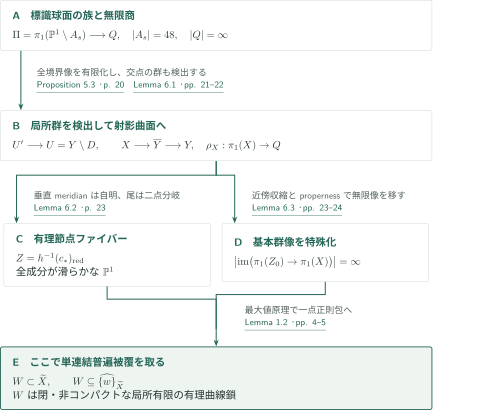
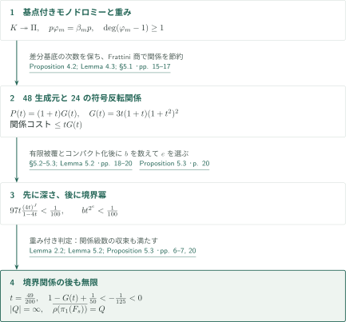
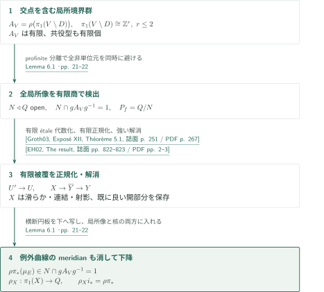
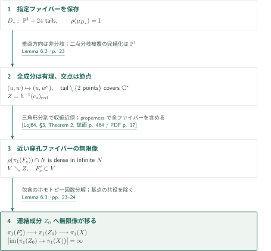
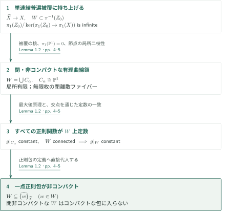

# A surface counterexample to Shafarevich holomorphic convexity

**重み付き pro-2 商を射影曲面へ残し、有理曲線の無限鎖を普遍被覆に持ち上げる**

原稿が対象とするのは「滑らかな連結射影複素多様体の普遍被覆は正則凸である」という Shafarevich 予想の通常の定式化である。著者は複素次元2での反例を主張する。途中の有限被覆から滑らかな射影曲面を作り、その後で通常の単連結普遍被覆を取る。任意の非Stein被覆を反例とする議論ではない。

## 1. 主要結果

### Theorem 1.1 — 射影曲面の普遍被覆に非コンパクトな一点正則包を作る

滑らかな連結射影複素曲面 $X$ と、その中の連結節点曲線 $Z_0$ が存在し、$Z_0$ の既約成分はすべて滑らかな有理曲線であり、

$$
\left|\operatorname{im}\bigl(\pi_1(Z_0)\longrightarrow\pi_1(X)\bigr)\right|=\infty
$$

となる。$X$ の単連結普遍被覆 $\widetilde X$ における $Z_0$ の逆像の連結成分は、閉・連結・非コンパクトな、コンパクト有理曲線の局所有限な和である。その上の任意の点の正則包は非コンパクトであり、$\widetilde X$ は正則凸でない。

<!-- cite:main -->[Theorem 1.1 · p. 2](https://github.com/openai/math/blob/1581d4cbdd69a0faf34b2089614fe2a814316a6a/preprints/A-surface-counterexample-to-Shafarevich-holomorphic-convexity-September-23-2026/paper.pdf)<!-- /cite -->

ここで複素多様体 $V$ の非空コンパクト集合 $K$ の正則包は

$$
\widehat K_V=\{v\in V:|g(v)|\leq\sup_K|g|\text{ for every }g\in\mathcal O(V)\}
$$

である。射影曲面はコンパクト Kähler 多様体でもあるため、構成が成立すればその広いクラスでの全称命題にも反例を与える。ただし、原稿の構成対象は滑らかな射影曲面であり、任意のコンパクト複素多様体の被覆に関する分類や、すべての Kähler 多様体での非凸性を主張するものではない。

<!-- cite:formulation -->[§1 · p. 2](https://github.com/openai/math/blob/1581d4cbdd69a0faf34b2089614fe2a814316a6a/preprints/A-surface-counterexample-to-Shafarevich-holomorphic-convexity-September-23-2026/paper.pdf)<!-- /cite -->

## 図の矢印に付した引用

<!-- reference-guide -->
略号のない定理・補題・節・式番号は本原稿 [A surface counterexample to Shafarevich holomorphic convexity](https://github.com/openai/math/blob/1581d4cbdd69a0faf34b2089614fe2a814316a6a/preprints/A-surface-counterexample-to-Shafarevich-holomorphic-convexity-September-23-2026/paper.pdf) を指します。外部入力には次の略号を使います。

- [Groth03](https://arxiv.org/pdf/math/0206203v2) Alexander Grothendieck et al. — *Revêtements étales et groupe fondamental (SGA 1)*：非properな有限étale被覆の代数化と有限正規延長の一意性。2003 revised edition; arXiv:math/0206203v2. Main printed pagination of this edition is used, not the old marginal pagination.。
- [EH02](https://ems.press/content/serial-article-files/42948?nt=1) Santiago Encinas; Herwig Hauser — *Strong resolution of singularities in characteristic zero*：滑らかな開部分を保つ強い解消。Commentarii Mathematici Helvetici 77 (2002), 821–845; publisher PDF。
- [Loj64](https://numdam.org/item/ASNSP_1964_3_18_4_449_0.pdf) Stanisław Łojasiewicz — *Triangulation of semi-analytic sets*：特殊ファイバーと両立する三角形分割。Annali della Scuola Normale Superiore di Pisa, Ser. 3, 18 (1964), 449–474; Numdam PDF with cover page。
- [Stacks26a](https://stacks.math.columbia.edu/tag/03GR) The Stacks Project Authors — *The Stacks Project — Relative normalization: Lemma 29.54.15*：Nagata性と有限型性から相対正規化の有限性。HTML tag 03GR, accessed 2026-10-13; unpaginated。
- [Stacks26b](https://stacks.math.columbia.edu/tag/0B3I) The Stacks Project Authors — *The Stacks Project — Finite morphisms are projective: Lemma 29.45.16*：有限射から射影性。HTML tag 0B3I, accessed 2026-10-13; unpaginated。
- [Stacks26c](https://stacks.math.columbia.edu/tag/0BIC) The Stacks Project Authors — *The Stacks Project — Embedded resolution: Lemma 54.15.6*：正則曲面上の境界を点blowupでSNC化。HTML tag 0BIC, accessed 2026-10-13; unpaginated。

各引用に結果番号とページを付します。誌面番号とPDF内の位置が異なる場合は両方を示します。GitHubの閲覧リンクではページ位置への自動移動を前提としません。
<!-- /reference-guide -->

## 2. Theorem 1.1 の証明 — 構成から正則包まで

<!-- proof-target:1 -->証明対象：[Theorem 1.1 · p. 2](https://github.com/openai/math/blob/1581d4cbdd69a0faf34b2089614fe2a814316a6a/preprints/A-surface-counterexample-to-Shafarevich-holomorphic-convexity-September-23-2026/paper.pdf)<!-- /proof-target --> [主張](#theorem-1-1)を参照する。

**証明の道筋。** 48点を除いた球面の族から、必要な境界関係を入れても無限な pro-2 群 $Q$ を作る。局所境界群を検出する有限商を使って射影曲面 $X$ を得る。その特殊ファイバーの有理成分と無限基本群像を合流させ、最後に普遍被覆上の一点正則包を調べる。詳細は[無限商](#proof-2)、[有限被覆と下降](#proof-3)、[特殊ファイバー](#proof-4)、[正則包](#proof-5)の順に読む。

### 1. 三種類の被覆を区別する

まず $B'\to B$ はパラメータ曲線の有限 étale 被覆で、48本の標識を切断にする。その射影完備化 $C'\to\mathbb P^1$ は指定点 $c_*\in C'\setminus B'$ で分岐指数をちょうど2に持つ。次に $U'\to U$ は有限群 $P_f$ で定める有限 étale 被覆であり、その正規化と解消から $X$ を作る。$X\to Y$ は解消を含む射影射なので、全体で有限または非分岐と仮定しない。最後の $\widetilde X\to X$ だけが単連結普遍被覆である。

<!-- cite:covers -->[§5.2; Lemma 6.1 · pp. 18, 21–22](https://github.com/openai/math/blob/1581d4cbdd69a0faf34b2089614fe2a814316a6a/preprints/A-surface-counterexample-to-Shafarevich-holomorphic-convexity-September-23-2026/paper.pdf)<!-- /cite -->

### 2. 各結論を結ぶ接続

射影性と滑らかさは Lemma 6.1、特殊ファイバーの有理性・節点性は Lemma 6.2、ある連結成分 $Z_0$ の基本群像の無限性は Lemma 6.3 が担う。無限性は個々の $\mathbb P^1$ から来るのではなく、成分の接合グラフのループから来る。これらを Lemma 1.2 に入れると、主定理の閉性・局所有限性・非コンパクト性・一点正則包の結論がすべて得られる。

<!-- cite:final -->[Lemmas 6.2–6.3; proof of Theorem 1.1 · pp. 23–24](https://github.com/openai/math/blob/1581d4cbdd69a0faf34b2089614fe2a814316a6a/preprints/A-surface-counterexample-to-Shafarevich-holomorphic-convexity-September-23-2026/paper.pdf)<!-- /cite -->

## 3. Proposition 5.3 の証明 — 幾何学的関係を入れても無限性を残す

<!-- proof-target:2 -->証明対象：[Proposition 5.3 · p. 20](https://github.com/openai/math/blob/1581d4cbdd69a0faf34b2089614fe2a814316a6a/preprints/A-surface-counterexample-to-Shafarevich-holomorphic-convexity-September-23-2026/paper.pdf)<!-- /proof-target -->

<!-- statement:proposition-5-3 -->
### Proposition 5.3 — 境界の有限像とファイバーの稠密像

原典 §§3–5 の構成で、$U=Y\setminus D$ は標識族をコンパクト化した滑らかな射影曲面の SNC 境界補集合とする。$Q$ は重み付き自由 pro-2 群 $L$ に符号反転関係、十分深いモノドロミー関係、残る境界 meridian の十分大きい $2$ 冪を課した商である。この $Q$ は無限であり、$\rho:\pi_1(U)\to Q$ は各穿孔滑らかファイバー上で稠密像を持つ。$D$ の各成分 meridian の像は有限位数で、指定ファイバー $D_*$ の各成分 meridian の像は自明である。

<!-- cite:quotient -->[Proposition 5.3 · p. 20](https://github.com/openai/math/blob/1581d4cbdd69a0faf34b2089614fe2a814316a6a/preprints/A-surface-counterexample-to-Shafarevich-holomorphic-convexity-September-23-2026/paper.pdf)<!-- /cite -->
<!-- /statement -->

### 1. 球面の実際のモノドロミーを制御する

$E=\mathbb C/(\mathbb Z+\mathbb Z\omega)$、$\omega^3=1\ne\omega$ とし、$q:E\to E/\{\pm1\}=\mathbb P^1$ と $[4]$ が誘導する次数16の写像 $f$ を使う。$\bar\omega$ は $[\omega]$ が商球面へ誘導する自己同型を表す。5点を除いたパラメータ曲線 $B$ 上で

$$
A_s=\{z:f(z)=\bar\omega^j s\text{ for some }0\leq j\leq2\}
$$

は48点からなり、$s_*=q(e_0)$、$0\ne e_0\in E[2]$ の近くで24組に衝突する。6穿孔トーラスの基本群 $F$ は階数7、$[4]$ の被覆部分群 $K$ は階数97、48穿孔球面の基本群 $\Pi$ は階数47である。Proposition 3.2 の基点付き全射 $p:K\twoheadrightarrow\Pi$ と $p\varphi_m=\beta_m p$ が、トーラス上の次数評価を**実際の球面モノドロミー**へ移す。

<!-- cite:family -->[Lemma 3.1; Proposition 3.2 · pp. 8–9](https://github.com/openai/math/blob/1581d4cbdd69a0faf34b2089614fe2a814316a6a/preprints/A-surface-counterexample-to-Shafarevich-holomorphic-convexity-September-23-2026/paper.pdf)<!-- /cite -->

三つの二重被覆 $Y_j^2=q(z)-\bar\omega^j s$ は基点上の持上げを持ち、重み1部分での作用を固定する。対の境界に重み2を与えると Proposition 3.4 により $\varphi_m-\mathrm{id}$ は次数を1以上上げる。core と対境界を潰した $L$ は48生成元を持ち、符号反転 $\sigma$ を課すと階数24の pinched 球面群の pro-2 完備化を得る。Lemma 3.5 は $K\twoheadrightarrow\Pi$ を使い、pinching の核のモノドロミー不変性を仮定せずに $\Pi\to Q$ の不変性を導く。

<!-- cite:monodromy -->[Lemmas 3.3, 3.5; Proposition 3.4 · pp. 9–12](https://github.com/openai/math/blob/1581d4cbdd69a0faf34b2089614fe2a814316a6a/preprints/A-surface-counterexample-to-Shafarevich-holomorphic-convexity-September-23-2026/paper.pdf)<!-- /cite -->

### 2. 24関係の節約と、選択順序

$H=(\mathbb Z/4)^2$ の二つの平行移動の差分から得る基底 $u_{i\ell,j}$ に重み $i+\ell+1$ を与える。Proposition 4.2 は Frattini 商の $R=C\oplus dC$ を使い、24個の関係 $r_g=\sigma(g)g^{-1}$ だけで符号反転をすべて課す。その次数コストは $tG(t)$ 以下で、

$$
P(t)=3t(1+t+t^2+t^3)^2=(1+t)G(t),\qquad
G(t)=3t(1+t)(1+t^2)^2.
$$

深さ $N$ のパラメータ生成元は高々 $4^N$ 個で、各々について $K$ の97生成元の関係を入れる。Lemma 4.3 の次数移送により、全コストは $97t(4t)^J/(1-4t)$ 以下になる。

<!-- cite:weights -->[Proposition 4.2; Lemma 4.3; §5.1 · pp. 15–17](https://github.com/openai/math/blob/1581d4cbdd69a0faf34b2089614fe2a814316a6a/preprints/A-surface-counterexample-to-Shafarevich-holomorphic-convexity-September-23-2026/paper.pdf)<!-- /cite -->

$t=49/200<1/4$ を固定し、まず深さ $J$ を選んでそのコストを $1/100$ 未満にする。有限パラメータ被覆とコンパクト化を行ってから、残る境界成分数 $b$ に対して $bt^{2^e}<1/100$ となる $e$ を選ぶ。したがって境界成分数を事前に制御する循環はない。原稿の評価 $G(t)>257/250$ から

$$
1-P(t)+tG(t)+\frac1{100}+\frac1{100}< -\frac1{125}<0
$$

となり、本文で証明された重み付き無限性判定 Lemma 2.2 が $Q$ の無限性を与える。無限個のモノドロミー関係についても有界次数内の有限性と級数収束を確認している。$D_*$ の meridian は、切断に沿う基底ループと pinching で消える対境界の積なので既に消えている（Lemma 5.2）。

<!-- cite:criterion -->[Lemma 2.2; Lemma 5.2; Proposition 5.3 · pp. 6–7, 20](https://github.com/openai/math/blob/1581d4cbdd69a0faf34b2089614fe2a814316a6a/preprints/A-surface-counterexample-to-Shafarevich-holomorphic-convexity-September-23-2026/paper.pdf)<!-- /cite -->

## 4. Lemma 6.1 の証明 — 局所群全体を有限商で検出する

<!-- proof-target:3 -->証明対象：[Lemma 6.1 · pp. 21–22](https://github.com/openai/math/blob/1581d4cbdd69a0faf34b2089614fe2a814316a6a/preprints/A-surface-counterexample-to-Shafarevich-holomorphic-convexity-September-23-2026/paper.pdf)<!-- /proof-target -->

<!-- statement:lemma-6-1 -->
### Lemma 6.1 — 有限局所検出とコンパクト化への下降

$Y$ を滑らかな連結射影複素曲面、$D$ を SNC 因子、$U=Y\setminus D$ とする。profinite 群への稠密像を持つ $\rho:\pi_1(U)\to Q$ が各成分 meridian を有限位数元へ送るなら、各局所境界補集合群の**像全体**に単射な有限商 $Q\twoheadrightarrow P_f$ が存在する。核で定める連結有限被覆 $U'\to U$ は、滑らかな連結射影曲面からの射影射 $p:X\to Y$ に延長され、$D_X=X\setminus U'$ は SNC となる。また包含 $i:U'\hookrightarrow X$ について

$$
\rho_X:\pi_1(X)\longrightarrow Q,\qquad \rho_X i_*=\rho\pi_*
$$

が存在する。解消は、正規化が既に滑らかで被約境界が SNC である任意の開部分を保存して選べる。

<!-- cite:descent -->[Lemma 6.1 · pp. 21–22](https://github.com/openai/math/blob/1581d4cbdd69a0faf34b2089614fe2a814316a6a/preprints/A-surface-counterexample-to-Shafarevich-holomorphic-convexity-September-23-2026/paper.pdf)<!-- /cite -->
<!-- /statement -->

### 1. 有限性・射影性・解消

小さい境界多重円板では補集合群は $\mathbb Z^r$、$r=1,2$ である。可換な有限位数像が生成する $A_V\subset Q$ は有限で、共役を除く型も有限個しかない。profinite 性により全 $A_V\setminus\{1\}$ を避ける開正規部分群 $N$ を取ると、$N\cap gA_Vg^{-1}=\{1\}$ がすべての局所群について成立する。個別 meridian の位数だけを検出する選択では足りない。

$P_f=Q/N$ の被覆は非properな $U$ にも適用される Riemann 存在定理で有限 étale 代数被覆となる。$Y$ を $U'$ の関数体で正規化すると有限射になり、射影性を得る。標数0の強い解消と境界の点 blowup で $X$ を作る。既に良い開部分を保つ性質が、次節の特殊ファイバーを壊さないために必要である。

<!-- cite:riemann -->[&#91;Groth03, Exposé XII, Théorème 5.1, 誌面 p. 251 / PDF p. 267&#93;](https://arxiv.org/pdf/math/0206203v2#page=267)<!-- /cite -->

<!-- cite:resolution -->[&#91;EH02, The result, 誌面 pp. 822–823 / PDF pp. 2–3&#93;](https://ems.press/content/serial-article-files/42948?nt=1)<!-- /cite -->

### 2. 新しい境界 meridian も消える理由

$i_*:\pi_1(U')\twoheadrightarrow\pi_1(X)$ の核は $D_X$ の成分 meridian の正規閉包である。任意の成分、特に解消例外曲線の滑らかな点を横断する小円板を $Y$ へ写すと、その meridian の $Q$ 像はある $gA_Vg^{-1}$ に入る。一方 $U'$ 上で閉じたループなので有限商 $P_f$ で消え、その像は $N$ にも入る。交わりが自明であるため全 meridian が消え、$\rho_X$ への下降が成立する。

<!-- cite:descent -->[Lemma 6.1 · pp. 21–22](https://github.com/openai/math/blob/1581d4cbdd69a0faf34b2089614fe2a814316a6a/preprints/A-surface-counterexample-to-Shafarevich-holomorphic-convexity-September-23-2026/paper.pdf)<!-- /cite -->

## 5. Lemma 6.2・Lemma 6.3 の証明 — 有理特殊ファイバーへ無限像を移す

<!-- proof-target:4 -->証明対象：[Lemma 6.2 · p. 23](https://github.com/openai/math/blob/1581d4cbdd69a0faf34b2089614fe2a814316a6a/preprints/A-surface-counterexample-to-Shafarevich-holomorphic-convexity-September-23-2026/paper.pdf)<!-- /proof-target -->

<!-- statement:lemma-6-2 -->
### Lemma 6.2 — 特殊ファイバーの全成分が有理である

上の構成で $h:X\to Y\to C'$ と置く。解消は、$Z=h^{-1}(c_*)_{\mathrm{red}}$ の既約成分がすべて滑らかな有理曲線で、交点が通常の横断的二重点となるように選べる。

<!-- cite:rational -->[Lemma 6.2 · p. 23](https://github.com/openai/math/blob/1581d4cbdd69a0faf34b2089614fe2a814316a6a/preprints/A-surface-counterexample-to-Shafarevich-holomorphic-convexity-September-23-2026/paper.pdf)<!-- /cite -->
<!-- /statement -->

<!-- statement:lemma-6-3 -->
### Lemma 6.3 — ある連結成分の基本群像は無限

Lemma 6.2 の有理節点ファイバー $Z$ は、$\operatorname{im}(\pi_1(Z_0)\to\pi_1(X))$ が無限となる連結成分 $Z_0$ を持つ。

<!-- cite:transfer -->[Lemma 6.3 · pp. 23–24](https://github.com/openai/math/blob/1581d4cbdd69a0faf34b2089614fe2a814316a6a/preprints/A-surface-counterexample-to-Shafarevich-holomorphic-convexity-September-23-2026/paper.pdf)<!-- /cite -->
<!-- /statement -->

### 1. 分岐は尾の二つの標識点だけに残る

二重底変換後の衝突は $w^2=u^2$ となり、一回の blowup で2切断が分離する。下の $D_*$ は無標識の主成分 $\mathbb P^1$ と24本の尾からなる。全垂直 meridian が消えているので、主成分の滑らかな点と垂直節点で正規化被覆は局所同型である。水平・垂直交点での局所正規延長は、水平 meridian の位数を $e$ とすると

$$
(u,w)\longmapsto (u,v)=(u,w^e)
$$

となる。有限性・正規性の解析化比較と有限正規延長の一意性により、このモデルは代数的正規化と一致する。ここでは既に滑らかな SNC 対なので解消を行わない。主成分上の被覆は非分岐で次数1、尾の被覆は二つの標識点だけで分岐する $\mathbb C^*$ の有限被覆のコンパクト化だから $\mathbb P^1$ である。

<!-- cite:normal-comparison -->[&#91;Groth03, Exposé XII, Propositions 2.1(vi), 3.2(vi), 5.3, 誌面 pp. 242, 245, 254 / PDF pp. 258, 261, 270&#93;](https://arxiv.org/pdf/math/0206203v2#page=258)<!-- /cite -->

### 2. Properness が穿孔ファイバー全体を収縮近傍へ入れる

穿孔滑らかファイバー $F_s\subset U$ の $Q$ 像は稠密なので、$P_f$ への像は全体であり、逆像 $F'_s\subset U'$ は連結である。その $Q$ 像は $\rho(\pi_1(F_s))\cap N$ で、無限開部分群 $N$ に稠密、したがって無限である。下降式により $\pi_1(X)$ への像も無限になる。

コンパクト実解析多様体 $X$ と閉半解析集合 $Z$ を両立して三角形分割し、重心細分後に $Z$ を full subcomplex にする。$Z$ の頂点座標の和が正となる開近傍 $V$ は、その座標を正規化することで $Z$ へ強変形収縮する。$h$ の properness から $h(X\setminus V)$ は閉で $c_*$ を含まないので、十分近い**全ファイバー**が $V$ に入る。連結な $F'_s$ の包含はホモトピーを除いてある $Z_0$ を経由する。したがって基本群準同型は基点変更の共役を除いて因数分解し、その無限像が $Z_0$ に移る。

<!-- cite:triangulation -->[&#91;Loj64, §3, Theorem 2, 誌面 p. 464 / PDF p. 17&#93;](https://numdam.org/item/ASNSP_1964_3_18_4_449_0.pdf#page=17)<!-- /cite -->

<!-- cite:transfer -->[Lemma 6.3 · pp. 23–24](https://github.com/openai/math/blob/1581d4cbdd69a0faf34b2089614fe2a814316a6a/preprints/A-surface-counterexample-to-Shafarevich-holomorphic-convexity-September-23-2026/paper.pdf)<!-- /cite -->

下の $D_*$ の接合グラフは木だが、尾の次数 $d$ の被覆は主成分の異なる $d$ 枚と接するため、上の接合グラフまで木とは限らない。原稿は上のグラフを任意に指定せず、無限像を上の近傍論証で確保する。

## 6. Lemma 1.2 の証明 — 非Stein性を経由せず一点正則包を調べる

<!-- proof-target:5 -->証明対象：[Lemma 1.2 · pp. 4–5](https://github.com/openai/math/blob/1581d4cbdd69a0faf34b2089614fe2a814316a6a/preprints/A-surface-counterexample-to-Shafarevich-holomorphic-convexity-September-23-2026/paper.pdf)<!-- /proof-target -->

<!-- statement:lemma-1-2 -->
### Lemma 1.2 — 有理曲線の閉じた無限鎖が正則凸性を妨げる

$X$ を連結複素多様体、$Z\subset X$ をコンパクト連結節点曲線とし、その既約成分は滑らかな有理曲線とする。$\pi_1(Z)\to\pi_1(X)$ の像が無限なら、単連結普遍被覆 $\widetilde X$ における逆像の各連結成分 $W$ は閉で非コンパクト、コンパクト有理曲線の局所有限和である。$\mathcal O(\widetilde X)$ のすべての関数は $W$ 上で定数となり、任意の $w\in W$ について $\widehat{\{w\}}_{\widetilde X}$ は非コンパクトである。

<!-- cite:hull -->[Lemma 1.2 · pp. 4–5](https://github.com/openai/math/blob/1581d4cbdd69a0faf34b2089614fe2a814316a6a/preprints/A-surface-counterexample-to-Shafarevich-holomorphic-convexity-September-23-2026/paper.pdf)<!-- /cite -->
<!-- /statement -->

### 1. 持上げの閉性・局所有限性・非コンパクト性

$W\to Z$ は $\ker(\pi_1(Z)\to\pi_1(X))$ に対応する被覆なので無限枚であり、閉離散無限ファイバーを持つからコンパクトではない。$W$ は閉逆像の連結成分なので閉である。各有理成分は単連結だから、その持上げは同型なコンパクト $\mathbb P^1$ になる。節点で二枝しかない小さい evenly covered 近傍が、持上げた成分族の局所有限性を保証する。

### 2. 閉じた無限鎖が一点正則包に入る

最大値原理により $g\in\mathcal O(\widetilde X)$ は各コンパクト成分上で定数となる。連結性と局所有限性により、成分をつなぐ道に沿ってその定数は一致する。したがって任意の $w\in W$ で

$$
W\subseteq\widehat{\{w\}}_{\widetilde X}.
$$

右辺がコンパクトなら、その閉部分集合 $W$ もコンパクトとなって矛盾する。これが正則凸性への直接の障害であり、コンパクト曲線の存在から非Stein性だけを述べて終える議論ではない。

<!-- cite:hull -->[Lemma 1.2 · pp. 4–5](https://github.com/openai/math/blob/1581d4cbdd69a0faf34b2089614fe2a814316a6a/preprints/A-surface-counterexample-to-Shafarevich-holomorphic-convexity-September-23-2026/paper.pdf)<!-- /cite -->

## 7. どの外部結果が、どの段階を担うか

| 供給元 | 利用箇所 | 使用内容・適用条件 | 確認範囲 |
|---|---|---|---|
| Groth03, Exposé XII, Théorème 5.1 | §5.2, Lemma 6.1 | 有限型複素スキームの有限 étale 被覆と解析的被覆の比較。properness は不要 | 定理の記述と両適用を照合 |
| Groth03, Exposé XII, Propositions 2.1(vi), 3.2(vi), 5.3 | Lemma 6.2 | 正規性・有限性の解析化比較、稠密開集合上で一致する有限正規延長の一意性 | 記述と局所モデルへの適用を照合 |
| EH02, “The result”; Stacks26a–c, Tags 03GR, 0B3I, 0BIC | Lemma 6.1 | 相対正規化の有限性、有限射の射影性、滑らかな開部分を保つ解消と境界解消 | 記述・使用箇所を照合。外部証明全体は未検証 |
| Loj64, §3, Theorem 2 | Lemma 6.3 | 実解析多様体の局所有限半解析族と両立する三角形分割。$X$ のコンパクト性から有限化 | 定理の記述と収縮近傍への適用を照合 |

重み付き Golod–Shafarevich 法には先行文献が挙げられるが、この記事の直接入力は原稿内で証明する Lemma 2.2 である。先行研究の全定理を独立に証明し直したとは扱わない。§1.2 が挙げる special Kähler 多様体の可換性論文と半代数的普遍被覆論文は、主構成への入力ではなく、得た反例の追加比較に使われる。その追加帰結はこの記事の主構成点検の対象外とする。

## 8. 原典を読む入口と確認範囲

<!-- reading-list -->
- [Theorem 1.1 · p. 2](https://github.com/openai/math/blob/1581d4cbdd69a0faf34b2089614fe2a814316a6a/preprints/A-surface-counterexample-to-Shafarevich-holomorphic-convexity-September-23-2026/paper.pdf) — 反例の正確な対象と全結論
- [Proposition 4.2; Lemma 4.3; §5.1 · pp. 15–17](https://github.com/openai/math/blob/1581d4cbdd69a0faf34b2089614fe2a814316a6a/preprints/A-surface-counterexample-to-Shafarevich-holomorphic-convexity-September-23-2026/paper.pdf) — 重み付き関係コストと実際の球面モノドロミーの接続
- [Proposition 5.3 · p. 20](https://github.com/openai/math/blob/1581d4cbdd69a0faf34b2089614fe2a814316a6a/preprints/A-surface-counterexample-to-Shafarevich-holomorphic-convexity-September-23-2026/paper.pdf) — 全境界関係を入れた後の無限性
- [Lemma 6.1 · pp. 21–22](https://github.com/openai/math/blob/1581d4cbdd69a0faf34b2089614fe2a814316a6a/preprints/A-surface-counterexample-to-Shafarevich-holomorphic-convexity-September-23-2026/paper.pdf) — 局所群全体の検出と解消例外meridianへの適用
- [Lemmas 6.2–6.3; proof of Theorem 1.1 · pp. 23–24](https://github.com/openai/math/blob/1581d4cbdd69a0faf34b2089614fe2a814316a6a/preprints/A-surface-counterexample-to-Shafarevich-holomorphic-convexity-September-23-2026/paper.pdf) — 有理性と無限像の合流、主定理への最後の接続
- [Lemma 1.2 · pp. 4–5](https://github.com/openai/math/blob/1581d4cbdd69a0faf34b2089614fe2a814316a6a/preprints/A-surface-counterexample-to-Shafarevich-holomorphic-convexity-September-23-2026/paper.pdf) — 閉非コンパクト集合を一点正則包に入れる理由
<!-- /reading-list -->

編集側では Theorem 1.1、Lemma 1.2、§§3–6 の主構成・次数評価・有限局所検出・特殊ファイバーへの移送を読み、上記外部入力の記述と使用箇所を照合した。原稿の主張を紹介する概説であり、全証明の独立検証や専門家査読を完了したものではない。Frattini 商での全線形計算、全モノドロミー計算、Lemma 2.2 の完備代数の証明全体を独立に再構成する作業、§1.1 の先行研究比較、§1.2 の追加帰結は未実施である。確認した接続とこの未確認範囲を区別する。
