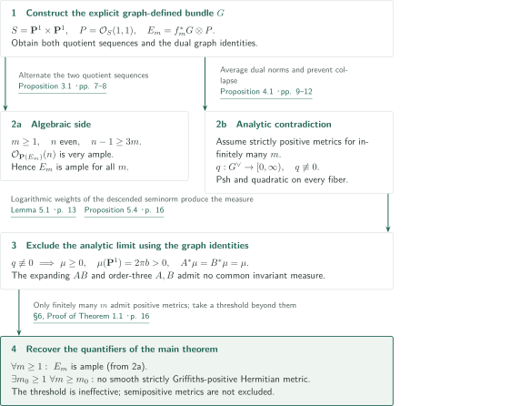
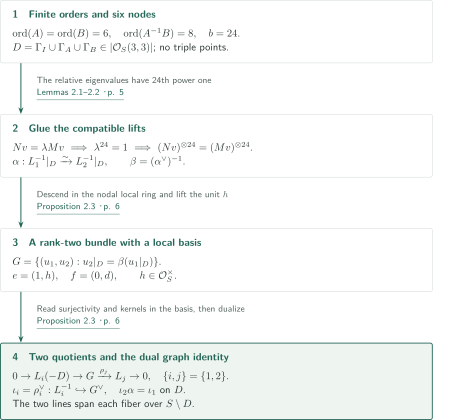
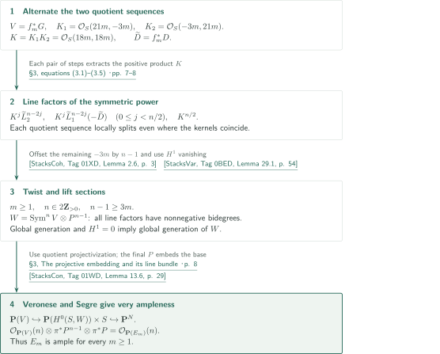
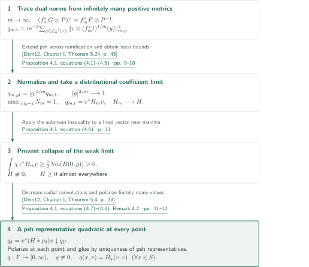
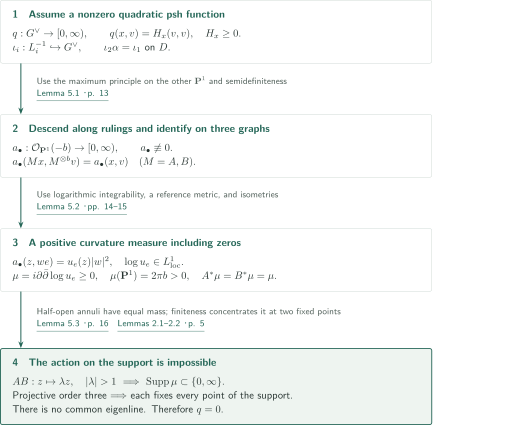

# Ample rank-two bundles on the quadric surface without Griffiths-positive metrics

**Ampleness from two quotients, and an invariant-measure obstruction to a quadratic limit**

The manuscript constructs a rank-two bundle on the quadric surface by identifications along three graphs. The same identifications produce sections of symmetric powers on the algebraic side and an obstruction to a common invariant measure on the analytic side. This article describes the manuscript's claims and proof route; it does not certify the complete proof.

## 1. Main results

### Theorem 1.1 — Ampleness for every power and no strictly positive metric for large powers

Set $S=\mathbf P^1\times\mathbf P^1$ and $P=\mathcal O_S(1,1)$, using the convention that $\mathbf P(E)$ parametrizes one-dimensional quotients. For a positive integer $m$, let

$$
f_m([z_0:z_1],[w_0:w_1])=([z_0^m:z_1^m],[w_0^m:w_1^m]),\qquad \deg f_m=m^2.
$$

There exists an algebraic vector bundle $G$ of rank two on $S$ such that, **for every positive integer $m$**,

$$
E_m=f_m^*G\otimes P
$$

is ample. Moreover, there is an integer $m_0\ge1$ such that, **for every $m\ge m_0$**, $E_m$ admits no smooth strictly Griffiths-positive Hermitian metric. Thus no smooth Hermitian metric has Chern curvature positive on every pair consisting of a nonzero tangent vector and a nonzero fiber vector.

<!-- cite:main -->[Theorem 1.1 · p. 2](https://github.com/openai/math/blob/1581d4cbdd69a0faf34b2089614fe2a814316a6a/preprints/ample-rank-two-bundles-on-the-quadric-surface-without-griffiths-positive-metrics-September-24-2026/paper.pdf)<!-- /cite -->

The formulation contradicted here is the modern assertion that every ample vector bundle on a smooth complex projective variety itself admits a smooth strictly Griffiths-positive Hermitian metric. The manuscript does not assert the nonexistence of semipositive metrics. It supplies no effective value of $m_0$ and does not settle the small values of $m$. Positivity after determinant twists or symmetric powers, and Finsler metrics not required to be Hermitian quadratics, concern different conclusions.

<!-- cite:formulation -->[§1, Historical context and related results · pp. 1–3](https://github.com/openai/math/blob/1581d4cbdd69a0faf34b2089614fe2a814316a6a/preprints/ample-rank-two-bundles-on-the-quadric-surface-without-griffiths-positive-metrics-September-24-2026/paper.pdf)<!-- /cite -->

## References on the arrows

<!-- reference-guide -->
Unprefixed theorem, lemma, section and equation numbers refer to [Ample rank-two bundles on the quadric surface without Griffiths-positive metrics](https://github.com/openai/math/blob/1581d4cbdd69a0faf34b2089614fe2a814316a6a/preprints/ample-rank-two-bundles-on-the-quadric-surface-without-griffiths-positive-metrics-September-24-2026/paper.pdf). External inputs use the following keys.

- [Dem12](https://www-fourier.univ-grenoble-alpes.fr/~demailly/manuscripts/agbook.pdf) Jean-Pierre Demailly — *Complex analytic and differential geometry*: Removable singularities and decreasing limits of psh functions. Version of 21 June 2012.
- [StacksCoh](https://stacks.math.columbia.edu/download/coherent.pdf) The Stacks Project Authors — *The Stacks Project — Cohomology of Schemes*: Čech comparison for the standard affine cover. Version ed88ff78, compiled 14 July 2026; consulted 22 October 2026.
- [StacksVar](https://stacks.math.columbia.edu/download/varieties.pdf) The Stacks Project Authors — *The Stacks Project — Varieties*: Künneth for line-bundle cohomology on the product. Version ed88ff78, compiled 14 July 2026; consulted 22 October 2026.
- [StacksCon](https://stacks.math.columbia.edu/download/constructions.pdf) The Stacks Project Authors — *The Stacks Project — Constructions of Schemes*: Quotient projectivization, closed immersions, and the Segre hyperplane bundle. Version ed88ff78, compiled 14 July 2026; consulted 22 October 2026.

Each citation gives the result and pages. When printed pagination differs from the PDF position, both are shown. GitHub previews do not automatically jump to the cited page.
<!-- /reference-guide -->

## 2. Theorem 1.1 — Proof overview of the main theorem

<!-- proof-target:1 -->Proof target：[Theorem 1.1 · p. 2](https://github.com/openai/math/blob/1581d4cbdd69a0faf34b2089614fe2a814316a6a/preprints/ample-rank-two-bundles-on-the-quadric-surface-without-griffiths-positive-metrics-September-24-2026/paper.pdf)<!-- /proof-target -->

**Proof route.** [Construct $G$ from three graphs](#proof-1), then alternate its two quotient sequences to obtain [ampleness for every $m$](#proof-2). If positive metrics existed for infinitely many $m$, averaged dual norms would yield [a nonzero psh function quadratic on every fiber](#proof-3). Applying the graph identities to this function would produce [an impossible common invariant measure](#proof-4).

### 1. An explicit bundle and ampleness for all $m$

The bundle $G$ of Proposition 2.3 has two surjections $G\twoheadrightarrow L_i$. After pullback by $f_m$, the product of their kernels is $\mathcal O_S(18m,18m)$. Proposition 3.1 incorporates this positive product into a symmetric-power filtration and proves that $\mathcal O_{\mathbf P(E_m)}(n)$ is very ample whenever $n$ is even and $n-1\ge3m$. Every $m\ge1$ admits such an $n$, giving ampleness for all $m$.

<!-- cite:construction -->[Proposition 2.3 · p. 6](https://github.com/openai/math/blob/1581d4cbdd69a0faf34b2089614fe2a814316a6a/preprints/ample-rank-two-bundles-on-the-quadric-surface-without-griffiths-positive-metrics-September-24-2026/paper.pdf)<!-- /cite -->

<!-- cite:ample -->[Proposition 3.1 · pp. 7–8](https://github.com/openai/math/blob/1581d4cbdd69a0faf34b2089614fe2a814316a6a/preprints/ample-rank-two-bundles-on-the-quadric-surface-without-griffiths-positive-metrics-September-24-2026/paper.pdf)<!-- /cite -->

### 2. Infinitely many positive metrics produce one limit

If positive metrics exist for infinitely many $m$, choose a sequence with $m\to\infty$. Proposition 4.1 gives a finite, nonnegative, nonzero psh function $q$ on $F=G^\vee$, with $q(x,v)=H_x(v,v)$ and $H_x\ge0$ at **every** $x\in S$. Rank may drop, but the function cannot vanish identically or cease to be quadratic. The pointwise statement allows the graph identities on the divisor to be evaluated directly in $q$.

<!-- cite:limit -->[Proposition 4.1 · pp. 9–12](https://github.com/openai/math/blob/1581d4cbdd69a0faf34b2089614fe2a814316a6a/preprints/ample-rank-two-bundles-on-the-quadric-surface-without-griffiths-positive-metrics-September-24-2026/paper.pdf)<!-- /cite -->

### 3. From the measure contradiction to finitely many exceptions

Proposition 5.4 says that such a $q$ must be zero for the constructed bundle. Hence the set of integers $m$ admitting a positive metric is finite. Choose $m_0$ larger than its maximum, or $m_0=1$ if it is empty. The proof excludes an infinite sequence of metrics rather than computing the curvature obstruction at a specified $m$.

<!-- cite:obstruction -->[Proposition 5.4 · p. 16](https://github.com/openai/math/blob/1581d4cbdd69a0faf34b2089614fe2a814316a6a/preprints/ample-rank-two-bundles-on-the-quadric-surface-without-griffiths-positive-metrics-September-24-2026/paper.pdf)<!-- /cite -->

<!-- cite:assembly -->[§6, Proof of Theorem 1.1 · p. 16](https://github.com/openai/math/blob/1581d4cbdd69a0faf34b2089614fe2a814316a6a/preprints/ample-rank-two-bundles-on-the-quadric-surface-without-griffiths-positive-metrics-September-24-2026/paper.pdf)<!-- /cite -->

## 3. Proposition 2.3 — Constructing the bundle from three graphs

<!-- proof-target:2 -->Proof target：[Proposition 2.3 · p. 6](https://github.com/openai/math/blob/1581d4cbdd69a0faf34b2089614fe2a814316a6a/preprints/ample-rank-two-bundles-on-the-quadric-surface-without-griffiths-positive-metrics-September-24-2026/paper.pdf)<!-- /proof-target -->

Fix the following scalars and matrices:

$$
a=e^{i\pi/3},\qquad s=\frac12-\frac{i(1+2\sqrt2)}{2\sqrt3},\qquad
A=\begin{pmatrix}a&0\\0&a^{-1}\end{pmatrix},\quad
B=\begin{pmatrix}s&1\\\sqrt2/3&1-s\end{pmatrix}.
$$

For $M\in\{I,A,B\}$ set $\Gamma_M=\{(x,Mx):x\in\mathbf P^1\}$ and let $D=\Gamma_I\cup\Gamma_A\cup\Gamma_B$ be reduced. Set $b=24$, $L_1=\mathcal O_S(b,0)$, and $L_2=\mathcal O_S(0,b)$.

<!-- cite:matrices -->[§2, equations (2.1)–(2.2) · pp. 4–5](https://github.com/openai/math/blob/1581d4cbdd69a0faf34b2089614fe2a814316a6a/preprints/ample-rank-two-bundles-on-the-quadric-surface-without-griffiths-positive-metrics-September-24-2026/paper.pdf)<!-- /cite -->

<!-- statement:proposition-2-3 -->
### Proposition 2.3 — Gluing, local freeness, and two quotients

The maps $M^{\otimes b}$ on $\Gamma_M$ glue to an isomorphism $\alpha:L_1^{-1}|_D\simeq L_2^{-1}|_D$. With $\beta=(\alpha^\vee)^{-1}$,

$$
G=\{(u_1,u_2)\in L_1\oplus L_2:u_2|_D=\beta(u_1|_D)\}
$$

is an algebraic rank-two vector bundle. Both projections $\rho_j:G\twoheadrightarrow L_j$ give exact sequences

$$
0\longrightarrow L_i(-D)\longrightarrow G\xrightarrow{\rho_j}L_j\longrightarrow0,
\qquad \{i,j\}=\{1,2\}.
$$

The dual inclusions $\iota_i=\rho_i^\vee:L_i^{-1}\hookrightarrow F=G^\vee$ span every fiber over $S\setminus D$ and satisfy $\iota_2\alpha=\iota_1$ on $D$.

<!-- cite:construction -->[Proposition 2.3 · p. 6](https://github.com/openai/math/blob/1581d4cbdd69a0faf34b2089614fe2a814316a6a/preprints/ample-rank-two-bundles-on-the-quadric-surface-without-griffiths-positive-metrics-September-24-2026/paper.pdf)<!-- /cite -->
<!-- /statement -->

### 1. Finite orders provide compatibility at intersections

The orders of $A,B,A^{-1}B$ in $\mathrm{SL}_2(\mathbf C)$ are $6,6,8$. Each pair of graphs meets transversely at the two distinct eigenlines of the relative matrix. There are no triple points because $A$ and $B$ have no common eigenline. Thus $D$ has bidegree $(3,3)$ and six nodes. At an intersection, $Nv=\lambda Mv$ and $\lambda^{24}=1$, so $M^{\otimes24}$ and $N^{\otimes24}$ agree on the actual fiber. The nodal local-ring sequence

$$
0\longrightarrow R/(xy)\longrightarrow R/(x)\oplus R/(y)\longrightarrow R/(x,y)\longrightarrow0
$$

turns this agreement into gluing on the whole divisor.

<!-- cite:graph-lemmas -->[Lemmas 2.1–2.2 · p. 5](https://github.com/openai/math/blob/1581d4cbdd69a0faf34b2089614fe2a814316a6a/preprints/ample-rank-two-bundles-on-the-quadric-surface-without-griffiths-positive-metrics-September-24-2026/paper.pdf)<!-- /cite -->

### 2. The local basis also proves surjectivity

Let $d$ be a local equation of $D$ and let the unit $h$ lift the local coefficient of $\beta$. Then $e=(1,h)$ and $f=(0,d)$ form a basis of $G$, including at nodes. This basis proves that both projections are surjective and their kernels are $L_i(-D)$. Dualizing gives $\iota_2\alpha=\iota_1$, the precise relation that will identify the seminorms coming from the two rulings.

<!-- cite:construction -->[Proposition 2.3 · p. 6](https://github.com/openai/math/blob/1581d4cbdd69a0faf34b2089614fe2a814316a6a/preprints/ample-rank-two-bundles-on-the-quadric-surface-without-griffiths-positive-metrics-September-24-2026/paper.pdf)<!-- /cite -->

## 4. Proposition 3.1 — Ampleness with the full range of powers and twists

<!-- proof-target:3 -->Proof target：[Proposition 3.1 · pp. 7–8](https://github.com/openai/math/blob/1581d4cbdd69a0faf34b2089614fe2a814316a6a/preprints/ample-rank-two-bundles-on-the-quadric-surface-without-griffiths-positive-metrics-September-24-2026/paper.pdf)<!-- /proof-target -->

<!-- statement:proposition-3-1 -->
### Proposition 3.1 — An explicit very-ampleness range

For the bundle $G$ above, $E_m=f_m^*G\otimes P$ is ample for every positive integer $m$. More precisely, $\mathcal O_{\mathbf P(E_m)}(n)$ is very ample for **every even integer $n$ satisfying $n-1\ge3m$**.

<!-- cite:ample -->[Proposition 3.1 · pp. 7–8](https://github.com/openai/math/blob/1581d4cbdd69a0faf34b2089614fe2a814316a6a/preprints/ample-rank-two-bundles-on-the-quadric-surface-without-griffiths-positive-metrics-September-24-2026/paper.pdf)<!-- /cite -->
<!-- /statement -->

Write $V=f_m^*G$, $\widetilde L_i=f_m^*L_i$, $\widetilde D=f_m^*D$, $K_i=\widetilde L_i(-\widetilde D)$, and $K=K_1\otimes K_2$.

### 1. Alternating quotients group the two negative directions

Although $K_1=\mathcal O_S(21m,-3m)$ and $K_2=\mathcal O_S(-3m,21m)$, their product is $K=\mathcal O_S(18m,18m)$. Alternating the sequences $0\to K_i\to V\to\widetilde L_j\to0$ gives, for even $n$, a filtration of $\operatorname{Sym}^nV$ with line factors

$$
K^j\widetilde L_2^{\,n-2j},\qquad
K^j\widetilde L_1^{\,n-2j}(-\widetilde D)\quad(0\le j<n/2),\qquad K^{n/2}.
$$

Each step uses one locally split quotient sequence, so it remains valid where the two kernels have the same fiber image. For $n=2$, the manuscript checks local bases to retain locally free quotients at nodes and on nonreduced pullbacks of the divisor.

<!-- cite:filtration -->[§3, equations (3.1)–(3.5) · pp. 7–8](https://github.com/openai/math/blob/1581d4cbdd69a0faf34b2089614fe2a814316a6a/preprints/ample-rank-two-bundles-on-the-quadric-surface-without-griffiths-positive-metrics-September-24-2026/paper.pdf)<!-- /cite -->

### 2. The twist $P^{n-1}$ makes all factors globally generated

The line factors of $W=\operatorname{Sym}^nV\otimes P^{n-1}$ have bidegrees

$$
\begin{aligned}
&(18mj+n-1,\ 18mj+24m(n-2j)+n-1),\\
&(18mj+24m(n-2j)-3m+n-1,\ 18mj-3m+n-1),\\
&(9mn+n-1,\ 9mn+n-1).
\end{aligned}
$$

The inequality $n-1\ge3m$ offsets the sole remaining negative term $-3m$. A line bundle of nonnegative bidegree is globally generated and has $H^1=0$. The long exact sequence therefore lifts sections through successive quotients, proving that $W$ is globally generated. The cohomology calculation uses Čech comparison for the standard affine cover of $\mathbf P^1$ and the Künneth formula on the product.

<!-- cite:global-generation -->[§3, Global generation after twisting · p. 8](https://github.com/openai/math/blob/1581d4cbdd69a0faf34b2089614fe2a814316a6a/preprints/ample-rank-two-bundles-on-the-quadric-surface-without-griffiths-positive-metrics-September-24-2026/paper.pdf)<!-- /cite -->

### 3. One final factor $P$ embeds the base

Evaluation and the relative Veronese give $\mathbf P(V)\hookrightarrow\mathbf P(H^0(S,W))\times S$. The hyperplane bundle from the first factor pulls back to $\mathcal O_{\mathbf P(V)}(n)\otimes\pi^*P^{n-1}$. Embed $S$ by $P$ and compose with Segre. The resulting hyperplane pullback is

$$
\mathcal O_{\mathbf P(V)}(n)\otimes\pi^*P^n
=\bigl(\mathcal O_{\mathbf P(V)}(1)\otimes\pi^*P\bigr)^n
=\mathcal O_{\mathbf P(E_m)}(n).
$$

Separating the roles of $P^{n-1}$ and the final $P$ explains the passage from global generation to very ampleness.

<!-- cite:embedding -->[§3, The projective embedding and its line bundle · p. 8](https://github.com/openai/math/blob/1581d4cbdd69a0faf34b2089614fe2a814316a6a/preprints/ample-rank-two-bundles-on-the-quadric-surface-without-griffiths-positive-metrics-September-24-2026/paper.pdf)<!-- /cite -->

## 5. Proposition 4.1 — Removing the twist while retaining a quadratic at every point

<!-- proof-target:4 -->Proof target：[Proposition 4.1 · pp. 9–12](https://github.com/openai/math/blob/1581d4cbdd69a0faf34b2089614fe2a814316a6a/preprints/ample-rank-two-bundles-on-the-quadric-surface-without-griffiths-positive-metrics-September-24-2026/paper.pdf)<!-- /proof-target -->

<!-- statement:proposition-4-1 -->
### Proposition 4.1 — A necessary condition for an arbitrary bundle

Let $G$ be any holomorphic vector bundle of positive rank on $S=\mathbf P^1\times\mathbf P^1$, and set $F=G^\vee$. If $f_m^*G\otimes P$ admits a smooth strictly Griffiths-positive Hermitian metric for infinitely many positive integers $m$, there exists a finite, nonnegative, nonzero psh function $q:F\to[0,\infty)$ on the total space such that, **for every $x\in S$**, $q(x,v)=H_x(v,v)$ for a finite positive semidefinite Hermitian form $H_x$.

<!-- cite:limit -->[Proposition 4.1 · pp. 9–12](https://github.com/openai/math/blob/1581d4cbdd69a0faf34b2089614fe2a814316a6a/preprints/ample-rank-two-bundles-on-the-quadric-surface-without-griffiths-positive-metrics-September-24-2026/paper.pdf)<!-- /cite -->
<!-- /statement -->

### 1. Tracing over the power map removes the twisting transition

The squared dual norm is psh on the total space of $f_m^*F\otimes P^{-1}$. For a local frame $t$ of $P^{-1}$, use $f_m^*P^{-1}\simeq P^{-m}$ to define

$$
q_{m,t}(x,v)=\frac1{m^2}\sum_{y\in f_m^{-1}(x)}
\left\|v\otimes(f_m^*t)^{1/m}(y)\right\|_{m,y}^{2}.
$$

The sum counts multiplicities, and different root choices differ by a unit-modulus constant, leaving the squared norm unchanged. Off the branch locus it is a sum of psh pullbacks by holomorphic inverse branches; across that locus it is continuous and locally bounded. The inverse image of the branch locus in the total space is closed and pluripolar, so the removable-singularities theorem applies. A frame change $t'=gt$ gives $q_{m,t'}=|g|^{2/m}q_{m,t}$, whose extra factor tends uniformly to one on compact subsets.

<!-- cite:trace -->[Proposition 4.1, equations (4.1)–(4.5) · pp. 9–10](https://github.com/openai/math/blob/1581d4cbdd69a0faf34b2089614fe2a814316a6a/preprints/ample-rank-two-bundles-on-the-quadric-surface-without-griffiths-positive-metrics-September-24-2026/paper.pdf)<!-- /cite -->

<!-- cite:dem-removal -->[&#91;Dem12, Chapter I, Theorem 5.24, p. 45&#93;](https://www-fourier.univ-grenoble-alpes.fr/~demailly/manuscripts/agbook.pdf#page=45)<!-- /cite -->

### 2. Convert a normalized maximum into nonvanishing of the limit

Using background metrics, normalize the global quadratic $N_m=q_{m,t}|t|_0^{-2/m}$ to have maximum one on the unit sphere bundle. Its local coefficient matrices $H_m$ are uniformly bounded; a subsequence converges distributionally to $H\in L^\infty_{\mathrm{loc}}$. Let maximizing points $(x_m,v_m)$ converge and replace the nearby fiber vectors by a fixed vector $c$. The submean inequality for the psh function $c^*H_mc$ gives a fixed nonnegative test function $\chi$ with

$$
\int\chi\,c^*H_mc\ \ge\ \tfrac12\operatorname{Vol}(B(0,\varrho))>0.
$$

Passing this estimate to the distributional limit proves $H\not\equiv0$. This integral bound supplies the noncollapse that normalization of the maximum alone would not establish.

<!-- cite:noncollapse -->[Proposition 4.1, equation (4.6) · p. 11](https://github.com/openai/math/blob/1581d4cbdd69a0faf34b2089614fe2a814316a6a/preprints/ample-rank-two-bundles-on-the-quadric-surface-without-griffiths-positive-metrics-September-24-2026/paper.pdf)<!-- /cite -->

### 3. Recover a psh representative usable on the divisor

Convolve the coefficients in the base variables with a radial kernel, setting $q_\delta(x,v)=v^*(H*\rho_\delta)(x)v$. These are smooth psh functions and decrease as $\delta\downarrow0$. Their local bounds give a finite psh limit $q_U$. Polarization recovers all matrix entries from the limiting values at the finite list $e_j,e_j+e_k,e_j+ie_k$, proving quadraticity at every point. On overlaps the local psh representatives agree almost everywhere, and the submean inequality together with upper semicontinuity gives equality everywhere.

<!-- cite:representative -->[Proposition 4.1, equations (4.7)–(4.8); Remark 4.2 · pp. 11–12](https://github.com/openai/math/blob/1581d4cbdd69a0faf34b2089614fe2a814316a6a/preprints/ample-rank-two-bundles-on-the-quadric-surface-without-griffiths-positive-metrics-September-24-2026/paper.pdf)<!-- /cite -->

<!-- cite:dem-decrease -->[&#91;Dem12, Chapter I, Theorem 5.4, p. 39&#93;](https://www-fourier.univ-grenoble-alpes.fr/~demailly/manuscripts/agbook.pdf#page=39)<!-- /cite -->

The representatives thus glue to a global $q$. The graph identities are evaluated in this single everywhere-defined function, rather than in a raw pointwise limit or a limit of restrictions to the divisor. Remark 4.2 explicitly makes no assertion of convergence of those restrictions.

<!-- cite:representative -->[Proposition 4.1, equations (4.7)–(4.8); Remark 4.2 · pp. 11–12](https://github.com/openai/math/blob/1581d4cbdd69a0faf34b2089614fe2a814316a6a/preprints/ample-rank-two-bundles-on-the-quadric-surface-without-griffiths-positive-metrics-September-24-2026/paper.pdf)<!-- /cite -->

## 6. Proposition 5.4 — No common invariant measure

<!-- proof-target:5 -->Proof target：[Proposition 5.4 · p. 16](https://github.com/openai/math/blob/1581d4cbdd69a0faf34b2089614fe2a814316a6a/preprints/ample-rank-two-bundles-on-the-quadric-surface-without-griffiths-positive-metrics-September-24-2026/paper.pdf)<!-- /proof-target -->

<!-- statement:proposition-5-4 -->
### Proposition 5.4 — Every quadratic psh function on this bundle vanishes

For $G$ from Proposition 2.3 and $F=G^\vee$, every finite nonnegative psh function on the total space of $F$ whose restriction to each fiber is a Hermitian quadratic form is identically zero.

<!-- cite:obstruction -->[Proposition 5.4 · p. 16](https://github.com/openai/math/blob/1581d4cbdd69a0faf34b2089614fe2a814316a6a/preprints/ample-rank-two-bundles-on-the-quadric-surface-without-griffiths-positive-metrics-September-24-2026/paper.pdf)<!-- /cite -->
<!-- /statement -->

### 1. Combine two rulings and three graphs into one seminorm

Suppose $q\not\equiv0$. In $q\circ\iota_i$, hold the $i$th coordinate and the fiber vector fixed. The resulting finite subharmonic function on the complementary $\mathbf P^1$ is constant. Each ruling therefore yields a psh squared seminorm $a_i$ on $\mathcal O_{\mathbf P^1}(-b)$. The identity along $\Gamma_I$ gives $a_1=a_2=:a_\bullet$; those along $\Gamma_A,\Gamma_B$ give

$$
a_\bullet(Mx,M^{\otimes b}v)=a_\bullet(x,v),\qquad M=A,B.
$$

If $a_\bullet=0$, the two spanning lines over $S\setminus D$ and Cauchy–Schwarz for positive semidefinite forms force $q=0$ there. The submean inequality extends the vanishing to the total space. Thus $a_\bullet$ is nonzero.

<!-- cite:seminorm -->[Lemma 5.1 · p. 13](https://github.com/openai/math/blob/1581d4cbdd69a0faf34b2089614fe2a814316a6a/preprints/ample-rank-two-bundles-on-the-quadric-surface-without-griffiths-positive-metrics-September-24-2026/paper.pdf)<!-- /cite -->

### 2. Include the zeros when computing curvature mass

In a local frame write $a_\bullet(z,we(z))=u_e(z)|w|^2$. Total-space plurisubharmonicity gives $u_\delta(u_\delta)_{z\bar z}-|(u_\delta)_z|^2\ge0$ for a positive smoothing, so $\log u_\delta$ is subharmonic. Nontriviality and the submean inequality bound its negative part in $L^1$; the manuscript thereby establishes $\log u_e\in L^1_{\mathrm{loc}}$, including at zeros. Consequently

$$
\mu=i\partial\bar\partial\log u_e\ge0
$$

is a global Radon measure. Frame changes add harmonic terms, and the lifts of $A,B$ are isometries, so $A^*\mu=B^*\mu=\mu$. Subtracting the reference logarithmic weight of $(1+|z|^2)^b$ on $\mathcal O(-b)$ gives a globally integrable potential whose $i\partial\bar\partial$ has integral zero. Hence

$$
\mu(\mathbf P^1)=\int_{\mathbf C}\frac{b\,i\,dz\wedge d\bar z}{(1+|z|^2)^2}=2\pi b>0.
$$

Retaining zeros and atoms is essential to preserving the nonzero mass.

<!-- cite:measure -->[Lemma 5.2 · pp. 14–15](https://github.com/openai/math/blob/1581d4cbdd69a0faf34b2089614fe2a814316a6a/preprints/ample-rank-two-bundles-on-the-quadric-surface-without-griffiths-positive-metrics-September-24-2026/paper.pdf)<!-- /cite -->

### 3. An expanding product is incompatible with order three

The eigenvalues of $T=AB$ have different moduli; in projective coordinates it acts as $z\mapsto\lambda z$ with $|\lambda|=R>1$. The disjoint half-open annuli $C_n=\{R^n\le|z|<R^{n+1}\}$ have equal measure, so finiteness forces each to have measure zero. The nonempty support of $\mu$ is therefore contained in the two fixed points of $T$. Both $A$ and $B$ preserve this support. Since their projective orders are three, their permutations of a set of at most two points are trivial. Every support point would be fixed by both transformations, contradicting the absence of a common eigenline in Lemma 2.1. This excludes $q\not\equiv0$.

<!-- cite:dynamics -->[Lemma 5.3 · p. 16](https://github.com/openai/math/blob/1581d4cbdd69a0faf34b2089614fe2a814316a6a/preprints/ample-rank-two-bundles-on-the-quadric-surface-without-griffiths-positive-metrics-September-24-2026/paper.pdf)<!-- /cite -->

## 7. Which papers supply which steps

The direct inputs are the two psh theorems from Dem12 for the analytic limit, and the Stacks Project results on Čech comparison, Künneth, projective bundles, and embeddings for the algebraic argument. Their statements and the applications below were compared; the complete external proofs were not verified.

| Input | Application and hypotheses | Role |
|---|---|---|
| <!-- cite:dem-removal -->[&#91;Dem12, Chapter I, Theorem 5.24, p. 45&#93;](https://www-fourier.univ-grenoble-alpes.fr/~demailly/manuscripts/agbook.pdf#page=45)<!-- /cite --> | Proposition 4.1, p.10: the inverse image of the branch locus is closed pluripolar, and the average is continuous and locally bounded | Extend the psh average across ramification |
| <!-- cite:dem-decrease -->[&#91;Dem12, Chapter I, Theorem 5.4, p. 39&#93;](https://www-fourier.univ-grenoble-alpes.fr/~demailly/manuscripts/agbook.pdf#page=39)<!-- /cite --> | Proposition 4.1, p.12: the convolved quadratics decrease to a finite, locally bounded limit | Obtain an everywhere-defined psh representative |
| <!-- cite:stacks-cech -->[&#91;StacksCoh, Tag 01XD, Lemma 2.6, p. 3&#93;](https://stacks.math.columbia.edu/download/coherent.pdf#page=3)<!-- /cite --> | Proposition 3.1, p.8: the standard affine cover and its intersections; quasi-coherent line bundles | Identify Čech and sheaf cohomology; vanishing itself comes from the calculation on $\mathbf P^1$ |
| <!-- cite:stacks-kunneth -->[&#91;StacksVar, Tag 0BED, Lemma 29.1, p. 54&#93;](https://stacks.math.columbia.edu/download/varieties.pdf#page=54)<!-- /cite --> | Proposition 3.1, p.8: $\mathbf P^1$ is quasi-compact and separated | Deduce $H^1(\mathcal O(c,t))=0$ on the product |
| <!-- cite:stacks-projective -->[&#91;StacksCon, Tag 01OA, §21, pp. 45–46&#93;](https://stacks.math.columbia.edu/download/constructions.pdf#page=45)<!-- /cite --> | Proposition 3.1, p.8: evaluation is surjective | Match quotient projectivization with the tautological line |
| <!-- cite:stacks-immersion -->[&#91;StacksCon, Tag 01N1, Lemma 11.5, p. 22&#93;](https://stacks.math.columbia.edu/download/constructions.pdf#page=22)<!-- /cite --> | Proposition 3.1, p.8: surjections of symmetric algebras generated in degree one | Identify the closed immersion and hyperplane pullback |
| <!-- cite:stacks-segre -->[&#91;StacksCon, Tag 01WD, Lemma 13.6, p. 29&#93;](https://stacks.math.columbia.edu/download/constructions.pdf#page=29)<!-- /cite --> | Proposition 3.1, p.8: $P$ embeds $S$ | Add the final $P$ through Segre to obtain very ampleness |

The manuscript supplies the needed arguments for graph gluing and local freeness, the alternating symmetric-power filtration, psh dual norms, smoothing and polarization, integrability of logarithmic weights, and the dynamical measure obstruction. References to Maruyama, Hartshorne, Berndtsson–Păun, Raufi, Păun–Takayama, and Furstenberg serve as methodological background or comparison; their presence is not converted into direct-dependency arrows through unread theorems. The main results and proofs of the other counterexamples discussed in the introduction are outside this article's checking scope.

## 8. Return to the sources

<!-- reading-list -->
- [Theorem 1.1 · p. 2](https://github.com/openai/math/blob/1581d4cbdd69a0faf34b2089614fe2a814316a6a/preprints/ample-rank-two-bundles-on-the-quadric-surface-without-griffiths-positive-metrics-September-24-2026/paper.pdf) — The quantifiers and the strict-positivity conclusion
- [§2, equations (2.1)–(2.2) · pp. 4–5](https://github.com/openai/math/blob/1581d4cbdd69a0faf34b2089614fe2a814316a6a/preprints/ample-rank-two-bundles-on-the-quadric-surface-without-griffiths-positive-metrics-September-24-2026/paper.pdf) — The explicit matrices and the choice b=24
- [Proposition 2.3 · p. 6](https://github.com/openai/math/blob/1581d4cbdd69a0faf34b2089614fe2a814316a6a/preprints/ample-rank-two-bundles-on-the-quadric-surface-without-griffiths-positive-metrics-September-24-2026/paper.pdf) — Gluing at nodes, the local basis, and two quotients
- [Proposition 3.1 · pp. 7–8](https://github.com/openai/math/blob/1581d4cbdd69a0faf34b2089614fe2a814316a6a/preprints/ample-rank-two-bundles-on-the-quadric-surface-without-griffiths-positive-metrics-September-24-2026/paper.pdf) — The symmetric-power filtration and the very-ampleness range
- [Proposition 4.1 · pp. 9–12](https://github.com/openai/math/blob/1581d4cbdd69a0faf34b2089614fe2a814316a6a/preprints/ample-rank-two-bundles-on-the-quadric-surface-without-griffiths-positive-metrics-September-24-2026/paper.pdf) — Noncollapse and a psh representative quadratic at every point
- [Lemma 5.2 · pp. 14–15](https://github.com/openai/math/blob/1581d4cbdd69a0faf34b2089614fe2a814316a6a/preprints/ample-rank-two-bundles-on-the-quadric-surface-without-griffiths-positive-metrics-September-24-2026/paper.pdf) — Logarithmic integrability including zeros and mass 2πb
- [Lemma 5.3 · p. 16](https://github.com/openai/math/blob/1581d4cbdd69a0faf34b2089614fe2a814316a6a/preprints/ample-rank-two-bundles-on-the-quadric-surface-without-griffiths-positive-metrics-September-24-2026/paper.pdf) — Annuli and the order-three argument excluding invariant measures
- [§6, Proof of Theorem 1.1 · p. 16](https://github.com/openai/math/blob/1581d4cbdd69a0faf34b2089614fe2a814316a6a/preprints/ample-rank-two-bundles-on-the-quadric-surface-without-griffiths-positive-metrics-September-24-2026/paper.pdf) — The final passage from finitely many exceptions to m0
<!-- /reading-list -->

The reading covers Theorem 1.1 and the proof text of §§2–6 in the September 24, 2026 version, particularly gluing at nodes, symmetric-power factors, noncollapse and the everywhere-defined quadratic representative, the mass calculation including zeros, and the conclusion of finitely many exceptions. The stated Dem12 and Stacks inputs and their application hypotheses were also compared. This is a check of the proof route and direct inputs, not independent verification of every calculation and complete proof, recursive verification of external proofs, or expert peer review. Effective values of $m_0$, metrics for individual small $m$, nonexistence of semipositive metrics, and priority or equivalence with other counterexamples remain outside the scope.
