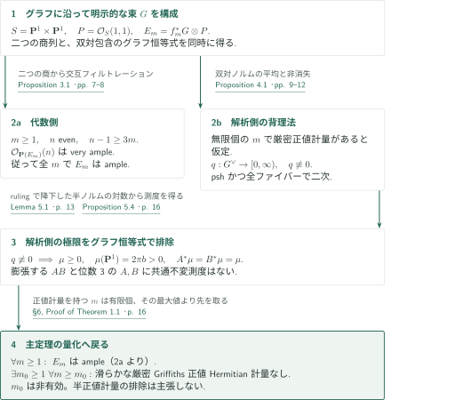
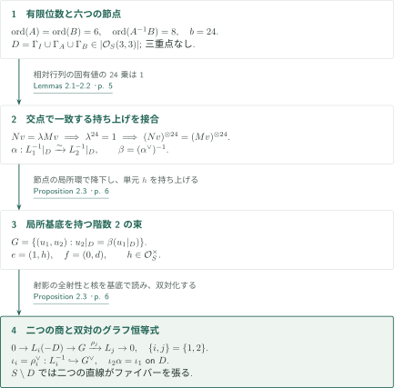
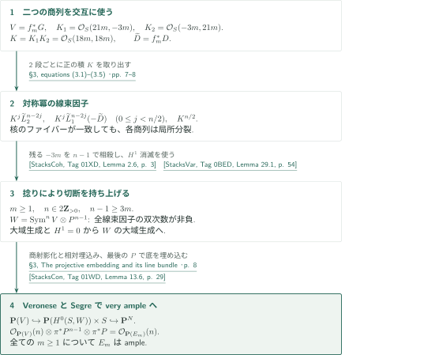
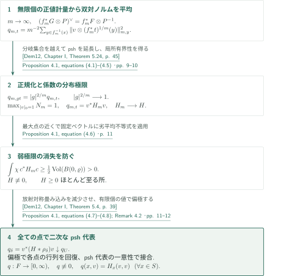
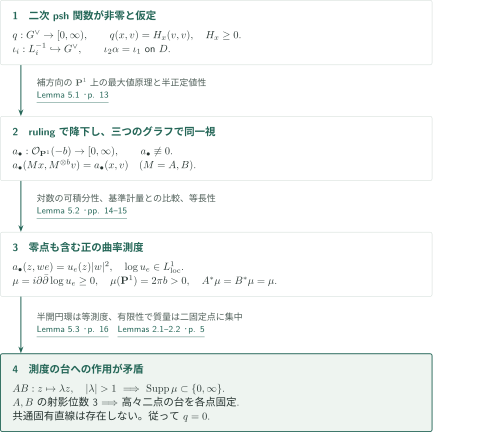

# Ample rank-two bundles on the quadric surface without Griffiths-positive metrics

**二つの商写像によるample性と、二次形式の極限が生む不変測度の障害**

本原稿は、二次曲面上の階数2の束を三つのグラフに沿う同一視で構成する。同じ同一視から、代数的には対称冪の切断を、解析的には共通不変測度への障害を引き出す。以下は原稿の主張とその証明経路の概説であり、証明全体の正しさの認定ではない。

## 1. 主要結果

### Theorem 1.1 — 全ての冪でample、十分大きい冪で厳密正値計量を持たない

$S=\mathbf P^1\times\mathbf P^1$、$P=\mathcal O_S(1,1)$とし、$\mathbf P(E)$は一次元商をパラメータ化する規約を用いる。正整数$m$に対して

$$
f_m([z_0:z_1],[w_0:w_1])=([z_0^m:z_1^m],[w_0^m:w_1^m]),\qquad \deg f_m=m^2,
$$

と置く。$S$上に代数的階数2のベクトル束$G$が存在し、**全ての正整数$m$**について

$$
E_m=f_m^*G\otimes P
$$

はampleである。さらに、ある整数$m_0\ge1$が存在し、**全ての$m\ge m_0$**について$E_m$は滑らかな厳密Griffiths正値Hermitian計量を持たない。すなわち、非零の接ベクトルと非零のファイバーベクトルの全ての組に対してChern曲率が正となる計量が存在しない。

<!-- cite:main -->[Theorem 1.1 · p. 2](https://github.com/openai/math/blob/1581d4cbdd69a0faf34b2089614fe2a814316a6a/preprints/ample-rank-two-bundles-on-the-quadric-surface-without-griffiths-positive-metrics-September-24-2026/paper.pdf)<!-- /cite -->

ここで否定されるのは「滑らかな複素射影多様体上のampleなベクトル束自身が滑らかな厳密Griffiths正値Hermitian計量を持つ」という現代的定式化である。本原稿の結論は半正値計量の不存在までは主張しない。$m_0$の有効値は与えず、小さい$m$についても判定しない。$\det E$による捻りや対称冪の正値性、Hermitian二次形式に限らないFinsler計量の問題とは結論の対象が異なる。

<!-- cite:formulation -->[§1, Historical context and related results · pp. 1–3](https://github.com/openai/math/blob/1581d4cbdd69a0faf34b2089614fe2a814316a6a/preprints/ample-rank-two-bundles-on-the-quadric-surface-without-griffiths-positive-metrics-September-24-2026/paper.pdf)<!-- /cite -->

## 図の矢印に付した引用

<!-- reference-guide -->
略号のない定理・補題・節・式番号は本原稿 [Ample rank-two bundles on the quadric surface without Griffiths-positive metrics](https://github.com/openai/math/blob/1581d4cbdd69a0faf34b2089614fe2a814316a6a/preprints/ample-rank-two-bundles-on-the-quadric-surface-without-griffiths-positive-metrics-September-24-2026/paper.pdf) を指します。外部入力には次の略号を使います。

- [Dem12](https://www-fourier.univ-grenoble-alpes.fr/~demailly/manuscripts/agbook.pdf) Jean-Pierre Demailly — *Complex analytic and differential geometry*：psh関数の分岐集合を越える延長と減少極限。Version of 21 June 2012。
- [StacksCoh](https://stacks.math.columbia.edu/download/coherent.pdf) The Stacks Project Authors — *The Stacks Project — Cohomology of Schemes*：標準アフィン被覆のČech計算と層コホモロジーの比較。Version ed88ff78, compiled 14 July 2026; consulted 22 October 2026。
- [StacksVar](https://stacks.math.columbia.edu/download/varieties.pdf) The Stacks Project Authors — *The Stacks Project — Varieties*：積上の線束コホモロジーのKünneth公式。Version ed88ff78, compiled 14 July 2026; consulted 22 October 2026。
- [StacksCon](https://stacks.math.columbia.edu/download/constructions.pdf) The Stacks Project Authors — *The Stacks Project — Constructions of Schemes*：商規約の射影束、閉埋込みとSegreの超平面束。Version ed88ff78, compiled 14 July 2026; consulted 22 October 2026。

各引用に結果番号とページを付します。誌面番号とPDF内の位置が異なる場合は両方を示します。GitHubの閲覧リンクではページ位置への自動移動を前提としません。
<!-- /reference-guide -->

## 2. Theorem 1.1 — 主定理の証明概略

<!-- proof-target:1 -->証明対象：[Theorem 1.1 · p. 2](https://github.com/openai/math/blob/1581d4cbdd69a0faf34b2089614fe2a814316a6a/preprints/ample-rank-two-bundles-on-the-quadric-surface-without-griffiths-positive-metrics-September-24-2026/paper.pdf)<!-- /proof-target -->

**証明の道筋。** [三つのグラフから$G$を構成](#proof-1)し、二つの商列を交互に使って[全$m$のample性](#proof-2)を示す。他方、無限個の$m$に正値計量があれば、双対ノルムの平均から[全てのファイバー上で二次形式である非零psh関数](#proof-3)を得る。この関数にグラフ恒等式を適用すると、[存在し得ない共通不変測度](#proof-4)が生じる。

### 1. 明示的な束と全$m$のample性

Proposition 2.3の$G$は二つの全射$G\twoheadrightarrow L_i$を持つ。$f_m$で引き戻した核の積は$\mathcal O_S(18m,18m)$となる。Proposition 3.1は、この正の積を対称冪のフィルトレーションに組み込み、偶数$n$かつ$n-1\ge3m$なら$\mathcal O_{\mathbf P(E_m)}(n)$がvery ampleであると示す。各$m\ge1$にそのような$n$があるため、全$m$でample性を得る。

<!-- cite:construction -->[Proposition 2.3 · p. 6](https://github.com/openai/math/blob/1581d4cbdd69a0faf34b2089614fe2a814316a6a/preprints/ample-rank-two-bundles-on-the-quadric-surface-without-griffiths-positive-metrics-September-24-2026/paper.pdf)<!-- /cite -->

<!-- cite:ample -->[Proposition 3.1 · pp. 7–8](https://github.com/openai/math/blob/1581d4cbdd69a0faf34b2089614fe2a814316a6a/preprints/ample-rank-two-bundles-on-the-quadric-surface-without-griffiths-positive-metrics-September-24-2026/paper.pdf)<!-- /cite -->

### 2. 無限個の正値計量を一つの極限へ移す

正値計量を持つ$m$が無限個なら、その中から$m\to\infty$を選べる。Proposition 4.1は$F=G^\vee$上に有限・非負・非零のpsh関数$q$を作り、**各点**$x\in S$で$q(x,v)=H_x(v,v)$、$H_x\ge0$を保証する。階数の退化は許すが、恒等的消失と二次性の消失は許さない。この全点での主張により、除数上のグラフ恒等式を$q$へ直接代入できる。

<!-- cite:limit -->[Proposition 4.1 · pp. 9–12](https://github.com/openai/math/blob/1581d4cbdd69a0faf34b2089614fe2a814316a6a/preprints/ample-rank-two-bundles-on-the-quadric-surface-without-griffiths-positive-metrics-September-24-2026/paper.pdf)<!-- /cite -->

### 3. 測度の矛盾から有限例外へ戻る

Proposition 5.4は、構成した$G$に対してそのような$q$が必ず零になると示す。したがって正値計量を持つ$m$の集合は有限であり、その最大値より大きい$m_0$を選べる。集合が空なら$m_0=1$でよい。これは特定の$m$の曲率を計算して排除する証明ではなく、無限列の存在を排除する証明である。

<!-- cite:obstruction -->[Proposition 5.4 · p. 16](https://github.com/openai/math/blob/1581d4cbdd69a0faf34b2089614fe2a814316a6a/preprints/ample-rank-two-bundles-on-the-quadric-surface-without-griffiths-positive-metrics-September-24-2026/paper.pdf)<!-- /cite -->

<!-- cite:assembly -->[§6, Proof of Theorem 1.1 · p. 16](https://github.com/openai/math/blob/1581d4cbdd69a0faf34b2089614fe2a814316a6a/preprints/ample-rank-two-bundles-on-the-quadric-surface-without-griffiths-positive-metrics-September-24-2026/paper.pdf)<!-- /cite -->

## 3. Proposition 2.3 — 三つのグラフから束を構成する

<!-- proof-target:2 -->証明対象：[Proposition 2.3 · p. 6](https://github.com/openai/math/blob/1581d4cbdd69a0faf34b2089614fe2a814316a6a/preprints/ample-rank-two-bundles-on-the-quadric-surface-without-griffiths-positive-metrics-September-24-2026/paper.pdf)<!-- /proof-target -->

次の値と行列を固定する。

$$
a=e^{i\pi/3},\qquad s=\frac12-\frac{i(1+2\sqrt2)}{2\sqrt3},\qquad
A=\begin{pmatrix}a&0\\0&a^{-1}\end{pmatrix},\quad
B=\begin{pmatrix}s&1\\\sqrt2/3&1-s\end{pmatrix}.
$$

$M\in\{I,A,B\}$について$\Gamma_M=\{(x,Mx):x\in\mathbf P^1\}$、$D=\Gamma_I\cup\Gamma_A\cup\Gamma_B$を被約除数とする。$b=24$、$L_1=\mathcal O_S(b,0)$、$L_2=\mathcal O_S(0,b)$と置く。

<!-- cite:matrices -->[§2, equations (2.1)–(2.2) · pp. 4–5](https://github.com/openai/math/blob/1581d4cbdd69a0faf34b2089614fe2a814316a6a/preprints/ample-rank-two-bundles-on-the-quadric-surface-without-griffiths-positive-metrics-September-24-2026/paper.pdf)<!-- /cite -->

<!-- statement:proposition-2-3 -->
### Proposition 2.3 — 接合、局所自由性、二つの商

各$\Gamma_M$上の写像$M^{\otimes b}$は同型$\alpha:L_1^{-1}|_D\simeq L_2^{-1}|_D$へ接合する。$\beta=(\alpha^\vee)^{-1}$として

$$
G=\{(u_1,u_2)\in L_1\oplus L_2:u_2|_D=\beta(u_1|_D)\}
$$

は代数的階数2のベクトル束であり、両射影$\rho_j:G\twoheadrightarrow L_j$は

$$
0\longrightarrow L_i(-D)\longrightarrow G\xrightarrow{\rho_j}L_j\longrightarrow0,
\qquad \{i,j\}=\{1,2\}
$$

を与える。$F=G^\vee$への双対包含$\iota_i=\rho_i^\vee:L_i^{-1}\hookrightarrow F$は$S\setminus D$の各ファイバーを張り、$D$上で$\iota_2\alpha=\iota_1$を満たす。

<!-- cite:construction -->[Proposition 2.3 · p. 6](https://github.com/openai/math/blob/1581d4cbdd69a0faf34b2089614fe2a814316a6a/preprints/ample-rank-two-bundles-on-the-quadric-surface-without-griffiths-positive-metrics-September-24-2026/paper.pdf)<!-- /cite -->
<!-- /statement -->

### 1. 有限位数は交点での接合を保証する

$A,B,A^{-1}B$の$\mathrm{SL}_2(\mathbf C)$における位数はそれぞれ$6,6,8$である。各対のグラフは異なる二つの固有直線に対応する二点で横断的に交わり、共通固有直線がないため三重点はない。従って$D$は双次数$(3,3)$、六つの節点を持つ。交点で$Nv=\lambda Mv$なら$\lambda^{24}=1$なので、$M^{\otimes24}$と$N^{\otimes24}$は同じ実際のファイバー写像となる。節点の局所環における

$$
0\longrightarrow R/(xy)\longrightarrow R/(x)\oplus R/(y)\longrightarrow R/(x,y)\longrightarrow0
$$

が、この一致を除数全体への接合へ変える。

<!-- cite:graph-lemmas -->[Lemmas 2.1–2.2 · p. 5](https://github.com/openai/math/blob/1581d4cbdd69a0faf34b2089614fe2a814316a6a/preprints/ample-rank-two-bundles-on-the-quadric-surface-without-griffiths-positive-metrics-September-24-2026/paper.pdf)<!-- /cite -->

### 2. 局所基底が商の全射性まで与える

$D$の局所方程式を$d$、$\beta$の局所係数の単元への持ち上げを$h$とすると、$G$は$e=(1,h)$、$f=(0,d)$を基底に持つ。これは節点でも成立する。両射影が全射であること、核が$L_i(-D)$であることをこの基底から読む。双対化で得る$\iota_2\alpha=\iota_1$は、後に二つのrulingから来る半ノルムを同一視する正確な関係である。

<!-- cite:construction -->[Proposition 2.3 · p. 6](https://github.com/openai/math/blob/1581d4cbdd69a0faf34b2089614fe2a814316a6a/preprints/ample-rank-two-bundles-on-the-quadric-surface-without-griffiths-positive-metrics-September-24-2026/paper.pdf)<!-- /cite -->

## 4. Proposition 3.1 — 冪と捻りの全パラメータを保ったample性

<!-- proof-target:3 -->証明対象：[Proposition 3.1 · pp. 7–8](https://github.com/openai/math/blob/1581d4cbdd69a0faf34b2089614fe2a814316a6a/preprints/ample-rank-two-bundles-on-the-quadric-surface-without-griffiths-positive-metrics-September-24-2026/paper.pdf)<!-- /proof-target -->

<!-- statement:proposition-3-1 -->
### Proposition 3.1 — very ampleな冪の明示範囲

上の$G$について、全ての正整数$m$で$E_m=f_m^*G\otimes P$はampleである。さらに、**全ての偶数$n$で$n-1\ge3m$を満たすもの**について、$\mathcal O_{\mathbf P(E_m)}(n)$はvery ampleである。

<!-- cite:ample -->[Proposition 3.1 · pp. 7–8](https://github.com/openai/math/blob/1581d4cbdd69a0faf34b2089614fe2a814316a6a/preprints/ample-rank-two-bundles-on-the-quadric-surface-without-griffiths-positive-metrics-September-24-2026/paper.pdf)<!-- /cite -->
<!-- /statement -->

$V=f_m^*G$、$\widetilde L_i=f_m^*L_i$、$\widetilde D=f_m^*D$、$K_i=\widetilde L_i(-\widetilde D)$、$K=K_1\otimes K_2$と置く。

### 1. 二つの負方向を交互の商でまとめる

$K_1=\mathcal O_S(21m,-3m)$、$K_2=\mathcal O_S(-3m,21m)$だが、$K=\mathcal O_S(18m,18m)$である。二つの列$0\to K_i\to V\to\widetilde L_j\to0$を交互に使うと、偶数$n$の$\operatorname{Sym}^nV$は線束因子

$$
K^j\widetilde L_2^{\,n-2j},\qquad
K^j\widetilde L_1^{\,n-2j}(-\widetilde D)\quad(0\le j<n/2),\qquad K^{n/2}
$$

を持つ。各段で一つの局所分裂する商列だけを使うため、二つの核のファイバーが一致する点でも成立する。原典は$n=2$の局所基底計算で、節点や非被約な引戻し除数でも商が局所自由であることを確認する。

<!-- cite:filtration -->[§3, equations (3.1)–(3.5) · pp. 7–8](https://github.com/openai/math/blob/1581d4cbdd69a0faf34b2089614fe2a814316a6a/preprints/ample-rank-two-bundles-on-the-quadric-surface-without-griffiths-positive-metrics-September-24-2026/paper.pdf)<!-- /cite -->

### 2. $P^{n-1}$で全因子を大域生成にする

$W=\operatorname{Sym}^nV\otimes P^{n-1}$の各線束因子の双次数は

$$
\begin{aligned}
&(18mj+n-1,\ 18mj+24m(n-2j)+n-1),\\
&(18mj+24m(n-2j)-3m+n-1,\ 18mj-3m+n-1),\\
&(9mn+n-1,\ 9mn+n-1).
\end{aligned}
$$

唯一残る負の寄与$-3m$を$n-1\ge3m$が打ち消す。非負双次数の線束は大域生成で$H^1=0$であり、長完全列によって各商の切断を順に持ち上げると$W$も大域生成となる。$H^1$の計算では、$\mathbf P^1$の標準アフィン被覆のČech計算を層コホモロジーに移す結果と、積のKünneth公式を使う。

<!-- cite:global-generation -->[§3, Global generation after twisting · p. 8](https://github.com/openai/math/blob/1581d4cbdd69a0faf34b2089614fe2a814316a6a/preprints/ample-rank-two-bundles-on-the-quadric-surface-without-griffiths-positive-metrics-September-24-2026/paper.pdf)<!-- /cite -->

### 3. 最後の一つの$P$が底の埋込みを担う

評価写像と相対Veroneseにより$\mathbf P(V)\hookrightarrow\mathbf P(H^0(S,W))\times S$を得る。第一因子の超平面束の引戻しは$\mathcal O_{\mathbf P(V)}(n)\otimes\pi^*P^{n-1}$である。$P$で$S$を埋め込み、Segreを合成すると超平面束は

$$
\mathcal O_{\mathbf P(V)}(n)\otimes\pi^*P^n
=\bigl(\mathcal O_{\mathbf P(V)}(1)\otimes\pi^*P\bigr)^n
=\mathcal O_{\mathbf P(E_m)}(n)
$$

となる。$P^{n-1}$と最後の$P$の役割を分けることで、単なる大域生成からvery ampleへ進む。

<!-- cite:embedding -->[§3, The projective embedding and its line bundle · p. 8](https://github.com/openai/math/blob/1581d4cbdd69a0faf34b2089614fe2a814316a6a/preprints/ample-rank-two-bundles-on-the-quadric-surface-without-griffiths-positive-metrics-September-24-2026/paper.pdf)<!-- /cite -->

## 5. Proposition 4.1 — 捻りを消して全点で二次な極限を得る

<!-- proof-target:4 -->証明対象：[Proposition 4.1 · pp. 9–12](https://github.com/openai/math/blob/1581d4cbdd69a0faf34b2089614fe2a814316a6a/preprints/ample-rank-two-bundles-on-the-quadric-surface-without-griffiths-positive-metrics-September-24-2026/paper.pdf)<!-- /proof-target -->

<!-- statement:proposition-4-1 -->
### Proposition 4.1 — 一般の束に対する必要条件

$G$を$S=\mathbf P^1\times\mathbf P^1$上の任意の正階数の正則ベクトル束、$F=G^\vee$とする。無限個の正整数$m$について$f_m^*G\otimes P$が滑らかな厳密Griffiths正値Hermitian計量を持つなら、全空間上の有限・非負・非零psh関数$q:F\to[0,\infty)$が存在し、**各$x\in S$**で有限な半正定値Hermitian形式$H_x$により$q(x,v)=H_x(v,v)$と書ける。

<!-- cite:limit -->[Proposition 4.1 · pp. 9–12](https://github.com/openai/math/blob/1581d4cbdd69a0faf34b2089614fe2a814316a6a/preprints/ample-rank-two-bundles-on-the-quadric-surface-without-griffiths-positive-metrics-September-24-2026/paper.pdf)<!-- /cite -->
<!-- /statement -->

### 1. 冪写像上の平均が捻りの遷移を消す

双対計量の二乗ノルムは$f_m^*F\otimes P^{-1}$の全空間上でpshである。$P^{-1}$の局所枠$t$と$f_m^*P^{-1}\simeq P^{-m}$を使って

$$
q_{m,t}(x,v)=\frac1{m^2}\sum_{y\in f_m^{-1}(x)}
\left\|v\otimes(f_m^*t)^{1/m}(y)\right\|_{m,y}^{2}
$$

と置く。和は重複度を数え、根の選択差は絶対値1の定数なので二乗ノルムは不変である。非分岐部分では正則逆枝による引戻しの和でpshとなり、分岐上でも連続で局所有界である。分岐集合の全空間への逆像は閉pluripolar集合なので、除去定理を適用する。枠変換$t'=gt$では$q_{m,t'}=|g|^{2/m}q_{m,t}$であり、この余分な因子はコンパクト集合上一様に1へ近づく。

<!-- cite:trace -->[Proposition 4.1, equations (4.1)–(4.5) · pp. 9–10](https://github.com/openai/math/blob/1581d4cbdd69a0faf34b2089614fe2a814316a6a/preprints/ample-rank-two-bundles-on-the-quadric-surface-without-griffiths-positive-metrics-September-24-2026/paper.pdf)<!-- /cite -->

<!-- cite:dem-removal -->[&#91;Dem12, Chapter I, Theorem 5.24, p. 45&#93;](https://www-fourier.univ-grenoble-alpes.fr/~demailly/manuscripts/agbook.pdf#page=45)<!-- /cite -->

### 2. 最大値の正規化だけで終わらず、非消失を積分へ移す

背景計量を用いた大域的二次形式$N_m=q_{m,t}|t|_0^{-2/m}$を単位球面束上で最大値1に正規化する。係数行列$H_m$は局所一様有界となり、部分列は分布の意味で$H\in L^\infty_{\mathrm{loc}}$へ収束する。最大点$(x_m,v_m)$を収束させ、近くの一定ファイバーベクトル$c$に対するpsh関数$c^*H_mc$へ劣平均不等式を適用すると、固定の非負試験関数$\chi$について

$$
\int\chi\,c^*H_mc\ \ge\ \tfrac12\operatorname{Vol}(B(0,\varrho))>0
$$

を得る。これを分布極限へ渡すことで$H\not\equiv0$が従う。最大値の正規化だけでは弱極限の非消失を結論できない箇所を、この積分評価が埋める。

<!-- cite:noncollapse -->[Proposition 4.1, equation (4.6) · p. 11](https://github.com/openai/math/blob/1581d4cbdd69a0faf34b2089614fe2a814316a6a/preprints/ample-rank-two-bundles-on-the-quadric-surface-without-griffiths-positive-metrics-September-24-2026/paper.pdf)<!-- /cite -->

### 3. 除数上でも使えるpsh代表を作る

係数を底変数で放射対称核と畳み込み、$q_\delta(x,v)=v^*(H*\rho_\delta)(x)v$とする。$q_\delta$は滑らかなpsh関数であり、$\delta\downarrow0$で減少する。局所有界性の下で有限psh極限$q_U$を得る。有限個のベクトル$e_j,e_j+e_k,e_j+ie_k$における値の極限から偏極公式で全行列係数を回復するので、二次性は各点で成立する。重なりでは局所psh代表がほとんど至る所一致し、劣平均不等式と上半連続性から全点で一致する。

<!-- cite:representative -->[Proposition 4.1, equations (4.7)–(4.8); Remark 4.2 · pp. 11–12](https://github.com/openai/math/blob/1581d4cbdd69a0faf34b2089614fe2a814316a6a/preprints/ample-rank-two-bundles-on-the-quadric-surface-without-griffiths-positive-metrics-September-24-2026/paper.pdf)<!-- /cite -->

<!-- cite:dem-decrease -->[&#91;Dem12, Chapter I, Theorem 5.4, p. 39&#93;](https://www-fourier.univ-grenoble-alpes.fr/~demailly/manuscripts/agbook.pdf#page=39)<!-- /cite -->

これにより大域的$q$を得る。生の点ごとの極限や除数への制限の収束を使うのではなく、全点で定義された一つの$q$にグラフ恒等式を評価することが重要である。原典Remark 4.2も除数上の制限の収束を主張していない。

<!-- cite:representative -->[Proposition 4.1, equations (4.7)–(4.8); Remark 4.2 · pp. 11–12](https://github.com/openai/math/blob/1581d4cbdd69a0faf34b2089614fe2a814316a6a/preprints/ample-rank-two-bundles-on-the-quadric-surface-without-griffiths-positive-metrics-September-24-2026/paper.pdf)<!-- /cite -->

## 6. Proposition 5.4 — 共通不変測度の不存在

<!-- proof-target:5 -->証明対象：[Proposition 5.4 · p. 16](https://github.com/openai/math/blob/1581d4cbdd69a0faf34b2089614fe2a814316a6a/preprints/ample-rank-two-bundles-on-the-quadric-surface-without-griffiths-positive-metrics-September-24-2026/paper.pdf)<!-- /proof-target -->

<!-- statement:proposition-5-4 -->
### Proposition 5.4 — 構成した束上の二次psh関数は零

Proposition 2.3の$G$と$F=G^\vee$について、$F$の全空間上の有限・非負psh関数で、各ファイバーへの制限がHermitian二次形式となるものは恒等的に零である。

<!-- cite:obstruction -->[Proposition 5.4 · p. 16](https://github.com/openai/math/blob/1581d4cbdd69a0faf34b2089614fe2a814316a6a/preprints/ample-rank-two-bundles-on-the-quadric-surface-without-griffiths-positive-metrics-September-24-2026/paper.pdf)<!-- /cite -->
<!-- /statement -->

### 1. 二つのrulingと三つのグラフを一つの半ノルムへ集約する

$q\not\equiv0$を仮定する。$q\circ\iota_i$で第$i$座標とファイバーベクトルを固定すると、残る$\mathbf P^1$上の有限劣調和関数は定数である。従って各rulingから$\mathcal O_{\mathbf P^1}(-b)$上のpsh二乗半ノルム$a_i$が得られる。$\Gamma_I$上の恒等式が$a_1=a_2=:a_\bullet$を与え、$\Gamma_A,\Gamma_B$上の恒等式が

$$
a_\bullet(Mx,M^{\otimes b}v)=a_\bullet(x,v),\qquad M=A,B
$$

を与える。$a_\bullet=0$なら、$S\setminus D$で二つの直線が張ることと半正定値形式のCauchy–Schwarz不等式により$q=0$となる。さらに劣平均不等式で全空間に消失が及ぶため、$a_\bullet$は非零である。

<!-- cite:seminorm -->[Lemma 5.1 · p. 13](https://github.com/openai/math/blob/1581d4cbdd69a0faf34b2089614fe2a814316a6a/preprints/ample-rank-two-bundles-on-the-quadric-surface-without-griffiths-positive-metrics-September-24-2026/paper.pdf)<!-- /cite -->

### 2. 零点を捨てずに曲率測度の質量を得る

局所枠$e$で$a_\bullet(z,we(z))=u_e(z)|w|^2$と書く。全空間でのpsh性から、平滑化した正係数$u_\delta$について$u_\delta(u_\delta)_{z\bar z}-|(u_\delta)_z|^2\ge0$となり、$\log u_\delta$は劣調和である。原典は非零性と劣平均不等式から負の部分の積分を評価し、零点を含めて$\log u_e\in L^1_{\mathrm{loc}}$を示す。従って

$$
\mu=i\partial\bar\partial\log u_e\ge0
$$

は大域的なRadon測度となる。枠変換の対数差は調和、$A,B$の持ち上げも等長なので$A^*\mu=B^*\mu=\mu$である。$\mathcal O(-b)$の基準係数$(1+|z|^2)^b$との差を大域的可積分関数の$i\partial\bar\partial$として積分すると

$$
\mu(\mathbf P^1)=\int_{\mathbf C}\frac{b\,i\,dz\wedge d\bar z}{(1+|z|^2)^2}=2\pi b>0.
$$

零点や原子を取り除かないことが、非零の質量を保つために必要である。

<!-- cite:measure -->[Lemma 5.2 · pp. 14–15](https://github.com/openai/math/blob/1581d4cbdd69a0faf34b2089614fe2a814316a6a/preprints/ample-rank-two-bundles-on-the-quadric-surface-without-griffiths-positive-metrics-September-24-2026/paper.pdf)<!-- /cite -->

### 3. 膨張する積と位数3が両立しない

$T=AB$は固有値の絶対値が異なり、射影座標で$z\mapsto\lambda z$、$|\lambda|=R>1$となる。互いに素な半開円環$C_n=\{R^n\le|z|<R^{n+1}\}$は同じ測度を持つため、有限性から全て測度零である。従って$\mu$の非空な台は$T$の二つの固定点の部分集合に含まれる。$A,B$はこの台を保ち、どちらも射影位数3なので、高々二点の台上の置換は自明である。よって台の各点が$A,B$の共通固定点となるが、Lemma 2.1の共通固有直線の不存在と矛盾する。これで$q\not\equiv0$は排除される。

<!-- cite:dynamics -->[Lemma 5.3 · p. 16](https://github.com/openai/math/blob/1581d4cbdd69a0faf34b2089614fe2a814316a6a/preprints/ample-rank-two-bundles-on-the-quadric-surface-without-griffiths-positive-metrics-September-24-2026/paper.pdf)<!-- /cite -->

## 7. どの論文が、どの段階を担うか

直接入力として、極限の解析にはDem12の二つのpsh定理、代数側にはStacks ProjectのČech比較・Künneth・射影束と埋込みを使用する。以下の原典記述と本稿での適用箇所を照合した。外部結果自体の全証明は検証していない。

| 入力 | 利用箇所と必要な条件 | 使用内容 |
|---|---|---|
| <!-- cite:dem-removal -->[&#91;Dem12, Chapter I, Theorem 5.24, p. 45&#93;](https://www-fourier.univ-grenoble-alpes.fr/~demailly/manuscripts/agbook.pdf#page=45)<!-- /cite --> | Proposition 4.1、p.10。分岐集合の逆像は閉pluripolar、平均は連続で局所有界 | 非分岐部分のpsh平均を全空間へ延長 |
| <!-- cite:dem-decrease -->[&#91;Dem12, Chapter I, Theorem 5.4, p. 39&#93;](https://www-fourier.univ-grenoble-alpes.fr/~demailly/manuscripts/agbook.pdf#page=39)<!-- /cite --> | Proposition 4.1、p.12。畳み込み二次形式は減少し、有限な局所有界極限を持つ | 全点で定義されたpsh代表を得る |
| <!-- cite:stacks-cech -->[&#91;StacksCoh, Tag 01XD, Lemma 2.6, p. 3&#93;](https://stacks.math.columbia.edu/download/coherent.pdf#page=3)<!-- /cite --> | Proposition 3.1、p.8。標準アフィン被覆とその交わり、準連接線束 | Čech計算を層コホモロジーへ移す。消滅自体は$\mathbf P^1$の計算 |
| <!-- cite:stacks-kunneth -->[&#91;StacksVar, Tag 0BED, Lemma 29.1, p. 54&#93;](https://stacks.math.columbia.edu/download/varieties.pdf#page=54)<!-- /cite --> | Proposition 3.1、p.8。$\mathbf P^1$は準コンパクトかつ分離的 | 積上の$H^1(\mathcal O(c,t))=0$を得る |
| <!-- cite:stacks-projective -->[&#91;StacksCon, Tag 01OA, §21, pp. 45–46&#93;](https://stacks.math.columbia.edu/download/constructions.pdf#page=45)<!-- /cite --> | Proposition 3.1、p.8。評価写像は全射 | 商規約の射影束とtautological lineを対応させる |
| <!-- cite:stacks-immersion -->[&#91;StacksCon, Tag 01N1, Lemma 11.5, p. 22&#93;](https://stacks.math.columbia.edu/download/constructions.pdf#page=22)<!-- /cite --> | Proposition 3.1、p.8。次数1で生成される対称代数の全射 | 閉埋込みと超平面束の引戻しを確認する |
| <!-- cite:stacks-segre -->[&#91;StacksCon, Tag 01WD, Lemma 13.6, p. 29&#93;](https://stacks.math.columbia.edu/download/constructions.pdf#page=29)<!-- /cite --> | Proposition 3.1、p.8。$P$が$S$を埋め込む | Segreで最後の$P$を加え、very ampleを得る |

グラフの接合・局所自由性、二つの商の対称冪フィルトレーション、双対ノルムのpsh性、係数の平滑化と偏極、対数重みの可積分性、力学的な測度排除については、本原稿が必要な議論を与える。Maruyama、Hartshorne、Berndtsson–Păun、Raufi、Păun–Takayama、Furstenbergへの参照は方法上の背景または比較であり、それらの引用を別の未読の定理による直接依存の矢印に置き換えていない。導入で比較する他の反例原稿の主定理・証明は本記事の確認範囲に含めない。

## 8. 原典を読む入口と確認範囲

<!-- reading-list -->
- [Theorem 1.1 · p. 2](https://github.com/openai/math/blob/1581d4cbdd69a0faf34b2089614fe2a814316a6a/preprints/ample-rank-two-bundles-on-the-quadric-surface-without-griffiths-positive-metrics-September-24-2026/paper.pdf) — 主定理の量化と厳密正値という範囲
- [§2, equations (2.1)–(2.2) · pp. 4–5](https://github.com/openai/math/blob/1581d4cbdd69a0faf34b2089614fe2a814316a6a/preprints/ample-rank-two-bundles-on-the-quadric-surface-without-griffiths-positive-metrics-September-24-2026/paper.pdf) — 具体的行列とb=24の選択
- [Proposition 2.3 · p. 6](https://github.com/openai/math/blob/1581d4cbdd69a0faf34b2089614fe2a814316a6a/preprints/ample-rank-two-bundles-on-the-quadric-surface-without-griffiths-positive-metrics-September-24-2026/paper.pdf) — 節点での接合、局所基底、二つの商
- [Proposition 3.1 · pp. 7–8](https://github.com/openai/math/blob/1581d4cbdd69a0faf34b2089614fe2a814316a6a/preprints/ample-rank-two-bundles-on-the-quadric-surface-without-griffiths-positive-metrics-September-24-2026/paper.pdf) — 対称冪フィルトレーションとvery ampleの範囲
- [Proposition 4.1 · pp. 9–12](https://github.com/openai/math/blob/1581d4cbdd69a0faf34b2089614fe2a814316a6a/preprints/ample-rank-two-bundles-on-the-quadric-surface-without-griffiths-positive-metrics-September-24-2026/paper.pdf) — 非消失および全点で二次なpsh代表
- [Lemma 5.2 · pp. 14–15](https://github.com/openai/math/blob/1581d4cbdd69a0faf34b2089614fe2a814316a6a/preprints/ample-rank-two-bundles-on-the-quadric-surface-without-griffiths-positive-metrics-September-24-2026/paper.pdf) — 零点を含む対数の可積分性と2πbの質量
- [Lemma 5.3 · p. 16](https://github.com/openai/math/blob/1581d4cbdd69a0faf34b2089614fe2a814316a6a/preprints/ample-rank-two-bundles-on-the-quadric-surface-without-griffiths-positive-metrics-September-24-2026/paper.pdf) — 共通不変測度を排除する円環と位数3の議論
- [§6, Proof of Theorem 1.1 · p. 16](https://github.com/openai/math/blob/1581d4cbdd69a0faf34b2089614fe2a814316a6a/preprints/ample-rank-two-bundles-on-the-quadric-surface-without-griffiths-positive-metrics-September-24-2026/paper.pdf) — 有限例外からm0を取る最終段階
<!-- /reading-list -->

2026年9月24日版のTheorem 1.1、§§2–6の証明本文、特に節点での接合、対称冪の因子、二次極限の非消失と全点での代表、零点を含む測度の質量、有限例外への帰結を読んだ。Dem12と上記Stacksの記述・適用条件も照合した。これは原稿の証明経路と直接入力の照合であり、全計算・全証明の独立検証、外部結果の証明の再帰的検証、専門家査読を行ったという意味ではない。$m_0$の有効値、個々の小さい$m$の計量、半正値計量の不存在、他の反例との優先性・同値性は確認対象外である。
