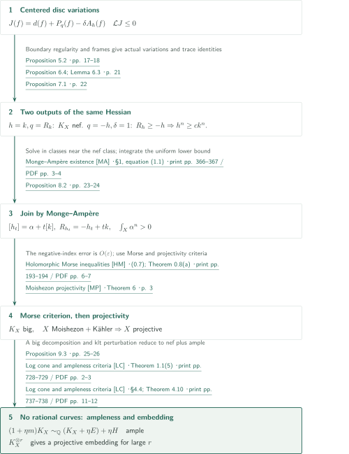
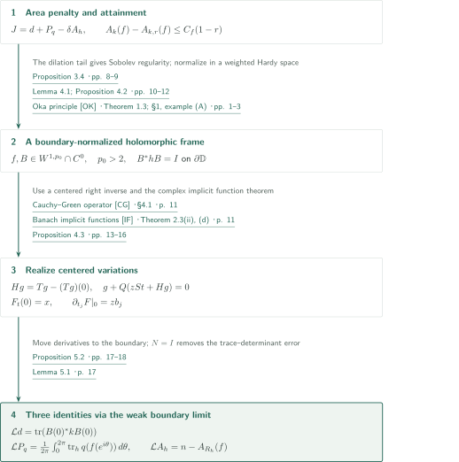
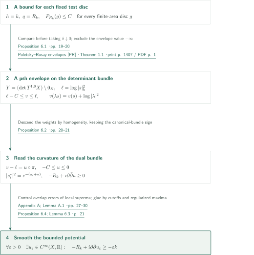
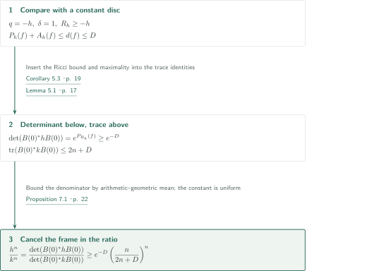
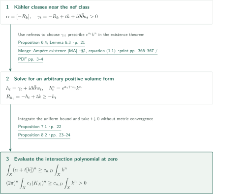
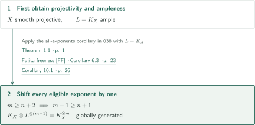
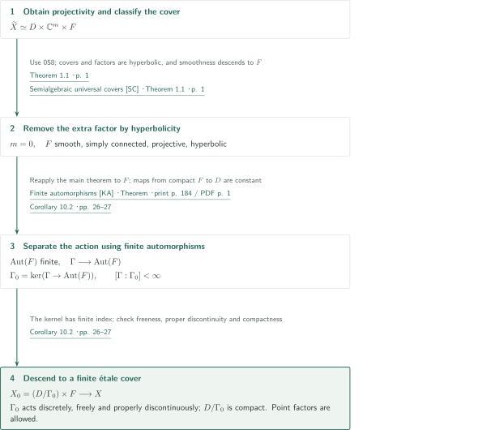

# Canonical ampleness of compact hyperbolic Kähler manifolds

**From boundary-regular disc variations to canonical ampleness**

The manuscript constructs extremal discs from the derivative bound supplied by compact hyperbolicity. Two uses of the same Hessian identity yield nefness and positive canonical volume. Projectivity is obtained before the final algebraic argument. This account follows the authors’ argument and distinguishes checking the statements and uses of inputs from independently verifying complete proofs.

## 1. Main results

### Theorem 1.1 — Canonical ampleness

Let $X$ be a compact connected Kähler manifold of complex dimension $n\ge1$. If every holomorphic map $\mathbb C\to X$ is constant, then $K_X$ is ample. In particular, the global sections of a positive tensor power $K_X^{\otimes m}$ define a holomorphic embedding of $X$ into a complex projective space.

<!-- cite:main -->[Theorem 1.1 · p. 1](https://github.com/openai/math/blob/fd4aeeb2ee4fc729c18d98444fed42fd0529eeeb/preprints/Canonical-ampleness-of-compact-hyperbolic-Kahler-manifolds-September-23-2026/canonical-ampleness.pdf)<!-- /cite -->

### Corollary 10.1 — All pluricanonical exponents

Let $X$ be a compact connected Brody-hyperbolic Kähler manifold of complex dimension $n\ge1$. For every integer $m\ge n+2$, the bundle $K_X^{\otimes m}$ is globally generated.

<!-- cite:powers -->[Corollary 10.1 · p. 26](https://github.com/openai/math/blob/fd4aeeb2ee4fc729c18d98444fed42fd0529eeeb/preprints/Canonical-ampleness-of-compact-hyperbolic-Kahler-manifolds-September-23-2026/canonical-ampleness.pdf)<!-- /cite -->

### Corollary 10.2 — A product after a finite cover

Let $X$ be a compact connected Brody-hyperbolic Kähler manifold of positive complex dimension. Assume that its ordinary universal cover is biholomorphic to a semialgebraic open subset of a complex projective variety, with openness in the ordinary complex topology. Then $X$ admits a connected finite étale cover biholomorphic to

$$ (D/\Gamma_0)\times F. $$

Here $D$ is a bounded symmetric domain, $\Gamma_0$ is a discrete group of biholomorphisms acting freely, properly discontinuously and cocompactly on $D$, and $F$ is a simply connected compact Brody-hyperbolic projective manifold. Either $D$ or $F$ may be a point.

<!-- cite:cover -->[Corollary 10.2 · pp. 26–27](https://github.com/openai/math/blob/fd4aeeb2ee4fc729c18d98444fed42fd0529eeeb/preprints/Canonical-ampleness-of-compact-hyperbolic-Kahler-manifolds-September-23-2026/canonical-ampleness.pdf)<!-- /cite -->

## References on the arrows

<!-- reference-guide -->
Unprefixed theorem, lemma, section and equation numbers refer to [Canonical ampleness](https://github.com/openai/math/blob/fd4aeeb2ee4fc729c18d98444fed42fd0529eeeb/preprints/Canonical-ampleness-of-compact-hyperbolic-Kahler-manifolds-September-23-2026/canonical-ampleness.pdf). External inputs use the following keys.

- [PR](https://users.fmf.uni-lj.si/forstneric/papers/2012Indiana.pdf) Barbara Drinovec Drnovšek; Franc Forstnerič — *Poletsky–Rosay envelopes*: Plurisubharmonicity of the envelope on the punctured determinant bundle, used in Proposition 6.2. Indiana Univ. Math. J. 61 (2012), 1407–1423; published version.
- [MA](https://research.chalmers.se/publication/509847/file/509847_Fulltext.pdf) Robert J. Berman — *Monge–Ampère existence*: Aubin–Yau existence in the stated arbitrary-volume-form setting; Theorem 8.1 and Proposition 8.2. Math. Z. 291 (2019), 365–394; repository copy with cover sheet.
- [HM](https://numdam.org/item/10.5802/aif.1034.pdf) Jean-Pierre Demailly — *Holomorphic Morse inequalities*: Section growth and the Moishezon criterion in Lemma 9.1. Ann. Inst. Fourier 35(4) (1985), 189–229; Numdam scan with cover sheet.
- [MP](https://arxiv.org/pdf/math/0101019v6) Yoshinori Namikawa — *Moishezon projectivity*: Projectivity of the smooth Kähler Moishezon manifold, used in Theorem 9.2. arXiv:math/0101019v6, 2001-11-12.
- [DT](https://arxiv.org/pdf/1606.01381v2) Simone Diverio; Stefano Trapani — *Canonical ampleness criterion*: A comparison statement for Proposition 9.3, which the manuscript proves through the cone theorem; the curvature main theorem is not an input. arXiv:1606.01381v2 (margin: 2016-08-04; manuscript date: 2019-04-19); author version.
- [LC](https://ems.press/content/serial-article-files/41145) Osamu Fujino — *Log cone and ampleness criteria*: The klt perturbation, rational curve, and nef-plus-ample steps of Proposition 9.3. Publ. RIMS 47 (2011), 727–789; published version.
- [FF](https://github.com/openai/math/blob/fd4aeeb2ee4fc729c18d98444fed42fd0529eeeb/preprints/Fujitas-freeness-conjecture-September-23-2026/Fujitas-freeness-conjecture-September-23-2026.pdf) OpenAI — *Fujita freeness*: Input only to Corollary 10.1, with L=K_X and exponent m−1. 2026-09-23; fixed catalogue 038 manuscript.
- [SC](https://github.com/openai/math/blob/fd4aeeb2ee4fc729c18d98444fed42fd0529eeeb/preprints/Semialgebraic-universal-covers-of-normal-projective-varieties-September-24-2026/paper.pdf) OpenAI — *Semialgebraic universal covers*: Input only to Corollary 10.2: product classification of the ordinary universal cover. 2026-09-24; fixed catalogue 058 manuscript.
- [KA](https://www.jstage.jst.go.jp/article/tmj1949/11/2/11_2_184/_pdf) Shoshichi Kobayashi — *Finite automorphisms*: Finiteness of Aut(F) from ample K_F in Corollary 10.2. Tohoku Math. J. (2) 11 (1959), 184–190; published version.
- [CG](https://arxiv.org/pdf/1411.3989v4) Alexandre Sukhov; Alexander Tumanov — *Cauchy–Green operator*: The L^p→W^{1,p} right inverse used in Lemma 4.1 and Proposition 4.3. arXiv:1411.3989v4, 2016-04-05.
- [IF](https://arxiv.org/pdf/math/0303320v1) Helge Glöckner — *Banach implicit functions*: Construction of the centered holomorphic family in Proposition 4.3. arXiv:math/0303320v1, 2003-03-25.
- [OK](https://arxiv.org/pdf/math/0305238v1) Franc Forstnerič; Jasna Prezelj — *Oka principle*: The holomorphic frame over a Stein disc in Lemma 4.1, via its GL_n(C) frame bundle. arXiv:math/0305238v1, 2003-05-16; first page unnumbered.

Each citation gives the result and pages. When printed pagination differs from the PDF position, both are shown. GitHub previews do not automatically jump to the cited page.
<!-- /reference-guide -->

## 2. Theorem 1.1 — Proof overview of the main theorem

<!-- proof-target:1 -->Proof target：[Theorem 1.1 · p. 1](https://github.com/openai/math/blob/fd4aeeb2ee4fc729c18d98444fed42fd0529eeeb/preprints/Canonical-ampleness-of-compact-hyperbolic-Kahler-manifolds-September-23-2026/canonical-ampleness.pdf)<!-- /proof-target -->

**Proof route.** The [Hessian identity](#proof-1) branches into [nefness](#proof-2) and a [volume bound](#proof-3), which meet at [positive top intersection](#proof-4). Bigness, projectivity and ampleness follow in that order. The external inputs to the two corollaries do not enter this proof.

Fix a background Kähler metric $k$ and set $R_h=-i\partial\bar\partial\log\det h$ and $d(f)=|f'(0)|_k^2$. On the disc $\mathbb D$, use

$$ A_q(f)=\frac1\pi\int_{\mathbb D}q(f',f')\,dS,\qquad P_q(f)=\frac2\pi\int_{\mathbb D}\log\frac1{|z|}\,q(f',f')\,dS. $$

Thus $[-R_k]=2\pi c_1(K_X)$. Write $D>0$ for the uniform bound on the central derivative of every holomorphic disc. This $D$ is unrelated to the domain in Corollary 10.2.

<!-- cite:conventions -->[§2; Lemma 2.1 · pp. 4–5](https://github.com/openai/math/blob/fd4aeeb2ee4fc729c18d98444fed42fd0529eeeb/preprints/Canonical-ampleness-of-compact-hyperbolic-Kahler-manifolds-September-23-2026/canonical-ampleness.pdf)<!-- /cite -->

### 1. Two uses of the same variation

Maximize $J=d+P_q-\delta A_h$ among finite-area discs with a fixed center. The area penalty gives attainment, and comparison with dilations supplies boundary regularity. Compute the Hessian along centered variations in a boundary-$h$-orthonormal holomorphic frame. The choice $h=k,q=R_k,\delta\downarrow0$ bounds the Ricci integral of every test disc; $q=-h,\delta=1$ gives a lower volume bound under $R_h\ge-h$.

<!-- cite:disc -->[Proposition 3.2; Lemma 3.3 · pp. 6–8](https://github.com/openai/math/blob/fd4aeeb2ee4fc729c18d98444fed42fd0529eeeb/preprints/Canonical-ampleness-of-compact-hyperbolic-Kahler-manifolds-September-23-2026/canonical-ampleness.pdf)<!-- /cite --> · <!-- cite:trace -->[Proposition 5.2 · pp. 17–18](https://github.com/openai/math/blob/fd4aeeb2ee4fc729c18d98444fed42fd0529eeeb/preprints/Canonical-ampleness-of-compact-hyperbolic-Kahler-manifolds-September-23-2026/canonical-ampleness.pdf)<!-- /cite --> · <!-- cite:nef -->[Proposition 6.4; Lemma 6.3 · p. 21](https://github.com/openai/math/blob/fd4aeeb2ee4fc729c18d98444fed42fd0529eeeb/preprints/Canonical-ampleness-of-compact-hyperbolic-Kahler-manifolds-September-23-2026/canonical-ampleness.pdf)<!-- /cite --> · <!-- cite:volume -->[Proposition 7.1 · p. 22](https://github.com/openai/math/blob/fd4aeeb2ee4fc729c18d98444fed42fd0529eeeb/preprints/Canonical-ampleness-of-compact-hyperbolic-Kahler-manifolds-September-23-2026/canonical-ampleness.pdf)<!-- /cite -->

### 2. Feed the nef class into the volume estimate

Put $\alpha=2\pi c_1(K_X)$. Nefness makes $\alpha+t[k]$ a Kähler class for $t>0$. The negative-sign Monge–Ampère equation supplies $[h_t]=\alpha+t[k]$ with $R_{h_t}=-h_t+tk$. Integrate the uniform lower bound and let $t\downarrow0$ in cohomology to obtain $\int_Xc_1(K_X)^n>0$.

<!-- cite:ma-input -->[Monge–Ampère existence &#91;MA&#93; · §1, equation (1.1) · print pp. 366–367 / PDF pp. 3–4](https://research.chalmers.se/publication/509847/file/509847_Fulltext.pdf#page=3)<!-- /cite --> · <!-- cite:intersection -->[Proposition 8.2 · pp. 23–24](https://github.com/openai/math/blob/fd4aeeb2ee4fc729c18d98444fed42fd0529eeeb/preprints/Canonical-ampleness-of-compact-hyperbolic-Kahler-manifolds-September-23-2026/canonical-ampleness.pdf)<!-- /cite -->

### 3. Prepare the Morse criterion and obtain projectivity

For a nef line bundle $L$, put $\beta=2\pi c_1(L)$ and choose $\Theta_\varepsilon\ge-\varepsilon k$. On the locus with a negative eigenvalue,

$$ |\Theta_\varepsilon^n|\le n\varepsilon(\Theta_\varepsilon+2\varepsilon k)^{n-1}\wedge k. $$

The integral on the right is $O(\varepsilon)$ by cohomology. If $\int_X\beta^n>0$, the integral on the nondegenerate locus of index at most one is positive as well. The Morse inequalities make $L$ big and $X$ Moishezon. Apply this with $L=K_X$, then use Namikawa’s projectivity theorem with the retained Kähler and smoothness assumptions. Projectivity was not an initial hypothesis.

<!-- cite:big -->[Lemma 9.1 · pp. 24–25](https://github.com/openai/math/blob/fd4aeeb2ee4fc729c18d98444fed42fd0529eeeb/preprints/Canonical-ampleness-of-compact-hyperbolic-Kahler-manifolds-September-23-2026/canonical-ampleness.pdf)<!-- /cite --> · <!-- cite:morse-input -->[Holomorphic Morse inequalities &#91;HM&#93; · (0.7); Theorem 0.8(a) · print pp. 193–194 / PDF pp. 6–7](https://numdam.org/item/10.5802/aif.1034.pdf#page=6)<!-- /cite --> · <!-- cite:projectivity -->[Theorem 9.2 · p. 25](https://github.com/openai/math/blob/fd4aeeb2ee4fc729c18d98444fed42fd0529eeeb/preprints/Canonical-ampleness-of-compact-hyperbolic-Kahler-manifolds-September-23-2026/canonical-ampleness.pdf)<!-- /cite --> · <!-- cite:projective-input -->[Moishezon projectivity &#91;MP&#93; · Theorem 6 · p. 3](https://arxiv.org/pdf/math/0101019v6#page=3)<!-- /cite -->

### 4. From absence of rational curves to ampleness and an embedding

A nonconstant map $\mathbb P^1\to X$ would contradict hyperbolicity after restriction to $\mathbb C$. Now $X$ is smooth and projective and $K_X$ is big, so the hypotheses of the criterion recorded by Diverio–Trapani hold. Proposition 9.3 proves that criterion again through the cone theorem as follows.

Choose a smooth very ample hyperplane section $H$. Compare the growth of sections from bigness with the $O(m^{n-1})$ bound on $H$ from the weak Morse inequality, using the restriction exact sequence. This yields $mK_X\sim H+E$ for some $m>0$ and effective $E$.

<!-- cite:morse-growth -->[Holomorphic Morse inequalities &#91;HM&#93; · Theorem 0.1(a) · print p. 189 / PDF p. 2](https://numdam.org/item/10.5802/aif.1034.pdf#page=2)<!-- /cite -->

Choose a sufficiently small positive rational $\eta$ so that $(X,\eta E)$ is klt. Absence of rational curves and the log cone theorem make $N=K_X+\eta E$ nef. Hence

$$ (1+\eta m)K_X\sim_{\mathbb Q}N+\eta H $$

is ample. Clearing the positive rational coefficient makes $K_X$ itself ample, and a sufficiently high positive tensor power gives the projective embedding.

<!-- cite:ample -->[Proposition 9.3 · pp. 25–26](https://github.com/openai/math/blob/fd4aeeb2ee4fc729c18d98444fed42fd0529eeeb/preprints/Canonical-ampleness-of-compact-hyperbolic-Kahler-manifolds-September-23-2026/canonical-ampleness.pdf)<!-- /cite --> · <!-- cite:ample-input -->[Canonical ampleness criterion &#91;DT&#93; · Lemma 2.1 · p. 3](https://arxiv.org/pdf/1606.01381v2#page=3)<!-- /cite --> · <!-- cite:cone-input -->[Log cone and ampleness criteria &#91;LC&#93; · Theorem 1.1(5) · print pp. 728–729 / PDF pp. 2–3](https://ems.press/content/serial-article-files/41145)<!-- /cite --> · <!-- cite:kleiman-input -->[Log cone and ampleness criteria &#91;LC&#93; · §4.4; Theorem 4.10 · print pp. 737–738 / PDF pp. 11–12](https://ems.press/content/serial-article-files/41145)<!-- /cite --> · <!-- cite:completion -->[§9; completion of Theorem 1.1 · pp. 24–26](https://github.com/openai/math/blob/fd4aeeb2ee4fc729c18d98444fed42fd0529eeeb/preprints/Canonical-ampleness-of-compact-hyperbolic-Kahler-manifolds-September-23-2026/canonical-ampleness.pdf)<!-- /cite -->

## 3. Proposition 5.2 — Boundary normalization and the Hessian

<!-- proof-target:2 -->Proof target：[Proposition 5.2 · pp. 17–18](https://github.com/openai/math/blob/fd4aeeb2ee4fc729c18d98444fed42fd0529eeeb/preprints/Canonical-ampleness-of-compact-hyperbolic-Kahler-manifolds-September-23-2026/canonical-ampleness.pdf)<!-- /proof-target -->

<!-- statement:proposition-5-2 -->
### Proposition 5.2 — Three trace identities

Use $X,k$ as above and a Kähler metric $h$. The disc $f$ and holomorphic frame $B=(b_1,\ldots,b_n)$ are continuous and $W^{1,p_0}$ on the closed disc, with $p_0>2$; $B$ is everywhere nonsingular and satisfies $B^*hB=I$ on the boundary. The centered holomorphic family $F_t$ satisfies $F_0=f$, $F_t(0)=x=f(0)$ and $\partial_{t_j}F|_0=zb_j$, and depends holomorphically on the parameters with values in local $W^{1,p_0}$ coordinates. Put $\mathcal L=\sum_j\partial_{t_j}\partial_{\bar t_j}|_0$. For every smooth closed real $(1,1)$-form $q$,

$$ \mathcal Ld=\operatorname{tr}(B(0)^*k(x)B(0)),\quad \mathcal LP_q=\frac1{2\pi}\int_0^{2\pi}\operatorname{tr}_h q(f(e^{i\theta}))\,d\theta,\quad \mathcal LA_h=n-A_{R_h}(f). $$

<!-- cite:trace -->[Proposition 5.2 · pp. 17–18](https://github.com/openai/math/blob/fd4aeeb2ee4fc729c18d98444fed42fd0529eeeb/preprints/Canonical-ampleness-of-compact-hyperbolic-Kahler-manifolds-September-23-2026/canonical-ampleness.pdf)<!-- /cite -->

<!-- /statement -->

### 1. Area penalty and the boundary tail

Lemma 3.1 carries out Brody reparametrization to bound the central derivative. On an outer annulus, $-\delta A_h$ dominates the logarithmic term; Fatou’s lemma and normal convergence in the interior give attainment. Comparing with $f(rz)$ yields $A_q(f)\ge-d(f)$ and $A_k(f)-A_{k,r}(f)\le C_f(1-r)$. Local mean-value estimates and summation over dyadic annuli give continuity up to the boundary and $W^{1,p}$ regularity for $2<p<4$. No uniformity of $C_f$ over all metrics is asserted.

<!-- cite:disc -->[Proposition 3.2; Lemma 3.3 · pp. 6–8](https://github.com/openai/math/blob/fd4aeeb2ee4fc729c18d98444fed42fd0529eeeb/preprints/Canonical-ampleness-of-compact-hyperbolic-Kahler-manifolds-September-23-2026/canonical-ampleness.pdf)<!-- /cite --> · <!-- cite:regularity -->[Proposition 3.4 · pp. 8–9](https://github.com/openai/math/blob/fd4aeeb2ee4fc729c18d98444fed42fd0529eeeb/preprints/Canonical-ampleness-of-compact-hyperbolic-Kahler-manifolds-September-23-2026/canonical-ampleness.pdf)<!-- /cite -->

### 2. Realize the directions by genuine disc families

Lemma 4.1 uses the Cauchy–Green right inverse and the Oka principle to trivialize a holomorphic bundle over a slightly larger disc. Proposition 4.2 normalizes the frame in a weighted Hardy space; rotation-difference estimates for a Toeplitz operator then supply boundary $W^{1,p_0}$ regularity and nonsingularity. Proposition 4.3 subtracts the central value from the right inverse, $Hg=Tg-(Tg)(0)$, and applies the complex Banach implicit function theorem to

$$ g+Q(zSt+Hg)=0,\qquad Q(0)=DQ(0)=0. $$

This preserves both the center and the prescribed first variation. The background on spectral factorization is not treated as automatically supplying the required boundary regularity.

<!-- cite:frame -->[Lemma 4.1; Proposition 4.2 · pp. 10–12](https://github.com/openai/math/blob/fd4aeeb2ee4fc729c18d98444fed42fd0529eeeb/preprints/Canonical-ampleness-of-compact-hyperbolic-Kahler-manifolds-September-23-2026/canonical-ampleness.pdf)<!-- /cite --> · <!-- cite:variation -->[Proposition 4.3 · pp. 13–16](https://github.com/openai/math/blob/fd4aeeb2ee4fc729c18d98444fed42fd0529eeeb/preprints/Canonical-ampleness-of-compact-hyperbolic-Kahler-manifolds-September-23-2026/canonical-ampleness.pdf)<!-- /cite --> · <!-- cite:cauchy-input -->[Cauchy–Green operator &#91;CG&#93; · §4.1 · p. 11](https://arxiv.org/pdf/1411.3989v4#page=11)<!-- /cite --> · <!-- cite:oka-input -->[Oka principle &#91;OK&#93; · Theorem 1.3; §1, example (A) · pp. 1–3](https://arxiv.org/pdf/math/0305238v1#page=1)<!-- /cite --> · <!-- cite:implicit-input -->[Banach implicit functions &#91;IF&#93; · Theorem 2.3(ii), (d) · p. 11](https://arxiv.org/pdf/math/0303320v1#page=11)<!-- /cite -->

### 3. Pass through the weak boundary limit

The inequality $p_0/2>1$ justifies parameter differentiation of the area and Poisson integrals. Closedness gives the local identity $\mathcal Lq(F_z,F_z)=\partial_z\partial_{\bar z}(|z|^2\operatorname{tr}(B^*qB))$. For $N=B^*hB$, the boundary value $N=I$ allows replacement of $\partial_r\operatorname{tr}N$ by $\partial_r\log\det N$ along suitable radii. The error vanishes by a radial $W^{1,2}$ estimate. Green’s formula gives the three identities and $\log\det N(0)=P_{R_h}(f)$; maximality then gives $\mathcal LJ\le0$. No holomorphic extension across the boundary is used.

<!-- cite:trace -->[Proposition 5.2 · pp. 17–18](https://github.com/openai/math/blob/fd4aeeb2ee4fc729c18d98444fed42fd0529eeeb/preprints/Canonical-ampleness-of-compact-hyperbolic-Kahler-manifolds-September-23-2026/canonical-ampleness.pdf)<!-- /cite --> · <!-- cite:determinant -->[Lemma 5.1 · p. 17](https://github.com/openai/math/blob/fd4aeeb2ee4fc729c18d98444fed42fd0529eeeb/preprints/Canonical-ampleness-of-compact-hyperbolic-Kahler-manifolds-September-23-2026/canonical-ampleness.pdf)<!-- /cite --> · <!-- cite:maximum -->[Corollary 5.3 · p. 19](https://github.com/openai/math/blob/fd4aeeb2ee4fc729c18d98444fed42fd0529eeeb/preprints/Canonical-ampleness-of-compact-hyperbolic-Kahler-manifolds-September-23-2026/canonical-ampleness.pdf)<!-- /cite -->

## 4. Proposition 6.4 — Nefness of the canonical class

<!-- proof-target:3 -->Proof target：[Proposition 6.4; Lemma 6.3 · p. 21](https://github.com/openai/math/blob/fd4aeeb2ee4fc729c18d98444fed42fd0529eeeb/preprints/Canonical-ampleness-of-compact-hyperbolic-Kahler-manifolds-September-23-2026/canonical-ampleness.pdf)<!-- /proof-target -->

<!-- statement:proposition-6-4 -->
### Proposition 6.4 — Arbitrarily small negative curvature error

Under the hypotheses of Theorem 1.1 and for the fixed Kähler metric $k$, for every $\varepsilon>0$ there is a smooth real function $u_\varepsilon$ satisfying

$$ -R_k+i\partial\bar\partial u_\varepsilon\ge-\varepsilon k. $$

Consequently $2\pi c_1(K_X)$ is nef.

<!-- cite:nef -->[Proposition 6.4; Lemma 6.3 · p. 21](https://github.com/openai/math/blob/fd4aeeb2ee4fc729c18d98444fed42fd0529eeeb/preprints/Canonical-ampleness-of-compact-hyperbolic-Kahler-manifolds-September-23-2026/canonical-ampleness.pdf)<!-- /cite -->

<!-- /statement -->

### 1. From maximizers to every test disc

Take $h=k,q=R_k$ and maximize for $0<\delta\le1$. Corollary 5.3 and $A_{R_k}(f)\ge-D$ imply $\operatorname{tr}N(0)\le n+D+M$, where $M=\sup_X|\operatorname{tr}_kR_k|$. The determinant identity and arithmetic–geometric mean bound $P_{R_k}(f)$ uniformly from above. Fix an arbitrary finite-area disc $g$, compare it with the maximum, and only then let $\delta\downarrow0$. This gives $P_{R_k}(g)\le C$ without a uniform area bound on the maximizing discs in this limit.

<!-- cite:ricci-bound -->[Proposition 6.1 · pp. 19–20](https://github.com/openai/math/blob/fd4aeeb2ee4fc729c18d98444fed42fd0529eeeb/preprints/Canonical-ampleness-of-compact-hyperbolic-Kahler-manifolds-September-23-2026/canonical-ampleness.pdf)<!-- /cite --> · <!-- cite:maximum -->[Corollary 5.3 · p. 19](https://github.com/openai/math/blob/fd4aeeb2ee4fc729c18d98444fed42fd0529eeeb/preprints/Canonical-ampleness-of-compact-hyperbolic-Kahler-manifolds-September-23-2026/canonical-ampleness.pdf)<!-- /cite -->

### 2. Turn envelope homogeneity into a canonical metric

On $Y=(\det T^{1,0}X)\setminus0_X$, put $\ell(s)=\log|s|_k^2$ and let $v$ be its Poisson envelope. The preceding estimate on projected discs gives $\ell-C\le v\le\ell$, excluding the identically $-\infty$ alternative in the Poletsky–Rosay theorem. Homogeneity $v(\lambda s)=v(s)+\log|\lambda|^2$ gives $v-\ell=u\circ\pi$ with $-C\le u\le0$. For local frames $s_i$ and $a_i=\log|s_i|_k^2$, the weights $a_i+u$ are bounded and psh. Setting $|s_i^*|^2=e^{-(a_i+u)}$ on the dual frames yields curvature $-R_k+i\partial\bar\partial u\ge0$ on $K_X$.

<!-- cite:potentials -->[Proposition 6.2 · pp. 20–21](https://github.com/openai/math/blob/fd4aeeb2ee4fc729c18d98444fed42fd0529eeeb/preprints/Canonical-ampleness-of-compact-hyperbolic-Kahler-manifolds-September-23-2026/canonical-ampleness.pdf)<!-- /cite --> · <!-- cite:pr-input -->[Poletsky–Rosay envelopes &#91;PR&#93; · Theorem 1.1 · print p. 1407 / PDF p. 1](https://users.fmf.uni-lj.si/forstneric/papers/2012Indiana.pdf#page=1)<!-- /cite -->

### 3. Smooth without assuming continuity

Lemma 6.3 supplies smoothing of the bounded potential. Appendix A compares local suprema of psh potentials at fixed multiples of a radius, bounding overlap errors by $O(1/|\log b|)+O(b)$. Choose a radius making this error small and glue by a regularized maximum after cutoff corrections. The curvature loss can be made arbitrarily small. Applying this to Proposition 6.2 proves the claim. The alternative citation to Demailly’s regularization theorem mentioned in the manuscript is not additionally checked here.

<!-- cite:nef -->[Proposition 6.4; Lemma 6.3 · p. 21](https://github.com/openai/math/blob/fd4aeeb2ee4fc729c18d98444fed42fd0529eeeb/preprints/Canonical-ampleness-of-compact-hyperbolic-Kahler-manifolds-September-23-2026/canonical-ampleness.pdf)<!-- /cite --> · <!-- cite:smoothing -->[Appendix A; Lemma A.1 · pp. 27–30](https://github.com/openai/math/blob/fd4aeeb2ee4fc729c18d98444fed42fd0529eeeb/preprints/Canonical-ampleness-of-compact-hyperbolic-Kahler-manifolds-September-23-2026/canonical-ampleness.pdf)<!-- /cite -->

## 5. Proposition 7.1 — A uniform volume lower bound

<!-- proof-target:4 -->Proof target：[Proposition 7.1 · p. 22](https://github.com/openai/math/blob/fd4aeeb2ee4fc729c18d98444fed42fd0529eeeb/preprints/Canonical-ampleness-of-compact-hyperbolic-Kahler-manifolds-September-23-2026/canonical-ampleness.pdf)<!-- /proof-target -->

<!-- statement:proposition-7-1 -->
### Proposition 7.1 — A constant common to all eligible metrics

Under the hypotheses of Theorem 1.1, fix $k$ and let $D$ be the derivative bound of Lemma 3.1. Every smooth Kähler form $h$ satisfying $R_h\ge-h$ obeys

$$ h^n\ge c_{n,D}k^n,\qquad c_{n,D}=e^{-D}\left(\frac n{2n+D}\right)^n>0. $$

<!-- cite:volume -->[Proposition 7.1 · p. 22](https://github.com/openai/math/blob/fd4aeeb2ee4fc729c18d98444fed42fd0529eeeb/preprints/Canonical-ampleness-of-compact-hyperbolic-Kahler-manifolds-September-23-2026/canonical-ampleness.pdf)<!-- /cite -->

<!-- /statement -->

### 1. Compare with the constant disc

At each point choose a maximizer with $q=-h,\delta=1$. Comparison with the constant disc, whose value is zero, gives $P_h(f)+A_h(f)\le d(f)\le D$. The curvature hypothesis implies $P_{R_h}(f),A_{R_h}(f)\ge-D$. Insert $\operatorname{tr}_h(-h)=-n$ into the maximizing inequality to obtain $\operatorname{tr}(B(0)^*kB(0))\le2n+D$.

<!-- cite:volume -->[Proposition 7.1 · p. 22](https://github.com/openai/math/blob/fd4aeeb2ee4fc729c18d98444fed42fd0529eeeb/preprints/Canonical-ampleness-of-compact-hyperbolic-Kahler-manifolds-September-23-2026/canonical-ampleness.pdf)<!-- /cite --> · <!-- cite:maximum -->[Corollary 5.3 · p. 19](https://github.com/openai/math/blob/fd4aeeb2ee4fc729c18d98444fed42fd0529eeeb/preprints/Canonical-ampleness-of-compact-hyperbolic-Kahler-manifolds-September-23-2026/canonical-ampleness.pdf)<!-- /cite -->

### 2. Cancel the frame determinant

Lemma 5.1 gives $\det(B(0)^*hB(0))=e^{P_{R_h}(f)}\ge e^{-D}$. The preceding trace bound controls the denominator determinant by arithmetic–geometric mean. Taking their ratio cancels $|\det B(0)|^2$ and gives

$$ \frac{h^n}{k^n}=\frac{\det(B(0)^*hB(0))}{\det(B(0)^*kB(0))}\ge e^{-D}\left(\frac n{2n+D}\right)^n. $$

The auxiliary disc, frame and size of the variation may depend on $h$ and the point. None appears in the final constant.

<!-- cite:determinant -->[Lemma 5.1 · p. 17](https://github.com/openai/math/blob/fd4aeeb2ee4fc729c18d98444fed42fd0529eeeb/preprints/Canonical-ampleness-of-compact-hyperbolic-Kahler-manifolds-September-23-2026/canonical-ampleness.pdf)<!-- /cite --> · <!-- cite:volume -->[Proposition 7.1 · p. 22](https://github.com/openai/math/blob/fd4aeeb2ee4fc729c18d98444fed42fd0529eeeb/preprints/Canonical-ampleness-of-compact-hyperbolic-Kahler-manifolds-September-23-2026/canonical-ampleness.pdf)<!-- /cite -->

## 6. Proposition 8.2 — Positive top self-intersection

<!-- proof-target:5 -->Proof target：[Proposition 8.2 · pp. 23–24](https://github.com/openai/math/blob/fd4aeeb2ee4fc729c18d98444fed42fd0529eeeb/preprints/Canonical-ampleness-of-compact-hyperbolic-Kahler-manifolds-September-23-2026/canonical-ampleness.pdf)<!-- /proof-target -->

<!-- statement:proposition-8-2 -->
### Proposition 8.2 — Positive canonical volume

Under the hypotheses of Theorem 1.1, let $X$ be a compact connected Kähler manifold of positive dimension $n$ with no nonconstant holomorphic map $\mathbb C\to X$. Then

$$ \int_Xc_1(K_X)^n>0. $$

<!-- cite:intersection -->[Proposition 8.2 · pp. 23–24](https://github.com/openai/math/blob/fd4aeeb2ee4fc729c18d98444fed42fd0529eeeb/preprints/Canonical-ampleness-of-compact-hyperbolic-Kahler-manifolds-September-23-2026/canonical-ampleness.pdf)<!-- /cite -->

<!-- /statement -->

### 1. Existence for an arbitrary positive volume form

Put $\alpha=[-R_k]$ and use nefness to choose $-R_k+i\partial\bar\partial a_t\ge-(t/2)k$. Apply Theorem 8.1 to $\gamma_t=-R_k+tk+i\partial\bar\partial a_t>0$ to obtain

$$ h_t=\gamma_t+i\partial\bar\partial w_t>0,\qquad h_t^n=e^{a_t+w_t}k^n. $$

The prescribed volume form is $e^{a_t}k^n$; no prior normalization of its total volume is needed because the additive constant of the solution enters the right-hand side. Logarithmic differentiation gives $R_{h_t}=-h_t+tk\ge-h_t$.

<!-- cite:ma-self -->[Theorem 8.1 · p. 23](https://github.com/openai/math/blob/fd4aeeb2ee4fc729c18d98444fed42fd0529eeeb/preprints/Canonical-ampleness-of-compact-hyperbolic-Kahler-manifolds-September-23-2026/canonical-ampleness.pdf)<!-- /cite --> · <!-- cite:ma-input -->[Monge–Ampère existence &#91;MA&#93; · §1, equation (1.1) · print pp. 366–367 / PDF pp. 3–4](https://research.chalmers.se/publication/509847/file/509847_Fulltext.pdf#page=3)<!-- /cite --> · <!-- cite:intersection -->[Proposition 8.2 · pp. 23–24](https://github.com/openai/math/blob/fd4aeeb2ee4fc729c18d98444fed42fd0529eeeb/preprints/Canonical-ampleness-of-compact-hyperbolic-Kahler-manifolds-September-23-2026/canonical-ampleness.pdf)<!-- /cite -->

### 2. Take the limit of the intersection polynomial

Apply Proposition 7.1 with the same constant for every $t>0$. Since $[h_t]=\alpha+t[k]$,

$$ \int_X(\alpha+t[k])^n=\int_Xh_t^n\ge c_{n,D}\int_Xk^n>0. $$

The left-hand side is a polynomial in $t$. Evaluation at zero gives $(2\pi)^n\int_Xc_1(K_X)^n\ge c_{n,D}\int_Xk^n>0$. No convergence of $h_t$ or its potentials is assumed in this step.

<!-- cite:volume -->[Proposition 7.1 · p. 22](https://github.com/openai/math/blob/fd4aeeb2ee4fc729c18d98444fed42fd0529eeeb/preprints/Canonical-ampleness-of-compact-hyperbolic-Kahler-manifolds-September-23-2026/canonical-ampleness.pdf)<!-- /cite --> · <!-- cite:intersection -->[Proposition 8.2 · pp. 23–24](https://github.com/openai/math/blob/fd4aeeb2ee4fc729c18d98444fed42fd0529eeeb/preprints/Canonical-ampleness-of-compact-hyperbolic-Kahler-manifolds-September-23-2026/canonical-ampleness.pdf)<!-- /cite -->

## 7. Corollary 10.1 — All exponents from the freeness input in 038

<!-- proof-target:6 -->Proof target：[Corollary 10.1 · p. 26](https://github.com/openai/math/blob/fd4aeeb2ee4fc729c18d98444fed42fd0529eeeb/preprints/Canonical-ampleness-of-compact-hyperbolic-Kahler-manifolds-September-23-2026/canonical-ampleness.pdf)<!-- /proof-target -->

### 1. Meet the hypotheses of the input

Theorem 1.1 makes $X$ a smooth connected projective variety with $K_X$ ample. Hence the Fujita freeness input from catalogue 038 applies with $L=K_X$. This input is not used retroactively in the proof of the main theorem.

<!-- cite:main -->[Theorem 1.1 · p. 1](https://github.com/openai/math/blob/fd4aeeb2ee4fc729c18d98444fed42fd0529eeeb/preprints/Canonical-ampleness-of-compact-hyperbolic-Kahler-manifolds-September-23-2026/canonical-ampleness.pdf)<!-- /cite --> · <!-- cite:fujita-input -->[Fujita freeness &#91;FF&#93; · Corollary 6.3 · p. 23](https://github.com/openai/math/blob/fd4aeeb2ee4fc729c18d98444fed42fd0529eeeb/preprints/Fujitas-freeness-conjecture-September-23-2026/Fujitas-freeness-conjecture-September-23-2026.pdf)<!-- /cite -->

### 2. Preserve the quantifier over all integers

For every integer $m\ge n+2$, one has $m-1\ge n+1$. Corollary 6.3 of the input therefore makes

$$ K_X\otimes L^{\otimes(m-1)}=K_X^{\otimes m} $$

globally generated. The all-exponents corollary, rather than only the smallest-exponent main theorem, is the required input. The [article on 038](https://masataka123.github.io/OpenAI-Math-Digest/en/papers/fujita-freeness/#proof-3) describes that extension.

<!-- cite:powers -->[Corollary 10.1 · p. 26](https://github.com/openai/math/blob/fd4aeeb2ee4fc729c18d98444fed42fd0529eeeb/preprints/Canonical-ampleness-of-compact-hyperbolic-Kahler-manifolds-September-23-2026/canonical-ampleness.pdf)<!-- /cite --> · <!-- cite:fujita-input -->[Fujita freeness &#91;FF&#93; · Corollary 6.3 · p. 23](https://github.com/openai/math/blob/fd4aeeb2ee4fc729c18d98444fed42fd0529eeeb/preprints/Fujitas-freeness-conjecture-September-23-2026/Fujitas-freeness-conjecture-September-23-2026.pdf)<!-- /cite -->

## 8. Corollary 10.2 — From classification to a finite cover

<!-- proof-target:7 -->Proof target：[Corollary 10.2 · pp. 26–27](https://github.com/openai/math/blob/fd4aeeb2ee4fc729c18d98444fed42fd0529eeeb/preprints/Canonical-ampleness-of-compact-hyperbolic-Kahler-manifolds-September-23-2026/canonical-ampleness.pdf)<!-- /proof-target -->

### 1. Remove the extra factor in the classification

First use Theorem 1.1 to make $X$ projective, then apply Theorem 1.1 of 058 to its ordinary universal cover. The resulting decomposition is $\widetilde X\simeq D\times\mathbb C^m\times F$, with $F$ simply connected, normal and projective. Smoothness of the product forces $F$ to be smooth. Hyperbolicity passes to covers and factors, so $m=0$ and $F$ is Brody hyperbolic. The proof of the classification theorem itself is treated as an external input.

<!-- cite:cover -->[Corollary 10.2 · pp. 26–27](https://github.com/openai/math/blob/fd4aeeb2ee4fc729c18d98444fed42fd0529eeeb/preprints/Canonical-ampleness-of-compact-hyperbolic-Kahler-manifolds-September-23-2026/canonical-ampleness.pdf)<!-- /cite --> · <!-- cite:classification-input -->[Semialgebraic universal covers &#91;SC&#93; · Theorem 1.1 · p. 1](https://github.com/openai/math/blob/fd4aeeb2ee4fc729c18d98444fed42fd0529eeeb/preprints/Semialgebraic-universal-covers-of-normal-projective-varieties-September-24-2026/paper.pdf)<!-- /cite -->

### 2. Use finite automorphisms to obtain a product action

If $\dim F>0$, reapply Theorem 1.1 to $F$ to make $K_F$ ample. Thus $c_1(F)<0$, and Kobayashi’s theorem makes $\operatorname{Aut}(F)$ finite. Finiteness is immediate when $F$ is a point. The $D$-component of a deck transformation is constant on compact connected $F$; applying the same observation to the inverse gives an automorphism of the base. The remaining $F$-component is a family in a finite group over connected $D$, hence independent of the base. The argument includes the case where $D$ is a point.

<!-- cite:cover -->[Corollary 10.2 · pp. 26–27](https://github.com/openai/math/blob/fd4aeeb2ee4fc729c18d98444fed42fd0529eeeb/preprints/Canonical-ampleness-of-compact-hyperbolic-Kahler-manifolds-September-23-2026/canonical-ampleness.pdf)<!-- /cite --> · <!-- cite:finite-input -->[Finite automorphisms &#91;KA&#93; · Theorem · print p. 184 / PDF p. 1](https://www.jstage.jst.go.jp/article/tmj1949/11/2/11_2_184/_pdf)<!-- /cite -->

### 3. Check the action of the finite-index kernel

Let $\Gamma_0$ be the kernel of the homomorphism from the deck group $\Gamma$ to $\operatorname{Aut}(F)$. It has finite index and acts faithfully and freely on $D$. For compact $K\subset D$, the set $K\times F$ is compact, so proper discontinuity of the deck action descends to $D$, and $\Gamma_0$ is discrete. The quotient is $(D/\Gamma_0)\times F$. Its map to $X$ is a connected finite unramified cover, hence a finite étale cover of the projective variety. Compactness of this cover makes $D/\Gamma_0$ compact, proving cocompactness as well.

<!-- cite:cover -->[Corollary 10.2 · pp. 26–27](https://github.com/openai/math/blob/fd4aeeb2ee4fc729c18d98444fed42fd0529eeeb/preprints/Canonical-ampleness-of-compact-hyperbolic-Kahler-manifolds-September-23-2026/canonical-ampleness.pdf)<!-- /cite -->

## 9. Which papers supply which steps

Direct inputs split into those supporting the main analytic and positivity argument and those used only in its corollaries. Diverio–Trapani supplies a comparison statement: the manuscript proves Proposition 9.3 again through the cone theorem. The checks below concern statements and application hypotheses, not complete external proofs.

| Source | Use and role | Checking scope |
|---|---|---|
| Oka principle, Cauchy–Green operator, Banach implicit functions | Lemma 4.1 and Proposition 4.3: the frame bundle over a Stein disc, centered right inverse, invertible linearization | Specified results and the bundle/function-space hypotheses compared |
| Poletsky–Rosay envelopes | Proposition 6.2: a continuous weight on a connected manifold and exclusion of −∞ | Theorem 1.1 and the envelope bounds compared |
| Monge–Ampère existence | Proposition 8.2: a Kähler class and an arbitrary positive volume form | Existence statement at Berman’s equation (1.1) and the sign convention compared |
| Holomorphic Morse inequalities, Moishezon projectivity | Lemma 9.1 and Theorem 9.2: positive index integral, smooth Kähler space | Hypotheses and the positivity connection compared |
| Canonical ampleness criterion, Log cone and ampleness criteria | Proposition 9.3: projective, big, no rational curves, klt perturbation | Criterion, cone and Kleiman statements compared; original resolution theorem not checked |
| Fujita freeness (038) | Only Corollary 10.1: the condition on every integer exponent | Corollary 6.3 reread in the source; its proof not reverified |
| Semialgebraic universal covers (058), Finite automorphisms | Only Corollary 10.2: product classification and passage to finite index | Classification statement and hypotheses of the finiteness theorem compared |

<!-- cite:oka-input -->[Oka principle &#91;OK&#93; · Theorem 1.3; §1, example (A) · pp. 1–3](https://arxiv.org/pdf/math/0305238v1#page=1)<!-- /cite --> · <!-- cite:cauchy-input -->[Cauchy–Green operator &#91;CG&#93; · §4.1 · p. 11](https://arxiv.org/pdf/1411.3989v4#page=11)<!-- /cite --> · <!-- cite:implicit-input -->[Banach implicit functions &#91;IF&#93; · Theorem 2.3(ii), (d) · p. 11](https://arxiv.org/pdf/math/0303320v1#page=11)<!-- /cite --> · <!-- cite:pr-input -->[Poletsky–Rosay envelopes &#91;PR&#93; · Theorem 1.1 · print p. 1407 / PDF p. 1](https://users.fmf.uni-lj.si/forstneric/papers/2012Indiana.pdf#page=1)<!-- /cite --> · <!-- cite:ma-input -->[Monge–Ampère existence &#91;MA&#93; · §1, equation (1.1) · print pp. 366–367 / PDF pp. 3–4](https://research.chalmers.se/publication/509847/file/509847_Fulltext.pdf#page=3)<!-- /cite --> · <!-- cite:morse-input -->[Holomorphic Morse inequalities &#91;HM&#93; · (0.7); Theorem 0.8(a) · print pp. 193–194 / PDF pp. 6–7](https://numdam.org/item/10.5802/aif.1034.pdf#page=6)<!-- /cite --> · <!-- cite:projective-input -->[Moishezon projectivity &#91;MP&#93; · Theorem 6 · p. 3](https://arxiv.org/pdf/math/0101019v6#page=3)<!-- /cite --> · <!-- cite:ample-input -->[Canonical ampleness criterion &#91;DT&#93; · Lemma 2.1 · p. 3](https://arxiv.org/pdf/1606.01381v2#page=3)<!-- /cite --> · <!-- cite:cone-input -->[Log cone and ampleness criteria &#91;LC&#93; · Theorem 1.1(5) · print pp. 728–729 / PDF pp. 2–3](https://ems.press/content/serial-article-files/41145)<!-- /cite --> · <!-- cite:kleiman-input -->[Log cone and ampleness criteria &#91;LC&#93; · §4.4; Theorem 4.10 · print pp. 737–738 / PDF pp. 11–12](https://ems.press/content/serial-article-files/41145)<!-- /cite --> · <!-- cite:fujita-input -->[Fujita freeness &#91;FF&#93; · Corollary 6.3 · p. 23](https://github.com/openai/math/blob/fd4aeeb2ee4fc729c18d98444fed42fd0529eeeb/preprints/Fujitas-freeness-conjecture-September-23-2026/Fujitas-freeness-conjecture-September-23-2026.pdf)<!-- /cite --> · <!-- cite:classification-input -->[Semialgebraic universal covers &#91;SC&#93; · Theorem 1.1 · p. 1](https://github.com/openai/math/blob/fd4aeeb2ee4fc729c18d98444fed42fd0529eeeb/preprints/Semialgebraic-universal-covers-of-normal-projective-varieties-September-24-2026/paper.pdf)<!-- /cite --> · <!-- cite:finite-input -->[Finite automorphisms &#91;KA&#93; · Theorem · print p. 184 / PDF p. 1](https://www.jstage.jst.go.jp/article/tmj1949/11/2/11_2_184/_pdf)<!-- /cite -->

## 10. Return to the sources

<!-- reading-list -->
- [Proposition 3.2; Lemma 3.3 · pp. 6–8](https://github.com/openai/math/blob/fd4aeeb2ee4fc729c18d98444fed42fd0529eeeb/preprints/Canonical-ampleness-of-compact-hyperbolic-Kahler-manifolds-September-23-2026/canonical-ampleness.pdf) — Attainment and the boundary-area tail.
- [Lemma 4.1; Proposition 4.2 · pp. 10–12](https://github.com/openai/math/blob/fd4aeeb2ee4fc729c18d98444fed42fd0529eeeb/preprints/Canonical-ampleness-of-compact-hyperbolic-Kahler-manifolds-September-23-2026/canonical-ampleness.pdf) — Boundary normalization and regularity.
- [Proposition 4.3 · pp. 13–16](https://github.com/openai/math/blob/fd4aeeb2ee4fc729c18d98444fed42fd0529eeeb/preprints/Canonical-ampleness-of-compact-hyperbolic-Kahler-manifolds-September-23-2026/canonical-ampleness.pdf) — Realizing formal directions by holomorphic families.
- [Proposition 5.2 · pp. 17–18](https://github.com/openai/math/blob/fd4aeeb2ee4fc729c18d98444fed42fd0529eeeb/preprints/Canonical-ampleness-of-compact-hyperbolic-Kahler-manifolds-September-23-2026/canonical-ampleness.pdf) — Differentiation under the integrals and the weak boundary limit.
- [Proposition 6.2 · pp. 20–21](https://github.com/openai/math/blob/fd4aeeb2ee4fc729c18d98444fed42fd0529eeeb/preprints/Canonical-ampleness-of-compact-hyperbolic-Kahler-manifolds-September-23-2026/canonical-ampleness.pdf) — The determinant-bundle envelope and the canonical-bundle sign.
- [Appendix A; Lemma A.1 · pp. 27–30](https://github.com/openai/math/blob/fd4aeeb2ee4fc729c18d98444fed42fd0529eeeb/preprints/Canonical-ampleness-of-compact-hyperbolic-Kahler-manifolds-September-23-2026/canonical-ampleness.pdf) — Gluing bounded, possibly discontinuous potentials.
- [Proposition 7.1 · p. 22](https://github.com/openai/math/blob/fd4aeeb2ee4fc729c18d98444fed42fd0529eeeb/preprints/Canonical-ampleness-of-compact-hyperbolic-Kahler-manifolds-September-23-2026/canonical-ampleness.pdf) — The lower bound independent of auxiliary choices.
- [Proposition 8.2 · pp. 23–24](https://github.com/openai/math/blob/fd4aeeb2ee4fc729c18d98444fed42fd0529eeeb/preprints/Canonical-ampleness-of-compact-hyperbolic-Kahler-manifolds-September-23-2026/canonical-ampleness.pdf) — The cohomological limit without metric convergence.
- [§9; completion of Theorem 1.1 · pp. 24–26](https://github.com/openai/math/blob/fd4aeeb2ee4fc729c18d98444fed42fd0529eeeb/preprints/Canonical-ampleness-of-compact-hyperbolic-Kahler-manifolds-September-23-2026/canonical-ampleness.pdf) — The inputs from bigness to projectivity and ampleness.
- [Corollary 10.1 · p. 26](https://github.com/openai/math/blob/fd4aeeb2ee4fc729c18d98444fed42fd0529eeeb/preprints/Canonical-ampleness-of-compact-hyperbolic-Kahler-manifolds-September-23-2026/canonical-ampleness.pdf) — Use of the all-powers input from 038.
- [Corollary 10.2 · pp. 26–27](https://github.com/openai/math/blob/fd4aeeb2ee4fc729c18d98444fed42fd0529eeeb/preprints/Canonical-ampleness-of-compact-hyperbolic-Kahler-manifolds-September-23-2026/canonical-ampleness.pdf) — The classification from 058 and the finite-index subgroup.
<!-- /reading-list -->

The principal reductions, the frame/variation/Hessian connections in §§3–5, and the relevant passages of §§6–10 and Appendix A were read. The specified results and application hypotheses in the twelve listed external works were compared. Every conclusion of the main theorem and its two corollaries is linked to a diagram and the explanation immediately following it.

This does not independently re-prove all functional-analytic estimates for boundary frames, Sobolev substitution, the weak boundary limit, or all local estimates in Appendix A. The original resolution theorem of Kollár cited in Proposition 9.3, the alternative route through Demailly’s regularization theorem, and all methodological background sources were not checked here. Complete external proofs, especially freeness in 038 and classification in 058, are outside this article’s checking scope. The account is neither an exhaustive dependency audit nor expert peer review or formal verification.
