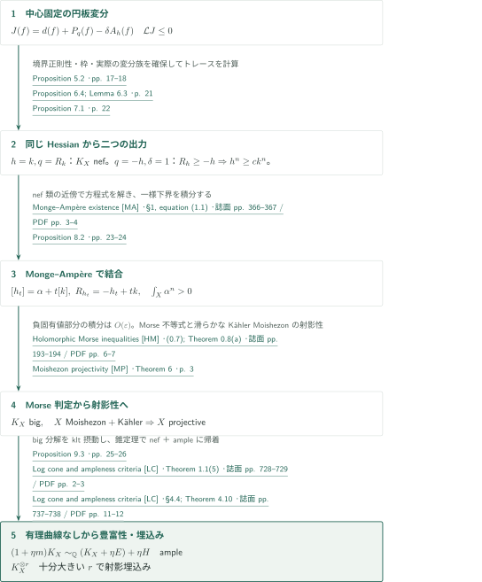
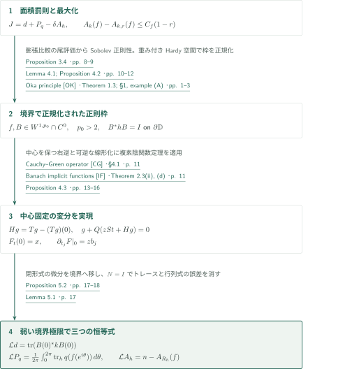
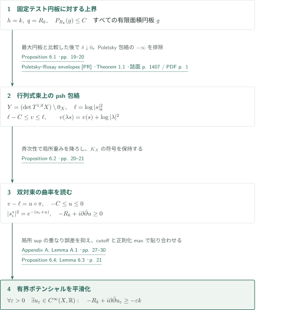
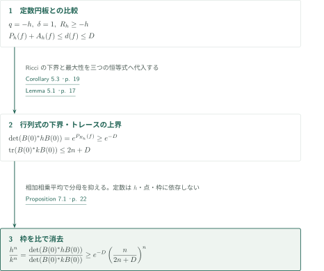
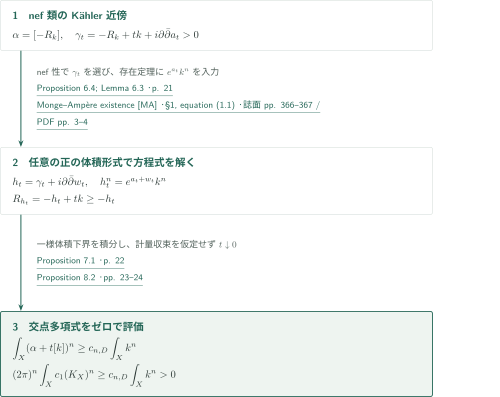
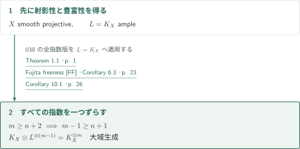
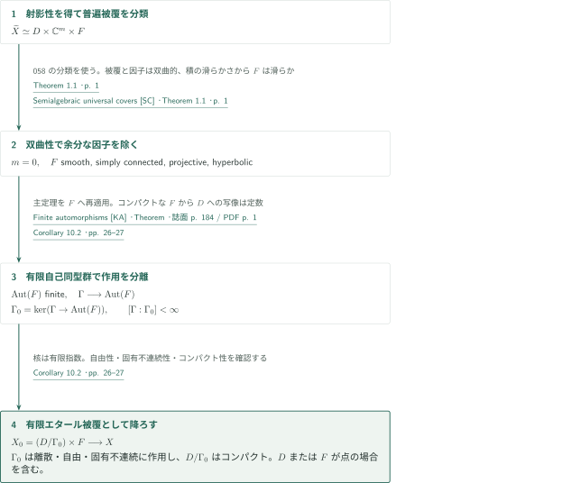

# Canonical ampleness of compact hyperbolic Kähler manifolds

**境界まで正則化した円板変分から、標準束の豊富性へ**

この原稿は、コンパクト双曲性の微分評価から最大化円板を作り、同じHessian恒等式を二通りに用いて標準束のnef性と正の体積を導く。射影性は最後の代数幾何的な段階の前に獲得される。以下は著者が提示する論証の概説であり、入力定理の記述・適用箇所の照合と、証明全体の独立検証を区別する。

## 1. 主要結果

### Theorem 1.1 — 標準束の豊富性

$X$を複素次元$n\ge1$のコンパクト連結Kähler多様体とする。すべての正則写像$\mathbb C\to X$が定数なら、$K_X$はampleである。特に、ある正のテンソル冪$K_X^{\otimes m}$の大域切断は$X$の複素射影空間への正則埋込みを定める。

<!-- cite:main -->[Theorem 1.1 · p. 1](https://github.com/openai/math/blob/fd4aeeb2ee4fc729c18d98444fed42fd0529eeeb/preprints/Canonical-ampleness-of-compact-hyperbolic-Kahler-manifolds-September-23-2026/canonical-ampleness.pdf)<!-- /cite -->

### Corollary 10.1 — 全指数の多重標準束

$X$を複素次元$n\ge1$のコンパクト連結Brody双曲Kähler多様体とする。すべての整数$m\ge n+2$に対して$K_X^{\otimes m}$は大域生成される。

<!-- cite:powers -->[Corollary 10.1 · p. 26](https://github.com/openai/math/blob/fd4aeeb2ee4fc729c18d98444fed42fd0529eeeb/preprints/Canonical-ampleness-of-compact-hyperbolic-Kahler-manifolds-September-23-2026/canonical-ampleness.pdf)<!-- /cite -->

### Corollary 10.2 — 有限被覆の積分解

$X$を正の複素次元のコンパクト連結Brody双曲Kähler多様体とする。通常の普遍被覆が、複素射影多様体の半代数的開集合に双正則であると仮定する。ここで開性は通常の複素位相で測る。このとき、$X$には

$$ (D/\Gamma_0)\times F $$

に双正則な連結有限étale被覆がある。$D$は有界対称領域、$\Gamma_0$は$D$上に自由・固有不連続・余コンパクトに作用する双正則変換の離散群であり、$F$は単連結コンパクトBrody双曲射影多様体である。$D$または$F$が点でもよい。

<!-- cite:cover -->[Corollary 10.2 · pp. 26–27](https://github.com/openai/math/blob/fd4aeeb2ee4fc729c18d98444fed42fd0529eeeb/preprints/Canonical-ampleness-of-compact-hyperbolic-Kahler-manifolds-September-23-2026/canonical-ampleness.pdf)<!-- /cite -->

## 図の矢印に付した引用

<!-- reference-guide -->
略号のない定理・補題・節・式番号は本原稿 [Canonical ampleness](https://github.com/openai/math/blob/fd4aeeb2ee4fc729c18d98444fed42fd0529eeeb/preprints/Canonical-ampleness-of-compact-hyperbolic-Kahler-manifolds-September-23-2026/canonical-ampleness.pdf) を指します。外部入力には次の略号を使います。

- [PR](https://users.fmf.uni-lj.si/forstneric/papers/2012Indiana.pdf) Barbara Drinovec Drnovšek; Franc Forstnerič — *Poletsky–Rosay envelopes*：det T_Xの零切断を除く空間の包絡をpshにする。Proposition 6.2で使用。Indiana Univ. Math. J. 61 (2012), 1407–1423; published version。
- [MA](https://research.chalmers.se/publication/509847/file/509847_Fulltext.pdf) Robert J. Berman — *Monge–Ampère existence*：Aubin–Yauの存在定理の任意の正の体積形式に対する記述。Theorem 8.1からProposition 8.2へ。Math. Z. 291 (2019), 365–394; repository copy with cover sheet。
- [HM](https://numdam.org/item/10.5802/aif.1034.pdf) Jean-Pierre Demailly — *Holomorphic Morse inequalities*：Lemma 9.1の切断増大とMoishezon性の判定。Ann. Inst. Fourier 35(4) (1985), 189–229; Numdam scan with cover sheet。
- [MP](https://arxiv.org/pdf/math/0101019v6) Yoshinori Namikawa — *Moishezon projectivity*：滑らかなKähler Moishezon多様体の射影性。Theorem 9.2で使用。arXiv:math/0101019v6, 2001-11-12。
- [DT](https://arxiv.org/pdf/1606.01381v2) Simone Diverio; Stefano Trapani — *Canonical ampleness criterion*：Proposition 9.3と同じ判定の比較参照。本稿は錐定理から改めて証明する。曲率仮定の主定理を入力にしない。arXiv:1606.01381v2 (margin: 2016-08-04; manuscript date: 2019-04-19); author version。
- [LC](https://ems.press/content/serial-article-files/41145) Osamu Fujino — *Log cone and ampleness criteria*：Proposition 9.3のklt摂動、有理曲線、nef＋ampleの豊富性。Publ. RIMS 47 (2011), 727–789; published version。
- [FF](https://github.com/openai/math/blob/fd4aeeb2ee4fc729c18d98444fed42fd0529eeeb/preprints/Fujitas-freeness-conjecture-September-23-2026/Fujitas-freeness-conjecture-September-23-2026.pdf) OpenAI — *Fujita freeness*：Corollary 10.1だけへの入力。L=K_X、指数m−1。2026-09-23; fixed catalogue 038 manuscript。
- [SC](https://github.com/openai/math/blob/fd4aeeb2ee4fc729c18d98444fed42fd0529eeeb/preprints/Semialgebraic-universal-covers-of-normal-projective-varieties-September-24-2026/paper.pdf) OpenAI — *Semialgebraic universal covers*：Corollary 10.2だけへの入力。通常の普遍被覆の積分類。2026-09-24; fixed catalogue 058 manuscript。
- [KA](https://www.jstage.jst.go.jp/article/tmj1949/11/2/11_2_184/_pdf) Shoshichi Kobayashi — *Finite automorphisms*：Corollary 10.2でK_F ampleからAut(F)有限。Tohoku Math. J. (2) 11 (1959), 184–190; published version。
- [CG](https://arxiv.org/pdf/1411.3989v4) Alexandre Sukhov; Alexander Tumanov — *Cauchy–Green operator*：Lemma 4.1とProposition 4.3で使うL^p→W^{1,p}の∂̄右逆。arXiv:1411.3989v4, 2016-04-05。
- [IF](https://arxiv.org/pdf/math/0303320v1) Helge Glöckner — *Banach implicit functions*：Proposition 4.3の中心固定正則族の構成。arXiv:math/0303320v1, 2003-03-25。
- [OK](https://arxiv.org/pdf/math/0305238v1) Franc Forstnerič; Jasna Prezelj — *Oka principle*：Lemma 4.1のStein円板上の正則枠。GL_n(C)の枠束に適用。arXiv:math/0305238v1, 2003-05-16; first page unnumbered。

各引用に結果番号とページを付します。誌面番号とPDF内の位置が異なる場合は両方を示します。GitHubの閲覧リンクではページ位置への自動移動を前提としません。
<!-- /reference-guide -->

## 2. Theorem 1.1 — 主定理の証明概略

<!-- proof-target:1 -->証明対象：[Theorem 1.1 · p. 1](https://github.com/openai/math/blob/fd4aeeb2ee4fc729c18d98444fed42fd0529eeeb/preprints/Canonical-ampleness-of-compact-hyperbolic-Kahler-manifolds-September-23-2026/canonical-ampleness.pdf)<!-- /proof-target -->

**証明の道筋。** [Hessian恒等式](#proof-1)から[nef性](#proof-2)と[体積下界](#proof-3)へ分岐し、[最高自己交点](#proof-4)で合流する。最後にbig、射影性、ampleの順に進む。二つの系への外部入力はこの主定理の証明には使わない。

背景Kähler計量を$k$とし、$R_h=-i\partial\bar\partial\log\det h$、$d(f)=|f'(0)|_k^2$と置く。円板$\mathbb D$上の正規化は

$$ A_q(f)=\frac1\pi\int_{\mathbb D}q(f',f')\,dS,\qquad P_q(f)=\frac2\pi\int_{\mathbb D}\log\frac1{|z|}\,q(f',f')\,dS. $$

したがって$[-R_k]=2\pi c_1(K_X)$である。全正則円板の中心微分の一様上界を$D>0$と記す。この$D$はCorollary 10.2の領域とは別の記号である。

<!-- cite:conventions -->[§2; Lemma 2.1 · pp. 4–5](https://github.com/openai/math/blob/fd4aeeb2ee4fc729c18d98444fed42fd0529eeeb/preprints/Canonical-ampleness-of-compact-hyperbolic-Kahler-manifolds-September-23-2026/canonical-ampleness.pdf)<!-- /cite -->

### 1. 同じ変分を二度使う

中心を固定した有限面積円板上で$J=d+P_q-\delta A_h$を最大化する。面積罰則が達成を保証し、dilation比較が境界正則性を与える。境界で$h$正規直交な正則枠に沿う中心固定変分のHessianを計算する。$h=k,q=R_k,\delta\downarrow0$は全テスト円板のRicci積分を抑え、$q=-h,\delta=1$は$R_h\ge-h$の下で体積形式を下から抑える。

<!-- cite:disc -->[Proposition 3.2; Lemma 3.3 · pp. 6–8](https://github.com/openai/math/blob/fd4aeeb2ee4fc729c18d98444fed42fd0529eeeb/preprints/Canonical-ampleness-of-compact-hyperbolic-Kahler-manifolds-September-23-2026/canonical-ampleness.pdf)<!-- /cite --> · <!-- cite:trace -->[Proposition 5.2 · pp. 17–18](https://github.com/openai/math/blob/fd4aeeb2ee4fc729c18d98444fed42fd0529eeeb/preprints/Canonical-ampleness-of-compact-hyperbolic-Kahler-manifolds-September-23-2026/canonical-ampleness.pdf)<!-- /cite --> · <!-- cite:nef -->[Proposition 6.4; Lemma 6.3 · p. 21](https://github.com/openai/math/blob/fd4aeeb2ee4fc729c18d98444fed42fd0529eeeb/preprints/Canonical-ampleness-of-compact-hyperbolic-Kahler-manifolds-September-23-2026/canonical-ampleness.pdf)<!-- /cite --> · <!-- cite:volume -->[Proposition 7.1 · p. 22](https://github.com/openai/math/blob/fd4aeeb2ee4fc729c18d98444fed42fd0529eeeb/preprints/Canonical-ampleness-of-compact-hyperbolic-Kahler-manifolds-September-23-2026/canonical-ampleness.pdf)<!-- /cite -->

### 2. nef類を体積評価へ入れる

$\alpha=2\pi c_1(K_X)$とする。nef性により$\alpha+t[k]$は$t>0$でKähler類である。負符号Monge–Ampère方程式を用いて$[h_t]=\alpha+t[k]$かつ$R_{h_t}=-h_t+tk$を満たす計量を得る。一様下界を積分し、コホモロジー上で$t\downarrow0$とすれば$\int_Xc_1(K_X)^n>0$となる。

<!-- cite:ma-input -->[Monge–Ampère existence &#91;MA&#93; · §1, equation (1.1) · 誌面 pp. 366–367 / PDF pp. 3–4](https://research.chalmers.se/publication/509847/file/509847_Fulltext.pdf#page=3)<!-- /cite --> · <!-- cite:intersection -->[Proposition 8.2 · pp. 23–24](https://github.com/openai/math/blob/fd4aeeb2ee4fc729c18d98444fed42fd0529eeeb/preprints/Canonical-ampleness-of-compact-hyperbolic-Kahler-manifolds-September-23-2026/canonical-ampleness.pdf)<!-- /cite -->

### 3. Morse不等式の前提を作り、射影性を得る

一般のnefな直線束$L$について、$\beta=2\pi c_1(L)$、$\Theta_\varepsilon\ge-\varepsilon k$を取る。負固有値のある集合では

$$ |\Theta_\varepsilon^n|\le n\varepsilon(\Theta_\varepsilon+2\varepsilon k)^{n-1}\wedge k. $$

右辺の積分はコホモロジーから$O(\varepsilon)$である。よって$\int_X\beta^n>0$なら、指数が高々1の非退化集合上の積分も正になる。Morse不等式から$L$はbig、$X$はMoishezonとなる。$L=K_X$へ適用し、Kähler性と滑らかさを保ってNamikawaの射影性定理を使う。射影性は出発点の仮定ではない。

<!-- cite:big -->[Lemma 9.1 · pp. 24–25](https://github.com/openai/math/blob/fd4aeeb2ee4fc729c18d98444fed42fd0529eeeb/preprints/Canonical-ampleness-of-compact-hyperbolic-Kahler-manifolds-September-23-2026/canonical-ampleness.pdf)<!-- /cite --> · <!-- cite:morse-input -->[Holomorphic Morse inequalities &#91;HM&#93; · (0.7); Theorem 0.8(a) · 誌面 pp. 193–194 / PDF pp. 6–7](https://numdam.org/item/10.5802/aif.1034.pdf#page=6)<!-- /cite --> · <!-- cite:projectivity -->[Theorem 9.2 · p. 25](https://github.com/openai/math/blob/fd4aeeb2ee4fc729c18d98444fed42fd0529eeeb/preprints/Canonical-ampleness-of-compact-hyperbolic-Kahler-manifolds-September-23-2026/canonical-ampleness.pdf)<!-- /cite --> · <!-- cite:projective-input -->[Moishezon projectivity &#91;MP&#93; · Theorem 6 · p. 3](https://arxiv.org/pdf/math/0101019v6#page=3)<!-- /cite -->

### 4. 有理曲線の不存在からampleと埋込みへ

非定数の$\mathbb P^1\to X$があれば、$\mathbb C$への制限が双曲性に矛盾する。すでに$X$は滑らかな射影多様体で$K_X$はbigなので、Diverio–Trapaniに記録された判定の仮定を満たす。本稿Proposition 9.3は、この判定を次のように錐定理から改めて証明する。

滑らかな非常に豊富な超平面切片$H$を選ぶ。big性による切断増大と、$H$上の弱いMorse不等式による$O(m^{n-1})$評価を制限完全列で比較して、ある$m>0$と有効な$E$に対し$mK_X\sim H+E$を得る。

<!-- cite:morse-growth -->[Holomorphic Morse inequalities &#91;HM&#93; · Theorem 0.1(a) · 誌面 p. 189 / PDF p. 2](https://numdam.org/item/10.5802/aif.1034.pdf#page=2)<!-- /cite -->

十分小さい正有理数$\eta$で$(X,\eta E)$をkltにする。有理曲線がないため、log cone theoremから$N=K_X+\eta E$はnefとなる。従って

$$ (1+\eta m)K_X\sim_{\mathbb Q}N+\eta H $$

はampleとなる。正の有理係数を払えば$K_X$自身がampleであり、十分高い正のテンソル冪が射影埋込みを与える。

<!-- cite:ample -->[Proposition 9.3 · pp. 25–26](https://github.com/openai/math/blob/fd4aeeb2ee4fc729c18d98444fed42fd0529eeeb/preprints/Canonical-ampleness-of-compact-hyperbolic-Kahler-manifolds-September-23-2026/canonical-ampleness.pdf)<!-- /cite --> · <!-- cite:ample-input -->[Canonical ampleness criterion &#91;DT&#93; · Lemma 2.1 · p. 3](https://arxiv.org/pdf/1606.01381v2#page=3)<!-- /cite --> · <!-- cite:cone-input -->[Log cone and ampleness criteria &#91;LC&#93; · Theorem 1.1(5) · 誌面 pp. 728–729 / PDF pp. 2–3](https://ems.press/content/serial-article-files/41145)<!-- /cite --> · <!-- cite:kleiman-input -->[Log cone and ampleness criteria &#91;LC&#93; · §4.4; Theorem 4.10 · 誌面 pp. 737–738 / PDF pp. 11–12](https://ems.press/content/serial-article-files/41145)<!-- /cite --> · <!-- cite:completion -->[§9; completion of Theorem 1.1 · pp. 24–26](https://github.com/openai/math/blob/fd4aeeb2ee4fc729c18d98444fed42fd0529eeeb/preprints/Canonical-ampleness-of-compact-hyperbolic-Kahler-manifolds-September-23-2026/canonical-ampleness.pdf)<!-- /cite -->

## 3. Proposition 5.2 — 境界正規化とHessian

<!-- proof-target:2 -->証明対象：[Proposition 5.2 · pp. 17–18](https://github.com/openai/math/blob/fd4aeeb2ee4fc729c18d98444fed42fd0529eeeb/preprints/Canonical-ampleness-of-compact-hyperbolic-Kahler-manifolds-September-23-2026/canonical-ampleness.pdf)<!-- /proof-target -->

<!-- statement:proposition-5-2 -->
### Proposition 5.2 — 三つのトレース恒等式

上の$X,k$とKähler計量$h$を用いる。円板$f$と正則枠$B=(b_1,\ldots,b_n)$は閉円板上で連続かつ$W^{1,p_0}$、$p_0>2$とし、$B$は至る所非特異、境界で$B^*hB=I$とする。中心固定の正則族$F_t$は$F_0=f$、$F_t(0)=x=f(0)$、$\partial_{t_j}F|_0=zb_j$を満たし、局所座標でパラメータに関して$W^{1,p_0}$値正則とする。$\mathcal L=\sum_j\partial_{t_j}\partial_{\bar t_j}|_0$と置く。任意の滑らかな閉実$(1,1)$形式$q$に対し、

$$ \mathcal Ld=\operatorname{tr}(B(0)^*k(x)B(0)),\quad \mathcal LP_q=\frac1{2\pi}\int_0^{2\pi}\operatorname{tr}_h q(f(e^{i\theta}))\,d\theta,\quad \mathcal LA_h=n-A_{R_h}(f). $$

<!-- cite:trace -->[Proposition 5.2 · pp. 17–18](https://github.com/openai/math/blob/fd4aeeb2ee4fc729c18d98444fed42fd0529eeeb/preprints/Canonical-ampleness-of-compact-hyperbolic-Kahler-manifolds-September-23-2026/canonical-ampleness.pdf)<!-- /cite -->

<!-- /statement -->

### 1. 面積罰則と境界の尾評価

円板の中心微分評価はBrodyの再パラメータ化を本稿Lemma 3.1で実行して得る。最大化列について、外周では$-\delta A_h$が対数重みの項を支配するので、Fatouの補題と内部の正規族収束から最大値が達成される。さらに$f(rz)$との比較により$A_q(f)\ge-d(f)$と$A_k(f)-A_{k,r}(f)\le C_f(1-r)$を得る。局所平均値評価とdyadic annuli上の和により、最大化円板は境界まで連続で$W^{1,p}$、$2<p<4$となる。定数$C_f$の全計量に対する一様性は主張しない。

<!-- cite:disc -->[Proposition 3.2; Lemma 3.3 · pp. 6–8](https://github.com/openai/math/blob/fd4aeeb2ee4fc729c18d98444fed42fd0529eeeb/preprints/Canonical-ampleness-of-compact-hyperbolic-Kahler-manifolds-September-23-2026/canonical-ampleness.pdf)<!-- /cite --> · <!-- cite:regularity -->[Proposition 3.4 · pp. 8–9](https://github.com/openai/math/blob/fd4aeeb2ee4fc729c18d98444fed42fd0529eeeb/preprints/Canonical-ampleness-of-compact-hyperbolic-Kahler-manifolds-September-23-2026/canonical-ampleness.pdf)<!-- /cite -->

### 2. 形式的な方向を実際の円板族にする

Lemma 4.1はCauchy–Green右逆とOka原理を使い、少し大きい円板上の正則束を自明化する。Proposition 4.2は重み付きHardy空間で枠を正規化し、Toeplitz作用素の回転差分評価を通して境界の$W^{1,p_0}$正則性と非特異性を得る。Proposition 4.3では中心値を引いた右逆$Hg=Tg-(Tg)(0)$を用い、

$$ g+Q(zSt+Hg)=0,\qquad Q(0)=DQ(0)=0 $$

へ複素Banach陰関数定理を適用する。これにより中心固定と所望の一次変分を同時に保つ。スペクトル因子分解の背景文献を、境界正則性まで自動的に与える定理として扱わない。

<!-- cite:frame -->[Lemma 4.1; Proposition 4.2 · pp. 10–12](https://github.com/openai/math/blob/fd4aeeb2ee4fc729c18d98444fed42fd0529eeeb/preprints/Canonical-ampleness-of-compact-hyperbolic-Kahler-manifolds-September-23-2026/canonical-ampleness.pdf)<!-- /cite --> · <!-- cite:variation -->[Proposition 4.3 · pp. 13–16](https://github.com/openai/math/blob/fd4aeeb2ee4fc729c18d98444fed42fd0529eeeb/preprints/Canonical-ampleness-of-compact-hyperbolic-Kahler-manifolds-September-23-2026/canonical-ampleness.pdf)<!-- /cite --> · <!-- cite:cauchy-input -->[Cauchy–Green operator &#91;CG&#93; · §4.1 · p. 11](https://arxiv.org/pdf/1411.3989v4#page=11)<!-- /cite --> · <!-- cite:oka-input -->[Oka principle &#91;OK&#93; · Theorem 1.3; §1, example (A) · pp. 1–3](https://arxiv.org/pdf/math/0305238v1#page=1)<!-- /cite --> · <!-- cite:implicit-input -->[Banach implicit functions &#91;IF&#93; · Theorem 2.3(ii), (d) · p. 11](https://arxiv.org/pdf/math/0303320v1#page=11)<!-- /cite -->

### 3. 弱い境界極限を通す

$p_0/2>1$により、面積・Poisson積分のパラメータ微分を正当化する。閉性を使った局所恒等式は$\mathcal Lq(F_z,F_z)=\partial_z\partial_{\bar z}(|z|^2\operatorname{tr}(B^*qB))$である。$N=B^*hB$に対し、境界で$N=I$なので、適切な半径列に沿って$\partial_r\operatorname{tr}N$を$\partial_r\log\det N$へ置き換えられる。誤差は$W^{1,2}$の半径方向評価で消える。Green公式から三つの恒等式と$\log\det N(0)=P_{R_h}(f)$を得て、最大点で$\mathcal LJ\le0$を適用する。円板が境界を越えて正則に延長することは使わない。

<!-- cite:trace -->[Proposition 5.2 · pp. 17–18](https://github.com/openai/math/blob/fd4aeeb2ee4fc729c18d98444fed42fd0529eeeb/preprints/Canonical-ampleness-of-compact-hyperbolic-Kahler-manifolds-September-23-2026/canonical-ampleness.pdf)<!-- /cite --> · <!-- cite:determinant -->[Lemma 5.1 · p. 17](https://github.com/openai/math/blob/fd4aeeb2ee4fc729c18d98444fed42fd0529eeeb/preprints/Canonical-ampleness-of-compact-hyperbolic-Kahler-manifolds-September-23-2026/canonical-ampleness.pdf)<!-- /cite --> · <!-- cite:maximum -->[Corollary 5.3 · p. 19](https://github.com/openai/math/blob/fd4aeeb2ee4fc729c18d98444fed42fd0529eeeb/preprints/Canonical-ampleness-of-compact-hyperbolic-Kahler-manifolds-September-23-2026/canonical-ampleness.pdf)<!-- /cite -->

## 4. Proposition 6.4 — 標準束のnef性

<!-- proof-target:3 -->証明対象：[Proposition 6.4; Lemma 6.3 · p. 21](https://github.com/openai/math/blob/fd4aeeb2ee4fc729c18d98444fed42fd0529eeeb/preprints/Canonical-ampleness-of-compact-hyperbolic-Kahler-manifolds-September-23-2026/canonical-ampleness.pdf)<!-- /proof-target -->

<!-- statement:proposition-6-4 -->
### Proposition 6.4 — 任意に小さい負曲率誤差

Theorem 1.1の仮定と固定Kähler計量$k$の下で、すべての$\varepsilon>0$について滑らかな実関数$u_\varepsilon$が存在し、

$$ -R_k+i\partial\bar\partial u_\varepsilon\ge-\varepsilon k. $$

したがって$2\pi c_1(K_X)$はnefである。

<!-- cite:nef -->[Proposition 6.4; Lemma 6.3 · p. 21](https://github.com/openai/math/blob/fd4aeeb2ee4fc729c18d98444fed42fd0529eeeb/preprints/Canonical-ampleness-of-compact-hyperbolic-Kahler-manifolds-September-23-2026/canonical-ampleness.pdf)<!-- /cite -->

<!-- /statement -->

### 1. 極値円板から全テスト円板へ

$h=k,q=R_k$とし、$0<\delta\le1$で最大化する。Corollary 5.3と$A_{R_k}(f)\ge-D$から$\operatorname{tr}N(0)\le n+D+M$、$M=\sup_X|\operatorname{tr}_kR_k|$を得る。行列式恒等式と相加相乗平均により$P_{R_k}(f)$は一様に上から抑えられる。任意の有限面積円板$g$を固定して最大値と比較し、その後に$\delta\downarrow0$とする。最大化円板の面積の一様上界を極限で仮定せず、$P_{R_k}(g)\le C$を得る。

<!-- cite:ricci-bound -->[Proposition 6.1 · pp. 19–20](https://github.com/openai/math/blob/fd4aeeb2ee4fc729c18d98444fed42fd0529eeeb/preprints/Canonical-ampleness-of-compact-hyperbolic-Kahler-manifolds-September-23-2026/canonical-ampleness.pdf)<!-- /cite --> · <!-- cite:maximum -->[Corollary 5.3 · p. 19](https://github.com/openai/math/blob/fd4aeeb2ee4fc729c18d98444fed42fd0529eeeb/preprints/Canonical-ampleness-of-compact-hyperbolic-Kahler-manifolds-September-23-2026/canonical-ampleness.pdf)<!-- /cite -->

### 2. 包絡の斉次性を標準束の計量へ移す

$Y=(\det T^{1,0}X)\setminus0_X$上で$\ell(s)=\log|s|_k^2$と置き、Poisson包絡を$v$とする。射影した円板への前段の評価から$\ell-C\le v\le\ell$であり、Poletsky–Rosay定理の恒等的$-\infty$の場合を除ける。$v(\lambda s)=v(s)+\log|\lambda|^2$より$v-\ell=u\circ\pi$、$-C\le u\le0$となる。局所枠$s_i$に対し$a_i=\log|s_i|_k^2$とすれば$a_i+u$は有界pshである。双対枠のノルムを$|s_i^*|^2=e^{-(a_i+u)}$とすると、曲率は$-R_k+i\partial\bar\partial u\ge0$であり、対象は$K_X$である。

<!-- cite:potentials -->[Proposition 6.2 · pp. 20–21](https://github.com/openai/math/blob/fd4aeeb2ee4fc729c18d98444fed42fd0529eeeb/preprints/Canonical-ampleness-of-compact-hyperbolic-Kahler-manifolds-September-23-2026/canonical-ampleness.pdf)<!-- /cite --> · <!-- cite:pr-input -->[Poletsky–Rosay envelopes &#91;PR&#93; · Theorem 1.1 · 誌面 p. 1407 / PDF p. 1](https://users.fmf.uni-lj.si/forstneric/papers/2012Indiana.pdf#page=1)<!-- /cite -->

### 3. 連続性を仮定せずに平滑化する

Lemma 6.3は有界ポテンシャルの平滑化を与える。付録Aは、局所pshポテンシャルの球上のsupを固定倍率の半径で比較し、重なりの誤差を$O(1/|\log b|)+O(b)$に抑える。この誤差が小さくなる半径を選び、cutoff補正後の正則化最大値で貼り合わせる。失う曲率は任意に小さくでき、Proposition 6.2へ適用して主張を得る。本稿が併記するDemaillyの正則化定理への別の引用経路は、ここでは追加の照合対象にしていない。

<!-- cite:nef -->[Proposition 6.4; Lemma 6.3 · p. 21](https://github.com/openai/math/blob/fd4aeeb2ee4fc729c18d98444fed42fd0529eeeb/preprints/Canonical-ampleness-of-compact-hyperbolic-Kahler-manifolds-September-23-2026/canonical-ampleness.pdf)<!-- /cite --> · <!-- cite:smoothing -->[Appendix A; Lemma A.1 · pp. 27–30](https://github.com/openai/math/blob/fd4aeeb2ee4fc729c18d98444fed42fd0529eeeb/preprints/Canonical-ampleness-of-compact-hyperbolic-Kahler-manifolds-September-23-2026/canonical-ampleness.pdf)<!-- /cite -->

## 5. Proposition 7.1 — 一様な体積下界

<!-- proof-target:4 -->証明対象：[Proposition 7.1 · p. 22](https://github.com/openai/math/blob/fd4aeeb2ee4fc729c18d98444fed42fd0529eeeb/preprints/Canonical-ampleness-of-compact-hyperbolic-Kahler-manifolds-September-23-2026/canonical-ampleness.pdf)<!-- /proof-target -->

<!-- statement:proposition-7-1 -->
### Proposition 7.1 — 全計量に共通の定数

Theorem 1.1の仮定の下で$k$を固定し、Lemma 3.1の微分上界を$D$とする。$R_h\ge-h$を満たすすべての滑らかなKähler形式$h$について、

$$ h^n\ge c_{n,D}k^n,\qquad c_{n,D}=e^{-D}\left(\frac n{2n+D}\right)^n>0. $$

<!-- cite:volume -->[Proposition 7.1 · p. 22](https://github.com/openai/math/blob/fd4aeeb2ee4fc729c18d98444fed42fd0529eeeb/preprints/Canonical-ampleness-of-compact-hyperbolic-Kahler-manifolds-September-23-2026/canonical-ampleness.pdf)<!-- /cite -->

<!-- /statement -->

### 1. 定数円板との比較を使う

$q=-h,\delta=1$の最大化円板を各点で取る。定数円板の値は0なので$P_h(f)+A_h(f)\le d(f)\le D$となる。曲率条件から$P_{R_h}(f),A_{R_h}(f)\ge-D$である。最大化不等式には$\operatorname{tr}_h(-h)=-n$を代入し、$\operatorname{tr}(B(0)^*kB(0))\le2n+D$を得る。

<!-- cite:volume -->[Proposition 7.1 · p. 22](https://github.com/openai/math/blob/fd4aeeb2ee4fc729c18d98444fed42fd0529eeeb/preprints/Canonical-ampleness-of-compact-hyperbolic-Kahler-manifolds-September-23-2026/canonical-ampleness.pdf)<!-- /cite --> · <!-- cite:maximum -->[Corollary 5.3 · p. 19](https://github.com/openai/math/blob/fd4aeeb2ee4fc729c18d98444fed42fd0529eeeb/preprints/Canonical-ampleness-of-compact-hyperbolic-Kahler-manifolds-September-23-2026/canonical-ampleness.pdf)<!-- /cite -->

### 2. 枠の行列式を消す

Lemma 5.1は$\det(B(0)^*hB(0))=e^{P_{R_h}(f)}\ge e^{-D}$を与える。一方、前段のトレース上界は相加相乗平均で分母の行列式を抑える。比を取ると$|\det B(0)|^2$が消え、

$$ \frac{h^n}{k^n}=\frac{\det(B(0)^*hB(0))}{\det(B(0)^*kB(0))}\ge e^{-D}\left(\frac n{2n+D}\right)^n. $$

補助円板、枠、変分の大きさは$h$や点に依存してよい。最終定数にはそれらを含めない。

<!-- cite:determinant -->[Lemma 5.1 · p. 17](https://github.com/openai/math/blob/fd4aeeb2ee4fc729c18d98444fed42fd0529eeeb/preprints/Canonical-ampleness-of-compact-hyperbolic-Kahler-manifolds-September-23-2026/canonical-ampleness.pdf)<!-- /cite --> · <!-- cite:volume -->[Proposition 7.1 · p. 22](https://github.com/openai/math/blob/fd4aeeb2ee4fc729c18d98444fed42fd0529eeeb/preprints/Canonical-ampleness-of-compact-hyperbolic-Kahler-manifolds-September-23-2026/canonical-ampleness.pdf)<!-- /cite -->

## 6. Proposition 8.2 — 正の最高自己交点

<!-- proof-target:5 -->証明対象：[Proposition 8.2 · pp. 23–24](https://github.com/openai/math/blob/fd4aeeb2ee4fc729c18d98444fed42fd0529eeeb/preprints/Canonical-ampleness-of-compact-hyperbolic-Kahler-manifolds-September-23-2026/canonical-ampleness.pdf)<!-- /proof-target -->

<!-- statement:proposition-8-2 -->
### Proposition 8.2 — 標準類の正の体積

Theorem 1.1と同じ仮定、すなわち正の次元$n$のコンパクト連結Kähler多様体$X$に非定数正則写像$\mathbb C\to X$が存在しないとする。このとき

$$ \int_Xc_1(K_X)^n>0. $$

<!-- cite:intersection -->[Proposition 8.2 · pp. 23–24](https://github.com/openai/math/blob/fd4aeeb2ee4fc729c18d98444fed42fd0529eeeb/preprints/Canonical-ampleness-of-compact-hyperbolic-Kahler-manifolds-September-23-2026/canonical-ampleness.pdf)<!-- /cite -->

<!-- /statement -->

### 1. 任意の正の体積形式に対する存在定理

$\alpha=[-R_k]$とし、nef性から$-R_k+i\partial\bar\partial a_t\ge-(t/2)k$を選ぶ。$\gamma_t=-R_k+tk+i\partial\bar\partial a_t>0$へTheorem 8.1を適用し、

$$ h_t=\gamma_t+i\partial\bar\partial w_t>0,\qquad h_t^n=e^{a_t+w_t}k^n $$

を得る。入力の体積形式は$e^{a_t}k^n$でよく、総体積を事前に規格化する必要はない。解の加法定数が右辺に入る。対数を微分すると$R_{h_t}=-h_t+tk\ge-h_t$となる。

<!-- cite:ma-self -->[Theorem 8.1 · p. 23](https://github.com/openai/math/blob/fd4aeeb2ee4fc729c18d98444fed42fd0529eeeb/preprints/Canonical-ampleness-of-compact-hyperbolic-Kahler-manifolds-September-23-2026/canonical-ampleness.pdf)<!-- /cite --> · <!-- cite:ma-input -->[Monge–Ampère existence &#91;MA&#93; · §1, equation (1.1) · 誌面 pp. 366–367 / PDF pp. 3–4](https://research.chalmers.se/publication/509847/file/509847_Fulltext.pdf#page=3)<!-- /cite --> · <!-- cite:intersection -->[Proposition 8.2 · pp. 23–24](https://github.com/openai/math/blob/fd4aeeb2ee4fc729c18d98444fed42fd0529eeeb/preprints/Canonical-ampleness-of-compact-hyperbolic-Kahler-manifolds-September-23-2026/canonical-ampleness.pdf)<!-- /cite -->

### 2. 計量ではなく交点多項式を極限に送る

Proposition 7.1をすべての$t>0$へ同じ定数で適用する。$[h_t]=\alpha+t[k]$より

$$ \int_X(\alpha+t[k])^n=\int_Xh_t^n\ge c_{n,D}\int_Xk^n>0. $$

左辺は$t$の多項式なので、$t=0$で評価して$(2\pi)^n\int_Xc_1(K_X)^n\ge c_{n,D}\int_Xk^n>0$を得る。$h_t$やそのポテンシャルの収束はこの段階の仮定ではない。

<!-- cite:volume -->[Proposition 7.1 · p. 22](https://github.com/openai/math/blob/fd4aeeb2ee4fc729c18d98444fed42fd0529eeeb/preprints/Canonical-ampleness-of-compact-hyperbolic-Kahler-manifolds-September-23-2026/canonical-ampleness.pdf)<!-- /cite --> · <!-- cite:intersection -->[Proposition 8.2 · pp. 23–24](https://github.com/openai/math/blob/fd4aeeb2ee4fc729c18d98444fed42fd0529eeeb/preprints/Canonical-ampleness-of-compact-hyperbolic-Kahler-manifolds-September-23-2026/canonical-ampleness.pdf)<!-- /cite -->

## 7. Corollary 10.1 — 038の自由性から全指数へ

<!-- proof-target:6 -->証明対象：[Corollary 10.1 · p. 26](https://github.com/openai/math/blob/fd4aeeb2ee4fc729c18d98444fed42fd0529eeeb/preprints/Canonical-ampleness-of-compact-hyperbolic-Kahler-manifolds-September-23-2026/canonical-ampleness.pdf)<!-- /proof-target -->

### 1. 入力定理の仮定を揃える

Theorem 1.1により$X$は滑らかな連結射影多様体で、$K_X$はampleとなる。したがってカタログ038のFujita freenessを$L=K_X$に適用できる。この入力は本稿主定理の証明に遡って使われるものではない。

<!-- cite:main -->[Theorem 1.1 · p. 1](https://github.com/openai/math/blob/fd4aeeb2ee4fc729c18d98444fed42fd0529eeeb/preprints/Canonical-ampleness-of-compact-hyperbolic-Kahler-manifolds-September-23-2026/canonical-ampleness.pdf)<!-- /cite --> · <!-- cite:fujita-input -->[Fujita freeness &#91;FF&#93; · Corollary 6.3 · p. 23](https://github.com/openai/math/blob/fd4aeeb2ee4fc729c18d98444fed42fd0529eeeb/preprints/Fujitas-freeness-conjecture-September-23-2026/Fujitas-freeness-conjecture-September-23-2026.pdf)<!-- /cite -->

### 2. 全整数への量化を保つ

任意の整数$m\ge n+2$に対し$m-1\ge n+1$なので、038のCorollary 6.3から

$$ K_X\otimes L^{\otimes(m-1)}=K_X^{\otimes m} $$

の大域生成を得る。最小指数だけを与える主定理ではなく、全指数版の系を入力にする点が必要である。[038の記事](https://masataka123.github.io/OpenAI-Math-Digest/ja/papers/fujita-freeness/#proof-3)でその拡張を案内している。

<!-- cite:powers -->[Corollary 10.1 · p. 26](https://github.com/openai/math/blob/fd4aeeb2ee4fc729c18d98444fed42fd0529eeeb/preprints/Canonical-ampleness-of-compact-hyperbolic-Kahler-manifolds-September-23-2026/canonical-ampleness.pdf)<!-- /cite --> · <!-- cite:fujita-input -->[Fujita freeness &#91;FF&#93; · Corollary 6.3 · p. 23](https://github.com/openai/math/blob/fd4aeeb2ee4fc729c18d98444fed42fd0529eeeb/preprints/Fujitas-freeness-conjecture-September-23-2026/Fujitas-freeness-conjecture-September-23-2026.pdf)<!-- /cite -->

## 8. Corollary 10.2 — 分類から有限被覆へ

<!-- proof-target:7 -->証明対象：[Corollary 10.2 · pp. 26–27](https://github.com/openai/math/blob/fd4aeeb2ee4fc729c18d98444fed42fd0529eeeb/preprints/Canonical-ampleness-of-compact-hyperbolic-Kahler-manifolds-September-23-2026/canonical-ampleness.pdf)<!-- /proof-target -->

### 1. 分類の余分な因子を除く

Theorem 1.1で$X$を射影的にしてから、058のTheorem 1.1を通常の普遍被覆へ適用する。得られる分解は$\widetilde X\simeq D\times\mathbb C^m\times F$で、$F$は単連結・正規・射影的である。積が滑らかなので$F$も滑らかであり、双曲性が被覆と因子へ移るため$m=0$、$F$はBrody双曲となる。ここでは分類定理そのものの証明は入力として区切る。

<!-- cite:cover -->[Corollary 10.2 · pp. 26–27](https://github.com/openai/math/blob/fd4aeeb2ee4fc729c18d98444fed42fd0529eeeb/preprints/Canonical-ampleness-of-compact-hyperbolic-Kahler-manifolds-September-23-2026/canonical-ampleness.pdf)<!-- /cite --> · <!-- cite:classification-input -->[Semialgebraic universal covers &#91;SC&#93; · Theorem 1.1 · p. 1](https://github.com/openai/math/blob/fd4aeeb2ee4fc729c18d98444fed42fd0529eeeb/preprints/Semialgebraic-universal-covers-of-normal-projective-varieties-September-24-2026/paper.pdf)<!-- /cite -->

### 2. 自己同型群の有限性で積作用にする

$\dim F>0$ならTheorem 1.1を$F$へ再適用して$K_F$をampleにする。よって$c_1(F)<0$となり、Kobayashiの定理から$\operatorname{Aut}(F)$は有限である。$F$が点なら同じ有限性は自明。deck変換の$D$成分はコンパクト連結な$F$上で定数であり、逆変換も用いて基底上の自己同型を得る。残る$F$成分は、連結な$D$から有限群への族なので基底に依存しない。$D$が点の場合もこの議論に含む。

<!-- cite:cover -->[Corollary 10.2 · pp. 26–27](https://github.com/openai/math/blob/fd4aeeb2ee4fc729c18d98444fed42fd0529eeeb/preprints/Canonical-ampleness-of-compact-hyperbolic-Kahler-manifolds-September-23-2026/canonical-ampleness.pdf)<!-- /cite --> · <!-- cite:finite-input -->[Finite automorphisms &#91;KA&#93; · Theorem · 誌面 p. 184 / PDF p. 1](https://www.jstage.jst.go.jp/article/tmj1949/11/2/11_2_184/_pdf)<!-- /cite -->

### 3. 有限指数の核の作用を確認する

deck群$\Gamma$から$\operatorname{Aut}(F)$への準同型の核を$\Gamma_0$とする。有限指数で、$D$上に忠実かつ自由に作用する。$K\subset D$をコンパクトとすると$K\times F$もコンパクトなので、deck作用の固有不連続性が$D$上へ移り、$\Gamma_0$は離散となる。商は$(D/\Gamma_0)\times F$であり、$X$への被覆は連結・有限・不分岐、したがって射影多様体の有限étale被覆である。そのコンパクト性から$D/\Gamma_0$もコンパクトとなり、余コンパクト性まで得られる。

<!-- cite:cover -->[Corollary 10.2 · pp. 26–27](https://github.com/openai/math/blob/fd4aeeb2ee4fc729c18d98444fed42fd0529eeeb/preprints/Canonical-ampleness-of-compact-hyperbolic-Kahler-manifolds-September-23-2026/canonical-ampleness.pdf)<!-- /cite -->

## 9. どの論文が、どの段階を担うか

主定理の解析・正値性への直接入力と、主定理後の二つの系への入力を分ける。Diverio–Trapaniは同じ判定の比較参照であり、本稿はProposition 9.3を錐定理から改めて証明する。次の照合は結果の記述と本稿の使用条件に限り、外部証明全体の検証ではない。

| 供給元 | 使用箇所・役割 | 照合範囲 |
|---|---|---|
| Oka principle、Cauchy–Green operator、Banach implicit functions | Lemma 4.1、Proposition 4.3。Stein円板の枠束、中心固定右逆、可逆線形化 | 指定結果と枠束・関数空間の条件を照合 |
| Poletsky–Rosay envelopes | Proposition 6.2。連結多様体上の連続な重み、非−∞性 | Theorem 1.1と包絡の上下界を照合 |
| Monge–Ampère existence | Proposition 8.2。Kähler類と任意の正の体積形式 | Bermanの式(1.1)の存在記述と符号を照合 |
| Holomorphic Morse inequalities、Moishezon projectivity | Lemma 9.1、Theorem 9.2。正の指数積分、滑らかなKähler空間 | 指定結果の仮定と正値性の接続を照合 |
| Canonical ampleness criterion、Log cone and ampleness criteria | Proposition 9.3。射影的・big・有理曲線なし、klt摂動 | 判定・cone・Kleimanを照合。解消定理の原文は未照合 |
| Fujita freeness（038） | Corollary 10.1のみ。全整数の指数条件 | Corollary 6.3の主張を原典で再照合。証明は再検証しない |
| Semialgebraic universal covers（058）、Finite automorphisms | Corollary 10.2のみ。積分類と有限指数化 | 分類の主張と有限性定理の仮定を照合 |

<!-- cite:oka-input -->[Oka principle &#91;OK&#93; · Theorem 1.3; §1, example (A) · pp. 1–3](https://arxiv.org/pdf/math/0305238v1#page=1)<!-- /cite --> · <!-- cite:cauchy-input -->[Cauchy–Green operator &#91;CG&#93; · §4.1 · p. 11](https://arxiv.org/pdf/1411.3989v4#page=11)<!-- /cite --> · <!-- cite:implicit-input -->[Banach implicit functions &#91;IF&#93; · Theorem 2.3(ii), (d) · p. 11](https://arxiv.org/pdf/math/0303320v1#page=11)<!-- /cite --> · <!-- cite:pr-input -->[Poletsky–Rosay envelopes &#91;PR&#93; · Theorem 1.1 · 誌面 p. 1407 / PDF p. 1](https://users.fmf.uni-lj.si/forstneric/papers/2012Indiana.pdf#page=1)<!-- /cite --> · <!-- cite:ma-input -->[Monge–Ampère existence &#91;MA&#93; · §1, equation (1.1) · 誌面 pp. 366–367 / PDF pp. 3–4](https://research.chalmers.se/publication/509847/file/509847_Fulltext.pdf#page=3)<!-- /cite --> · <!-- cite:morse-input -->[Holomorphic Morse inequalities &#91;HM&#93; · (0.7); Theorem 0.8(a) · 誌面 pp. 193–194 / PDF pp. 6–7](https://numdam.org/item/10.5802/aif.1034.pdf#page=6)<!-- /cite --> · <!-- cite:projective-input -->[Moishezon projectivity &#91;MP&#93; · Theorem 6 · p. 3](https://arxiv.org/pdf/math/0101019v6#page=3)<!-- /cite --> · <!-- cite:ample-input -->[Canonical ampleness criterion &#91;DT&#93; · Lemma 2.1 · p. 3](https://arxiv.org/pdf/1606.01381v2#page=3)<!-- /cite --> · <!-- cite:cone-input -->[Log cone and ampleness criteria &#91;LC&#93; · Theorem 1.1(5) · 誌面 pp. 728–729 / PDF pp. 2–3](https://ems.press/content/serial-article-files/41145)<!-- /cite --> · <!-- cite:kleiman-input -->[Log cone and ampleness criteria &#91;LC&#93; · §4.4; Theorem 4.10 · 誌面 pp. 737–738 / PDF pp. 11–12](https://ems.press/content/serial-article-files/41145)<!-- /cite --> · <!-- cite:fujita-input -->[Fujita freeness &#91;FF&#93; · Corollary 6.3 · p. 23](https://github.com/openai/math/blob/fd4aeeb2ee4fc729c18d98444fed42fd0529eeeb/preprints/Fujitas-freeness-conjecture-September-23-2026/Fujitas-freeness-conjecture-September-23-2026.pdf)<!-- /cite --> · <!-- cite:classification-input -->[Semialgebraic universal covers &#91;SC&#93; · Theorem 1.1 · p. 1](https://github.com/openai/math/blob/fd4aeeb2ee4fc729c18d98444fed42fd0529eeeb/preprints/Semialgebraic-universal-covers-of-normal-projective-varieties-September-24-2026/paper.pdf)<!-- /cite --> · <!-- cite:finite-input -->[Finite automorphisms &#91;KA&#93; · Theorem · 誌面 p. 184 / PDF p. 1](https://www.jstage.jst.go.jp/article/tmj1949/11/2/11_2_184/_pdf)<!-- /cite -->

## 10. 原典を読む入口と確認範囲

<!-- reading-list -->
- [Proposition 3.2; Lemma 3.3 · pp. 6–8](https://github.com/openai/math/blob/fd4aeeb2ee4fc729c18d98444fed42fd0529eeeb/preprints/Canonical-ampleness-of-compact-hyperbolic-Kahler-manifolds-September-23-2026/canonical-ampleness.pdf) — 最大化と境界面積の尾評価。
- [Lemma 4.1; Proposition 4.2 · pp. 10–12](https://github.com/openai/math/blob/fd4aeeb2ee4fc729c18d98444fed42fd0529eeeb/preprints/Canonical-ampleness-of-compact-hyperbolic-Kahler-manifolds-September-23-2026/canonical-ampleness.pdf) — 境界正規化と正則性。
- [Proposition 4.3 · pp. 13–16](https://github.com/openai/math/blob/fd4aeeb2ee4fc729c18d98444fed42fd0529eeeb/preprints/Canonical-ampleness-of-compact-hyperbolic-Kahler-manifolds-September-23-2026/canonical-ampleness.pdf) — 形式的方向を実際の正則族にする箇所。
- [Proposition 5.2 · pp. 17–18](https://github.com/openai/math/blob/fd4aeeb2ee4fc729c18d98444fed42fd0529eeeb/preprints/Canonical-ampleness-of-compact-hyperbolic-Kahler-manifolds-September-23-2026/canonical-ampleness.pdf) — 積分の微分と弱い境界極限。
- [Proposition 6.2 · pp. 20–21](https://github.com/openai/math/blob/fd4aeeb2ee4fc729c18d98444fed42fd0529eeeb/preprints/Canonical-ampleness-of-compact-hyperbolic-Kahler-manifolds-September-23-2026/canonical-ampleness.pdf) — 行列式束上の包絡と標準束の符号。
- [Appendix A; Lemma A.1 · pp. 27–30](https://github.com/openai/math/blob/fd4aeeb2ee4fc729c18d98444fed42fd0529eeeb/preprints/Canonical-ampleness-of-compact-hyperbolic-Kahler-manifolds-September-23-2026/canonical-ampleness.pdf) — 有界だが不連続なポテンシャルの貼合せ。
- [Proposition 7.1 · p. 22](https://github.com/openai/math/blob/fd4aeeb2ee4fc729c18d98444fed42fd0529eeeb/preprints/Canonical-ampleness-of-compact-hyperbolic-Kahler-manifolds-September-23-2026/canonical-ampleness.pdf) — 補助量に依存しない下界。
- [Proposition 8.2 · pp. 23–24](https://github.com/openai/math/blob/fd4aeeb2ee4fc729c18d98444fed42fd0529eeeb/preprints/Canonical-ampleness-of-compact-hyperbolic-Kahler-manifolds-September-23-2026/canonical-ampleness.pdf) — 計量収束を使わないコホモロジー極限。
- [§9; completion of Theorem 1.1 · pp. 24–26](https://github.com/openai/math/blob/fd4aeeb2ee4fc729c18d98444fed42fd0529eeeb/preprints/Canonical-ampleness-of-compact-hyperbolic-Kahler-manifolds-September-23-2026/canonical-ampleness.pdf) — bigから射影性・ampleへの各入力。
- [Corollary 10.1 · p. 26](https://github.com/openai/math/blob/fd4aeeb2ee4fc729c18d98444fed42fd0529eeeb/preprints/Canonical-ampleness-of-compact-hyperbolic-Kahler-manifolds-September-23-2026/canonical-ampleness.pdf) — 038の全指数版の使用。
- [Corollary 10.2 · pp. 26–27](https://github.com/openai/math/blob/fd4aeeb2ee4fc729c18d98444fed42fd0529eeeb/preprints/Canonical-ampleness-of-compact-hyperbolic-Kahler-manifolds-September-23-2026/canonical-ampleness.pdf) — 058の分類と有限指数部分群。
<!-- /reading-list -->

本文の主要な帰着、§§3–5の枠・変分・Hessianの接続、§§6–10と付録Aの使用箇所を読解し、上記12文献の指定結果の記述・適用仮定を照合した。主定理と二つの系の全結論を、図とその直後の説明に対応させた。

境界枠の関数解析的評価、Sobolev置換、弱い境界極限、付録Aの全局所評価を独立に再証明したものではない。Proposition 9.3が引用するKollárの解消定理の原文、Demailly正則化定理を使う別経路、方法的背景の全原典は今回未照合である。外部入力の全証明、特に038の自由性・058の分類の全証明は本記事の検証対象から区切る。全依存関係の網羅、専門家査読、形式検証は行っていない。
