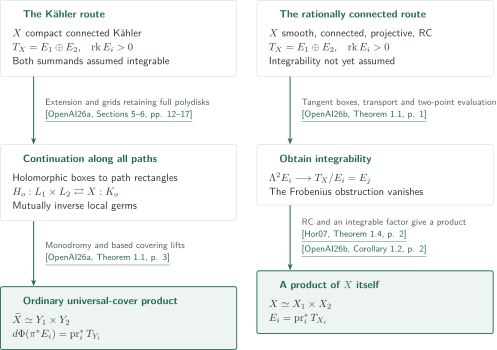

# Tangent-bundle splittings and universal covers

**Catalogue 052**

These two papers separate obtaining integrability for a specified holomorphic splitting $T_X=E_1\oplus E_2$ from passing to a global product. In the compact Kähler setting, integrability is assumed and the ordinary universal cover is split. In the rationally connected projective setting, integrability is proved before splitting $X$ itself.

## 1. Papers in official catalogue order

CATALOGINVENTORYTOKEN

## References on the arrows

- **OpenAI26a** — OpenAI, *Universal-cover splitting for compact Kähler manifolds*, September 23, 2026, 33 pages. Global holomorphic-box continuation and the ordinary universal-cover product, assuming integrability.
- **OpenAI26b** — OpenAI, *Integrability of split tangent bundles on rationally connected manifolds*, September 23, 2026, 16 pages. Integrability of the specified splitting from rational connectedness.
- **Hor07** — Andreas Höring, *Uniruled varieties with split tangent bundle*, arXiv:math/0505327v3 (2017-11-09; internal PDF date November 2, 2018). Theorem 1.4 turns an integrable summand into a product of $X$ itself in the rationally connected projective setting. The external proof itself is outside the checking scope.

<!-- cite:universal -->[&#91;OpenAI26a, Theorem 1.1, p. 3&#93;](https://github.com/openai/math/blob/1581d4cbdd69a0faf34b2089614fe2a814316a6a/preprints/Universal-cover-splitting-for-compact-Kahler-manifolds-September-23-2026/paper.pdf)<!-- /cite -->

<!-- cite:integrability -->[&#91;OpenAI26b, Theorem 1.1, p. 1&#93;](https://github.com/openai/math/blob/1581d4cbdd69a0faf34b2089614fe2a814316a6a/preprints/Integrability-of-split-tangent-bundles-on-rationally-connected-manifolds-September-23-2026/main.pdf)<!-- /cite -->

<!-- cite:horing-product -->[&#91;Hor07, Theorem 1.4, p. 2&#93;](https://arxiv.org/pdf/math/0505327v3#page=2)<!-- /cite -->

## 2. Where integrability enters and which space becomes a product

The left route promotes local products from two integrable distributions to a global product of the universal cover through all-path continuation. The right route uses tangent boxes of rational curves and two-point evaluation to kill the Lie-bracket obstruction, then applies Höring's product theorem. A tangent box may have critical points; it is not a local product chart before integrability is obtained.

No solid proof-dependency arrow connects the two papers. The left manuscript cites the right main theorem as context in its introduction, not as an input to its main proof. The right Corollary 1.2 uses Höring rather than the left main theorem. This checks the principal connections to the main results; it does not certify the absence of dependencies throughout unexamined references and appendices.

<!-- cite:companion -->[&#91;OpenAI26a, Introduction, p. 3&#93;](https://github.com/openai/math/blob/1581d4cbdd69a0faf34b2089614fe2a814316a6a/preprints/Universal-cover-splitting-for-compact-Kahler-manifolds-September-23-2026/paper.pdf)<!-- /cite -->

<!-- cite:product -->[&#91;OpenAI26b, Corollary 1.2, p. 2&#93;](https://github.com/openai/math/blob/1581d4cbdd69a0faf34b2089614fe2a814316a6a/preprints/Integrability-of-split-tangent-bundles-on-rationally-connected-manifolds-September-23-2026/main.pdf)<!-- /cite -->

The [universal-cover proof overview](../universal-cover-splitting/article.en.md#proof-1) follows holomorphic extension, area bounds and the two path grids. The [integrability article](../split-tangent-integrability/article.en.md#proof-overview) follows rational reconstruction and holomorphic removal of a formal box, bundle transport and two-point evaluation. Non-uniruled and nef-and-big applications belong to the former; general rationally connected fibres and the rank-two structure belong to the latter. The latter's Corollary 5.1 does not assert integrability or a product for the whole ambient uniruled Kähler manifold.

<!-- cite:quotient -->[&#91;OpenAI26b, Corollary 5.1, pp. 12–13&#93;](https://github.com/openai/math/blob/1581d4cbdd69a0faf34b2089614fe2a814316a6a/preprints/Integrability-of-split-tangent-bundles-on-rationally-connected-manifolds-September-23-2026/main.pdf)<!-- /cite -->

## 3. Sources and checking scope

The official field is **Algebraic and complex geometry** (second in official order, entries 032–069). On p.7 of overview.pdf, entry 052 is **Tangent-bundle splittings and universal covers**; CONTENTS.md uses **Tangent splittings and product decompositions**. The overview title-page date is October 6, 2026; the reference commit is `1581d4cbdd69a0faf34b2089614fe2a814316a6a`. Both manuscripts are dated September 23, 2026.

<!-- cite:catalog -->[OpenAI Research Catalog · Catalogue 052 · p. 7](https://github.com/openai/math/blob/1581d4cbdd69a0faf34b2089614fe2a814316a6a/overview.pdf)<!-- /cite -->

The articles check principal statements, proof overviews for every conclusion, and the statements and uses of direct inputs. The Kollár–Mori theorem statement and page in the universal-cover article, the alternative proof in its Appendices A–D, and complete proofs of external inputs remain unchecked. Each article ends with a reading guide and its precise checking scope. Consistency checks of explanations, diagrams and citations are separate from certifying complete proofs or expert peer review.
