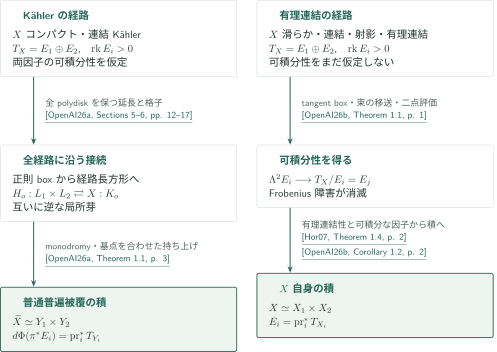

# 接束の分裂と普遍被覆

**Tangent-bundle splittings and universal covers — カタログ052**

指定された正則接束分裂$T_X=E_1\oplus E_2$について、可積分性を得る問題と、そこから大域的な積へ進む問題を分けて扱う2本を収録する。コンパクトKählerの場合は可積分性を仮定して普通普遍被覆を分解し、有理連結射影の場合は可積分性を証明した後に$X$自身を分解する。

## 1. 公式順の記事一覧

CATALOGINVENTORYTOKEN

## 図の引用案内

- **OpenAI26a** — OpenAI, *Universal-cover splitting for compact Kähler manifolds*, September 23, 2026, 33ページ。可積分性を前提とする正則boxの大域延長と普通普遍被覆の積を扱う。
- **OpenAI26b** — OpenAI, *Integrability of split tangent bundles on rationally connected manifolds*, September 23, 2026, 16ページ。有理連結性から指定分裂の可積分性を示す。
- **Hor07** — Andreas Höring, *Uniruled varieties with split tangent bundle*, arXiv:math/0505327v3（2017-11-09、PDF内部の日付は2018-11-02）。Theorem 1.4は有理連結射影の場合に可積分な因子から$X$自身の積を与える。外部証明そのものは検証範囲外。

<!-- cite:universal -->[&#91;OpenAI26a, Theorem 1.1, p. 3&#93;](https://github.com/openai/math/blob/1581d4cbdd69a0faf34b2089614fe2a814316a6a/preprints/Universal-cover-splitting-for-compact-Kahler-manifolds-September-23-2026/paper.pdf)<!-- /cite -->

<!-- cite:integrability -->[&#91;OpenAI26b, Theorem 1.1, p. 1&#93;](https://github.com/openai/math/blob/1581d4cbdd69a0faf34b2089614fe2a814316a6a/preprints/Integrability-of-split-tangent-bundles-on-rationally-connected-manifolds-September-23-2026/main.pdf)<!-- /cite -->

<!-- cite:horing-product -->[&#91;Hor07, Theorem 1.4, p. 2&#93;](https://arxiv.org/pdf/math/0505327v3#page=2)<!-- /cite -->

## 2. 可積分性の位置と、積になる空間

左の経路は、二つの可積分分布から得た局所積を、全経路に沿う延長で普遍被覆の大域積へ変える。右の経路は、有理曲線のtangent boxと二点評価でLie括弧の障害を消し、Höringの積定理へ渡す。tangent boxは臨界点をもつ写像でもよく、可積分性を得る前の局所積座標とは同一視しない。

2本の間に実線の証明依存を置いていない。左の原稿は右の主定理を序論で背景として引用するが、主証明の入力には使わない。右のCorollary 1.2は左の主定理ではなくHöringを使う。この確認範囲は各主結果への主要な接続であり、未調査の参考文献・付録全体について依存の不存在を認定するものではない。

<!-- cite:companion -->[&#91;OpenAI26a, Introduction, p. 3&#93;](https://github.com/openai/math/blob/1581d4cbdd69a0faf34b2089614fe2a814316a6a/preprints/Universal-cover-splitting-for-compact-Kahler-manifolds-September-23-2026/paper.pdf)<!-- /cite -->

<!-- cite:product -->[&#91;OpenAI26b, Corollary 1.2, p. 2&#93;](https://github.com/openai/math/blob/1581d4cbdd69a0faf34b2089614fe2a814316a6a/preprints/Integrability-of-split-tangent-bundles-on-rationally-connected-manifolds-September-23-2026/main.pdf)<!-- /cite -->

[普遍被覆の記事の全体証明](../universal-cover-splitting/article.ja.md#proof-1)では、正則延長・面積評価・二種類の経路格子を追う。[可積分性の記事](../split-tangent-integrability/article.ja.md#proof-overview)では、形式boxの有理化と正則化、束の移送、二点評価の役割を追う。非単線織・nefかつbigの応用は前者、一般有理連結ファイバーと階数2の構造は後者にまとめる。後者のCorollary 5.1は、周囲の単線織Kähler多様体全体の可積分性や積を主張する結果ではない。

<!-- cite:quotient -->[&#91;OpenAI26b, Corollary 5.1, pp. 12–13&#93;](https://github.com/openai/math/blob/1581d4cbdd69a0faf34b2089614fe2a814316a6a/preprints/Integrability-of-split-tangent-bundles-on-rationally-connected-manifolds-September-23-2026/main.pdf)<!-- /cite -->

## 3. 原典・確認範囲

公式分野は **Algebraic and complex geometry**（公式順2番目、番号032–069）。overview.pdfのp.7では052を **Tangent-bundle splittings and universal covers** と表記し、CONTENTS.mdの見出しは **Tangent splittings and product decompositions** である。公式概要の表紙日付はOctober 6, 2026、参照commitは `1581d4cbdd69a0faf34b2089614fe2a814316a6a`。2本ともSeptember 23, 2026版を読む。

<!-- cite:catalog -->[OpenAI Research Catalog · Catalogue 052 · p. 7](https://github.com/openai/math/blob/1581d4cbdd69a0faf34b2089614fe2a814316a6a/overview.pdf)<!-- /cite -->

記事の主要結果と各結論への証明概略、直接入力の記述・適用箇所を照合した。普遍被覆論文のKollár–Mori入力の定理本文・ページ、Appendices A–Dの別証明、外部定理の証明全体は未確認として残る。個々の記事末尾に読書案内と確認範囲を記す。概説・図・引用の整合確認は、原稿全体の正しさの認定や専門家査読とは別である。
