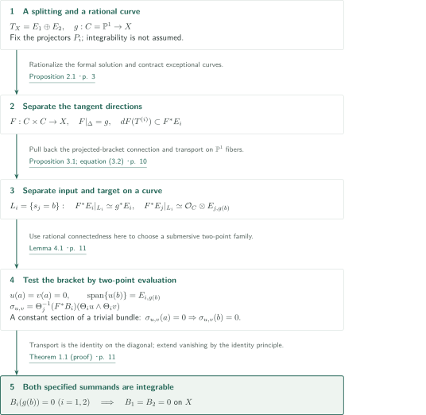
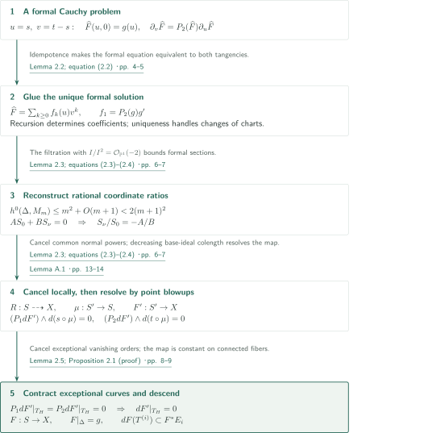
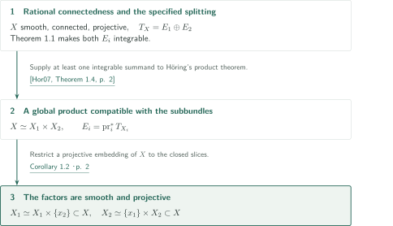
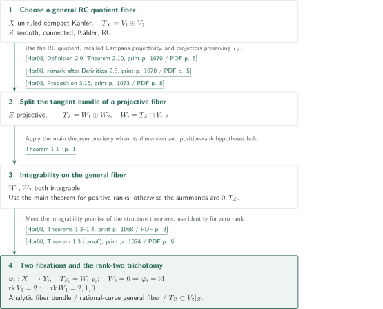

# Integrability of split tangent bundles on rationally connected manifolds

**Separating formal tangent directions, extending a rational map, and killing the bracket tensors**

The manuscript proves integrability of both summands of a specified holomorphic tangent-bundle splitting on a smooth rationally connected projective manifold. Its key construction extends a rational curve on the diagonal to a map whose two factor directions lie in the two summands. Relative connections on this map move the bracket tensor into a trivial target bundle; a two-point family of rational curves then forces it to vanish. A global product requires the additional input of Höring’s product theorem.

## 1. Main results

### Theorem 1.1 — Automatic integrability of both specified summands

Let $X$ be a smooth connected projective complex manifold of dimension at least $2$. Suppose that two general points of $X$ lie on the image of a morphism $\mathbb P^1\to X$. Here “two general points” means every pair in some nonempty Zariski open subset of $X\times X$. For every specified holomorphic decomposition

$$T_X=E_1\oplus E_2$$

into subbundles of positive rank, both $E_1$ and $E_2$ are integrable. The embeddings $E_i\subset T_X$ are part of the specified splitting.

<!-- cite:main -->[Theorem 1.1 · p. 1](https://github.com/openai/math/blob/1581d4cbdd69a0faf34b2089614fe2a814316a6a/preprints/Integrability-of-split-tangent-bundles-on-rationally-connected-manifolds-September-23-2026/main.pdf)<!-- /cite -->

### Corollary 1.2 — A product of the manifold compatible with its specified splitting

Under the hypotheses of Theorem 1.1, there are smooth projective manifolds $X_1,X_2$ and an isomorphism $X\simeq X_1\times X_2$ under which

$$E_i=\operatorname{pr}_i^*T_{X_i}\qquad(i=1,2)$$

as subbundles. This is a product decomposition of $X$ itself.

<!-- cite:product -->[Corollary 1.2 · p. 2](https://github.com/openai/math/blob/1581d4cbdd69a0faf34b2089614fe2a814316a6a/preprints/Integrability-of-split-tangent-bundles-on-rationally-connected-manifolds-September-23-2026/main.pdf)<!-- /cite -->

### Corollary 5.1 — Two fibrations from the rationally connected quotient

Let $X$ be a connected uniruled compact Kähler manifold with a holomorphic splitting $T_X=V_1\oplus V_2$. Let $Z$ be a general fiber of its rationally connected quotient and put $W_i=T_Z\cap V_i|_Z$. For each $i=1,2$, there is an almost-holomorphic fibration $\varphi_i\colon X\dashrightarrow Y_i$ whose general fiber $F_i$ is rationally connected and, for compatible choices $F_i\subset Z$, satisfies

$$T_{F_i}=W_i|_{F_i}\subset V_i|_{F_i}.$$

If $W_i=0$, one may take $\varphi_i=\operatorname{id}_X$ with point fibers.

If in addition $\operatorname{rank}V_1=2$, exactly one of the following holds.

1. $W_1=V_1|_Z$. There is an analytic fiber bundle $X\to Y$ with rationally connected general fiber and $T_{X/Y}=V_1$.
2. $W_1$ is a line bundle. There is an equidimensional holomorphic map $X\to Y$ whose general fiber $F$ is a rational curve with $T_F\subset V_1|_F$.
3. $W_1=0$, equivalently $T_Z\subset V_2|_Z$.

<!-- cite:quotient -->[Corollary 5.1 · pp. 12–13](https://github.com/openai/math/blob/1581d4cbdd69a0faf34b2089614fe2a814316a6a/preprints/Integrability-of-split-tangent-bundles-on-rationally-connected-manifolds-September-23-2026/main.pdf)<!-- /cite -->

## References on the arrows

<!-- reference-guide -->
Unprefixed theorem, lemma, section and equation numbers refer to [Integrability of split tangent bundles on rationally connected manifolds](https://github.com/openai/math/blob/1581d4cbdd69a0faf34b2089614fe2a814316a6a/preprints/Integrability-of-split-tangent-bundles-on-rationally-connected-manifolds-September-23-2026/main.pdf). External inputs use the following keys.

- [Hor07](https://arxiv.org/pdf/math/0505327v3) Andreas Höring — *Uniruled varieties with split tangent bundle*: Compatible product from an integrable specified splitting on a rationally connected manifold. arXiv:math/0505327v3 (PDF margin: 9 Nov 2017; internal date: November 2, 2018); numbering of this preprint, not the journal version.
- [Hor08](https://ocu-omu.repo.nii.ac.jp/record/2010198/files/111F0000002-04504-14.pdf) Andreas Höring — *The structure of uniruled manifolds with split tangent bundle*: General RC quotient fibers, their projectivity and tangent splitting, almost-holomorphic fibrations and the rank-two trichotomy. Osaka Journal of Mathematics 45 (2008), 1067–1084; published text, repository PDF with one cover sheet.

Each citation gives the result and pages. When printed pagination differs from the PDF position, both are shown. GitHub previews do not automatically jump to the cited page.
<!-- /reference-guide -->

## 2. Theorem 1.1 — Proof overview of the main theorem

<!-- proof-target:1 -->Proof target：[Theorem 1.1 · p. 1](https://github.com/openai/math/blob/1581d4cbdd69a0faf34b2089614fe2a814316a6a/preprints/Integrability-of-split-tangent-bundles-on-rationally-connected-manifolds-September-23-2026/main.pdf)<!-- /proof-target -->

**Proof route.** Write $P_i$ for the projectors of the splitting in [Theorem 1.1](#theorem-1-1). Without using rational connectedness, extend any $g\colon C=\mathbb P^1\to X$ to a map $F\colon S=C\times C\to X$ with separated tangent directions. The construction is explained in the [section on Proposition 2.1](#proof-1). Relative connections identify $F^*E_i$ with a pullback from the $i$th factor. Rational connectedness enters only afterwards, through submersive two-point evaluation.

### 1. Trivialize the complementary bundle on a factor curve

Take $F$ satisfying $F|_\Delta=g$ and $dF(T^{(i)})\subset F^*E_i$, where $T^{(i)}=\operatorname{pr}_i^*T_C$. The map may have critical points: a tangent box does not supply coordinates or a local product decomposition of $X$.

For $i\ne j$, $\xi\in E_j$ and $e\in E_i$, the formula $\nabla^i_\xi e=P_i[\xi,e]$ is tensorial in the direction and satisfies the Leibniz rule in $e$. This partial connection requires no integrability of either bundle. The tangency of $F$ pulls it back to a holomorphic connection on $F^*E_i$ relative to $\operatorname{pr}_i$. The construction does not invert $dF$ and remains defined at critical points.

On each $\mathbb P^1$ fiber its curvature is a holomorphic two-form and vanishes. Simple connectedness makes parallel transport path-independent. Transport starting on the diagonal varies holomorphically and gives the isomorphisms of Proposition 3.1:

$$\Theta_i\colon\operatorname{pr}_i^*(g^*E_i)\xrightarrow{\sim}F^*E_i,\qquad \Theta_i|_\Delta=\operatorname{id}.$$

Flatness here concerns the restriction to the curve fibers; no flat connection on all of $X$ has been produced.

<!-- cite:box -->[Proposition 2.1 · p. 3](https://github.com/openai/math/blob/1581d4cbdd69a0faf34b2089614fe2a814316a6a/preprints/Integrability-of-split-tangent-bundles-on-rationally-connected-manifolds-September-23-2026/main.pdf)<!-- /cite --> · <!-- cite:transport -->[Proposition 3.1; equation (3.2) · p. 10](https://github.com/openai/math/blob/1581d4cbdd69a0faf34b2089614fe2a814316a6a/preprints/Integrability-of-split-tangent-bundles-on-rationally-connected-manifolds-September-23-2026/main.pdf)<!-- /cite -->

### 2. Produce sections vanishing at one point and spanning at the other

Fix distinct $a,b\in C$. Lemma 4.1 supplies a nonempty family $G\colon C\times T\to X$ for which $(\mathrm{ev}_a,\mathrm{ev}_b)\colon T\to X\times X$ is a submersion. Appendix B constructs countably many families using polynomial presentations in projective space. Their two-point images contain general pairs. If all images had deficient rank, their union would have measure zero, so some family has full rank.

For $g=G(\cdot,\tau)$, differentiating in a parameter direction gives a global section of $g^*T_X$. Surjectivity of two-point evaluation, followed by projection with $P_i$, shows that global sections of $g^*E_i$ vanishing at $a$ have values spanning $E_{i,g(b)}$. The tangent boxes of the separate curves need not themselves be chosen as a holomorphic family.

<!-- cite:evaluation -->[Lemma 4.1 · p. 11](https://github.com/openai/math/blob/1581d4cbdd69a0faf34b2089614fe2a814316a6a/preprints/Integrability-of-split-tangent-bundles-on-rationally-connected-manifolds-September-23-2026/main.pdf)<!-- /cite --> · <!-- cite:family -->[Appendix B; Lemma 4.1 (proof) · pp. 14–15](https://github.com/openai/math/blob/1581d4cbdd69a0faf34b2089614fe2a814316a6a/preprints/Integrability-of-split-tangent-bundles-on-rationally-connected-manifolds-September-23-2026/main.pdf)<!-- /cite -->

### 3. Kill both brackets by reducing their values to constant sections

The obstruction to integrability is the holomorphic bundle morphism

$$B_i\colon\bigwedge^2E_i\longrightarrow E_j,\qquad B_i(e,e')=P_j[e,e']\quad(j\ne i).$$

On $L_i=\{s_j=b\}\subset S$, the map $\Theta_i$ identifies the input bundle with $g^*E_i$, while $\Theta_j$ identifies the target with $\mathcal O_C\otimes E_{j,g(b)}$. For global sections $u,v$ of $g^*E_i$ vanishing at $a$,

$$\sigma_{u,v}=\Theta_j^{-1}\big((F^*B_i)(\Theta_i u\wedge\Theta_i v)\big)\in H^0(C,\mathcal O_C\otimes E_{j,g(b)})$$

is constant. It vanishes at $a$ and therefore at $b$. At $(b,b)$, one has $F(b,b)=g(b)$ and the transport maps are the identity, so $B_i(g(b))(u(b)\wedge v(b))=0$. The spanning property gives $B_i(g(b))=0$. The image of $\mathrm{ev}_b$ is nonempty and open, and the identity principle on connected $X$ makes $B_i$ vanish everywhere. Applying the argument for both $i=1,2$ proves integrability of both specified subbundles.

<!-- cite:bracket -->[Theorem 1.1 (proof) · p. 11](https://github.com/openai/math/blob/1581d4cbdd69a0faf34b2089614fe2a814316a6a/preprints/Integrability-of-split-tangent-bundles-on-rationally-connected-manifolds-September-23-2026/main.pdf)<!-- /cite -->

## 3. Proposition 2.1 — From formal tangency to a global tangent box

<!-- proof-target:2 -->Proof target：[Proposition 2.1 · p. 3](https://github.com/openai/math/blob/1581d4cbdd69a0faf34b2089614fe2a814316a6a/preprints/Integrability-of-split-tangent-bundles-on-rationally-connected-manifolds-September-23-2026/main.pdf)<!-- /proof-target -->

<!-- statement:proposition-2-1 -->
### Proposition 2.1 — Tangent box

Let $X$ be a smooth projective complex manifold with a fixed holomorphic splitting $T_X=E_1\oplus E_2$. Put $C=\mathbb P^1$, $S=C\times C$, let $\Delta\subset S$ be the diagonal, and set $T^{(i)}=\operatorname{pr}_i^*T_C$. Every holomorphic map $g\colon C\to X$ admits a holomorphic map $F\colon S\to X$ satisfying

$$F|_\Delta=g,\qquad dF(T^{(i)})\subset F^*E_i\quad(i=1,2).$$

Neither summand is assumed integrable.

<!-- cite:box -->[Proposition 2.1 · p. 3](https://github.com/openai/math/blob/1581d4cbdd69a0faf34b2089614fe2a814316a6a/preprints/Integrability-of-split-tangent-bundles-on-rationally-connected-manifolds-September-23-2026/main.pdf)<!-- /cite -->
<!-- /statement -->

### 1. Solve a formal Cauchy problem using the projectors

With $u=s,v=t-s$ near the diagonal, the required tangencies are equivalent to

$$\widehat F(u,0)=g(u),\qquad\partial_v\widehat F=P_2(\widehat F)\partial_u\widehat F.$$

In $\widehat F=\sum f_k(u)v^k$, comparison of coefficients determines $(k+1)f_{k+1}$ from previous coefficients and their $u$ derivatives. Uniqueness glues the local solutions across coordinate changes. No convergence in the normal direction is asserted at this stage.

<!-- cite:formal -->[Lemma 2.2; equation (2.2) · pp. 4–5](https://github.com/openai/math/blob/1581d4cbdd69a0faf34b2089614fe2a814316a6a/preprints/Integrability-of-split-tangent-bundles-on-rationally-connected-manifolds-September-23-2026/main.pdf)<!-- /cite -->

### 2. Turn positivity of the diagonal’s normal bundle into a section bound

For a projective embedding $X\subset\mathbb P^N$, let $L$ be the formal pullback of the hyperplane bundle, with $L|_\Delta\simeq\mathcal O_C(d)$. Since $I/I^2\simeq\mathcal O_C(-2)$, the filtration by normal vanishing order of $M_m=L\otimes\widehat{\mathcal O}_S(m,m)$ yields

$$\dim H^0(\Delta,M_m)\le\sum_{k\ge0}\max\{d+2m-2k+1,0\}=m^2+O(m+1).$$

Pairs of ordinary polynomial sections form a space of dimension $2(m+1)^2$. This forces a nonzero relation $AS_0+BS_\nu=0$ between formal homogeneous coordinates, expressing $S_\nu/S_0=-A/B$ as a rational function. Choose a point of the diagonal where the leading denominator coefficients are nonzero. Canceling common powers of the normal parameter then gives a holomorphic map near that point with the same formal expansion. The manuscript does not invoke an external G3 theorem for this step.

<!-- cite:rational -->[Lemma 2.3; equations (2.3)–(2.4) · pp. 6–7](https://github.com/openai/math/blob/1581d4cbdd69a0faf34b2089614fe2a814316a6a/preprints/Integrability-of-split-tangent-bundles-on-rationally-connected-manifolds-September-23-2026/main.pdf)<!-- /cite --> · <!-- cite:g3 -->[Remark 2.4 · p. 8](https://github.com/openai/math/blob/1581d4cbdd69a0faf34b2089614fe2a814316a6a/preprints/Integrability-of-split-tangent-bundles-on-rationally-connected-manifolds-September-23-2026/main.pdf)<!-- /cite -->

### 3. The two tangencies force zero derivative on exceptional curves

Resolve the resulting rational map by finitely many point blowups $\mu\colon S'\to S$, obtaining $F'\colon S'\to X$. Appendix A proves finite termination through a decreasing local base-ideal colength. The tangencies give global identities

$$(P_1dF')\wedge d(s\circ\mu)=0,\qquad(P_2dF')\wedge d(t\circ\mu)=0.$$

At a general point of an exceptional curve $H$, write $s\circ\mu-s(p)=r^\alpha h$ and $t\circ\mu-t(p)=r^\beta\widetilde h$. Cancel the common powers and restrict to $r=0$. Both $P_1dF'|_{T_H}$ and $P_2dF'|_{T_H}$ vanish, so $dF'|_{T_H}=0$. Every exceptional component maps to a point. Connectedness of the fibers of $\mu$ allows $F'$ to descend to $S$, and removability at isolated points makes the descended map holomorphic. The identity principle extends its diagonal value and tangencies globally.

<!-- cite:surface -->[Lemma A.1 · pp. 13–14](https://github.com/openai/math/blob/1581d4cbdd69a0faf34b2089614fe2a814316a6a/preprints/Integrability-of-split-tangent-bundles-on-rationally-connected-manifolds-September-23-2026/main.pdf)<!-- /cite --> · <!-- cite:extension -->[Lemma 2.5; Proposition 2.1 (proof) · pp. 8–9](https://github.com/openai/math/blob/1581d4cbdd69a0faf34b2089614fe2a814316a6a/preprints/Integrability-of-split-tangent-bundles-on-rationally-connected-manifolds-September-23-2026/main.pdf)<!-- /cite -->

## 4. Corollary 1.2 — From integrability to a compatible product

<!-- proof-target:3 -->Proof target：[Corollary 1.2 · p. 2](https://github.com/openai/math/blob/1581d4cbdd69a0faf34b2089614fe2a814316a6a/preprints/Integrability-of-split-tangent-bundles-on-rationally-connected-manifolds-September-23-2026/main.pdf)<!-- /proof-target -->

The target is [Corollary 1.2](#corollary-1-2). The preceding argument establishes integrability of specified subbundles; obtaining a global product is a separate step.

### 1. Apply the product theorem and realize the factors as projective slices

Höring’s Theorem 1.4 starts with a specified tangent splitting on a rationally connected projective manifold and requires at least one integrable summand. It produces $X\simeq X_1\times X_2$ compatible with both summands. The manuscript’s Theorem 1.1 supplies the integrability hypothesis. The factors are smooth and occur as closed complex submanifolds of $X$ by taking slices of the product. Restriction of a projective embedding of $X$ proves that each factor is projective.

Compatibility here concerns the specified holomorphic tangent subbundles; it does not assert an orthogonal product for a metric. The product of $X$ itself should also be distinguished from one obtained only after passing to a finite or universal cover.

<!-- cite:horing-product -->[&#91;Hor07, Theorem 1.4, p. 2&#93;](https://arxiv.org/pdf/math/0505327v3#page=2)<!-- /cite --> · <!-- cite:product -->[Corollary 1.2 · p. 2](https://github.com/openai/math/blob/1581d4cbdd69a0faf34b2089614fe2a814316a6a/preprints/Integrability-of-split-tangent-bundles-on-rationally-connected-manifolds-September-23-2026/main.pdf)<!-- /cite -->

## 5. Corollary 5.1 — Apply the theorem on a general RC fiber and separate the ranks

<!-- proof-target:4 -->Proof target：[Corollary 5.1 · pp. 12–13](https://github.com/openai/math/blob/1581d4cbdd69a0faf34b2089614fe2a814316a6a/preprints/Integrability-of-split-tangent-bundles-on-rationally-connected-manifolds-September-23-2026/main.pdf)<!-- /proof-target -->

The target is [Corollary 5.1](#corollary-5-1). The ambient $X$ is not assumed projective or rationally connected. Theorem 1.1 is applied to a general fiber $Z$ of its RC quotient.

### 1. Establish the hypotheses on the general fiber

Using Definition 2.9 and Theorem 2.10 in Höring’s published version, choose $Z$ over a regular value in the fibration locus. It is a smooth connected compact submanifold, inherits a Kähler form, and is rationally connected. Campana’s result recalled immediately after Definition 2.8 makes $Z$ projective.

Proposition 3.16 says that the ambient projectors $P_i$ preserve $T_Z$. Their restrictions are complementary holomorphic idempotents of constant rank on connected $Z$. Their images are therefore subbundles $W_i$ and $T_Z=W_1\oplus W_2$. If both ranks are positive, then $\dim Z\ge2$ and Theorem 1.1 applies. Otherwise the two summands are $0,T_Z$ and integrability already holds.

<!-- cite:horing-quotient -->[&#91;Hor08, Definition 2.9; Theorem 2.10, print p. 1070 / PDF p. 5&#93;](https://ocu-omu.repo.nii.ac.jp/record/2010198/files/111F0000002-04504-14.pdf#page=5)<!-- /cite --> · <!-- cite:horing-projective -->[&#91;Hor08, remark after Definition 2.8, print p. 1070 / PDF p. 5&#93;](https://ocu-omu.repo.nii.ac.jp/record/2010198/files/111F0000002-04504-14.pdf#page=5)<!-- /cite --> · <!-- cite:horing-preserve -->[&#91;Hor08, Proposition 3.16, print p. 1073 / PDF p. 8&#93;](https://ocu-omu.repo.nii.ac.jp/record/2010198/files/111F0000002-04504-14.pdf#page=8)<!-- /cite --> · <!-- cite:main -->[Theorem 1.1 · p. 1](https://github.com/openai/math/blob/1581d4cbdd69a0faf34b2089614fe2a814316a6a/preprints/Integrability-of-split-tangent-bundles-on-rationally-connected-manifolds-September-23-2026/main.pdf)<!-- /cite -->

### 2. Pass from integrability on general fibers to two fibrations

The integrability hypothesis of Höring’s Theorem 1.3 now holds. For both $i=1,2$, it gives an almost-holomorphic fibration with $T_{F_i}=W_i|_{F_i}$. The published convention permits the identity map, and its proof handles $W_i=0$ by $\operatorname{id}_X$. This case is treated separately from Theorem 1.1, which requires positive ranks. Integrability of $W_i$ does not imply integrability of the ambient $V_i$ in general.

<!-- cite:horing-structure -->[&#91;Hor08, Theorems 1.3–1.4, print p. 1068 / PDF p. 3&#93;](https://ocu-omu.repo.nii.ac.jp/record/2010198/files/111F0000002-04504-14.pdf#page=3)<!-- /cite --> · <!-- cite:horing-identity -->[&#91;Hor08, Theorem 1.3 (proof), print p. 1074 / PDF p. 9&#93;](https://ocu-omu.repo.nii.ac.jp/record/2010198/files/111F0000002-04504-14.pdf#page=9)<!-- /cite -->

### 3. Obtain all three alternatives under the rank-two hypothesis

If $\operatorname{rank}V_1=2$, the rank of $W_1$ is $2,1$, or $0$. Under the same integrability premise, Höring’s Theorem 1.4 gives, respectively, an analytic fiber bundle with $T_{X/Y}=V_1$, an equidimensional holomorphic map with rational-curve general fiber, or $T_Z\subset V_2|_Z$. The ranks are mutually exclusive and exhaustive, proving the “exactly one” assertion in Corollary 5.1.

<!-- cite:horing-structure -->[&#91;Hor08, Theorems 1.3–1.4, print p. 1068 / PDF p. 3&#93;](https://ocu-omu.repo.nii.ac.jp/record/2010198/files/111F0000002-04504-14.pdf#page=3)<!-- /cite --> · <!-- cite:quotient -->[Corollary 5.1 · pp. 12–13](https://github.com/openai/math/blob/1581d4cbdd69a0faf34b2089614fe2a814316a6a/preprints/Integrability-of-split-tangent-bundles-on-rationally-connected-manifolds-September-23-2026/main.pdf)<!-- /cite -->

## 6. Which papers supply which steps

| Input | Used at | Role and hypotheses | Checking scope |
|---|---|---|---|
| <!-- cite:horing-product -->[&#91;Hor07, Theorem 1.4, p. 2&#93;](https://arxiv.org/pdf/math/0505327v3#page=2)<!-- /cite --> | [Corollary 1.2](#proof-2) | A compatible product for a specified splitting on projective RC $X$ with at least one integrable summand | Statement in the specified version and manuscript application checked |
| <!-- cite:horing-quotient -->[&#91;Hor08, Definition 2.9; Theorem 2.10, print p. 1070 / PDF p. 5&#93;](https://ocu-omu.repo.nii.ac.jp/record/2010198/files/111F0000002-04504-14.pdf#page=5)<!-- /cite --> · <!-- cite:horing-projective -->[&#91;Hor08, remark after Definition 2.8, print p. 1070 / PDF p. 5&#93;](https://ocu-omu.repo.nii.ac.jp/record/2010198/files/111F0000002-04504-14.pdf#page=5)<!-- /cite --> | [Corollary 5.1 inputs](#proof-3-step-1) | Choose the general RC fiber as a smooth compact Kähler, hence projective, manifold | Published conventions and statements, including the recalled Campana result, checked |
| <!-- cite:horing-preserve -->[&#91;Hor08, Proposition 3.16, print p. 1073 / PDF p. 8&#93;](https://ocu-omu.repo.nii.ac.jp/record/2010198/files/111F0000002-04504-14.pdf#page=8)<!-- /cite --> | [Splitting on the fiber](#proof-3-step-1) | Ambient projectors preserve $T_Z$ and give complementary subbundles | Statement and preservation argument checked |
| <!-- cite:horing-structure -->[&#91;Hor08, Theorems 1.3–1.4, print p. 1068 / PDF p. 3&#93;](https://ocu-omu.repo.nii.ac.jp/record/2010198/files/111F0000002-04504-14.pdf#page=3)<!-- /cite --> · <!-- cite:horing-identity -->[&#91;Hor08, Theorem 1.3 (proof), print p. 1074 / PDF p. 9&#93;](https://ocu-omu.repo.nii.ac.jp/record/2010198/files/111F0000002-04504-14.pdf#page=9)<!-- /cite --> | [Fibrations and trichotomy](#proof-3-step-2) | Integrable $W_i$ give the fibrations; zero rank allows identity, and $\operatorname{rank}V_1=2$ gives three cases | Statements, applicability and identity case checked |

The tangent-box construction for the main theorem is internal to the manuscript. Formal-function and G3 theory are cited as background, but Lemma 2.3 does not claim to use a G3 theorem as a direct input. Checking external statements and their applications is distinct from verifying their proofs.

<!-- cite:g3 -->[Remark 2.4 · p. 8](https://github.com/openai/math/blob/1581d4cbdd69a0faf34b2089614fe2a814316a6a/preprints/Integrability-of-split-tangent-bundles-on-rationally-connected-manifolds-September-23-2026/main.pdf)<!-- /cite -->

## 7. Return to the sources

<!-- reading-list -->
- [Proposition 2.1 · p. 3](https://github.com/openai/math/blob/1581d4cbdd69a0faf34b2089614fe2a814316a6a/preprints/Integrability-of-split-tangent-bundles-on-rationally-connected-manifolds-September-23-2026/main.pdf) — The tangent-box statement and its three-stage construction.
- [Lemma 2.3; equations (2.3)–(2.4) · pp. 6–7](https://github.com/openai/math/blob/1581d4cbdd69a0faf34b2089614fe2a814316a6a/preprints/Integrability-of-split-tangent-bundles-on-rationally-connected-manifolds-September-23-2026/main.pdf) — The section count that reconstructs rational coordinate functions.
- [Proposition 3.1; equation (3.2) · p. 10](https://github.com/openai/math/blob/1581d4cbdd69a0faf34b2089614fe2a814316a6a/preprints/Integrability-of-split-tangent-bundles-on-rationally-connected-manifolds-September-23-2026/main.pdf) — Relative connections without an integrability hypothesis and diagonal normalization.
- [Theorem 1.1 (proof) · p. 11](https://github.com/openai/math/blob/1581d4cbdd69a0faf34b2089614fe2a814316a6a/preprints/Integrability-of-split-tangent-bundles-on-rationally-connected-manifolds-September-23-2026/main.pdf) — Constant sections and two-point evaluation kill both bracket tensors.
- [Corollary 1.2 · p. 2](https://github.com/openai/math/blob/1581d4cbdd69a0faf34b2089614fe2a814316a6a/preprints/Integrability-of-split-tangent-bundles-on-rationally-connected-manifolds-September-23-2026/main.pdf) — The external product input and projectivity of the factors.
- [Corollary 5.1 · pp. 12–13](https://github.com/openai/math/blob/1581d4cbdd69a0faf34b2089614fe2a814316a6a/preprints/Integrability-of-split-tangent-bundles-on-rationally-connected-manifolds-September-23-2026/main.pdf) — Reapply the main theorem to general RC quotient fibers.
<!-- /reading-list -->

The statements, the proof text in §§2–5, and Appendices A–B were read to trace formal-to-rational reconstruction, contraction of exceptional curves, relative transport, and two-point evaluation leading to bracket vanishing. The input statements in the specified versions of the two Höring papers were compared with their uses. Campana’s projectivity result was checked as recalled in Höring’s published paper; its original proof was not read.

This does not constitute a complete independent reconstruction of all technical details of formal gluing, decreasing base ideals, or holomorphic parameter dependence of transport. External proofs and their further dependencies were not recursively verified. It is neither expert peer review nor certification of the entire argument. Cross-catalog connections beyond those recorded remain uninvestigated.
