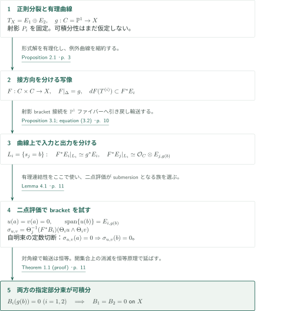
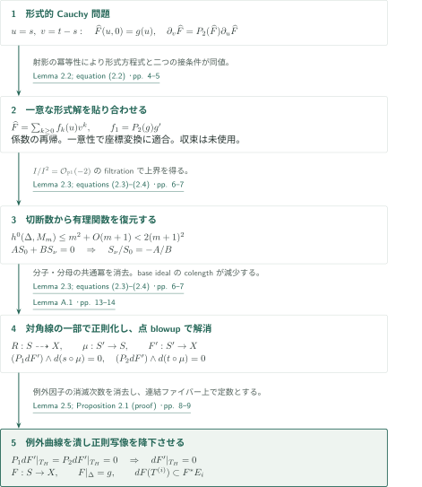
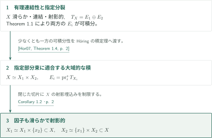
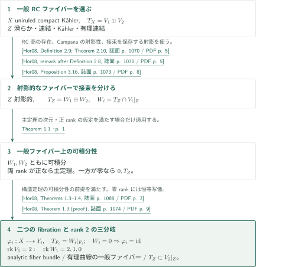

# Integrability of split tangent bundles on rationally connected manifolds

**形式的な接方向の分離、有理写像の延長、bracket tensorの消滅**

この原稿は、有理連結な滑らかな射影多様体の指定された正則接束分裂について、両直和因子の可積分性を示す。鍵は、有理曲線を対角線上に持ち、二つの因子方向がそれぞれの直和因子に接する写像を作ることである。その写像上の相対接続がbracket tensorの値を自明束に移し、二点を動かせる有理曲線族がその消滅を強制する。大域的な積分解には、さらにHöringの積定理を用いる。

## 1. 主要結果

### Theorem 1.1 — 指定された両直和因子の自動可積分性

$X$ を次元が少なくとも $2$ の滑らかな連結射影複素多様体とする。$X$ の一般の二点がある射 $\mathbb P^1\to X$ の像に含まれると仮定する。ここで「一般の二点」は、$X\times X$ のある非空Zariski開集合に属するすべての組を意味する。正のrankを持つ部分束への任意の指定された正則分裂

$$T_X=E_1\oplus E_2$$

に対して、$E_1,E_2$ はともに可積分である。分裂には部分束の埋込み $E_i\subset T_X$ も含める。

<!-- cite:main -->[Theorem 1.1 · p. 1](https://github.com/openai/math/blob/1581d4cbdd69a0faf34b2089614fe2a814316a6a/preprints/Integrability-of-split-tangent-bundles-on-rationally-connected-manifolds-September-23-2026/main.pdf)<!-- /cite -->

### Corollary 1.2 — 指定分裂に適合する本体の積

Theorem 1.1の仮定の下で、滑らかな射影多様体 $X_1,X_2$ と同型 $X\simeq X_1\times X_2$ が存在し、この同型の下で

$$E_i=\operatorname{pr}_i^*T_{X_i}\qquad(i=1,2)$$

が部分束として成立する。結論は $X$ 自体の積である。

<!-- cite:product -->[Corollary 1.2 · p. 2](https://github.com/openai/math/blob/1581d4cbdd69a0faf34b2089614fe2a814316a6a/preprints/Integrability-of-split-tangent-bundles-on-rationally-connected-manifolds-September-23-2026/main.pdf)<!-- /cite -->

### Corollary 5.1 — 有理連結商から得る二つのファイブレーション

$X$ を連結なuniruled compact Kähler多様体、$T_X=V_1\oplus V_2$ を正則分裂とする。有理連結商の一般ファイバーを $Z$、$W_i=T_Z\cap V_i|_Z$ と置く。各 $i=1,2$ に対してalmost-holomorphic fibration $\varphi_i\colon X\dashrightarrow Y_i$ が存在し、その一般ファイバー $F_i$ は有理連結であり、適合する選択 $F_i\subset Z$ に対して

$$T_{F_i}=W_i|_{F_i}\subset V_i|_{F_i}$$

を満たす。$W_i=0$ なら $\varphi_i=\operatorname{id}_X$ と点ファイバーを選べる。

さらに $\operatorname{rank}V_1=2$ なら、次のちょうど一つが成立する。

1. $W_1=V_1|_Z$。$X$ はanalytic fiber bundle $X\to Y$ を持ち、一般ファイバーは有理連結、$T_{X/Y}=V_1$。
2. $W_1$ は線束。equidimensionalな正則写像 $X\to Y$ が存在し、一般ファイバー $F$ は有理曲線で、$T_F\subset V_1|_F$。
3. $W_1=0$。同値に $T_Z\subset V_2|_Z$。

<!-- cite:quotient -->[Corollary 5.1 · pp. 12–13](https://github.com/openai/math/blob/1581d4cbdd69a0faf34b2089614fe2a814316a6a/preprints/Integrability-of-split-tangent-bundles-on-rationally-connected-manifolds-September-23-2026/main.pdf)<!-- /cite -->

## 図の矢印に付した引用

<!-- reference-guide -->
略号のない定理・補題・節・式番号は本原稿 [Integrability of split tangent bundles on rationally connected manifolds](https://github.com/openai/math/blob/1581d4cbdd69a0faf34b2089614fe2a814316a6a/preprints/Integrability-of-split-tangent-bundles-on-rationally-connected-manifolds-September-23-2026/main.pdf) を指します。外部入力には次の略号を使います。

- [Hor07](https://arxiv.org/pdf/math/0505327v3) Andreas Höring — *Uniruled varieties with split tangent bundle*：有理連結多様体で可積分な指定分裂から適合する積を得る。arXiv:math/0505327v3 (PDF margin: 9 Nov 2017; internal date: November 2, 2018); numbering of this preprint, not the journal version。
- [Hor08](https://ocu-omu.repo.nii.ac.jp/record/2010198/files/111F0000002-04504-14.pdf) Andreas Höring — *The structure of uniruled manifolds with split tangent bundle*：RC商の一般ファイバー、その射影性と接束分裂、almost-holomorphic fibrationとrank 2の三分岐。Osaka Journal of Mathematics 45 (2008), 1067–1084; published text, repository PDF with one cover sheet。

各引用に結果番号とページを付します。誌面番号とPDF内の位置が異なる場合は両方を示します。GitHubの閲覧リンクではページ位置への自動移動を前提としません。
<!-- /reference-guide -->

## 2. Theorem 1.1 — 主定理の証明概略

<!-- proof-target:1 -->証明対象：[Theorem 1.1 · p. 1](https://github.com/openai/math/blob/1581d4cbdd69a0faf34b2089614fe2a814316a6a/preprints/Integrability-of-split-tangent-bundles-on-rationally-connected-manifolds-September-23-2026/main.pdf)<!-- /proof-target -->

**証明の道筋。** [Theorem 1.1](#theorem-1-1)の分裂に付随する射影を $P_i$ とする。まず有理連結性を使わずに、任意の $g\colon C=\mathbb P^1\to X$ を接方向の分かれた写像 $F\colon S=C\times C\to X$ に延長する。[Proposition 2.1の節](#proof-1)でこの構成を説明する。相対接続によって $F^*E_i$ を第 $i$ 因子からの引戻しに同定した後、初めて有理連結性を二点評価の全射性に使う。

### 1. 接する写像上で補因子の束を自明化する

$F|_\Delta=g$、$dF(T^{(i)})\subset F^*E_i$ を満たす $F$ を取る。ただし $T^{(i)}=\operatorname{pr}_i^*T_C$ である。$F$ は臨界点を持ち得るので、局所座標系や $X$ の局所積分解とは扱わない。

$i\ne j$ に対し、$\xi\in E_j$、$e\in E_i$ に対する $\nabla^i_\xi e=P_i[\xi,e]$ は、方向変数でテンソル的、$e$ についてLeibniz則を満たす部分接続である。どちらの束の可積分性もこの構成には不要である。$F$ の接条件により、$F^*E_i$ 上に $\operatorname{pr}_i$ に関する相対正則接続が引き戻される。これは $dF$ の逆を使わず、臨界点でも定義される。

その接続を各 $\mathbb P^1$ ファイバーへ制限すると曲率は正則2形式なので零であり、単連結性から平行移動は経路に依らない。対角線上を始点とする移動は正則に変化し、Proposition 3.1の同型

$$\Theta_i\colon\operatorname{pr}_i^*(g^*E_i)\xrightarrow{\sim}F^*E_i,\qquad \Theta_i|_\Delta=\operatorname{id}$$

を与える。ここで平坦なのは曲線ファイバー上への制限であり、$X$ 全体の平坦接続を得たわけではない。

<!-- cite:box -->[Proposition 2.1 · p. 3](https://github.com/openai/math/blob/1581d4cbdd69a0faf34b2089614fe2a814316a6a/preprints/Integrability-of-split-tangent-bundles-on-rationally-connected-manifolds-September-23-2026/main.pdf)<!-- /cite --> · <!-- cite:transport -->[Proposition 3.1; equation (3.2) · p. 10](https://github.com/openai/math/blob/1581d4cbdd69a0faf34b2089614fe2a814316a6a/preprints/Integrability-of-split-tangent-bundles-on-rationally-connected-manifolds-September-23-2026/main.pdf)<!-- /cite -->

### 2. 二点評価から、一点で消え他点を張る切断を得る

異なる $a,b\in C$ を固定する。Lemma 4.1は、$G\colon C\times T\to X$ で $(\mathrm{ev}_a,\mathrm{ev}_b)\colon T\to X\times X$ がsubmersionとなる非空の族を与える。Appendix Bでは射影空間内の多項式表示を用いて可算個の曲線族を作り、その二点評価の像が一般の点対を覆うことを使う。すべての像が低rankなら測度零となるため、少なくとも一つは全rankを持つ。

各 $g=G(\cdot,\tau)$ について族を微分すると $g^*T_X$ の大域切断を得る。二点評価の微分の全射性と $P_i$ による射影から、$a$ で消える $g^*E_i$ の大域切断の $b$ における値が $E_{i,g(b)}$ を張る。各曲線のtangent boxを族として正則に選ぶ必要はない。

<!-- cite:evaluation -->[Lemma 4.1 · p. 11](https://github.com/openai/math/blob/1581d4cbdd69a0faf34b2089614fe2a814316a6a/preprints/Integrability-of-split-tangent-bundles-on-rationally-connected-manifolds-September-23-2026/main.pdf)<!-- /cite --> · <!-- cite:family -->[Appendix B; Lemma 4.1 (proof) · pp. 14–15](https://github.com/openai/math/blob/1581d4cbdd69a0faf34b2089614fe2a814316a6a/preprints/Integrability-of-split-tangent-bundles-on-rationally-connected-manifolds-September-23-2026/main.pdf)<!-- /cite -->

### 3. 定数切断に還元して両方のbracketを消す

可積分性の障害は正則束射

$$B_i\colon\bigwedge^2E_i\longrightarrow E_j,\qquad B_i(e,e')=P_j[e,e']\quad(j\ne i)$$

である。$L_i=\{s_j=b\}\subset S$ に制限すると、$\Theta_i$ は入力束を $g^*E_i$ と、$\Theta_j$ は出力束を $\mathcal O_C\otimes E_{j,g(b)}$ と同定する。$a$ で消える切断 $u,v\in H^0(C,g^*E_i)$ に対し

$$\sigma_{u,v}=\Theta_j^{-1}\big((F^*B_i)(\Theta_i u\wedge\Theta_i v)\big)\in H^0(C,\mathcal O_C\otimes E_{j,g(b)})$$

は定数であり、$a$ で零なので $b$ でも零である。$(b,b)$ では $F(b,b)=g(b)$ かつ輸送は恒等であるため、$B_i(g(b))(u(b)\wedge v(b))=0$。前段の張る性質から $B_i(g(b))=0$ となる。$\mathrm{ev}_b$ の像は非空開集合であり、連結な $X$ 上の恒等原理により $B_i$ は全体で消える。$i=1,2$ の双方に同じ議論を行うことで、両方の指定部分束の可積分性を得る。

<!-- cite:bracket -->[Theorem 1.1 (proof) · p. 11](https://github.com/openai/math/blob/1581d4cbdd69a0faf34b2089614fe2a814316a6a/preprints/Integrability-of-split-tangent-bundles-on-rationally-connected-manifolds-September-23-2026/main.pdf)<!-- /cite -->

## 3. Proposition 2.1 — 形式的な接条件から大域的なtangent boxへ

<!-- proof-target:2 -->証明対象：[Proposition 2.1 · p. 3](https://github.com/openai/math/blob/1581d4cbdd69a0faf34b2089614fe2a814316a6a/preprints/Integrability-of-split-tangent-bundles-on-rationally-connected-manifolds-September-23-2026/main.pdf)<!-- /proof-target -->

<!-- statement:proposition-2-1 -->
### Proposition 2.1 — Tangent box

$X$ を滑らかな射影複素多様体、$T_X=E_1\oplus E_2$ を固定した正則分裂とする。$C=\mathbb P^1$、$S=C\times C$、$\Delta\subset S$ を対角線、$T^{(i)}=\operatorname{pr}_i^*T_C$ と置く。任意の正則写像 $g\colon C\to X$ に対し、正則写像 $F\colon S\to X$ が存在し、

$$F|_\Delta=g,\qquad dF(T^{(i)})\subset F^*E_i\quad(i=1,2)$$

を満たす。いずれの直和因子の可積分性も仮定しない。

<!-- cite:box -->[Proposition 2.1 · p. 3](https://github.com/openai/math/blob/1581d4cbdd69a0faf34b2089614fe2a814316a6a/preprints/Integrability-of-split-tangent-bundles-on-rationally-connected-manifolds-September-23-2026/main.pdf)<!-- /cite -->
<!-- /statement -->

### 1. 射影により形式的Cauchy問題を解く

対角線近傍で $u=s,v=t-s$ と置くと、必要な接条件は

$$\widehat F(u,0)=g(u),\qquad\partial_v\widehat F=P_2(\widehat F)\partial_u\widehat F$$

と同値である。$\widehat F=\sum f_k(u)v^k$ の係数比較で $(k+1)f_{k+1}$ が既知の係数とその $u$ 微分から決まり、局所解の一意性が座標変換上の貼合せを与える。この時点では法線方向の収束を主張していない。

<!-- cite:formal -->[Lemma 2.2; equation (2.2) · pp. 4–5](https://github.com/openai/math/blob/1581d4cbdd69a0faf34b2089614fe2a814316a6a/preprints/Integrability-of-split-tangent-bundles-on-rationally-connected-manifolds-September-23-2026/main.pdf)<!-- /cite -->

### 2. 対角線の正の法束を切断数の不足へ変換する

射影埋込み $X\subset\mathbb P^N$ の形式的引戻し線束を $L$、$L|_\Delta\simeq\mathcal O_C(d)$ とする。$I/I^2\simeq\mathcal O_C(-2)$ より、$M_m=L\otimes\widehat{\mathcal O}_S(m,m)$ の法線方向の消滅次数filtrationは

$$\dim H^0(\Delta,M_m)\le\sum_{k\ge0}\max\{d+2m-2k+1,0\}=m^2+O(m+1)$$

を与える。一方、多項式切断の対の空間は $2(m+1)^2$ 次元なので、形式的同次座標 $S_0,S_\nu$ に対する $AS_0+BS_\nu=0$ という非自明な関係が得られる。これにより $S_\nu/S_0=-A/B$ を有理関数で表す。対角線上の一点で分母の先頭係数を非零に選び、共通の法線変数の冪を消去することで、同じ形式展開を持つ正則写像がその近傍に得られる。この段階で原稿は外部のG3定理を使わない。

<!-- cite:rational -->[Lemma 2.3; equations (2.3)–(2.4) · pp. 6–7](https://github.com/openai/math/blob/1581d4cbdd69a0faf34b2089614fe2a814316a6a/preprints/Integrability-of-split-tangent-bundles-on-rationally-connected-manifolds-September-23-2026/main.pdf)<!-- /cite --> · <!-- cite:g3 -->[Remark 2.4 · p. 8](https://github.com/openai/math/blob/1581d4cbdd69a0faf34b2089614fe2a814316a6a/preprints/Integrability-of-split-tangent-bundles-on-rationally-connected-manifolds-September-23-2026/main.pdf)<!-- /cite -->

### 3. 両接条件が例外曲線上の微分を零にする

得られた有理写像を有限個の点のblowup $\mu\colon S'\to S$ で解消し、$F'\colon S'\to X$ を得る。Appendix Aは局所base idealのcolengthを減少量として、この解消の有限停止を示す。接条件から

$$(P_1dF')\wedge d(s\circ\mu)=0,\qquad(P_2dF')\wedge d(t\circ\mu)=0$$

が全体で成り立つ。例外曲線 $H$ の一般点で $s\circ\mu-s(p)=r^\alpha h$、$t\circ\mu-t(p)=r^\beta\widetilde h$ と書く。正の次数の共通因子を消去して $r=0$ に制限すると、$P_1dF'|_{T_H}=P_2dF'|_{T_H}=0$、したがって $dF'|_{T_H}=0$。各例外成分は一点に写り、$\mu$ のファイバーの連結性により $F'$ は $S$ へ降下する。孤立点での除去可能性によって降下写像は正則となり、恒等原理が対角線上の値と接条件を全域へ延長する。

<!-- cite:surface -->[Lemma A.1 · pp. 13–14](https://github.com/openai/math/blob/1581d4cbdd69a0faf34b2089614fe2a814316a6a/preprints/Integrability-of-split-tangent-bundles-on-rationally-connected-manifolds-September-23-2026/main.pdf)<!-- /cite --> · <!-- cite:extension -->[Lemma 2.5; Proposition 2.1 (proof) · pp. 8–9](https://github.com/openai/math/blob/1581d4cbdd69a0faf34b2089614fe2a814316a6a/preprints/Integrability-of-split-tangent-bundles-on-rationally-connected-manifolds-September-23-2026/main.pdf)<!-- /cite -->

## 4. Corollary 1.2 — 可積分性から指定分裂に適合する積へ

<!-- proof-target:3 -->証明対象：[Corollary 1.2 · p. 2](https://github.com/openai/math/blob/1581d4cbdd69a0faf34b2089614fe2a814316a6a/preprints/Integrability-of-split-tangent-bundles-on-rationally-connected-manifolds-September-23-2026/main.pdf)<!-- /proof-target -->

対象は[Corollary 1.2](#corollary-1-2)である。前節までの議論で得たのは指定部分束の可積分性であり、大域的な積を得る段階を分ける。

### 1. 積定理の仮定を満たし、因子を射影的な切片として実現する

HöringのTheorem 1.4は、有理連結な射影多様体の指定分裂について、少なくとも一方の可積分性から両因子に適合する同型 $X\simeq X_1\times X_2$ を与える。本稿のTheorem 1.1がその追加仮定を満たす。得られた因子は滑らかであり、積の切片として $X$ の閉複素部分多様体に実現できるので、$X$ の射影埋込みの制限が各因子の射影性を与える。

ここでの同定は正則接束の指定部分束との適合であり、計量に関する直交積を主張していない。また、有限被覆や普遍被覆へ移って得る積を本体の積と取り違えない。

<!-- cite:horing-product -->[&#91;Hor07, Theorem 1.4, p. 2&#93;](https://arxiv.org/pdf/math/0505327v3#page=2)<!-- /cite --> · <!-- cite:product -->[Corollary 1.2 · p. 2](https://github.com/openai/math/blob/1581d4cbdd69a0faf34b2089614fe2a814316a6a/preprints/Integrability-of-split-tangent-bundles-on-rationally-connected-manifolds-September-23-2026/main.pdf)<!-- /cite -->

## 5. Corollary 5.1 — 一般RCファイバーへの適用とrankによる三分岐

<!-- proof-target:4 -->証明対象：[Corollary 5.1 · pp. 12–13](https://github.com/openai/math/blob/1581d4cbdd69a0faf34b2089614fe2a814316a6a/preprints/Integrability-of-split-tangent-bundles-on-rationally-connected-manifolds-September-23-2026/main.pdf)<!-- /proof-target -->

対象は[Corollary 5.1](#corollary-5-1)である。$X$ 自体の射影性や有理連結性は仮定しない。Theorem 1.1を適用する先は、RC商の一般ファイバー $Z$ である。

### 1. 一般ファイバーで主定理の仮定を用意する

Höringの公刊版Definition 2.9とTheorem 2.10に従い、商のfibration locusの正則値上で $Z$ を取る。$Z$ は滑らかで連結なコンパクト部分多様体としてKähler形式を継承し、有理連結である。同書のDefinition 2.8直後に述べられたCampanaの結果により $Z$ は射影的になる。

さらにProposition 3.16は、周囲の射影 $P_i$ が $T_Z$ を保存することを与える。その制限は正則な相補的冪等射であり、連結な $Z$ 上でrankは一定なので、その像は部分束 $W_i$ をなし、$T_Z=W_1\oplus W_2$。両rankが正なら $\dim Z\ge2$ でTheorem 1.1が適用できる。一方が零なら、二つは $0,T_Z$ であり可積分性は既に成立する。

<!-- cite:horing-quotient -->[&#91;Hor08, Definition 2.9; Theorem 2.10, 誌面 p. 1070 / PDF p. 5&#93;](https://ocu-omu.repo.nii.ac.jp/record/2010198/files/111F0000002-04504-14.pdf#page=5)<!-- /cite --> · <!-- cite:horing-projective -->[&#91;Hor08, remark after Definition 2.8, 誌面 p. 1070 / PDF p. 5&#93;](https://ocu-omu.repo.nii.ac.jp/record/2010198/files/111F0000002-04504-14.pdf#page=5)<!-- /cite --> · <!-- cite:horing-preserve -->[&#91;Hor08, Proposition 3.16, 誌面 p. 1073 / PDF p. 8&#93;](https://ocu-omu.repo.nii.ac.jp/record/2010198/files/111F0000002-04504-14.pdf#page=8)<!-- /cite --> · <!-- cite:main -->[Theorem 1.1 · p. 1](https://github.com/openai/math/blob/1581d4cbdd69a0faf34b2089614fe2a814316a6a/preprints/Integrability-of-split-tangent-bundles-on-rationally-connected-manifolds-September-23-2026/main.pdf)<!-- /cite -->

### 2. 一般ファイバー上の可積分性を二つのファイブレーションへ渡す

これでHöringのTheorem 1.3が要求する一般ファイバー上の可積分性が成立し、$i=1,2$ の双方についてalmost-holomorphic fibrationと $T_{F_i}=W_i|_{F_i}$ が得られる。公刊版の定義は恒等写像を許し、同定理の証明は $W_i=0$ の場合を $\operatorname{id}_X$ で処理している。この場合を正のrankを要するTheorem 1.1に無理に含めない。$W_i$ の可積分性から、周囲の $V_i$ が一般に可積分だとは結論しない。

<!-- cite:horing-structure -->[&#91;Hor08, Theorems 1.3–1.4, 誌面 p. 1068 / PDF p. 3&#93;](https://ocu-omu.repo.nii.ac.jp/record/2010198/files/111F0000002-04504-14.pdf#page=3)<!-- /cite --> · <!-- cite:horing-identity -->[&#91;Hor08, Theorem 1.3 (proof), 誌面 p. 1074 / PDF p. 9&#93;](https://ocu-omu.repo.nii.ac.jp/record/2010198/files/111F0000002-04504-14.pdf#page=9)<!-- /cite -->

### 3. rank 2の仮定の下で全三結論を得る

$\operatorname{rank}V_1=2$ なら、$\operatorname{rank}W_1$ は $2,1,0$ のいずれかである。HöringのTheorem 1.4は同じ可積分性の前提の下で、順にanalytic fiber bundleと $T_{X/Y}=V_1$、equidimensionalな正則写像と有理曲線の一般ファイバー、$T_Z\subset V_2|_Z$ を与える。rankが互いに排他的かつ全体を尽くすので、Corollary 5.1の「ちょうど一つ」まで従う。

<!-- cite:horing-structure -->[&#91;Hor08, Theorems 1.3–1.4, 誌面 p. 1068 / PDF p. 3&#93;](https://ocu-omu.repo.nii.ac.jp/record/2010198/files/111F0000002-04504-14.pdf#page=3)<!-- /cite --> · <!-- cite:quotient -->[Corollary 5.1 · pp. 12–13](https://github.com/openai/math/blob/1581d4cbdd69a0faf34b2089614fe2a814316a6a/preprints/Integrability-of-split-tangent-bundles-on-rationally-connected-manifolds-September-23-2026/main.pdf)<!-- /cite -->

## 6. どの論文が、どの段階を担うか

| 供給する結果 | 利用箇所 | 使用内容と適用条件 | 確認範囲 |
|---|---|---|---|
| <!-- cite:horing-product -->[&#91;Hor07, Theorem 1.4, p. 2&#93;](https://arxiv.org/pdf/math/0505327v3#page=2)<!-- /cite --> | [Corollary 1.2](#proof-2) | 射影的RC多様体で少なくとも一方が可積分な指定分裂を、適合する積へ移す | 指定版の主張と本稿の適用を照合 |
| <!-- cite:horing-quotient -->[&#91;Hor08, Definition 2.9; Theorem 2.10, 誌面 p. 1070 / PDF p. 5&#93;](https://ocu-omu.repo.nii.ac.jp/record/2010198/files/111F0000002-04504-14.pdf#page=5)<!-- /cite --> · <!-- cite:horing-projective -->[&#91;Hor08, remark after Definition 2.8, 誌面 p. 1070 / PDF p. 5&#93;](https://ocu-omu.repo.nii.ac.jp/record/2010198/files/111F0000002-04504-14.pdf#page=5)<!-- /cite --> | [Corollary 5.1の入力](#proof-3-step-1) | 一般RCファイバーを滑らかなコンパクトKähler・射影多様体として選ぶ | 公刊版の定義・主張・Campanaの結果の引用記述を照合 |
| <!-- cite:horing-preserve -->[&#91;Hor08, Proposition 3.16, 誌面 p. 1073 / PDF p. 8&#93;](https://ocu-omu.repo.nii.ac.jp/record/2010198/files/111F0000002-04504-14.pdf#page=8)<!-- /cite --> | [一般ファイバーの分裂](#proof-3-step-1) | 周囲の射影が $T_Z$ を保存し、相補的部分束を与える | 主張と保存の議論を照合 |
| <!-- cite:horing-structure -->[&#91;Hor08, Theorems 1.3–1.4, 誌面 p. 1068 / PDF p. 3&#93;](https://ocu-omu.repo.nii.ac.jp/record/2010198/files/111F0000002-04504-14.pdf#page=3)<!-- /cite --> · <!-- cite:horing-identity -->[&#91;Hor08, Theorem 1.3 (proof), 誌面 p. 1074 / PDF p. 9&#93;](https://ocu-omu.repo.nii.ac.jp/record/2010198/files/111F0000002-04504-14.pdf#page=9)<!-- /cite --> | [二つのfibrationと三分岐](#proof-3-step-2) | 可積分な $W_i$ からfibrationを構成。零rankは恒等、$\operatorname{rank}V_1=2$ では三分類 | 主張と使用条件、恒等写像の扱いを照合 |

主定理のtangent box構成は本稿内部の議論である。形式関数論・G3は背景として挙げられるが、Lemma 2.3の直接入力とは記されていない。外部結果の記述と適用の照合を、外部結果自体の証明検証とは区別する。

<!-- cite:g3 -->[Remark 2.4 · p. 8](https://github.com/openai/math/blob/1581d4cbdd69a0faf34b2089614fe2a814316a6a/preprints/Integrability-of-split-tangent-bundles-on-rationally-connected-manifolds-September-23-2026/main.pdf)<!-- /cite -->

## 7. 原典を読む入口と確認範囲

<!-- reading-list -->
- [Proposition 2.1 · p. 3](https://github.com/openai/math/blob/1581d4cbdd69a0faf34b2089614fe2a814316a6a/preprints/Integrability-of-split-tangent-bundles-on-rationally-connected-manifolds-September-23-2026/main.pdf) — 全体の接する写像を作る命題と、その3段階の構成。
- [Lemma 2.3; equations (2.3)–(2.4) · pp. 6–7](https://github.com/openai/math/blob/1581d4cbdd69a0faf34b2089614fe2a814316a6a/preprints/Integrability-of-split-tangent-bundles-on-rationally-connected-manifolds-September-23-2026/main.pdf) — 形式切断の個数から有理式を復元する核心。
- [Proposition 3.1; equation (3.2) · p. 10](https://github.com/openai/math/blob/1581d4cbdd69a0faf34b2089614fe2a814316a6a/preprints/Integrability-of-split-tangent-bundles-on-rationally-connected-manifolds-September-23-2026/main.pdf) — 可積分性を仮定しない相対接続と対角線からの正規化。
- [Theorem 1.1 (proof) · p. 11](https://github.com/openai/math/blob/1581d4cbdd69a0faf34b2089614fe2a814316a6a/preprints/Integrability-of-split-tangent-bundles-on-rationally-connected-manifolds-September-23-2026/main.pdf) — 定数切断と二点評価を組み合わせて両bracketを消す。
- [Corollary 1.2 · p. 2](https://github.com/openai/math/blob/1581d4cbdd69a0faf34b2089614fe2a814316a6a/preprints/Integrability-of-split-tangent-bundles-on-rationally-connected-manifolds-September-23-2026/main.pdf) — 積分解へ進む外部入力と因子の射影性。
- [Corollary 5.1 · pp. 12–13](https://github.com/openai/math/blob/1581d4cbdd69a0faf34b2089614fe2a814316a6a/preprints/Integrability-of-split-tangent-bundles-on-rationally-connected-manifolds-September-23-2026/main.pdf) — RC商の一般ファイバー上で主定理を再適用する。
<!-- /reading-list -->

本概説では、主張欄、§§2–5とAppendices A–Bの証明本文を読み、形式解から有理写像への移行、例外曲線の縮約、相対輸送、二点評価からbracket消滅への接続を確認した。二つのHöring文献は指定した版の入力結果と適用箇所を照合した。Campanaによる射影性はHöring公刊版の引用記述で確認しており、その原論文の証明は読んでいない。

形式的貼合せ、base idealの減少論法、輸送のパラメータ依存を含む全技術事項の独立再構成、外部定理の全証明とその先の依存文献の再帰的検証は行っていない。専門家査読や主張全体の正しさの認定ではない。未記録の他カタログへの接続は未調査である。
