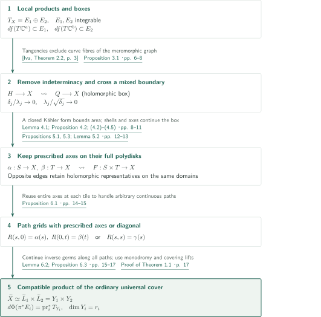
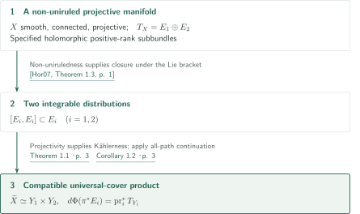
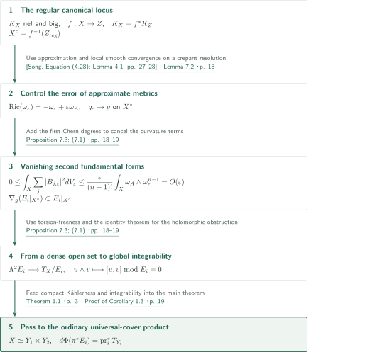

# Universal-cover splitting for compact Kähler manifolds

**Extending holomorphic boxes to obtain a universal-cover product compatible with the specified splitting**

The main proof extends holomorphic maps tangent to two integrable tangent summands, placing both leaf paths and arbitrary paths inside rectangles. It constructs continuation of a local product map and its inverse along all paths. Local product coordinates alone do not supply the global conclusion. For a nef and big canonical bundle, approximate Kähler–Einstein metrics supply integrability.

## 1. Main results

### Theorem 1.1 — A universal cover compatible with the specified splitting

Let $X$ be a compact connected Kähler manifold of complex dimension $n\ge2$, with a specified decomposition

$$T_X=E_1\oplus E_2$$

into **integrable holomorphic subbundles** of positive ranks $r_1,r_2$. For the ordinary universal cover $\pi:\widetilde X\to X$, there are connected simply connected complex manifolds $Y_1,Y_2$ and a biholomorphism $\Phi:\widetilde X\to Y_1\times Y_2$ such that, identifying $T_{\widetilde X}=\pi^*T_X$ by $d\pi$,

$$d\Phi(\pi^*E_i)=\operatorname{pr}_i^*T_{Y_i},\qquad \dim_{\mathbb C}Y_i=r_i\quad(i=1,2).$$

The factors are constructed as universal covers of the intrinsic leaves through a common basepoint and may be noncompact. No product decomposition of a finite cover is asserted.

<!-- cite:main -->[Theorem 1.1 · p. 3](https://github.com/openai/math/blob/1581d4cbdd69a0faf34b2089614fe2a814316a6a/preprints/Universal-cover-splitting-for-compact-Kahler-manifolds-September-23-2026/paper.pdf)<!-- /cite -->

### Corollary 1.2 — Non-uniruled projective manifolds

Let $X$ be a smooth connected non-uniruled projective complex manifold, with a specified holomorphic splitting $T_X=E_1\oplus E_2$ into positive-rank subbundles. Both summands are integrable, and the ordinary universal cover has a compatible product decomposition as in Theorem 1.1.

<!-- cite:non-uniruled -->[Corollary 1.2 · p. 3](https://github.com/openai/math/blob/1581d4cbdd69a0faf34b2089614fe2a814316a6a/preprints/Universal-cover-splitting-for-compact-Kahler-manifolds-September-23-2026/paper.pdf)<!-- /cite -->

### Corollary 1.3 — Nef and big canonical bundle

Let $X$ be a smooth connected projective complex manifold of dimension $n\ge2$ with nef and big $K_X$. Every specified holomorphic splitting $T_X=E_1\oplus E_2$ into positive-rank subbundles is integrable and induces the compatible product decomposition of the ordinary universal cover in Theorem 1.1.

<!-- cite:nef-big -->[Corollary 1.3 · p. 4](https://github.com/openai/math/blob/1581d4cbdd69a0faf34b2089614fe2a814316a6a/preprints/Universal-cover-splitting-for-compact-Kahler-manifolds-September-23-2026/paper.pdf)<!-- /cite -->

## References on the arrows

<!-- reference-guide -->
Unprefixed theorem, lemma, section and equation numbers refer to [Universal-cover splitting for compact Kähler manifolds](https://github.com/openai/math/blob/1581d4cbdd69a0faf34b2089614fe2a814316a6a/preprints/Universal-cover-splitting-for-compact-Kahler-manifolds-September-23-2026/paper.pdf). External inputs use the following keys.

- [Iva](https://arxiv.org/pdf/0810.4588v2) S. Ivashkovich — *Extra extension properties of equidimensional holomorphic mappings: results and open questions*: Meromorphic extension to the envelope of holomorphy; removal of indeterminacy is done in the present manuscript. arXiv:0810.4588v2 (2008-11-11); PDF title-page date November 7, 2018.
- [Hor07](https://arxiv.org/pdf/math/0505327v3) Andreas Höring — *Uniruled varieties with split tangent bundle*: Automatic integrability of a specified split tangent bundle on a non-uniruled projective manifold. arXiv:math/0505327v3 (2017-11-09); PDF title-page date November 2, 2018.
- [Song](https://arxiv.org/pdf/1404.0445v1) Jian Song — *Riemannian geometry of Kähler–Einstein currents*: Approximate Kähler–Einstein metrics on a crepant resolution and smooth convergence on the regular locus. arXiv:1404.0445v1 (2014).
- [KM98](https://doi.org/10.1017/CBO9780511662560) János Kollár; Shigefumi Mori — *Birational Geometry of Algebraic Varieties*: Base-point-freeness input; use in the manuscript checked, book statement and page not independently checked. Cambridge Tracts in Mathematics 134 (1998); cited edition, theorem page not independently checked.

Each citation gives the result and pages. When printed pagination differs from the PDF position, both are shown. GitHub previews do not automatically jump to the cited page.
<!-- /reference-guide -->

## 2. Proof of Theorem 1.1 — Global boxes and continuation in both directions

<!-- proof-target:1 -->Proof target：[Theorem 1.1 · p. 3](https://github.com/openai/math/blob/1581d4cbdd69a0faf34b2089614fe2a814316a6a/preprints/Universal-cover-splitting-for-compact-Kahler-manifolds-September-23-2026/paper.pdf)<!-- /proof-target --> See the [hypotheses and full conclusion](#theorem-1-1).

**Proof route.** Integrability first supplies local product charts. Hartogs extension and a mixed-boundary area estimate combine two prescribed axes on their full polydisks. Retaining the entire axis domains permits a finite-grid construction, which continues both the local product map and its inverse along all paths. Monodromy and covering lifts finish the argument. The diagram shows the whole route to the main theorem; its stages are explained immediately below.

Write $P_i:T_X\to E_i$ for projection along the specified direct sum, not necessarily orthogonal projection. A holomorphic box $f:U\subset\mathbb C^a\times\mathbb C^b\to X$ has derivatives in the two parameter blocks tangent to $E_1,E_2$, respectively. It need not have full rank or be an embedding.

### 1. Integrability gives local products; tangencies remove meromorphic indeterminacy

Combining the two Frobenius submersions gives local coordinates in which each $E_i$ is a coordinate block. Transitions locally separate as $(z_1,z_2)\mapsto(h_1(z_1),h_2(z_2))$. This does not assert a product metric.

<!-- cite:charts -->[Lemma 2.1; Definition 2.2 · pp. 5–6](https://github.com/openai/math/blob/1581d4cbdd69a0faf34b2089614fe2a814316a6a/preprints/Universal-cover-splitting-for-compact-Kahler-manifolds-September-23-2026/paper.pdf)<!-- /cite -->

For a box on a Hartogs figure $H\subset\mathbb C^2$, Ivashkovich's theorem gives a **meromorphic** extension to its envelope of holomorphy, a bidisk $Q$. The input hypotheses are that $H$ is a domain in a Stein manifold and the target is compact Kähler. The manuscript separately proves holomorphicity. If the projection of the graph $\Gamma\subset Q\times X$ had a curve fibre, some component $h$ of a target product chart would vary along it. If $h$ belongs to the first block, a general point is isolated in a level of $(s,h)$. Near ordinary graph points, however, $h$ is independent of $t$, so the same type of level contains the $t$-direction. A level avoiding the boundary of a small ball would then be a positive-dimensional compact analytic set, a contradiction. Properness, density and connectedness of the ordinary graph make the remaining finite fibres singletons; continuous locally bounded coordinate functions remove the indeterminacy. The affine coordinates defining the Hartogs figure need not be the box coordinates $(s,t)$.

<!-- cite:iva-input -->[&#91;Iva, Theorem 2.2, p. 3&#93;](https://arxiv.org/pdf/0810.4588v2#page=3)<!-- /cite -->

<!-- cite:hartogs -->[Proposition 3.1 · pp. 6–8](https://github.com/openai/math/blob/1581d4cbdd69a0faf34b2089614fe2a814316a6a/preprints/Universal-cover-splitting-for-compact-Kahler-manifolds-September-23-2026/paper.pdf)<!-- /cite -->

### 2. A closed Kähler form and two scales cross a mixed boundary

At a smooth convex boundary point, assume that the complex tangent has nonzero components in both parameter directions. With $v$ complex tangential and $u$ transverse, the box conditions and the compactness bound $\sup_X\|P_i\|<\infty$ imply $\|df(\partial_{\mathrm{Re}\,u})\|\le C\|df(\partial_{\mathrm{Re}\,v})\|$. On disks $u=x<0$, $|v|\le k\sqrt{-x}$, closedness $d\omega=0$ and Stokes' theorem bound the areas $A(x)$ using the contracting-boundary term.

In slices $x_j=-\delta_j\to0$, many disjoint annuli yield one with area tending to zero. The derivative rescaling in Lemma 4.1 places its image in one product chart. Its radius $\lambda_j$ satisfies both

$$\delta_j/\lambda_j\to0,\qquad \lambda_j/\sqrt{\delta_j}\to0.$$

The first makes the Hartogs shell wider than the remaining distance to the boundary; the second keeps it inside the original tangential disk. Separated target coordinates thicken the shell transversely, and Proposition 3.1 fills it. The Kähler metric is arbitrary: neither orthogonality nor parallelism of the summands is assumed.

<!-- cite:boundary -->[Lemma 4.1; Proposition 4.2; (4.2)–(4.5) · pp. 8–11](https://github.com/openai/math/blob/1581d4cbdd69a0faf34b2089614fe2a814316a6a/preprints/Universal-cover-splitting-for-compact-Kahler-manifolds-September-23-2026/paper.pdf)<!-- /cite -->

### 3. Combine prescribed axes on their entire polydisks

Starting with two holomorphic disks tangent to $E_1,E_2$ through the same point, extend their box germ over $|s|^{2m}+|t|^{2m}<R^{2m}$. The preceding step treats boundary points off the axes; the prescribed disks treat points on the axes. Extension cannot stop at $R<1$, and letting $m\to\infty$ gives the full bidisk. For higher-dimensional axes, first combine radial disks and then reconstruct a finite grid in fixed product charts with parameters. This reconstruction proves holomorphic parameter dependence; pointwise existence of a box would not suffice.

<!-- cite:axes -->[Propositions 5.1, 5.3; Lemma 5.2 · pp. 12–13](https://github.com/openai/math/blob/1581d4cbdd69a0faf34b2089614fe2a814316a6a/preprints/Universal-cover-splitting-for-compact-Kahler-manifolds-September-23-2026/paper.pdf)<!-- /cite -->

### 4. Two finite grids continue the map and its inverse

Subdivide two leaf paths and express each piece as a holomorphic plaque map evaluated on continuous parameters. After Proposition 5.3 fills a tile, each opposite edge still has a holomorphic representative on the **entire original polydisk**. The prescribed-axis rectangle can therefore be completed without keeping successive images small. For an arbitrary path $\gamma$, prescribe diagonal tiles first, then fill bands away from the diagonal to obtain $R(s,s)=\gamma(s)$. This second construction is needed to continue the inverse map along all paths.

<!-- cite:rectangles -->[Proposition 6.1 · pp. 14–15](https://github.com/openai/math/blob/1581d4cbdd69a0faf34b2089614fe2a814316a6a/preprints/Universal-cover-splitting-for-compact-Kahler-manifolds-September-23-2026/paper.pdf)<!-- /cite -->

### 5. Universal covers of intrinsic leaves give the biholomorphism and compatibility

Give the leaves $L_i$ through the basepoint their intrinsic plaque topologies, rather than the subspace topology from $X$. Lemma 6.2 makes them connected complex manifolds with universal covers $Y_i=\widetilde L_i$. Proposition 6.3 simultaneously continues the inverse local germs $H_o:L_1\times L_2\to X$ and $K_o:X\to L_1\times L_2$ along the rectangles.

<!-- cite:leaves -->[Lemma 6.2; Proposition 6.3 · pp. 15–17](https://github.com/openai/math/blob/1581d4cbdd69a0faf34b2089614fe2a814316a6a/preprints/Universal-cover-splitting-for-compact-Kahler-manifolds-September-23-2026/paper.pdf)<!-- /cite -->

Monodromy defines maps on the simply connected covers. Lift them with matching basepoints to $\widetilde H:Y_1\times Y_2\to\widetilde X$ and $\widetilde K:\widetilde X\to Y_1\times Y_2$. Both composites are the identity near their basepoints, hence everywhere by connectedness and the identity theorem. The wrong-factor components of $d\widetilde K$ likewise vanish globally as holomorphic bundle maps. Invertibility of the differential and $\dim Y_i=r_i$ turn the inclusions into equalities. This proves compatibility with the specified embeddings $E_i\subset T_X$, as well as the abstract product isomorphism.

<!-- cite:global -->[Proof of Theorem 1.1 · p. 17](https://github.com/openai/math/blob/1581d4cbdd69a0faf34b2089614fe2a814316a6a/preprints/Universal-cover-splitting-for-compact-Kahler-manifolds-September-23-2026/paper.pdf)<!-- /cite -->

## 3. Proof of Corollary 1.2 — Supply integrability from an external theorem

<!-- proof-target:2 -->Proof target：[Corollary 1.2 · p. 3](https://github.com/openai/math/blob/1581d4cbdd69a0faf34b2089614fe2a814316a6a/preprints/Universal-cover-splitting-for-compact-Kahler-manifolds-September-23-2026/paper.pdf)<!-- /proof-target --> See the [statement](#corollary-1-2).

### 1. From non-uniruledness to integrability

Höring's Theorem 1.3 makes both factors of a holomorphically split tangent bundle integrable on a non-uniruled projective manifold. The present hypotheses satisfy its assumptions. Its output here is closure under the Lie bracket.

<!-- cite:hor-input -->[&#91;Hor07, Theorem 1.3, p. 1&#93;](https://arxiv.org/pdf/math/0505327v3#page=1)<!-- /cite -->

### 2. From integrability to an ordinary universal-cover product

A smooth projective complex manifold is compact Kähler, so the previous output satisfies Theorem 1.1. The chain is a specified holomorphic splitting, then two integrable distributions, then a compatible universal-cover product. The first step alone is not used to infer the last conclusion in general.

<!-- cite:non-uniruled -->[Corollary 1.2 · p. 3](https://github.com/openai/math/blob/1581d4cbdd69a0faf34b2089614fe2a814316a6a/preprints/Universal-cover-splitting-for-compact-Kahler-manifolds-September-23-2026/paper.pdf)<!-- /cite -->

<!-- cite:main -->[Theorem 1.1 · p. 3](https://github.com/openai/math/blob/1581d4cbdd69a0faf34b2089614fe2a814316a6a/preprints/Universal-cover-splitting-for-compact-Kahler-manifolds-September-23-2026/paper.pdf)<!-- /cite -->

## 4. Proof of Corollary 1.3 — Remove metric error and return to integrability

<!-- proof-target:3 -->Proof target：[Corollary 1.3 · p. 4](https://github.com/openai/math/blob/1581d4cbdd69a0faf34b2089614fe2a814316a6a/preprints/Universal-cover-splitting-for-compact-Kahler-manifolds-September-23-2026/paper.pdf)<!-- /proof-target --> See the [statement](#corollary-1-3).

We follow the route in §7. Let $f:X\to Z$ be the canonical contraction and put $X^\circ=f^{-1}(Z_{\mathrm{reg}})$. The metric parallelism used here holds on $X^\circ$; it does not construct a smooth product metric on all of $X$.

### 1. The canonical model and approximate Kähler–Einstein metrics

Proposition 7.1 constructs a contraction with $K_X=f^*K_Z$, ample $K_Z$, canonical $Z$, and $f$ an isomorphism over $Z_{\mathrm{reg}}$. Semiampleness uses the cited Kollár–Mori base-point-free theorem: for $D=K_X$ and an integer $a>1$, the divisor $aD-K_X=(a-1)K_X$ is nef and big. Its use in the manuscript was checked; the book's theorem statement and exact page have not been independently checked here.

<!-- cite:canonical -->[Proposition 7.1 · pp. 17–18](https://github.com/openai/math/blob/1581d4cbdd69a0faf34b2089614fe2a814316a6a/preprints/Universal-cover-splitting-for-compact-Kahler-manifolds-September-23-2026/paper.pdf)<!-- /cite -->

Song's approximation applies to this smooth crepant resolution. For $0<\varepsilon<1$ it supplies metrics satisfying

$$\operatorname{Ric}(\omega_\varepsilon)=-\omega_\varepsilon+\varepsilon\omega_A,\qquad [\omega_\varepsilon]=2\pi c_1(K_X)+\varepsilon[\omega_A].$$

The next step uses smooth convergence on compact subsets of $X^\circ$ to a negative Kähler–Einstein metric $g$. Song's additional conclusion identifying its metric completion with $Z$ is not needed for this main-text route.

<!-- cite:song-input -->[&#91;Song, Equation (4.28); Lemma 4.1, pp. 27–28&#93;](https://arxiv.org/pdf/1404.0445v1#page=27)<!-- /cite -->

<!-- cite:metric -->[Lemma 7.2 · p. 18](https://github.com/openai/math/blob/1581d4cbdd69a0faf34b2089614fe2a814316a6a/preprints/Universal-cover-splitting-for-compact-Kahler-manifolds-September-23-2026/paper.pdf)<!-- /cite -->

### 2. Vanishing second fundamental forms imply global integrability

Let $P_{j,\varepsilon}$ be $g_\varepsilon$-orthogonal projection onto $E_j$ and $B_{j,\varepsilon}$ its second fundamental form. These projections differ from those along the specified direct sum in the main proof. Integrating and adding the two subbundle-curvature identities cancels degrees through $c_1(E_1)+c_1(E_2)=c_1(T_X)$. Since $C_\varepsilon=P_{1,\varepsilon}+P_{2,\varepsilon}-I$ satisfies $\operatorname{tr}C_\varepsilon=0$ and $-I\le C_\varepsilon\le I$,

$$0\le\int_X\sum_{j=1}^2|B_{j,\varepsilon}|^2\,dV_\varepsilon\le\frac{\varepsilon}{(n-1)!}\int_X\omega_A\wedge\omega_\varepsilon^{n-1}=O(\varepsilon).$$

The bound comes from a polynomial in cohomology classes. Smooth convergence on $X^\circ$ forces both limiting second fundamental forms to vanish, so the connection of $g$ preserves both factors. Its torsion-free property implies integrability on $X^\circ$. The holomorphic Frobenius obstruction

$$\Lambda^2E_j\longrightarrow T_X/E_j,\qquad u\wedge v\longmapsto[u,v]\bmod E_j$$

vanishes on a dense open set, hence on all of $X$. This is where the metric argument returns to the holomorphic hypothesis of the main theorem.

<!-- cite:parallel -->[Proposition 7.3; (7.1) · pp. 18–19](https://github.com/openai/math/blob/1581d4cbdd69a0faf34b2089614fe2a814316a6a/preprints/Universal-cover-splitting-for-compact-Kahler-manifolds-September-23-2026/paper.pdf)<!-- /cite -->

### 3. Theorem 1.1 supplies the global product

Integrability and projectivity now permit Theorem 1.1, giving the ordinary universal-cover product compatible with the specified splitting. No completeness of the metric on $X^\circ$ is assumed here, and de Rham's decomposition is not directly applied to that parallelism. Appendices A–D give a different global continuation mechanism through collapsed canonical fibres; it is separate from the route explained here.

<!-- cite:nef-proof -->[Proof of Corollary 1.3 · p. 19](https://github.com/openai/math/blob/1581d4cbdd69a0faf34b2089614fe2a814316a6a/preprints/Universal-cover-splitting-for-compact-Kahler-manifolds-September-23-2026/paper.pdf)<!-- /cite -->

## 5. Which papers supply which steps

| Input | Used at | Content and hypotheses | Checking scope |
|---|---|---|---|
| <!-- cite:iva-input -->[&#91;Iva, Theorem 2.2, p. 3&#93;](https://arxiv.org/pdf/0810.4588v2#page=3)<!-- /cite --> | Proposition 3.1 | Meromorphic extension from a Hartogs domain in a Stein manifold to a compact Kähler target | External statement and application checked; holomorphic removal belongs to this manuscript |
| <!-- cite:hor-input -->[&#91;Hor07, Theorem 1.3, p. 1&#93;](https://arxiv.org/pdf/math/0505327v3#page=1)<!-- /cite --> | Corollary 1.2 | Integrability of the specified splitting under non-uniruledness and projectivity | External statement and application on p.3 checked |
| KM98: Theorem 3.3 | Proposition 7.1 | Semiampleness of $K_X$ | Use in manuscript checked; book statement and page not independently checked |
| <!-- cite:song-input -->[&#91;Song, Equation (4.28); Lemma 4.1, pp. 27–28&#93;](https://arxiv.org/pdf/1404.0445v1#page=27)<!-- /cite --> | Lemma 7.2 → Proposition 7.3 | Approximate metrics on a crepant resolution and smooth convergence off the exceptional locus | Input statement and applicability checked; external proofs outside scope |

The companion [article on integrability on rationally connected manifolds](../split-tangent-integrability/article.en.md) treats another setting supplying the main theorem's integrability hypothesis. Its Theorem 1.1 is cited in this manuscript's introduction, but it is not a direct input to this manuscript's main proof or the two corollaries above.

<!-- cite:intro-companion -->[Introduction · p. 3](https://github.com/openai/math/blob/1581d4cbdd69a0faf34b2089614fe2a814316a6a/preprints/Universal-cover-splitting-for-compact-Kahler-manifolds-September-23-2026/paper.pdf)<!-- /cite -->

## 6. Return to the sources

<!-- reading-list -->
- [Theorem 1.1 · p. 3](https://github.com/openai/math/blob/1581d4cbdd69a0faf34b2089614fe2a814316a6a/preprints/Universal-cover-splitting-for-compact-Kahler-manifolds-September-23-2026/paper.pdf) — Integrability as a hypothesis and compatibility with the specified splitting
- [Proposition 3.1 · pp. 6–8](https://github.com/openai/math/blob/1581d4cbdd69a0faf34b2089614fe2a814316a6a/preprints/Universal-cover-splitting-for-compact-Kahler-manifolds-September-23-2026/paper.pdf) — Removal of exceptional fibres of the meromorphic graph
- [Lemma 4.1; Proposition 4.2; (4.2)–(4.5) · pp. 8–11](https://github.com/openai/math/blob/1581d4cbdd69a0faf34b2089614fe2a814316a6a/preprints/Universal-cover-splitting-for-compact-Kahler-manifolds-September-23-2026/paper.pdf) — Closed Kähler form, area estimate and the two scales
- [Propositions 5.1, 5.3; Lemma 5.2 · pp. 12–13](https://github.com/openai/math/blob/1581d4cbdd69a0faf34b2089614fe2a814316a6a/preprints/Universal-cover-splitting-for-compact-Kahler-manifolds-September-23-2026/paper.pdf) — Extension retaining the entire polydisk axes
- [Proposition 6.1 · pp. 14–15](https://github.com/openai/math/blob/1581d4cbdd69a0faf34b2089614fe2a814316a6a/preprints/Universal-cover-splitting-for-compact-Kahler-manifolds-September-23-2026/paper.pdf) — The prescribed-axis and prescribed-diagonal grids
- [Proof of Theorem 1.1 · p. 17](https://github.com/openai/math/blob/1581d4cbdd69a0faf34b2089614fe2a814316a6a/preprints/Universal-cover-splitting-for-compact-Kahler-manifolds-September-23-2026/paper.pdf) — From two-way continuation to the product isomorphism and compatibility
- [Proposition 7.3; (7.1) · pp. 18–19](https://github.com/openai/math/blob/1581d4cbdd69a0faf34b2089614fe2a814316a6a/preprints/Universal-cover-splitting-for-compact-Kahler-manifolds-September-23-2026/paper.pdf) — From metric parallelism to global integrability
<!-- /reading-list -->

We read the principal statements and the proof text in §§2–7, checking all conclusions of the main theorem, the connections to both corollaries, and the statements and uses of the Ivashkovich, Höring and Song inputs. The statement and exact page of Kollár–Mori's base-point-free theorem remain unchecked. The alternative proof in Appendices A–D, proofs of external theorems, background references and all underlying analytic-set and covering-space theory have not been independently verified. This article organizes the manuscript's arguments; it does not certify the complete proofs or constitute expert peer review.
