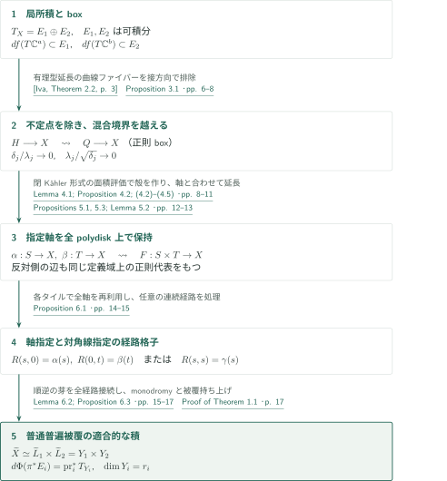
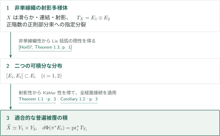
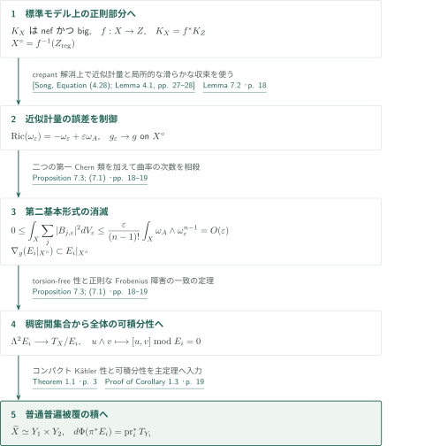

# Universal-cover splitting for compact Kähler manifolds

**正則boxの延長から、指定された二分裂に適合する普遍被覆の積へ**

原稿の主証明は、二つの可積分な接束因子に接する正則写像を延長し、葉に沿う経路と任意の経路の双方を長方形へ組み込む。局所積座標の存在から直ちに大域積を結論するのではなく、局所積写像とその逆の全経路に沿う解析接続を構成する。nefかつbigな標準束の場合には、近似Kähler–Einstein計量が可積分性を供給する。

## 1. 主要結果

### Theorem 1.1 — 指定分裂に適合する普遍被覆

$X$を複素次元$n\ge2$のコンパクト連結Kähler多様体とし、

$$T_X=E_1\oplus E_2$$

を、正の階数$r_1,r_2$をもつ**可積分な正則部分束**への指定された分裂とする。通常位相での普遍被覆$\pi:\widetilde X\to X$に対して、連結かつ単連結な複素多様体$Y_1,Y_2$と双正則写像$\Phi:\widetilde X\to Y_1\times Y_2$が存在し、$d\pi$による$T_{\widetilde X}=\pi^*T_X$の同一視の下で

$$d\Phi(\pi^*E_i)=\operatorname{pr}_i^*T_{Y_i},\qquad \dim_{\mathbb C}Y_i=r_i\quad(i=1,2)$$

となる。因子は基点を通る内在的な葉の普遍被覆として構成され、非コンパクトでもよい。有限被覆が積になるという主張は含まない。

<!-- cite:main -->[Theorem 1.1 · p. 3](https://github.com/openai/math/blob/1581d4cbdd69a0faf34b2089614fe2a814316a6a/preprints/Universal-cover-splitting-for-compact-Kahler-manifolds-September-23-2026/paper.pdf)<!-- /cite -->

### Corollary 1.2 — 非単線織射影多様体

$X$を滑らかな連結非単線織複素射影多様体とし、$T_X=E_1\oplus E_2$を正階数の正則部分束への指定分裂とする。このとき両部分束は可積分であり、通常の普遍被覆はTheorem 1.1と同じ適合的な積分解をもつ。

<!-- cite:non-uniruled -->[Corollary 1.2 · p. 3](https://github.com/openai/math/blob/1581d4cbdd69a0faf34b2089614fe2a814316a6a/preprints/Universal-cover-splitting-for-compact-Kahler-manifolds-September-23-2026/paper.pdf)<!-- /cite -->

### Corollary 1.3 — 標準束がnefかつbigの場合

$X$を次元$n\ge2$の滑らかな連結複素射影多様体で、$K_X$がnefかつbigであるものとする。正階数の部分束への任意の指定された正則分裂$T_X=E_1\oplus E_2$について、両部分束は可積分となり、通常の普遍被覆はTheorem 1.1の適合的な積分解をもつ。

<!-- cite:nef-big -->[Corollary 1.3 · p. 4](https://github.com/openai/math/blob/1581d4cbdd69a0faf34b2089614fe2a814316a6a/preprints/Universal-cover-splitting-for-compact-Kahler-manifolds-September-23-2026/paper.pdf)<!-- /cite -->

## 図の矢印に付した引用

<!-- reference-guide -->
略号のない定理・補題・節・式番号は本原稿 [Universal-cover splitting for compact Kähler manifolds](https://github.com/openai/math/blob/1581d4cbdd69a0faf34b2089614fe2a814316a6a/preprints/Universal-cover-splitting-for-compact-Kahler-manifolds-September-23-2026/paper.pdf) を指します。外部入力には次の略号を使います。

- [Iva](https://arxiv.org/pdf/0810.4588v2) S. Ivashkovich — *Extra extension properties of equidimensional holomorphic mappings: results and open questions*：Stein内の領域からの写像を正則包へ有理型延長する。正則性の回復は本稿で行う。arXiv:0810.4588v2 (2008-11-11); PDF title-page date November 7, 2018。
- [Hor07](https://arxiv.org/pdf/math/0505327v3) Andreas Höring — *Uniruled varieties with split tangent bundle*：非単線織射影多様体上の指定接束分裂を可積分にする。arXiv:math/0505327v3 (2017-11-09); PDF title-page date November 2, 2018。
- [Song](https://arxiv.org/pdf/1404.0445v1) Jian Song — *Riemannian geometry of Kähler–Einstein currents*：crepantな標準モデル解消上の近似Kähler–Einstein計量と正則部分での滑らかな収束。arXiv:1404.0445v1 (2014)。
- [KM98](https://doi.org/10.1017/CBO9780511662560) János Kollár; Shigefumi Mori — *Birational Geometry of Algebraic Varieties*：標準束の半豊富性の入力。原稿内での適用を確認したが、書籍の定理本文・ページは未照合。Cambridge Tracts in Mathematics 134 (1998); cited edition, theorem page not independently checked。

各引用に結果番号とページを付します。誌面番号とPDF内の位置が異なる場合は両方を示します。GitHubの閲覧リンクではページ位置への自動移動を前提としません。
<!-- /reference-guide -->

## 2. Theorem 1.1 の証明 — boxの全域延長と双方向の解析接続

<!-- proof-target:1 -->証明対象：[Theorem 1.1 · p. 3](https://github.com/openai/math/blob/1581d4cbdd69a0faf34b2089614fe2a814316a6a/preprints/Universal-cover-splitting-for-compact-Kahler-manifolds-September-23-2026/paper.pdf)<!-- /proof-target --> [仮定・全結論](#theorem-1-1)を参照する。

**証明の道筋。** 可積分性から局所積座標を作る。Hartogs延長と混合境界の面積評価により、指定された二つの軸を全polydisk上で結合する。この「軸の定義域を失わない」性質で有限格子を埋め、局所積写像とその逆をともに全経路に沿って接続する。最後にmonodromyと被覆の持ち上げを用いる。以下の図は主定理までの全体を示し、各段階の説明は直後に置く。

$P_i:T_X\to E_i$は指定直和に沿う正則射影であり、計量直交射影とは限らない。$f:U\subset\mathbb C^a\times\mathbb C^b\to X$がboxであるとは、二つのパラメータ方向の微分がそれぞれ$E_1,E_2$に入ることをいう。全階数性や埋込みは要求しない。

### 1. 可積分性は局所積を与え、接方向は有理型延長の不定点を除く

Frobeniusの二つの局所沈め込みを組み合わせると、$E_i$が各座標ブロックの接方向となる局所座標を得る。座標変換は局所的に$(z_1,z_2)\mapsto(h_1(z_1),h_2(z_2))$と分離する。これは計量が積であるという主張ではない。

<!-- cite:charts -->[Lemma 2.1; Definition 2.2 · pp. 5–6](https://github.com/openai/math/blob/1581d4cbdd69a0faf34b2089614fe2a814316a6a/preprints/Universal-cover-splitting-for-compact-Kahler-manifolds-September-23-2026/paper.pdf)<!-- /cite -->

Hartogs図形$H\subset\mathbb C^2$上のboxにIvashkovichの定理を適用すると、その正則包であるbidisk $Q$へ**有理型**に延長する。$H$がStein多様体内の領域で、標的がコンパクトKählerであることが入力の条件である。原稿はここから正則性を別に示す。グラフ$\Gamma\subset Q\times X$の射影に曲線ファイバーがあれば、局所積座標の成分$h$の一つがその曲線上で変動する。たとえば$h$が第一成分なら、一般点で$(s,h)$のレベルは孤立する。一方、近傍の通常グラフでは$h$が$t$に依存せず、そのレベルは$t$方向を含む。境界を避ける小球内のレベルが正次元コンパクト解析集合になり、矛盾する。proper性と通常グラフの稠密性・連結性から残る有限ファイバーも一点となり、連続かつ局所有界な座標表示で不定点を除く。Hartogs図形を定めるアフィン座標とbox方向$(s,t)$は一致していなくてもよい。

<!-- cite:iva-input -->[&#91;Iva, Theorem 2.2, p. 3&#93;](https://arxiv.org/pdf/0810.4588v2#page=3)<!-- /cite -->

<!-- cite:hartogs -->[Proposition 3.1 · pp. 6–8](https://github.com/openai/math/blob/1581d4cbdd69a0faf34b2089614fe2a814316a6a/preprints/Universal-cover-splitting-for-compact-Kahler-manifolds-September-23-2026/paper.pdf)<!-- /cite -->

### 2. 閉Kähler形式と二つのスケールで混合境界を越える

複素接線が$s,t$の両方向に非零成分をもつ滑らかな凸境界点を考える。$v$を複素接方向、$u$を横断方向とすると、box条件とコンパクト性による$\sup_X\|P_i\|<\infty$から$\|df(\partial_{\mathrm{Re}\,u})\|\le C\|df(\partial_{\mathrm{Re}\,v})\|$を得る。$u=x<0$、$|v|\le k\sqrt{-x}$の円板の面積$A(x)$について、$d\omega=0$とStokesの定理は境界の収縮項を利用した上界を与える。

$x_j=-\delta_j\to0$のスライス内で多数の互いに素な環帯を取り、一つの面積を0へ収束させる。Lemma 4.1の微分再スケール議論によりその像は一つの積座標に入る。選ばれた半径$\lambda_j$は

$$\delta_j/\lambda_j\to0,\qquad \lambda_j/\sqrt{\delta_j}\to0$$

を同時に満たす。前者は構成するHartogs殻の幅が残りの境界距離を越えること、後者は殻が元の接円板に収まることを保証する。積座標内の分離式で殻を横に厚くし、Proposition 3.1で充填する。任意のKähler計量を使い、二部分束の直交性・平行性は仮定しない。

<!-- cite:boundary -->[Lemma 4.1; Proposition 4.2; (4.2)–(4.5) · pp. 8–11](https://github.com/openai/math/blob/1581d4cbdd69a0faf34b2089614fe2a814316a6a/preprints/Universal-cover-splitting-for-compact-Kahler-manifolds-September-23-2026/paper.pdf)<!-- /cite -->

### 3. 指定軸を全polydisk上で組み合わせる

同じ点から出る$E_1,E_2$に接する正則円板を、$|s|^{2m}+|t|^{2m}<R^{2m}$上で延長する。軸以外の境界では前段を使い、軸上では指定円板そのものを使う。$R<1$で停止できないことと$m\to\infty$により、全bidisk上のboxを得る。高次元軸の場合、まず放射状の円板を組み合わせ、有限個の積座標からなる格子をパラメータ付きで再構成する。この再構成が正則なパラメータ依存性を与えるので、点ごとのboxの存在だけで済ませていない。

<!-- cite:axes -->[Propositions 5.1, 5.3; Lemma 5.2 · pp. 12–13](https://github.com/openai/math/blob/1581d4cbdd69a0faf34b2089614fe2a814316a6a/preprints/Universal-cover-splitting-for-compact-Kahler-manifolds-September-23-2026/paper.pdf)<!-- /cite -->

### 4. 二種類の有限格子が順写像と逆写像の接続を担う

葉に沿う二経路を小片へ分割し、各片を正則plaque写像と連続パラメータの合成で表す。Proposition 5.3により一つのタイルを埋めた後も、反対側の辺は**元の全polydisk**上の正則代表をもつ。したがって像の大きさを逐次小さく保つ必要なく、軸指定の長方形を完成できる。任意の経路$\gamma$には対角タイルを先に置き、対角から離れる順に残りを埋めて$R(s,s)=\gamma(s)$とする。この二つ目の構成が逆写像の全経路接続に必要である。

<!-- cite:rectangles -->[Proposition 6.1 · pp. 14–15](https://github.com/openai/math/blob/1581d4cbdd69a0faf34b2089614fe2a814316a6a/preprints/Universal-cover-splitting-for-compact-Kahler-manifolds-September-23-2026/paper.pdf)<!-- /cite -->

### 5. 葉の普遍被覆で双正則性と指定分裂への適合性を得る

基点を通る葉$L_i$には$X$の部分空間位相ではなく内在的なplaque位相を入れる。Lemma 6.2により連結な複素多様体として普遍被覆$Y_i=\widetilde L_i$を取れる。積座標由来の相互に逆な芽$H_o:L_1\times L_2\to X$、$K_o:X\to L_1\times L_2$を、Proposition 6.3が長方形に沿ってともに接続する。

<!-- cite:leaves -->[Lemma 6.2; Proposition 6.3 · pp. 15–17](https://github.com/openai/math/blob/1581d4cbdd69a0faf34b2089614fe2a814316a6a/preprints/Universal-cover-splitting-for-compact-Kahler-manifolds-September-23-2026/paper.pdf)<!-- /cite -->

monodromyで単連結被覆上に写像を定義し、基点を一致させた被覆持ち上げ$\widetilde H:Y_1\times Y_2\to\widetilde X$と$\widetilde K:\widetilde X\to Y_1\times Y_2$を取る。二合成は基点近傍で恒等なので、連結性と一致の定理で全域でも恒等となる。$d\widetilde K$の誤った因子への成分も正則束写像として全域で消える。微分が可逆で$\dim Y_i=r_i$であるため、包含は等号となる。これで積同型だけでなく、指定された埋込み$E_i\subset T_X$への適合性も示される。

<!-- cite:global -->[Proof of Theorem 1.1 · p. 17](https://github.com/openai/math/blob/1581d4cbdd69a0faf34b2089614fe2a814316a6a/preprints/Universal-cover-splitting-for-compact-Kahler-manifolds-September-23-2026/paper.pdf)<!-- /cite -->

## 3. Corollary 1.2 の証明 — 可積分性を外部定理から供給する

<!-- proof-target:2 -->証明対象：[Corollary 1.2 · p. 3](https://github.com/openai/math/blob/1581d4cbdd69a0faf34b2089614fe2a814316a6a/preprints/Universal-cover-splitting-for-compact-Kahler-manifolds-September-23-2026/paper.pdf)<!-- /proof-target --> [仮定・結論](#corollary-1-2)を参照する。

### 1. 非単線織性から可積分性へ

HöringのTheorem 1.3は、非単線織な射影多様体の正則接束分裂について両因子の可積分性を与える。原稿の仮定はその適用条件を満たす。ここで得るのはLie括弧に関する閉性である。

<!-- cite:hor-input -->[&#91;Hor07, Theorem 1.3, p. 1&#93;](https://arxiv.org/pdf/math/0505327v3#page=1)<!-- /cite -->

### 2. 可積分性から普通普遍被覆の積へ

滑らかな複素射影多様体はコンパクトKählerなので、前段をTheorem 1.1へ入力できる。順序は「指定された正則分裂→可積分な二分布→適合的な普遍被覆の積」であり、最初の分裂だけから一般に最後の結論を導いてはいない。

<!-- cite:non-uniruled -->[Corollary 1.2 · p. 3](https://github.com/openai/math/blob/1581d4cbdd69a0faf34b2089614fe2a814316a6a/preprints/Universal-cover-splitting-for-compact-Kahler-manifolds-September-23-2026/paper.pdf)<!-- /cite -->

<!-- cite:main -->[Theorem 1.1 · p. 3](https://github.com/openai/math/blob/1581d4cbdd69a0faf34b2089614fe2a814316a6a/preprints/Universal-cover-splitting-for-compact-Kahler-manifolds-September-23-2026/paper.pdf)<!-- /cite -->

## 4. Corollary 1.3 の証明 — 近似計量の誤差を消して可積分性へ戻す

<!-- proof-target:3 -->証明対象：[Corollary 1.3 · p. 4](https://github.com/openai/math/blob/1581d4cbdd69a0faf34b2089614fe2a814316a6a/preprints/Universal-cover-splitting-for-compact-Kahler-manifolds-September-23-2026/paper.pdf)<!-- /proof-target --> [仮定・結論](#corollary-1-3)を参照する。

原稿§7の経路をたどる。$f:X\to Z$を標準モデルへの縮約、$X^\circ=f^{-1}(Z_{\mathrm{reg}})$とする。ここで使う計量上の平行性は$X^\circ$上の主張であり、$X$全体の滑らかな積計量を構成するものではない。

### 1. 標準モデルと近似Kähler–Einstein計量

Proposition 7.1は$K_X=f^*K_Z$、$K_Z$がample、$Z$がcanonicalで、$f$が$Z_{\mathrm{reg}}$上同型となる縮約を構成する。半豊富性には原典が引用するKollár–Moriのbase-point-free theoremを使い、$D=K_X$と整数$a>1$について$aD-K_X=(a-1)K_X$がnefかつbigとなる。この書籍入力は適用箇所を確認したが、入力定理本文・正確なページは今回未照合である。

<!-- cite:canonical -->[Proposition 7.1 · pp. 17–18](https://github.com/openai/math/blob/1581d4cbdd69a0faf34b2089614fe2a814316a6a/preprints/Universal-cover-splitting-for-compact-Kahler-manifolds-September-23-2026/paper.pdf)<!-- /cite -->

Songの近似はこの滑らかなcrepant解消に適用され、$0<\varepsilon<1$について

$$\operatorname{Ric}(\omega_\varepsilon)=-\omega_\varepsilon+\varepsilon\omega_A,\qquad [\omega_\varepsilon]=2\pi c_1(K_X)+\varepsilon[\omega_A]$$

を満たす計量を与える。$X^\circ$のコンパクト部分上で負のKähler–Einstein計量$g$へ滑らかに収束することが次段で使う内容である。距離完備化が$Z$になるというSongの別の結論は、この本文経路では必要ない。

<!-- cite:song-input -->[&#91;Song, Equation (4.28); Lemma 4.1, pp. 27–28&#93;](https://arxiv.org/pdf/1404.0445v1#page=27)<!-- /cite -->

<!-- cite:metric -->[Lemma 7.2 · p. 18](https://github.com/openai/math/blob/1581d4cbdd69a0faf34b2089614fe2a814316a6a/preprints/Universal-cover-splitting-for-compact-Kahler-manifolds-September-23-2026/paper.pdf)<!-- /cite -->

### 2. 第二基本形式の消滅から大域的可積分性へ

$P_{j,\varepsilon}$を$g_\varepsilon$による$E_j$への直交射影、$B_{j,\varepsilon}$を第二基本形式とする。これらの射影は、主証明の指定直和に沿う射影とは異なる。曲率公式を二部分束について積分して加えると、$c_1(E_1)+c_1(E_2)=c_1(T_X)$によって次数が相殺する。$C_\varepsilon=P_{1,\varepsilon}+P_{2,\varepsilon}-I$は$\operatorname{tr}C_\varepsilon=0$、$-I\le C_\varepsilon\le I$を満たすため、

$$0\le\int_X\sum_{j=1}^2|B_{j,\varepsilon}|^2\,dV_\varepsilon\le\frac{\varepsilon}{(n-1)!}\int_X\omega_A\wedge\omega_\varepsilon^{n-1}=O(\varepsilon).$$

右辺の有界性はコホモロジー類の多項式から従う。$X^\circ$上の滑らかな収束により極限の第二基本形式は0となり、$g$の接続は両因子を保つ。Kähler接続のtorsion-free性から$X^\circ$上で可積分であり、正則なFrobenius障害

$$\Lambda^2E_j\longrightarrow T_X/E_j,\qquad u\wedge v\longmapsto[u,v]\bmod E_j$$

が稠密開集合で消えるので$X$全体でも消える。これが計量的な議論を、主定理の正則な仮定へ戻す箇所である。

<!-- cite:parallel -->[Proposition 7.3; (7.1) · pp. 18–19](https://github.com/openai/math/blob/1581d4cbdd69a0faf34b2089614fe2a814316a6a/preprints/Universal-cover-splitting-for-compact-Kahler-manifolds-September-23-2026/paper.pdf)<!-- /cite -->

### 3. 大域積を与えるのは再びTheorem 1.1

得られた可積分性と射影性からTheorem 1.1が適用でき、指定分裂に適合する普通普遍被覆の積を得る。$X^\circ$の計量はこの議論で完備と仮定しておらず、そこでの平行性へde Rham分解を直接適用したわけではない。Appendices A–Dは、潰れる標準モデルのファイバーを通る別の大域接続法を展開するが、本記事の証明経路からは区切る。

<!-- cite:nef-proof -->[Proof of Corollary 1.3 · p. 19](https://github.com/openai/math/blob/1581d4cbdd69a0faf34b2089614fe2a814316a6a/preprints/Universal-cover-splitting-for-compact-Kahler-manifolds-September-23-2026/paper.pdf)<!-- /cite -->

## 5. どの論文が、どの段階を担うか

| 入力 | 使用箇所 | 供給内容・適用条件 | 確認範囲 |
|---|---|---|---|
| <!-- cite:iva-input -->[&#91;Iva, Theorem 2.2, p. 3&#93;](https://arxiv.org/pdf/0810.4588v2#page=3)<!-- /cite --> | Proposition 3.1 | Stein内のHartogs領域、コンパクトKähler標的から有理型延長 | 外部の主張と本稿の適用を照合。正則性の回復は本稿自身の議論 |
| <!-- cite:hor-input -->[&#91;Hor07, Theorem 1.3, p. 1&#93;](https://arxiv.org/pdf/math/0505327v3#page=1)<!-- /cite --> | Corollary 1.2 | 非単線織・射影の条件下で指定分裂を可積分にする | 外部の主張と本稿p.3の適用を照合 |
| KM98：Theorem 3.3 | Proposition 7.1 | $K_X$の半豊富性 | 原稿での適用確認。書籍の定理本文・ページは未照合 |
| <!-- cite:song-input -->[&#91;Song, Equation (4.28); Lemma 4.1, pp. 27–28&#93;](https://arxiv.org/pdf/1404.0445v1#page=27)<!-- /cite --> | Lemma 7.2 → Proposition 7.3 | crepant解消上の近似計量、非例外部分での滑らかな収束 | 入力記述と適用条件を照合。外部証明は追跡対象外 |

同じ052の[有理連結多様体上の可積分性の記事](../split-tangent-integrability/article.ja.md)は、主定理の可積分性仮定を成立させる別の状況を扱う。本稿序論にはそのTheorem 1.1の引用があるが、本稿の主証明・上記二つの系がそれを直接使うわけではない。

<!-- cite:intro-companion -->[Introduction · p. 3](https://github.com/openai/math/blob/1581d4cbdd69a0faf34b2089614fe2a814316a6a/preprints/Universal-cover-splitting-for-compact-Kahler-manifolds-September-23-2026/paper.pdf)<!-- /cite -->

## 6. 原典を読む入口と確認範囲

<!-- reading-list -->
- [Theorem 1.1 · p. 3](https://github.com/openai/math/blob/1581d4cbdd69a0faf34b2089614fe2a814316a6a/preprints/Universal-cover-splitting-for-compact-Kahler-manifolds-September-23-2026/paper.pdf) — 仮定としての可積分性と指定分裂への適合性
- [Proposition 3.1 · pp. 6–8](https://github.com/openai/math/blob/1581d4cbdd69a0faf34b2089614fe2a814316a6a/preprints/Universal-cover-splitting-for-compact-Kahler-manifolds-September-23-2026/paper.pdf) — 有理型延長の例外ファイバーを除く論証
- [Lemma 4.1; Proposition 4.2; (4.2)–(4.5) · pp. 8–11](https://github.com/openai/math/blob/1581d4cbdd69a0faf34b2089614fe2a814316a6a/preprints/Universal-cover-splitting-for-compact-Kahler-manifolds-September-23-2026/paper.pdf) — 閉Kähler形式、面積評価、二つのスケール
- [Propositions 5.1, 5.3; Lemma 5.2 · pp. 12–13](https://github.com/openai/math/blob/1581d4cbdd69a0faf34b2089614fe2a814316a6a/preprints/Universal-cover-splitting-for-compact-Kahler-manifolds-September-23-2026/paper.pdf) — 軸の全polydiskを保った延長
- [Proposition 6.1 · pp. 14–15](https://github.com/openai/math/blob/1581d4cbdd69a0faf34b2089614fe2a814316a6a/preprints/Universal-cover-splitting-for-compact-Kahler-manifolds-September-23-2026/paper.pdf) — 軸指定と対角線指定の二つの格子
- [Proof of Theorem 1.1 · p. 17](https://github.com/openai/math/blob/1581d4cbdd69a0faf34b2089614fe2a814316a6a/preprints/Universal-cover-splitting-for-compact-Kahler-manifolds-September-23-2026/paper.pdf) — 双方向延長から積同型と適合性へ
- [Proposition 7.3; (7.1) · pp. 18–19](https://github.com/openai/math/blob/1581d4cbdd69a0faf34b2089614fe2a814316a6a/preprints/Universal-cover-splitting-for-compact-Kahler-manifolds-September-23-2026/paper.pdf) — 計量的平行性から大域可積分性への移行
<!-- /reading-list -->

本記事では主結果と§§2–7の証明本文を読み、主定理の全結論、二つの系への接続、Ivashkovich・Höring・Songの入力の記述と適用箇所を照合した。Kollár–Moriのbase-point-free theoremの原典本文・ページは未照合である。Appendices A–Dの別証明、外部定理そのものの証明、背景文献・標準的な解析集合論と被覆理論の全証明は独立検証していない。説明は原稿の論証を整理したものであり、全証明の正しさの認定や専門家査読を意味しない。
