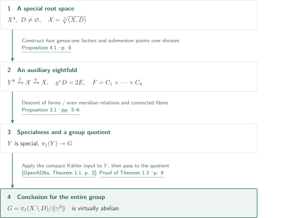
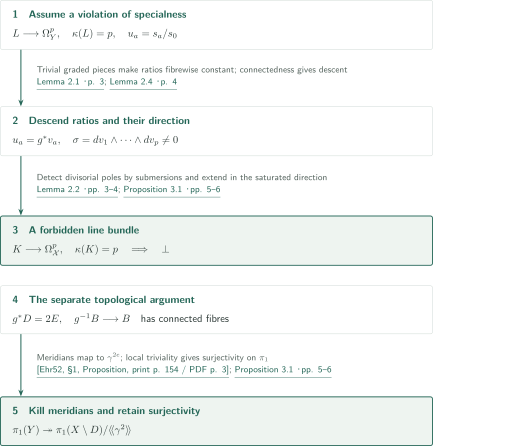
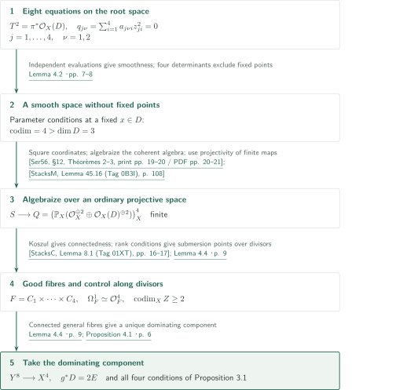

# Conditional abelianity for special fourfold pairs with a half-weight divisor

**A genus-one construction on the root space realizes its orbifold group as a quotient of an ordinary fundamental group**

The manuscript takes abelianity for smooth compact Kähler manifolds as an input and transfers it to the order-two root orbifold of a smooth projective fourfold pair. Its central construction is a projective eightfold whose general fibre is a product of four genus-one curves. Descent of differential forms and the meridian relations separately provide specialness of this eightfold and a surjection from its fundamental group.

## 1. Main results

### Theorem 1.3 — Conditional virtual abelianity

**Input hypothesis (Assumption 1.2).** Every connected smooth special compact Kähler manifold, in every dimension, has virtually abelian fundamental group. The manuscript obtains this input from Theorem 1.1 of the first paper in this catalog.

<!-- cite:assumption -->[Assumption 1.2 · p. 2](https://github.com/openai/math/blob/fd4aeeb2ee4fc729c18d98444fed42fd0529eeeb/preprints/A-conditional-abelianity-theorem-for-special-fourfold-pairs-with-a-half-weight-divisor-October-5-2026/main.pdf)<!-- /cite --> <!-- cite:companion -->[&#91;OpenAI26a, Theorem 1.1, p. 2&#93;](https://github.com/openai/math/blob/fd4aeeb2ee4fc729c18d98444fed42fd0529eeeb/preprints/The-abelianity-conjecture-for-special-compact-Kahler-manifolds-September-23-2026/paper.pdf)<!-- /cite -->

Let $X$ be a connected smooth complex projective fourfold and $D\subset X$ a nonempty smooth connected reduced divisor. Put $\mathcal X=\sqrt[2]{(X,D)}$. If $\mathcal X$ is special, then, under the hypothesis above,

$$G=\pi_1(X\setminus D,x)/\langle\!\langle\gamma^2\rangle\!\rangle$$

contains an abelian subgroup of finite index, where $\gamma$ is a meridian of $D$. This assertion concerns the entire discrete group $G$; it gives neither a uniform index bound nor torsion-freeness.

<!-- cite:main -->[Theorem 1.3 · p. 2](https://github.com/openai/math/blob/fd4aeeb2ee4fc729c18d98444fed42fd0529eeeb/preprints/A-conditional-abelianity-theorem-for-special-fourfold-pairs-with-a-half-weight-divisor-October-5-2026/main.pdf)<!-- /cite -->

Specialness here is Definition 1.1 of the manuscript: for $1\le p\le\dim V$, there is no nonzero map from a line bundle $L$ to $\Omega_V^p$ with $\kappa(L)=p$. On the root space, forms and global sections are interpreted equivariantly on its local covers.

<!-- cite:definition -->[Definition 1.1 · p. 2](https://github.com/openai/math/blob/fd4aeeb2ee4fc729c18d98444fed42fd0529eeeb/preprints/A-conditional-abelianity-theorem-for-special-fourfold-pairs-with-a-half-weight-divisor-October-5-2026/main.pdf)<!-- /cite -->

## References on the arrows

<!-- reference-guide -->
Unprefixed theorem, lemma, section and equation numbers refer to [A conditional abelianity theorem for special fourfold pairs with a half-weight divisor](https://github.com/openai/math/blob/fd4aeeb2ee4fc729c18d98444fed42fd0529eeeb/preprints/A-conditional-abelianity-theorem-for-special-fourfold-pairs-with-a-half-weight-divisor-October-5-2026/main.pdf). External inputs use the following keys.

- [OpenAI26a](https://github.com/openai/math/blob/fd4aeeb2ee4fc729c18d98444fed42fd0529eeeb/preprints/The-abelianity-conjecture-for-special-compact-Kahler-manifolds-September-23-2026/paper.pdf) OpenAI — *The abelianity conjecture for special compact Kähler manifolds*: Virtual abelianity of the entire fundamental group of a special smooth compact Kähler manifold; supplies Assumption 1.2. 2026-09-23.
- [Ehr52](https://www.numdam.org/item/SB_1948-1951__1__153_0.pdf) Charles Ehresmann — *Les connexions infinitésimales dans un espace fibré différentiable*: Local triviality for submersions with connected compact fibres, used for surjectivity on fundamental groups. 1952, Séminaire Bourbaki, exp. 24 (lecture 1950), pp. 153–168.
- [Ser56](https://www.numdam.org/item/AIF_1956__6__1_0.pdf) Jean-Pierre Serre — *Géométrie algébrique et géométrie analytique*: Algebraization of a finite analytic map through its coherent algebra and structure maps. 1956, Annales de l’Institut Fourier 6, pp. 1–42.
- [Dem12](https://www-fourier.univ-grenoble-alpes.fr/~demailly/manuscripts/agbook.pdf) Jean-Pierre Demailly — *Complex Analytic and Differential Geometry*: Closedness of holomorphic differential forms in Lemma 2.1. June 21, 2012.
- [StacksM](https://stacks.math.columbia.edu/download/morphisms.pdf) The Stacks project authors — *The Stacks Project — Morphisms of Schemes*: Projectivity of finite morphisms. version ed88ff78, compiled July 14, 2026.
- [StacksC](https://stacks.math.columbia.edu/download/coherent.pdf) The Stacks project authors — *The Stacks Project — Cohomology of Schemes*: Cohomology of projective space in the Koszul calculation. version ed88ff78, compiled July 14, 2026.

Each citation gives the result and pages. When printed pagination differs from the PDF position, both are shown. GitHub previews do not automatically jump to the cited page.
<!-- /reference-guide -->

## 2. Theorem 1.3 — Proof overview of the main theorem

<!-- proof-target:1 -->Proof target：[Theorem 1.3 · p. 2](https://github.com/openai/math/blob/fd4aeeb2ee4fc729c18d98444fed42fd0529eeeb/preprints/A-conditional-abelianity-theorem-for-special-fourfold-pairs-with-a-half-weight-divisor-October-5-2026/main.pdf)<!-- /proof-target -->

Use the hypotheses and notation of [Theorem 1.3 above](#theorem-1-3). Construct an auxiliary variety, establish its specialness and the group quotient, and then apply the compact Kähler input.

### The construction and the two transfers

Proposition 4.1 constructs a connected smooth projective eightfold $Y$ and a surjection $g:Y\to X$. Its general fibre $F$ is a product of four genus-one curves, so $\Omega_F^1$ is trivial. Moreover, $g^*D=2E$ and $g$ lifts to $f:Y\to\mathcal X$. Suitable submersion points over general points of every divisor are essential for the next step.

<!-- cite:construction -->[Proposition 4.1 · p. 6](https://github.com/openai/math/blob/fd4aeeb2ee4fc729c18d98444fed42fd0529eeeb/preprints/A-conditional-abelianity-theorem-for-special-fourfold-pairs-with-a-half-weight-divisor-October-5-2026/main.pdf)<!-- /cite -->

Proposition 3.1 shows that a differential line bundle on $Y$ with $\kappa(L)=p$ would descend to $\mathcal X$. Specialness of $\mathcal X$ therefore implies specialness of $Y$. A separate topological argument uses even ramification multiplicities and connected general fibres to obtain $\pi_1(Y)\twoheadrightarrow G$.

<!-- cite:transfer -->[Proposition 3.1 · pp. 5–6](https://github.com/openai/math/blob/fd4aeeb2ee4fc729c18d98444fed42fd0529eeeb/preprints/A-conditional-abelianity-theorem-for-special-fourfold-pairs-with-a-half-weight-divisor-October-5-2026/main.pdf)<!-- /cite -->

### Apply the input to the entire group and pass to its quotient

Since $Y$ is smooth projective, it is compact Kähler. Apply Assumption 1.2 to this **eight-dimensional $Y$** to obtain an abelian finite-index subgroup $A\subset\pi_1(Y)$. Its image in $G$ is abelian and has index at most $[\pi_1(Y):A]$. This proves the full conclusion of the main theorem. The argument does not assume that the root space admits a finite manifold cover.

<!-- cite:companion -->[&#91;OpenAI26a, Theorem 1.1, p. 2&#93;](https://github.com/openai/math/blob/fd4aeeb2ee4fc729c18d98444fed42fd0529eeeb/preprints/The-abelianity-conjecture-for-special-compact-Kahler-manifolds-September-23-2026/paper.pdf)<!-- /cite --> <!-- cite:finish -->[Proof of Theorem 1.3 · p. 9](https://github.com/openai/math/blob/fd4aeeb2ee4fc729c18d98444fed42fd0529eeeb/preprints/A-conditional-abelianity-theorem-for-special-fourfold-pairs-with-a-half-weight-divisor-October-5-2026/main.pdf)<!-- /cite -->

## 3. Proposition 3.1 — Transfer of specialness and fundamental groups

<!-- proof-target:2 -->Proof target：[Proposition 3.1 · pp. 5–6](https://github.com/openai/math/blob/fd4aeeb2ee4fc729c18d98444fed42fd0529eeeb/preprints/A-conditional-abelianity-theorem-for-special-fourfold-pairs-with-a-half-weight-divisor-October-5-2026/main.pdf)<!-- /proof-target -->

<!-- statement:proposition-3-1 -->
### Proposition 3.1 — Four conditions for transfer

Let $X$ be a connected smooth projective variety of positive dimension, $D$ a nonempty smooth connected reduced divisor, $Y$ a connected smooth projective variety, and $g:Y\to X$ surjective. Assume the following.

1. $g^*D=2E$ for an effective integral divisor $E$, giving a lift $f:Y\to\mathcal X$.
2. Over a nonempty Zariski open subset $B\subset X\setminus D$, the map $g$ is smooth with connected fibres $F$ and trivial $\Omega_F^1$.
3. Over a general point of each prime divisor $P\ne D$, there is a submersion point of $g$.
4. Over a general point of $D$, a local lift to a root chart has a submersion point.

Then specialness of $\mathcal X$ implies specialness of $Y$. Without assuming specialness, there is a surjection $\pi_1(Y)\twoheadrightarrow G$. Consequently, if $\mathcal X$ is special and Assumption 1.2 holds, $G$ is virtually abelian.

<!-- cite:transfer -->[Proposition 3.1 · pp. 5–6](https://github.com/openai/math/blob/fd4aeeb2ee4fc729c18d98444fed42fd0529eeeb/preprints/A-conditional-abelianity-theorem-for-special-fourfold-pairs-with-a-half-weight-divisor-October-5-2026/main.pdf)<!-- /cite -->
<!-- /statement -->

### Descend ratios of sections to the base

Suppose $L\to\Omega_Y^p$ is nonzero with $\kappa(L)=p$. Choose sections $s_0,\ldots,s_p$ of a power $L^m$ with algebraically independent ratios $u_a=s_a/s_0$. Lemma 2.1 identifies the generic direction of $L$ with the wedge of the differentials of these ratios. Its input is closedness of holomorphic forms on a resolution of the cover obtained by simultaneously adjoining $m$th roots of the sections.

<!-- cite:wedge -->[Lemma 2.1 · p. 3](https://github.com/openai/math/blob/fd4aeeb2ee4fc729c18d98444fed42fd0529eeeb/preprints/A-conditional-abelianity-theorem-for-special-fourfold-pairs-with-a-half-weight-divisor-October-5-2026/main.pdf)<!-- /cite --> <!-- cite:closed -->[&#91;Dem12, VI, Proposition 8.9, p. 312&#93;](https://www-fourier.univ-grenoble-alpes.fr/~demailly/manuscripts/agbook.pdf#page=312)<!-- /cite -->

On a general fibre, the cotangent sequence is $0\to\mathcal O_F^{\dim X}\to\Omega_Y^1|_F\to\Omega_F^1\to0$. Its exterior powers have a filtration with trivial graded pieces. A component of the first nonzero graded projection of $L|_F$ gives a section $t$ of $L^{-1}|_F$. On a general fibre where $t^m s_0$ is a nonzero constant, all ratios $s_a/s_0$ are constant. Rational descent along connected general fibres then gives $u_a=g^*v_a$. Thus $\sigma=dv_1\wedge\cdots\wedge dv_p\ne0$, and $p\le\dim X$.

<!-- cite:descent -->[Lemma 2.4 · p. 4](https://github.com/openai/math/blob/fd4aeeb2ee4fc729c18d98444fed42fd0529eeeb/preprints/A-conditional-abelianity-theorem-for-special-fourfold-pairs-with-a-half-weight-divisor-October-5-2026/main.pdf)<!-- /cite -->

### Detect poles at submersion points in root charts

Write $\pi:\mathcal X\to X$ and saturate the direction of $\tau=\pi^*\sigma$ inside $\Omega^p_{\mathcal X}$ to obtain a line bundle $K$. Lemma 2.2 uses primitive generators in codimension one and Hartogs extension; it does not assume that the resulting map is a subbundle everywhere.

<!-- cite:saturation -->[Lemma 2.2 · pp. 3–4](https://github.com/openai/math/blob/fd4aeeb2ee4fc729c18d98444fed42fd0529eeeb/preprints/A-conditional-abelianity-theorem-for-special-fourfold-pairs-with-a-half-weight-divisor-October-5-2026/main.pdf)<!-- /cite -->

First write the images of $s_a$ as $h_a(g^*\sigma)^m$. Over an open set where $\sigma$ is holomorphic and nonvanishing and $g$ is a submersion, $h_a$ is holomorphic and therefore constant on compact connected fibres. Lemma 2.4 gives $h_a=g^*b_a$, so the images are $g^*b_a(g^*\sigma)^m$. The submersion points in conditions 3 and 4 admit local sections. Any divisorial pole downstairs would therefore be detected after pullback to $Y$. Consequently $(\pi^*b_a)\tau^m$ is holomorphic on every root chart and extends across codimension two. Independence of the ratios $v_a$ gives $\kappa(K)\ge p$. On the other hand, $f^*K\to\Omega_Y^p$ and Lemma 2.1 give $\kappa(K)\le\kappa(f^*K)\le p$. This produces the forbidden line bundle with $\kappa(K)=p$ on $\mathcal X$.

<!-- cite:transfer -->[Proposition 3.1 · pp. 5–6](https://github.com/openai/math/blob/fd4aeeb2ee4fc729c18d98444fed42fd0529eeeb/preprints/A-conditional-abelianity-theorem-for-special-fourfold-pairs-with-a-half-weight-divisor-October-5-2026/main.pdf)<!-- /cite -->

### Even meridian powers yield the group surjection

For $Y\setminus g^{-1}D\to X\setminus D$, a meridian of a component of multiplicity $2e$ in $g^*D$ maps to $\gamma^{2e}$ and hence dies in $G$. The inclusion of this complement in $Y$ induces a surjection on fundamental groups, whose kernel is normally generated by divisor meridians. The map therefore factors through $\pi_1(Y)\to G$. The proper smooth map $g^{-1}B\to B$ has connected compact fibres and is locally trivial, so it is surjective on fundamental groups. General position also gives surjectivity of $\pi_1(B)\to\pi_1(X\setminus D)$, proving the required surjection.

<!-- cite:fibration -->[&#91;Ehr52, §1, Proposition, print p. 154 / PDF p. 3&#93;](https://www.numdam.org/item/SB_1948-1951__1__153_0.pdf#page=3)<!-- /cite --> <!-- cite:transfer -->[Proposition 3.1 · pp. 5–6](https://github.com/openai/math/blob/fd4aeeb2ee4fc729c18d98444fed42fd0529eeeb/preprints/A-conditional-abelianity-theorem-for-special-fourfold-pairs-with-a-half-weight-divisor-October-5-2026/main.pdf)<!-- /cite -->

## 4. Proposition 4.1 — Constructing a projective eightfold

<!-- proof-target:3 -->Proof target：[Proposition 4.1 · p. 6](https://github.com/openai/math/blob/fd4aeeb2ee4fc729c18d98444fed42fd0529eeeb/preprints/A-conditional-abelianity-theorem-for-special-fourfold-pairs-with-a-half-weight-divisor-October-5-2026/main.pdf)<!-- /proof-target -->

<!-- statement:proposition-4-1 -->
### Proposition 4.1 — A construction with four genus-one factors

Let $X$ be a connected smooth complex projective fourfold and $D\subset X$ a nonempty smooth connected reduced divisor. There exist a connected smooth projective eightfold $Y$ and a surjective map $g:Y\to X$ satisfying all four conditions of Proposition 3.1. Its general fibre is a product of four smooth connected genus-one curves. The construction itself does not require specialness of $\mathcal X$.

<!-- cite:construction -->[Proposition 4.1 · p. 6](https://github.com/openai/math/blob/fd4aeeb2ee4fc729c18d98444fed42fd0529eeeb/preprints/A-conditional-abelianity-theorem-for-special-fourfold-pairs-with-a-half-weight-divisor-October-5-2026/main.pdf)<!-- /cite -->
<!-- /statement -->

### Diagonal quadrics on the root space and avoidance of fixed points

Set $T=\mathcal O_{\mathcal X}(\mathcal D)$, so $T^2=\pi^*\mathcal O_X(D)$. Choose $M$ with both $M$ and $M(-D)$ globally generated. On the fourfold fibre product of $\mathbb P_{\mathcal X}(\mathcal O^{\oplus2}\oplus T^{\oplus2})$, impose two diagonal quadrics in each factor $j=1,\ldots,4$:

$$q_{j\nu}=\sum_{i=1}^4 a_{j\nu i}z_{ji}^2=0\quad(\nu=1,2).$$

For $i=1,2$ the coefficients lie in $H^0(X,M)$, and for $i=3,4$ in $H^0(X,M(-D))$. The latter are evaluated after tensoring with $T^2$; they are not automatically zero along $D$.

Independent coefficient evaluations for the eight equations give smoothness for general parameters. Over $D$, a fixed point of $\mu_2$ lies in one of two eigenspace copies of $\mathbb P^1$ in every factor. A common zero of the corresponding two quadrics requires the relevant $2\times2$ determinant to vanish. The four factors impose four independent conditions. Since $\dim D=3$, general parameters avoid every fixed point. This dimension count explains the use of four factors.

<!-- cite:choice -->[Lemma 4.2 · pp. 7–8](https://github.com/openai/math/blob/fd4aeeb2ee4fc729c18d98444fed42fd0529eeeb/preprints/A-conditional-abelianity-theorem-for-special-fourfold-pairs-with-a-half-weight-divisor-October-5-2026/main.pdf)<!-- /cite -->

### Squaring coordinates provides projectivity

The smooth analytic space $S$ obtained from the free root charts maps finitely, by squaring coordinates, to the ordinary projective bundle product

$$Q=\bigl(\mathbb P_X(\mathcal O_X^{\oplus2}\oplus\mathcal O_X(D)^{\oplus2})\bigr)^4_X.$$

GAGA algebraizes the finite coherent algebra together with its multiplication and unit. Taking relative Spec gives an algebraic finite morphism to $Q$. Finite morphisms are projective and $Q$ is projective, so $S$ is projective.

<!-- cite:projective -->[Lemma 4.3 · p. 8](https://github.com/openai/math/blob/fd4aeeb2ee4fc729c18d98444fed42fd0529eeeb/preprints/A-conditional-abelianity-theorem-for-special-fourfold-pairs-with-a-half-weight-divisor-October-5-2026/main.pdf)<!-- /cite --> <!-- cite:gaga -->[&#91;Ser56, §12, Théorèmes 2–3, print pp. 19–20 / PDF pp. 20–21&#93;](https://www.numdam.org/item/AIF_1956__6__1_0.pdf#page=20)<!-- /cite --> <!-- cite:finite-projective -->[&#91;StacksM, Lemma 45.16 (Tag 0B3I), p. 108&#93;](https://stacks.math.columbia.edu/download/morphisms.pdf#page=108)<!-- /cite -->

### Arrange connected fibres and submersion points over divisors

For general parameters there is a nonempty open $B$ where all two-column minors of every $2\times4$ coefficient matrix are nonzero. The intersection of its two quadrics is smooth there. The Koszul sequence and vanishing of intermediate cohomology on $\mathbb P^3$ give $H^0(C,\mathcal O_C)=\mathbb C$, while adjunction gives $K_C\simeq\mathcal O_C$. Thus each curve is connected of genus one.

<!-- cite:p3-cohomology -->[&#91;StacksC, Lemma 8.1 (Tag 01XT), pp. 16–17&#93;](https://stacks.math.columbia.edu/download/coherent.pdf#page=16)<!-- /cite --> <!-- cite:fibres -->[Lemma 4.4 · p. 9](https://github.com/openai/math/blob/fd4aeeb2ee4fc729c18d98444fed42fd0529eeeb/preprints/A-conditional-abelianity-theorem-for-special-fourfold-pairs-with-a-half-weight-divisor-October-5-2026/main.pdf)<!-- /cite -->

The rank-drop condition for a $2\times3$ matrix obtained by deleting any column has codimension two. The corresponding bad set $Z\subset X$ can therefore be chosen to have codimension at least two. At $x\notin Z$, the kernel contains a vector with every coordinate nonzero. Taking its coordinatewise square roots yields a point where the vertical derivative of each pair of quadrics has rank two. It is a submersion point to the root chart, giving the required condition over general points of every prime divisor, including $D$.

Connected general fibres give a unique component $Y$ of $S$ dominating $X$, and the submersion points above belong to it. Finally, $g^*D=2f^*\mathcal D$ and $\dim Y=4+4=8$. All hypotheses of Proposition 3.1 have now been supplied.

<!-- cite:choice -->[Lemma 4.2 · pp. 7–8](https://github.com/openai/math/blob/fd4aeeb2ee4fc729c18d98444fed42fd0529eeeb/preprints/A-conditional-abelianity-theorem-for-special-fourfold-pairs-with-a-half-weight-divisor-October-5-2026/main.pdf)<!-- /cite --> <!-- cite:fibres -->[Lemma 4.4 · p. 9](https://github.com/openai/math/blob/fd4aeeb2ee4fc729c18d98444fed42fd0529eeeb/preprints/A-conditional-abelianity-theorem-for-special-fourfold-pairs-with-a-half-weight-divisor-October-5-2026/main.pdf)<!-- /cite -->

## 5. Dependencies and their uses

The direct input from the first paper concerns the **entire fundamental group** of a special compact Kähler manifold. Its analytic and group-theoretic proof is discussed in [that article](../special-kahler-abelianity/article.en.md#theorem-1-1), not reproved here. The second paper's linear-monodromy results are not substituted for this input.

Closedness of differential forms enters Lemma 2.1; Ehresmann's result enters the group surjection in Proposition 3.1; GAGA and projectivity of finite morphisms enter Lemma 4.3; projective-space cohomology enters Lemma 4.4. We checked these statements and their uses. The original resolution-of-singularities input in Lemma 2.1 and complete proofs of the external results lie outside this checking scope.

## 6. Return to the sources

<!-- reading-list -->
- [Theorem 1.3 · p. 2](https://github.com/openai/math/blob/fd4aeeb2ee4fc729c18d98444fed42fd0529eeeb/preprints/A-conditional-abelianity-theorem-for-special-fourfold-pairs-with-a-half-weight-divisor-October-5-2026/main.pdf) — The conditional conclusion and the group it concerns.
- [Proposition 3.1 · pp. 5–6](https://github.com/openai/math/blob/fd4aeeb2ee4fc729c18d98444fed42fd0529eeeb/preprints/A-conditional-abelianity-theorem-for-special-fourfold-pairs-with-a-half-weight-divisor-October-5-2026/main.pdf) — Separate specialness transfer from the meridian argument for the group quotient.
- [Lemma 4.2 · pp. 7–8](https://github.com/openai/math/blob/fd4aeeb2ee4fc729c18d98444fed42fd0529eeeb/preprints/A-conditional-abelianity-theorem-for-special-fourfold-pairs-with-a-half-weight-divisor-October-5-2026/main.pdf) — Distinguish codimension four for fixed-point avoidance from codimension two for the excluded set.
- [Lemma 4.4 · p. 9](https://github.com/openai/math/blob/fd4aeeb2ee4fc729c18d98444fed42fd0529eeeb/preprints/A-conditional-abelianity-theorem-for-special-fourfold-pairs-with-a-half-weight-divisor-October-5-2026/main.pdf) — The connected genus-one product and submersion points in every factor.
- [&#91;OpenAI26a, Theorem 1.1, p. 2&#93;](https://github.com/openai/math/blob/fd4aeeb2ee4fc729c18d98444fed42fd0529eeeb/preprints/The-abelianity-conjecture-for-special-compact-Kahler-manifolds-September-23-2026/paper.pdf) — The assertion about the entire fundamental group used at the last step.
- [Appendix A · pp. 10–13](https://github.com/openai/math/blob/fd4aeeb2ee4fc729c18d98444fed42fd0529eeeb/preprints/A-conditional-abelianity-theorem-for-special-fourfold-pairs-with-a-half-weight-divisor-October-5-2026/main.pdf) — An alternative 14-dimensional construction, outside the detailed checking scope here.
<!-- /reading-list -->

The source is the October 5, 2026 manuscript, 14 pages. The conclusions above are the manuscript's claims. Editorial checking covers the main proofs on pp. 3–9, the hypotheses of Theorem 1.3 and Propositions 3.1 and 4.1, the path to each conclusion, and the statements and uses of the direct inputs. Appendix A's alternative 14-dimensional construction was not checked in detail. This is not a complete independent reconstruction of every local calculation on the root space or of the external proofs.

The source version, SHA-256, page mappings and unresolved items are recorded in [sources.json](sources.json); timing and further edits are in [status.md](status.md). This is an AI-generated exposition; consult the linked originals for research use.
