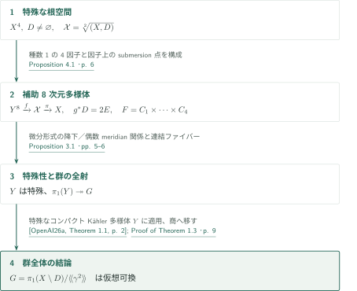
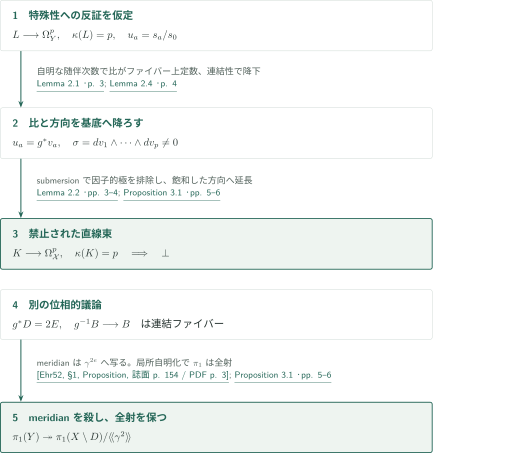
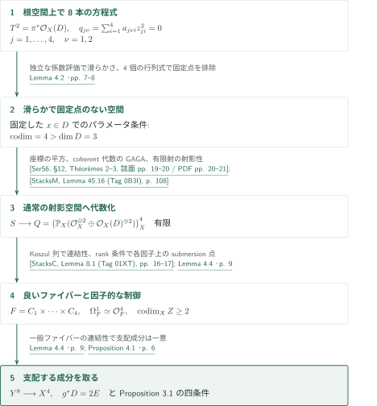

# 半重み因子を持つ特殊4次元対の条件付きアーベル性

**根空間上の種数1曲線族で、オービフォールド基本群を通常の基本群の商にする**

原稿は、滑らかなコンパクトKähler多様体に対するアーベル性を入力として、滑らかな射影4次元対の重み2の根オービフォールドへ結論を移す。核心は、有限被覆ではなく、種数1曲線4本の積を一般ファイバーに持つ射影8次元多様体を構成することにある。微分形式の降下とmeridianの関係式を別々に確保して、この多様体の特殊性と基本群からの全射を得る。

## 1. 主要結果

### Theorem 1.3 — 条件付きの仮想可換性

**入力する仮定（Assumption 1.2）。** 任意の次元の連結で滑らかな特殊コンパクトKähler多様体の基本群は仮想可換である。原稿はこの入力をカタログ内の第1論文のTheorem 1.1から受け取る。

<!-- cite:assumption -->[Assumption 1.2 · p. 2](https://github.com/openai/math/blob/fd4aeeb2ee4fc729c18d98444fed42fd0529eeeb/preprints/A-conditional-abelianity-theorem-for-special-fourfold-pairs-with-a-half-weight-divisor-October-5-2026/main.pdf)<!-- /cite --> <!-- cite:companion -->[&#91;OpenAI26a, Theorem 1.1, p. 2&#93;](https://github.com/openai/math/blob/fd4aeeb2ee4fc729c18d98444fed42fd0529eeeb/preprints/The-abelianity-conjecture-for-special-compact-Kahler-manifolds-September-23-2026/paper.pdf)<!-- /cite -->

$X$を連結で滑らかな複素射影4次元多様体、$D\subset X$を空でない滑らかな連結被約因子とし、$\mathcal X=\sqrt[2]{(X,D)}$と書く。$\mathcal X$が特殊ならば、上の仮定の下で

$$G=\pi_1(X\setminus D,x)/\langle\!\langle\gamma^2\rangle\!\rangle$$

は有限指数の可換部分群を持つ。ここで$\gamma$は$D$のmeridianである。結論は離散群$G$全体についての主張であり、指数の一様評価やtorsion-free性までは主張しない。

<!-- cite:main -->[Theorem 1.3 · p. 2](https://github.com/openai/math/blob/fd4aeeb2ee4fc729c18d98444fed42fd0529eeeb/preprints/A-conditional-abelianity-theorem-for-special-fourfold-pairs-with-a-half-weight-divisor-October-5-2026/main.pdf)<!-- /cite -->

ここで用いる「特殊」は原稿のDefinition 1.1である。すなわち、$1\le p\le\dim V$について、$\kappa(L)=p$となる直線束からの非零写像$L\to\Omega_V^p$が存在しないことをいう。根空間では局所被覆上の同変微分形式と大域切断で解釈する。

<!-- cite:definition -->[Definition 1.1 · p. 2](https://github.com/openai/math/blob/fd4aeeb2ee4fc729c18d98444fed42fd0529eeeb/preprints/A-conditional-abelianity-theorem-for-special-fourfold-pairs-with-a-half-weight-divisor-October-5-2026/main.pdf)<!-- /cite -->

## 図の矢印に付した引用

<!-- reference-guide -->
略号のない定理・補題・節・式番号は本原稿 [A conditional abelianity theorem for special fourfold pairs with a half-weight divisor](https://github.com/openai/math/blob/fd4aeeb2ee4fc729c18d98444fed42fd0529eeeb/preprints/A-conditional-abelianity-theorem-for-special-fourfold-pairs-with-a-half-weight-divisor-October-5-2026/main.pdf) を指します。外部入力には次の略号を使います。

- [OpenAI26a](https://github.com/openai/math/blob/fd4aeeb2ee4fc729c18d98444fed42fd0529eeeb/preprints/The-abelianity-conjecture-for-special-compact-Kahler-manifolds-September-23-2026/paper.pdf) OpenAI — *The abelianity conjecture for special compact Kähler manifolds*：特殊な滑らかなコンパクトKähler多様体の基本群全体の仮想可換性。Assumption 1.2を供給。2026-09-23。
- [Ehr52](https://www.numdam.org/item/SB_1948-1951__1__153_0.pdf) Charles Ehresmann — *Les connexions infinitésimales dans un espace fibré différentiable*：連結コンパクトファイバーを持つsubmersionの局所自明化と基本群の全射。1952, Séminaire Bourbaki, exp. 24 (lecture 1950), pp. 153–168。
- [Ser56](https://www.numdam.org/item/AIF_1956__6__1_0.pdf) Jean-Pierre Serre — *Géométrie algébrique et géométrie analytique*：有限解析写像のcoherent代数と構造写像の代数化。1956, Annales de l’Institut Fourier 6, pp. 1–42。
- [Dem12](https://www-fourier.univ-grenoble-alpes.fr/~demailly/manuscripts/agbook.pdf) Jean-Pierre Demailly — *Complex Analytic and Differential Geometry*：Lemma 2.1で用いる正則微分形式の閉性。June 21, 2012。
- [StacksM](https://stacks.math.columbia.edu/download/morphisms.pdf) The Stacks project authors — *The Stacks Project — Morphisms of Schemes*：有限射の射影性。version ed88ff78, compiled July 14, 2026。
- [StacksC](https://stacks.math.columbia.edu/download/coherent.pdf) The Stacks project authors — *The Stacks Project — Cohomology of Schemes*：Koszul列で使う射影空間のコホモロジー。version ed88ff78, compiled July 14, 2026。

各引用に結果番号とページを付します。誌面番号とPDF内の位置が異なる場合は両方を示します。GitHubの閲覧リンクではページ位置への自動移動を前提としません。
<!-- /reference-guide -->

## 2. Theorem 1.3 — 主定理の証明概略

<!-- proof-target:1 -->証明対象：[Theorem 1.3 · p. 2](https://github.com/openai/math/blob/fd4aeeb2ee4fc729c18d98444fed42fd0529eeeb/preprints/A-conditional-abelianity-theorem-for-special-fourfold-pairs-with-a-half-weight-divisor-October-5-2026/main.pdf)<!-- /proof-target -->

主張と記号は[冒頭のTheorem 1.3](#theorem-1-3)を参照。まず幾何的な補助多様体を作り、次にその特殊性と群の全射を示し、最後にコンパクトKählerの場合の入力を適用する。

### 幾何の構成と二つの移行

Proposition 4.1は、連結で滑らかな射影8次元多様体$Y$と全射$g:Y\to X$を作る。一般ファイバー$F$は種数1曲線4本の積であり、$\Omega_F^1$は自明である。また$g^*D=2E$となり、写像は$f:Y\to\mathcal X$へ持ち上がる。各因子の一般点上に十分なsubmersion点を確保することが、次の移行に必要になる。

<!-- cite:construction -->[Proposition 4.1 · p. 6](https://github.com/openai/math/blob/fd4aeeb2ee4fc729c18d98444fed42fd0529eeeb/preprints/A-conditional-abelianity-theorem-for-special-fourfold-pairs-with-a-half-weight-divisor-October-5-2026/main.pdf)<!-- /cite -->

Proposition 3.1で、$Y$上に$\kappa(L)=p$の微分形式の直線束があれば、それを$\mathcal X$へ降ろせることを示す。したがって$\mathcal X$の特殊性から$Y$の特殊性を得る。別の位相的議論により、偶数の分岐重複度と一般ファイバーの連結性から$\pi_1(Y)\twoheadrightarrow G$を得る。

<!-- cite:transfer -->[Proposition 3.1 · pp. 5–6](https://github.com/openai/math/blob/fd4aeeb2ee4fc729c18d98444fed42fd0529eeeb/preprints/A-conditional-abelianity-theorem-for-special-fourfold-pairs-with-a-half-weight-divisor-October-5-2026/main.pdf)<!-- /cite -->

### 基本群全体への適用と商への移行

$Y$は滑らかな射影多様体なのでコンパクトKählerである。Assumption 1.2を**次元8の$Y$**に適用し、$\pi_1(Y)$の有限指数可換部分群$A$を得る。その像は$G$の可換部分群で、指数は$[\pi_1(Y):A]$以下である。これで主定理の全結論に到達する。根空間が有限の多様体被覆を持つことは、この議論の仮定ではない。

<!-- cite:companion -->[&#91;OpenAI26a, Theorem 1.1, p. 2&#93;](https://github.com/openai/math/blob/fd4aeeb2ee4fc729c18d98444fed42fd0529eeeb/preprints/The-abelianity-conjecture-for-special-compact-Kahler-manifolds-September-23-2026/paper.pdf)<!-- /cite --> <!-- cite:finish -->[Proof of Theorem 1.3 · p. 9](https://github.com/openai/math/blob/fd4aeeb2ee4fc729c18d98444fed42fd0529eeeb/preprints/A-conditional-abelianity-theorem-for-special-fourfold-pairs-with-a-half-weight-divisor-October-5-2026/main.pdf)<!-- /cite -->

## 3. Proposition 3.1 — 特殊性と基本群の移行

<!-- proof-target:2 -->証明対象：[Proposition 3.1 · pp. 5–6](https://github.com/openai/math/blob/fd4aeeb2ee4fc729c18d98444fed42fd0529eeeb/preprints/A-conditional-abelianity-theorem-for-special-fourfold-pairs-with-a-half-weight-divisor-October-5-2026/main.pdf)<!-- /proof-target -->

<!-- statement:proposition-3-1 -->
### Proposition 3.1 — 移行を可能にする四条件

$X$を正の次元の連結で滑らかな射影多様体、$D$を空でない滑らかな連結被約因子とし、$Y$を連結で滑らかな射影多様体、$g:Y\to X$を全射とする。次を仮定する。

1. 有効整因子$E$について$g^*D=2E$であり、$f:Y\to\mathcal X$への持ち上げを取る。
2. 空でないZariski開集合$B\subset X\setminus D$上で$g$は滑らかで、ファイバー$F$は連結かつ$\Omega_F^1$が自明である。
3. 各素因子$P\ne D$の一般点上に$g$のsubmersion点が存在する。
4. $D$の一般点上で、根チャートへの局所持ち上げがsubmersionとなる点が存在する。

このとき$\mathcal X$が特殊なら$Y$は特殊である。特殊性を仮定せずに$\pi_1(Y)\twoheadrightarrow G$が存在する。したがって$\mathcal X$が特殊でAssumption 1.2が成り立てば、$G$は仮想可換である。

<!-- cite:transfer -->[Proposition 3.1 · pp. 5–6](https://github.com/openai/math/blob/fd4aeeb2ee4fc729c18d98444fed42fd0529eeeb/preprints/A-conditional-abelianity-theorem-for-special-fourfold-pairs-with-a-half-weight-divisor-October-5-2026/main.pdf)<!-- /cite -->
<!-- /statement -->

### 切断の比を基底へ降ろす

$L\to\Omega_Y^p$が非零で$\kappa(L)=p$と仮定し、ある$L^m$の切断$s_0,\ldots,s_p$で比$u_a=s_a/s_0$が代数的に独立となるものを取る。Lemma 2.1は、これらの比の微分の外積が$L$の一般点での方向を張ることを与える。その入力は、切断の$m$乗根を同時に取った被覆の解消上で、正則微分形式が閉じていることにある。

<!-- cite:wedge -->[Lemma 2.1 · p. 3](https://github.com/openai/math/blob/fd4aeeb2ee4fc729c18d98444fed42fd0529eeeb/preprints/A-conditional-abelianity-theorem-for-special-fourfold-pairs-with-a-half-weight-divisor-October-5-2026/main.pdf)<!-- /cite --> <!-- cite:closed -->[&#91;Dem12, VI, Proposition 8.9, p. 312&#93;](https://www-fourier.univ-grenoble-alpes.fr/~demailly/manuscripts/agbook.pdf#page=312)<!-- /cite -->

一般ファイバーへの余接列は$0\to\mathcal O_F^{\dim X}\to\Omega_Y^1|_F\to\Omega_F^1\to0$で、外積の誘導するfiltrationの随伴次数は自明である。$L|_F$から最初に非零となる次数への写像の成分を取ると、$L^{-1}|_F$の切断$t$が得られる。$t^m s_0$が非零定数になる一般ファイバーでは、全ての$s_a/s_0$が定数となる。連結な一般ファイバーに沿う有理関数の降下を使い、$u_a=g^*v_a$と書く。したがって$\sigma=dv_1\wedge\cdots\wedge dv_p\ne0$で、$p\le\dim X$である。

<!-- cite:descent -->[Lemma 2.4 · p. 4](https://github.com/openai/math/blob/fd4aeeb2ee4fc729c18d98444fed42fd0529eeeb/preprints/A-conditional-abelianity-theorem-for-special-fourfold-pairs-with-a-half-weight-divisor-October-5-2026/main.pdf)<!-- /cite -->

### 根チャートのsubmersion点で極を検出する

$\pi:\mathcal X\to X$として、$\tau=\pi^*\sigma$の方向を$\Omega^p_{\mathcal X}$内で飽和して直線束$K$を取る。原稿のLemma 2.2は、これを大域的な部分**束**と仮定せず、余次元1の原始生成元とHartogs延長で扱う。

<!-- cite:saturation -->[Lemma 2.2 · pp. 3–4](https://github.com/openai/math/blob/fd4aeeb2ee4fc729c18d98444fed42fd0529eeeb/preprints/A-conditional-abelianity-theorem-for-special-fourfold-pairs-with-a-half-weight-divisor-October-5-2026/main.pdf)<!-- /cite -->

$s_a$の像をまず$h_a(g^*\sigma)^m$と書く。$\sigma$が正則かつ非零で$g$がsubmersionとなる開集合では$h_a$は正則であり、コンパクトな連結ファイバー上で定数となる。Lemma 2.4で$h_a=g^*b_a$と降ろせるので、像は$g^*b_a(g^*\sigma)^m$である。条件3と4のsubmersion点には局所切断があるため、$\mathcal X$上に因子的な極があれば$Y$へ引き戻したテンソルにも極が現れる。したがって$(\pi^*b_a)\tau^m$は各根チャートで正則となり、余次元2を越えて延長する。比$v_a$の独立性から$\kappa(K)\ge p$を得る。一方、$f^*K\to\Omega_Y^p$とLemma 2.1から$\kappa(K)\le\kappa(f^*K)\le p$である。こうして$\mathcal X$上に禁止された$\kappa(K)=p$の直線束が生じ、矛盾する。

<!-- cite:transfer -->[Proposition 3.1 · pp. 5–6](https://github.com/openai/math/blob/fd4aeeb2ee4fc729c18d98444fed42fd0529eeeb/preprints/A-conditional-abelianity-theorem-for-special-fourfold-pairs-with-a-half-weight-divisor-October-5-2026/main.pdf)<!-- /cite -->

### 群の全射はmeridianの偶数乗で得る

$Y\setminus g^{-1}D\to X\setminus D$で、$g^*D$の重複度$2e$を持つ成分のmeridianは$\gamma^{2e}$へ写るため$G$では消える。補集合から$Y$への基本群の写像は全射で、核は因子のmeridianで正規生成される。このため$\pi_1(Y)\to G$へ因子化する。$g^{-1}B\to B$は連結コンパクトファイバーを持つ滑らかな固有写像なので局所自明であり、基本群上で全射である。さらに一般位置によって$\pi_1(B)\to\pi_1(X\setminus D)$も全射となり、所要の全射を得る。

<!-- cite:fibration -->[&#91;Ehr52, §1, Proposition, 誌面 p. 154 / PDF p. 3&#93;](https://www.numdam.org/item/SB_1948-1951__1__153_0.pdf#page=3)<!-- /cite --> <!-- cite:transfer -->[Proposition 3.1 · pp. 5–6](https://github.com/openai/math/blob/fd4aeeb2ee4fc729c18d98444fed42fd0529eeeb/preprints/A-conditional-abelianity-theorem-for-special-fourfold-pairs-with-a-half-weight-divisor-October-5-2026/main.pdf)<!-- /cite -->

## 4. Proposition 4.1 — 8次元の射影多様体を作る

<!-- proof-target:3 -->証明対象：[Proposition 4.1 · p. 6](https://github.com/openai/math/blob/fd4aeeb2ee4fc729c18d98444fed42fd0529eeeb/preprints/A-conditional-abelianity-theorem-for-special-fourfold-pairs-with-a-half-weight-divisor-October-5-2026/main.pdf)<!-- /proof-target -->

<!-- statement:proposition-4-1 -->
### Proposition 4.1 — 種数1曲線4本の積をファイバーに持つ構成

$X$を連結で滑らかな複素射影4次元多様体、$D\subset X$を空でない滑らかな連結被約因子とする。このとき、連結で滑らかな射影8次元多様体$Y$と全射$g:Y\to X$が存在し、Proposition 3.1の四条件を全て満たす。その一般ファイバーは滑らかな連結種数1曲線4本の積である。この構成自体には$\mathcal X$の特殊性を仮定しない。

<!-- cite:construction -->[Proposition 4.1 · p. 6](https://github.com/openai/math/blob/fd4aeeb2ee4fc729c18d98444fed42fd0529eeeb/preprints/A-conditional-abelianity-theorem-for-special-fourfold-pairs-with-a-half-weight-divisor-October-5-2026/main.pdf)<!-- /cite -->
<!-- /statement -->

### 根空間上の対角二次式と固定点の回避

$T=\mathcal O_{\mathcal X}(\mathcal D)$、$T^2=\pi^*\mathcal O_X(D)$とする。$M$と$M(-D)$が大域生成されるよう$M$を選び、$\mathbb P_{\mathcal X}(\mathcal O^{\oplus2}\oplus T^{\oplus2})$の4重積上で、各因子$j=1,\ldots,4$に二つの対角二次式

$$q_{j\nu}=\sum_{i=1}^4 a_{j\nu i}z_{ji}^2=0\quad(\nu=1,2)$$

を課す。$i=1,2$の係数は$H^0(X,M)$、$i=3,4$の係数は$H^0(X,M(-D))$から取る。後者は$T^2$とのテンソル積で評価されるため、$D$上で係数が自動的に消えるという解釈ではない。

普遍族では八つの方程式の係数評価が独立なので、一般パラメータで滑らかさを得る。$D$上の$\mu_2$固定部分では各因子が二つの固有空間のいずれかの$\mathbb P^1$に入り、その二次式対が共通零点を持つには対応する$2\times2$行列式の消滅が必要となる。4因子から独立な4条件が生じる。$\dim D=3$なので、一般パラメータは全ての固定点を避ける。これが4因子を用いる次元上の理由である。

<!-- cite:choice -->[Lemma 4.2 · pp. 7–8](https://github.com/openai/math/blob/fd4aeeb2ee4fc729c18d98444fed42fd0529eeeb/preprints/A-conditional-abelianity-theorem-for-special-fourfold-pairs-with-a-half-weight-divisor-October-5-2026/main.pdf)<!-- /cite -->

### 座標の平方から射影性を得る

自由な根チャートを貼り合わせた滑らかな解析空間$S$から、座標を平方して通常の射影束の4重積

$$Q=\bigl(\mathbb P_X(\mathcal O_X^{\oplus2}\oplus\mathcal O_X(D)^{\oplus2})\bigr)^4_X$$

への有限解析写像を得る。GAGAで有限coherent代数とその乗法・単位を代数化し、相対Specを取る。有限射が射影的で$Q$も射影的だから$S$は射影的となる。

<!-- cite:projective -->[Lemma 4.3 · p. 8](https://github.com/openai/math/blob/fd4aeeb2ee4fc729c18d98444fed42fd0529eeeb/preprints/A-conditional-abelianity-theorem-for-special-fourfold-pairs-with-a-half-weight-divisor-October-5-2026/main.pdf)<!-- /cite --> <!-- cite:gaga -->[&#91;Ser56, §12, Théorèmes 2–3, 誌面 pp. 19–20 / PDF pp. 20–21&#93;](https://www.numdam.org/item/AIF_1956__6__1_0.pdf#page=20)<!-- /cite --> <!-- cite:finite-projective -->[&#91;StacksM, Lemma 45.16 (Tag 0B3I), p. 108&#93;](https://stacks.math.columbia.edu/download/morphisms.pdf#page=108)<!-- /cite -->

### 連結性と因子上のsubmersion点を同時に確保する

一般パラメータで、各$2\times4$係数行列の全ての二列小行列式が非零となる開集合$B\ne\varnothing$を取れる。ここでは二つの二次式の交叉は滑らかである。Koszul列と$\mathbb P^3$上の中間コホモロジーの消滅から$H^0(C,\mathcal O_C)=\mathbb C$、随伴公式から$K_C\simeq\mathcal O_C$を得るので、各曲線は連結種数1である。

<!-- cite:p3-cohomology -->[&#91;StacksC, Lemma 8.1 (Tag 01XT), pp. 16–17&#93;](https://stacks.math.columbia.edu/download/coherent.pdf#page=16)<!-- /cite --> <!-- cite:fibres -->[Lemma 4.4 · p. 9](https://github.com/openai/math/blob/fd4aeeb2ee4fc729c18d98444fed42fd0529eeeb/preprints/A-conditional-abelianity-theorem-for-special-fourfold-pairs-with-a-half-weight-divisor-October-5-2026/main.pdf)<!-- /cite -->

また、各行列から任意の一列を除いた$2\times3$行列のrankが落ちる条件は余次元2である。その不良集合$Z\subset X$も余次元2以上にできる。$x\notin Z$では核に全座標が非零のベクトルが存在し、その平方根を取った点で各二次式対の垂直微分はrank 2を持つ。したがって根チャートへのsubmersion点があり、$D$を含む全素因子の一般点で必要な条件を満たす。

一般ファイバーの連結性により、$S$には$X$を支配する成分$Y$が一つだけある。上のsubmersion点はこの成分に属する。$g^*D=2f^*\mathcal D$と次元$\dim Y=4+4=8$を合わせ、Proposition 3.1の全条件が揃う。

<!-- cite:choice -->[Lemma 4.2 · pp. 7–8](https://github.com/openai/math/blob/fd4aeeb2ee4fc729c18d98444fed42fd0529eeeb/preprints/A-conditional-abelianity-theorem-for-special-fourfold-pairs-with-a-half-weight-divisor-October-5-2026/main.pdf)<!-- /cite --> <!-- cite:fibres -->[Lemma 4.4 · p. 9](https://github.com/openai/math/blob/fd4aeeb2ee4fc729c18d98444fed42fd0529eeeb/preprints/A-conditional-abelianity-theorem-for-special-fourfold-pairs-with-a-half-weight-divisor-October-5-2026/main.pdf)<!-- /cite -->

## 5. 依存する結果と使用箇所

第1論文からの直接入力は、特殊なコンパクトKähler多様体の**基本群全体**に関する定理である。[その記事](../special-kahler-abelianity/article.ja.md#theorem-1-1)で扱う解析・群論の証明を、本記事で再証明してはいない。第2論文の線形モノドロミーの結果を、この入力の代わりに置くこともしていない。

微分形式の閉性はLemma 2.1、Ehresmannの結果はProposition 3.1の群の全射、GAGAと有限射の射影性はLemma 4.3、射影空間のコホモロジーはLemma 4.4で用いられる。これらの記述と適用箇所を照合した。Lemma 2.1で用いる特異点解消の元論文との照合と、各外部結果の証明全体の検証は今回の範囲外である。

## 6. 原典を読む入口と確認範囲

<!-- reading-list -->
- [Theorem 1.3 · p. 2](https://github.com/openai/math/blob/fd4aeeb2ee4fc729c18d98444fed42fd0529eeeb/preprints/A-conditional-abelianity-theorem-for-special-fourfold-pairs-with-a-half-weight-divisor-October-5-2026/main.pdf) — 条件付き結論と対象となる群。
- [Proposition 3.1 · pp. 5–6](https://github.com/openai/math/blob/fd4aeeb2ee4fc729c18d98444fed42fd0529eeeb/preprints/A-conditional-abelianity-theorem-for-special-fourfold-pairs-with-a-half-weight-divisor-October-5-2026/main.pdf) — 特殊性の降下とmeridianによる群の全射を分けて読む。
- [Lemma 4.2 · pp. 7–8](https://github.com/openai/math/blob/fd4aeeb2ee4fc729c18d98444fed42fd0529eeeb/preprints/A-conditional-abelianity-theorem-for-special-fourfold-pairs-with-a-half-weight-divisor-October-5-2026/main.pdf) — 固定点排除の余次元4と、除外集合の余次元2を区別する。
- [Lemma 4.4 · p. 9](https://github.com/openai/math/blob/fd4aeeb2ee4fc729c18d98444fed42fd0529eeeb/preprints/A-conditional-abelianity-theorem-for-special-fourfold-pairs-with-a-half-weight-divisor-October-5-2026/main.pdf) — 連結な種数1の積と各因子のsubmersion点。
- [&#91;OpenAI26a, Theorem 1.1, p. 2&#93;](https://github.com/openai/math/blob/fd4aeeb2ee4fc729c18d98444fed42fd0529eeeb/preprints/The-abelianity-conjecture-for-special-compact-Kahler-manifolds-September-23-2026/paper.pdf) — 最後に適用する基本群全体の主張。
- [Appendix A · pp. 10–13](https://github.com/openai/math/blob/fd4aeeb2ee4fc729c18d98444fed42fd0529eeeb/preprints/A-conditional-abelianity-theorem-for-special-fourfold-pairs-with-a-half-weight-divisor-October-5-2026/main.pdf) — 14次元の別構成。本記事の詳細照合の対象外。
<!-- /reading-list -->

原稿は2026年10月5日版、14ページ。上記の結論は原稿の主張の紹介である。編集側では本文pp. 3–9の主要証明を読み、Theorem 1.3とPropositions 3.1・4.1の条件、各結論への接続、直接入力の記述・使用箇所を照合した。Appendix Aの14次元の別構成は詳細に点検していない。根空間上の全局所計算や外部文献の証明を独立に再構成したという意味での完全検証ではない。

参照版・SHA-256・ページ対応・未確認事項は[sources.json](sources.json)、制作時間と追加編集は[status.md](status.md)に記録する。AIによる概説であり、研究上の利用ではリンク先の原典を確認されたい。
