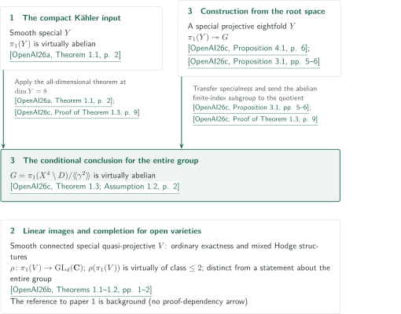

# Campana's abelianity conjecture and special varieties

**Three papers on ordinary groups, linear monodromy, and root orbifolds**

Catalog 057 contains three papers on fundamental groups of special varieties. They concern virtual abelianity of the entire group in the compact Kähler setting, virtual nilpotence of class at most two for linear images in the open setting, and a transfer to fourfold pairs using the compact result. The articles distinguish these targets and explain the manuscripts' proof routes and the scope of editorial checking.

## 1. All three papers in official order

CATALOGINVENTORYTOKEN

## 2. Where the result for the entire group is used

The diagram keys refer to the following fixed manuscripts. External inputs to each paper are listed in its individual article.

<!-- reference-guide -->
- [OpenAI26a](https://github.com/openai/math/blob/fd4aeeb2ee4fc729c18d98444fed42fd0529eeeb/preprints/The-abelianity-conjecture-for-special-compact-Kahler-manifolds-September-23-2026/paper.pdf) OpenAI — *The abelianity conjecture for special compact Kähler manifolds*. 2026-09-23; Input for the entire compact Kähler fundamental group.
- [OpenAI26b](https://github.com/openai/math/blob/fd4aeeb2ee4fc729c18d98444fed42fd0529eeeb/preprints/Two-step-monodromy-of-special-quasi-projective-varieties-September-24-2026/paper.pdf) OpenAI — *Two-step monodromy of special quasi-projective varieties*. 2026-09-24; Comparison with linear images, completion and nonspecial fibres.
- [OpenAI26c](https://github.com/openai/math/blob/fd4aeeb2ee4fc729c18d98444fed42fd0529eeeb/preprints/A-conditional-abelianity-theorem-for-special-fourfold-pairs-with-a-half-weight-divisor-October-5-2026/main.pdf) OpenAI — *A conditional abelianity theorem for special fourfold pairs with a half-weight divisor*. 2026-10-05; Eightfold construction and conditional transfer.
<!-- /reference-guide -->

The third paper realizes the root space's fundamental group as a quotient of the fundamental group of a smooth projective eightfold $Y$. Applying the first paper requires specialness of $Y$ as well as smoothness and projectivity; Propositions 3.1 and 4.1 of the third paper supply these conditions. Virtual abelianity passes to a quotient, giving the conditional conclusion of Theorem 1.3. The [third article's overview](../half-weight-fourfold-abelianity/article.en.md#proof-overview) leads to the arguments establishing these conditions.

<!-- cite:root-transfer -->[&#91;OpenAI26c, Proposition 3.1, pp. 5–6&#93;](https://github.com/openai/math/blob/fd4aeeb2ee4fc729c18d98444fed42fd0529eeeb/preprints/A-conditional-abelianity-theorem-for-special-fourfold-pairs-with-a-half-weight-divisor-October-5-2026/main.pdf)<!-- /cite --> <!-- cite:root-construction -->[&#91;OpenAI26c, Proposition 4.1, p. 6&#93;](https://github.com/openai/math/blob/fd4aeeb2ee4fc729c18d98444fed42fd0529eeeb/preprints/A-conditional-abelianity-theorem-for-special-fourfold-pairs-with-a-half-weight-divisor-October-5-2026/main.pdf)<!-- /cite --> <!-- cite:root-use -->[&#91;OpenAI26c, Proof of Theorem 1.3, p. 9&#93;](https://github.com/openai/math/blob/fd4aeeb2ee4fc729c18d98444fed42fd0529eeeb/preprints/A-conditional-abelianity-theorem-for-special-fourfold-pairs-with-a-half-weight-divisor-October-5-2026/main.pdf)<!-- /cite -->

The second paper controls linear images and rational unipotent completion through ordinary quasi-Albanese exactness and mixed Hodge structures. It cites the first paper as compact-setting background, not as a direct input to this proof. Its surface example has nonspecial general fibres whose fundamental groups have trivial image in the total group. The [weight argument](../two-step-monodromy/article.en.md#proof-1) and [surface calculation](../two-step-monodromy/article.en.md#proof-3) explain why these targets must be distinguished.

<!-- cite:open -->[&#91;OpenAI26b, Theorems 1.1–1.2, pp. 1–2&#93;](https://github.com/openai/math/blob/fd4aeeb2ee4fc729c18d98444fed42fd0529eeeb/preprints/Two-step-monodromy-of-special-quasi-projective-varieties-September-24-2026/paper.pdf)<!-- /cite --> <!-- cite:surface -->[&#91;OpenAI26b, Theorem 1.3, p. 3&#93;](https://github.com/openai/math/blob/fd4aeeb2ee4fc729c18d98444fed42fd0529eeeb/preprints/Two-step-monodromy-of-special-quasi-projective-varieties-September-24-2026/paper.pdf)<!-- /cite -->

| Source → recipient | Relation | Result, hypotheses and checked use |
|---|---|---|
| Special Kähler abelianity → Half-weight fourfold abelianity | Explicit premise and direct input | Virtual abelianity in all dimensions is applied to the constructed special projective eightfold. Third paper: Assumption 1.2 and final proof on p.9. |
| Special Kähler abelianity → Two-step monodromy | Background | Comparison with the compact case in §1, p.1 of the second paper; not a proof dependency for Theorems 1.1–1.3. |

<!-- cite:compact -->[&#91;OpenAI26a, Theorem 1.1, p. 2&#93;](https://github.com/openai/math/blob/fd4aeeb2ee4fc729c18d98444fed42fd0529eeeb/preprints/The-abelianity-conjecture-for-special-compact-Kahler-manifolds-September-23-2026/paper.pdf)<!-- /cite --> <!-- cite:root -->[&#91;OpenAI26c, Theorem 1.3; Assumption 1.2, p. 2&#93;](https://github.com/openai/math/blob/fd4aeeb2ee4fc729c18d98444fed42fd0529eeeb/preprints/A-conditional-abelianity-theorem-for-special-fourfold-pairs-with-a-half-weight-divisor-October-5-2026/main.pdf)<!-- /cite --> <!-- cite:open-background -->[&#91;OpenAI26b, §1, p. 1&#93;](https://github.com/openai/math/blob/fd4aeeb2ee4fc729c18d98444fed42fd0529eeeb/preprints/Two-step-monodromy-of-special-quasi-projective-varieties-September-24-2026/paper.pdf)<!-- /cite -->

## 3. Sources and checking scope

The official overview title is *Campana's abelianity conjecture and special varieties*, under *Algebraic and complex geometry*. CONTENTS instead uses *Fundamental groups of special complex varieties and root orbifolds*. The order and manuscripts are fixed to official repository commit `fd4aeeb2ee4fc729c18d98444fed42fd0529eeeb`. In order, the versions are September 23, 2026 (50 pages), September 24, 2026 (19 pages), and October 5, 2026 (14 pages).

<!-- cite:catalog -->[OpenAI Research Catalog · Catalog 057 · p. 7](https://github.com/openai/math/blob/fd4aeeb2ee4fc729c18d98444fed42fd0529eeeb/overview.pdf)<!-- /cite -->

The articles report the manuscripts' claims. Editorial work checked hypotheses and all stated conclusions, selected main proof passages, and the statements and uses of direct external inputs, followed by review by a different contributor. Complete independent verification does not cover all analytic estimates and descent comparisons in the first paper, the full completed-group-algebra construction in the second, Appendix A's alternative construction in the third, or the complete external proofs. Detailed limits are recorded at the end of each article and in its source records.

The second paper's criticism of fibre specialness in earlier work is restricted to the CDHP arXiv v2 specified in its article. It is not treated as a refutation of that work's separate linear-image theorem. Unchecked generalization or containment relations are not drawn as arrows.
