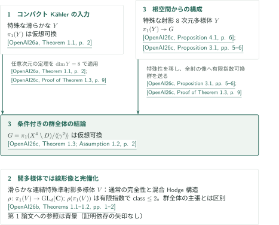

# Campanaのアーベル性予想と特殊多様体

**通常基本群、線形モノドロミー、根オービフォールドを結ぶ3論文**

カタログ057は、特殊多様体の基本群に関する3本を収録する。コンパクトKählerの場合の群全体の仮想可換性、開多様体の線形像の有限指数での二段冪零性、前者を入力とする4次元対への移行を扱う。各記事では結論の対象を区別し、原稿が使う証明経路と照合範囲を示す。

## 1. 全3篇の要点（公式順）

CATALOGINVENTORYTOKEN

## 2. 群全体の結果をどこで使うか

図の引用キーは次の固定原稿を指す。各論文の外部入力は個別記事の文献案内にまとめた。

<!-- reference-guide -->
- [OpenAI26a](https://github.com/openai/math/blob/fd4aeeb2ee4fc729c18d98444fed42fd0529eeeb/preprints/The-abelianity-conjecture-for-special-compact-Kahler-manifolds-September-23-2026/paper.pdf) OpenAI — *The abelianity conjecture for special compact Kähler manifolds*. 2026-09-23; 特殊コンパクトKähler多様体の群全体の入力.
- [OpenAI26b](https://github.com/openai/math/blob/fd4aeeb2ee4fc729c18d98444fed42fd0529eeeb/preprints/Two-step-monodromy-of-special-quasi-projective-varieties-September-24-2026/paper.pdf) OpenAI — *Two-step monodromy of special quasi-projective varieties*. 2026-09-24; 線形像・完備化と非特殊ファイバーの比較.
- [OpenAI26c](https://github.com/openai/math/blob/fd4aeeb2ee4fc729c18d98444fed42fd0529eeeb/preprints/A-conditional-abelianity-theorem-for-special-fourfold-pairs-with-a-half-weight-divisor-October-5-2026/main.pdf) OpenAI — *A conditional abelianity theorem for special fourfold pairs with a half-weight divisor*. 2026-10-05; 8次元構成と条件付き移行.
<!-- /reference-guide -->

第3論文の構成は、根空間の基本群を滑らかな射影8次元多様体$Y$の基本群の商として実現する。第1論文を$Y$へ適用するには、滑らかさ・射影性に加えて$Y$の特殊性が必要であり、第3論文のPropositions 3.1・4.1がこれを供給する。仮想可換性は群の商へ移るので、Theorem 1.3の条件付き結論を得る。[第3記事の全体図](../half-weight-fourfold-abelianity/article.ja.md#proof-overview)から各条件の証明へ進める。

<!-- cite:root-transfer -->[&#91;OpenAI26c, Proposition 3.1, pp. 5–6&#93;](https://github.com/openai/math/blob/fd4aeeb2ee4fc729c18d98444fed42fd0529eeeb/preprints/A-conditional-abelianity-theorem-for-special-fourfold-pairs-with-a-half-weight-divisor-October-5-2026/main.pdf)<!-- /cite --> <!-- cite:root-construction -->[&#91;OpenAI26c, Proposition 4.1, p. 6&#93;](https://github.com/openai/math/blob/fd4aeeb2ee4fc729c18d98444fed42fd0529eeeb/preprints/A-conditional-abelianity-theorem-for-special-fourfold-pairs-with-a-half-weight-divisor-October-5-2026/main.pdf)<!-- /cite --> <!-- cite:root-use -->[&#91;OpenAI26c, Proof of Theorem 1.3, p. 9&#93;](https://github.com/openai/math/blob/fd4aeeb2ee4fc729c18d98444fed42fd0529eeeb/preprints/A-conditional-abelianity-theorem-for-special-fourfold-pairs-with-a-half-weight-divisor-October-5-2026/main.pdf)<!-- /cite -->

第2論文は、通常のquasi-Albanese完全列と混合Hodge構造から、線形像およびrational unipotent completionを制御する。第1論文は導入の背景として引用されるが、この証明の直接入力ではない。また、一般ファイバーが特殊でない曲面でも、その基本群の全空間への像は自明となる。[第2記事の重みの議論](../two-step-monodromy/article.ja.md#proof-1)と[曲面の計算](../two-step-monodromy/article.ja.md#proof-3)は、この二つの対象を分ける理由を示す。

<!-- cite:open -->[&#91;OpenAI26b, Theorems 1.1–1.2, pp. 1–2&#93;](https://github.com/openai/math/blob/fd4aeeb2ee4fc729c18d98444fed42fd0529eeeb/preprints/Two-step-monodromy-of-special-quasi-projective-varieties-September-24-2026/paper.pdf)<!-- /cite --> <!-- cite:surface -->[&#91;OpenAI26b, Theorem 1.3, p. 3&#93;](https://github.com/openai/math/blob/fd4aeeb2ee4fc729c18d98444fed42fd0529eeeb/preprints/Two-step-monodromy-of-special-quasi-projective-varieties-September-24-2026/paper.pdf)<!-- /cite -->

| 供給・参照元 → 利用先 | 関係 | 結果・適用条件・確認箇所 |
|---|---|---|
| Special Kähler abelianity → Half-weight fourfold abelianity | 明示的前提・直接入力 | 任意次元の特殊コンパクトKähler基本群の仮想可換性を、構成された特殊射影8次元多様体に適用。第3論文Assumption 1.2、最終証明p.9。 |
| Special Kähler abelianity → Two-step monodromy | 背景 | 第2論文§1 p.1のコンパクトの場合との比較。Theorems 1.1–1.3の証明依存とはしない。 |

<!-- cite:compact -->[&#91;OpenAI26a, Theorem 1.1, p. 2&#93;](https://github.com/openai/math/blob/fd4aeeb2ee4fc729c18d98444fed42fd0529eeeb/preprints/The-abelianity-conjecture-for-special-compact-Kahler-manifolds-September-23-2026/paper.pdf)<!-- /cite --> <!-- cite:root -->[&#91;OpenAI26c, Theorem 1.3; Assumption 1.2, p. 2&#93;](https://github.com/openai/math/blob/fd4aeeb2ee4fc729c18d98444fed42fd0529eeeb/preprints/A-conditional-abelianity-theorem-for-special-fourfold-pairs-with-a-half-weight-divisor-October-5-2026/main.pdf)<!-- /cite --> <!-- cite:open-background -->[&#91;OpenAI26b, §1, p. 1&#93;](https://github.com/openai/math/blob/fd4aeeb2ee4fc729c18d98444fed42fd0529eeeb/preprints/Two-step-monodromy-of-special-quasi-projective-varieties-September-24-2026/paper.pdf)<!-- /cite -->

## 3. 原典と確認範囲

公式概要の名称は *Campana's abelianity conjecture and special varieties*、分野は *Algebraic and complex geometry*。CONTENTSでは *Fundamental groups of special complex varieties and root orbifolds* と表記される。収録順と原稿は公式リポジトリの固定commit `fd4aeeb2ee4fc729c18d98444fed42fd0529eeeb`に揃えた。3本は順に2026年9月23日版50頁、9月24日版19頁、10月5日版14頁である。

<!-- cite:catalog -->[OpenAI Research Catalog · Catalog 057 · p. 7](https://github.com/openai/math/blob/fd4aeeb2ee4fc729c18d98444fed42fd0529eeeb/overview.pdf)<!-- /cite -->

記事の結論は各原稿の主張を紹介する。編集側では主張の仮定と全結論、選択した主要証明、直接外部入力の記述・適用を照合し、別担当による点検を行った。第1論文の全解析評価・降下の全比較、第2論文の完成群環構成全体、第3論文Appendix Aの別構成、および外部定理の証明全体は独立検証の対象外である。詳しい未確認範囲は各記事末尾と出典記録に記す。

第2論文による先行文献のファイバー特殊性への批判は、当該記事に記したCDHPのarXiv v2に限定する。同文献の線形像の主定理への反証と扱わない。論文間で未確認の一般化・包含関係は図の矢印にしていない。
