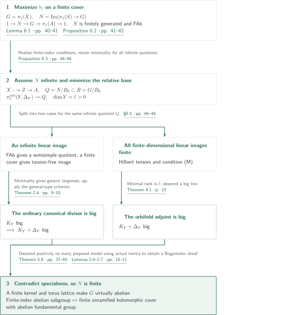
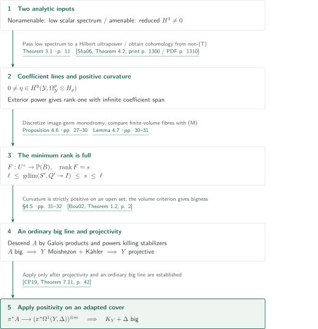
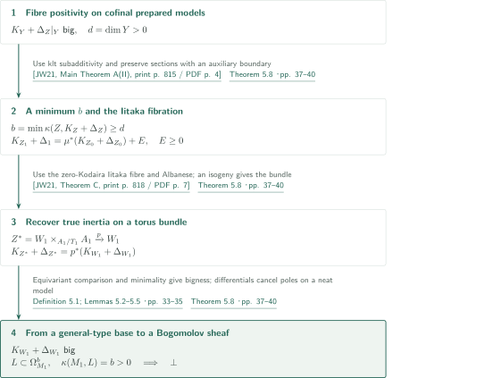
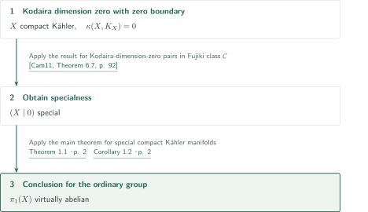
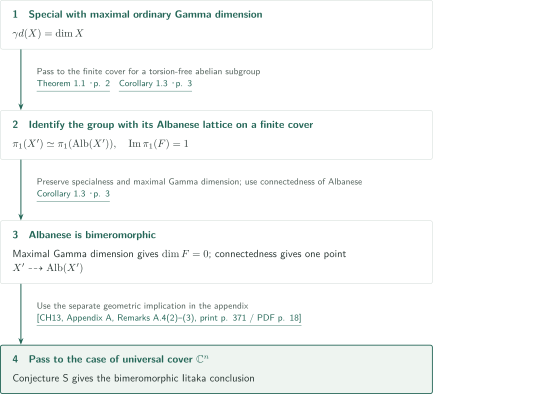
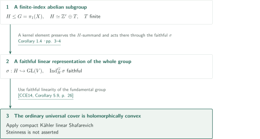
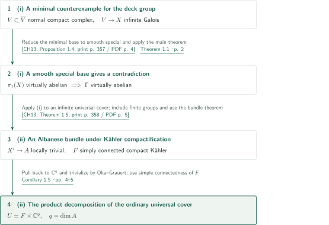

# The abelianity conjecture for special compact Kähler manifolds

**Minimal quotients of Albanese fibre groups, Hilbert tensors, and descent retaining actual inertia**

The manuscript claims virtual abelianity of the entire ordinary fundamental group of a special compact Kähler manifold. On a finite cover, it isolates the image of an Albanese fibre group, derives positivity from an infinite quotient of that image, and descends to a Bogomolov sheaf forbidden by specialness. The argument separates quotients with an infinite finite-dimensional linear image from those whose finite-dimensional linear images are all finite.

## 1. Main results

### Theorem 1.1 — Virtual abelianity of the ordinary fundamental group

Let $X$ be a connected smooth compact Kähler manifold of arbitrary complex dimension. If $X$ is special, then $\pi_1(X)$ has an abelian subgroup of finite index. Equivalently, there is a connected finite unramified holomorphic cover $X'\to X$ with abelian fundamental group. The manuscript uses specialness in the sense that no nonzero morphism $L\to\Omega_X^p$, with $1\le p\le\dim X$, has $\kappa(X,L)=p$. Linearity, residual finiteness and projectivity are not assumed.

<!-- cite:main -->[Theorem 1.1 · p. 2](https://github.com/openai/math/blob/fd4aeeb2ee4fc729c18d98444fed42fd0529eeeb/preprints/The-abelianity-conjecture-for-special-compact-Kahler-manifolds-September-23-2026/paper.pdf)<!-- /cite -->

### Corollary 1.2 — Kodaira dimension zero

If $X$ is a smooth compact connected Kähler manifold with $\kappa(X,K_X)=0$, its ordinary fundamental group $\pi_1(X)$ is virtually abelian.

<!-- cite:cor12 -->[Corollary 1.2 · p. 2](https://github.com/openai/math/blob/fd4aeeb2ee4fc729c18d98444fed42fd0529eeeb/preprints/The-abelianity-conjecture-for-special-compact-Kahler-manifolds-September-23-2026/paper.pdf)<!-- /cite -->

### Corollary 1.3 — Conjecture S and bimeromorphic uniformization

Let $X$ be a connected compact Kähler manifold of complex dimension $n$. Suppose either (i) $X$ is special and has maximal ordinary $\Gamma$-dimension $\gamma d(X)=n$, or (ii) its ordinary universal cover is biholomorphic to $\mathbb C^n$. In either case, $X$ has a connected finite étale cover $X'$ bimeromorphic to a complex torus. Here $\gamma d$ is the dimension of the $\Gamma$-reduction for the identity quotient of $\pi_1(X)$.

<!-- cite:cor13 -->[Corollary 1.3 · p. 3](https://github.com/openai/math/blob/fd4aeeb2ee4fc729c18d98444fed42fd0529eeeb/preprints/The-abelianity-conjecture-for-special-compact-Kahler-manifolds-September-23-2026/paper.pdf)<!-- /cite -->

### Corollary 1.4 — Holomorphic convexity of the universal cover

If $X$ is a connected smooth special compact Kähler manifold, its ordinary universal cover is holomorphically convex. The conclusion does not assert Steinness.

<!-- cite:cor14 -->[Corollary 1.4 · pp. 3–4](https://github.com/openai/math/blob/fd4aeeb2ee4fc729c18d98444fed42fd0529eeeb/preprints/The-abelianity-conjecture-for-special-compact-Kahler-manifolds-September-23-2026/paper.pdf)<!-- /cite -->

### Corollary 1.5 — Compactifiable covers

(i) Let $X$ be a connected normal compact Kähler space, $V\to X$ a connected infinite étale Galois cover, and $\Gamma$ its deck group. If $V$ embeds as a Zariski-open subset of a normal compact **complex space**, then $\Gamma$ is virtually abelian.

(ii) Let $X$ be a connected compact Kähler manifold and $U$ its ordinary universal cover. If $U$ embeds as a Zariski-open subset of a normal compact **Kähler space**, there is a connected finite étale cover $X'\to X$ whose Albanese map $X'\to A$ is a locally trivial holomorphic bundle with simply connected compact Kähler fibre $F$. Writing $q=\dim A$,

$$U\simeq F\times\mathbb C^q.$$

Either $A$ or $F$ may be a point. For a nonuniversal cover, (i) does not control the whole group $\pi_1(X)$; (ii) does not assert that $X'$ itself is a product.

<!-- cite:cor15 -->[Corollary 1.5 · pp. 4–5](https://github.com/openai/math/blob/fd4aeeb2ee4fc729c18d98444fed42fd0529eeeb/preprints/The-abelianity-conjecture-for-special-compact-Kahler-manifolds-September-23-2026/paper.pdf)<!-- /cite -->

## References on the arrows

<!-- reference-guide -->
Unprefixed theorem, lemma, section and equation numbers refer to [The abelianity conjecture for special compact Kähler manifolds](https://github.com/openai/math/blob/fd4aeeb2ee4fc729c18d98444fed42fd0529eeeb/preprints/The-abelianity-conjecture-for-special-compact-Kahler-manifolds-September-23-2026/paper.pdf). External inputs use the following keys.

- [Cam04](https://arxiv.org/pdf/math/0110051v9) Frédéric Campana — *Orbifolds, special varieties and classification theory*: Bogomolov-sheaf characterization and preservation of specialness under finite étale covers. arXiv:math/0110051v9.
- [Cam23](https://aif.centre-mersenne.org/item/10.5802/aif.3563.pdf) Frédéric Campana — *Albanese map of special manifolds: a correction*: Surjectivity and connectedness of Albanese; distinguished from the projective-target condition for eliminating multiple fibres. Ann. Inst. Fourier 73 (2023), 1903–1908; published version.
- [BW16](https://arxiv.org/pdf/1312.6619v2) Botong Wang — *Torsion points on the cohomology jump loci of compact Kähler manifolds*: Isolated rank-one jump-locus characters are torsion, permitting the isogeny in the FAb argument. arXiv:1312.6619v2, 2015-11-30.
- [CCE14](https://arxiv.org/pdf/1302.5016v3) Frédéric Campana; Benoît Claudon; Philippe Eyssidieux — *Représentations linéaires des groupes kählériens: factorisations et conjecture de Shafarevich linéaire*: General type of the semisimple Shafarevich base, and holomorphic convexity for a faithful linear fundamental group. arXiv:1302.5016v3, 2014-02-17; manuscript dated 2014-01-24.
- [Sha06](https://www.mathunion.org/fileadmin/ICM/Proceedings/ICM2006.2/ICM2006.2.ocr.pdf) Yehuda Shalom — *The algebraization of Kazhdan’s property (T)*: A finitely generated non-(T) group has a unitary representation with nonzero reduced H¹. ICM 2006, Vol. II, pp. 1283–1310; full proceedings PDF.
- [Bou02](https://arxiv.org/pdf/math/0201031v1) Sébastien Boucksom — *On the volume of a line bundle*: Positive curvature with strict positivity on an open set gives bigness of the ordinary line. arXiv:math/0201031v1.
- [CP19](https://www.numdam.org/item/10.1007/s10240-019-00105-w.pdf) Frédéric Campana; Mihai Păun — *Foliations with positive slopes and birational stability of orbifold cotangent bundles*: After projectivity is established, an ordinary big line in an adapted orbifold cotangent tensor gives adjoint bigness. Publ. Math. IHÉS 129 (2019), 1–49; published version.
- [JW21](https://afst.centre-mersenne.org/item/10.5802/afst.1690.pdf) Juanyong Wang — *On the Iitaka Conjecture Cn,m for Kähler Fibre Spaces*: Klt subadditivity over possibly nonprojective tori and Albanese fibrations of log Kodaira dimension zero pairs. Ann. Fac. Sci. Toulouse 30 (2021), 813–897; published version.
- [Cam11](https://arxiv.org/pdf/0705.0737v8) Frédéric Campana — *Orbifoldes géométriques spéciales et classification biméromorphe des variétés kählériennes compactes*: Kodaira dimension zero implies specialness, applied with zero boundary. arXiv:0705.0737v8; stamp 2009-07-15; title page 2018-10-25.
- [CH13](https://www.numdam.org/item/10.24033/bsmf.2651.pdf) Benoît Claudon; Andreas Höring; Appendix A by Frédéric Campana — *Compact Kähler manifolds with compactifiable universal cover*: Specialness of a minimal counterexample, the Albanese bundle, and the appendix implications involving Conjecture S. Bull. Soc. Math. France 141 (2013), 355–375; published version with Appendix A.

Each citation gives the result and pages. When printed pagination differs from the PDF position, both are shown. GitHub previews do not automatically jump to the cited page.
<!-- /reference-guide -->

## 2. Theorem 1.1 — Proof overview of the main theorem

<!-- proof-target:1 -->Proof target：[Theorem 1.1 · p. 2](https://github.com/openai/math/blob/fd4aeeb2ee4fc729c18d98444fed42fd0529eeeb/preprints/The-abelianity-conjecture-for-special-compact-Kahler-manifolds-September-23-2026/paper.pdf)<!-- /proof-target --> See the [hypotheses and conclusion](#theorem-1-1).

**Proof route.** Pass to a finite cover maximizing $b_1$, let $\alpha:X\to A$ be its Albanese map, and set $G=\pi_1(X)$ and $N=\operatorname{Im}(\pi_1(S)\to G)$ for a smooth general Albanese fibre $S$. The goal is finiteness of $N$; specialness of $S$ itself is not assumed. If $N$ is infinite, construct a minimal relative base and feed the positivity obtained in two branches into [Theorem 5.8](#theorem-5-8).

### 1. Exactness and FAb on finite covers

Finite étale covers preserve specialness, and their Albanese maps are surjective with connected fibres, so $b_1\le2\dim X$. Choose a cover attaining the maximum; subsequent finite covers have the same first Betti number. Lemma 6.1 establishes

$$1\longrightarrow N\longrightarrow G\longrightarrow\pi_1(A)\longrightarrow1.$$

It does not extend the absence of multiple fibres unconditionally to nonprojective tori. If a meridian has nontrivial actual order in $G/N$, the corresponding effective boundary on the torus is pulled back from an ample divisor on a projective torus quotient. Pulling back a sufficiently small rational multiple through differentials cancels the poles and produces a forbidden Bogomolov sheaf. Thus the meridians vanish and the sequence is exact.

For a further finite cover, Proposition 6.2 considers $V=\operatorname{Hom}(N',\mathbb C)$ with $N'=N\cap G'$. Nontrivial eigencharacters of the lattice action are isolated points of a rank-one jump locus, hence torsion by [BW16]. An isogeny makes an eigenvector invariant. Inflation–restriction and injectivity of $H^2(A',\mathbb C)\to H^2(X',\mathbb C)$ would then give extra $H^1$, contradicting the Albanese dimension. Lemma 2.7 realizes every prescribed finite-index condition on $N$ by a finite cover of the total space, proving that $N$ is FAb.

<!-- cite:cam-stability -->[&#91;Cam04, Theorems 2.26; 5.12, pp. 27, 56&#93;](https://arxiv.org/pdf/math/0110051v9#page=27)<!-- /cite --> · <!-- cite:cam-albanese -->[&#91;Cam23, Theorem 1.2(1)–(2), print p. 1904 / PDF p. 3&#93;](https://aif.centre-mersenne.org/item/10.5802/aif.3563.pdf#page=3)<!-- /cite --> · <!-- cite:exact -->[Lemma 6.1 · pp. 40–41](https://github.com/openai/math/blob/fd4aeeb2ee4fc729c18d98444fed42fd0529eeeb/preprints/The-abelianity-conjecture-for-special-compact-Kahler-manifolds-September-23-2026/paper.pdf)<!-- /cite --> · <!-- cite:fab -->[Proposition 6.2 · pp. 41–42](https://github.com/openai/math/blob/fd4aeeb2ee4fc729c18d98444fed42fd0529eeeb/preprints/The-abelianity-conjecture-for-special-compact-Kahler-manifolds-September-23-2026/paper.pdf)<!-- /cite --> · <!-- cite:bw-torsion -->[&#91;BW16, Theorem 1.3, p. 2&#93;](https://arxiv.org/pdf/1312.6619v2#page=2)<!-- /cite -->

### 2. A minimal relative base carrying an infinite quotient

Assume $N$ is infinite. Across all compatible finite covers and general Albanese fibres $S$, minimize $\dim T$ among fibrations $S\dashrightarrow T$ for which $N/C$ is infinite, where $C$ is the fibre-group image. Write the minimum as $\ell>0$. Proposition 6.3 globalizes a minimizer, using cycle families and $\Gamma$-reduction, to $X\dashrightarrow Z\to A$. For the actual fibre-group image $B_0$ of the first map,

$$Q=N/B_0\subset R=G/B_0,\qquad\dim Y=\ell,$$

and the general torus fibre carries a surjection $\pi_1^{\mathrm{orb}}(Y,\Delta_Y)\twoheadrightarrow Q$. Boundary coefficients use actual meridian orders in $R$, and $Q\hookrightarrow R$ preserves those orders on restriction. For every finite-index $Q_0$, choose **one cover first**, $S'\to S$, whose image $Q'\subset Q_0$ satisfies $\operatorname{gdim}(S',\psi\nu')\ge\ell$ for **every infinite quotient** of $Q'$. This is condition (M) of Theorem 4.1; choosing a different cover separately for each infinite quotient would be weaker.

<!-- cite:minimum -->[Proposition 6.3 · pp. 44–46](https://github.com/openai/math/blob/fd4aeeb2ee4fc729c18d98444fed42fd0529eeeb/preprints/The-abelianity-conjecture-for-special-compact-Kahler-manifolds-September-23-2026/paper.pdf)<!-- /cite --> · <!-- cite:kernel -->[Lemmas 2.6–2.7 · pp. 10–11](https://github.com/openai/math/blob/fd4aeeb2ee4fc729c18d98444fed42fd0529eeeb/preprints/The-abelianity-conjecture-for-special-compact-Kahler-manifolds-September-23-2026/paper.pdf)<!-- /cite -->

### 3. The branch with an infinite linear image

An infinite linear image of the FAb group $Q$ cannot be virtually solvable. Pass to finite index, take a simple adjoint factor of the semisimple quotient of its Zariski closure, and use Selberg's lemma and Lemma 2.7 to realize a torsion-free image on a finite cover of the total space. Finite-order meridians die in that image, so the representation extends to the ordinary group $\pi_1(Y)$. If it were not generically large, composing its $\Gamma$-reduction with $S'\dashrightarrow Y$ would give an admissible base of dimension below $\ell$. The semisimple general-type criterion of [CCE14] makes $K_Y$, and hence $K_Y+\Delta_Y$, big.

<!-- cite:cases -->[§6.5 · pp. 46–48](https://github.com/openai/math/blob/fd4aeeb2ee4fc729c18d98444fed42fd0529eeeb/preprints/The-abelianity-conjecture-for-special-compact-Kahler-manifolds-September-23-2026/paper.pdf)<!-- /cite --> · <!-- cite:cce-general -->[&#91;CCE14, Theorems 1; 6.3, pp. 2, 29&#93;](https://arxiv.org/pdf/1302.5016v3#page=2)<!-- /cite -->

### 4. The branch where every finite-dimensional linear image is finite

Ordinary finite-dimensional representations do not exclude this case. The [discussion of Theorem 4.1](#proof-1) constructs holomorphic tensors with unitary Hilbert coefficients and forces their minimal coefficient-map rank to be full by (M). This gives bigness of $K_Y+\Delta_Y$. Both branches retain the actual inertia of a fixed group quotient and **choose a fresh very general fibre on each prepared model**, using the same minimum. Bigness on a single model would not supply the descent hypothesis.

<!-- cite:hilbert -->[Theorem 4.1 · p. 23](https://github.com/openai/math/blob/fd4aeeb2ee4fc729c18d98444fed42fd0529eeeb/preprints/The-abelianity-conjecture-for-special-compact-Kahler-manifolds-September-23-2026/paper.pdf)<!-- /cite --> · <!-- cite:cases -->[§6.5 · pp. 46–48](https://github.com/openai/math/blob/fd4aeeb2ee4fc729c18d98444fed42fd0529eeeb/preprints/The-abelianity-conjecture-for-special-compact-Kahler-manifolds-September-23-2026/paper.pdf)<!-- /cite -->

### 5. Descent, a finite kernel, and the covering formulation

The [discussion of Theorem 5.8](#proof-2) pulls orbifold pluriforms from a positive-dimensional general-type base to a Bogomolov sheaf on a finite cover, contradicting specialness. Thus $N$ is finite. Lemma 2.6 passes to the finite-index centralizer of the finite kernel and kills its finite central commutator subgroup by taking sufficiently large powers of generators. The resulting abelian subgroup has finite index. This conclusion passes from the initial finite cover back to the original group. Lifting the complex structure to the connected finite topological cover corresponding to that subgroup gives the equivalent unramified holomorphic covering statement.

<!-- cite:descent -->[Theorem 5.8 · pp. 37–40](https://github.com/openai/math/blob/fd4aeeb2ee4fc729c18d98444fed42fd0529eeeb/preprints/The-abelianity-conjecture-for-special-compact-Kahler-manifolds-September-23-2026/paper.pdf)<!-- /cite --> · <!-- cite:kernel -->[Lemmas 2.6–2.7 · pp. 10–11](https://github.com/openai/math/blob/fd4aeeb2ee4fc729c18d98444fed42fd0529eeeb/preprints/The-abelianity-conjecture-for-special-compact-Kahler-manifolds-September-23-2026/paper.pdf)<!-- /cite --> · <!-- cite:cases -->[§6.5 · pp. 46–48](https://github.com/openai/math/blob/fd4aeeb2ee4fc729c18d98444fed42fd0529eeeb/preprints/The-abelianity-conjecture-for-special-compact-Kahler-manifolds-September-23-2026/paper.pdf)<!-- /cite -->

## 3. Proof of Theorem 4.1 — From Hilbert coefficients to a big adjoint divisor

<!-- proof-target:2 -->Proof target：[Theorem 4.1 · p. 23](https://github.com/openai/math/blob/fd4aeeb2ee4fc729c18d98444fed42fd0529eeeb/preprints/The-abelianity-conjecture-for-special-compact-Kahler-manifolds-September-23-2026/paper.pdf)<!-- /proof-target -->

<!-- statement:theorem-4-1 -->
### Theorem 4.1 — Positivity under the minimality condition (M)

Let $Y$ be a connected smooth compact Kähler manifold of dimension $\ell>0$, let $\Delta=\sum_i(1-m_i^{-1})D_i$ have SNC support with integers $m_i\ge2$, and let $\mathcal Y$ be its root orbifold. Suppose $q:\pi_1^{\mathrm{orb}}(\mathcal Y)\twoheadrightarrow Q$ is surjective, $Q$ is infinite, and every finite-dimensional complex linear representation of $Q$ has finite image.

Suppose a connected smooth compact Kähler manifold $S$ admits a dominant meromorphic map $a:S\dashrightarrow Y$ and a homomorphism $\nu:\pi_1(S)\to Q$ with finite-index image, compatible with $a$ and $q$ on a dense analytic Zariski-open set where $a$ is holomorphic and takes values outside the boundary. For every finite-index $Q_0\le Q$, suppose there is a connected finite étale cover $S'\to S$ such that its induced map $\nu'$ has image $Q'\subset Q_0$ and

Condition (M):

$$\begin{gathered}\operatorname{gdim}(S',\psi\circ\nu')\ge\ell,\\\text{for every }\psi:Q'\twoheadrightarrow H\text{ with }H\text{ infinite}.\end{gathered}$$

Then $K_Y+\Delta$ is big. The cover may depend on $Q_0$, but after it is selected it must work for every infinite quotient.

<!-- cite:hilbert -->[Theorem 4.1 · p. 23](https://github.com/openai/math/blob/fd4aeeb2ee4fc729c18d98444fed42fd0529eeeb/preprints/The-abelianity-conjecture-for-special-compact-Kahler-manifolds-September-23-2026/paper.pdf)<!-- /cite -->
<!-- /statement -->

### 1. A nonzero tensor with infinite-dimensional coefficient span

The nonamenable case uses Theorem 3.1: on a normal cover of a compact Kähler orbifold with infinite deck group, zero lies in the spectrum of the scalar $(p,0)$-Dolbeault Laplacian for some $p\in\{0,\ldots,n\}$. Under contrary spectral gaps, manuscript §3 constructs weighted inverses and finite-propagation smoothing. They preserve a nonzero pairing of the compact diagonal class, while norm and support-volume estimates force that pairing to zero. Proposition 4.3 folds low-spectrum forms down to regular coefficients and obtains a nonzero holomorphic form in a Hilbert ultrapower.

In the amenable case, an infinite finitely generated group lacks property (T), so [Sha06] supplies nonzero reduced $H^1$. Remove the contribution from finite-dimensional subrepresentations and use the Kähler type decomposition to obtain a holomorphic one-form. In either case the coefficient representation can have no nonzero finite-dimensional invariant subspace. Degree zero is excluded because a holomorphic section would be parallel and supply an invariant line, so $p>0$. Exterior powers produce coefficient rank one with infinite-dimensional span, hence a coefficient-line map and an orbifold line with positive curvature. Mere nonvanishing of a tensor would not contradict specialness.

<!-- cite:spectrum -->[Theorem 3.1 · p. 11](https://github.com/openai/math/blob/fd4aeeb2ee4fc729c18d98444fed42fd0529eeeb/preprints/The-abelianity-conjecture-for-special-compact-Kahler-manifolds-September-23-2026/paper.pdf)<!-- /cite --> · <!-- cite:diagonal -->[Lemma 3.6; §3.6; (35) · pp. 21–23](https://github.com/openai/math/blob/fd4aeeb2ee4fc729c18d98444fed42fd0529eeeb/preprints/The-abelianity-conjecture-for-special-compact-Kahler-manifolds-September-23-2026/paper.pdf)<!-- /cite --> · <!-- cite:shalom -->[&#91;Sha06, Theorem 4.2, print p. 1300 / PDF p. 1310&#93;](https://www.mathunion.org/fileadmin/ICM/Proceedings/ICM2006.2/ICM2006.2.ocr.pdf#page=1310)<!-- /cite --> · <!-- cite:tensor -->[Proposition 4.3; Lemmas 4.4–4.5 · pp. 24–27](https://github.com/openai/math/blob/fd4aeeb2ee4fc729c18d98444fed42fd0529eeeb/preprints/The-abelianity-conjecture-for-special-compact-Kahler-manifolds-September-23-2026/paper.pdf)<!-- /cite -->

### 2. Minimal rank and discrete monodromy

Minimize the rank of such coefficient-line maps on finite orbifold covers, obtaining $s\in\{1,\ldots,\ell\}$. Proposition 4.6 works with the manifold of regular image germs and a Lie-group closure of the monodromy. If its identity component moves the image, spectral decomposition of the unitary coefficients produces line tensors of smaller rank. Minimality and the finite-linear-image hypothesis force that component to act trivially, leaving an infinite discrete image.

Lemma 4.7 uses finite mass of the curvature current and coarea to give almost every fibre finite volume, with compact analytic closure. Its group image lies in a finite stabilizer of the discrete action, so the $\Gamma$-reduction contracts it and $\operatorname{gdim}\le s$. Pull back to the single cover $S'$ selected by (M); for the same infinite monodromy quotient, (M) gives $\operatorname{gdim}\ge\ell$. Thus $s=\ell$.

<!-- cite:rank -->[Proposition 4.6 · pp. 27–30](https://github.com/openai/math/blob/fd4aeeb2ee4fc729c18d98444fed42fd0529eeeb/preprints/The-abelianity-conjecture-for-special-compact-Kahler-manifolds-September-23-2026/paper.pdf)<!-- /cite --> · <!-- cite:compact-fibres -->[Lemma 4.7 · pp. 30–31](https://github.com/openai/math/blob/fd4aeeb2ee4fc729c18d98444fed42fd0529eeeb/preprints/The-abelianity-conjecture-for-special-compact-Kahler-manifolds-September-23-2026/paper.pdf)<!-- /cite --> · <!-- cite:big-line -->[§4.5 · pp. 31–32](https://github.com/openai/math/blob/fd4aeeb2ee4fc729c18d98444fed42fd0529eeeb/preprints/The-abelianity-conjecture-for-special-compact-Kahler-manifolds-September-23-2026/paper.pdf)<!-- /cite -->

### 3. Descending an ordinary line before invoking projectivity

On a Galois orbifold cover, tensor the deck translates of the line and take a power killing chart stabilizers to descend to an ordinary line bundle. Full-rank curvature is strictly positive on a nonempty open set, so the volume criterion of [Bou02] makes this line big. Thus $Y$ is Moishezon and, being Kähler, is projective. Only then is the tensor inclusion interpreted on an adapted projective cover and Theorem 7.11 of [CP19] applied to make $K_Y+\Delta$ big. Neither projectivity nor pseudoeffectivity of $K_Y+\Delta$ was assumed at the outset.

<!-- cite:big-line -->[§4.5 · pp. 31–32](https://github.com/openai/math/blob/fd4aeeb2ee4fc729c18d98444fed42fd0529eeeb/preprints/The-abelianity-conjecture-for-special-compact-Kahler-manifolds-September-23-2026/paper.pdf)<!-- /cite --> · <!-- cite:bou-volume -->[&#91;Bou02, Theorem 1.2, p. 2&#93;](https://arxiv.org/pdf/math/0201031v1#page=2)<!-- /cite --> · <!-- cite:cp-big -->[&#91;CP19, Theorem 7.11, p. 42&#93;](https://www.numdam.org/item/10.1007/s10240-019-00105-w.pdf#page=42)<!-- /cite -->

## 4. Proof of Theorem 5.8 — Torus descent retaining actual inertia

<!-- proof-target:3 -->Proof target：[Theorem 5.8 · pp. 37–40](https://github.com/openai/math/blob/fd4aeeb2ee4fc729c18d98444fed42fd0529eeeb/preprints/The-abelianity-conjecture-for-special-compact-Kahler-manifolds-September-23-2026/paper.pdf)<!-- /proof-target -->

<!-- statement:theorem-5-8 -->
### Theorem 5.8 — Impossibility by descent over a torus

Let $M$ be a special smooth compact Kähler manifold, $\alpha:M\to A$ a surjection to a complex torus with connected fibres, and $M\dashrightarrow Z\xrightarrow{g}A$ a factorization by fibrations with $d=\dim Z-\dim A>0$. For a smooth general fibre $F_c$ of the first map, use the actual meridian orders in the fixed quotient

$$R=\pi_1(M)/\operatorname{Im}\bigl(\pi_1(F_c)\to\pi_1(M)\bigr)$$

to define $\Delta_Z$ on each prepared smooth model. It is impossible that, on a cofinal collection of prepared models, $K_Y+\Delta_Z|_Y$ is big for a very general $g$-fibre $Y$. The torus may be a point. Preparation resolves maps, makes the boundary SNC and selects a smooth locus; actual orders are read again on new exceptional divisors. Cofinality means that every prepared model is dominated by a member through a holomorphic modification.

<!-- cite:descent -->[Theorem 5.8 · pp. 37–40](https://github.com/openai/math/blob/fd4aeeb2ee4fc729c18d98444fed42fd0529eeeb/preprints/The-abelianity-conjecture-for-special-compact-Kahler-manifolds-September-23-2026/paper.pdf)<!-- /cite -->
<!-- /statement -->

### 1. Minimal log Kodaira dimension and the auxiliary boundary

Klt subadditivity over tori in [JW21] gives $\kappa(Z,K_Z+\Delta_Z)\ge d>0$. Choose its minimum $b$ in that cofinal collection and resolve the Iitaka map to $h:Z_1\to W$. At this step introduce an auxiliary klt boundary $\Delta_1$, distinct from true inertia, whose exceptional coefficients are sufficiently close to one so that

$$K_{Z_1}+\Delta_1=\mu^*(K_{Z_0}+\Delta_{Z_0})+E,\qquad E\ge0\text{ exceptional}.$$

This preserves sections and the Iitaka map; a general Iitaka fibre $H$ has log Kodaira dimension zero. The argument does not assume birational invariance of the log Kodaira dimension of the true inertial adjoint on arbitrary models.

<!-- cite:descent -->[Theorem 5.8 · pp. 37–40](https://github.com/openai/math/blob/fd4aeeb2ee4fc729c18d98444fed42fd0529eeeb/preprints/The-abelianity-conjecture-for-special-compact-Kahler-manifolds-September-23-2026/paper.pdf)<!-- /cite --> · <!-- cite:jw-subadd -->[&#91;JW21, Main Theorem A(II), print p. 815 / PDF p. 4&#93;](https://afst.centre-mersenne.org/item/10.5802/afst.1690.pdf#page=4)<!-- /cite -->

### 2. A torus-bundle model and recovery of the true boundary

Apply Theorem C and subadditivity of [JW21] to $H$. Restricting bigness to common general fibres of $h$ and $g$ shows that $H$ maps birationally by an isogeny onto a torus translate. After a finite isogeny, a birational model is the principal torus bundle

$$Z^*=W_1\times_{A_1/T_1}A_1,\qquad p:Z^*\to W_1.$$

True inertia has no horizontal component, so $\Delta_{Z^*}=p^*\Delta_{W_1}$ and $K_{Z^*}=p^*K_{W_1}$. An equivariant comparison for the finite deck group returns to a cofinal prepared model over the original torus; the minimum $b$ then makes $K_{W_1}+\Delta_{W_1}$ big. A key point is to recover the true boundary rather than substitute the auxiliary exceptional coefficients for it.

<!-- cite:descent -->[Theorem 5.8 · pp. 37–40](https://github.com/openai/math/blob/fd4aeeb2ee4fc729c18d98444fed42fd0529eeeb/preprints/The-abelianity-conjecture-for-special-compact-Kahler-manifolds-September-23-2026/paper.pdf)<!-- /cite --> · <!-- cite:jw-albanese -->[&#91;JW21, Theorem C, print p. 818 / PDF p. 7&#93;](https://afst.centre-mersenne.org/item/10.5802/afst.1690.pdf#page=7)<!-- /cite -->

### 3. Cancellation of poles on a neat model

Bigness remains obtainable after any necessary further modification, so the map $M_1\dashrightarrow W_1$ can be made neat. Lemma 5.2 ensures that every boundary order divides the multiplicity of every source divisor above it. Lemma 5.5 cancels the poles of orbifold pluriforms with differential vanishing, producing a line in $\Omega^{\dim W_1}$ with Iitaka dimension $\dim W_1>0$. This contradicts specialness of the finite étale cover $M_1$.

<!-- cite:inertia -->[Definition 5.1; Lemmas 5.2–5.5 · pp. 33–35](https://github.com/openai/math/blob/fd4aeeb2ee4fc729c18d98444fed42fd0529eeeb/preprints/The-abelianity-conjecture-for-special-compact-Kahler-manifolds-September-23-2026/paper.pdf)<!-- /cite --> · <!-- cite:descent -->[Theorem 5.8 · pp. 37–40](https://github.com/openai/math/blob/fd4aeeb2ee4fc729c18d98444fed42fd0529eeeb/preprints/The-abelianity-conjecture-for-special-compact-Kahler-manifolds-September-23-2026/paper.pdf)<!-- /cite -->

## 5. Proof of Corollary 1.2 — Applying the theorem when κ=0

<!-- proof-target:4 -->Proof target：[Corollary 1.2 · p. 2](https://github.com/openai/math/blob/fd4aeeb2ee4fc729c18d98444fed42fd0529eeeb/preprints/The-abelianity-conjecture-for-special-compact-Kahler-manifolds-September-23-2026/paper.pdf)<!-- /proof-target --> See the [hypotheses and conclusion](#corollary-1-2).

### 1. Input specialness with zero boundary

Apply Theorem 6.7 of [Cam11] to $(X\mid0)$ and then Theorem 1.1. The hypothesis is $\kappa=0$; it is not replaced by $c_1(X)=0$. The manuscript also mentions Orbifold Iitaka in catalogue 033 as another record of this established specialness implication. It is not an additional direct input to this proof.

<!-- cite:cam-kappa -->[&#91;Cam11, Theorem 6.7, p. 92&#93;](https://arxiv.org/pdf/0705.0737v8#page=92)<!-- /cite --> · <!-- cite:main -->[Theorem 1.1 · p. 2](https://github.com/openai/math/blob/fd4aeeb2ee4fc729c18d98444fed42fd0529eeeb/preprints/The-abelianity-conjecture-for-special-compact-Kahler-manifolds-September-23-2026/paper.pdf)<!-- /cite --> · <!-- cite:cor12 -->[Corollary 1.2 · p. 2](https://github.com/openai/math/blob/fd4aeeb2ee4fc729c18d98444fed42fd0529eeeb/preprints/The-abelianity-conjecture-for-special-compact-Kahler-manifolds-September-23-2026/paper.pdf)<!-- /cite -->

## 6. Proof of Corollary 1.3 — Maximal Γ-dimension and Albanese

<!-- proof-target:5 -->Proof target：[Corollary 1.3 · p. 3](https://github.com/openai/math/blob/fd4aeeb2ee4fc729c18d98444fed42fd0529eeeb/preprints/The-abelianity-conjecture-for-special-compact-Kahler-manifolds-September-23-2026/paper.pdf)<!-- /proof-target --> See the [hypotheses and conclusion](#corollary-1-3).

### 1. Specialness and maximal ordinary Γ-dimension

Theorem 1.1 gives a finite étale cover $X'$ with torsion-free abelian fundamental group. Specialness and maximal ordinary $\Gamma$-dimension persist: a positive-dimensional subvariety with finite group image upstairs would, under the finite map, yield one with finite group image downstairs. The map from $\pi_1(X')$ to its Albanese lattice is an isomorphism. A smooth general Albanese fibre therefore has trivial group image, so maximal $\Gamma$-dimension forces it to be zero-dimensional. Connectedness makes it a single point, proving that $X'\to\operatorname{Alb}(X')$ is bimeromorphic.

<!-- cite:cor13 -->[Corollary 1.3 · p. 3](https://github.com/openai/math/blob/fd4aeeb2ee4fc729c18d98444fed42fd0529eeeb/preprints/The-abelianity-conjecture-for-special-compact-Kahler-manifolds-September-23-2026/paper.pdf)<!-- /cite --> · <!-- cite:cam-albanese -->[&#91;Cam23, Theorem 1.2(1)–(2), print p. 1904 / PDF p. 3&#93;](https://aif.centre-mersenne.org/item/10.5802/aif.3563.pdf#page=3)<!-- /cite -->

### 2. Affine space as universal cover

The manuscript uses Remarks A.4(2)–(3) in Appendix A of [CH13]. Abelianity yields Conjecture S as above, and Conjecture S gives the bimeromorphic Iitaka conclusion for $U\simeq\mathbb C^n$. The latter is a separate geometric implication supplied by the appendix, rather than a direct assertion that the shape of the universal cover makes the Albanese map an isomorphism.

<!-- cite:ch-s -->[&#91;CH13, Appendix A, Remarks A.4(2)–(3), print p. 371 / PDF p. 18&#93;](https://www.numdam.org/item/10.24033/bsmf.2651.pdf#page=18)<!-- /cite --> · <!-- cite:cor13 -->[Corollary 1.3 · p. 3](https://github.com/openai/math/blob/fd4aeeb2ee4fc729c18d98444fed42fd0529eeeb/preprints/The-abelianity-conjecture-for-special-compact-Kahler-manifolds-September-23-2026/paper.pdf)<!-- /cite -->

## 7. Proof of Corollary 1.4 — Faithful linearization and holomorphic convexity

<!-- proof-target:6 -->Proof target：[Corollary 1.4 · pp. 3–4](https://github.com/openai/math/blob/fd4aeeb2ee4fc729c18d98444fed42fd0529eeeb/preprints/The-abelianity-conjecture-for-special-compact-Kahler-manifolds-September-23-2026/paper.pdf)<!-- /proof-target --> See the [hypotheses and conclusion](#corollary-1-4).

### 1. Construct a faithful representation of the whole group

The finite-index abelian subgroup $H\simeq\mathbb Z^r\oplus T$ of the finitely generated group $G$ has a faithful finite-dimensional complex representation $\sigma$. Its induced representation $\operatorname{Ind}_H^G\sigma$ is faithful: a kernel element preserves the summand indexed by the coset $H$, hence lies in $H$, and acts there through the faithful $\sigma$. Corollary 5.9 of [CCE14] applies to this faithful linearity of $G$, giving holomorphic convexity of the ordinary universal cover. Neither projectivity nor maximal $\Gamma$-dimension is added.

<!-- cite:cor14 -->[Corollary 1.4 · pp. 3–4](https://github.com/openai/math/blob/fd4aeeb2ee4fc729c18d98444fed42fd0529eeeb/preprints/The-abelianity-conjecture-for-special-compact-Kahler-manifolds-September-23-2026/paper.pdf)<!-- /cite --> · <!-- cite:cce-convex -->[&#91;CCE14, Corollary 5.9, p. 26&#93;](https://arxiv.org/pdf/1302.5016v3#page=26)<!-- /cite -->

## 8. Proof of Corollary 1.5 — A minimal counterexample and bundle trivialization

<!-- proof-target:7 -->Proof target：[Corollary 1.5 · pp. 4–5](https://github.com/openai/math/blob/fd4aeeb2ee4fc729c18d98444fed42fd0529eeeb/preprints/The-abelianity-conjecture-for-special-compact-Kahler-manifolds-September-23-2026/paper.pdf)<!-- /proof-target --> See the [two compactification hypotheses](#corollary-1-5).

### 1. (i) Exclude a minimal-dimensional counterexample

Choose a counterexample with non-virtually-abelian deck group and minimal base dimension. Proposition 1.4 of [CH13] makes the base smooth and special. Theorem 1.1 makes its fundamental group virtually abelian, as is its quotient deck group, a contradiction. This step requires neither a Kähler compactification nor extension of the deck action to it.

<!-- cite:ch-minimal -->[&#91;CH13, Proposition 1.4, print p. 357 / PDF p. 4&#93;](https://www.numdam.org/item/10.24033/bsmf.2651.pdf#page=4)<!-- /cite --> · <!-- cite:cor15 -->[Corollary 1.5 · pp. 4–5](https://github.com/openai/math/blob/fd4aeeb2ee4fc729c18d98444fed42fd0529eeeb/preprints/The-abelianity-conjecture-for-special-compact-Kahler-manifolds-September-23-2026/paper.pdf)<!-- /cite -->

### 2. (ii) The Albanese bundle and simply connected fibre

If $\pi_1(X)$ is infinite, apply (i) to the universal cover; if finite, it is already virtually abelian. Now the **Kähler compactification** hypothesis and Theorem 1.5 of [CH13] give a locally trivial holomorphic Albanese bundle with simply connected fibre on a finite étale cover. The fibre is compact Kähler; projectivity is not asserted.

<!-- cite:ch-bundle -->[&#91;CH13, Theorem 1.5, print p. 358 / PDF p. 5&#93;](https://www.numdam.org/item/10.24033/bsmf.2651.pdf#page=5)<!-- /cite --> · <!-- cite:cor15 -->[Corollary 1.5 · pp. 4–5](https://github.com/openai/math/blob/fd4aeeb2ee4fc729c18d98444fed42fd0529eeeb/preprints/The-abelianity-conjecture-for-special-compact-Kahler-manifolds-September-23-2026/paper.pdf)<!-- /cite -->

### 3. The product decomposition of the universal cover

Pull the bundle back along $\mathbb C^q\to A$. With structure group the automorphism group of the compact complex manifold $F$, the bundle is topologically trivial over this contractible base. The Oka–Grauert principle over the Stein base makes it holomorphically trivial. Since $F$ is simply connected, $F\times\mathbb C^q$ is the ordinary universal cover of $X'$, hence also of $X$. This follows the connection on manuscript pp. 4–5, separately from the bundle conclusion supplied by [CH13].

<!-- cite:cor15 -->[Corollary 1.5 · pp. 4–5](https://github.com/openai/math/blob/fd4aeeb2ee4fc729c18d98444fed42fd0529eeeb/preprints/The-abelianity-conjecture-for-special-compact-Kahler-manifolds-September-23-2026/paper.pdf)<!-- /cite -->

## 9. Which papers supply which steps

| Input | Used in the manuscript | Role and checking scope |
|---|---|---|
| Cam04, Cam23 | Theorem 2.1; §6.1 | Preservation of specialness on finite covers and surjectivity/connectedness of Albanese checked in the source statements. No absence of multiple fibres is assumed over a nonprojective base. |
| BW16 | Proposition 6.2 | Torsion of isolated characters and invariant vectors after an isogeny. |
| CCE14 | Theorem 2.4; §6.5; Corollary 1.4 | General type for torsion-free semisimple images and convexity for faithful linear groups are distinct inputs. |
| Sha06, Bou02, CP19 | Proposition 4.3; §4.5 | Hilbert coefficients, an ordinary big line, and bigness of the projective orbifold adjoint checked in the respective statements. |
| JW21 | Theorem 5.8 | Applicability to smooth klt pairs and arbitrary complex tori checked. |
| Cam11, CH13 | Corollaries 1.2, 1.3, 1.5 | Inputs to consequences, distinguishing κ=0, maximal Γ-dimension and the two compactification hypotheses. |

The reference list before the diagrams and the citations at each proof step associate these keys with results and source pages. Checking those connections is separate from rechecking the complete external proofs.

## 10. Return to the sources

<!-- reading-list -->
- [Theorem 1.1 · p. 2](https://github.com/openai/math/blob/fd4aeeb2ee4fc729c18d98444fed42fd0529eeeb/preprints/The-abelianity-conjecture-for-special-compact-Kahler-manifolds-September-23-2026/paper.pdf) — The target is the full ordinary fundamental group.
- [Lemma 6.1 · pp. 40–41](https://github.com/openai/math/blob/fd4aeeb2ee4fc729c18d98444fed42fd0529eeeb/preprints/The-abelianity-conjecture-for-special-compact-Kahler-manifolds-September-23-2026/paper.pdf) — Why meridians vanish over a nonprojective Albanese torus.
- [Proposition 6.2 · pp. 41–42](https://github.com/openai/math/blob/fd4aeeb2ee4fc729c18d98444fed42fd0529eeeb/preprints/The-abelianity-conjecture-for-special-compact-Kahler-manifolds-September-23-2026/paper.pdf) — From torsion jump-locus points to finite abelianization on all covers.
- [Proposition 6.3 · pp. 44–46](https://github.com/openai/math/blob/fd4aeeb2ee4fc729c18d98444fed42fd0529eeeb/preprints/The-abelianity-conjecture-for-special-compact-Kahler-manifolds-September-23-2026/paper.pdf) — Choose the finite cover before all further infinite quotients.
- [Theorem 4.1 · p. 23](https://github.com/openai/math/blob/fd4aeeb2ee4fc729c18d98444fed42fd0529eeeb/preprints/The-abelianity-conjecture-for-special-compact-Kahler-manifolds-September-23-2026/paper.pdf) — Minimal rank, discrete monodromy and the big line.
- [Theorem 5.8 · pp. 37–40](https://github.com/openai/math/blob/fd4aeeb2ee4fc729c18d98444fed42fd0529eeeb/preprints/The-abelianity-conjecture-for-special-compact-Kahler-manifolds-September-23-2026/paper.pdf) — Descent distinguishing true inertia from the auxiliary boundary.
- [Corollary 1.5 · pp. 4–5](https://github.com/openai/math/blob/fd4aeeb2ee4fc729c18d98444fed42fd0529eeeb/preprints/The-abelianity-conjecture-for-special-compact-Kahler-manifolds-September-23-2026/paper.pdf) — The two compactification hypotheses and the bundle/product conclusions.
<!-- /reading-list -->

The principal statements, the central connections in §§4–6, and the reduction to the diagonal pairing in the latter part of §3 were read in the fixed manuscript. The specified external result statements were compared with their uses. This article explains the manuscript's proof strategy; it does not report completion of independent proof verification or expert peer review.

The full constants and limit operations in Theorem 3.1, including its potential construction and elliptic estimates, the analytic details of the image-germ space and direct integral in Proposition 4.6, and every model comparison in Theorem 5.8 have not been independently reproved. Complete external proofs, their further dependencies, and a separate primary source for the Oka–Grauert principle are outside the checking scope. The account should not be read as verification of the entire proof.
